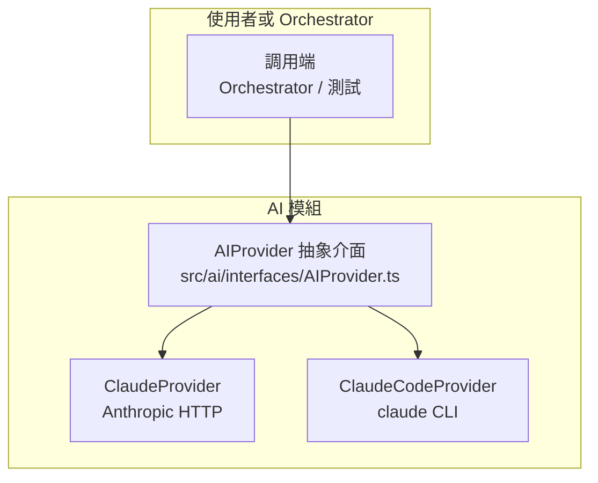
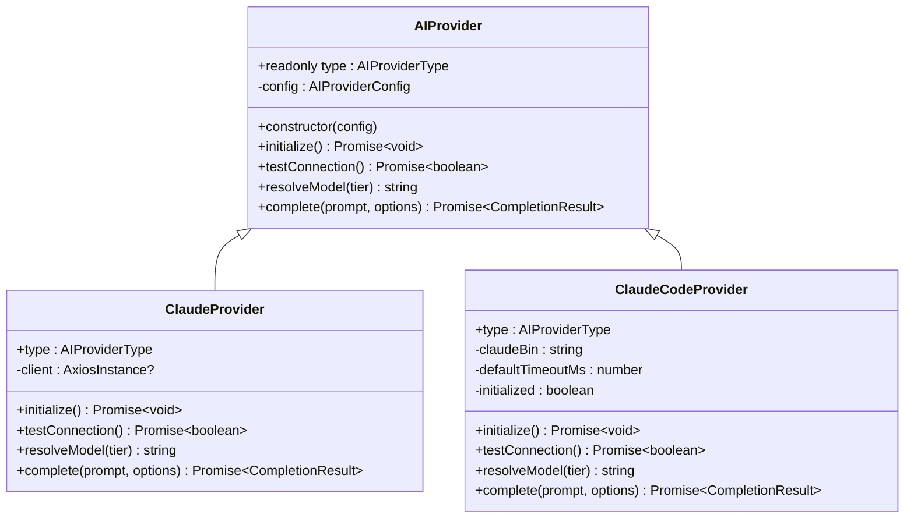
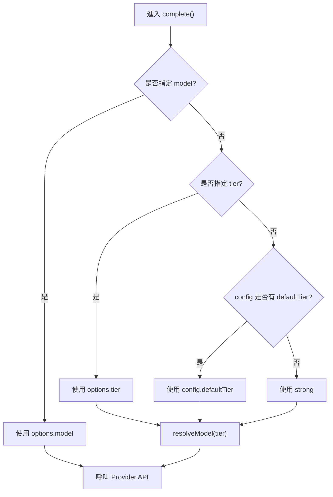
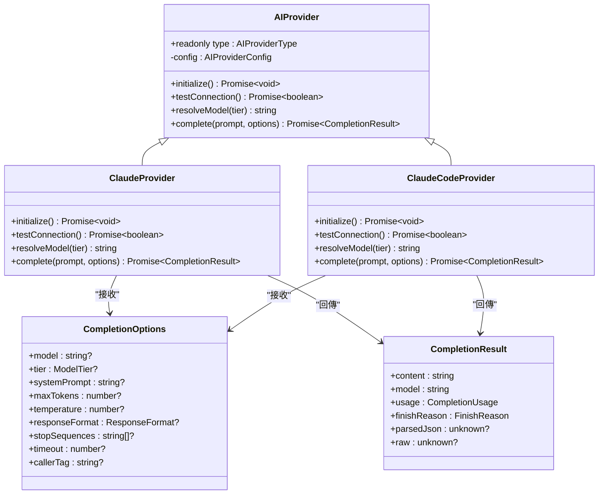
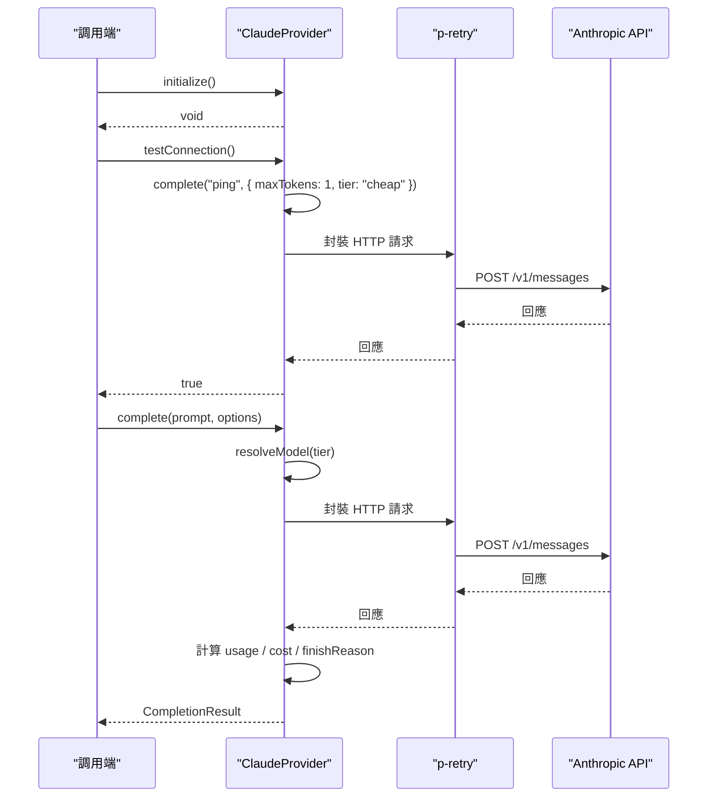
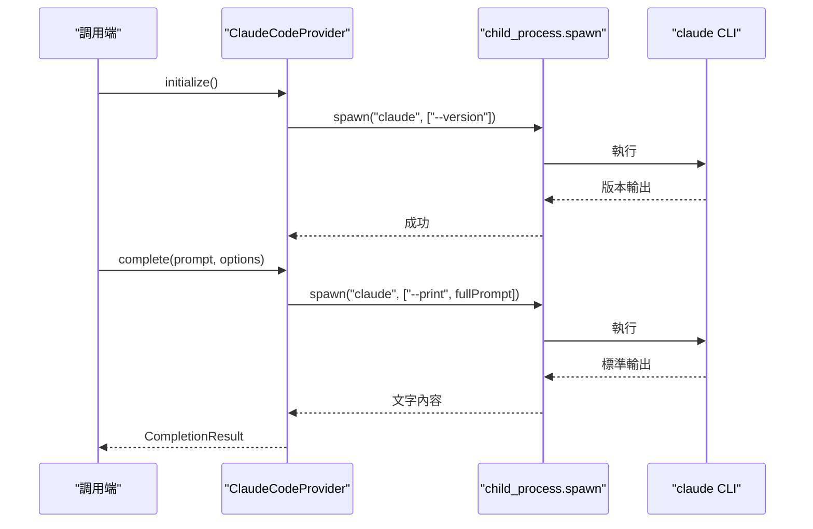

# AIProvider 抽象介面

**本文引用的檔案**

- [AIProvider.ts](https://github.com/mikeah2011/maestro/blob/master/src/ai/interfaces/AIProvider.ts)
- [ClaudeProvider.ts](https://github.com/mikeah2011/maestro/blob/master/src/ai/providers/ClaudeProvider.ts)
- [ClaudeCodeProvider.ts](https://github.com/mikeah2011/maestro/blob/master/src/ai/providers/ClaudeCodeProvider.ts)
- [DESIGN.md](https://github.com/mikeah2011/maestro/blob/master/docs/DESIGN.md)
- [README.md](https://github.com/mikeah2011/maestro/blob/master/README.md)

## 目錄
1. [引言](#引言)
2. [專案結構與角色定位](#專案結構與角色定位)
3. [核心型別定義](#核心型別定義)
4. [AIProvider 抽象類別設計](#aiprovider-抽象類別設計)
5. [tier → model 路由機制](#tier--model-路由機制)
6. [現有 Provider 實作分析](#現有-provider-實作分析)
7. [UML 與呼叫流程](#uml-與呼叫流程)
8. [錯誤處理模式](#錯誤處理模式)
9. [成本追蹤與 estimatedCostUsd](#成本追蹤與-estimatedcostusd)
10. [自訂 Provider 實作指南](#自訂-provider-實作指南)
11. [效能與使用建議](#效能與使用建議)
12. [故障排除](#故障排除)
13. [結論](#結論)

## 引言
本文件說明 `AIProvider` 抽象介面的設計理念、型別定義、初始化流程、模型路由機制、錯誤處理方式，以及如何實作自訂 Provider。整體設計將 AI Provider 視為「提示字串 → 完成結果」的無狀態管道：provider 本身不具備審查邏輯，也不提供 `review` 方法；審查與決策由 orchestrator 的 prompts 負責。

設計文件中明確指出：
- `AIProvider` 是多 Provider 工廠，用於 Claude、OpenAI、Gemini、本機與自訂後端。
- 每個階段有獨立路由表，高頻低風險操作使用廉價模型，判斷性操作使用強模型，最終輸出使用旗艦模型。
- 審查工具（如 CodeRabbit、Ellipsis）是輸入，`maestro` 在其上建立收斂層，而非另一個審查工具。

**章節來源**
- [AIProvider.ts:1-18](https://github.com/mikeah2011/maestro/blob/master/src/ai/interfaces/AIProvider.ts#L1-L18)
- [DESIGN.md:1-20](https://github.com/mikeah2011/maestro/blob/master/docs/DESIGN.md#L1-L20)
- [DESIGN.md:25-45](https://github.com/mikeah2011/maestro/blob/master/docs/DESIGN.md#L25-L45)

## 專案結構與角色定位
`ai/` 目錄分為兩層：
- `interfaces/AIProvider.ts`：定義抽象類別與所有共用型別。
- `providers/`：具體 Provider 實作，目前包含 Anthropic HTTP 實作與 Claude Code CLI 實作。

**圖表來源**
- [AIProvider.ts:1-114](https://github.com/mikeah2011/maestro/blob/master/src/ai/interfaces/AIProvider.ts#L1-L114)
- [ClaudeProvider.ts:1-175](https://github.com/mikeah2011/maestro/blob/master/src/ai/providers/ClaudeProvider.ts#L1-L175)
- [ClaudeCodeProvider.ts:1-146](https://github.com/mikeah2011/maestro/blob/master/src/ai/providers/ClaudeCodeProvider.ts#L1-L146)

**章節來源**
- [README.md:120-160](https://github.com/mikeah2011/maestro/blob/master/README.md#L120-L160)
- [DESIGN.md:25-45](https://github.com/mikeah2011/maestro/blob/master/docs/DESIGN.md#L25-L45)

## 核心型別定義

### ModelTier：模型等級
`ModelTier` 有三個值：
- `cheap`：高流量、低風險操作，例如提交訊息、大量分類。
- `strong`：需要判斷力的操作。
- `flagship`：最終輸出或對品質要求最高的內容。

這個設計讓同一個 provider 能根據階段選擇不同價格與能力的模型，而不暴露內部定價策略給 caller。

**章節來源**
- [AIProvider.ts:20-21](https://github.com/mikeah2011/maestro/blob/master/src/ai/interfaces/AIProvider.ts#L20-L21)
- [DESIGN.md:35-45](https://github.com/mikeah2011/maestro/blob/master/docs/DESIGN.md#L35-L45)

### AIProviderType：Provider 類型
支援類型包括：
- `claude`
- `openai`
- `google`
- `local`
- `custom`

這是一個擴展點：未來可新增 Gemini、OpenAI、本地 Ollama 等實作，並透過該欄位識別來源。

**章節來源**
- [AIProvider.ts:23](https://github.com/mikeah2011/maestro/blob/master/src/ai/interfaces/AIProvider.ts#L23)

### AIProviderConfig：提供者設定
| 欄位 | 說明 |
|---|---|
| `apiKey` | 解析後的 API Key，適用於環境變數展開後的值。 |
| `baseUrl` | 自託管或特定區域的基礎 URL。 |
| `models` | 將 `ModelTier` 映射到實際 model id。 |
| `defaultTier` | 未指定 tier 時的預設等級。 |
| `timeout` | 單次 HTTP 請求逾時毫秒數。 |
| `retries` | 暫態錯誤自動重試次數。 |
| `[key: string]` | Provider 專屬擴充欄位。 |

這是一種鬆耦合設定模型：orchestrator 只依賴有限欄位，Provider 可自由增加自訂配置。

**章節來源**
- [AIProvider.ts:25-43](https://github.com/mikeah2011/maestro/blob/master/src/ai/interfaces/AIProvider.ts#L25-L43)
- [ClaudeProvider.ts:38-64](https://github.com/mikeah2011/maestro/blob/master/src/ai/providers/ClaudeProvider.ts#L38-L64)
- [ClaudeCodeProvider.ts:35-53](https://github.com/mikeah2011/maestro/blob/master/src/ai/providers/ClaudeCodeProvider.ts#L35-L53)

### ResponseFormat：回應格式
支援三種格式：
- `text`：純文字。
- `json_object`：期望 JSON object。
- `json_schema`：帶有 schema 的 JSON。

注意：此處是「期望格式」，不是完整 OpenAI response_format schema 語法；具體解碼與驗證由各 Provider 自行處理。

**章節來源**
- [AIProvider.ts:45-49](https://github.com/mikeah2011/maestro/blob/master/src/ai/interfaces/AIProvider.ts#L45-L49)
- [ClaudeProvider.ts:120-140](https://github.com/mikeah2011/maestro/blob/master/src/ai/providers/ClaudeProvider.ts#L120-L140)
- [ClaudeCodeProvider.ts:83-100](https://github.com/mikeah2011/maestro/blob/master/src/ai/providers/ClaudeCodeProvider.ts#L83-L100)

### CompletionOptions：完成請求選項
| 欄位 | 說明 |
|---|---|
| `model` | 覆寫本次使用的 model id。 |
| `tier` | 若未設定 `model`，則依此 tier 解析 model。 |
| `systemPrompt` | 系統提示，前置於使用者提示之前。 |
| `maxTokens` | 輸出 token 預算。 |
| `temperature` | 預設為 0，使 orchestrator 決策更確定。 |
| `responseFormat` | 期望輸出格式。 |
| `stopSequences` | 停止序列。 |
| `timeout` | 單次呼叫逾時覆寫。 |
| `callerTag` | 成本歸因與審計日誌標籤。 |

其中 `callerTag` 保留成本歸因用途，但當前 Claude Provider 並未直接將其寫入 `CompletionResult`；它可用於外部 log 或 audit trail。

**章節來源**
- [AIProvider.ts:51-67](https://github.com/mikeah2011/maestro/blob/master/src/ai/interfaces/AIProvider.ts#L51-L67)

### CompletionUsage：Token 用量與成本
| 欄位 | 說明 |
|---|---|
| `inputTokens` | 輸入 token 數。 |
| `outputTokens` | 輸出 token 數。 |
| `cacheReadTokens` | 提示快取讀取 token。 |
| `cacheWriteTokens` | 提示快寫入 token。 |
| `estimatedCostUsd` | 估算美元成本，若可計算則存在。 |

這讓 orchestrator 或 CostTracker 能在不耦合任何 Provider 的情況下追蹤費用。

**章節來源**
- [AIProvider.ts:69-78](https://github.com/mikeah2011/maestro/blob/master/src/ai/interfaces/AIProvider.ts#L69-L78)
- [DESIGN.md:35-45](https://github.com/mikeah2011/maestro/blob/master/docs/DESIGN.md#L35-L45)

### FinishReason：停止原因
| 值 | 意義 |
|---|---|
| `stop` | 正常停止。 |
| `max_tokens` | 達到最大 token 限制。 |
| `content_filter` | 內容過濾。 |
| `tool_use` | 觸發工具使用。 |
| `error` | 錯誤導致停止。 |

Claude Provider 會把 Anthropic 的 `stop_reason` 映射至這些值，未知值會降級為 `stop`。

**章節來源**
- [AIProvider.ts:80-85](https://github.com/mikeah2011/maestro/blob/master/src/ai/interfaces/AIProvider.ts#L80-L85)
- [ClaudeProvider.ts:66-76](https://github.com/mikeah2011/maestro/blob/master/src/ai/providers/ClaudeProvider.ts#L66-L76)

### CompletionResult：完成結果
| 欄位 | 說明 |
|---|---|
| `content` | 原始完成文字。 |
| `model` | 實際產出模型的 id。 |
| `usage` | Token 用量與成本。 |
| `finishReason` | 停止原因。 |
| `parsedJson` | 當回應格式為 JSON 時可能存在的解析結果。 |
| `raw` | Provider 原生回應，供審計或重播。 |

這是 orchestrator 唯一需要的統一回傳結構。

**章節來源**
- [AIProvider.ts:87-99](https://github.com/mikeah2011/maestro/blob/master/src/ai/interfaces/AIProvider.ts#L87-L99)

## AIProvider 抽象類別設計

### 設計原則
1. **無狀態管道**：provider 僅負責 prompt → completion，不持有業務審查狀態。
2. **無 review 方法**：審查邏輯位於 orchestrator 的 prompts 中。
3. **tier 與 model 分離**：caller 傳遞 tier 或 model，provider 負責解析實際 model id。
4. **可測試**：`testConnection()` 提供輕量連線檢查。
5. **可擴展**：新 Provider 只需實作五個核心行為。

### 五個核心成員
| 成員 | 責任 |
|---|---|
| `constructor(config)` | 儲存設定，不要求必須立即連線。 |
| `initialize()` | 驗證設定、建立 HTTP/SDK 客戶端，應冪等。 |
| `testConnection()` | 輕量連線檢查，不應消耗大量成本。 |
| `resolveModel(tier)` | 從 `config.models` 與 provider 預設值解析 model id。 |
| `complete(prompt, options)` | orchestrator 的唯一主要呼叫點。 |

此外，`type` 是唯讀屬性，標示 provider 種類。

**圖表來源**
- [AIProvider.ts:101-114](https://github.com/mikeah2011/maestro/blob/master/src/ai/interfaces/AIProvider.ts#L101-L114)
- [ClaudeProvider.ts:78-175](https://github.com/mikeah2011/maestro/blob/master/src/ai/providers/ClaudeProvider.ts#L78-L175)
- [ClaudeCodeProvider.ts:35-146](https://github.com/mikeah2011/maestro/blob/master/src/ai/providers/ClaudeCodeProvider.ts#L35-L146)

### 建構子初始化流程
1. 接收 `AIProviderConfig`。
2. ClaudeProvider 不會在建構子中建立 axios 客戶端；`initialize()` 才建立。
3. ClaudeCodeProvider 會在建構子中決定 CLI 路徑與預設逾時，並在 `initialize()` 中執行 `claude --version` 確認二進位可用。

這符合「建構子只做最小設定、`initialize()` 做 IO 準備」的模式。

**章節來源**
- [AIProvider.ts:101-107](https://github.com/mikeah2011/maestro/blob/master/src/ai/interfaces/AIProvider.ts#L101-L107)
- [ClaudeProvider.ts:78-99](https://github.com/mikeah2011/maestro/blob/master/src/ai/providers/ClaudeProvider.ts#L78-L99)
- [ClaudeCodeProvider.ts:35-64](https://github.com/mikeah2011/maestro/blob/master/src/ai/providers/ClaudeCodeProvider.ts#L35-L64)

## tier → model 路由機制

### 路由優先順序
以 ClaudeProvider 為例：
1. 若 `options.model` 存在，直接使用。
2. 否則使用 `options.tier`。
3. 若仍無 tier，回退至 `config.defaultTier`。
4. 若仍未設定，預設為 `strong`。
5. 最後由 `resolveModel()` 查 `config.models[tier]`，不存在則套用 `DEFAULT_MODELS[tier]`。

**圖表來源**
- [ClaudeProvider.ts:101-125](https://github.com/mikeah2011/maestro/blob/master/src/ai/providers/ClaudeProvider.ts#L101-L125)
- [ClaudeProvider.ts:109-113](https://github.com/mikeah2011/maestro/blob/master/src/ai/providers/ClaudeProvider.ts#L109-L113)

### 三層模型策略
- **cheap**：適合高流量、低風險任務，例如提交訊息、大量去重前處理。
- **strong**：適合需要判斷力的步驟，例如問題分類、品味偵測。
- **flagship**：適合最終摘要、PR 內容草稿等對品質要求高的輸出。

這種設計讓 cost 與 quality 可被 orchestrator 控制，而不是由 provider 自行決定。

**章節來源**
- [AIProvider.ts:1-18](https://github.com/mikeah2011/maestro/blob/master/src/ai/interfaces/AIProvider.ts#L1-L18)
- [DESIGN.md:35-45](https://github.com/mikeah2011/maestro/blob/master/docs/DESIGN.md#L35-L45)
- [ClaudeProvider.ts:12-24](https://github.com/mikeah2011/maestro/blob/master/src/ai/providers/ClaudeProvider.ts#L12-L24)

## 現有 Provider 實作分析

### ClaudeProvider
ClaudeProvider 是基於 Anthropic Messages API 的 HTTP 實作，使用 axios 而非官方 SDK，目的是減少安裝套件負擔。

重點特性：
- 使用 `x-api-key`、`anthropic-version`、`content-type` 標頭。
- 預設 base URL 為 Anthropic API。
- 使用 `p-retry` 重試 429 與 5xx 錯誤。
- 將 Anthropic 的 stop reason 映射為標準 `FinishReason`。
- 依據 model id 查表計算 `estimatedCostUsd`。
- 當 `responseFormat` 為 JSON 相關格式時，嘗試解析 `content`。

缺點：
- 錯誤處理集中在重試條件與 catch，較少細粒度錯誤分類。
- 非 text 的 content block 會被過濾掉，但若 provider 返回非預期結構，仍需上游穩定。

**章節來源**
- [ClaudeProvider.ts:1-24](https://github.com/mikeah2011/maestro/blob/master/src/ai/providers/ClaudeProvider.ts#L1-L24)
- [ClaudeProvider.ts:38-76](https://github.com/mikeah2011/maestro/blob/master/src/ai/providers/ClaudeProvider.ts#L38-L76)
- [ClaudeProvider.ts:78-175](https://github.com/mikeah2011/maestro/blob/master/src/ai/providers/ClaudeProvider.ts#L78-L175)

### ClaudeCodeProvider
ClaudeCodeProvider 是透過 `claude --print` 本機 CLI 呼叫的 Provider。

重點特性：
- 不需要 `ANTHROPIC_API_KEY`。
- 使用 child process 執行 `claude` 二進位。
- `initialize()` 執行 `--version` 確認二進位可用。
- `testConnection()` 執行 `claude --print ping`。
- `resolveModel()` 忽略 tier，通常回傳 `claude-code-cli`。
- system prompt 會拼接成使用者提示的前置文字，因為 CLI 沒有原生 system role。
- 無法取得 token usage 與成本估算。

缺點：
- `usage.inputTokens` 與 `usage.outputTokens` 固定為 0。
- 無 `estimatedCostUsd`。
- 無法精確反映真實模型與用量。

**章節來源**
- [ClaudeCodeProvider.ts:1-24](https://github.com/mikeah2011/maestro/blob/master/src/ai/providers/ClaudeCodeProvider.ts#L1-L24)
- [ClaudeCodeProvider.ts:35-100](https://github.com/mikeah2011/maestro/blob/master/src/ai/providers/ClaudeCodeProvider.ts#L35-L100)
- [ClaudeCodeProvider.ts:101-146](https://github.com/mikeah2011/maestro/blob/master/src/ai/providers/ClaudeCodeProvider.ts#L101-L146)

## UML 與呼叫流程

### 類別關係圖

**圖表來源**
- [AIProvider.ts:20-99](https://github.com/mikeah2011/maestro/blob/master/src/ai/interfaces/AIProvider.ts#L20-L99)
- [AIProvider.ts:101-114](https://github.com/mikeah2011/maestro/blob/master/src/ai/interfaces/AIProvider.ts#L101-L114)
- [ClaudeProvider.ts:78-175](https://github.com/mikeah2011/maestro/blob/master/src/ai/providers/ClaudeProvider.ts#L78-L175)
- [ClaudeCodeProvider.ts:35-146](https://github.com/mikeah2011/maestro/blob/master/src/ai/providers/ClaudeCodeProvider.ts#L35-L146)

### 呼叫流程範例：ClaudeProvider.complete

**圖表來源**
- [ClaudeProvider.ts:99-175](https://github.com/mikeah2011/maestro/blob/master/src/ai/providers/ClaudeProvider.ts#L99-L175)

### 呼叫流程範例：ClaudeCodeProvider.complete

**圖表來源**
- [ClaudeCodeProvider.ts:64-100](https://github.com/mikeah2011/maestro/blob/master/src/ai/providers/ClaudeCodeProvider.ts#L64-L100)
- [ClaudeCodeProvider.ts:101-146](https://github.com/mikeah2011/maestro/blob/master/src/ai/providers/ClaudeCodeProvider.ts#L101-L146)

## 錯誤處理模式

### ClaudeProvider
- 未呼叫 `initialize()` 即呼叫 `complete()` 會拋錯。
- HTTP 錯誤由 `p-retry` 重試，重試條件為 axios 錯誤且狀態為 429 或大於等於 500。
- `testConnection()` 捕獲異常並回傳 false，避免連線失敗直接崩潰。
- JSON 解析失敗不會拋錯，而是讓 `parsedJson` 保持 undefined。

風險點：
- 其他非 429/5xx 錯誤不會重試。
- 如果 Anthropic 回傳結構異常，filter/map/join 可能產生空內容，但不一定拋錯。

**章節來源**
- [ClaudeProvider.ts:99-112](https://github.com/mikeah2011/maestro/blob/master/src/ai/providers/ClaudeProvider.ts#L99-L112)
- [ClaudeProvider.ts:126-156](https://github.com/mikeah2011/maestro/blob/master/src/ai/providers/ClaudeProvider.ts#L126-L156)
- [ClaudeProvider.ts:158-175](https://github.com/mikeah2011/maestro/blob/master/src/ai/providers/ClaudeProvider.ts#L158-L175)

### ClaudeCodeProvider
- 未呼叫 `initialize()` 即呼叫 `complete()` 會拋錯。
- 子程序逾時會殺掉 process 並拋錯。
- 非零 exit code 會收集 stderr 並拋錯。
- JSON 解析失敗會回傳 undefined，不阻塞主流程。

風險點：
- 錯誤訊息依賴 CLI stderr，可能因平台或版本不同而變化。
- 無 token usage，因此 cost tracking 不完整。

**章節來源**
- [ClaudeCodeProvider.ts:64-82](https://github.com/mikeah2011/maestro/blob/master/src/ai/providers/ClaudeCodeProvider.ts#L64-L82)
- [ClaudeCodeProvider.ts:83-100](https://github.com/mikeah2011/maestro/blob/master/src/ai/providers/ClaudeCodeProvider.ts#L83-L100)
- [ClaudeCodeProvider.ts:101-146](https://github.com/mikeah2011/maestro/blob/master/src/ai/providers/ClaudeCodeProvider.ts#L101-L146)

## 成本追蹤與 estimatedCostUsd

### ClaudeProvider 的成本計算
ClaudeProvider 使用內建成本表：
- 根據實際回傳的 `raw.model` 查表。
- 若找不到對應 model，則使用呼叫時解析出的 `model`。
- 公式為：
  - `(inputTokens / 1_000_000) × inputPrice`
  - `+ (outputTokens / 1_000_000) × outputPrice`

這讓 orchestrator 或 CostTracker 可以累積每次呼叫的 `estimatedCostUsd`。

### ClaudeCodeProvider 的限制
ClaudeCodeProvider 無法取得 token usage，因此：
- `inputTokens` 與 `outputTokens` 固定為 0。
- 不會計算 `estimatedCostUsd`。
- 適合開發者本機快速測試，不適合嚴格成本管控。

### 成本追蹤建議
- 在 orchestrator 層累計 `CompletionResult.usage.estimatedCostUsd`。
- 使用 `CompletionOptions.callerTag` 區分不同階段或功能。
- 當超過預算時，由 orchestrator 停止循環或升級人工處理。

**章節來源**
- [ClaudeProvider.ts:26-36](https://github.com/mikeah2011/maestro/blob/master/src/ai/providers/ClaudeProvider.ts#L26-L36)
- [ClaudeProvider.ts:141-157](https://github.com/mikeah2011/maestro/blob/master/src/ai/providers/ClaudeProvider.ts#L141-L157)
- [ClaudeCodeProvider.ts:83-100](https://github.com/mikeah2011/maestro/blob/master/src/ai/providers/ClaudeCodeProvider.ts#L83-L100)
- [DESIGN.md:35-45](https://github.com/mikeah2011/maestro/blob/master/docs/DESIGN.md#L35-L45)

## 自訂 Provider 實作指南

### 必要實作項目
自訂 Provider 需繼承 `AIProvider` 並實作：
1. `type`：設定為 `'openai'`、`'google'`、`'local'`、`'custom'` 或其他適當值。
2. `initialize()`：驗證 API key、base URL、權限。
3. `testConnection()`：輕量連線檢查。
4. `resolveModel(tier)`：根據 tier 或 `config.models` 回傳 model id。
5. `complete(prompt, options)`：將 prompt 轉為目標 provider 的 API 格式，並回傳 `CompletionResult`。

### 建議實作模式
| 項目 | 建議 |
|---|---|
| 設定驗證 | 在 `initialize()` 中檢查 apiKey、baseUrl、必要權限。 |
| 客戶端初始化 | 不要放在建構子；放在 `initialize()`，並確保冪等。 |
| 連線檢查 | `testConnection()` 應使用最低成本請求。 |
| 模型解析 | 優先使用 `config.models`，再 fallback 到 provider 預設值。 |
| JSON 解析 | 若 `responseFormat` 為 JSON，嘗試解析 `content`；失敗時保留 undefined。 |
| 成本估算 | 盡可能填入 `estimatedCostUsd`，便於 orchestrator 追蹤。 |
| 錯誤分類 | 可考慮將 HTTP 狀態或 provider 錯誤映射為 `FinishReason.error`。 |
| 可測試性 | 允許注入 baseUrl、mock client，方便單元測試。 |

### 常見陷阱
- 忘記實作 `initialize()` 就呼叫 `complete()`。
- 將 business logic 放入 provider，破壞「prompt → completion」無狀態管道。
- 忽略 `responseFormat`，導致 JSON 使用者收到純文字。
- 忽略 `finishReason`，讓 orchestrator 無法正確判斷是否達到 maxTokens 或被過濾。
- 假設所有 provider 都能回報 token usage。

**章節來源**
- [AIProvider.ts:1-18](https://github.com/mikeah2011/maestro/blob/master/src/ai/interfaces/AIProvider.ts#L1-L18)
- [AIProvider.ts:20-99](https://github.com/mikeah2011/maestro/blob/master/src/ai/interfaces/AIProvider.ts#L20-L99)
- [AIProvider.ts:101-114](https://github.com/mikeah2011/maestro/blob/master/src/ai/interfaces/AIProvider.ts#L101-L114)
- [ClaudeProvider.ts:78-175](https://github.com/mikeah2011/maestro/blob/master/src/ai/providers/ClaudeProvider.ts#L78-L175)
- [ClaudeCodeProvider.ts:35-146](https://github.com/mikeah2011/maestro/blob/master/src/ai/providers/ClaudeCodeProvider.ts#L35-L146)

## 效能與使用建議

### 性能考量
- ClaudeProvider 使用 axios 與 `p-retry`，重試間隔從 1 秒到 30 秒，適合網路抖動環境。
- ClaudeCodeProvider 啟動 child process，初始化和每次呼叫都有 process 開銷，不適合極高 QPS。
- temperature 預設為 0，有利 orchestrator 的確定性決策。
- `maxTokens` 預設值可避免過長輸出造成不必要成本。

### 使用建議
- 高流量階段使用 `cheap`。
- 判斷階段使用 `strong`。
- 最終摘要、PR body 使用 `flagship`。
- 在 orchestrator 層統一記錄 `model`、`usage`、`estimatedCostUsd`。
- 對關鍵路徑加入 `callerTag`，方便後續成本歸因。

[本節為一般使用建議，不直接分析特定程式碼行號]

## 故障排除

### 問題：呼叫 complete() 時報錯表示尚未 initialize
- ClaudeProvider：必須先呼叫 `initialize()`。
- ClaudeCodeProvider：必須先呼叫 `initialize()` 以確認 `claude` 二進位可用。

解決方式：
- 在建立 provider 後立即呼叫 `initialize()`。
- 將 `initialize()` 納入啟動流程。

**章節來源**
- [ClaudeProvider.ts:99-112](https://github.com/mikeah2011/maestro/blob/master/src/ai/providers/ClaudeProvider.ts#L99-L112)
- [ClaudeCodeProvider.ts:74-82](https://github.com/mikeah2011/maestro/blob/master/src/ai/providers/ClaudeCodeProvider.ts#L74-L82)

### 問題：連線檢查失敗
- ClaudeProvider：可能是 API key 錯誤、network error、429 或 5xx。
- ClaudeCodeProvider：可能是 `claude` 二進位不存在、權限不足或 CLI 錯誤。

解決方式：
- 檢查環境變數與 `.maestro.yaml`。
- 手動執行 `claude --version` 或 `claude --print ping`。
- 觀察 retry 重試與 HTTP 狀態碼。

**章節來源**
- [ClaudeProvider.ts:114-125](https://github.com/mikeah2011/maestro/blob/master/src/ai/providers/ClaudeProvider.ts#L114-L125)
- [ClaudeCodeProvider.ts:64-73](https://github.com/mikeah2011/maestro/blob/master/src/ai/providers/ClaudeCodeProvider.ts#L64-L73)

### 問題：JSON 解析失敗
- 兩種 provider 都會在 JSON 解析失敗時保留 `parsedJson` 為 undefined。
- 建議 orchestrator 檢查 `parsedJson` 是否存在，並重構 prompt 或調整 system prompt。

**章節來源**
- [ClaudeProvider.ts:158-175](https://github.com/mikeah2011/maestro/blob/master/src/ai/providers/ClaudeProvider.ts#L158-L175)
- [ClaudeCodeProvider.ts:83-100](https://github.com/mikeah2011/maestro/blob/master/src/ai/providers/ClaudeCodeProvider.ts#L83-L100)

### 問題：成本估算為 undefined
- ClaudeCodeProvider 不提供 token usage，因此不會計算成本。
- ClaudeProvider 若回傳 model 不在成本表中，也可能為 undefined。

解決方式：
- 使用 ClaudeProvider 進行正式成本追蹤。
- 為自訂 provider 加入成本表。

**章節來源**
- [ClaudeCodeProvider.ts:83-100](https://github.com/mikeah2011/maestro/blob/master/src/ai/providers/ClaudeCodeProvider.ts#L83-L100)
- [ClaudeProvider.ts:141-157](https://github.com/mikeah2011/maestro/blob/master/src/ai/providers/ClaudeProvider.ts#L141-L157)

## 結論
`AIProvider` 抽象介面成功將 AI 模型能力抽象為一個統一、無狀態的 prompt → completion 管道。它不承擔審查邏輯，也不提供 `review` 方法；審查由 orchestrator 的 prompts 控制。透過 `ModelTier`、`AIProviderConfig`、`CompletionOptions`、`CompletionResult` 等型別，系統可以在 cheap、strong、flagship 三層之間靈活路由，同時維持清晰的錯誤處理與成本追蹤能力。

現有實作已涵蓋雲端 API 與本機 CLI 兩種典型情境。未來新增 OpenAI、Google、本地 Ollama 或自訂 HTTP provider 時，只要遵循此抽象介面的契約，即可無縫整合到 maestro 的收斂循環中。

[本節為總結，不直接分析特定程式碼行號]