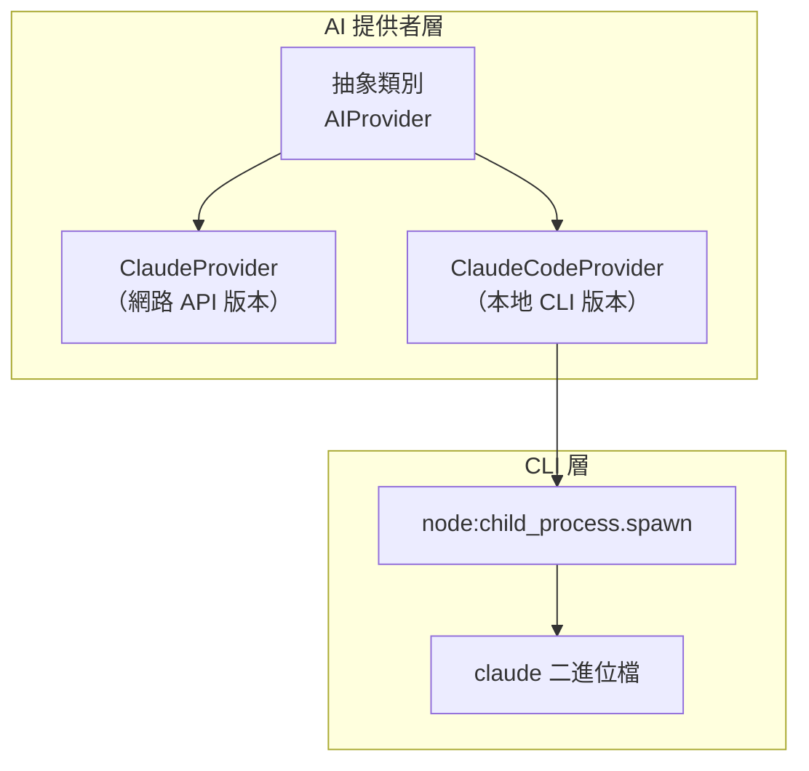
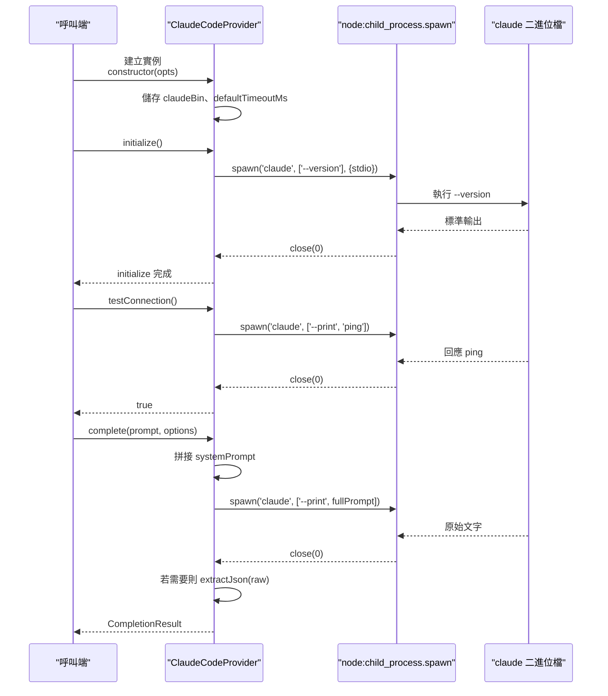
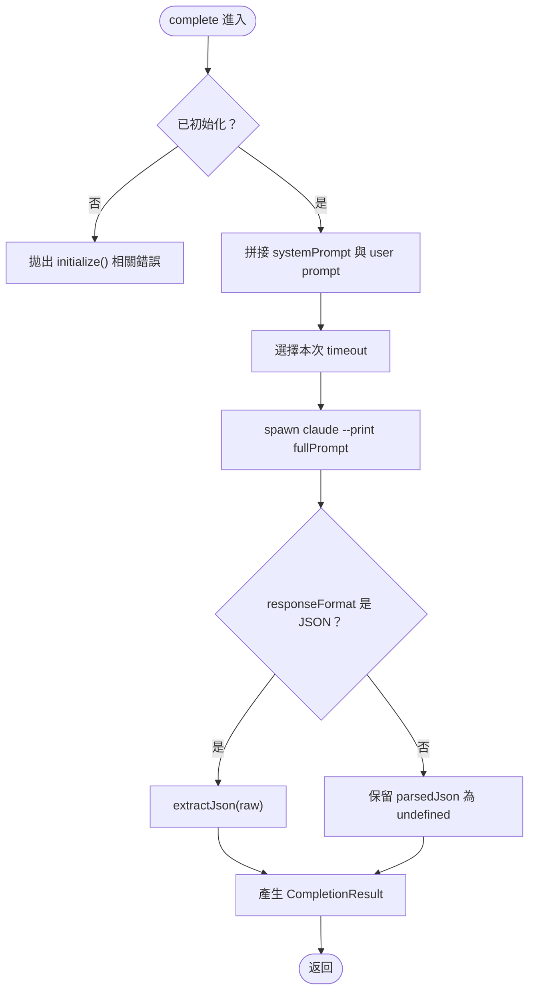
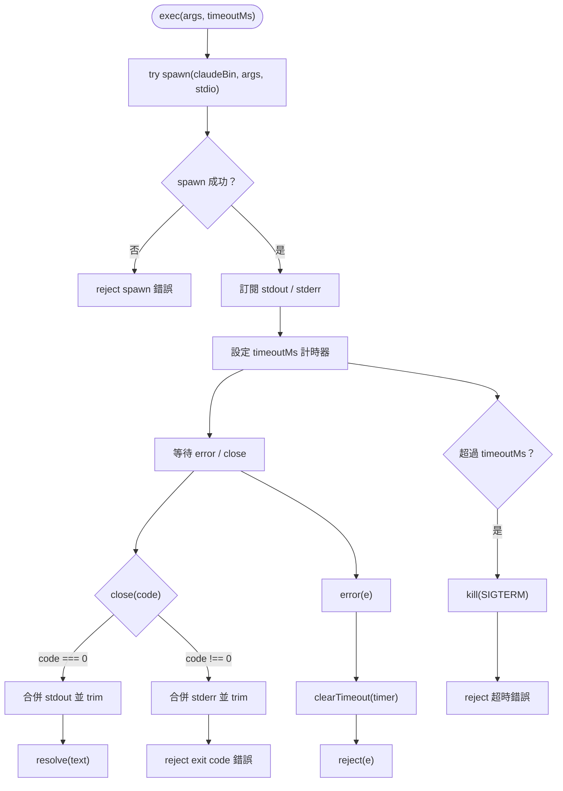
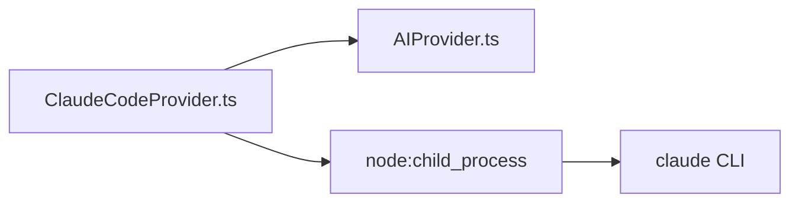

# ClaudeCodeProvider（claude CLI）

**本文引用的檔案**

- [src/ai/providers/ClaudeCodeProvider.ts](https://github.com/mikeah2011/maestro/blob/master/src/ai/providers/ClaudeCodeProvider.ts)
- [tests/ai/providers/ClaudeCodeProvider.test.ts](https://github.com/mikeah2011/maestro/blob/master/tests/ai/providers/ClaudeCodeProvider.test.ts)
- [src/ai/interfaces/AIProvider.ts](https://github.com/mikeah2011/maestro/blob/master/src/ai/interfaces/AIProvider.ts)

## 目錄
1. [簡介](#簡介)
2. [專案結構與角色定位](#專案結構與角色定位)
3. [核心元件分析](#核心元件分析)
4. [架構總覽](#架構總覽)
5. [詳細實作分析](#詳細實作分析)
6. [依賴關係分析](#依賴關係分析)
7. [效能與限制](#效能與限制)
8. [故障診斷指南](#故障診斷指南)
9. [結論](#結論)

## 簡介
ClaudeCodeProvider 是專案中 AIProvider 的一個實作，以本機安裝的 Claude Code CLI 為後端。它不依賴 `ANTHROPIC_API_KEY`，而是直接呼叫系統 PATH 或指定路徑中的 `claude` 二進位檔，並依賴 Claude Code CLI 自身的工作階段憑證。這樣的設計適合已經在本機設定好 Claude Code 的開發者機器環境。

此實作的重點：
- 使用 `claude --version` 驗證 CLI 是否可用。
- 使用 `claude --print ping` 進行連線測試。
- 使用 `claude --print` 執行提示詞請求。
- 因為 CLI 沒有原生 system role，`systemPrompt` 會前置拼接到 user prompt。
- token usage 固定為 0，model 固定回傳 `claude-code-cli`。
- JSON 回應透過正則式提取最外層物件，再交由 `JSON.parse` 解析。

## 專案結構與角色定位
ClaudeCodeProvider 位於 `src/ai/providers/` 之下，繼承抽象類別 `AIProvider`，並實作其抽象方法。相對地，`src/ai/interfaces/AIProvider.ts` 定義了所有提供者必須遵循的介面、型別與預設行為。

**圖表來源**
- [src/ai/providers/ClaudeCodeProvider.ts:1-146](https://github.com/mikeah2011/maestro/blob/master/src/ai/providers/ClaudeCodeProvider.ts#L1-L146)
- [src/ai/interfaces/AIProvider.ts:1-114](https://github.com/mikeah2011/maestro/blob/master/src/ai/interfaces/AIProvider.ts#L1-L114)

**章節來源**
- [src/ai/providers/ClaudeCodeProvider.ts:1-30](https://github.com/mikeah2011/maestro/blob/master/src/ai/providers/ClaudeCodeProvider.ts#L1-L30)
- [src/ai/interfaces/AIProvider.ts:1-40](https://github.com/mikeah2011/maestro/blob/master/src/ai/interfaces/AIProvider.ts#L1-L40)

## 核心元件分析
ClaudeCodeProvider 的核心由以下部分組成：
- 選項型別 `ClaudeCodeProviderOptions`，擴充 `AIProviderConfig`，新增 `claudeBin`。
- 建構子處理 `claudeBin` 與 `timeout` 的預設值。
- `initialize()` 使用 `--version` 檢查 CLI。
- `testConnection()` 使用 `--print ping` 檢查連線。
- `complete()` 拼接 system prompt、呼叫 `exec('--print', prompt)`，並根據 `responseFormat` 嘗試解析 JSON。
- `exec()` 內部使用 `spawn` 執行外部程序、收集 stdout/stderr、處理超時與非零 exit code。
- `extractJson()` 用正則式取出最外層 `{...}` 字串並解析。

**章節來源**
- [src/ai/providers/ClaudeCodeProvider.ts:31-146](https://github.com/mikeah2011/maestro/blob/master/src/ai/providers/ClaudeCodeProvider.ts#L31-L146)

## 架構總覽
ClaudeCodeProvider 的生命週期如下：

**圖表來源**
- [src/ai/providers/ClaudeCodeProvider.ts:37-146](https://github.com/mikeah2011/maestro/blob/master/src/ai/providers/ClaudeCodeProvider.ts#L37-L146)
- [tests/ai/providers/ClaudeCodeProvider.test.ts:63-135](https://github.com/mikeah2011/maestro/blob/master/tests/ai/providers/ClaudeCodeProvider.test.ts#L63-L135)

## 詳細實作分析

### ClaudeCodeProviderOptions 與建構子
`ClaudeCodeProviderOptions` 繼承 `AIProviderConfig`，並新增：
- `claudeBin?: string`：指定 `claude` 二進位檔路徑；未提供時使用 `'claude'`，由作業系統的 PATH 尋找。
- `timeout?: number`：來自父類別 `AIProviderConfig.timeout`，作為預設每呼叫超時時間。

建構子中：
- `this.claudeBin = opts.claudeBin ?? 'claude'`
- `this.defaultTimeoutMs = (opts.timeout as number | undefined) ?? 120_000`

這表示：
- 若未設定 `claudeBin`，依賴 PATH 能找到 `claude`。
- 若未設定 `timeout`，預設為 120 秒。
- 其他 `AIProviderConfig` 欄位仍保留，供更高層配置使用。

**章節來源**
- [src/ai/providers/ClaudeCodeProvider.ts:22-36](https://github.com/mikeah2011/maestro/blob/master/src/ai/providers/ClaudeCodeProvider.ts#L22-L36)
- [src/ai/interfaces/AIProvider.ts:19-40](https://github.com/mikeah2011/maestro/blob/master/src/ai/interfaces/AIProvider.ts#L19-L40)

### initialize() 與 testConnection()
`initialize()`：
- 若已初始化則直接返回。
- 否則執行 `exec(['--version'], 10_000)`，最多等待 10 秒。
- 成功後標記 `initialized = true`。

`testConnection()`：
- 執行 `exec(['--print', 'ping'], 15_000)`。
- 成功返回 `true`，任何例外返回 `false`。

測試覆蓋：
- `initialize()` 會呼叫 `claude --version`。
- 重複呼叫 `initialize()` 只會觸發一次 spawn。
- 找不到 `claude` 時會拋出錯誤。
- `testConnection()` 在成功時回傳 `true`，失敗時回傳 `false`。

**章節來源**
- [src/ai/providers/ClaudeCodeProvider.ts:37-61](https://github.com/mikeah2011/maestro/blob/master/src/ai/providers/ClaudeCodeProvider.ts#L37-L61)
- [tests/ai/providers/ClaudeCodeProvider.test.ts:63-112](https://github.com/mikeah2011/maestro/blob/master/tests/ai/providers/ClaudeCodeProvider.test.ts#L63-L112)

### resolveModel()
`resolveModel(tier)` 優先使用 `config.models[tier]`，若無則回傳 `'claude-code-cli'`。  
這代表：
- 模型識別不是由 Claude Code CLI 動態回報。
- 可透過配置覆寫 tier → model id 的對應。
- 預設值是 `'claude-code-cli'`，用於標示此提供者並非透過 HTTP API 取得實際模型名稱。

**章節來源**
- [src/ai/providers/ClaudeCodeProvider.ts:63-67](https://github.com/mikeah2011/maestro/blob/master/src/ai/providers/ClaudeCodeProvider.ts#L63-L67)
- [tests/ai/providers/ClaudeCodeProvider.test.ts:114-128](https://github.com/mikeah2011/maestro/blob/master/tests/ai/providers/ClaudeCodeProvider.test.ts#L114-L128)

### complete() 流程
`complete(prompt, options)` 的主要邏輯：
1. 若尚未 `initialize()`，拋出錯誤。
2. 若 `options.systemPrompt` 存在，將 system prompt 與 user prompt 以換行組合：
   - 格式大致為：`systemPrompt + "\n\n" + prompt`。
3. 計算本次呼叫超時：`options.timeout ?? defaultTimeoutMs`。
4. 執行 `exec(['--print', fullPrompt], timeoutMs)` 取得原始文字。
5. 若 `options.responseFormat.type` 是 `json_object` 或 `json_schema`，則對 raw text 執行 `extractJson`。
6. 回傳 `CompletionResult`：
   - `content`：原始 trimmed 文字。
   - `model`：固定為 `'claude-code-cli'`。
   - `usage.inputTokens` 與 `outputTokens`：固定為 0。
   - `finishReason`：固定為 `'stop'`。
   - `parsedJson`：僅在 JSON 模式且解析成功時存在。

**圖表來源**
- [src/ai/providers/ClaudeCodeProvider.ts:69-100](https://github.com/mikeah2011/maestro/blob/master/src/ai/providers/ClaudeCodeProvider.ts#L69-L100)

**章節來源**
- [src/ai/providers/ClaudeCodeProvider.ts:69-100](https://github.com/mikeah2011/maestro/blob/master/src/ai/providers/ClaudeCodeProvider.ts#L69-L100)
- [tests/ai/providers/ClaudeCodeProvider.test.ts:130-199](https://github.com/mikeah2011/maestro/blob/master/tests/ai/providers/ClaudeCodeProvider.test.ts#L130-L199)

### exec() 內部實作
`exec(args, timeoutMs)` 是整個實作的核心：
- 使用 `spawn(this.claudeBin, args, { stdio: ['ignore', 'pipe', 'pipe'] })`：
  - stdin 忽略。
  - stdout pipe。
  - stderr pipe。
- 收集 stdout chunk 到 `out[]`，stderr chunk 到 `err[]`。
- 設定 `setTimeout`：
  - 超過 `timeoutMs` 後發送 `SIGTERM`。
  - reject 一個包含超時訊息的錯誤。
- 監聽 `error` 事件：清除 timer 並 reject。
- 監聽 `close(code)`：
  - 清除 timer。
  - 若 `code === 0`：合併 stdout 並 trim 後 resolve。
  - 若 `code !== 0`：合併 stderr 並 reject，訊息包含 exit code 與 stderr 內容。

**圖表來源**
- [src/ai/providers/ClaudeCodeProvider.ts:102-141](https://github.com/mikeah2011/maestro/blob/master/src/ai/providers/ClaudeCodeProvider.ts#L102-L141)

**章節來源**
- [src/ai/providers/ClaudeCodeProvider.ts:102-141](https://github.com/mikeah2011/maestro/blob/master/src/ai/providers/ClaudeCodeProvider.ts#L102-L141)

### extractJson()
`extractJson(text)`：
- 使用 `/\\{[\\s\\S]*\\}/` 匹配最外層 `{...}`。
- 若無法匹配，回傳 `undefined`。
- 若 `JSON.parse` 失敗，也回傳 `undefined`。
- 成功則回傳解析後的物件。

這個實作簡易但有限：
- 假設最外層是一個合法 JSON object。
- 若 Claude CLI 回覆包含多段文字、Markdown、程式碼區塊或其他非純 JSON 內容，可能無法正確解析。
- 因此，當使用者期望穩定 JSON 輸出時，應在 prompt 中明確要求純 JSON 結構。

**章節來源**
- [src/ai/providers/ClaudeCodeProvider.ts:143-146](https://github.com/mikeah2011/maestro/blob/master/src/ai/providers/ClaudeCodeProvider.ts#L143-L146)
- [tests/ai/providers/ClaudeCodeProvider.test.ts:163-178](https://github.com/mikeah2011/maestro/blob/master/tests/ai/providers/ClaudeCodeProvider.test.ts#L163-L178)

## 依賴關係分析
ClaudeCodeProvider 依賴：
- `node:child_process.spawn`：啟動外部 `claude` 程序。
- `AIProvider` 抽象類別：統一提供者介面。
- `AIProviderConfig`、`CompletionOptions`、`CompletionResult` 等型別：維持與其他提供者的合約一致性。

**圖表來源**
- [src/ai/providers/ClaudeCodeProvider.ts:1-146](https://github.com/mikeah2011/maestro/blob/master/src/ai/providers/ClaudeCodeProvider.ts#L1-L146)
- [src/ai/interfaces/AIProvider.ts:1-114](https://github.com/mikeah2011/maestro/blob/master/src/ai/interfaces/AIProvider.ts#L1-L114)

**章節來源**
- [src/ai/providers/ClaudeCodeProvider.ts:1-20](https://github.com/mikeah2011/maestro/blob/master/src/ai/providers/ClaudeCodeProvider.ts#L1-L20)
- [src/ai/interfaces/AIProvider.ts:1-40](https://github.com/mikeah2011/maestro/blob/master/src/ai/interfaces/AIProvider.ts#L1-L40)

## 效能與限制
### 已知限制
1. **token usage 始終為 0**  
   Claude Code CLI 不暴露 token 用量，因此 `usage.inputTokens` 與 `usage.outputTokens` 固定為 0。
2. **無成本估算**  
   由於沒有 token 用量，也沒有價格模型，`estimatedCostUsd` 不會出現。
3. **model 固定**  
   `resolveModel()` 和 `complete()` 回傳的 model 都是 `'claude-code-cli'`，不代表實際模型名稱。
4. **system role 模擬**  
   CLI 沒有原生 system role，因此 system prompt 只是字串前置拼接，效果取決於 Claude CLI 如何解讀這段文字。
5. **JSON 解析脆弱性**  
   `extractJson` 只找最外層 `{...}`，若 Claude 回覆包含說明文字、Markdown、程式碼反引號或混合內容，可能無法正確解析。
6. **finishReason 固定為 stop**  
   因為 CLI 不回報停止原因，實作一律回傳 `'stop'`。

### 效能特徵
- 每次 `complete()` 都啟動新的子程序。
- 超時預設為 120 秒，可透過 `options.timeout` 覆蓋。
- 初始化和連線測試分別有較短的超時：`--version` 為 10 秒，`--print ping` 為 15 秒。
- 沒有串流式回應；完整 stdout 收集後才返回結果。

**章節來源**
- [src/ai/providers/ClaudeCodeProvider.ts:1-20](https://github.com/mikeah2011/maestro/blob/master/src/ai/providers/ClaudeCodeProvider.ts#L1-L20)
- [src/ai/providers/ClaudeCodeProvider.ts:63-100](https://github.com/mikeah2011/maestro/blob/master/src/ai/providers/ClaudeCodeProvider.ts#L63-L100)
- [src/ai/providers/ClaudeCodeProvider.ts:102-146](https://github.com/mikeah2011/maestro/blob/master/src/ai/providers/ClaudeCodeProvider.ts#L102-L146)

## 故障診斷指南

### PATH 找不到 claude
**現象**：
- `initialize()` 或 `complete()` 啟動 `spawn` 時拋出錯誤。
- 測試中模擬為 `ENOENT`。

**可能原因**：
- `claude` 未安裝或未加入 PATH。
- 使用自訂 `claudeBin` 時路徑錯誤。

**建議處理**：
- 確認本機可執行 `claude --version`。
- 若需指定路徑，在建構子中使用 `claudeBin`。
- 在 CI 或容器環境中，確保 Claude CLI 已安裝。

**章節來源**
- [tests/ai/providers/ClaudeCodeProvider.test.ts:89-100](https://github.com/mikeah2011/maestro/blob/master/tests/ai/providers/ClaudeCodeProvider.test.ts#L89-L100)
- [src/ai/providers/ClaudeCodeProvider.ts:31-36](https://github.com/mikeah2011/maestro/blob/master/src/ai/providers/ClaudeCodeProvider.ts#L31-L36)

### CLI 權限問題
**現象**：
- `spawn` 成功但子程序立即退出。
- `close` event 回傳非零 exit code。
- 錯誤訊息包含 exit code 與 stderr。

**可能原因**：
- Claude CLI 需要工作階段憑證或登入狀態。
- 使用者環境未登入 Claude。
- 工作階段憑證過期或權限不足。

**建議處理**：
- 在本機手動執行 `claude --print ping` 確認可通行。
- 重新登入 Claude Code。
- 檢查終端機中是否有認證警告或錯誤訊息。

**章節來源**
- [src/ai/providers/ClaudeCodeProvider.ts:124-141](https://github.com/mikeah2011/maestro/blob/master/src/ai/providers/ClaudeCodeProvider.ts#L124-L141)
- [tests/ai/providers/ClaudeCodeProvider.test.ts:55-61](https://github.com/mikeah2011/maestro/blob/master/tests/ai/providers/ClaudeCodeProvider.test.ts#L55-L61)

### 超時處理
**現象**：
- 錯誤訊息包含 `claude CLI timed out after Xms`。
- 子程序收到 `SIGTERM`。

**可能原因**：
- Claude CLI 正在執行長時間任務。
- 網路或 Claude 服務回應緩慢。
- prompt 太複雜或要求過多工具調用。

**建議處理**：
- 增加 `options.timeout`。
- 簡化 prompt。
- 避免同時觸發多個耗時 Claude 操作。

**章節來源**
- [src/ai/providers/ClaudeCodeProvider.ts:114-123](https://github.com/mikeah2011/maestro/blob/master/src/ai/providers/ClaudeCodeProvider.ts#L114-L123)

### JSON 解析失敗
**現象**：
- `parsedJson` 為 `undefined`。
- 雖然 `responseFormat` 是 `json_object` 或 `json_schema`，但仍無法取得解析結果。

**可能原因**：
- Claude 回覆包含 Markdown、說明文字或非 JSON 段落。
- 最外層 `{...}` 內部的 JSON 語法非法。
- 有多個 `{...}` 段落，正則式只抓第一個最外層。

**建議處理**：
- 在 prompt 中明確要求「請只輸出 JSON，不要包含任何其他文字」。
- 在應用層加入容錯機制，例如 fallback 到文字模式。
- 記錄原始 `content` 以便診斷。

**章節來源**
- [src/ai/providers/ClaudeCodeProvider.ts:143-146](https://github.com/mikeah2011/maestro/blob/master/src/ai/providers/ClaudeCodeProvider.ts#L143-L146)
- [tests/ai/providers/ClaudeCodeProvider.test.ts:163-178](https://github.com/mikeah2011/maestro/blob/master/tests/ai/providers/ClaudeCodeProvider.test.ts#L163-L178)

### 未先呼叫 initialize()
**現象**：
- `complete()` 拋出錯誤，訊息包含 `initialize()`。

**可能原因**：
- 應用程式跳過初始化流程，直接呼叫 `complete()`。

**建議處理**：
- 在啟動流程中先呼叫 `initialize()`。
- 或使用 `testConnection()` 作為輕量檢查。

**章節來源**
- [src/ai/providers/ClaudeCodeProvider.ts:71-72](https://github.com/mikeah2011/maestro/blob/master/src/ai/providers/ClaudeCodeProvider.ts#L71-L72)
- [tests/ai/providers/ClaudeCodeProvider.test.ts:132-138](https://github.com/mikeah2011/maestro/blob/master/tests/ai/providers/ClaudeCodeProvider.test.ts#L132-L138)

## 結論
ClaudeCodeProvider 是一個以本地 Claude Code CLI 為後端的 AIProvider 實作。它的優點是不需要 `ANTHROPIC_API_KEY`，並且能直接使用開發者機器上已設定的 Claude Code 工作階段憑證。缺點是無法取得 token usage、成本估算與真實 model 名稱，JSON 解析也比較脆弱。

最佳實踐包括：
- 在使用前執行 `initialize()`。
- 使用 `testConnection()` 快速檢查 CLI 是否可通行。
- 若需要穩定 JSON，請在 prompt 中明確要求純 JSON。
- 針對長時間任務調整 `timeout`。
- 在 PATH 或 `claudeBin` 中確保 Claude CLI 可被找到。
- 在 CI 環境中預先安裝並登入 Claude CLI。