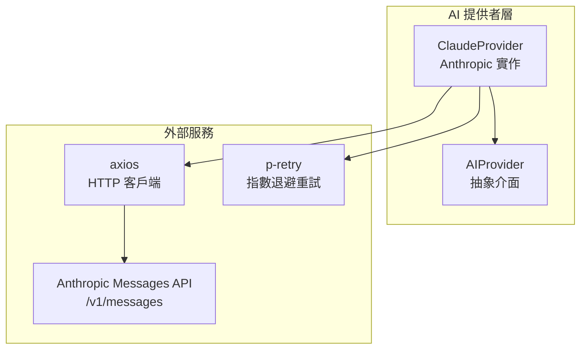
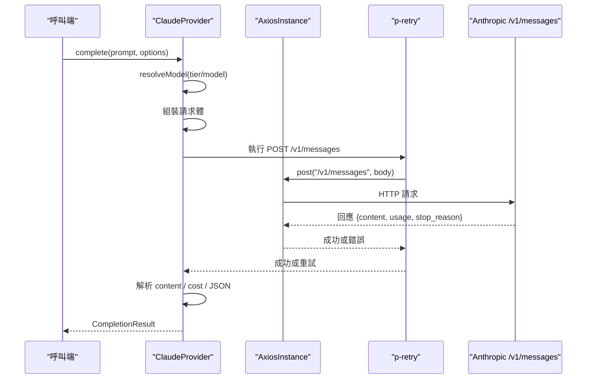
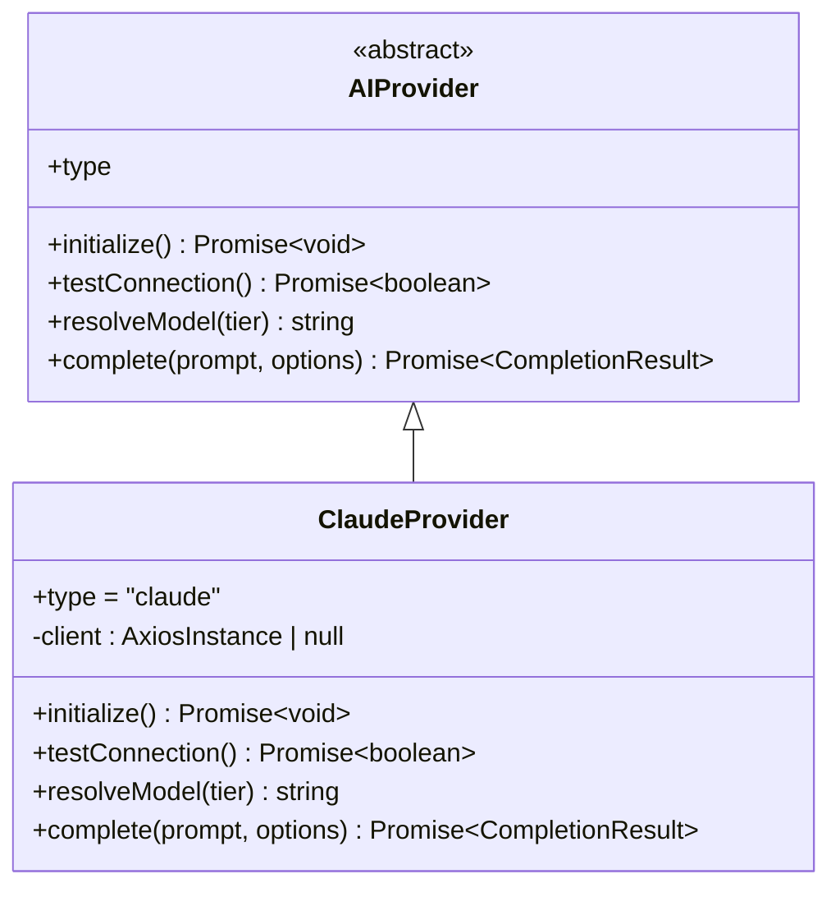
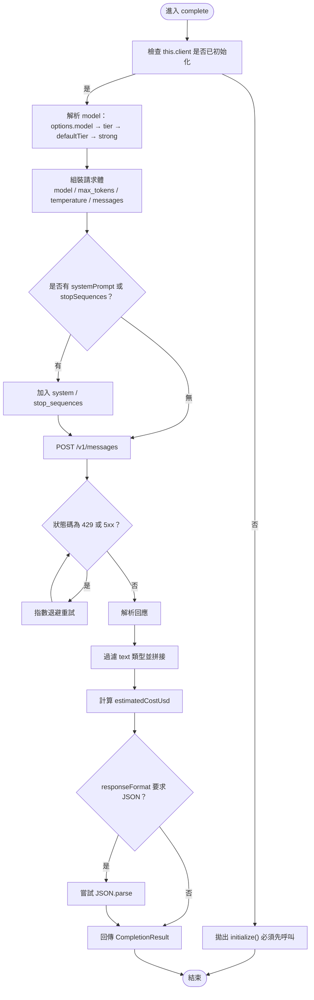
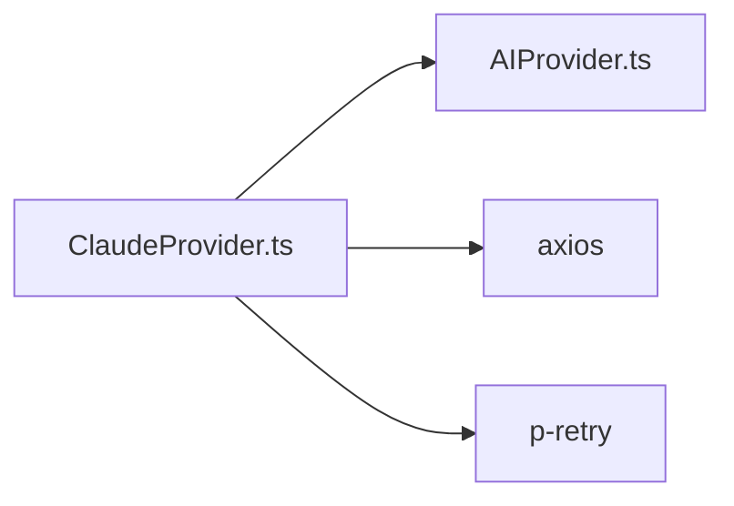

# ClaudeProvider（Anthropic API）

**本文引用的文件**

- [ClaudeProvider.ts](https://github.com/mikeah2011/maestro/blob/master/src/ai/providers/ClaudeProvider.ts)
- [AIProvider.ts](https://github.com/mikeah2011/maestro/blob/master/src/ai/interfaces/AIProvider.ts)
- [ClaudeProvider.test.ts](https://github.com/mikeah2011/maestro/blob/master/tests/ai/providers/ClaudeProvider.test.ts)

## 目錄
1. [簡介](#簡介)
2. [專案結構與定位](#專案結構與定位)
3. [核心元件](#核心元件)
4. [架構總覽](#架構總覽)
5. [詳細元件分析](#詳細元件分析)
6. [依賴關係分析](#依賴關係分析)
7. [效能考量](#效能考量)
8. [除錯與故障排除指南](#除錯與故障排除指南)
9. [結論](#結論)

## 簡介
ClaudeProvider 是 Anthropic Messages API 的具體 AIProvider 實作，負責把「提示」轉換為模型完成結果。它使用 axios 直接呼叫 `/v1/messages`，而不是安裝 Anthropic 官方 SDK，目的是減少安裝體積；重試邏輯由 p-retry 處理。預設模型按成本層級區分：cheap、strong、flagship，並提供每百萬 token 的成本表 COST_PER_1M，用於估算美元成本。

本文件說明其初始化流程、請求體組合、重試策略、回應解析、JSON 解析、連線測試、模型解析與錯誤處理。

## 專案結構與定位
ClaudeProvider 位於 `src/ai/providers/ClaudeProvider.ts`，繼承抽象類別 `AIProvider`（定義於 `src/ai/interfaces/AIProvider.ts`），並由測試檔案 `tests/ai/providers/ClaudeProvider.test.ts` 驗證主要行為。

**圖表來源**
- [ClaudeProvider.ts:1-175](https://github.com/mikeah2011/maestro/blob/master/src/ai/providers/ClaudeProvider.ts#L1-L175)
- [AIProvider.ts:1-114](https://github.com/mikeah2011/maestro/blob/master/src/ai/interfaces/AIProvider.ts#L1-L114)

**章節來源**
- [ClaudeProvider.ts:1-175](https://github.com/mikeah2011/maestro/blob/master/src/ai/providers/ClaudeProvider.ts#L1-L175)
- [AIProvider.ts:1-114](https://github.com/mikeah2011/maestro/blob/master/src/ai/interfaces/AIProvider.ts#L1-L114)

## 核心元件
- **型別與配置**：ModelTier、AIProviderConfig、CompletionOptions、CompletionResult、ResponseFormat、FinishReason。
- **ClaudeProvider 類別**：維護 AxiosInstance、建立 HTTP 標頭、選擇模型、組裝請求、重試、解析回應。
- **模型目錄與成本表**：DEFAULT_MODELS、COST_PER_1M。
- **停止原因對映**：STOP_REASON_MAP。
- **單元測試**：驗證 initialize、resolveModel、complete、系統提示、JSON 解析、成本計算與模型選擇。

**章節來源**
- [AIProvider.ts:1-114](https://github.com/mikeah2011/maestro/blob/master/src/ai/interfaces/AIProvider.ts#L1-L114)
- [ClaudeProvider.ts:1-175](https://github.com/mikeah2011/maestro/blob/master/src/ai/providers/ClaudeProvider.ts#L1-L175)
- [ClaudeProvider.test.ts:1-177](https://github.com/mikeah2011/maestro/blob/master/tests/ai/providers/ClaudeProvider.test.ts#L1-L177)

## 架構總覽
ClaudeProvider 的工作流程如下：

1. 使用者或協調器呼叫 complete()。
2. 若尚未 initialize()，立即拋出錯誤。
3. 根據 options.model、options.tier、config.defaultTier 與 config.models 解析最終 model。
4. 組裝 Anthropic Messages API 請求體。
5. 透過 axios.post('/v1/messages') 送出請求，並由 p-retry 處理重試。
6. 過濾 text 類型內容、合併多個區塊、映射 stop_reason。
7. 計算 estimatedCostUsd，並可嘗試解析 JSON。
8. 回傳 CompletionResult。

**圖表來源**
- [ClaudeProvider.ts:60-175](https://github.com/mikeah2011/maestro/blob/master/src/ai/providers/ClaudeProvider.ts#L60-L175)
- [AIProvider.ts:1-114](https://github.com/mikeah2011/maestro/blob/master/src/ai/interfaces/AIProvider.ts#L1-L114)

## 詳細元件分析

### 類別與方法總覽
ClaudeProvider 暴露以下關鍵能力：
- type：固定為 'claude'。
- initialize()：建立帶有必要標頭的 AxiosInstance。
- testConnection()：輕量 ping 測試。
- resolveModel(tier)：依 tier 解析 model。
- complete(prompt, options)：主完成方法。

**圖表來源**
- [AIProvider.ts:1-114](https://github.com/mikeah2011/maestro/blob/master/src/ai/interfaces/AIProvider.ts#L1-L114)
- [ClaudeProvider.ts:1-175](https://github.com/mikeah2011/maestro/blob/master/src/ai/providers/ClaudeProvider.ts#L1-L175)

**章節來源**
- [ClaudeProvider.ts:1-175](https://github.com/mikeah2011/maestro/blob/master/src/ai/providers/ClaudeProvider.ts#L1-L175)

### 初始化流程 initialize()
initialize() 會：
- 檢查 apiKey 是否存在；不存在時拋出錯誤。
- 使用 axios.create() 建立 AxiosInstance。
- baseURL 預設為 https://api.anthropic.com，可由 config.baseUrl 覆蓋。
- timeout 預設為 60000 ms，可由 config.timeout 覆蓋。
- 設定三個重要標頭：
  - x-api-key：來自 config.apiKey。
  - anthropic-version：固定為 2023-06-01。
  - content-type：application/json。

如果沒有 apiKey，initialize() 不會建立 client，後續 complete() 會因 this.client 為 null 而拋出錯誤。

**章節來源**
- [ClaudeProvider.ts:38-66](https://github.com/mikeah2011/maestro/blob/master/src/ai/providers/ClaudeProvider.ts#L38-L66)
- [ClaudeProvider.test.ts:44-78](https://github.com/mikeah2011/maestro/blob/master/tests/ai/providers/ClaudeProvider.test.ts#L44-L78)

### 連線測試 testConnection()
testConnection() 會呼叫 complete('ping', { maxTokens: 1, tier: 'cheap' })，成功返回 true，失敗返回 false。它不拋出錯誤給呼叫端，適合用來做快速健康檢查。

**章節來源**
- [ClaudeProvider.ts:68-76](https://github.com/mikeah2011/maestro/blob/master/src/ai/providers/ClaudeProvider.ts#L68-L76)

### 模型解析 resolveModel()
resolveModel(tier) 優先從 config.models[tier] 取得覆寫值；若未設定，則退回 DEFAULT_MODELS[tier]。

預設模型目錄：
- cheap → claude-haiku-4-5-20251001
- strong → claude-sonnet-4-6
- flagship → claude-opus-4-7

測試也驗證了 config.models 可以覆蓋 cheap tier。

**章節來源**
- [ClaudeProvider.ts:22-36](https://github.com/mikeah2011/maestro/blob/master/src/ai/providers/ClaudeProvider.ts#L22-L36)
- [ClaudeProvider.test.ts:80-97](https://github.com/mikeah2011/maestro/blob/master/tests/ai/providers/ClaudeProvider.test.ts#L80-L97)

### 完成方法 complete()
complete() 是整個 ClaudeProvider 的核心。以下是完整處理流程：

#### 前置檢查與參數
- 若 this.client 為 null，表示尚未 initialize()，立即拋出錯誤。
- model 解析順序：
  1. options.model
  2. 由 options.tier 或 config.defaultTier 或 'strong' 解析
- maxTokens 預設 4096。
- temperature 預設 0。
- maxRetries 取自 config.retries，預設 3。

#### 請求體組合
基礎請求體包含：
- model
- max_tokens
- temperature
- messages：[{ role: 'user', content: prompt }]

條件欄位：
- 若 options.systemPrompt 存在，加入 system。
- 若 options.stopSequences 非空陣列，加入 stop_sequences。

#### 重試策略
使用 p-retry 包裹 axios.post('/v1/messages', body)。重試條件：
- 僅當 axios.isAxiosError(err) 且回應狀態為 429 或 >= 500。
- minTimeout：1000 ms。
- maxTimeout：30000 ms。
- retries：maxRetries。

這代表 429（限流）與 5xx（伺服器錯誤）會觸發指數退避重試。其他錯誤會直接向上拋出。

#### 回應解析
Anthropic 回應結構包含：
- content：多個內容區塊，ClaudeProvider 只保留 type === 'text' 的區塊，並將 text 字串接合。
- model：實際使用的模型。
- stop_reason：映射到 FinishReason。
- usage：input_tokens、output_tokens，以及可能的 cache_read_input_tokens、cache_creation_input_tokens。

#### 成本計算
costTable 由 raw.model 在 COST_PER_1M 中查找。若找不到，estimatedCostUsd 為 undefined。
公式為：
- estimatedCostUsd = (input_tokens / 1_000_000) × inputCost + (output_tokens / 1_000_000) × outputCost

#### JSON 解析
若 options.responseFormat.type 為 json_object 或 json_schema，則嘗試 JSON.parse(content)。解析失敗不會改變 parsedJson，仍為 undefined。

#### 回傳結果
CompletionResult 包含：
- content：拼接後的文字。
- model：實際模型。
- usage：inputTokens、outputTokens、cacheReadTokens、cacheWriteTokens、estimatedCostUsd。
- finishReason：stop、max_tokens、tool_use 或預設 stop。
- parsedJson：可能存在的已解析 JSON。
- raw：原始 Anthropic 回應。

**圖表來源**
- [ClaudeProvider.ts:78-175](https://github.com/mikeah2011/maestro/blob/master/src/ai/providers/ClaudeProvider.ts#L78-L175)

**章節來源**
- [ClaudeProvider.ts:78-175](https://github.com/mikeah2011/maestro/blob/master/src/ai/providers/ClaudeProvider.ts#L78-L175)

### 預設模型與成本表
預設模型：
- cheap：claude-haiku-4-5-20251001
- strong：claude-sonnet-4-6
- flagship：claude-opus-4-7

每百萬 token 成本（USD）：
- claude-haiku-4-5-20251001：輸入 0.80、輸出 4.00
- claude-sonnet-4-6：輸入 3.00、輸出 15.00
- claude-opus-4-7：輸入 15.00、輸出 75.00

若回應中的 model 不在 COST_PER_1M 中，estimatedCostUsd 會是 undefined。

**章節來源**
- [ClaudeProvider.ts:22-36](https://github.com/mikeah2011/maestro/blob/master/src/ai/providers/ClaudeProvider.ts#L22-L36)
- [ClaudeProvider.test.ts:126-142](https://github.com/mikeah2011/maestro/blob/master/tests/ai/providers/ClaudeProvider.test.ts#L126-L142)

### 停止原因映射
Anthropic stop_reason 到 FinishReason 的映射：
- end_turn → stop
- max_tokens → max_tokens
- stop_sequence → stop
- tool_use → tool_use
- 其他未知值 → stop

這讓上游協調器可以用統一的 FinishReason 判斷生成結束原因。

**章節來源**
- [ClaudeProvider.ts:52-58](https://github.com/mikeah2011/maestro/blob/master/src/ai/providers/ClaudeProvider.ts#L52-L58)

### API 請求與回應範例

#### 基本請求
- 方法：POST
- 路徑：/v1/messages
- 標頭：
  - x-api-key：您的 Anthropic API Key
  - anthropic-version：2023-06-01
  - content-type：application/json
- 請求體重點：
  - model：如 claude-sonnet-4-6
  - max_tokens：例如 4096
  - temperature：例如 0
  - messages：[{ role: 'user', content: '...' }]
  - system：可選，對應 options.systemPrompt
  - stop_sequences：可選，對應 options.stopSequences

#### 基本回應
- content：[ { type: 'text', text: '...' } ]
- model：實際使用的模型
- stop_reason：end_turn、max_tokens、stop_sequence、tool_use
- usage：
  - input_tokens
  - output_tokens
  - cache_read_input_tokens（可選）
  - cache_creation_input_tokens（可選）

#### JSON 回應範例情境
當 responseFormat.type 為 json_object 或 json_schema 時，ClaudeProvider 會嘗試將 content 字串解析成 JSON。若模型回傳合法 JSON 字串，parsedJson 會被填入；否則保持 undefined。

**章節來源**
- [ClaudeProvider.ts:78-175](https://github.com/mikeah2011/maestro/blob/master/src/ai/providers/ClaudeProvider.ts#L78-L175)
- [ClaudeProvider.test.ts:108-142](https://github.com/mikeah2011/maestro/blob/master/tests/ai/providers/ClaudeProvider.test.ts#L108-L142)

### 錯誤處理與邊界情境

#### 常見錯誤情境
- 尚未 initialize() 就呼叫 complete()：拋出錯誤，提示必須先呼叫 initialize()。
- apiKey 缺失：initialize() 直接拋出錯誤。
- HTTP 429：指數退避重試。
- HTTP 5xx：指數退避重試。
- HTTP 其他錯誤：不重試，直接向上拋出。
- JSON 解析失敗：不改變 parsedJson，仍為 undefined。
- 未知 stop_reason：finishReason 使用預設值 stop。
- 未知 model：estimatedCostUsd 為 undefined。

#### 建議的錯誤處理策略
- 在 orchestrator 或 CLI 層攔截 complete() 的錯誤，並根據 axios error response.status 決定是否顯示限流提示。
- 若需要精確成本追蹤，應記錄 raw.model 與 usage，並對 COST_PER_1M 中未涵蓋的模型特別標記。
- testConnection() 會吞掉異常並回傳 boolean，適合健康檢查；若要診斷問題，應直接觀察 initialize() 與 complete() 的例外訊息。

**章節來源**
- [ClaudeProvider.ts:38-175](https://github.com/mikeah2011/maestro/blob/master/src/ai/providers/ClaudeProvider.ts#L38-L175)
- [ClaudeProvider.test.ts:44-106](https://github.com/mikeah2011/maestro/blob/master/tests/ai/providers/ClaudeProvider.test.ts#L44-L106)

## 依賴關係分析
ClaudeProvider 的外部依賴：
- axios：HTTP 客戶端與 isAxiosError。
- p-retry：指數退避重試。
- AIProvider：抽象基類，定義統一介面。

**圖表來源**
- [ClaudeProvider.ts:1-175](https://github.com/mikeah2011/maestro/blob/master/src/ai/providers/ClaudeProvider.ts#L1-L175)
- [AIProvider.ts:1-114](https://github.com/mikeah2011/maestro/blob/master/src/ai/interfaces/AIProvider.ts#L1-L114)

**章節來源**
- [ClaudeProvider.ts:1-175](https://github.com/mikeah2011/maestro/blob/master/src/ai/providers/ClaudeProvider.ts#L1-L175)
- [AIProvider.ts:1-114](https://github.com/mikeah2011/maestro/blob/master/src/ai/interfaces/AIProvider.ts#L1-L114)

## 效能考量
- **最小安裝體積**：使用 axios 而非 Anthropic SDK，減少相依套件與安裝大小。
- **預設溫度 0**：適合協調器決策，提高可重複性。
- **預設最大 token 4096**：避免過長回應拖慢流程。
- **重試上限與退避**：minTimeout 1s、maxTimeout 30s，避免短時間內頻繁重試造成限流惡化。
- **成本估算**：基於已知模型計算 USD，有助於預算監控；對於新模型或自訂 baseUrl 環境，應留意 estimatedCostUsd 可能為 undefined。
- **多內容區塊**：filter + join 確保只取 text 內容，忽略 tool_use 等區塊，使 content 更穩定。

[本節為一般性能討論，不直接分析特定程式碼片段]

## 除錯與故障排除指南

### 常見問題與解法
- **問題：initialize() 未呼叫**
  - 現象：complete() 拋出錯誤，指出必須先呼叫 initialize()。
  - 解法：在首次使用前呼叫 provider.initialize()。

- **問題：缺少 ANTHROPIC_API_KEY**
  - 現象：initialize() 拋出錯誤，提示 apiKey is required。
  - 解法：設定 config.apiKey 或環境變數，並確認已展開。

- **問題：429 限流**
  - 現象：多次收到 429。
  - 解法：增加 config.retries、降低頻率、或改用較便宜模型 tier。

- **問題：5xx 伺服器錯誤**
  - 現象：重試後仍失敗。
  - 解法：檢查 baseUrl、網路代理、Anthropic 服務狀態。

- **問題：JSON 解析失敗**
  - 現象：parsedJson 為 undefined。
  - 解法：確認模型確實回傳合法 JSON 字串，或使用更強模型 tier。

- **問題：成本為 undefined**
  - 現象：usage.estimatedCostUsd 為 undefined。
  - 解法：確認 raw.model 落在 COST_PER_1M；若使用自訂模型，需手動補充成本表。

### 測試輔助技巧
- 使用 testConnection() 快速驗證 API Key 與連線是否正常。
- 在測試中使用 vi.mock('axios') 模擬 axios.create 與 post，控制 Anthropic 回應。
- 檢查 mockPost 是否收到正確的 /v1/messages、messages、system、stop_sequences。

**章節來源**
- [ClaudeProvider.ts:38-175](https://github.com/mikeah2011/maestro/blob/master/src/ai/providers/ClaudeProvider.ts#L38-L175)
- [ClaudeProvider.test.ts:1-177](https://github.com/mikeah2011/maestro/blob/master/tests/ai/providers/ClaudeProvider.test.ts#L1-L177)

## 結論
ClaudeProvider 是一個輕量、明確的 Anthropic Messages API 實作。它透過 axios 與 p-retry 取得低依賴、可重試的完成能力，並以清晰的方法分離初始化、連線測試、模型解析與完成流程。預設模型與成本表讓一般使用場景可直接套用；同時保留足夠的擴展點，例如 config.models、baseUrl、timeout、retries 與 responseFormat。

在生產使用中，建議：
- 始終先呼叫 initialize()。
- 針對高頻調用設置合理的 retries 與 backoff。
- 監控 429 與 5xx 次數。
- 對未知 model 的成本估算進行特別標記。
- 使用 testConnection() 作為啟動前健康檢查。