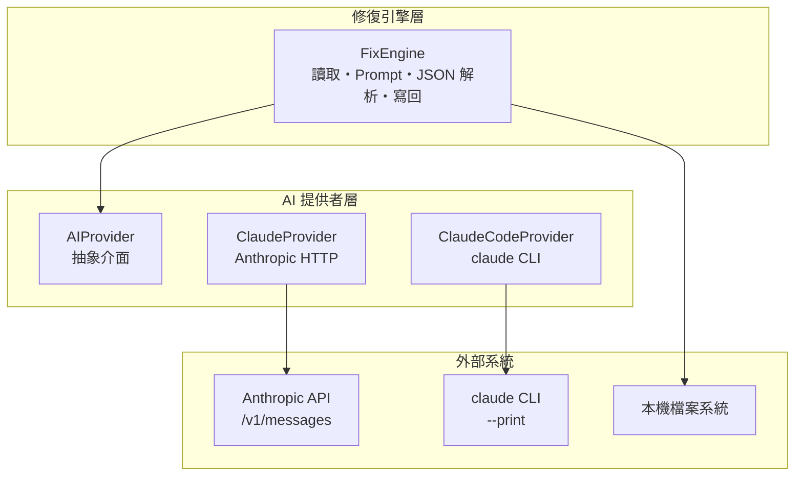
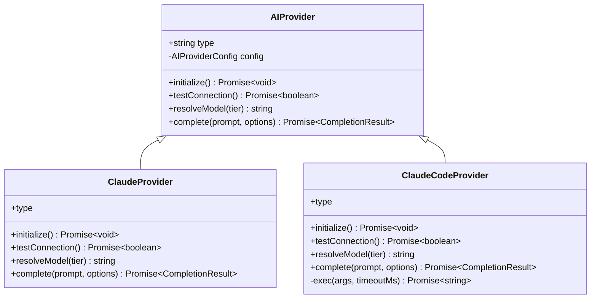
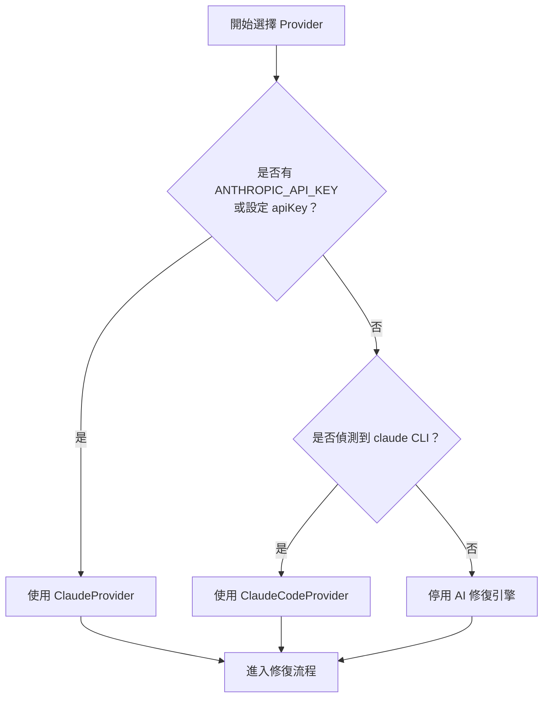
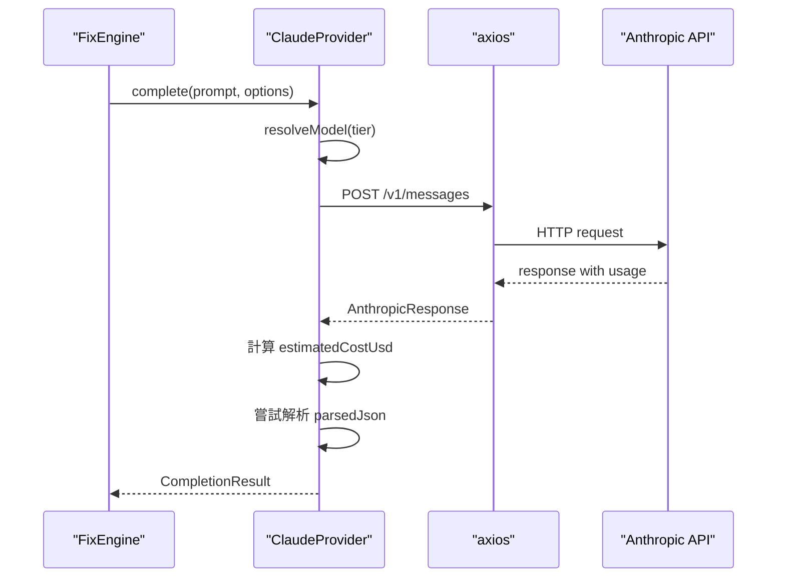
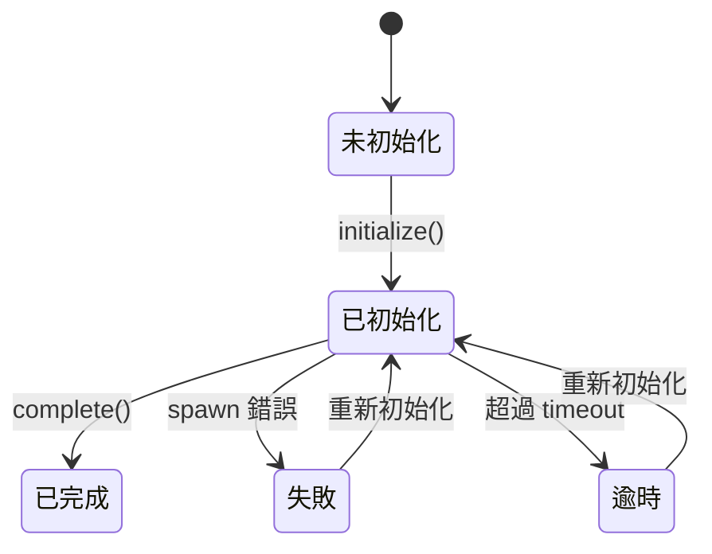
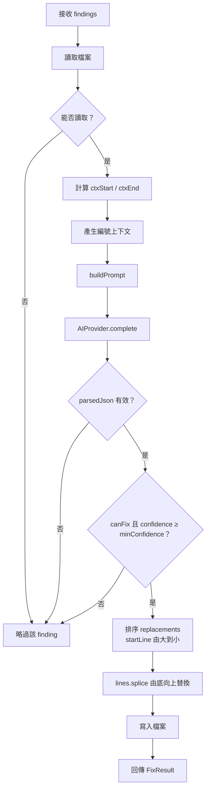
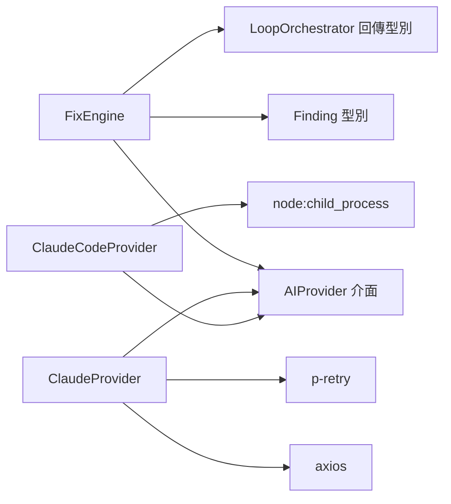
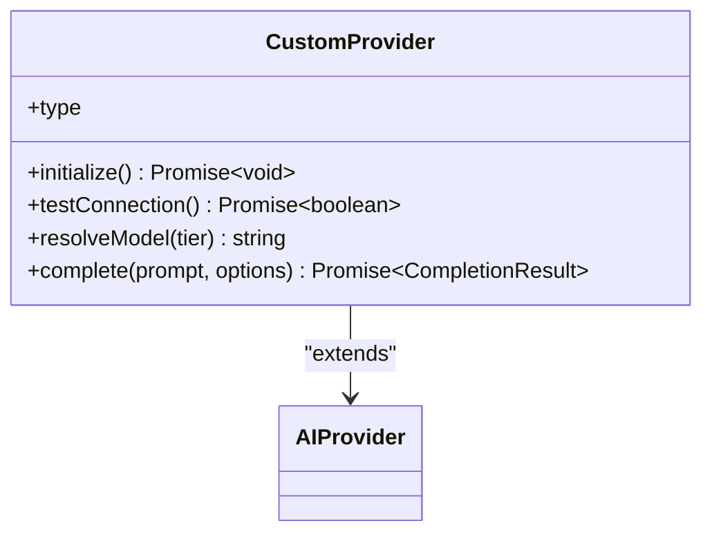

# AI Provider 架構

**本文引用的檔案**

- [AIProvider.ts](https://github.com/mikeah2011/maestro/blob/master/src/ai/interfaces/AIProvider.ts)
- [ClaudeProvider.ts](https://github.com/mikeah2011/maestro/blob/master/src/ai/providers/ClaudeProvider.ts)
- [ClaudeCodeProvider.ts](https://github.com/mikeah2011/maestro/blob/master/src/ai/providers/ClaudeCodeProvider.ts)
- [FixEngine.ts](https://github.com/mikeah2011/maestro/blob/master/src/core/fix/FixEngine.ts)
- [DESIGN.md](https://github.com/mikeah2011/maestro/blob/master/docs/DESIGN.md)
- [README.md](https://github.com/mikeah2011/maestro/blob/master/README.md)
- [ClaudeProvider.test.ts](https://github.com/mikeah2011/maestro/blob/master/tests/ai/providers/ClaudeProvider.test.ts)
- [ClaudeCodeProvider.test.ts](https://github.com/mikeah2011/maestro/blob/master/tests/ai/providers/ClaudeCodeProvider.test.ts)
- [FixEngine.test.ts](https://github.com/mikeah2011/maestro/blob/master/tests/core/fix/FixEngine.test.ts)

## 目錄

1. [簡介](#簡介)
2. [專案結構](#專案結構)
3. [核心抽象與策略模式](#核心抽象與策略模式)
4. [架構總覽](#架構總覽)
5. [詳細組件分析](#詳細組件分析)
6. [依賴關係分析](#依賴關係分析)
7. [效能與成本特性](#效能與成本特性)
8. [故障排除指南](#故障排除指南)
9. [新增自訂 Provider 指南](#新增自訂-provider-指南)
10. [結論](#結論)

## 簡介

本文件說明 Maestro 工具中的 **AI Provider 架構**，重點包括：

- `AIProvider` 抽象介面如何把複雜的 LLM 整合簡化為「prompt → completion」。
- 透過 Strategy 模式實作的 `ClaudeProvider`（Anthropic HTTP API）與 `ClaudeCodeProvider`（本地 Claude Code CLI）。
- `FixEngine` 如何讀取上下文、產生 prompt、解析 JSON replacement，並由底向上寫回檔案。
- Provider 自動偵測順序與按階段路由的設計。
- 錯誤處理、Token 用量與成本追蹤機制。
- 新增自訂 Provider 的擴充步驟。

Maestro 的核心定位是「審查機器人之上的收斂層」；AI Provider 則是該層用來驅動分類、修復、回覆等動作的一致後端。

**章節來源**
- [README.md:1-40](https://github.com/mikeah2011/maestro/blob/master/README.md#L1-L40)
- [DESIGN.md:1-20](https://github.com/mikeah2011/maestro/blob/master/docs/DESIGN.md#L1-L20)

## 專案結構

與 AI Provider 架構直接相關的程式碼集中在三個層次：

| 路徑 | 角色 |
|---|---|
| `src/ai/interfaces/AIProvider.ts` | 定義 `AIProvider` 抽象類別、型別與統一完成結果格式。 |
| `src/ai/providers/ClaudeProvider.ts` | 基於 Anthropic Messages API 的具體實作。 |
| `src/ai/providers/ClaudeCodeProvider.ts` | 基於本地 `claude` CLI 的具體實作。 |
| `src/core/fix/FixEngine.ts` | 使用任意 `AIProvider` 執行問題修復流程。 |

**圖表來源**
- [AIProvider.ts:1-114](https://github.com/mikeah2011/maestro/blob/master/src/ai/interfaces/AIProvider.ts#L1-L114)
- [ClaudeProvider.ts:1-175](https://github.com/mikeah2011/maestro/blob/master/src/ai/providers/ClaudeProvider.ts#L1-L175)
- [ClaudeCodeProvider.ts:1-146](https://github.com/mikeah2011/maestro/blob/master/src/ai/providers/ClaudeCodeProvider.ts#L1-L146)
- [FixEngine.ts:1-216](https://github.com/mikeah2011/maestro/blob/master/src/core/fix/FixEngine.ts#L1-L216)

**章節來源**
- [README.md:40-120](https://github.com/mikeah2011/maestro/blob/master/README.md#L40-L120)
- [DESIGN.md:20-60](https://github.com/mikeah2011/maestro/blob/master/docs/DESIGN.md#L20-L60)

## 核心抽象與策略模式

### `AIProvider` 抽象介面

`AIProvider` 是一個抽象類別，封裝所有 LLM Provider 的共同行為：

| 成員 | 用途 |
|---|---|
| `type` | Provider 類型識別字串，例如 `'claude'`。 |
| `initialize()` | 驗證設定、建立 HTTP 或 CLI 連線；應為冪等。 |
| `testConnection()` | 輕量連線測試，供 `doctor` 或啟動流程使用。 |
| `resolveModel(tier)` | 將 tier 轉換為實際 model id。 |
| `complete(prompt, options)` | 唯一對外完成方法：輸入提示，輸出統一結果。 |

**圖表來源**
- [AIProvider.ts:1-114](https://github.com/mikeah2011/maestro/blob/master/src/ai/interfaces/AIProvider.ts#L1-L114)
- [ClaudeProvider.ts:1-175](https://github.com/mikeah2011/maestro/blob/master/src/ai/providers/ClaudeProvider.ts#L1-L175)
- [ClaudeCodeProvider.ts:1-146](https://github.com/mikeah2011/maestro/blob/master/src/ai/providers/ClaudeCodeProvider.ts#L1-L146)

### 設計原則：provider 是 dumb pipe

註解明確指出：**review 邏輯不在 provider 中**，而是在編排器的 prompt 裡。Provider 只負責把 prompt 送到模型，再把 completion 送回調用者。這讓 Claude API 與 Claude CLI 共享相同的呼叫契約。

### 支援 tier、routing 與 cost attribution

- `ModelTier` 分為 `cheap`、`strong`、`flagship`。
- `AIProviderConfig.models` 可覆寫各 tier 對應的 model id。
- `CompletionOptions.tier` 可在每次呼叫時指定 tier。
- `CompletionUsage` 包含輸入 Token、輸出 Token、快取 Token，以及 `estimatedCostUsd`。
- `CompletionOptions.callerTag` 可用於成本歸因與審計日誌。

**章節來源**
- [AIProvider.ts:1-114](https://github.com/mikeah2011/maestro/blob/master/src/ai/interfaces/AIProvider.ts#L1-L114)

## 架構總覽

### Provider 選擇流程

系統會依以下優先順序選擇 Provider：

1. **ClaudeProvider**：當 `ANTHROPIC_API_KEY` 或設定中的 `apiKey` 存在。
2. **ClaudeCodeProvider**：當本地已安裝 `claude` CLI。
3. **停用修復引擎**：兩者皆不可用時，Loop 繼續但跳過 AI 自動修復。

**圖表來源**
- [README.md:120-180](https://github.com/mikeah2011/maestro/blob/master/README.md#L120-L180)

這個順序反映兩種部署情境：

- CI 或伺服器環境通常有 API Key，直接走 Anthropic HTTP。
- 開發者本機若已設定 Claude Code，則可直接使用 CLI，不需要額外 API Key。

**章節來源**
- [README.md:120-180](https://github.com/mikeah2011/maestro/blob/master/README.md#L120-L180)

### 路由表（stage → provider/tier）

根據設計文件，每個 stage 都有獨立的路由表：高頻低風險操作使用便宜模型，判斷性操作使用強力模型，最終輸出使用旗艦模型。Provider 本身不決定 model；tier 由調用方傳入。

| 使用情境 | 建議 tier | 目的 |
|---|---|---|
| 提交訊息生成、未知問題分類 | `cheap` | 控制成本、提高吞吐量。 |
| PR 內容草稿、品味偵測 | `strong` | 平衡品質與費用。 |
| 最終摘要、關鍵修復決策 | `flagship` | 追求更高判斷品質。 |

注意：此處的路由表是「orchestrator 配置概念」，目前程式碼中由 `FixEngine` 明確以 `tier: this.tier` 傳給 provider，預設為 `strong`。

**章節來源**
- [DESIGN.md:20-60](https://github.com/mikeah2011/maestro/blob/master/docs/DESIGN.md#L20-L60)
- [FixEngine.ts:1-120](https://github.com/mikeah2011/maestro/blob/master/src/core/fix/FixEngine.ts#L1-L120)

## 詳細組件分析

### ClaudeProvider：Anthropic API 實作

`ClaudeProvider` 使用 axios 呼叫 Anthropic `/v1/messages`，而不依賴 Anthropic SDK，以減少安裝套件規模。

#### 主要行為

| 行為 | 說明 |
|---|---|
| `initialize()` | 檢查 `apiKey`，建立 axios instance，設定 base URL、header 與 timeout。 |
| `testConnection()` | 發送一個極小請求，成功代表 Provider 可連線。 |
| `resolveModel()` | 優先使用 `config.models[tier]`，否則回退到內建預設值。 |
| `complete()` | 組合請求體、重試、解析 content、計算成本、解析 JSON。 |

#### 預設模型與成本表

| Tier | 預設 model | 輸入每百萬 Token | 輸出每百萬 Token |
|---|---|---:|---:|
| `cheap` | `claude-haiku-4-5-20251001` | $0.80 | $4.00 |
| `strong` | `claude-sonnet-4-6` | $3.00 | $15.00 |
| `flagship` | `claude-opus-4-7` | $15.00 | $75.00 |

成本估算公式為：

> 預估費用 = （輸入 Token / 1,000,000）× 輸入單價 + （輸出 Token / 1,000,000）× 輸出單價

#### 錯誤處理與重試

- 使用 `p-retry` 重試狀態碼 `429` 與 `≥500` 的錯誤。
- 最小延遲 1 秒，最大延遲 30 秒。
- 未初始化就呼叫 `complete()` 會拋出錯誤。
- `stop_reason` 會映射為統一的 `FinishReason`。

**圖表來源**
- [ClaudeProvider.ts:60-175](https://github.com/mikeah2011/maestro/blob/master/src/ai/providers/ClaudeProvider.ts#L60-L175)
- [FixEngine.ts:80-140](https://github.com/mikeah2011/maestro/blob/master/src/core/fix/FixEngine.ts#L80-L140)

**章節來源**
- [ClaudeProvider.ts:1-175](https://github.com/mikeah2011/maestro/blob/master/src/ai/providers/ClaudeProvider.ts#L1-L175)
- [ClaudeProvider.test.ts:1-177](https://github.com/mikeah2011/maestro/blob/master/tests/ai/providers/ClaudeProvider.test.ts#L1-L177)

### ClaudeCodeProvider：claude CLI 實作

`ClaudeCodeProvider` 透過 `node:child_process.spawn` 執行本地 `claude` 指令，適合已經設定好 Claude Code 的使用者機器。

#### 主要差異

| 項目 | ClaudeProvider | ClaudeCodeProvider |
|---|---|---|
| 通訊方式 | HTTP `/v1/messages` | 子程序 `claude --print` |
| 認證 | `x-api-key` header | 使用 CLI 自身 session |
| Token 用量 | 從 API response 取得 | 固定為 0 |
| 成本估算 | 可計算 | 不支援 |
| model 回報 | 實際 model id | 固定為 `claude-code-cli` |
| system prompt | 放入 body.system | 前置到 user prompt |
| 預設 timeout | 60 秒 | 120 秒 |

#### CLI 生命週期

**圖表來源**
- [ClaudeCodeProvider.ts:40-120](https://github.com/mikeah2011/maestro/blob/master/src/ai/providers/ClaudeCodeProvider.ts#L40-L120)

#### JSON 解析限制

由於 CLI 可能回傳含說明的文字，`extractJson` 使用正則尋找最外層 `{...}`，再嘗試 `JSON.parse`；若失敗則返回 `undefined`。

**章節來源**
- [ClaudeCodeProvider.ts:1-146](https://github.com/mikeah2011/maestro/blob/master/src/ai/providers/ClaudeCodeProvider.ts#L1-L146)
- [ClaudeCodeProvider.test.ts:1-231](https://github.com/mikeah2011/maestro/blob/master/tests/ai/providers/ClaudeCodeProvider.test.ts#L1-L231)

### FixEngine：修復資料流

`FixEngine` 是 M6 的主要 `onFix` 實作，對每個 classified finding 執行五個步驟：

1. 讀取檔案。
2. 取得發現行前後 `CONTEXT_LINES = 20` 行的上下文。
3. 產生 structured prompt 並呼叫 `AIProvider.complete()`。
4. 解析 JSON replacement。
5. 由底向上套用替換，寫回檔案。

#### FixEngine 資料流

**圖表來源**
- [FixEngine.ts:1-216](https://github.com/mikeah2011/maestro/blob/master/src/core/fix/FixEngine.ts#L1-L216)

#### 重要參數

| 參數 | 預設值 | 說明 |
|---|---:|---|
| `tier` | `strong` | 修復使用的模型等級。 |
| `maxTokens` | 2048 | 每次修復呼叫的最大輸出 Token。 |
| `minConfidence` | 0.7 | 低於此信心值的修復會被捨棄。 |
| `repoRoot` | `process.cwd()` | 解析相對檔案路徑。 |
| `readFile` | `fs.promises.readFile` | 可注入測試用的讀取函式。 |
| `writeFile` | `fs.promises.writeFile` | 可注入測試用的寫入函式。 |

#### Prompt 結構

系統 prompt 要求 AI 扮演「外科式程式修復助手」，並輸出符合 schema 的 JSON，包含：

- `canFix`：是否可修復。
- `confidence`：0–1 的信心值。
- `description`：≤72 字、過去式祈使句的 commit 訊息。
- `replacements`：`startLine`、`endLine`、`newContent` 的陣列。

用戶 prompt 則包含 finding 的 file、line range、severity、title、body，以及帶行號的上下文程式碼。

#### 由底向上寫回的原因

replacement 排序採用 `b.startLine - a.startLine`，也就是先處理較大的 `startLine`。這樣在 `splice` 修改 lines 陣列時，後續替換的行號不會被前面替換改變。

**章節來源**
- [FixEngine.ts:1-216](https://github.com/mikeah2011/maestro/blob/master/src/core/fix/FixEngine.ts#L1-L216)
- [FixEngine.test.ts:1-225](https://github.com/mikeah2011/maestro/blob/master/tests/core/fix/FixEngine.test.ts#L1-L225)

## 依賴關係分析

### 模組依賴圖

**圖表來源**
- [FixEngine.ts:1-40](https://github.com/mikeah2011/maestro/blob/master/src/core/fix/FixEngine.ts#L1-L40)
- [ClaudeProvider.ts:1-40](https://github.com/mikeah2011/maestro/blob/master/src/ai/providers/ClaudeProvider.ts#L1-L40)
- [ClaudeCodeProvider.ts:1-40](https://github.com/mikeah2011/maestro/blob/master/src/ai/providers/ClaudeCodeProvider.ts#L1-L40)

### 耦合度評估

- `FixEngine` 僅依賴 `AIProvider` 抽象介面，因此可替換任何實作，耦合度低。
- `ClaudeProvider` 依賴 HTTP 客戶端與重試套件，屬於基礎設施耦合。
- `ClaudeCodeProvider` 依賴作業系統的 child process，適合開發環境但不適合完全無狀態容器。
- 兩個 Provider 都實現相同的 `complete()` 契約，便於測試與替換。

**章節來源**
- [AIProvider.ts:1-114](https://github.com/mikeah2011/maestro/blob/master/src/ai/interfaces/AIProvider.ts#L1-L114)
- [FixEngine.ts:1-60](https://github.com/mikeah2011/maestro/blob/master/src/core/fix/FixEngine.ts#L1-L60)

## 效能與成本特性

### Token 用量與成本追蹤

| Provider | inputTokens | outputTokens | cacheReadTokens | cacheWriteTokens | estimatedCostUsd |
|---|---:|---:|---:|---:|---:|
| ClaudeProvider | 真實值 | 真實值 | 若有支援 | 若有支援 | 已知 model 時可計算 |
| ClaudeCodeProvider | 0 | 0 | 0 | 0 | 不支援 |

成本追蹤適合配合 `callerTag` 做分層報表，例如區分 `fix_engine`、`classifier`、`summary_writer` 等呼叫來源。

### 重試與逾時

| 組件 | 行為 |
|---|---|
| ClaudeProvider | 對 `429` 與 `≥500` 重試，最多 3 次，退避 1–30 秒。 |
| ClaudeProvider | 預設 HTTP timeout 60 秒。 |
| ClaudeCodeProvider | 預設 CLI timeout 120 秒，超時會 kill 子程序。 |
| FixEngine | 不自行重試；provider 異常時直接略過該 finding。 |

### 記憶體與 I/O

- `FixEngine` 將檔案內容切為 line array，並在 memory 中 splice，最後一次寫回；避免多次 I/O。
- `CONTEXT_LINES = 20` 限制 prompt 大小，避免過度消耗 token。
- `maxTokens = 2048` 限制 AI 輸出長度。

**章節來源**
- [ClaudeProvider.ts:90-175](https://github.com/mikeah2011/maestro/blob/master/src/ai/providers/ClaudeProvider.ts#L90-L175)
- [ClaudeCodeProvider.ts:60-146](https://github.com/mikeah2011/maestro/blob/master/src/ai/providers/ClaudeCodeProvider.ts#L60-L146)
- [FixEngine.ts:60-160](https://github.com/mikeah2011/maestro/blob/master/src/core/fix/FixEngine.ts#L60-L160)

## 故障排除指南

### 常見錯誤與處理

| 現象 | 可能原因 | 處理方式 |
|---|---|---|
| ClaudeProvider 初始化失敗 | 缺少 `apiKey` | 設定 `ANTHROPIC_API_KEY` 或在設定檔提供 `apiKey`。 |
| ClaudeProvider complete 失敗 | 未先呼叫 `initialize()` | 在 orchestrator 中確保先初始化 Provider。 |
| ClaudeCodeProvider 初始化失敗 | 找不到 `claude` 二進位 | 安裝 Claude Code CLI，或使用 `claudeBin` 指定路徑。 |
| ClaudeCodeProvider 逾時 | CLI 回應太慢 | 增加 `timeout` 或改用 ClaudeProvider。 |
| FixEngine 無修復結果 | `canFix=false`、信心值太低、provider 拋錯 | 調整 `minConfidence`、檢查 prompt 與上下文。 |
| 修復後行號錯誤 | replacement 順序錯誤 | 確認 engine 使用由底向上排序；不要手動修改排序邏輯。 |
| JSON 無法解析 | AI 回傳非純 JSON | Provider 會保留 `content`，`parsedJson` 為 `undefined`；FixEngine 會略過。 |

### 診斷建議

1. 先用 `testConnection()` 驗證 Provider 是否可連線。
2. 使用 dry-run 或 mock provider 測試 FixEngine 的 prompt 與 replacement 邏輯。
3. 檢查 `CompletionResult.usage` 與 `estimatedCostUsd`，確認成本是否符合預期。
4. 若 CLI 模式穩定但 API 模式不穩定，比較兩者 model tier 與 prompt 差異。
5. 若多 replacement 寫入後內容錯亂，檢查 replacement 的 `startLine`、`endLine` 是否合理。

**章節來源**
- [ClaudeProvider.test.ts:20-177](https://github.com/mikeah2011/maestro/blob/master/tests/ai/providers/ClaudeProvider.test.ts#L20-L177)
- [ClaudeCodeProvider.test.ts:1-231](https://github.com/mikeah2011/maestro/blob/master/tests/ai/providers/ClaudeCodeProvider.test.ts#L1-L231)
- [FixEngine.test.ts:1-225](https://github.com/mikeah2011/maestro/blob/master/tests/core/fix/FixEngine.test.ts#L1-L225)

## 新增自訂 Provider 指南

若要新增一個自訂 Provider，請遵循以下步驟：

### 1. 建立新類別

在 `src/ai/providers/` 下新增檔案，例如 `CustomProvider.ts`。

### 2. 繼承 `AIProvider`

類別需實作：

- `readonly type: AIProviderType`
- `initialize(): Promise<void>`
- `testConnection(): Promise<boolean>`
- `resolveModel(tier: ModelTier): string`
- `complete(prompt: string, options?: CompletionOptions): Promise<CompletionResult>`

### 3. 遵守統一回傳格式

`complete()` 必須回傳：

| 欄位 | 必填 | 說明 |
|---|---:|---|
| `content` | 是 | 原始文字內容。 |
| `model` | 是 | 實際使用的 model id。 |
| `usage` | 是 | Token 用量；若無法取得則填 0。 |
| `finishReason` | 是 | 停止原因。 |
| `parsedJson` | 否 | 當 `responseFormat` 為 JSON 時的解析結果。 |
| `raw` | 否 | Provider 原生回應，用於審計。 |

### 4. 處理 JSON 解析

若 `options.responseFormat.type` 為 `json_object` 或 `json_schema`，應嘗試解析 `content` 並填入 `parsedJson`。解析失敗時留空即可。

### 5. 支援成本追蹤

若你的 Provider 能取得 Token 用量與定價資訊，請計算 `estimatedCostUsd`；否則保留 `undefined`。

### 6. 加入路由與自動偵測

在 orchestrator 的 Provider 選擇邏輯中加入你的 Provider 類型，並決定它應該出現在 Claude API、Claude CLI 之前還是之後。

### 7. 撰寫測試

參考現有測試：

- ClaudeProvider 測試使用 vi.mock 模擬 axios。
- ClaudeCodeProvider 測試模擬 `spawn` 與子程序事件。
- FixEngine 測試注入 mock `AIProvider`。

### 8. 範例類別架構

**圖表來源**
- [AIProvider.ts:1-114](https://github.com/mikeah2011/maestro/blob/master/src/ai/interfaces/AIProvider.ts#L1-L114)

**章節來源**
- [AIProvider.ts:1-114](https://github.com/mikeah2011/maestro/blob/master/src/ai/interfaces/AIProvider.ts#L1-L114)
- [ClaudeProvider.ts:1-175](https://github.com/mikeah2011/maestro/blob/master/src/ai/providers/ClaudeProvider.ts#L1-L175)
- [ClaudeCodeProvider.ts:1-146](https://github.com/mikeah2011/maestro/blob/master/src/ai/providers/ClaudeCodeProvider.ts#L1-L146)

## 結論

Maestro 的 AI Provider 架構以簡單而堅固的抽象為核心：

- `AIProvider` 把不同 LLM 服務統一為「prompt → completion」，讓編排器不用關心底層是 HTTP、CLI 或其他協議。
- `ClaudeProvider` 與 `ClaudeCodeProvider` 分別對應雲端 API 與開發者本機體驗。
- `FixEngine` 專注於修復流程：上下文、prompt、JSON replacement、bottom-to-top 寫回。
- 成本追蹤、tier routing、錯誤處理與可注入 I/O 設計，讓系統在開發與生產環境都可控、可測、可稽核。

未來新增其他 Provider 時，只要實作統一介面並正確處理 JSON 與用量，就能無縫接入現有分類、修復與成本追蹤流程。