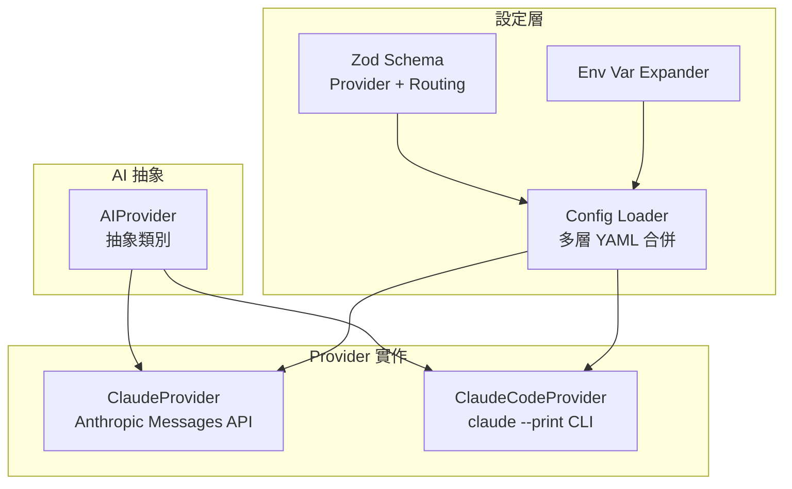
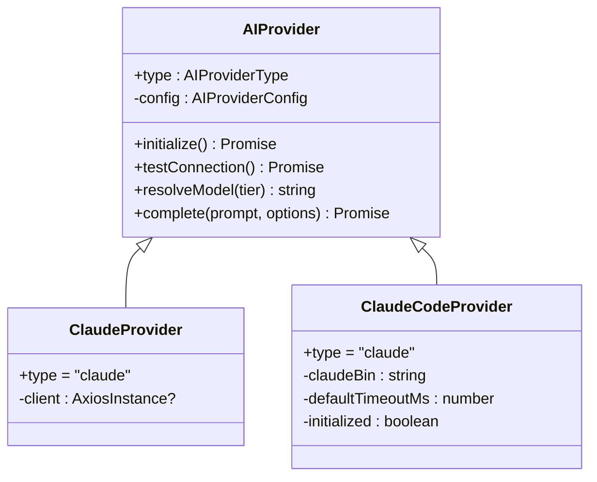
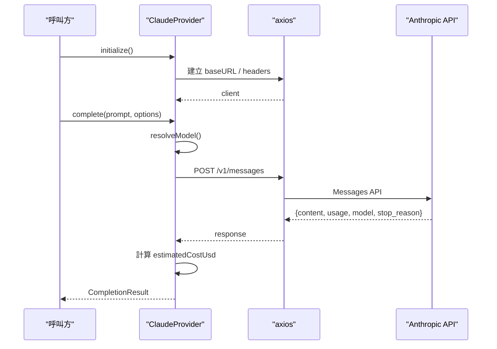
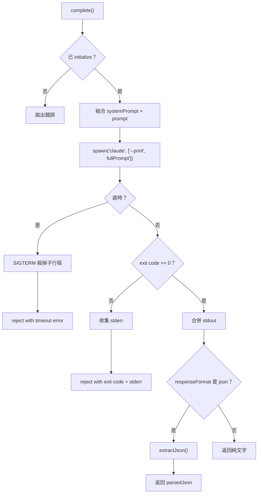
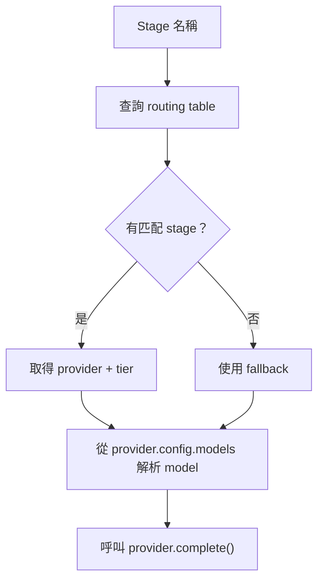
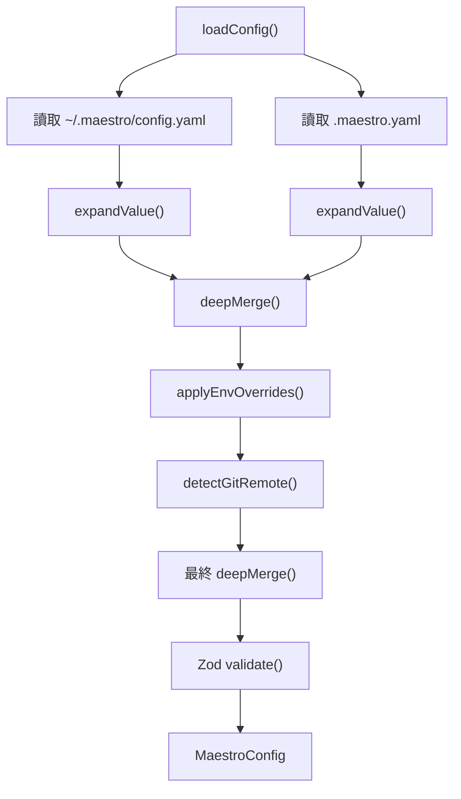

# AI Providers 設定

<cite>
**本文引用的檔案**   
- [.maestro.example.yaml](https://github.com/mikeah2011/maestro/blob/master/.maestro.example.yaml)
- [AIProvider.ts](https://github.com/mikeah2011/maestro/blob/master/src/ai/interfaces/AIProvider.ts)
- [ClaudeProvider.ts](https://github.com/mikeah2011/maestro/blob/master/src/ai/providers/ClaudeProvider.ts)
- [ClaudeCodeProvider.ts](https://github.com/mikeah2011/maestro/blob/master/src/ai/providers/ClaudeCodeProvider.ts)
- [schema.ts](https://github.com/mikeah2011/maestro/blob/master/src/config/schema.ts)
- [load.ts](https://github.com/mikeah2011/maestro/blob/master/src/config/load.ts)
- [expand.ts](https://github.com/mikeah2011/maestro/blob/master/src/config/expand.ts)
- [index.ts](https://github.com/mikeah2011/maestro/blob/master/src/config/index.ts)
- [ClaudeProvider.test.ts](https://github.com/mikeah2011/maestro/blob/master/tests/ai/providers/ClaudeProvider.test.ts)
- [ClaudeCodeProvider.test.ts](https://github.com/mikeah2011/maestro/blob/master/tests/ai/providers/ClaudeCodeProvider.test.ts)
- [load.test.ts](https://github.com/mikeah2011/maestro/blob/master/tests/config/load.test.ts)
- [README.md](https://github.com/mikeah2011/maestro/blob/master/README.md)
</cite>

## 目錄

1. [簡介](#簡介)
2. [專案結構與 AI 模組位置](#專案結構與-ai-模組位置)
3. [核心抽象與資料型別](#核心抽象與資料型別)
4. [支援的 AI Provider](#支援的-ai-provider)
5. [Provider Routing Table 設定](#provider-routing-table-設定)
6. [Cost Attribution 與 Rate Limiting](#cost-attribution-與-rate-limiting)
7. [設定載入與環境變數展開](#設定載入與環境變數展開)
8. [各 Provider 設定範例](#各-provider-設定範例)
9. [常見錯誤排除](#常見錯誤排除)
10. [效能優化建議](#效能優化建議)
11. [總結](#總結)

## 簡介

Maestro 的 AI Provider 系統把「呼叫語言模型」這個動作抽象成一個通用介面，讓核心迴圈不必知道背後是 Anthropic、OpenAI、Google Gemini、本機 Ollama 或自訂 HTTP。設定層負責：

- 宣告多個 provider 實例；
- 用 stage → provider/tier 的 routing table 決定每個階段使用哪個 model；
- 透過環境變數展開填入 API key、base URL；
- 由 schema 驗證欄位格式；
- 由 provider 實作處理認證、重試、token usage、成本估算。

目前程式碼中已實作的 provider 只有 Claude API 與 Claude Code CLI，但 schema、routing 與 example config 已經預留 OpenAI、Gemini（google）、local Ollama（local）與 custom HTTP（custom）的路徑。

**Section sources**
- [README.md:1-231](https://github.com/mikeah2011/maestro/blob/master/README.md#L1-L231)
- [AIProvider.ts:1-114](https://github.com/mikeah2011/maestro/blob/master/src/ai/interfaces/AIProvider.ts#L1-L114)
- [.maestro.example.yaml:1-120](https://github.com/mikeah2011/maestro/blob/master/.maestro.example.yaml#L1-L120)

## 專案結構與 AI 模組位置



**Diagram sources**
- [AIProvider.ts:1-114](https://github.com/mikeah2011/maestro/blob/master/src/ai/interfaces/AIProvider.ts#L1-L114)
- [ClaudeProvider.ts:1-175](https://github.com/mikeah2011/maestro/blob/master/src/ai/providers/ClaudeProvider.ts#L1-L175)
- [ClaudeCodeProvider.ts:1-146](https://github.com/mikeah2011/maestro/blob/master/src/ai/providers/ClaudeCodeProvider.ts#L1-L146)
- [schema.ts:1-226](https://github.com/mikeah2011/maestro/blob/master/src/config/schema.ts#L1-L226)
- [load.ts:1-200](https://github.com/mikeah2011/maestro/blob/master/src/config/load.ts#L1-L200)
- [expand.ts:1-81](https://github.com/mikeah2011/maestro/blob/master/src/config/expand.ts#L1-L81)

**Section sources**
- [README.md:120-190](https://github.com/mikeah2011/maestro/blob/master/README.md#L120-L190)
- [index.ts:1-25](https://github.com/mikeah2011/maestro/blob/master/src/config/index.ts#L1-L25)

## 核心抽象與資料型別

`AIProvider` 是所有 provider 的共同基礎。它不負責 prompt engineering 或 review 邏輯，只負責把 prompt 送出去、把 completion 拿回來。

| 概念 | 說明 |
|---|---|
| `ModelTier` | 三個階層：`cheap`、`strong`、`flagship`。便宜模型用於高量低風險任務，強模型用於判斷，旗艦模型用於最終輸出。 |
| `AIProviderType` | 目前 schema 允許 `claude`、`openai`、`google`、`local`、`custom`。 |
| `AIProviderConfig` | 所有 provider 共用的設定：apiKey、baseUrl、models、defaultTier、timeout、retries，以及 provider-specific extras。 |
| `CompletionOptions` | 單次呼叫選項：model、tier、systemPrompt、maxTokens、temperature、responseFormat、stopSequences、timeout、callerTag。 |
| `CompletionResult` | 回傳內容：content、model、usage、finishReason、parsedJson、raw。 |
| `FinishReason` | 完成原因：stop、max_tokens、content_filter、tool_use、error。 |

### Provider 共同方法

| 方法 | 用途 |
|---|---|
| `initialize()` | 驗證設定、建立 HTTP 或 SDK client。 |
| `testConnection()` | 輕量連線檢查。 |
| `resolveModel(tier)` | 根據 tier 從 `config.models` 或預設值解析 model id。 |
| `complete(prompt, options)` | 唯一對外呼叫點：prompt → completion。 |



**Diagram sources**
- [AIProvider.ts:1-114](https://github.com/mikeah2011/maestro/blob/master/src/ai/interfaces/AIProvider.ts#L1-L114)
- [ClaudeProvider.ts:1-175](https://github.com/mikeah2011/maestro/blob/master/src/ai/providers/ClaudeProvider.ts#L1-L175)
- [ClaudeCodeProvider.ts:1-146](https://github.com/mikeah2011/maestro/blob/master/src/ai/providers/ClaudeCodeProvider.ts#L1-L146)

**Section sources**
- [AIProvider.ts:1-114](https://github.com/mikeah2011/maestro/blob/master/src/ai/interfaces/AIProvider.ts#L1-L114)

## 支援的 AI Provider

### Claude API Provider

這是目前唯一完整實作的 HTTP provider。它直接呼叫 Anthropic Messages API，沒有依賴 Anthropic SDK，以降低安裝套件大小。

| 設定欄位 | 是否必要 | 預設值 | 說明 |
|---|---:|---|---|
| `type` | 是 | — | 固定為 `claude` |
| `apiKey` | 是 | 無 | 由 `ANTHROPIC_API_KEY` 或配置展開後的值提供。若未設定，`initialize()` 會拋出錯誤。 |
| `baseUrl` | 否 | `https://api.anthropic.com` | 可設定代理或自託管端點。 |
| `models` | 否 | cheap=`claude-haiku-4-5-20251001`、strong=`claude-sonnet-4-6`、flagship=`claude-opus-4-7` | 覆蓋 tier → model mapping。 |
| `defaultTier` | 否 | `strong` | 當 caller 沒有指定 tier 時使用。 |
| `timeout` | 否 | 60000 ms | axios 請求逾時。 |
| `retries` | 否 | 3 | p-retry 的重試次數。 |

#### 認證方式

- 使用 axios 建立 HTTP client；
- 將 apiKey 放入 `x-api-key` header；
- 加入 `anthropic-version: 2023-06-01`；
- content-type 為 `application/json`；
- endpoint 為 `/v1/messages`。

#### Model 選擇

優先順序：

1. `options.model`；
2. `options.tier` 對應的 `config.models`；
3. `config.defaultTier`；
4. 預設 strong。

#### 參數調校

| 選項 | 預設行為 | 調整建議 |
|---|---|---|
| `systemPrompt` | 作為 system role 送入 Anthropic request body | 適合放角色定義、審查規則、輸出格式規範。 |
| `maxTokens` | 4096 | 分類、去重等短輸出可降低；摘要、PR body 可提高。 |
| `temperature` | 0 | 決策流程應保持確定性，不要提高。 |
| `stopSequences` | 空 | 若希望 JSON 或 Markdown 區塊在特定字串停止可設定。 |
| `responseFormat` | text | 需要穩定結構化輸出時使用 `json_object` 或 `json_schema`。 |
| `timeout` | 繼承 provider timeout | 長摘要可加大；快速分類可縮短。 |
| `callerTag` | 無 | 用於 cost attribution 與 audit log。 |

#### 重試策略

- 狀態碼 429 與 >= 500 才會重試；
- 初始延遲 1 秒，最大 30 秒；
- 重試次數來自 `config.retries`，預設 3。

#### Token Usage 與成本估算

Claude provider 會把 Anthropic response 中的 input/output tokens 轉成 `CompletionUsage`，並對已知 model 計算 `estimatedCostUsd`：

| Model | 輸入每百萬 token | 輸出每百萬 token |
|---|---:|---:|
| `claude-haiku-4-5-20251001` | $0.80 | $4.00 |
| `claude-sonnet-4-6` | $3.00 | $15.00 |
| `claude-opus-4-7` | $15.00 | $75.00 |

如果 model 不在價格表中，`estimatedCostUsd` 會是 undefined。



**Diagram sources**
- [ClaudeProvider.ts:1-175](https://github.com/mikeah2011/maestro/blob/master/src/ai/providers/ClaudeProvider.ts#L1-L175)
- [ClaudeProvider.test.ts:1-177](https://github.com/mikeah2011/maestro/blob/master/tests/ai/providers/ClaudeProvider.test.ts#L1-L177)

**Section sources**
- [ClaudeProvider.ts:1-175](https://github.com/mikeah2011/maestro/blob/master/src/ai/providers/ClaudeProvider.ts#L1-L175)
- [ClaudeProvider.test.ts:1-177](https://github.com/mikeah2011/maestro/blob/master/tests/ai/providers/ClaudeProvider.test.ts#L1-L177)

### Claude Code CLI Provider

這個 provider 不直接呼叫雲端 API，而是透過本機安裝的 `claude` 二進位執行 `claude --print`。它適合開發者機器上已有 Claude Code 的情境，不需要設定 Anthropic API Key。

| 設定欄位 | 是否必要 | 預設值 | 說明 |
|---|---:|---|---|
| `type` | 是 | — | 雖然 type 是 `claude`，但實作類別是 `ClaudeCodeProvider`。 |
| `claudeBin` | 否 | `claude` | 可指定完整路徑，例如 `/usr/local/bin/claude`。 |
| `timeout` | 否 | 120000 ms | CLI 子行程的預設逾時，比 HTTP provider 更長。 |
| `apiKey` | 否 | 無 | 此 provider 不需要 API key。 |
| `baseUrl` | 否 | 無 | 不使用。 |
| `models` | 否 | `claude-code-cli` | 僅供 routing 顯示；實際 model 由 Claude Code CLI 內部決定。 |
| `retries` | 否 | 無 | 不適用。 |

#### 認證方式

- 不需要 `ANTHROPIC_API_KEY`；
- 依賴使用者在本機已登入 Claude Code；
- 初始化時會執行 `claude --version` 確認二進位存在；
- `testConnection()` 會執行 `claude --print ping`。

#### 限制

- token usage 一律回報為 0；
- 無法估算成本；
- model 名稱一律是 `claude-code-cli`；
- systemPrompt 會拼接到 user prompt 前面，而不是原生 system role；
- JSON 解析使用正規表達式取出最外層 `{}`，不是嚴格 JSON parser。



**Diagram sources**
- [ClaudeCodeProvider.ts:1-146](https://github.com/mikeah2011/maestro/blob/master/src/ai/providers/ClaudeCodeProvider.ts#L1-L146)
- [ClaudeCodeProvider.test.ts:1-200](https://github.com/mikeah2011/maestro/blob/master/tests/ai/providers/ClaudeCodeProvider.test.ts#L1-L200)

**Section sources**
- [ClaudeCodeProvider.ts:1-146](https://github.com/mikeah2011/maestro/blob/master/src/ai/providers/ClaudeCodeProvider.ts#L1-L146)
- [ClaudeCodeProvider.test.ts:1-200](https://github.com/mikeah2011/maestro/blob/master/tests/ai/providers/ClaudeCodeProvider.test.ts#L1-L200)

### OpenAI Provider

目前程式碼中沒有 OpenAI provider 實作，但 schema 與 example config 已將其納入支援範圍。

| 設定欄位 | 狀態 | 說明 |
|---|---|---|
| `type: openai` | 已定義 | Zod schema 允許。 |
| `apiKey` | 預期必要 | OpenAI 通常使用 bearer token，但目前沒有對應 provider 實作。 |
| `baseUrl` | 預期可用 | 可用於 Azure OpenAI、Proxy 或其他相容端點。 |
| `models` | 預期支援 | 範例使用 `gpt-4o-mini`、`gpt-4o`、`o1-preview`。 |
| `defaultTier` | 共用欄位 | 未指定時由 orchestrator 決定。 |
| `timeout` | 共用欄位 | HTTP 請求逾時。 |
| `retries` | 共用欄位 | 重試次數。 |

要啟用 OpenAI，未來需要新增一個 `OpenAIProvider` 實作，套用與 `ClaudeProvider` 相同的 `AIProvider` 介面。

**Section sources**
- [schema.ts:1-60](https://github.com/mikeah2011/maestro/blob/master/src/config/schema.ts#L1-L60)
- [.maestro.example.yaml:1-40](https://github.com/mikeah2011/maestro/blob/master/.maestro.example.yaml#L1-L40)

### Gemini Provider

Gemini 在 schema 中使用 `google` 作為 provider type，example config 中使用 `gemini` 作為 config key。

| 設定欄位 | 狀態 | 說明 |
|---|---|---|
| `type: google` | 已定義 | 這是 Google Gemini 的 provider type。 |
| `apiKey` | 預期必要 | 範例使用 `GOOGLE_API_KEY`。 |
| `baseUrl` | 可用 | 可設定 GCP region 或自託管端點。 |
| `models` | 預期支援 | 範例使用 `gemini-2.0-flash`、`gemini-1.5-pro`。 |
| `defaultTier` | 共用欄位 | 未指定時由 orchestrator 決定。 |
| `timeout` | 共用欄位 | HTTP 請求逾時。 |
| `retries` | 共用欄位 | 重試次數。 |

與 OpenAI 相同，目前沒有 Gemini provider 實作。

**Section sources**
- [schema.ts:1-60](https://github.com/mikeah2011/maestro/blob/master/src/config/schema.ts#L1-L60)
- [.maestro.example.yaml:25-40](https://github.com/mikeah2011/maestro/blob/master/.maestro.example.yaml#L25-L40)

### Local Ollama Provider

Local provider 是用來連接本機或網路上的 Ollama 服務。

| 設定欄位 | 狀態 | 說明 |
|---|---|---|
| `type: local` | 已定義 | 表示本地語言模型服務。 |
| `baseUrl` | 預期必要 | 範例使用 `${OLLAMA_BASE_URL:-http://localhost:11434}`。 |
| `apiKey` | 非必要 | Ollama 通常不需要 API key。 |
| `models` | 預期支援 | 範例使用 `mistral`、`llama3.1:70b`。 |
| `defaultTier` | 共用欄位 | 未指定時由 orchestrator 決定。 |
| `timeout` | 共用欄位 | 本機推理可能較慢，建議調高。 |
| `retries` | 共用欄位 | 可重試短暫失敗。 |

要使用 Ollama，需要先啟動 Ollama server，並在 `OLLAMA_BASE_URL` 或設定中指向正確端口。

**Section sources**
- [schema.ts:1-60](https://github.com/mikeah2011/maestro/blob/master/src/config/schema.ts#L1-L60)
- [.maestro.example.yaml:40-55](https://github.com/mikeah2011/maestro/blob/master/.maestro.example.yaml#L40-L55)

### Custom HTTP Provider

`custom` provider type 保留給尚未內建實作的 HTTP-based LLM 服務。因為 `ProviderConfigSchema` 使用 `.passthrough()`，所以可以帶入任意 provider-specific 欄位。

| 設定欄位 | 狀態 | 說明 |
|---|---|---|
| `type: custom` | 已定義 | 代表自訂 HTTP provider。 |
| `apiKey` | 依服務而定 | 可放在任何 provider-specific 欄位。 |
| `baseUrl` | 依服務而定 | 自訂服務端點。 |
| `models` | 依服務而定 | 自訂 model mapping。 |
| 其他欄位 | 開放 | Zod `.passthrough()` 允許額外欄位。 |

由於沒有 `CustomProvider` 實作，這個 type 目前主要作為 schema 與 routing 的宣告，真正的 HTTP 呼叫邏輯需要自行實作 `AIProvider`。

**Section sources**
- [schema.ts:1-60](https://github.com/mikeah2011/maestro/blob/master/src/config/schema.ts#L1-L60)

## Provider Routing Table 設定

Routing table 決定 Maestro 循環中每個 stage 使用哪個 provider 與哪個 tier。

### 支援的 Stage

| Stage | 目的 | Example 中的 tier |
|---|---|---|
| `commitMessage` | 每輪產生 commit message | cheap |
| `prBodyDraft` | 每 PR 一次產生 PR body 草稿 | strong |
| `classifyUnknown` | 未知 bot 的回覆分類 fallback | cheap |
| `semanticDedup` | 第三層語義去重 | cheap |
| `tasteDetection` | 偵測 review 是否陷入瑣碎爭論 | strong |
| `finalSummary` | 迴圈結束時的 PR body rollup | flagship |
| `fallback` | 未明確匹配的 stage fallback | cheap |

### Routing Target Schema

每個 target 必須包含：

| 欄位 | 型別 | 預設值 | 說明 |
|---|---|---:|---|
| `provider` | string | 無 | providers 區段下的 key，例如 `claude`、`openai`、`gemini`、`local`。 |
| `tier` | `cheap \| strong \| flagship` | `cheap` | 決定該 stage 使用的 model 等級。 |



**Diagram sources**
- [schema.ts:25-60](https://github.com/mikeah2011/maestro/blob/master/src/config/schema.ts#L25-L60)
- [.maestro.example.yaml:55-85](https://github.com/mikeah2011/maestro/blob/master/.maestro.example.yaml#L55-L85)

**Section sources**
- [schema.ts:25-60](https://github.com/mikeah2011/maestro/blob/master/src/config/schema.ts#L25-L60)
- [.maestro.example.yaml:55-85](https://github.com/mikeah2011/maestro/blob/master/.maestro.example.yaml#L55-L85)

## Cost Attribution 與 Rate Limiting

### Cost Attribution

Cost attribution 主要由以下機制組成：

1. `CompletionUsage.estimatedCostUsd`：Claude provider 會根據 model 價格表計算；
2. `CompletionOptions.callerTag`：可標記每次呼叫來源，方便 audit log；
3. `StopConditions.costBudgetUSD`：整個 loop run 的成本上限，預設 $5；
4. Audit 模組會記錄分類與決策過程。

Claude provider 的費用計算公式：

> 預估美元 = (inputTokens / 1,000,000) × 輸入價格 + (outputTokens / 1,000,000) × 輸出價格

ClaudeCodeProvider 不會回報 token usage，因此不會有 cost estimation。

### Rate Limiting

目前程式碼中有兩層 rate limiting 相關設計：

1. **Provider 層重試**：Claude provider 使用 p-retry 對 429 與 5xx 做指數退避重試；
2. **Advanced 設定中的 rateLimit**：schema 定義了 `honorRemainingHeader` 與 `minInterRequestMs`，但這部分是 advanced 設定，當前 provider 實作並未直接使用。

| Advanced Rate Limit 欄位 | 預設值 | 說明 |
|---|---:|---|
| `honorRemainingHeader` | true | 未來可用來尊重 provider 回傳的剩餘請求頭。 |
| `minInterRequestMs` | 100 | 最小請求間隔毫秒數。 |

這些欄位在 schema 中存在，但 ClaudeProvider 與 ClaudeCodeProvider 都沒有讀取 `advanced.rateLimit`。若要真正實作全局 rate limiter，需要在 orchestrator 或 provider factory 中加入隊列與延遲機制。

**Section sources**
- [ClaudeProvider.ts:1-175](https://github.com/mikeah2011/maestro/blob/master/src/ai/providers/ClaudeProvider.ts#L1-L175)
- [ClaudeCodeProvider.ts:1-146](https://github.com/mikeah2011/maestro/blob/master/src/ai/providers/ClaudeCodeProvider.ts#L1-L146)
- [schema.ts:180-226](https://github.com/mikeah2011/maestro/blob/master/src/config/schema.ts#L180-L226)

## 設定載入與環境變數展開

### 設定優先順序

由高到低：

1. CLI overrides；
2. process.env 中的 MAESTRO_* 變數；
3. repo 層級 `.maestro.yaml`；
4. 使用者層級 `~/.maestro/config.yaml`；
5. git remote 自動偵測；
6. schema 預設值。

### 環境變數展開模式

YAML 中的字串值支援：

| 模式 | 行為 |
|---|---|
| `${VAR}` | 必要變數，未設定時拋出錯誤。 |
| `${VAR:-default}` | 可選變數，未設定時使用 default。 |
| `${VAR:?error}` | 必要變數，未設定時使用自訂錯誤訊息。 |

展開是遞迴的，深度上限為 10，防止環狀引用。



**Diagram sources**
- [load.ts:1-200](https://github.com/mikeah2011/maestro/blob/master/src/config/load.ts#L1-L200)
- [expand.ts:1-81](https://github.com/mikeah2011/maestro/blob/master/src/config/expand.ts#L1-L81)

**Section sources**
- [load.ts:1-200](https://github.com/mikeah2011/maestro/blob/master/src/config/load.ts#L1-L200)
- [expand.ts:1-81](https://github.com/mikeah2011/maestro/blob/master/src/config/expand.ts#L1-L81)
- [load.test.ts:1-200](https://github.com/mikeah2011/maestro/blob/master/tests/config/load.test.ts#L1-L200)

## 各 Provider 設定範例

以下範例基於 `.maestro.example.yaml` 與 schema 定義整理。請根據實際服務調整 model name、API key 與 base URL。

### Claude API

```yaml
ai:
  providers:
    claude:
      type: claude
      apiKey: ${ANTHROPIC_API_KEY}
      models:
        cheap:    claude-haiku-4-5-20251001
        strong:   claude-sonnet-4-6
        flagship: claude-opus-4-7
      timeout: 30000
      retries: 3
```

重點：

- `apiKey` 必須透過環境變數或 shell 設定；
- `baseUrl` 可省略，預設 Anthropic 官方端點；
- `models` 可覆蓋三個 tier；
- `timeout` 建議至少 30 秒；
- `retries` 建議保留 3 以應對短暫 429 或 5xx。

### OpenAI

```yaml
ai:
  providers:
    openai:
      type: openai
      apiKey: ${OPENAI_API_KEY}
      models:
        cheap:    gpt-4o-mini
        strong:   gpt-4o
        flagship: o1-preview
```

注意：目前沒有 OpenAI provider 實作，需自行實作後才能使用。

### Gemini

```yaml
ai:
  providers:
    gemini:
      type: google
      apiKey: ${GOOGLE_API_KEY}
      models:
        cheap:    gemini-2.0-flash
        strong:   gemini-1.5-pro
```

注意：provider type 是 `google`，config key 是 `gemini`。

### Local Ollama

```yaml
ai:
  providers:
    local:
      type: local
      baseUrl: ${OLLAMA_BASE_URL:-http://localhost:11434}
      models:
        cheap:  mistral
        strong: llama3.1:70b
```

建議：

- 確保 Ollama server 正在運行；
- `ollama pull` 需要的 model；
- 若 GPU 資源有限，先拉小 model 測試；
- 延長 timeout，因為本機推理可能很慢。

### Custom HTTP Provider

```yaml
ai:
  providers:
    my_provider:
      type: custom
      baseUrl: ${MY_LLM_BASE_URL}
      apiKey: ${MY_LLM_API_KEY}
      models:
        cheap:    fast-model
        strong:   smart-model
        flagship: expert-model
      extraField: provider-specific-value
```

注意：`.passthrough()` 允許額外欄位，但必須自行實作對應 provider 才有意義。

### Routing Table

```yaml
ai:
  routing:
    commitMessage:     { provider: claude, tier: cheap }
    prBodyDraft:       { provider: claude, tier: strong }
    classifyUnknown:   { provider: claude, tier: cheap }
    semanticDedup:     { provider: claude, tier: cheap }
    tasteDetection:    { provider: claude, tier: strong }
    finalSummary:      { provider: claude, tier: flagship }
    fallback:          { provider: claude, tier: cheap }
```

**Section sources**
- [.maestro.example.yaml:1-120](https://github.com/mikeah2011/maestro/blob/master/.maestro.example.yaml#L1-L120)
- [schema.ts:1-60](https://github.com/mikeah2011/maestro/blob/master/src/config/schema.ts#L1-L60)

## 常見錯誤排除

### Claude Provider：缺少 API Key

**現象**：`initialize()` 拋出錯誤，提示 `config.apiKey is required`。

**原因**：沒有設定 `ANTHROPIC_API_KEY`，也沒有在配置中提供 `apiKey`。

**解法**：

- 設定 `ANTHROPIC_API_KEY`；
- 或在 `.maestro.yaml` 中寫 `apiKey: ${ANTHROPIC_API_KEY}`；
- 或使用 Claude Code CLI provider 作為替代。

**Section sources**
- [ClaudeProvider.ts:55-75](https://github.com/mikeah2011/maestro/blob/master/src/ai/providers/ClaudeProvider.ts#L55-L75)
- [ClaudeProvider.test.ts:35-50](https://github.com/mikeah2011/maestro/blob/master/tests/ai/providers/ClaudeProvider.test.ts#L35-L50)

### Claude Provider：未完成 initialize()

**現象**：呼叫 `complete()` 前拋出錯誤，提示必須先呼叫 `initialize()`。

**原因**：provider 尚未建立 axios client。

**解法**：在使用 `complete()` 前先呼叫 `initialize()`。

**Section sources**
- [ClaudeProvider.ts:90-100](https://github.com/mikeah2011/maestro/blob/master/src/ai/providers/ClaudeProvider.ts#L90-L100)
- [ClaudeProvider.test.ts:65-75](https://github.com/mikeah2011/maestro/blob/master/tests/ai/providers/ClaudeProvider.test.ts#L65-L75)

### Claude Code CLI：找不到 claude 二進位

**現象**：`initialize()` 或 `testConnection()` 失敗，spawn 拋出 ENOENT。

**原因**：`claude` 不在 PATH 中，或沒有安裝 Claude Code CLI。

**解法**：

- 安裝 Claude Code CLI；
- 或設定 `claudeBin` 為完整路徑；
- 或改用 Claude API provider。

**Section sources**
- [ClaudeCodeProvider.ts:1-146](https://github.com/mikeah2011/maestro/blob/master/src/ai/providers/ClaudeCodeProvider.ts#L1-L146)
- [ClaudeCodeProvider.test.ts:80-120](https://github.com/mikeah2011/maestro/blob/master/tests/ai/providers/ClaudeCodeProvider.test.ts#L80-L120)

### Claude Code CLI：CLI 逾時

**現象**：`complete()` 在指定時間後 reject，訊息包含 `claude CLI timed out after Xms`。

**原因**：Claude Code 回應太慢，或模型太大。

**解法**：

- 增加 `timeout`；
- 使用較小的 model；
- 檢查本機 CPU/GPU 負載。

**Section sources**
- [ClaudeCodeProvider.ts:90-140](https://github.com/mikeah2011/maestro/blob/master/src/ai/providers/ClaudeCodeProvider.ts#L90-L140)

### Environment Variable Expansion：變數未設定

**現象**：載入設定時拋出 `EnvExpansionError`，指出某個 `${VAR}` 未設定。

**原因**：YAML 使用了 `${VAR}` 但環境中沒有該變數，且沒有提供 `-default`。

**解法**：

- 設定環境變數；
- 或改用 `${VAR:-default}`；
- 或改用 `${VAR:?custom error}` 取得清楚錯誤訊息。

**Section sources**
- [expand.ts:1-81](https://github.com/mikeah2011/maestro/blob/master/src/config/expand.ts#L1-L81)
- [load.test.ts:120-160](https://github.com/mikeah2011/maestro/blob/master/tests/config/load.test.ts#L120-L160)

### Base URL 錯誤

**現象**：Claude provider 能建立 axios client，但 HTTP 請求失敗。

**原因**：`baseUrl` 指向錯誤端點，或 proxy 不支援 Anthropic Messages API。

**解法**：

- 確認 Anthropic API 是否正常；
- 若使用代理，確認 path `/v1/messages` 被正確轉發；
- 暫時移除 `baseUrl` 測試官方端點。

**Section sources**
- [ClaudeProvider.ts:60-75](https://github.com/mikeah2011/maestro/blob/master/src/ai/providers/ClaudeProvider.ts#L60-L75)
- [ClaudeProvider.test.ts:50-65](https://github.com/mikeah2011/maestro/blob/master/tests/ai/providers/ClaudeProvider.test.ts#L50-L65)

## 效能優化建議

### 合理選擇 Tier

- `commitMessage`、`classifyUnknown`、`semanticDedup` 這類高頻、低風險任務使用 `cheap`；
- `prBodyDraft`、`tasteDetection` 需要較好理解能力，使用 `strong`；
- `finalSummary` 是最終產出，使用 `flagship`。

這樣可以在品質與成本之間取得平衡。

### 控制 maxTokens

- 分類、去重、commit message：可使用較小 maxTokens；
- PR body、summary：需要較大 maxTokens；
- temperature 建議維持 0，避免決策不穩定。

### 善用 responseFormat

若期望 JSON，使用 `json_object` 或 `json_schema`，讓 orchestrator 能直接解析 `parsedJson`。這減少下游 parse error，也提升穩定性。

### 調整 Retries 與 Timeout

- Claude provider 預設 3 次重試，適合一般雲端 API；
- 若頻繁遇到 429，可考慮上游限流器或降低呼叫頻率；
- ClaudeCodeProvider 預設 120 秒，適合本機大模型；
- Ollama 建議根據硬體能力調高 timeout。

### 利用 Cost Budget

透過 `stopConditions.costBudgetUSD` 控制整次 loop 的花費上限，避免長時間迴圈造成成本失控。

### 未來擴充 Provider 的建議

如果要新增 OpenAI、Gemini 或 custom provider，建議：

1. 實作 `AIProvider` 抽象類別；
2. 使用 `axios` 或對應 SDK；
3. 實現 `initialize()`、`testConnection()`、`resolveModel()`、`complete()`；
4. 映射 finish reason；
5. 嘗試回報 token usage 與 `estimatedCostUsd`；
6. 加入 unit test，mock HTTP 或 child_process。

**Section sources**
- [.maestro.example.yaml:55-85](https://github.com/mikeah2011/maestro/blob/master/.maestro.example.yaml#L55-L85)
- [AIProvider.ts:35-114](https://github.com/mikeah2011/maestro/blob/master/src/ai/interfaces/AIProvider.ts#L35-L114)
- [ClaudeProvider.ts:100-175](https://github.com/mikeah2011/maestro/blob/master/src/ai/providers/ClaudeProvider.ts#L100-L175)

## 總結

Maestro 的 AI Provider 設定架構可以簡化成三層：

1. **抽象層**：`AIProvider` 統一 prompt → completion 的介面；
2. **實作層**：目前已實作 Claude API 與 Claude Code CLI，其餘 provider 由 schema 與 example config 預留空間；
3. **設定層**：Zod schema 驗證、多層 YAML 合併、環境變數展開、routing table 指派 stage 到 provider/tier。

實務上，推薦的做法是：

- 使用 Claude API provider 作為主力；
- 在開發環境搭配 Claude Code CLI 作為 fallback；
- 透過 routing table 把不同 stage 分配到不同 tier；
- 用 environment variable expansion 管理 API key；
- 用 `costBudgetUSD` 控制整體花費；
- 對 OpenAI、Gemini、Ollama、custom 等 provider，先在 `.maestro.yaml` 宣告，再逐步實作對應 provider class。