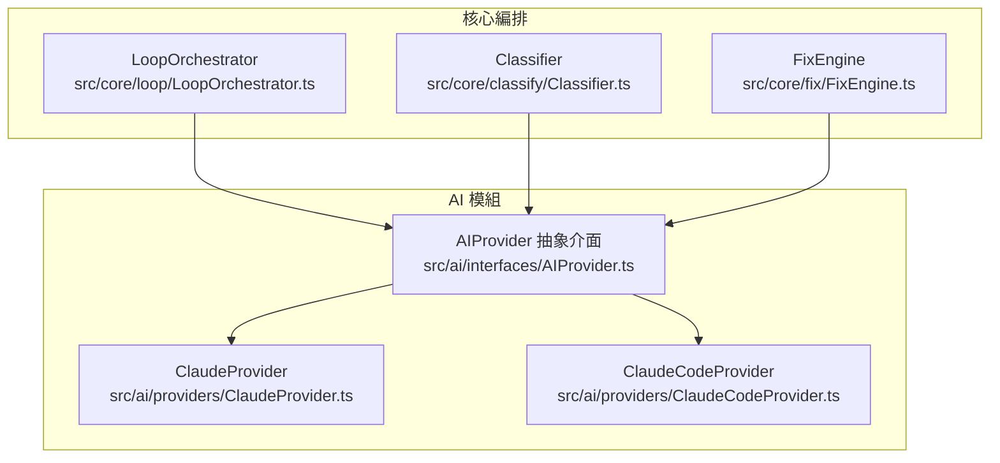
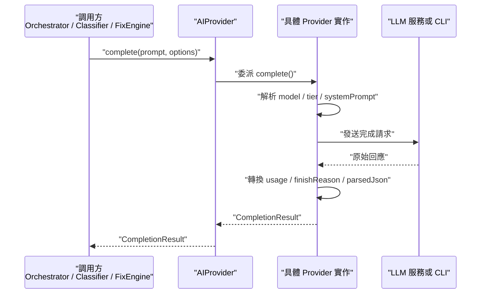
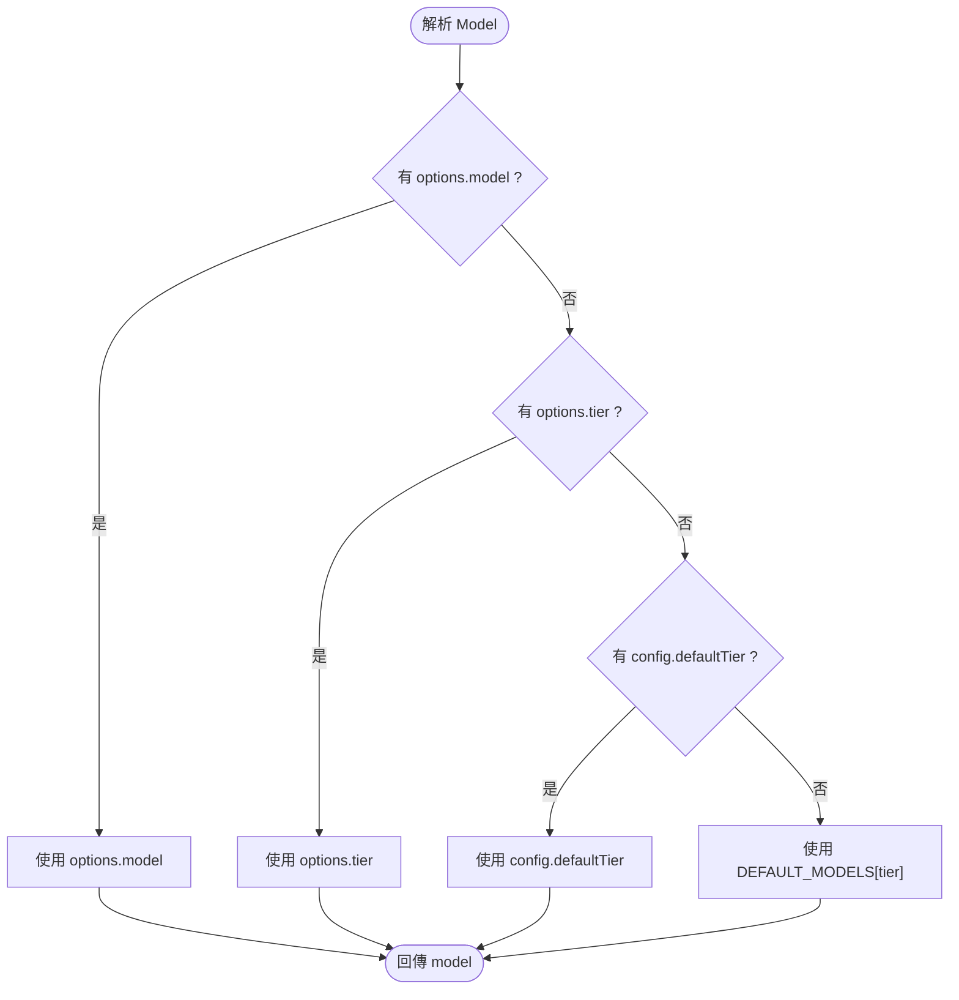
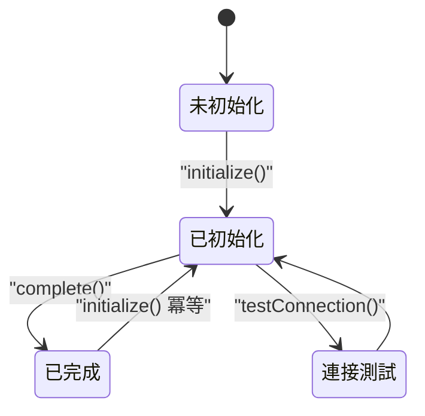
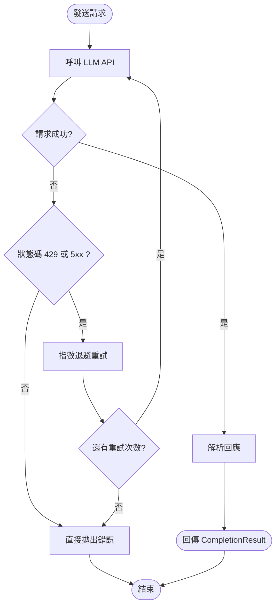
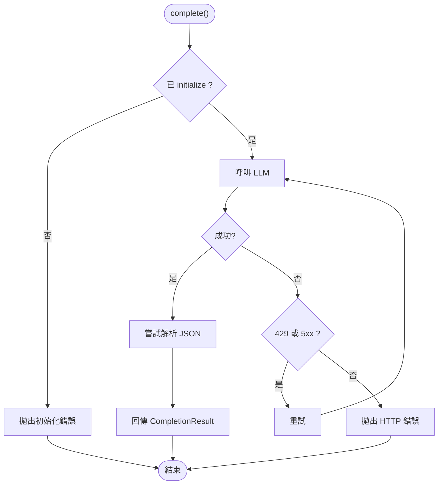
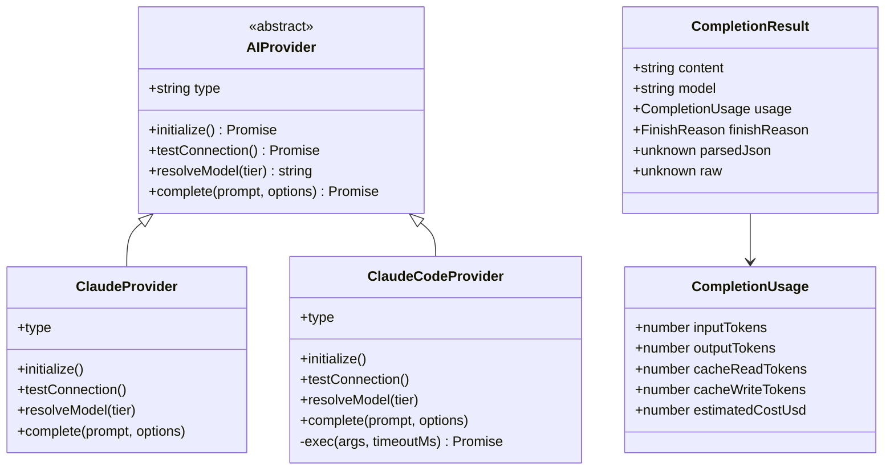

# AIProvider 抽象介面

**本文引用的檔案**

- [AIProvider.ts](https://github.com/mikeah2011/maestro/blob/master/src/ai/interfaces/AIProvider.ts)
- [ClaudeProvider.ts](https://github.com/mikeah2011/maestro/blob/master/src/ai/providers/ClaudeProvider.ts)
- [ClaudeCodeProvider.ts](https://github.com/mikeah2011/maestro/blob/master/src/ai/providers/ClaudeCodeProvider.ts)
- [DESIGN.md](https://github.com/mikeah2011/maestro/blob/master/docs/DESIGN.md)
- [README.md](https://github.com/mikeah2011/maestro/blob/master/README.md)

## 目錄
1. [引言](#引言)
2. [專案結構與定位](#專案結構與定位)
3. [核心設計理念](#核心設計理念)
4. [完整 TypeScript 介面定義與型別說明](#完整-typescript-介面定義與型別說明)
5. [統一 prompt → completion 流程](#統一-prompt--completion-流程)
6. [tier / routing / cost attribution 機制](#tier--routing--cost-attribution-機制)
7. [Provider 生命週期管理](#provider-生命週期管理)
8. [重試退避與速率限制處理](#重試退避與速率限制處理)
9. [實作自訂 Provider 指南](#實作自訂-provider-指南)
10. [錯誤處理模式](#錯誤處理模式)
11. [現有實作對照分析](#現有實作對照分析)
12. [架構總覽圖](#架構總覽圖)
13. [效能考量與最佳實踐](#效能考量與最佳實踐)
14. [常見問題排查](#常見問題排查)
15. [結論](#結論)

## 引言
`AIProvider` 是 Maestro 中「將不同語言模型服務統一為單一完成介面」的抽象層。它的核心目標很明確：讓上層的審查、分類、修復、回覆等編排邏輯不需要知道底層使用的是 Claude API、Gemini、OpenAI、本地 Ollama，還是 Claude Code CLI。所有這些差異都被收斂到 `complete(prompt, options)` 這個統一口徑中。

這也意味著：`AIProvider` 不是「審查器」，而是「prompt 到 completion 的管道」。審查策略、提示詞組合、回合控制、成本預算、狀態機與收斂保證，都在更上層的設計中處理。

## 專案結構與定位
在當前程式碼庫中，AI 相關程式碼集中在 `src/ai/`：

**圖表來源**
- [AIProvider.ts:1-114](https://github.com/mikeah2011/maestro/blob/master/src/ai/interfaces/AIProvider.ts#L1-L114)
- [ClaudeProvider.ts:1-175](https://github.com/mikeah2011/maestro/blob/master/src/ai/providers/ClaudeProvider.ts#L1-L175)
- [ClaudeCodeProvider.ts:1-146](https://github.com/mikeah2011/maestro/blob/master/src/ai/providers/ClaudeCodeProvider.ts#L1-L146)

從系統設計來看，`AIProvider` 屬於「工具無關的基礎設施層」；真正決定使用哪個 provider、哪個 tier、何時重試、如何計費的是 orchestrator 與配置系統。

**章節來源**
- [DESIGN.md:25-40](https://github.com/mikeah2011/maestro/blob/master/docs/DESIGN.md#L25-L40)
- [README.md:100-140](https://github.com/mikeah2011/maestro/blob/master/README.md#L100-L140)

## 核心設計理念

### 1. 單一完成入口
`AIProvider.complete()` 是 orchestrator 唯一需要呼叫的方法。它接收一段 prompt 與一組選項，回傳統一的 `CompletionResult`。

### 2. 提供者無決策權
註解明確指出：provider 不選擇自己的 model。model 由 caller 透過 `options.model`、`options.tier` 或 provider 配置的 `defaultTier` 與 `models` 解析。這樣做的好處是：
- 商業規則（高頻操作用便宜模型、判斷性操作用強力模型）放在 orchestrator 或設定檔。
- Provider 只負責把 prompt 轉成 completion，減少實現歧異。

### 3. 結果結構優先於原始協議
每個 LLM 的 HTTP API、SDK、CLI 輸出格式都不同，但 `CompletionResult` 把它們轉換成一致的結構：
- `content`：純文字內容。
- `usage`：token 用量與可選費用估算。
- `finishReason`：停止原因。
- `parsedJson`：當要求 JSON 輸出時嘗試解析的結果。
- `raw`：保留原始回應，供審計或重播。

### 4. 可插拔類型系統
`AIProviderType` 預設支援 `claude`、`openai`、`google`、`local`、`custom`。目前實作為 Claude API 與 Claude Code CLI，但型別空間已經為 OpenAI、Gemini、Ollama 與自訂 HTTP provider 留下位置。

**章節來源**
- [AIProvider.ts:1-114](https://github.com/mikeah2011/maestro/blob/master/src/ai/interfaces/AIProvider.ts#L1-L114)

## 完整 TypeScript 介面定義與型別說明

以下整理自 `src/ai/interfaces/AIProvider.ts`，以「用途導向」的方式說明。

| 名稱 | 型別 | 說明 |
|---|---|---|
| `ModelTier` | `'cheap' \| 'strong' \| 'flagship'` | 模型分級：廉價、強力、旗艦。用於路由不同風險與頻率的任務。 |
| `AIProviderType` | `'claude' \| 'openai' \| 'google' \| 'local' \| 'custom'` | Provider 類型標識，便於註冊、日誌與診斷。 |
| `AIProviderConfig` | interface | Provider 配置：API key、base URL、tier→model 映射、預設 tier、timeout、retries、provider 專屬欄位。 |
| `ResponseFormat` | union | 輸出格式：純文字、JSON object、JSON schema。 |
| `CompletionOptions` | interface | 單次呼叫選項：model、tier、systemPrompt、maxTokens、temperature、responseFormat、stopSequences、timeout、callerTag。 |
| `CompletionUsage` | interface | Token 用量與成本：inputTokens、outputTokens、cacheReadTokens、cacheWriteTokens、estimatedCostUsd。 |
| `FinishReason` | `'stop' \| 'max_tokens' \| 'content_filter' \| 'tool_use' \| 'error'` | 模型停止生成原因。 |
| `CompletionResult` | interface | 統一完成結果：content、model、usage、finishReason、parsedJson、raw。 |
| `AIProvider` | abstract class | Provider 抽象基類，包含 type、config、initialize、testConnection、resolveModel、complete。 |

### 重要設計細節

#### `AIProviderConfig`
- `apiKey`：環境變數展開後的 API key。
- `baseUrl`：適合自託管 Ollama、GCP 區域或其他非預設端點。
- `models`：`Partial<Record<ModelTier, string>>`，允許部分覆蓋 cheap/strong/flagship。
- `defaultTier`：未指定 tier 時的預設值。
- `timeout`：每次 HTTP 請求的超時時間。
- `retries`：自動重試次數。
- `[key: string]: unknown`：允許 provider 自行擴充配置。

#### `ResponseFormat`
- `text`：預設純文字。
- `json_object`：要求返回合法 JSON object。
- `json_schema`：帶有 schema 的嚴格 JSON 結構。

#### `CompletionOptions`
- `model`：覆寫本次使用的 model。
- `tier`：若未提供 `model`，則以此 tier 解析 model。
- `systemPrompt`：系統提示詞，通常放在 user prompt 之前。
- `maxTokens`：輸出 token 上限。
- `temperature`：orchestrator 預設為 `0`，強調確定性。
- `responseFormat`：控制輸出結構。
- `stopSequences`：停止序列。
- `timeout`：單次呼叫超時覆寫。
- `callerTag`：成本歸屬與審計標籤。

#### `CompletionUsage`
- `inputTokens`：輸入 token。
- `outputTokens`：輸出 token。
- `cacheReadTokens`：可選，提示緩存讀取 token。
- `cacheWriteTokens`：可選，提示緩存寫入 token。
- `estimatedCostUsd`：可選，USD 費用估算。

#### `CompletionResult`
- `content`：必須存在。
- `model`：實際產生回應的 model。
- `usage`：token 用量。
- `finishReason`：停止原因。
- `parsedJson`：可選，僅當 responseFormat 要求 JSON 且解析成功時存在。
- `raw`：可選，原始 provider 回應，用於審計。

**章節來源**
- [AIProvider.ts:13-114](https://github.com/mikeah2011/maestro/blob/master/src/ai/interfaces/AIProvider.ts#L13-L114)

## 統一 prompt → completion 流程

這個流程的關鍵在於：
1. 調用方只關心 `prompt` 和 `CompletionResult`。
2. Provider 負責處理 model 解析、HTTP/CLI 通訊、錯誤重試、token 統計。
3. 結果始終是統一的 `CompletionResult`，不會把 Anthropic、OpenAI、Gemini、Ollama 的內部結構暴露給上層。

**圖表來源**
- [AIProvider.ts:90-114](https://github.com/mikeah2011/maestro/blob/master/src/ai/interfaces/AIProvider.ts#L90-L114)
- [ClaudeProvider.ts:80-175](https://github.com/mikeah2011/maestro/blob/master/src/ai/providers/ClaudeProvider.ts#L80-L175)
- [ClaudeCodeProvider.ts:55-146](https://github.com/mikeah2011/maestro/blob/master/src/ai/providers/ClaudeCodeProvider.ts#L55-L146)

## tier / routing / cost attribution 機制

### tier 解析順序
`ClaudeProvider.resolveModel()` 展示了典型解析邏輯：

1. 若 `options.model` 存在，直接使用。
2. 否則使用 `options.tier`。
3. 若仍沒有，使用 `config.defaultTier`。
4. 最後 fallback 到 provider 內建的 `DEFAULT_MODELS[tier]`。

**圖表來源**
- [ClaudeProvider.ts:63-78](https://github.com/mikeah2011/maestro/blob/master/src/ai/providers/ClaudeProvider.ts#L63-L78)

### routing 策略
根據設計文件，Maestro 的分層路由原則如下：
- **廉價模型**：高頻、低風險任務，例如提交訊息、未知問題分類。
- **強力模型**：判斷性任務，例如 PR 內容草稿、品味偵測。
- **旗艦模型**：最終輸出或高價值摘要。

這種路由不在 provider 內部決定，而應該由 orchestrator 或 `.maestro.yaml` 的 stage routing 配置決定。

### cost attribution
`CompletionUsage.estimatedCostUsd` 是可選欄位。ClaudeProvider 根據已知的每百萬 token 價格計算費用；如果 model 不在已知表中，則留空。其他 provider 可以選擇：
- 完全不提供費用估算。
- 提供近似估算。
- 提供精確金額（例如 OpenAI/Gemini 官方定價）。
- 完全依賴外部 CostTracker。

**章節來源**
- [DESIGN.md:25-40](https://github.com/mikeah2011/maestro/blob/master/docs/DESIGN.md#L25-L40)
- [ClaudeProvider.ts:23-43](https://github.com/mikeah2011/maestro/blob/master/src/ai/providers/ClaudeProvider.ts#L23-L43)
- [ClaudeProvider.ts:63-78](https://github.com/mikeah2011/maestro/blob/master/src/ai/providers/ClaudeProvider.ts#L63-L78)
- [ClaudeProvider.ts:120-160](https://github.com/mikeah2011/maestro/blob/master/src/ai/providers/ClaudeProvider.ts#L120-L160)

## Provider 生命週期管理

`AIProvider` 的生命週期可以簡化為四個階段：

### 關鍵方法

| 方法 | 責任 | 行為說明 |
|---|---|---|
| `initialize()` | 驗證配置、建立 HTTP SDK 或準備子程序 | ClaudeProvider 會檢查 `apiKey` 並建立 axios；ClaudeCodeProvider 會執行 `claude --version`。 |
| `testConnection()` | 輕量連線檢查 | ClaudeProvider 發一次極短請求；ClaudeCodeProvider 執行 `claude --print ping`。 |
| `resolveModel(tier)` | tier → model id | 優先使用配置，再 fallback 到預設模型。 |
| `complete(prompt, options?)` | 主要完成入口 | 封裝重試、錯誤轉換、usage 統計、JSON 解析。 |

### 冪等性與前置條件
- `initialize()` 被描述為冪等。
- `ClaudeCodeProvider.initialize()` 使用 `initialized` flag，避免重複啟動。
- `ClaudeProvider.complete()` 要求先呼叫 `initialize()`，否則拋出錯誤。
- `ClaudeCodeProvider.complete()` 也會檢查是否已初始化。

**章節來源**
- [AIProvider.ts:90-114](https://github.com/mikeah2011/maestro/blob/master/src/ai/interfaces/AIProvider.ts#L90-L114)
- [ClaudeProvider.ts:45-78](https://github.com/mikeah2011/maestro/blob/master/src/ai/providers/ClaudeProvider.ts#L45-L78)
- [ClaudeCodeProvider.ts:33-65](https://github.com/mikeah2011/maestro/blob/master/src/ai/providers/ClaudeCodeProvider.ts#L33-L65)

## 重試退避與速率限制處理

### ClaudeProvider 的重試策略
ClaudeProvider 使用 `p-retry` 包裹 HTTP 請求：

- 預設重試次數來自 `config.retries`，未設定時為 3。
- 最小延遲 1 秒。
- 最大延遲 30 秒。
- 僅重試：
  - HTTP 429（Too Many Requests）。
  - HTTP 5xx（伺服器錯誤）。
- 其他錯誤立即失敗。

**圖表來源**
- [ClaudeProvider.ts:95-145](https://github.com/mikeah2011/maestro/blob/master/src/ai/providers/ClaudeProvider.ts#L95-L145)

### 速率限制處理
設計文件中提到，任何狀態下觸發速率限制時，系統應進入 `RateLimited` 狀態，並執行指數退避，同時遵守 `X-RateLimit-Remaining`。不過，目前的 `ClaudeProvider` 僅針對 HTTP 429 做重試，並未直接解析 rate limit header。這是未來擴展的重點：
- 可在 provider 層面解析 rate limit header。
- 可在 orchestrator 層面追蹤全局 rate limit。
- 可在 CostTracker / RoundBudget 中加入費用與 token 配額。

**章節來源**
- [DESIGN.md:110-140](https://github.com/mikeah2011/maestro/blob/master/docs/DESIGN.md#L110-L140)
- [ClaudeProvider.ts:95-145](https://github.com/mikeah2011/maestro/blob/master/src/ai/providers/ClaudeProvider.ts#L95-L145)

## 實作自訂 Provider 指南

### 步驟一：新增 provider 類別
自訂 provider 應繼承 `AIProvider`，並實作以下方法：

| 方法 | 必要程度 | 建議實作重點 |
|---|---|---|
| `type` | 必要 | 使用 `AIProviderType` 中的值，例如 `'openai'`、`'google'`、`'local'`、`'custom'`。 |
| `initialize()` | 必要 | 驗證 API key、建立 SDK、設定 base URL、設定 timeout。 |
| `testConnection()` | 必要 | 發送一個極小請求，成功回傳 `true`，失敗回傳 `false`。 |
| `resolveModel(tier)` | 必要 | 支援 `cheap`、`strong`、`flagship` 三個 tier。 |
| `complete(prompt, options?)` | 必要 | 封裝 HTTP/SDK/CLI 呼叫，回傳 `CompletionResult`。 |

### 步驟二：處理 model 解析
參考 `ClaudeProvider.resolveModel()`：
- 優先使用 `options.model`。
- 其次使用 `options.tier`。
- 再次使用 `config.defaultTier`。
- 最後使用 provider 內建模型映射。

### 步驟三：處理輸出格式
若 `options.responseFormat` 是 `json_object` 或 `json_schema`：
- 先取得原始 `content`。
- 嘗試 `JSON.parse(content)`。
- 若解析失敗，`parsedJson` 保持未定義。
- 不要吞掉異常而不記錄，除非這是期望行為。

### 步驟四：處理 usage 與成本
- 若 provider 支援 token 統計，填入 `inputTokens`、`outputTokens`。
- 若支援提示緩存，填入 `cacheReadTokens`、`cacheWriteTokens`。
- 若有定價資訊，計算 `estimatedCostUsd`。
- 若無法計算，留空即可；不應假造數據。

### 步驟五：處理停止原因
`finishReason` 可使用以下值：
- `stop`：正常停止。
- `max_tokens`：達到 maxTokens。
- `content_filter`：內容過濾。
- `tool_use`：工具使用。
- `error`：發生錯誤。

### OpenAI 風格 provider 範例結構
由於本文不展示具體程式碼，請依照以下結構規劃你的 OpenAI provider：

| 區塊 | 對應責任 |
|---|---|
| `initialize()` | 讀取 API key、base URL、建立 OpenAI SDK 或 axios client。 |
| `testConnection()` | 呼叫 `/models` 或極短聊天訊息。 |
| `resolveModel()` | 將 `cheap/strong/flagship` 映射到 GPT-4o-mini、GPT-4o、GPT-4.5 等。 |
| `complete()` | 轉換 messages、temperature、maxTokens、response_format，包裝重試與錯誤。 |
| `complete()` 結果 | 轉換 OpenAI usage 到 `CompletionUsage`，轉換 finish_reason 到 `FinishReason`。 |

### Gemini 風格 provider 範例結構
| 區塊 | 對應責任 |
|---|---|
| `initialize()` | 設定 Google Cloud API key 或 Vertex AI endpoint。 |
| `testConnection()` | 呼叫 Gemini list models 或生成極短文本。 |
| `resolveModel()` | 映射到 gemini-pro、gemini-flash、gemini-ultra 等。 |
| `complete()` | 處理 safety settings、generation config、response schema。 |
| `complete()` 結果 | 轉換 Gemini usage 與 finish reason。 |

### 本地 Ollama 風格 provider 範例結構
| 區塊 | 對應責任 |
|---|---|
| `initialize()` | 檢查 `baseUrl`，預設指向 Ollama 本地端點。 |
| `testConnection()` | 呼叫 `/api/tags` 或 `/api/chat`。 |
| `resolveModel()` | 映射 tier 到 `llama3`、`mistral`、`qwen` 等本地模型。 |
| `complete()` | 轉換為 Ollama chat API payload。 |
| `complete()` 結果 | 若無 token 統計，至少填寫 input/output tokens 為合理估計或直接留零。 |

### 自訂 HTTP provider 範例結構
對於任意 REST API：
1. 使用 `baseUrl` + `apiKey` 設定請求頭。
2. 將 `prompt`、`systemPrompt`、`maxTokens`、`temperature`、`stopSequences` 轉換為該 API 的 payload。
3. 將 HTTP 狀態碼轉換為錯誤或重試條件。
4. 將回應轉換為 `CompletionResult`。
5. 若 API 不支持 JSON mode，仍可透過 prompt 工程強制 JSON 輸出，並在 `parsedJson` 中嘗試解析。

**章節來源**
- [AIProvider.ts:13-114](https://github.com/mikeah2011/maestro/blob/master/src/ai/interfaces/AIProvider.ts#L13-L114)
- [ClaudeProvider.ts:63-78](https://github.com/mikeah2011/maestro/blob/master/src/ai/providers/ClaudeProvider.ts#L63-L78)
- [ClaudeProvider.ts:120-160](https://github.com/mikeah2011/maestro/blob/master/src/ai/providers/ClaudeProvider.ts#L120-L160)

## 錯誤處理模式

### 配置錯誤
- `ClaudeProvider.initialize()` 在缺少 `apiKey` 時直接拋出錯誤。
- 這類錯誤屬於「開發期/部署期錯誤」，不應被重試。

### 連線錯誤
- `testConnection()` 捕獲異常並回傳 `false`。
- 適合用於 health check、doctor command、自動 fallback。

### 網路錯誤與伺服器錯誤
- `ClaudeProvider.complete()` 使用 `p-retry` 重試 429 與 5xx。
- 其他錯誤（例如 400、401、403）直接向上拋出。

### CLI 錯誤
- `ClaudeCodeProvider.exec()` 會收集 stdout 與 stderr。
- 非零退出碼會建構錯誤訊息，包含 exit code 與 stderr。
- 超過 timeout 會殺掉子程序並拋出逾時錯誤。

### JSON 解析錯誤
- 當要求 JSON 輸出但內容不是合法 JSON 時，`parsedJson` 保持未定義。
- 這表示「模型未能遵守格式約束」，而非 provider 本身崩潰。

**圖表來源**
- [ClaudeProvider.ts:80-175](https://github.com/mikeah2011/maestro/blob/master/src/ai/providers/ClaudeProvider.ts#L80-L175)
- [ClaudeCodeProvider.ts:65-146](https://github.com/mikeah2011/maestro/blob/master/src/ai/providers/ClaudeCodeProvider.ts#L65-L146)

**章節來源**
- [ClaudeProvider.ts:45-78](https://github.com/mikeah2011/maestro/blob/master/src/ai/providers/ClaudeProvider.ts#L45-L78)
- [ClaudeProvider.ts:95-175](https://github.com/mikeah2011/maestro/blob/master/src/ai/providers/ClaudeProvider.ts#L95-L175)
- [ClaudeCodeProvider.ts:65-146](https://github.com/mikeah2011/maestro/blob/master/src/ai/providers/ClaudeCodeProvider.ts#L65-L146)

## 現有實作對照分析

### ClaudeProvider
使用 Anthropic Messages API，透過 axios 直接呼叫，不依賴 Anthropic SDK，以減少安裝依賴。

| 項目 | 行為 |
|---|---|
| HTTP 客戶端 | axios instance，base URL 預設 Anthropic API。 |
| 認證 | `x-api-key`。 |
| 版本標頭 | `anthropic-version: 2023-06-01`。 |
| 模型預設值 | haiku → sonnet → opus。 |
| 費用估算 | 依每百萬 token 價格計算 USD。 |
| 重試 | p-retry，429 與 5xx。 |
| JSON 解析 | 根據 responseFormat 嘗試解析 content。 |
| raw 回應 | 保留原始 Anthropic 回應。 |

### ClaudeCodeProvider
透過本機 `claude` CLI 執行，無需 API Key。適合開發者機器。

| 項目 | 行為 |
|---|---|
| 通訊方式 | node `child_process.spawn`。 |
| 初始化 | 執行 `claude --version`。 |
| 連線測試 | 執行 `claude --print ping`。 |
| 模型 | 固定為 `claude-code-cli`。 |
| usage | 全部為 0，因為 CLI 不暴露 token 統計。 |
| 費用 | 不提供。 |
| systemPrompt | 字串拼接到 user prompt 前面。 |
| JSON 解析 | 使用正則取出最外層 JSON object 後解析。 |

### 兩者的共同點
- 都繼承 `AIProvider`。
- 都實作 `initialize()`、`testConnection()`、`resolveModel()`、`complete()`。
- 都尊重 `systemPrompt`、`maxTokens`、`temperature`、`responseFormat`、`stopSequences`、`timeout`。
- 都回傳 `CompletionResult`。

### 兩者的差異
| 維度 | ClaudeProvider | ClaudeCodeProvider |
|---|---|---|
| 是否需要 API Key | 是 | 否 |
| 通訊方式 | HTTP API | 本機 CLI |
| 費用估算 | 可計算 | 不可用 |
| token 統計 | 可取得 | 全為 0 |
| 重試策略 | 指數退避重試 | 無內建重試 |
| 適用場景 | CI、生產、遠端服務 | 開發者本機 |

**章節來源**
- [ClaudeProvider.ts:1-175](https://github.com/mikeah2011/maestro/blob/master/src/ai/providers/ClaudeProvider.ts#L1-L175)
- [ClaudeCodeProvider.ts:1-146](https://github.com/mikeah2011/maestro/blob/master/src/ai/providers/ClaudeCodeProvider.ts#L1-L146)

## 架構總覽圖

**圖表來源**
- [AIProvider.ts:13-114](https://github.com/mikeah2011/maestro/blob/master/src/ai/interfaces/AIProvider.ts#L13-L114)
- [ClaudeProvider.ts:45-175](https://github.com/mikeah2011/maestro/blob/master/src/ai/providers/ClaudeProvider.ts#L45-L175)
- [ClaudeCodeProvider.ts:33-146](https://github.com/mikeah2011/maestro/blob/master/src/ai/providers/ClaudeCodeProvider.ts#L33-L146)

## 效能考量與最佳實踐

### 1. 使用便宜的 tier 處理高頻任務
分類、提交訊息、簡單格式化等任務應使用 `cheap` tier。這能降低整體 token 消耗與費用。

### 2. 避免不必要的 systemPrompt
過長的 system prompt 會增加 inputTokens，進而提高費用與延遲。應保持 instruction 精簡且具可重用性。

### 3. 啟用 JSON 模式時容錯
即使 API 支援 JSON mode，也不代表永遠能正確解析。務必保留 `parsedJson` 為 undefined 的分支，並在上層做 fallback。

### 4. 重試次數不宜過高
預設 3 次重試是合理起點。對於 CI 環境，過高的重試可能延長 pipeline 時間；對於開發模式，較高的重試可提升穩定性。

### 5. 成本歸屬要可追溯
使用 `callerTag` 標識每次呼叫的業務上下文，例如：
- `classify_unknown_issue`
- `fix_suggestion`
- `pr_summary`
- `reply_thread`

配合 CostTracker 可產出按任務分類的費用報告。

### 6. 不要在 provider 內硬編碼業務路由
tier 與 model 的選擇應由 orchestrator 或設定檔決定，而不是由 provider 猜測。這樣才能保持一致的經濟模型與審計能力。

[此節為一般性指導，未直接分析特定程式碼行]

## 常見問題排查

| 問題 | 可能原因 | 解決方式 |
|---|---|---|
| `ClaudeProvider.initialize() must be called first` | 未呼叫 `initialize()` 就呼叫 `complete()` | 先執行 `initialize()`，或在 orchestrator 中確保生命週期順序。 |
| `config.apiKey is required` | 未設定 Anthropic API key | 設定 `ANTHROPIC_API_KEY` 或在 `.maestro.yaml` 中提供 apiKey。 |
| `claude exited ...` | Claude Code CLI 執行失敗或 stderr 有錯誤 | 檢查 claude CLI 是否可執行、是否有登入 session、stderr 內容。 |
| `claude CLI timed out after ...` | 本機 CLI 回應太慢或卡住 | 調整 `timeout` 或檢查 claude CLI 狀態。 |
| `parsedJson` 為 undefined | 模型未輸出合法 JSON | 改善 prompt 或改用支援 JSON schema 的 provider。 |
| `estimatedCostUsd` 為 undefined | 未支援費用計算或 model 不在定價表中 | 接受近似值，或由外部 CostTracker 計算。 |
| 429 頻率過高 | API 速率限制 | 增加退避間隔、減少並發、使用 cheaper tier、加入全局限流。 |
| 5xx 持續出現 | 供應商服務異常 | 檢查供應商狀態頁面、增加重試上限、加入警報。 |

**章節來源**
- [ClaudeProvider.ts:45-78](https://github.com/mikeah2011/maestro/blob/master/src/ai/providers/ClaudeProvider.ts#L45-L78)
- [ClaudeProvider.ts:95-175](https://github.com/mikeah2011/maestro/blob/master/src/ai/providers/ClaudeProvider.ts#L95-L175)
- [ClaudeCodeProvider.ts:65-146](https://github.com/mikeah2011/maestro/blob/master/src/ai/providers/ClaudeCodeProvider.ts#L65-L146)

## 結論
`AIProvider` 抽象介面的價值不在於實現某個 LLM 的具體協議，而在於把多樣化的 AI 服務收斂成一個穩定的完成介面。它讓 Maestro 的核心編排邏輯可以專注於「什麼時候調用、調用什麼模型、如何分類問題、如何收斂循環」，而不必被 Anthropic、OpenAI、Gemini、Ollama 或 CLI 的差異分散注意力。

若要擴充新的 provider，請遵循以下原則：
1. 實作 `initialize()`、`testConnection()`、`resolveModel()`、`complete()`。
2. 統一回傳 `CompletionResult`。
3. 盡量提供 token 用量與費用估算。
4. 明確處理重試、逾時、速率限制與 JSON 解析失敗。
5. 不要把業務路由寫進 provider，保留給 orchestrator 與設定。

這樣，未來的 OpenAI、Gemini、本地 Ollama 或其他 LLM API 都能以一致的方式接入 Maestro 的審查與收斂循環。

[此節為總結性內容，未直接分析特定程式碼行]