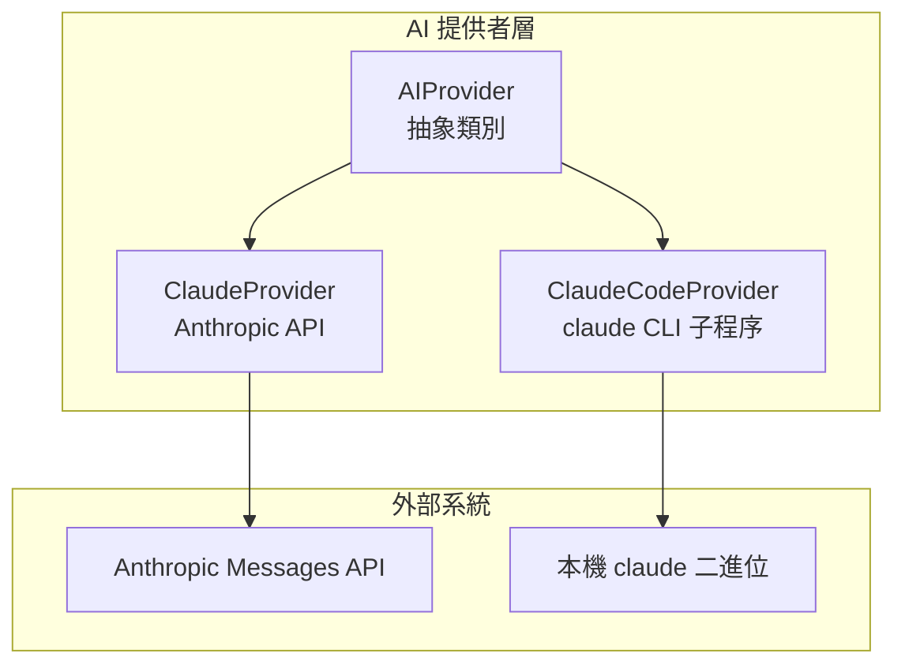
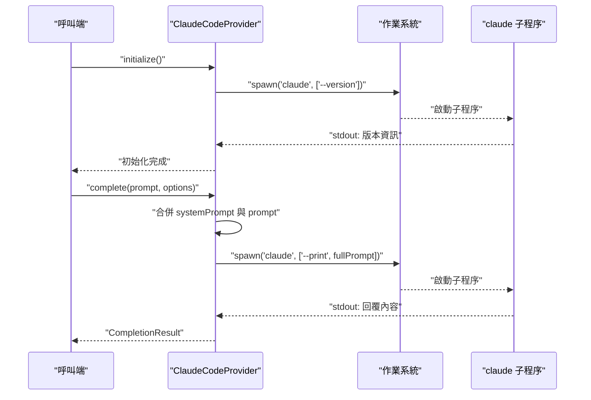
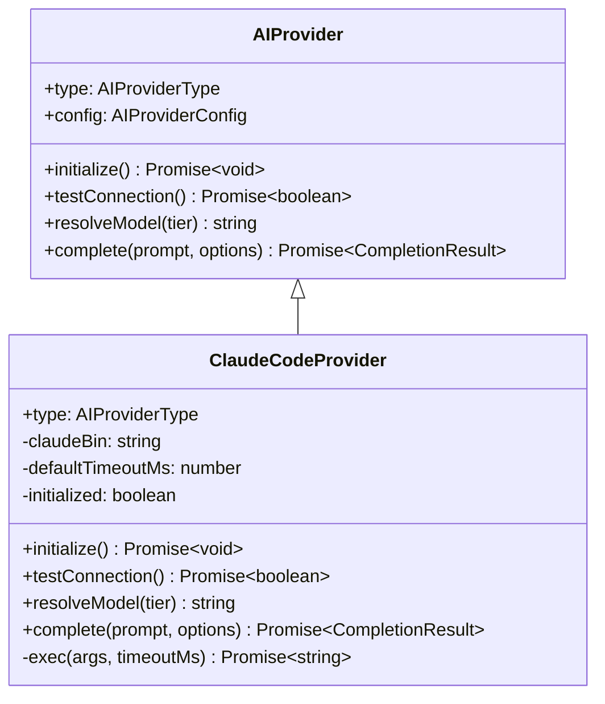
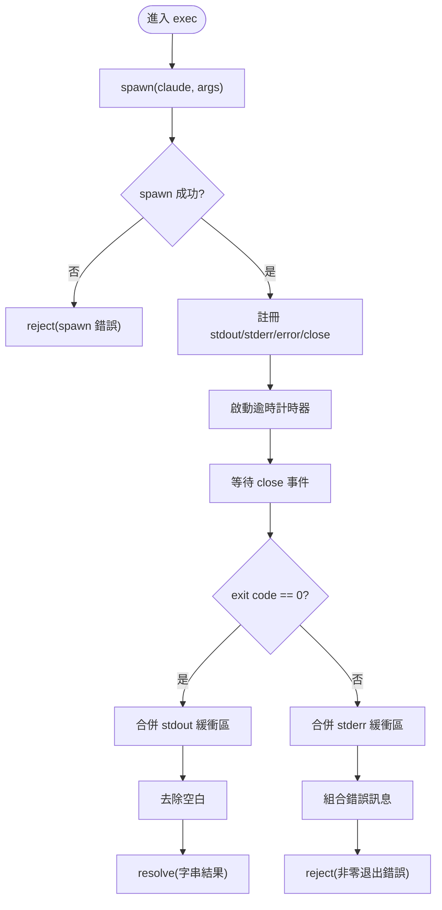
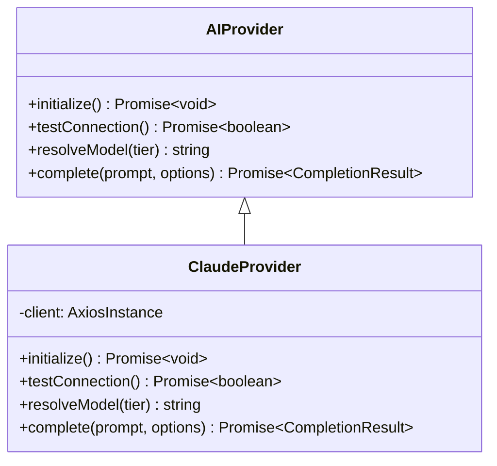
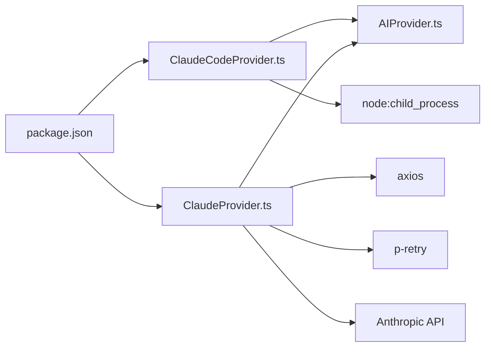
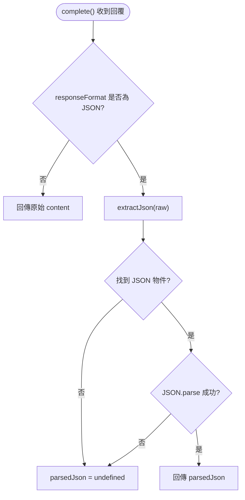
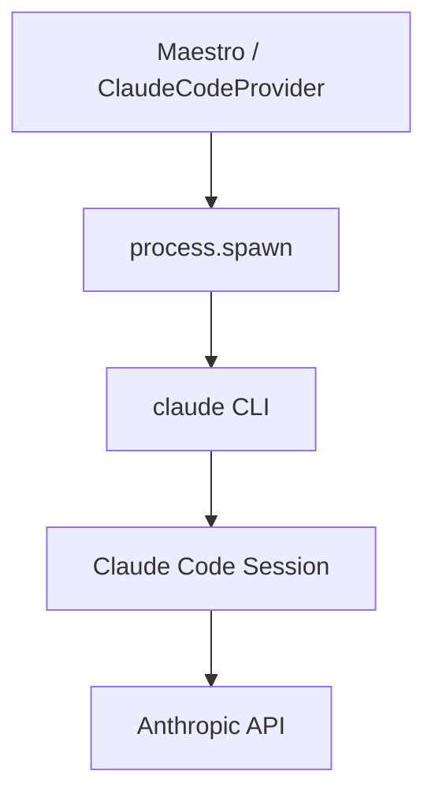
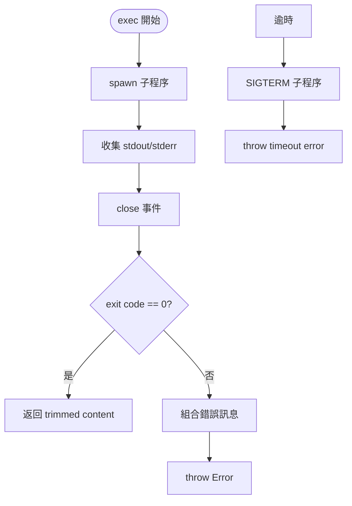

# ClaudeCodeProvider（claude CLI）

**本文引用的檔案**

- [ClaudeCodeProvider.ts](https://github.com/mikeah2011/maestro/blob/master/src/ai/providers/ClaudeCodeProvider.ts)
- [ClaudeProvider.ts](https://github.com/mikeah2011/maestro/blob/master/src/ai/providers/ClaudeProvider.ts)
- [AIProvider.ts](https://github.com/mikeah2011/maestro/blob/master/src/ai/interfaces/AIProvider.ts)
- [ClaudeCodeProvider.test.ts](https://github.com/mikeah2011/maestro/blob/master/tests/ai/providers/ClaudeCodeProvider.test.ts)
- [ClaudeProvider.test.ts](https://github.com/mikeah2011/maestro/blob/master/tests/ai/providers/ClaudeProvider.test.ts)
- [package.json](https://github.com/mikeah2011/maestro/blob/master/package.json)
- [CLAUDE.md](https://github.com/mikeah2011/maestro/blob/master/CLAUDE.md)
- [README.md](https://github.com/mikeah2011/maestro/blob/master/README.md)

## 目錄
1. [簡介](#簡介)
2. [專案結構與角色定位](#專案結構與角色定位)
3. [核心元件總覽](#核心元件總覽)
4. [系統架構](#系統架構)
5. [詳細元件分析](#詳細元件分析)
6. [依賴關係分析](#依賴關係分析)
7. [安裝與設定步驟](#安裝與設定步驟)
8. [命令列參數與資料流](#命令列參數與資料流)
9. [與 Claude Code Skill 的整合方式](#與-claude-code-skill-的整合方式)
10. [JSONL 事件流與進度監控現況](#jsonl-事件流與進度監控現況)
11. [ClaudeCodeProvider 與 ClaudeProvider 對比](#claudocodeprovider-與-clauseprovider-對比)
12. [錯誤處理與除錯指南](#錯誤處理與除錯指南)
13. [效能考量與優化建議](#效能考量與優化建議)
14. [結論](#結論)

## 簡介

ClaudeCodeProvider 是 Maestro 中「以本地 Claude Code CLI 作為後端」的 AI 提供者實作。它不直接呼叫 Anthropic API，而是透過 Node.js 的 `child_process.spawn` 啟動本機 `claude` 二進位，並使用 `--print` 模式取得文字回覆。其設計目標很明確：

- 適合開發者機器上已經設定好 Claude Code 的環境。
- 不需要使用者額外提供 `ANTHROPIC_API_KEY`。
- 將 `claude --print <prompt>` 的輸出視為一次性的提示完成結果。
- 保留與 `AIProvider` 抽象介面的相容性，讓主程式可以統一調度不同 AI 後端。

相對地，ClaudeProvider 是直接呼叫 Anthropic Messages API 的雲端提供者，擁有更完整的模型清單、用量統計、費用估算與重試機制。兩者都實作相同的 `AIProvider` 介面，但背後執行模型完全不同。

## 專案結構與角色定位

在當前程式碼庫中，ClaudeCodeProvider 屬於 `src/ai/providers` 模組，與 ClaudeProvider 並列；兩者都繼承抽象類別 `AIProvider`，並由 orchestrator 透過統一口徑呼叫 `initialize()`、`testConnection()`、`resolveModel()` 與 `complete()`。



**圖表來源**
- [AIProvider.ts:1-L114](https://github.com/mikeah2011/maestro/blob/master/src/ai/interfaces/AIProvider.ts#L1-L114)
- [ClaudeProvider.ts:1-L175](https://github.com/mikeah2011/maestro/blob/master/src/ai/providers/ClaudeProvider.ts#L1-L175)
- [ClaudeCodeProvider.ts:1-L146](https://github.com/mikeah2011/maestro/blob/master/src/ai/providers/ClaudeCodeProvider.ts#L1-L146)

**章節來源**
- [CLAUDE.md:1-L98](https://github.com/mikeah2011/maestro/blob/master/CLAUDE.md#L1-L98)
- [README.md:1-L200](https://github.com/mikeah2011/maestro/blob/master/README.md#L1-L200)

## 核心元件總覽

| 元件 | 主要責任 | 關鍵行為 |
|---|---|---|
| `AIProvider` | 定義所有 AI 後端的統一介面 | 規定 `initialize`、`testConnection`、`resolveModel`、`complete` |
| `ClaudeProvider` | 使用 axios 呼叫 Anthropic `/v1/messages` | 需要 API Key、可估算費用、支援重試 |
| `ClaudeCodeProvider` | 使用 `child_process.spawn` 呼叫 `claude --print` | 無需 API Key、模型名稱為 `claude-code-cli`、用量為零 |
| `ClaudeCodeProvider.exec` | 包裝子程序生命週期 | 收集 stdout/stderr、逾時殺掉子程序、非零退出轉為錯誤 |
| `extractJson` | 從純文字回應中提取最外層 JSON | 用於 `json_object` / `json_schema` 情境 |

**章節來源**
- [AIProvider.ts:1-L114](https://github.com/mikeah2011/maestro/blob/master/src/ai/interfaces/AIProvider.ts#L1-L114)
- [ClaudeProvider.ts:1-L175](https://github.com/mikeah2011/maestro/blob/master/src/ai/providers/ClaudeProvider.ts#L1-L175)
- [ClaudeCodeProvider.ts:1-L146](https://github.com/mikeah2011/maestro/blob/master/src/ai/providers/ClaudeCodeProvider.ts#L1-L146)

## 系統架構

ClaudeCodeProvider 的運作流程可以簡化為以下階段：

1. 建構時讀取 `claudeBin`，預設為 `claude`，表示從 PATH 解析。
2. `initialize()` 會先執行 `claude --version`，確認二進位存在且可執行。
3. `testConnection()` 會執行 `claude --print ping`，成功則視為連線正常。
4. `complete()` 會把 system prompt 與使用者 prompt 合併，然後執行 `claude --print "<完整提示>"`。
5. 成功時回傳 `content`、固定模型名稱、零用量與 `finishReason: stop`。
6. 失敗時會根據 exit code 與 stderr 產生錯誤訊息。



**圖表來源**
- [ClaudeCodeProvider.ts:1-L146](https://github.com/mikeah2011/maestro/blob/master/src/ai/providers/ClaudeCodeProvider.ts#L1-L146)

**章節來源**
- [ClaudeCodeProvider.ts:1-L146](https://github.com/mikeah2011/maestro/blob/master/src/ai/providers/ClaudeCodeProvider.ts#L1-L146)

## 詳細元件分析

### ClaudeCodeProvider 類別分析

ClaudeCodeProvider 是一個狀態式類別，內部維護三個重要欄位：

| 欄位 | 型別 | 說明 |
|---|---|---|
| `claudeBin` | `string` | 要執行的 claude 二進位路徑，預設為 `claude` |
| `defaultTimeoutMs` | `number` | 預設逾時時間，預設為 120,000 毫秒 |
| `initialized` | `boolean` | 是否已完成 `initialize()` |

它的公開方法包括：

| 方法 | 輸入 | 輸出 | 行為摘要 |
|---|---|---|---|
| `initialize()` | 無 | `Promise<void>` | 若尚未初始化，則執行 `claude --version` |
| `testConnection()` | 無 | `Promise<boolean>` | 執行 `claude --print ping`，成功回傳 `true` |
| `resolveModel(tier)` | `ModelTier` | `string` | 回傳 `claude-code-cli`，或覆蓋值 |
| `complete(prompt, options)` | 提示字串與選項 | `Promise<CompletionResult>` | 執行 `claude --print` 並封裝結果 |

#### 類別關聯圖



**圖表來源**
- [AIProvider.ts:1-L114](https://github.com/mikeah2011/maestro/blob/master/src/ai/interfaces/AIProvider.ts#L1-L114)
- [ClaudeCodeProvider.ts:1-L146](https://github.com/mikeah2011/maestro/blob/master/src/ai/providers/ClaudeCodeProvider.ts#L1-L146)

#### 子程序執行流程

`exec` 是整個類別的核心實作，負責：

1. 建立 `spawn` 子程序，只開啟 stdout 與 stderr 管線。
2. 累積 stdout 與 stderr 緩衝區。
3. 設定逾時計時器，到期時送出 `SIGTERM` 並拒絕 Promise。
4. 監聽 `error` 事件，清除計時器並傳遞錯誤。
5. 監聽 `close` 事件，根據 exit code 決定解析成功或失敗。



**圖表來源**
- [ClaudeCodeProvider.ts:1-L146](https://github.com/mikeah2011/maestro/blob/master/src/ai/providers/ClaudeCodeProvider.ts#L1-L146)

**章節來源**
- [ClaudeCodeProvider.ts:1-L146](https://github.com/mikeah2011/maestro/blob/master/src/ai/providers/ClaudeCodeProvider.ts#L1-L146)

### ClaudeProvider 類別分析

ClaudeProvider 是另一種 Claude 提供者實作，重點差異在於它直接呼叫 Anthropic Messages API：

| 項目 | ClaudeProvider |
|---|---|
| 通訊方式 | HTTP，使用 axios |
| 憑證要求 | 需要 `apiKey`，通常來自 `ANTHROPIC_API_KEY` |
| 模型選擇 | 支援 cheap、strong、flagship 三層預設模型 |
| 用量回報 | 包含 inputTokens、outputTokens、cache tokens |
| 費用估算 | 可計算預估美元成本 |
| 重試策略 | 使用 `p-retry`，針對 429 與 5xx 重試 |
| 原始回應 | 可回傳 `raw` 給審計或重播用途 |

#### 類別關聯圖



**圖表來源**
- [AIProvider.ts:1-L114](https://github.com/mikeah2011/maestro/blob/master/src/ai/interfaces/AIProvider.ts#L1-L114)
- [ClaudeProvider.ts:1-L175](https://github.com/mikeah2011/maestro/blob/master/src/ai/providers/ClaudeProvider.ts#L1-L175)

**章節來源**
- [ClaudeProvider.ts:1-L175](https://github.com/mikeah2011/maestro/blob/master/src/ai/providers/ClaudeProvider.ts#L1-L175)

### 測試涵蓋範圍

`ClaudeCodeProvider.test.ts` 使用 Vitest 完全 mock `node:child_process.spawn`，並模擬子程序的 `stdout`、`stderr`、`on`、`emit`、`kill` 等行為。它驗證了以下情境：

- `initialize()` 會呼叫 `claude --version`。
- 重複初始化只會執行一次 spawn。
- `claude` 二進位找不到時會拋出錯誤。
- 支援自訂 `claudeBin`。
- `testConnection()` 在成功時回傳 `true`，失敗時回傳 `false`。
- `resolveModel()` 預設回傳 `claude-code-cli`。
- `complete()` 在未 initialize 前會拋錯。
- `complete()` 會正確拼接 system prompt 與使用者 prompt。
- `complete()` 能從 stdout 取得 trim 後的內容。
- `responseFormat` 為 `json_object` 時能提取 JSON。
- `responseFormat` 為 text 時不會產生 `parsedJson`。

這些測試清楚地顯示：ClaudeCodeProvider 目前不消費 JSONL 事件流，也不追蹤 token 用量。

**章節來源**
- [ClaudeCodeProvider.test.ts:1-L200](https://github.com/mikeah2011/maestro/blob/master/tests/ai/providers/ClaudeCodeProvider.test.ts#L1-L200)

## 依賴關係分析

ClaudeCodeProvider 的外部依賴非常少：

| 依賴 | 用途 | 風險 |
|---|---|---|
| `node:child_process` | 啟動 `claude` 子程序 | 高度依賴本機環境是否有 `claude` |
| `../interfaces/AIProvider` | 統一 AI 提供者介面 | 低耦合，僅共用介面 |
| 其他套件 | 無直接依賴 | 最小化安裝影響 |

相對地，ClaudeProvider 依賴更多外部服務與套件：

| 依賴 | 用途 |
|---|---|
| `axios` | HTTP 客戶端 |
| `p-retry` | 網路重試邏輯 |
| Anthropic API | 實際 LLM 推理服務 |



**圖表來源**
- [package.json:1-L89](https://github.com/mikeah2011/maestro/blob/master/package.json#L1-L89)
- [ClaudeCodeProvider.ts:1-L146](https://github.com/mikeah2011/maestro/blob/master/src/ai/providers/ClaudeCodeProvider.ts#L1-L146)
- [ClaudeProvider.ts:1-L175](https://github.com/mikeah2011/maestro/blob/master/src/ai/providers/ClaudeProvider.ts#L1-L175)
- [AIProvider.ts:1-L114](https://github.com/mikeah2011/maestro/blob/master/src/ai/interfaces/AIProvider.ts#L1-L114)

**章節來源**
- [package.json:1-L89](https://github.com/mikeah2011/maestro/blob/master/package.json#L1-L89)
- [ClaudeCodeProvider.ts:1-L146](https://github.com/mikeah2011/maestro/blob/master/src/ai/providers/ClaudeCodeProvider.ts#L1-L146)
- [ClaudeProvider.ts:1-L175](https://github.com/mikeah2011/maestro/blob/master/src/ai/providers/ClaudeProvider.ts#L1-L175)

## 安裝與設定步驟

### Claude CLI 安裝要求

ClaudeCodeProvider 的本機需求如下：

1. **Node.js 或 Bun 環境**：Maestro 本身要求 Node.js >= 20 或 Bun >= 1.1。
2. **已安裝 `claude` CLI**：因為預設 `claudeBin` 是 `claude`，所以必須能在 PATH 中找到這個指令。
3. **Claude Code 登入狀態**：ClaudeCodeProvider 不檢查 `ANTHROPIC_API_KEY`，而是依賴 Claude Code 自身的 session credentials。
4. **網路連線**：Claude Code CLI 仍需連線到 Anthropic 服務完成推理。

### 環境診斷

建議使用 Maestro 提供的 doctor 指令檢查環境：

```bash
bun run src/cli/index.ts doctor
```

這會協助確認 GitHub Token、Claude CLI、設定檔等環境是否正常。

### 使用 ClaudeCodeProvider 的選擇條件

根據專案文件，當 `ANTHROPIC_API_KEY` 不存在但本機有 `claude` CLI 時，系統會自動 fallback 使用 ClaudeCodeProvider。因此，若要使用此提供者，請確保：

- 沒有設定有效的 `ANTHROPIC_API_KEY`，或者有意選擇 CLI 模式。
- `claude` 指令可在終端機執行。
- Claude Code 已在本機完成初始設定與登入。

**章節來源**
- [README.md:1-L200](https://github.com/mikeah2011/maestro/blob/master/README.md#L1-L200)
- [CLAUDE.md:1-L98](https://github.com/mikeah2011/maestro/blob/master/CLAUDE.md#L1-L98)

## 命令列參數與資料流

ClaudeCodeProvider 目前只使用一個命令列模式：`--print`。

| 參數 | 用途 | 行為 |
|---|---|---|
| `--version` | 初始化偵測 | 驗證 `claude` 二進位是否存在 |
| `--print` | 提示完成模式 | 接收提示字串並輸出文字結果 |
| `ping` | 連線測試 | 作為 `--print ping` 的簡單測試提示 |

### 參數對應表

| 內部呼叫 | 實際執行 | 目的 |
|---|---|---|
| `exec(['--version'], 10_000)` | `claude --version` | 初始化檢查 |
| `exec(['--print', 'ping'], 15_000)` | `claude --print ping` | 連線測試 |
| `exec(['--print', fullPrompt], timeoutMs)` | `claude --print "<提示>"` | 主要提示完成 |

### stdin/stdout 串流處理

| 方向 | 實作方式 | 說明 |
|---|---|---|
| stdin | 未使用 | `stdio` 設定為 `['ignore', 'pipe', 'pipe']`，stdin 被忽略 |
| stdout | pipe + Buffer 累積 | 所有 stdout chunk 存入陣列，最後合併成字串 |
| stderr | pipe + Buffer 累積 | 錯誤訊息用於非零 exit code 時的錯誤訊息 |
| JSONL 事件 | 未實現 | 目前只接收最終文字輸出，不解析逐行 JSONL |

### JSON 解析行為

當 `options.responseFormat.type` 為 `json_object` 或 `json_schema` 時，ClaudeCodeProvider 會嘗試從完整回覆中提取最外層的 JSON object。如果無法解析，則 `parsedJson` 保持 `undefined`。



**圖表來源**
- [ClaudeCodeProvider.ts:1-L146](https://github.com/mikeah2011/maestro/blob/master/src/ai/providers/ClaudeCodeProvider.ts#L1-L146)

**章節來源**
- [ClaudeCodeProvider.ts:1-L146](https://github.com/mikeah2011/maestro/blob/master/src/ai/providers/ClaudeCodeProvider.ts#L1-L146)

## 與 Claude Code Skill 的整合方式

ClaudeCodeProvider 與 Claude Code 的關係是「間接整合」，而不是直接與某個 MCP 或 Claude Code skill 協定對話。它的整合層次如下：

1. **二進位層**：依賴作業系統 PATH 中的 `claude` 指令。
2. **CLI 層**：使用 `claude --print` 將提示字串當成單次互動輸入。
3. **Session 層**：Credential 由 Claude Code 管理，不是由 Maestro 管理。
4. **結果層**：Maestro 只看到 stdout 文字，不參與 Claude Code 內部的 tool use、file edit 或 terminal 行為。

這代表：

- ClaudeCodeProvider 適合「把 Claude Code 當作文字生成器」。
- 它不能直接控制 Claude Code 的 interactive mode、MCP server、或 IDE 插件行為。
- 若 Claude Code 的行為改變了 `--print` 的輸出格式，ClaudeCodeProvider 可能需要同步更新。



**圖表來源**
- [ClaudeCodeProvider.ts:1-L146](https://github.com/mikeah2011/maestro/blob/master/src/ai/providers/ClaudeCodeProvider.ts#L1-L146)

**章節來源**
- [ClaudeCodeProvider.ts:1-L146](https://github.com/mikeah2011/maestro/blob/master/src/ai/providers/ClaudeCodeProvider.ts#L1-L146)

## JSONL 事件流與進度監控現況

這是一個重要限制：**目前的 ClaudeCodeProvider 不消費 JSONL 事件流**。

具體來說：

| 功能 | 目前實作 | 原因 |
|---|---|---|
| 即時 token 增量 | 無 | 只累積 stdout，最後一次合併 |
| 逐行 JSONL 解析 | 無 | 不使用 JSONL parser |
| 進度事件 | 無 | 沒有 event emitter 或 progress callback |
| 費用追蹤 | 無 | CLI 不暴露 usage |
| 模型識別 | 固定 `claude-code-cli` | CLI 不暴露 model name |
| finishReason | 固定 `stop` | 沒有解析 Claude Code 內部狀態 |

若要支援 JSONL 事件流，未來可能的改進方向包括：

1. 改用 `stdio: ['ignore', 'readable', 'pipe']` 並使用 stream 而非 buffer。
2. 逐行切割 stdout，嘗試對每一行進行 JSON 解析。
3. 發射 `tokenDelta`、`usageUpdate`、`statusUpdate` 等事件。
4. 支援 `onProgress` callback。
5. 記錄每個事件的 time、delta、cumulative usage。

不過，這需要確認 Claude Code CLI 的 `--print` 模式是否真的會輸出 JSONL 事件，還是只輸出最終文字。目前程式碼假設它是最終文字。

**章節來源**
- [ClaudeCodeProvider.ts:1-L146](https://github.com/mikeah2011/maestro/blob/master/src/ai/providers/ClaudeCodeProvider.ts#L1-L146)

## ClaudeCodeProvider 與 ClaudeProvider 對比

| 比較維度 | ClaudeCodeProvider | ClaudeProvider |
|---|---|---|
| 通訊方式 | 本地 child process | HTTP API |
| 二進位需求 | 需要 `claude` CLI | 不需要本地 CLI |
| API Key 需求 | 不需要 | 需要 `ANTHROPIC_API_KEY` |
| 模型辨識 | 固定 `claude-code-cli` | 使用 Anthropic 回傳 model |
| Token 用量 | 全部為 0 | 可讀取 input/output/cache tokens |
| 費用估算 | 無 | 可估算 USD |
| 重試機制 | 無 | 使用 `p-retry` |
| 進度事件 | 無 | 無（但仍可擴充） |
| JSONL 支援 | 無 | 無（目前是 JSON payload） |
| 環境隔離 | 受開發者 machine 設定影響 | 受網路與 API Key 影響 |
| 適合場景 | 已有 Claude Code 的開發者 | CI、伺服器、雲端自動化 |
| 缺點 | CLI 依賴、用量不可見 | 需要 API Key、網路依賴 |

### 優缺點總結

#### ClaudeCodeProvider 優點

- 不需額外設定 API Key。
- 適合本地開發者工作流。
- 可直接利用 Claude Code 已建立的 session。
- 安裝依賴少。

#### ClaudeCodeProvider 缺點

- 本地環境變數大：PATH、Claude Code 設定、登入狀態都可能影響行為。
- 無法取得 token 用量與費用。
- 無法得知實際使用的模型。
- 沒有重試邏輯。
- 沒有進度事件。
- 錯誤訊息較粗糙。

#### ClaudeProvider 優點

- 標準化 API 行為。
- 可追蹤用量與費用。
- 可配置重試與 base URL。
- 適合 CI 與遠端部署。

#### ClaudeProvider 缺點

- 需要 API Key。
- 需要穩定網路連線。
- 費用可能較高。
- 依賴第三方雲端服務。

**章節來源**
- [ClaudeCodeProvider.ts:1-L146](https://github.com/mikeah2011/maestro/blob/master/src/ai/providers/ClaudeCodeProvider.ts#L1-L146)
- [ClaudeProvider.ts:1-L175](https://github.com/mikeah2011/maestro/blob/master/src/ai/providers/ClaudeProvider.ts#L1-L175)

## 錯誤處理與除錯指南

### 常見錯誤與處理方式

| 錯誤現象 | 可能原因 | 處理方式 |
|---|---|---|
| `claude exited null` | 子程序未順利取得 exit code | 檢查 `child.on('close')` 是否被觸發 |
| `claude exited 1: ...` | Claude Code 執行失敗 | 查看 stderr 內容，確認 Claude Code 是否已登入 |
| `claude CLI timed out after Xms` | 提示太長或 Claude Code 卡住 | 增加 `timeout`，或縮短提示 |
| `ENOENT` | PATH 中找不到 `claude` | 安裝 Claude CLI 或設定 `claudeBin` |
| `Call initialize() before complete()` | 未呼叫 `initialize()` | 在使用 `complete()` 前先呼叫 `initialize()` |
| `parsedJson is undefined` | 回覆不是有效 JSON | 調整 prompt 或使用 text format |

### 除錯技巧

1. **確認 Claude CLI 可用**  
   在終端機執行 `claude --version`，確認 PATH 正確。

2. **手動測試 `--print`**  
   執行類似 `claude --print "你好"`，觀察輸出是否符合預期。

3. **增加 log 位置**  
   可在 `exec` 中加入 stderr 輸出，幫助判斷 Claude Code 內部錯誤。

4. **檢查逾時值**  
   預設為 120 秒，若提示複雜或 Claude Code 正在執行工具，可能需要延長。

5. **使用 testConnection**  
   `testConnection()` 是最輕量的健康檢查，可先於主流程前執行。

6. **切換到 ClaudeProvider**  
   若問題持續，可暫時改用 ClaudeProvider，排除 Claude Code CLI 本身的問題。

### 錯誤處理流程圖



**圖表來源**
- [ClaudeCodeProvider.ts:1-L146](https://github.com/mikeah2011/maestro/blob/master/src/ai/providers/ClaudeCodeProvider.ts#L1-L146)

**章節來源**
- [ClaudeCodeProvider.ts:1-L146](https://github.com/mikeah2011/maestro/blob/master/src/ai/providers/ClaudeCodeProvider.ts#L1-L146)

## 效能考量與優化建議

### 目前效能特性

| 面向 | 現狀 | 影響 |
|---|---|---|
| I/O 模式 | 同步累積 buffer | 簡單但無法漸進處理大量輸出 |
| 記憶體 | 每次完整儲存 stdout | 巨大回覆可能消耗記憶體 |
| 串流 | 無 | 無法即時顯示進度 |
| 重試 | 無 | 單一 CLI 失敗即報錯 |
| 模型用量 | 無 | 無法做成本控管 |
| 並行 | 無保護 | 多個 `complete()` 會同時 spawn 子程序 |

### 潛在瓶頸

1. **巨大回覆**：若 Claude Code 回覆很大，`Buffer.concat(out)` 會複製一次字串，再 `.toString('utf8')`，再 `.trim()`，產生多份副本。
2. **無漸進輸出**：使用者無法知道 Claude Code 正在寫檔、執行 shell、或呼叫 tool。
3. **無用量統計**：orchestrator 無法依據 token 數量動態調整預算。
4. **無重試**：網路波動或 Claude Code 瞬間錯誤會直接失敗。
5. **模型未知**：無法依據實際模型選擇不同的提示策略或價格上限。

### 優化建議

| 優先級 | 建議 | 效益 |
|---|---|---|
| 高 | 支援 stream 模式，逐步累積或分段處理 | 降低記憶體峰值 |
| 高 | 加入 progress callback 或 event emitter | 改善使用者體驗 |
| 中 | 增加基本重試邏輯 | 提升穩定性 |
| 中 | 解析 Claude Code 內部 usage 或 model 資訊 | 改善用量追蹤 |
| 低 | 增加子程序 concurrency limit | 避免同時啟動過多 claude 行程 |
| 低 | 支援 JSONL 事件流 | 支援即時 token 增量與進度 |

### 與 ClaudeProvider 的效能對比

ClaudeProvider 雖然也有 buffer 行為，但它走 HTTP 通道，更容易加入：

- 請求重試
- 速率限制
- 用量統計
- 費用估算
- 可觀測性 logging

ClaudeCodeProvider 若想達到同等能力，需要更深入地解析 Claude CLI 的輸出格式，甚至考慮改用 Claude Code 的 MCP 或其他官方接口。

**章節來源**
- [ClaudeCodeProvider.ts:1-L146](https://github.com/mikeah2011/maestro/blob/master/src/ai/providers/ClaudeCodeProvider.ts#L1-L146)
- [ClaudeProvider.ts:1-L175](https://github.com/mikeah2011/maestro/blob/master/src/ai/providers/ClaudeProvider.ts#L1-L175)

## 結論

ClaudeCodeProvider 是一個簡潔而務實的 wrapper：它把 Claude Code CLI 包裝成標準的 `AIProvider`，讓 Maestro 可以在沒有 API Key 的情況下仍然使用 Claude 能力。它適合本地開發者快速驗證、CI 中作為 fallback、或企業環境中希望集中管理 Claude Code credential 的情境。

然而，它並非萬用解決方案。相對於 ClaudeProvider，它在模型辨識、用量追蹤、費用估算、重試機制、進度事件與 JSONL 事件流方面都有明顯差距。若你的應用需要精確成本控管、穩定雲端部署、或即時 AI 進度回饋，ClaudeProvider 仍是更完整的選擇。

最佳實踐建議：

- 本地開發者：可優先使用 ClaudeCodeProvider，減少 API Key 管理負擔。
- CI 與伺服器：優先使用 ClaudeProvider，確保環境一致與可觀測性。
- 重要決策路徑：使用 ClaudeProvider 並搭配明確的 prompt、model tier 與 cost budget。
- 未來擴展：若 Claude CLI 穩定輸出 JSONL，可升級 ClaudeCodeProvider 支援事件流與進度監控。