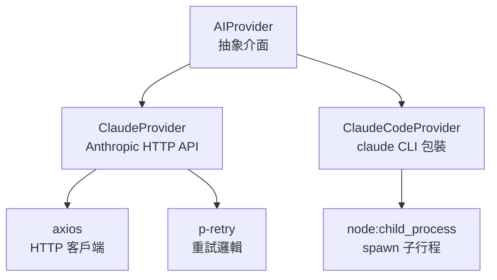
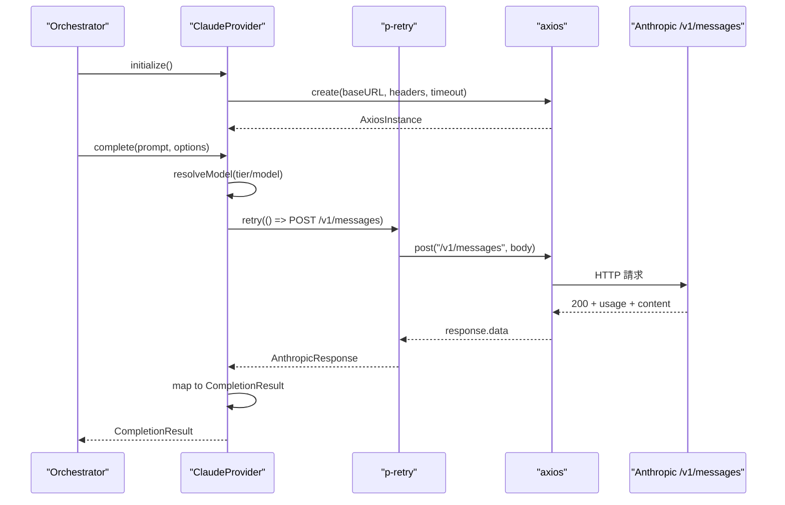
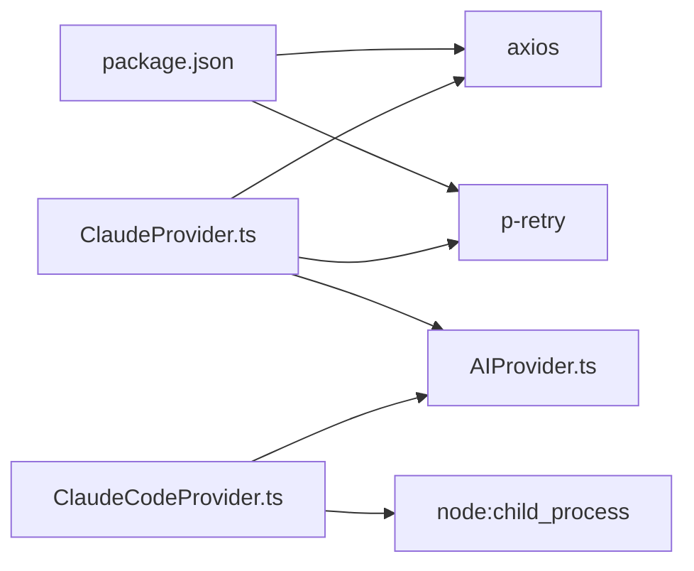
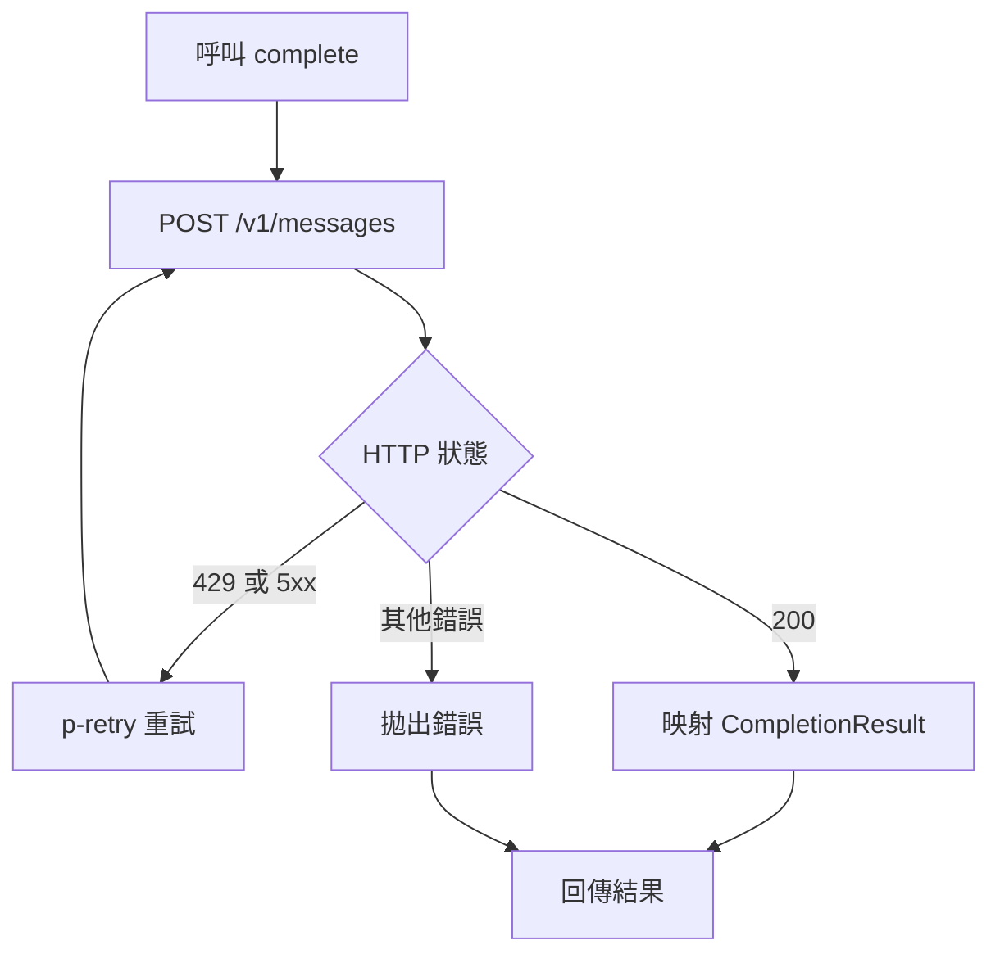

# ClaudeProvider（Anthropic API）

**本文引用的檔案**

- [src/ai/providers/ClaudeProvider.ts](https://github.com/mikeah2011/maestro/blob/master/src/ai/providers/ClaudeProvider.ts)
- [src/ai/providers/ClaudeCodeProvider.ts](https://github.com/mikeah2011/maestro/blob/master/src/ai/providers/ClaudeCodeProvider.ts)
- [src/ai/interfaces/AIProvider.ts](https://github.com/mikeah2011/maestro/blob/master/src/ai/interfaces/AIProvider.ts)
- [tests/ai/providers/ClaudeProvider.test.ts](https://github.com/mikeah2011/maestro/blob/master/tests/ai/providers/ClaudeProvider.test.ts)
- [tests/ai/providers/ClaudeCodeProvider.test.ts](https://github.com/mikeah2011/maestro/blob/master/tests/ai/providers/ClaudeCodeProvider.test.ts)
- [package.json](https://github.com/mikeah2011/maestro/blob/master/package.json)

## 目錄
1. [簡介](#簡介)
2. [專案結構與角色定位](#專案結構與角色定位)
3. [核心元件分析](#核心元件分析)
4. [架構總覽](#架構總覽)
5. [詳細實作說明](#詳細實作說明)
6. [依賴關係分析](#依賴關係分析)
7. [效能與成本優化](#效能與成本優化)
8. [錯誤處理與重試邏輯](#錯誤處理與重試邏輯)
9. [配置範例](#配置範例)
10. [常見問題排除指南](#常見問題排除指南)
11. [結論](#結論)

## 簡介
ClaudeProvider 是基於 Anthropic Messages API 的 AIProvider 實作。它使用 axios 直接呼叫 Anthropic HTTP API，而不是 Anthropic SDK，以維持較小的安裝套件規模；重試則由 p-retry 處理。ClaudeProvider 支援模型分級、系統提示、停止序列、JSON 回應解析、token 用量追蹤與美元成本估算。

相對於 ClaudeCodeProvider，ClaudeProvider 是直接 API 呼叫：可取得用量與成本、支援 Anthropic 原生 stop_reason 映射、可在 baseURL 上設定代理或自託管端點。ClaudeCodeProvider 則是包裝本地 claude CLI，不需要 ANTHROPIC_API_KEY，但無法取得 token 用量與成本估算，且 model 一律回傳 `claude-code-cli`。

## 專案結構與角色定位
本專案的 AI 提供者抽象位於 `src/ai/interfaces/AIProvider.ts`，兩個具體實作分別為：
- `src/ai/providers/ClaudeProvider.ts`：直接呼叫 Anthropic Messages API。
- `src/ai/providers/ClaudeCodeProvider.ts`：透過 `node:child_process.spawn` 執行本地 `claude` 指令。



**圖表來源**
- [src/ai/interfaces/AIProvider.ts:1-114](https://github.com/mikeah2011/maestro/blob/master/src/ai/interfaces/AIProvider.ts#L1-L114)
- [src/ai/providers/ClaudeProvider.ts:1-175](https://github.com/mikeah2011/maestro/blob/master/src/ai/providers/ClaudeProvider.ts#L1-L175)
- [src/ai/providers/ClaudeCodeProvider.ts:1-146](https://github.com/mikeah2011/maestro/blob/master/src/ai/providers/ClaudeCodeProvider.ts#L1-L146)

**章節來源**
- [src/ai/interfaces/AIProvider.ts:1-114](https://github.com/mikeah2011/maestro/blob/master/src/ai/interfaces/AIProvider.ts#L1-L114)
- [src/ai/providers/ClaudeProvider.ts:1-175](https://github.com/mikeah2011/maestro/blob/master/src/ai/providers/ClaudeProvider.ts#L1-L175)
- [src/ai/providers/ClaudeCodeProvider.ts:1-146](https://github.com/mikeah2011/maestro/blob/master/src/ai/providers/ClaudeCodeProvider.ts#L1-L146)

## 核心元件分析

### ClaudeProvider
ClaudeProvider 負責：
- 驗證並初始化 axios 客戶端，設定 Anthropic API key、base URL、timeout、headers。
- 將 orchestrator 的 prompt 轉換成 Anthropic `/v1/messages` 請求。
- 使用 p-retry 對 429 與 5xx 狀態進行重試。
- 將 Anthropic response 映射到 CompletionResult，包含 content、model、usage、finishReason、parsedJson。
- 依據模型名稱計算預估美元成本。

關鍵特性：
- 預設模型分級：cheap → claude-haiku-4-5-20251001，strong → claude-sonnet-4-6，flagship → claude-opus-4-7。
- 預設 maxTokens=4096、temperature=0。
- systemPrompt 會放入 request body 的 `system`。
- stopSequences 會放入 `stop_sequences`。
- JSON 回應解析僅在 responseFormat 為 `json_object` 或 `json_schema` 時嘗試。

**章節來源**
- [src/ai/providers/ClaudeProvider.ts:1-175](https://github.com/mikeah2011/maestro/blob/master/src/ai/providers/ClaudeProvider.ts#L1-L175)

### ClaudeCodeProvider
ClaudeCodeProvider 負責：
- 使用 spawn 執行本地 `claude` 指令。
- initialize 階段會執行 `claude --version` 檢查二進位是否存在。
- testConnection 會執行 `claude --print ping`。
- complete 會執行 `claude --print <prompt>`，並將 systemPrompt 前置到使用者 prompt。
- 不具備 token 用量與成本估算；model 固定為 `claude-code-cli`。

**章節來源**
- [src/ai/providers/ClaudeCodeProvider.ts:1-146](https://github.com/mikeah2011/maestro/blob/master/src/ai/providers/ClaudeCodeProvider.ts#L1-L146)

### AIProvider 抽象介面
AIProvider 定義：
- type、initialize、testConnection、resolveModel、complete。
- AIProviderConfig 包含 apiKey、baseUrl、models、defaultTier、timeout、retries 等通用欄位。
- CompletionOptions 包含 model、tier、systemPrompt、maxTokens、temperature、responseFormat、stopSequences、timeout、callerTag。
- CompletionUsage 包含 inputTokens、outputTokens、cacheReadTokens、cacheWriteTokens、estimatedCostUsd。
- FinishReason 包含 stop、max_tokens、content_filter、tool_use、error。
- CompletionResult 包含 content、model、usage、finishReason、parsedJson、raw。

這個抽象讓 orchestrator 可以統一調用不同 LLM provider，而不需關心底層是 Anthropic HTTP、OpenAI、Google、Ollama 或 CLI。

**章節來源**
- [src/ai/interfaces/AIProvider.ts:1-114](https://github.com/mikeah2011/maestro/blob/master/src/ai/interfaces/AIProvider.ts#L1-L114)

## 架構總覽



**圖表來源**
- [src/ai/providers/ClaudeProvider.ts:60-175](https://github.com/mikeah2011/maestro/blob/master/src/ai/providers/ClaudeProvider.ts#L60-L175)

## 詳細實作說明

### API Key 與連線初始化
ClaudeProvider.initialize 會：
- 要求 config.apiKey 存在，否則拋出錯誤。
- 使用 axios.create 建立 HTTP 客戶端。
- baseURL 預設為 `https://api.anthropic.com`，可由 config.baseUrl 覆蓋。
- timeout 預設 60000 ms，可由 config.timeout 覆蓋。
- headers 包含 `x-api-key`、`anthropic-version: 2023-06-01`、`content-type: application/json`。

testConnection 會呼叫一次 minimal complete('ping', { maxTokens: 1, tier: 'cheap' })，成功回傳 true，失敗回傳 false。

**章節來源**
- [src/ai/providers/ClaudeProvider.ts:38-66](https://github.com/mikeah2011/maestro/blob/master/src/ai/providers/ClaudeProvider.ts#L38-L66)
- [tests/ai/providers/ClaudeProvider.test.ts:38-74](https://github.com/mikeah2011/maestro/blob/master/tests/ai/providers/ClaudeProvider.test.ts#L38-L74)

### 模型選擇與分級
resolveModel 優先使用 config.models[tier]，若未設定則退回預設模型：
- cheap → claude-haiku-4-5-20251001
- strong → claude-sonnet-4-6
- flagship → claude-opus-4-7

complete 的 model 決定順序：
1. options.model
2. 若無，則使用 options.tier
3. 若 tier 也無，則使用 config.defaultTier
4. 若仍無，則使用 'strong'

**章節來源**
- [src/ai/providers/ClaudeProvider.ts:22-36](https://github.com/mikeah2011/maestro/blob/master/src/ai/providers/ClaudeProvider.ts#L22-L36)
- [src/ai/providers/ClaudeProvider.ts:76-90](https://github.com/mikeah2011/maestro/blob/master/src/ai/providers/ClaudeProvider.ts#L76-L90)
- [tests/ai/providers/ClaudeProvider.test.ts:76-96](https://github.com/mikeah2011/maestro/blob/master/tests/ai/providers/ClaudeProvider.test.ts#L76-L96)

### 請求參數映射
ClaudeProvider.complete 會建構 Anthropic Messages API 請求 body：
- model
- max_tokens
- temperature
- messages: [{ role: 'user', content: prompt }]
- system（當 options.systemPrompt 存在）
- stop_sequences（當 options.stopSequences.length > 0）

完整請求路徑為 POST `/v1/messages`。

**章節來源**
- [src/ai/providers/ClaudeProvider.ts:90-116](https://github.com/mikeah2011/maestro/blob/master/src/ai/providers/ClaudeProvider.ts#L90-L116)
- [tests/ai/providers/ClaudeProvider.test.ts:100-135](https://github.com/mikeah2011/maestro/blob/master/tests/ai/providers/ClaudeProvider.test.ts#L100-L135)

### 回應映射與 JSON 解析
Anthropic 回應被映射為：
- content：過濾 type === 'text' 的 content items，並拼接 text。
- model：raw.model。
- finishReason：根據 STOP_REASON_MAP 映射 end_turn、max_tokens、stop_sequence、tool_use，其他值回傳 'stop'。
- usage：inputTokens、outputTokens、cacheReadTokens、cacheWriteTokens。
- parsedJson：僅當 responseFormat.type 為 json_object 或 json_schema 時嘗試 JSON.parse。
- raw：保留原始 Anthropic 回應供稽核。

**章節來源**
- [src/ai/providers/ClaudeProvider.ts:116-175](https://github.com/mikeah2011/maestro/blob/master/src/ai/providers/ClaudeProvider.ts#L116-L175)
- [tests/ai/providers/ClaudeProvider.test.ts:100-177](https://github.com/mikeah2011/maestro/blob/master/tests/ai/providers/ClaudeProvider.test.ts#L100-L177)

### 成本追蹤機制
ClaudeProvider 維護一個 COST_PER_1M 表格，針對三個預設模型定義每百萬 token 的 USD 價格：
- claude-haiku-4-5-20251001：input 0.80、output 4.00
- claude-sonnet-4-6：input 3.00、output 15.00
- claude-opus-4-7：input 15.00、output 75.00

estimatedCostUsd = (input_tokens / 1,000,000) × input_price + (output_tokens / 1,000,000) × output_price。若 raw.model 不在表中，estimatedCostUsd 為 undefined。

ClaudeCodeProvider 不支援成本估算，usage.inputTokens 與 usage.outputTokens 一律為 0。

**章節來源**
- [src/ai/providers/ClaudeProvider.ts:22-36](https://github.com/mikeah2011/maestro/blob/master/src/ai/providers/ClaudeProvider.ts#L22-L36)
- [src/ai/providers/ClaudeProvider.ts:130-148](https://github.com/mikeah2011/maestro/blob/master/src/ai/providers/ClaudeProvider.ts#L130-L148)
- [tests/ai/providers/ClaudeProvider.test.ts:143-157](https://github.com/mikeah2011/maestro/blob/master/tests/ai/providers/ClaudeProvider.test.ts#L143-L157)
- [src/ai/providers/ClaudeCodeProvider.ts:76-94](https://github.com/mikeah2011/maestro/blob/master/src/ai/providers/ClaudeCodeProvider.ts#L76-L94)

### 與 ClaudeCodeProvider 的差異對比

| 比較面向 | ClaudeProvider | ClaudeCodeProvider |
|---|---|---|
| 通訊方式 | 直接 HTTP 呼叫 Anthropic API | 執行本地 claude CLI |
| API Key | 需要 ANTHROPIC_API_KEY | 不需要 ANTHROPIC_API_KEY |
| Base URL | 可設定 baseUrl | 不適用 |
| 模型選擇 | 支援 tier 與 models 覆蓋 | 預設 claude-code-cli |
| Token 用量 | 有 input/output/cache | 全部為 0 |
| 成本估算 | 有 estimatedCostUsd | 無 |
| 錯誤類型 | HTTP 429/5xx 重試 | CLI exit code、spawn error、timeout |
| System Prompt | 使用 Anthropic system field | 前置到 user prompt |
| JSON 解析 | JSON.parse(content) | 正規表達式取出最外層 JSON |
| 測試連接 | complete('ping') | claude --print ping |

**章節來源**
- [src/ai/providers/ClaudeProvider.ts:1-175](https://github.com/mikeah2011/maestro/blob/master/src/ai/providers/ClaudeProvider.ts#L1-L175)
- [src/ai/providers/ClaudeCodeProvider.ts:1-146](https://github.com/mikeah2011/maestro/blob/master/src/ai/providers/ClaudeCodeProvider.ts#L1-L146)

## 依賴關係分析



**圖表來源**
- [package.json:60-85](https://github.com/mikeah2011/maestro/blob/master/package.json#L60-L85)
- [src/ai/providers/ClaudeProvider.ts:1-20](https://github.com/mikeah2011/maestro/blob/master/src/ai/providers/ClaudeProvider.ts#L1-L20)
- [src/ai/providers/ClaudeCodeProvider.ts:1-20](https://github.com/mikeah2011/maestro/blob/master/src/ai/providers/ClaudeCodeProvider.ts#L1-L20)

**章節來源**
- [package.json:60-85](https://github.com/mikeah2011/maestro/blob/master/package.json#L60-L85)
- [src/ai/providers/ClaudeProvider.ts:1-20](https://github.com/mikeah2011/maestro/blob/master/src/ai/providers/ClaudeProvider.ts#L1-L20)
- [src/ai/providers/ClaudeCodeProvider.ts:1-20](https://github.com/mikeah2011/maestro/blob/master/src/ai/providers/ClaudeCodeProvider.ts#L1-L20)

## 效能與成本優化

### 模型分級策略
orchestrator 可依任務強度選擇 tier：
- cheap：大量、低風險、高流量操作。
- strong：一般判斷與生成。
- flagship：最終輸出或高價值決策。

這可同時控制成本與品質。

### 溫度與確定性
預設 temperature=0，適合 orchestrator 的穩定行為。若需要更多創意，可提升 temperature，但這會影響可重複性。

### Token 預算
建議根據 prompt 長度與預期回覆長短設定 maxTokens，避免過大導致延遲與費用上升。ClaudeProvider 預設 4096。

### 重試間隔
p-retry 使用 minTimeout=1000、maxTimeout=30000。對頻繁觸發 rate limit 的情境，可考慮提高 retries 或在上層加入退避邏輯。

### 成本觀察
透過 usage.estimatedCostUsd 與 usage.inputTokens/outputTokens 累計每次呼叫成本。ClaudeCodeProvider 不具備此能力，因此不適合用於精確成本追蹤場景。

[本節為一般性建議，未直接分析特定程式碼行]

## 錯誤處理與重試邏輯

### HTTP 錯誤與重試
ClaudeProvider.complete 使用 p-retry 包裹 HTTP 呼叫。shouldRetry 會檢查：
- 是否為 axios.isAxiosError
- status 是否為 429 或大於等於 500

符合條件時重試，否則立即失敗。重試次數來自 config.retries，預設 3。



**圖表來源**
- [src/ai/providers/ClaudeProvider.ts:116-140](https://github.com/mikeah2011/maestro/blob/master/src/ai/providers/ClaudeProvider.ts#L116-L140)

### API Error
Anthropic API 可能回傳 4xx/5xx。ClaudeProvider 不會自行解讀錯誤訊息內容，而是將非 429/5xx 錯誤直接向上拋出。呼叫端應捕獲錯誤並記錄狀態碼、request id、message 等資訊。

### Rate Limit
429 會觸發重試。若持續觸發，代表上游限流嚴重，應：
- 降低請求頻率
- 提高 retries
- 調整 tier 至更便宜但更穩定的模型
- 在上層實作指數退避或佇列

### Token Limit
Anthropic 可能因 max_tokens 限制而返回 stop_reason='max_tokens'。FinishReason 會映射為 'max_tokens'。呼叫端可根據 finishReason 判斷是否需要增加 maxTokens 或分段處理。

### CLI 錯誤
ClaudeCodeProvider.exec 會：
- 捕捉 spawn 錯誤
- 超過 timeoutMs 後 kill 子行程並拒絕 Promise
- 非 zero exit code 時收集 stderr 並拒絕
- 成功時合併 stdout 並 trim

**章節來源**
- [src/ai/providers/ClaudeProvider.ts:116-140](https://github.com/mikeah2011/maestro/blob/master/src/ai/providers/ClaudeProvider.ts#L116-L140)
- [src/ai/providers/ClaudeCodeProvider.ts:96-146](https://github.com/mikeah2011/maestro/blob/master/src/ai/providers/ClaudeCodeProvider.ts#L96-L146)
- [tests/ai/providers/ClaudeProvider.test.ts:38-74](https://github.com/mikeah2011/maestro/blob/master/tests/ai/providers/ClaudeProvider.test.ts#L38-L74)

## 配置範例

### ClaudeProvider 基本配置
```yaml
provider: claude
apiKey: "${ANTHROPIC_API_KEY}"
baseUrl: "https://api.anthropic.com"
timeout: 60000
retries: 3
defaultTier: strong
models:
  cheap: "claude-haiku-4-5-20251001"
  strong: "claude-sonnet-4-6"
  flagship: "claude-opus-4-7"
```

### ClaudeProvider 代理或自託管配置
```yaml
provider: claude
apiKey: "${ANTHROPIC_API_KEY}"
baseUrl: "https://my-proxy.example.com"
timeout: 120000
retries: 5
defaultTier: strong
```

### ClaudeCodeProvider 配置
```yaml
provider: claude
claudeBin: "claude"
timeout: 120000
models:
  strong: "claude-code-cli"
```

注意：ClaudeCodeProvider 不需要 apiKey，因為它依賴本地 claude CLI 的 session credentials。

**章節來源**
- [src/ai/interfaces/AIProvider.ts:24-53](https://github.com/mikeah2011/maestro/blob/master/src/ai/interfaces/AIProvider.ts#L24-L53)
- [src/ai/providers/ClaudeProvider.ts:38-66](https://github.com/mikeah2011/maestro/blob/master/src/ai/providers/ClaudeProvider.ts#L38-L66)
- [src/ai/providers/ClaudeCodeProvider.ts:22-40](https://github.com/mikeah2011/maestro/blob/master/src/ai/providers/ClaudeCodeProvider.ts#L22-L40)

## 常見問題排除指南

### 問題：initialize 時缺少 apiKey
**現象**：抛出不含 apiKey 的錯誤。  
**原因**：config.apiKey 未設定。  
**解決**：設定 ANTHROPIC_API_KEY 或在配置中提供 apiKey。

**章節來源**
- [src/ai/providers/ClaudeProvider.ts:40-47](https://github.com/mikeah2011/maestro/blob/master/src/ai/providers/ClaudeProvider.ts#L40-L47)
- [tests/ai/providers/ClaudeProvider.test.ts:48-54](https://github.com/mikeah2011/maestro/blob/master/tests/ai/providers/ClaudeProvider.test.ts#L48-L54)

### 問題：complete 前未呼叫 initialize
**現象**：抛出 require initialize() 的錯誤。  
**原因**：呼叫者跳過 initialize 步驟。  
**解決**：先呼叫 initialize，再呼叫 complete。

**章節來源**
- [src/ai/providers/ClaudeProvider.ts:72-75](https://github.com/mikeah2011/maestro/blob/master/src/ai/providers/ClaudeProvider.ts#L72-L75)
- [tests/ai/providers/ClaudeProvider.test.ts:100-106](https://github.com/mikeah2011/maestro/blob/master/tests/ai/providers/ClaudeProvider.test.ts#L100-L106)

### 問題：Anthropic API 頻繁 429
**現象**：大量 rate limit 錯誤。  
**原因**：超出 Anthropic 速率限制。  
**解決**：
- 減少請求頻率
- 提高 retries
- 使用 cheaper tier
- 在上層實作退避佇列

**章節來源**
- [src/ai/providers/ClaudeProvider.ts:120-140](https://github.com/mikeah2011/maestro/blob/master/src/ai/providers/ClaudeProvider.ts#L120-L140)

### 問題：Claude CLI 找不到
**現象**：initialize 或 testConnection 失敗。  
**原因**：claude 二進位不存在於 PATH。  
**解決**：安裝 Claude Code CLI，或使用 claudeBin 指定完整路徑。

**章節來源**
- [tests/ai/providers/ClaudeCodeProvider.test.ts:62-82](https://github.com/mikeah2011/maestro/blob/master/tests/ai/providers/ClaudeCodeProvider.test.ts#L62-L82)
- [src/ai/providers/ClaudeCodeProvider.ts:44-56](https://github.com/mikeah2011/maestro/blob/master/src/ai/providers/ClaudeCodeProvider.ts#L44-L56)

### 問題：JSON 解析失敗
**現象**：parsedJson 為 undefined。  
**原因**：model 回傳非合法 JSON，或 responseFormat 不是 json_object/json_schema。  
**解決**：
- 檢查 systemPrompt 與 prompt 是否引導 model 輸出純 JSON
- 確認 responseFormat.type 設定正確
- 查看 raw.content 與 raw.finishReason

**章節來源**
- [src/ai/providers/ClaudeProvider.ts:148-175](https://github.com/mikeah2011/maestro/blob/master/src/ai/providers/ClaudeProvider.ts#L148-L175)
- [tests/ai/providers/ClaudeProvider.test.ts:136-142](https://github.com/mikeah2011/maestro/blob/master/tests/ai/providers/ClaudeProvider.test.ts#L136-L142)

### 問題：成本估算為 undefined
**現象**：usage.estimatedCostUsd 為 undefined。  
**原因**：raw.model 不在 COST_PER_1M 表中。  
**解決**：使用預設模型，或在未來擴展 COST_PER_1M。

**章節來源**
- [src/ai/providers/ClaudeProvider.ts:22-36](https://github.com/mikeah2011/maestro/blob/master/src/ai/providers/ClaudeProvider.ts#L22-L36)
- [src/ai/providers/ClaudeProvider.ts:148-156](https://github.com/mikeah2011/maestro/blob/master/src/ai/providers/ClaudeProvider.ts#L148-L156)

## 結論
ClaudeProvider 是本專案中直接整合 Anthropic Messages API 的主要提供者。它提供清晰的 API key 管理、模型分級、請求參數映射、錯誤重試、token 用量與成本估算，適合生產環境與需要成本追蹤的場景。ClaudeCodeProvider 則適合開發人員快速體驗本地 Claude Code CLI，但不適合需要用量與成本精確追蹤的自動化流程。

實務上建議：
- 優先使用 ClaudeProvider 搭配 ANTHROPIC_API_KEY。
- 依任務強度選擇 tier，平衡成本與品質。
- 監控 finishReason、usage、estimatedCostUsd。
- 針對 429/5xx 設計上層退避與監控。
- 使用 ClaudeCodeProvider 作為開發輔助，而非主要成本來源。