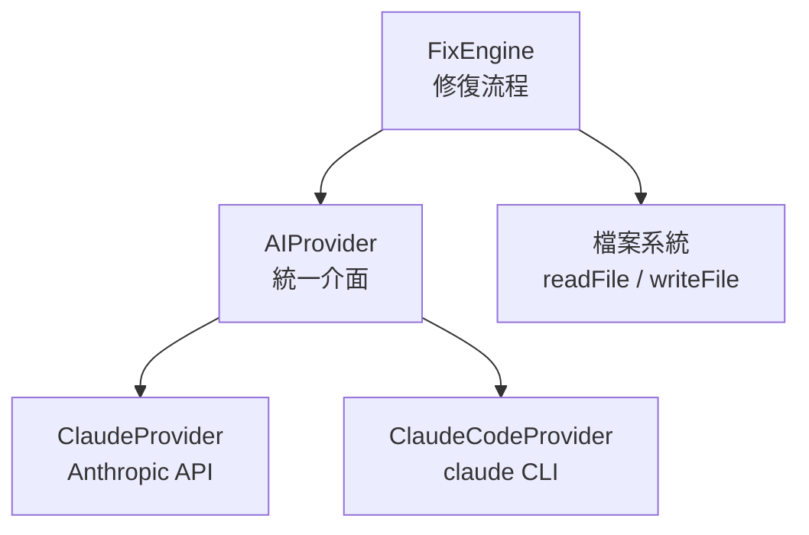
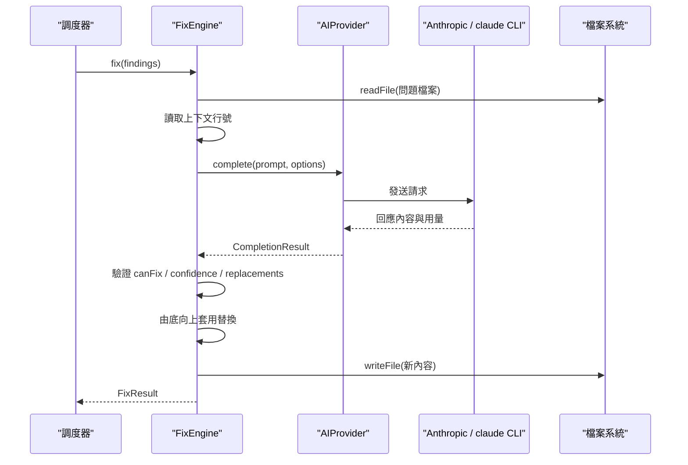
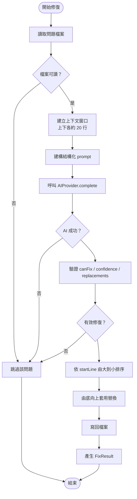
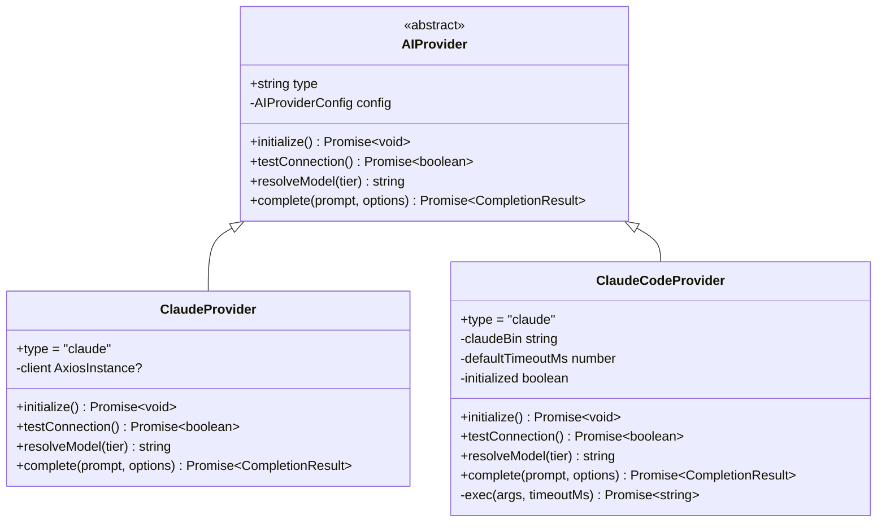
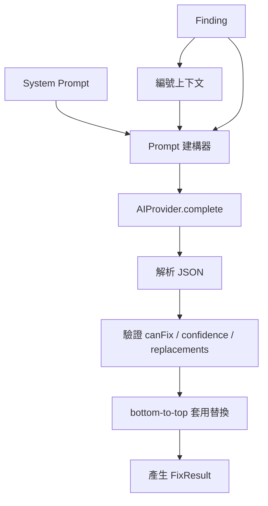
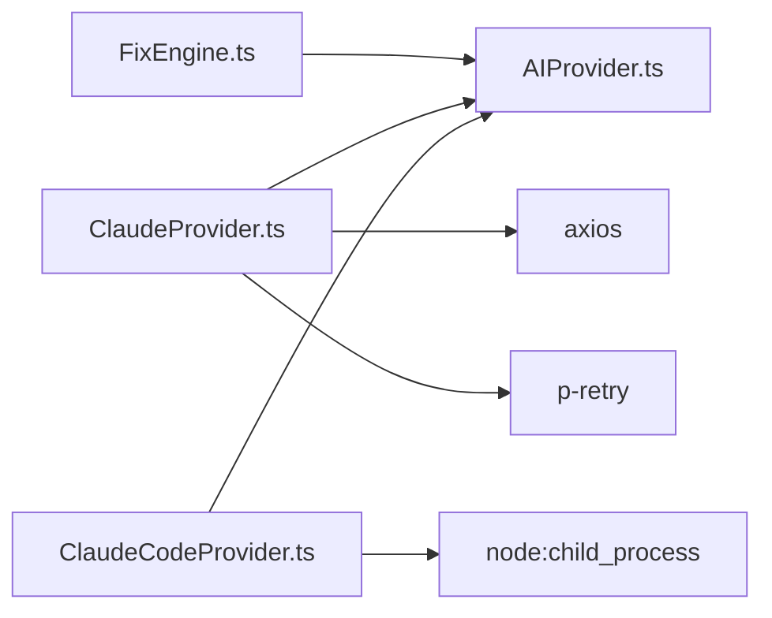

# AI 自動修復引擎

<cite>
**本文引用的檔案**   
- [AIProvider.ts](https://github.com/mikeah2011/maestro/blob/master/src/ai/interfaces/AIProvider.ts)
- [ClaudeProvider.ts](https://github.com/mikeah2011/maestro/blob/master/src/ai/providers/ClaudeProvider.ts)
- [ClaudeCodeProvider.ts](https://github.com/mikeah2011/maestro/blob/master/src/ai/providers/ClaudeCodeProvider.ts)
- [FixEngine.ts](https://github.com/mikeah2011/maestro/blob/master/src/core/fix/FixEngine.ts)
- [README.md](https://github.com/mikeah2011/maestro/blob/master/README.md)
- [DESIGN.md](https://github.com/mikeah2011/maestro/blob/master/docs/DESIGN.md)
- [FixEngine.test.ts](https://github.com/mikeah2011/maestro/blob/master/tests/core/fix/FixEngine.test.ts)
- [ClaudeProvider.test.ts](https://github.com/mikeah2011/maestro/blob/master/tests/ai/providers/ClaudeProvider.test.ts)
- [ClaudeCodeProvider.test.ts](https://github.com/mikeah2011/maestro/blob/master/tests/ai/providers/ClaudeCodeProvider.test.ts)
</cite>

## 目錄

1. [引言](#引言)
2. [專案結構與定位](#專案結構與定位)
3. [核心元件總覽](#核心元件總覽)
4. [架構總覽](#架構總覽)
5. [詳細元件分析](#詳細元件分析)
6. [依賴關係分析](#依賴關係分析)
7. [Prompt 設計最佳實踐](#prompt-設計最佳實踐)
8. [成本優化技巧](#成本優化技巧)
9. [錯誤處理與重試機制](#錯誤處理與重試機制)
10. [自訂 Provider 開發指南](#自訂-provider-開發指南)
11. [故障排除指南](#故障排除指南)
12. [結論](#結論)

## 引言

本文件針對 Maestro 的 **AI 自動修復引擎**，說明 FixEngine 如何把審查機器人發現的問題轉換為實際程式碼修改，並深入分析 AIProvider 抽象介面、ClaudeProvider（Anthropic API）與 ClaudeCodeProvider（claude CLI）的實作差異。

整體目標是：

- 讀取問題附近程式碼上下文。
- 建構結構化 prompt。
- 透過 AIProvider.complete 取得 JSON replacement。
- 由底向上套用替換，避免行號偏移。
- 寫回檔案，完成一次修復循環。

同時說明 tier/routing/cost attribution 的設計原則、Provider 自動偵測順序與 fallback 策略，以及如何在現有架構中擴充新的 Provider。

**章節來源**
- [README.md:1-200](https://github.com/mikeah2011/maestro/blob/master/README.md#L1-L200)
- [DESIGN.md:1-200](https://github.com/mikeah2011/maestro/blob/master/docs/DESIGN.md#L1-L200)

## 專案結構與定位

AI 自動修復相關程式碼集中在兩個層次：

| 層級 | 路徑 | 責任 |
|---|---|---|
| AI 抽象層 | `src/ai/interfaces/AIProvider.ts` | 定義 provider 統一介面、tier、cost usage、finish reason |
| AI 提供者 | `src/ai/providers/ClaudeProvider.ts` | 使用 Anthropic Messages API |
| AI 提供者 | `src/ai/providers/ClaudeCodeProvider.ts` | 使用本地 claude CLI |
| 修復引擎 | `src/core/fix/FixEngine.ts` | 讀檔 → 構建 prompt → AI → JSON → bottom-to-top 寫檔 |

**圖表來源**
- [FixEngine.ts:1-216](https://github.com/mikeah2011/maestro/blob/master/src/core/fix/FixEngine.ts#L1-L216)
- [AIProvider.ts:1-114](https://github.com/mikeah2011/maestro/blob/master/src/ai/interfaces/AIProvider.ts#L1-L114)
- [ClaudeProvider.ts:1-175](https://github.com/mikeah2011/maestro/blob/master/src/ai/providers/ClaudeProvider.ts#L1-L175)
- [ClaudeCodeProvider.ts:1-146](https://github.com/mikeah2011/maestro/blob/master/src/ai/providers/ClaudeCodeProvider.ts#L1-L146)

**章節來源**
- [README.md:1-200](https://github.com/mikeah2011/maestro/blob/master/README.md#L1-L200)
- [DESIGN.md:1-200](https://github.com/mikeah2011/maestro/blob/master/docs/DESIGN.md#L1-L200)

## 核心元件總覽

### AIProvider 抽象介面

AIProvider 是一個「prompt → completion」的純管道，不內建 review 邏輯；review 與 prompt 建構放在調度器與 FixEngine 中。

它暴露以下關鍵能力：

| 方法或屬性 | 用途 |
|---|---|
| `type` | 識別 provider 類型 |
| `initialize()` | 驗證設定、建立 HTTP 或子程序客戶端 |
| `testConnection()` | 輕量連線檢查 |
| `resolveModel(tier)` | 將 cheap / strong / flagship 解析成具體模型 ID |
| `complete(prompt, options)` | 唯一對外呼叫點 |

支援的 tier 包括：

| Tier | 語意 |
|---|---|
| `cheap` | 高流量、低風險操作 |
| `strong` | 一般判斷性修復 |
| `flagship` | 最終輸出或高價值決策 |

CompletionOptions 允許每筆呼叫覆蓋 model、tier、systemPrompt、maxTokens、temperature、responseFormat、stopSequences、timeout 與 callerTag。

CompletionResult 提供 content、model、usage、finishReason、parsedJson 與 raw，方便稽核與重播。

**章節來源**
- [AIProvider.ts:1-114](https://github.com/mikeah2011/maestro/blob/master/src/ai/interfaces/AIProvider.ts#L1-L114)

### FixEngine 修復引擎

FixEngine 是無狀態修復器，對每個 classified finding 執行固定五階段流程：

1. 讀取問題所在檔案。
2. 讀取上下文中約 20 行。
3. 建構帶有編號行號的 structured prompt。
4. 呼叫 AIProvider.complete，期望返回 JSON replacement。
5. 由底向上套用替換並寫回檔案。

它可注入 `readFile` 與 `writeFile`，讓測試完全避開真實檔案系統。

**章節來源**
- [FixEngine.ts:1-216](https://github.com/mikeah2011/maestro/blob/master/src/core/fix/FixEngine.ts#L1-L216)

### ClaudeProvider

ClaudeProvider 使用 axios 直接呼叫 Anthropic `/v1/messages`，而不是引入完整 SDK，以減少安裝套件數量。

重點特性：

- 需要 `apiKey`。
- 預設 base URL 為 Anthropic API。
- 支援 `baseUrl` 代理或自託管部署。
- 支援 `models` 覆蓋每個 tier 對應的模型。
- 使用 p-retry 重試 429 與 5xx。
- 計算預估費用。
- 自動嘗試解析 JSON。

**章節來源**
- [ClaudeProvider.ts:1-175](https://github.com/mikeah2011/maestro/blob/master/src/ai/providers/ClaudeProvider.ts#L1-L175)

### ClaudeCodeProvider

ClaudeCodeProvider 使用 node child_process 啟動本地 `claude` 二進位，適合已設定好 Claude Code 的開發者環境，不需要 ANTHROPIC_API_KEY。

限制包括：

- token 用量一律回報為 0。
- 無法計算成本。
- model 固定為 `claude-code-cli`。
- systemPrompt 會拼接到 user prompt 前面，沒有原生 system role。
- 錯誤訊息來自 CLI stderr。

**章節來源**
- [ClaudeCodeProvider.ts:1-146](https://github.com/mikeah2011/maestro/blob/master/src/ai/providers/ClaudeCodeProvider.ts#L1-L146)

## 架構總覽

FixEngine 並不直接依賴 Anthropic 或 claude CLI，而是依賴 AIProvider 抽象。這樣做的好處是：

- 修復流程不受後端實現影響。
- 可在不同環境切換 API 模式與 CLI 模式。
- 未來新增 OpenAI、Gemini、本地 Ollama 等 Provider 時，不需改動 FixEngine。

**圖表來源**
- [FixEngine.ts:1-216](https://github.com/mikeah2011/maestro/blob/master/src/core/fix/FixEngine.ts#L1-L216)
- [ClaudeProvider.ts:1-175](https://github.com/mikeah2011/maestro/blob/master/src/ai/providers/ClaudeProvider.ts#L1-L175)
- [ClaudeCodeProvider.ts:1-146](https://github.com/mikeah2011/maestro/blob/master/src/ai/providers/ClaudeCodeProvider.ts#L1-L146)

## 詳細元件分析

### FixEngine 修復流程

FixEngine 的核心行為如下：

#### 重要行為細節

| 行為 | 說明 |
|---|---|
| 上下文大小 | 預設上下各 20 行 |
| 編號上下文 | 每一行加上行號，幫助模型精確定位 |
| 溫度參數 | temperature 設為 0，確保修復行為穩定 |
| JSON 格式 | responseFormat 指定為 json_object |
| 置信度閾值 | minConfidence 預設 0.7 |
| 替換順序 | 由底向上排序，避免較早替換改變後續行號 |
| 錯誤容錯 | 讀檔失敗、AI 拋出異常、寫檔失敗都會跳過該問題 |

**圖表來源**
- [FixEngine.ts:1-216](https://github.com/mikeah2011/maestro/blob/master/src/core/fix/FixEngine.ts#L1-L216)

**章節來源**
- [FixEngine.ts:1-216](https://github.com/mikeah2011/maestro/blob/master/src/core/fix/FixEngine.ts#L1-L216)
- [FixEngine.test.ts:1-200](https://github.com/mikeah2011/maestro/blob/master/tests/core/fix/FixEngine.test.ts#L1-L200)

### AIProvider 類別結構

**圖表來源**
- [AIProvider.ts:1-114](https://github.com/mikeah2011/maestro/blob/master/src/ai/interfaces/AIProvider.ts#L1-L114)
- [ClaudeProvider.ts:1-175](https://github.com/mikeah2011/maestro/blob/master/src/ai/providers/ClaudeProvider.ts#L1-L175)
- [ClaudeCodeProvider.ts:1-146](https://github.com/mikeah2011/maestro/blob/master/src/ai/providers/ClaudeCodeProvider.ts#L1-L146)

**章節來源**
- [AIProvider.ts:1-114](https://github.com/mikeah2011/maestro/blob/master/src/ai/interfaces/AIProvider.ts#L1-L114)
- [ClaudeProvider.ts:1-175](https://github.com/mikeah2011/maestro/blob/master/src/ai/providers/ClaudeProvider.ts#L1-L175)
- [ClaudeCodeProvider.ts:1-146](https://github.com/mikeah2011/maestro/blob/master/src/ai/providers/ClaudeCodeProvider.ts#L1-L146)

### ClaudeProvider 與 ClaudeCodeProvider 實作對比

| 比較項目 | ClaudeProvider | ClaudeCodeProvider |
|---|---|---|
| 後端 | Anthropic Messages API | 本地 claude CLI |
| 憑證 | 需要 apiKey | 使用 CLI 自身 session 憑證 |
| HTTP 庫 | axios | 不適用 |
| 子程序 | 不適用 | node:child_process.spawn |
| 重試機制 | p-retry，針對 429 與 5xx | 無自動重試 |
| Token 用量 | inputTokens / outputTokens | 一律 0 |
| 成本估算 | 可計算 estimatedCostUsd | 不可計算 |
| model 欄位 | 實際模型名稱 | 固定為 claude-code-cli |
| finishReason | 映射 Anthropic stop_reason | 固定為 stop |
| systemPrompt | 放入 body.system | 字串拼接到 user prompt |
| JSON 解析 | 嘗試解析 JSON | 用正規表達式取出最外層 JSON |
| 預設逾時 | 60 秒 | 120 秒 |
| 初始化動作 | 建立 axios 客戶端 | 執行 `claude --version` |
| testConnection | 發送簡短訊息 | 執行 `claude --print ping` |

**章節來源**
- [ClaudeProvider.ts:1-175](https://github.com/mikeah2011/maestro/blob/master/src/ai/providers/ClaudeProvider.ts#L1-L175)
- [ClaudeCodeProvider.ts:1-146](https://github.com/mikeah2011/maestro/blob/master/src/ai/providers/ClaudeCodeProvider.ts#L1-L146)
- [ClaudeProvider.test.ts:1-177](https://github.com/mikeah2011/maestro/blob/master/tests/ai/providers/ClaudeProvider.test.ts#L1-L177)
- [ClaudeCodeProvider.test.ts:1-200](https://github.com/mikeah2011/maestro/blob/master/tests/ai/providers/ClaudeCodeProvider.test.ts#L1-L200)

### Prompt 與 JSON Replacement 流程

FixEngine 的 prompt 包含以下資訊：

- 問題來源檔案。
- 問題行號範圍。
- 嚴重程度。
- 標題與描述。
- 帶行號的程式碼上下文。
- 明確指示只輸出 JSON。

AI 回傳的 FixResponse 必須包含：

| 欄位 | 類型 | 用途 |
|---|---|---|
| `canFix` | boolean | 表示是否具備足夠上下文進行修復 |
| `confidence` | number | 0–1 之間的信心分數 |
| `description` | string | 最多 72 個字元的過去式描述，作為 commit message |
| `replacements` | array | 一行或多行替換區塊 |

LineReplacement 使用 1-based 起始行與結束行，newContent 以換行符號連接多行。

**圖表來源**
- [FixEngine.ts:1-216](https://github.com/mikeah2011/maestro/blob/master/src/core/fix/FixEngine.ts#L1-L216)

**章節來源**
- [FixEngine.ts:1-216](https://github.com/mikeah2011/maestro/blob/master/src/core/fix/FixEngine.ts#L1-L216)

### Prompt 設計與修復規則

FixEngine 的 system prompt 強調以下原則：

- 角色是手術刀式的程式碼修復助手。
- 輸入來自多個 AI 審查機器人。
- 目標是最小化、精準修復，不做大規模重構。
- 只解決單一 finding。
- 多段 replacement 僅在相同根因下才允許。
- canFix 為 false 時省略 replacements。
- confidence 低於 0.7 會被引擎自動捨棄。
- description 必須是過去式命令句。
- newContent 要保留縮排與風格。
- 非必要時不要新增 import。

buildPrompt 函式會把 finding 與編號上下文組合，並在結尾要求只輸出 JSON。

**章節來源**
- [FixEngine.ts:1-216](https://github.com/mikeah2011/maestro/blob/master/src/core/fix/FixEngine.ts#L1-L216)

### 自動偵測順序與 Fallback 策略

根據 README，AI Provider 自動偵測順序如下：

1. **ClaudeProvider**：當 `ANTHROPIC_API_KEY` 或設定中的 `apiKey` 有值時使用。
2. **ClaudeCodeProvider**：當本機已安裝 `claude` CLI 時自動 fallback，無需 API Key。
3. **停用修復引擎**：兩者皆不可用時，循環繼續但跳過 AI 自動修復。

這意味著：

- CI 或伺服器環境通常優先走 ClaudeProvider。
- 開發者機器若沒有 API Key，但有 Claude Code，則自動退回 CLI。
- 若兩者都不可用，不會直接崩潰，而是放棄自動修復。

**章節來源**
- [README.md:1-200](https://github.com/mikeah2011/maestro/blob/master/README.md#L1-L200)

## 依賴關係分析

FixEngine 與 AIProvider 解耦，而 ClaudeProvider 與 ClaudeCodeProvider 各自獨立實現同一組方法。

**圖表來源**
- [FixEngine.ts:1-216](https://github.com/mikeah2011/maestro/blob/master/src/core/fix/FixEngine.ts#L1-L216)
- [AIProvider.ts:1-114](https://github.com/mikeah2011/maestro/blob/master/src/ai/interfaces/AIProvider.ts#L1-L114)
- [ClaudeProvider.ts:1-175](https://github.com/mikeah2011/maestro/blob/master/src/ai/providers/ClaudeProvider.ts#L1-L175)
- [ClaudeCodeProvider.ts:1-146](https://github.com/mikeah2011/maestro/blob/master/src/ai/providers/ClaudeCodeProvider.ts#L1-L146)

### 耦合與內聚分析

| 模組 | 耦合對象 | 內聚程度 |
|---|---|---|
| FixEngine | AIProvider、Finding、LoopOrchestrator、Node fs | 高：專注於單一修復流程 |
| AIProvider | 無外部程式碼依賴 | 高：純介面定義 |
| ClaudeProvider | axios、p-retry、AIProvider | 中高：封裝 Anthropic HTTP |
| ClaudeCodeProvider | node:child_process、AIProvider | 中高：封裝 CLI 子程序 |
| FixEngine 測試 | vitest、mocked provider/file IO | 高：隔離檔案系統與 AI |

潛在風險：

- ClaudeProvider 直接依賴 axios 與 p-retry，升級第三方套件可能影響 HTTP 行為。
- ClaudeCodeProvider 依賴本地 `claude` 二進位存在與版本相容性。
- FixEngine 目前只有 ClaudeProvider 與 ClaudeCodeProvider 兩種常見實現，但介面已預留 openai、google、local、custom 等類型。

**章節來源**
- [FixEngine.ts:1-216](https://github.com/mikeah2011/maestro/blob/master/src/core/fix/FixEngine.ts#L1-L216)
- [AIProvider.ts:1-114](https://github.com/mikeah2011/maestro/blob/master/src/ai/interfaces/AIProvider.ts#L1-L114)
- [ClaudeProvider.ts:1-175](https://github.com/mikeah2011/maestro/blob/master/src/ai/providers/ClaudeProvider.ts#L1-L175)
- [ClaudeCodeProvider.ts:1-146](https://github.com/mikeah2011/maestro/blob/master/src/ai/providers/ClaudeCodeProvider.ts#L1-L146)

## Prompt 設計最佳實踐

### 固定系統提示

FixEngine 使用固定的 system prompt，優點是：

- 行為一致。
- 便於測試與稽核。
- 避免每次動態生成指令造成不一致。

缺點是擴展彈性較低；若需要多語言風格或公司內部命名規範，需要擴充 system prompt 來源。

### 精確行號上下文

使用 `ctxStart + i: ${line}` 的方式輸出編號上下文，能大幅降低模型誤判行號的機率。建議：

- 保持上下文窗口固定且有限。
- 不要在 context 中加入無關檔案。
- 對於跨檔案變更，應改用更高階的 orchestrator 處理，而非塞入單一 finding prompt。

### 強制 JSON 結構

FixEngine 要求 responseFormat 為 json_object，並在系統提示中列出 JSON schema。實務上仍建議：

- 在 provider 層增加嚴格 JSON 驗證。
- 對 malformed JSON 記錄原始內容。
- 在 cost attribution 中區分 successful_parse 與 failed_parse。

### 最小修復原則

prompt 明確禁止不必要的 refactoring。這是控制 LLM 副作用的關鍵：

- 只修 bug。
- 不新增功能。
- 不重構不相干程式碼。
- 不新增 import 除非絕對必要。

**章節來源**
- [FixEngine.ts:1-216](https://github.com/mikeah2011/maestro/blob/master/src/core/fix/FixEngine.ts#L1-L216)

## 成本優化技巧

### 使用 Tier 路由

AIProvider 的設計允許不同階段使用不同 tier：

| Tier | 適合場景 | 成本特性 |
|---|---|---|
| cheap | 提交訊息、未知問題分類、大量低風險操作 | 最低 |
| strong | 一般修復、判斷性修復 | 中等 |
| flagship | PR 內容草稿、品味偵測、最終摘要 | 最高 |

FixEngine 預設使用 `strong`，因為修復決定比單純文字生成更需要準確性。

### 選擇便宜模型

ClaudeProvider 預設模型：

| Tier | 預設模型 |
|---|---|
| cheap | claude-haiku-4-5-20251001 |
| strong | claude-sonnet-4-6 |
| flagship | claude-opus-4-7 |

這些模型可透過 `config.models` 覆蓋。

### Token 預算

FixEngine 預設 maxTokens 為 2048，ClaudeProvider 預設為 4096。建議：

- 對簡單修復使用較小 maxTokens。
- 對複雜 multi-line replacement 保留較大上限。
- 在長期運行環境中監控 estimatedCostUsd。

### 價格估算

ClaudeProvider 使用每百萬 token 的輸入與輸出價格估算費用。當前定價：

| 模型 | 輸入每百萬美元 | 輸出每百萬美元 |
|---|---:|---:|
| claude-haiku-4-5-20251001 | 0.80 | 4.00 |
| claude-sonnet-4-6 | 3.00 | 15.00 |
| claude-opus-4-7 | 15.00 | 75.00 |

ClaudeCodeProvider 不支援成本估算，因為 CLI 不暴露 token 用量。

**章節來源**
- [AIProvider.ts:1-114](https://github.com/mikeah2011/maestro/blob/master/src/ai/interfaces/AIProvider.ts#L1-L114)
- [ClaudeProvider.ts:1-175](https://github.com/mikeah2011/maestro/blob/master/src/ai/providers/ClaudeProvider.ts#L1-L175)

## 錯誤處理與重試機制

### FixEngine 層錯誤處理

FixEngine 對以下情況採取保守策略：

| 錯誤 | 行為 |
|---|---|
| 找不到檔案 | 跳過該 finding |
| AI provider 拋出異常 | 跳過該 finding |
| canFix 為 false | 跳過 |
| confidence 低於 minConfidence | 跳過 |
| replacements 為空 | 跳過 |
| writeFile 失敗 | 跳過 |

這種設計讓單一問題失敗不會中斷整個批次修復。

### ClaudeProvider 重試機制

ClaudeProvider 使用 p-retry 重試條件：

- 網路錯誤。
- HTTP 429 速率限制。
- HTTP 5xx 伺服器錯誤。

重試參數：

| 參數 | 值 |
|---|---|
| retries | 預設 3 |
| minTimeout | 1 秒 |
| maxTimeout | 30 秒 |

### ClaudeCodeProvider 錯誤處理

ClaudeCodeProvider 沒有自動重試。錯誤來源包括：

- spawn 失敗。
- CLI 非零退出。
- 子程序 error event。
- 逾時。

逾時預設為 120 秒，並透過 kill('SIGTERM') 終止子程序。

### Finish Reason 映射

ClaudeProvider 將 Anthropic stop_reason 映射到標準 finishReason：

| Anthropic stop_reason | 結果 |
|---|---|
| end_turn | stop |
| max_tokens | max_tokens |
| stop_sequence | stop |
| tool_use | tool_use |
| 其他 | stop |

ClaudeCodeProvider 一律回傳 stop，因此無法反映 CLI 端的真實停止原因。

**章節來源**
- [FixEngine.ts:1-216](https://github.com/mikeah2011/maestro/blob/master/src/core/fix/FixEngine.ts#L1-L216)
- [ClaudeProvider.ts:1-175](https://github.com/mikeah2011/maestro/blob/master/src/ai/providers/ClaudeProvider.ts#L1-L175)
- [ClaudeCodeProvider.ts:1-146](https://github.com/mikeah2011/maestro/blob/master/src/ai/providers/ClaudeCodeProvider.ts#L1-L146)

## 自訂 Provider 開發指南

### 步驟一：建立 Provider 類別

自訂 Provider 必須繼承 AIProvider，並實作以下方法：

| 方法 | 必要程度 | 說明 |
|---|---|---|
| `type` | 必要 | 例如 `openai`、`google`、`local`、`custom` |
| `initialize()` | 必要 | 驗證 API key、建立客戶端 |
| `testConnection()` | 必要 | 輕量連線檢查 |
| `resolveModel(tier)` | 必要 | 將 tier 轉為模型 ID |
| `complete(prompt, options)` | 必要 | 主流程：prompt → completion |

### 步驟二：實作 CompletionResult

completion 必須回傳符合 CompletionResult 的結果：

| 欄位 | 說明 |
|---|---|
| `content` | 原始文本內容 |
| `model` | 實際使用的模型名稱 |
| `usage.inputTokens` | 輸入 token 數 |
| `usage.outputTokens` | 輸出 token 數 |
| `usage.cacheReadTokens` | 可選：prompt cache 讀取 token |
| `usage.cacheWriteTokens` | 可選：prompt cache 寫入 token |
| `usage.estimatedCostUsd` | 可選：預估費用 |
| `finishReason` | stop、max_tokens、content_filter、tool_use、error |
| `parsedJson` | 可選：已解析 JSON |
| `raw` | 可選：provider 原生回應，用於稽核 |

### 步驟三：處理 JSON 解析

如果 FixEngine 使用 responseFormat 為 json_object，建議在 provider 層嘗試 JSON.parse，並將結果放入 parsedJson。ClaudeProvider 與 ClaudeCodeProvider 都有類似邏輯，但 ClaudeCodeProvider 先使用正規表達式提取 JSON，再解析。

### 步驟四：處理成本估算

若能取得 token 用量與定價，請填入 estimatedCostUsd。若不能，則留空。這會影響上層的成本追蹤與預算控制。

### 步驟五：處理重試與逾時

建議參考 ClaudeProvider 的重試策略，至少處理：

- 網路錯誤。
- 429。
- 5xx。
- 逾時。

CLI 型 provider 可以採用 ClaudeCodeProvider 的 exec 模式，管理子程序生命週期。

### 步驟六：加入測試

自訂 Provider 應測試：

- initialize 失敗情境。
- resolveModel 預設與覆寫。
- complete 成功與失敗。
- JSON 解析。
- finishReason 映射。
- cost estimation。
- 重試行為。

**章節來源**
- [AIProvider.ts:1-114](https://github.com/mikeah2011/maestro/blob/master/src/ai/interfaces/AIProvider.ts#L1-L114)
- [ClaudeProvider.ts:1-175](https://github.com/mikeah2011/maestro/blob/master/src/ai/providers/ClaudeProvider.ts#L1-L175)
- [ClaudeCodeProvider.ts:1-146](https://github.com/mikeah2011/maestro/blob/master/src/ai/providers/ClaudeCodeProvider.ts#L1-L146)

## 故障排除指南

### ClaudeProvider 無法連線

常見原因：

- 未設定 ANTHROPIC_API_KEY。
- apiKey 遺漏。
- baseUrl 指向錯誤端點。
- 防火牆阻擋 api.anthropic.com。

診斷方式：

- 執行 testConnection。
- 檢查 initialize 是否拋出 apiKey 錯誤。
- 確認 axios baseURL 正確。

**章節來源**
- [ClaudeProvider.ts:1-175](https://github.com/mikeah2011/maestro/blob/master/src/ai/providers/ClaudeProvider.ts#L1-L175)

### ClaudeCodeProvider 找不到 claude 二進位

常見原因：

- 未安裝 Claude Code CLI。
- PATH 中找不到 `claude`。
- 使用自訂 claudeBin 但路徑錯誤。

診斷方式：

- 執行 initialize，觀察是否出現 ENOENT。
- 手動執行 `claude --version`。
- 檢查 testConnection 是否回傳 false。

**章節來源**
- [ClaudeCodeProvider.ts:1-146](https://github.com/mikeah2011/maestro/blob/master/src/ai/providers/ClaudeCodeProvider.ts#L1-L146)

### FixEngine 未寫入任何檔案

可能原因：

- AI 回傳 canFix 為 false。
- confidence 低於 minConfidence。
- replacements 為空。
- 檔案讀取失敗。
- AI provider 拋出異常。
- writeFile 失敗。

診斷方式：

- 檢查 provider.complete 回傳內容。
- 檢查 FixEngine 測試中的 mock behavior。
- 查看是否有被跳過的 finding。

**章節來源**
- [FixEngine.ts:1-216](https://github.com/mikeah2011/maestro/blob/master/src/core/fix/FixEngine.ts#L1-L216)
- [FixEngine.test.ts:1-200](https://github.com/mikeah2011/maestro/blob/master/tests/core/fix/FixEngine.test.ts#L1-L200)

### JSON 解析失敗

可能原因：

- AI 回傳非合法 JSON。
- ClaudeCodeProvider 的正規表達式找不到 `{...}`。
- 模型產出雜亂文字包裹 JSON。

改善方向：

- 加強 prompt 指示。
- 在 provider 層增加 JSON 容錯。
- 記錄 raw content 以便稽核。

**章節來源**
- [ClaudeCodeProvider.ts:1-146](https://github.com/mikeah2011/maestro/blob/master/src/ai/providers/ClaudeCodeProvider.ts#L1-L146)

### 成本超出預期

可能原因：

- 使用 flagship 模型處理大量修復。
- maxTokens 過大。
- 單一 prompt 上下文過長。
- 多次重試導致重複計費。

改善方向：

- 使用 strong 或 cheap tier。
- 限制 maxTokens。
- 監控 estimatedCostUsd。
- 在上層加入 costBudget。

**章節來源**
- [ClaudeProvider.ts:1-175](https://github.com/mikeah2011/maestro/blob/master/src/ai/providers/ClaudeProvider.ts#L1-L175)

## 結論

Maestro 的 AI 自動修復引擎以 FixEngine 為中心，透過 AIProvider 抽象統一不同後端。其核心價值不在於自行撰寫 AI 模型，而在於：

- 穩定的修復流程。
- 明確的 tier/routing/cost attribution。
- 可測試的 bottom-to-top file write。
- 可插拔的 Provider 架構。

ClaudeProvider 適合自動化與成本可控的環境；ClaudeCodeProvider 適合開發者本地快速驗證。兩者的差異在於 HTTP 與 CLI、token 用量、成本估算與重試策略。

若要擴展系統，應優先維護 AIProvider 介面的穩定性，並為新 Provider 加入連線、JSON、finishReason、cost estimation 與錯誤處理的完整測試。