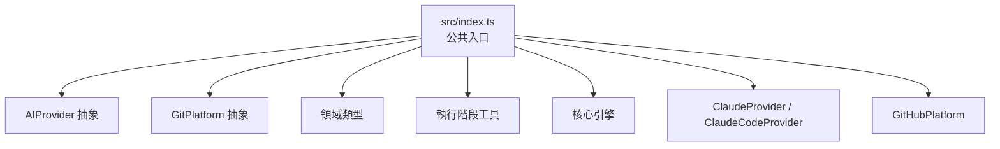
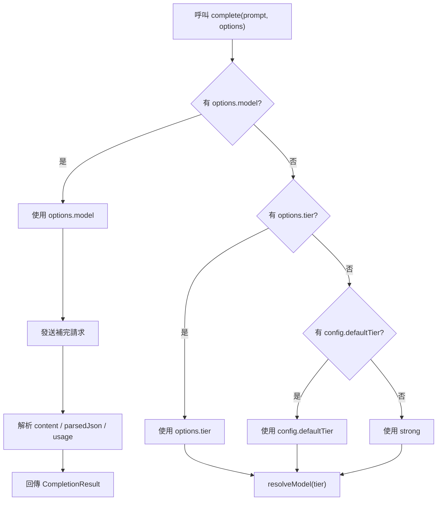
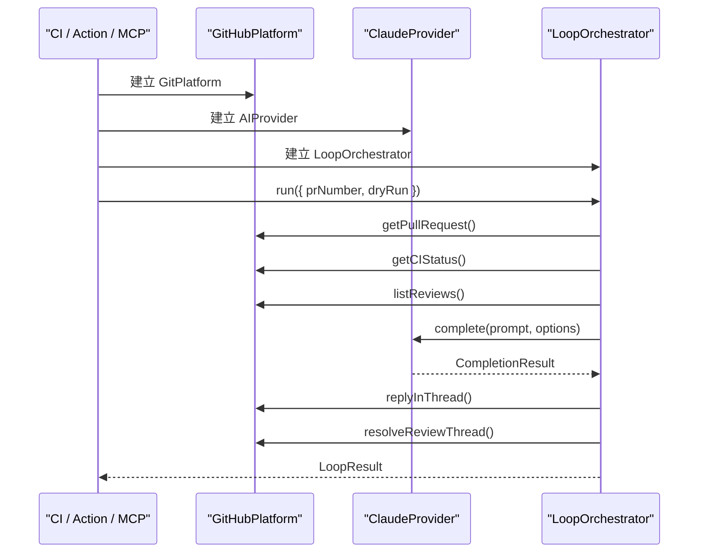
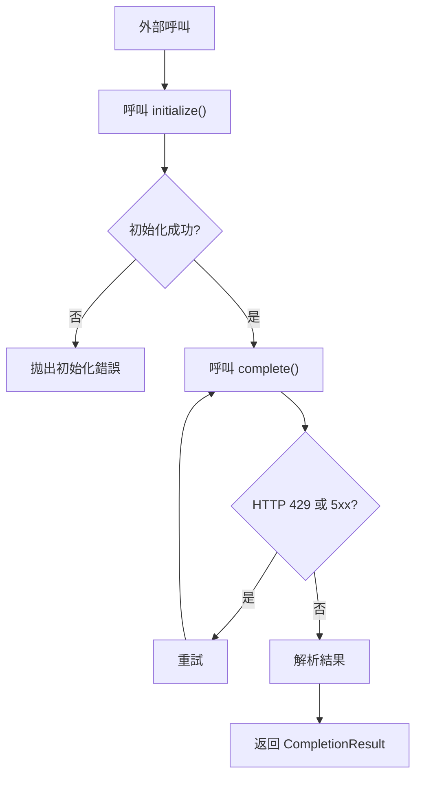

# API 參考

**本文引用的檔案**

- [src/index.ts](https://github.com/mikeah2011/maestro/blob/master/src/index.ts)
- [src/platforms/interfaces/GitPlatform.ts](https://github.com/mikeah2011/maestro/blob/master/src/platforms/interfaces/GitPlatform.ts)
- [src/ai/interfaces/AIProvider.ts](https://github.com/mikeah2011/maestro/blob/master/src/ai/interfaces/AIProvider.ts)
- [src/ai/providers/ClaudeProvider.ts](https://github.com/mikeah2011/maestro/blob/master/src/ai/providers/ClaudeProvider.ts)
- [src/ai/providers/ClaudeCodeProvider.ts](https://github.com/mikeah2011/maestro/blob/master/src/ai/providers/ClaudeCodeProvider.ts)
- [src/platforms/github/GitHubPlatform.ts](https://github.com/mikeah2011/maestro/blob/master/src/platforms/github/GitHubPlatform.ts)
- [src/core/types/Finding.ts](https://github.com/mikeah2011/maestro/blob/master/src/core/types/Finding.ts)
- [src/core/types/CI.ts](https://github.com/mikeah2011/maestro/blob/master/src/core/types/CI.ts)
- [src/core/types/PullRequest.ts](https://github.com/mikeah2011/maestro/blob/master/src/core/types/PullRequest.ts)
- [src/core/events/EventEmitter.ts](https://github.com/mikeah2011/maestro/blob/master/src/core/events/EventEmitter.ts)
- [src/core/round/RoundBudget.ts](https://github.com/mikeah2011/maestro/blob/master/src/core/round/RoundBudget.ts)
- [src/core/round/CommitThrottle.ts](https://github.com/mikeah2011/maestro/blob/master/src/core/round/CommitThrottle.ts)
- [src/core/state/StateMachine.ts](https://github.com/mikeah2011/maestro/blob/master/src/core/state/StateMachine.ts)
- [src/core/convergence/ConvergenceMonitor.ts](https://github.com/mikeah2011/maestro/blob/master/src/core/convergence/ConvergenceMonitor.ts)
- [src/core/classify/Classifier.ts](https://github.com/mikeah2011/maestro/blob/master/src/core/classify/Classifier.ts)
- [src/core/dedup/Dedup.ts](https://github.com/mikeah2011/maestro/blob/master/src/core/dedup/Dedup.ts)
- [src/core/security/SecretScanner.ts](https://github.com/mikeah2011/maestro/blob/master/src/core/security/SecretScanner.ts)
- [src/core/loop/LoopOrchestrator.ts](https://github.com/mikeah2011/maestro/blob/master/src/core/loop/LoopOrchestrator.ts)
- [src/core/fix/FixEngine.ts](https://github.com/mikeah2011/maestro/blob/master/src/core/fix/FixEngine.ts)
- [package.json](https://github.com/mikeah2011/maestro/blob/master/package.json)
- [README.md](https://github.com/mikeah2011/maestro/blob/master/README.md)

## 目錄

1. [簡介](#簡介)
2. [專案結構與公開輸出](#專案結構與公開輸出)
3. [核心模組總覽](#核心模組總覽)
4. [GitPlatform 抽象介面](#gitplatform-抽象介面)
5. [AIProvider 抽象介面與提供者路由](#aiprovider-抽象介面與提供者路由)
6. [領域類型定義](#領域類型定義)
7. [執行階段工具](#執行階段工具)
8. [實際導入範例](#實際導入範例)
9. [版本相容性與遷移指南](#版本相容性與遷移指南)
10. [錯誤處理模式](#錯誤處理模式)
11. [效能考量](#效能考量)
12. [結論](#結論)

## 簡介

本文件說明 `@mikeah2011/maestro` 程式庫的公共 API。該程式庫不是另一個獨立的程式碼審查工具，而是調度多個 AI 審查機器人的收斂層：它會分類問題、去重、自動修復、在討論串中回覆、解決討論串、請求重新審查，並在達到停止條件時結束循環。

程式庫的單一入口是 `src/index.ts`。所有外部消費者（CI 腳本、GitHub Action、MCP 整合、未來插件）都應該從這裡匯入，而不是直接依賴內部實作類別。這樣做可以確保：

- 抽象介面穩定，實作可替換。
- Provider 與平台透過註冊模式或注入方式使用，而非硬編碼。
- 錯誤行為、事件格式與型別契約有明確規範。

## 專案結構與公開輸出

`src/index.ts` 同時 re-export 以下六類內容：

| 類別 | 說明 |
|---|---|
| AI provider 抽象 | `AIProvider`、`AIProviderConfig`、`CompletionOptions`、`CompletionResult`、`ModelTier`、`FinishReason`、`ResponseFormat`、`CompletionUsage` |
| Git platform 抽象 | `GitPlatform`、`GitPlatformConfig`、`PlatformCapabilities`、`RateLimitInfo`、`PlatformType` |
| GitHub 實作 | `GitHubPlatform`、GraphQL client 相關型別、mappers |
| 領域類型 | `Finding`、`BotReview`、`PullRequest`、`CIStatus` 等 |
| 執行階段工具 | `EventEmitter`、`RoundBudget`、`CommitThrottle`、`StateMachine` |
| 核心引擎 | `Classifier`、`Dedup`、`SecretScanner`、`ConvergenceMonitor`、`LoopOrchestrator`、`FixEngine`、Claude providers |



**圖表來源**
- [src/index.ts:1-150](https://github.com/mikeah2011/maestro/blob/master/src/index.ts#L1-L150)

**章節來源**
- [src/index.ts:1-150](https://github.com/mikeah2011/maestro/blob/master/src/index.ts#L1-L150)
- [package.json:1-89](https://github.com/mikeah2011/maestro/blob/master/package.json#L1-L89)

## 核心模組總覽

### 公共輸出摘要

| 匯出名稱 | 種類 | 用途 |
|---|---|---|
| `AIProvider` | 抽象類別 | 統一 AI 補完介面 |
| `ClaudeProvider` | 具體類別 | Anthropic Messages API |
| `ClaudeCodeProvider` | 具體類別 | Claude Code CLI |
| `GitPlatform` | 抽象類別 | Git 平台抽象 |
| `GitHubPlatform` | 具體類別 | GitHub REST + GraphQL |
| `EventEmitter` | 類別 | JSONL 事件流 |
| `toLine` | 函式 | 將事件序列化為單行 JSONL |
| `streamSink` | 函式 | 寫入可寫入串流的 sink |
| `stdoutSink` | 函式 | 寫入標準輸出 |
| `RoundBudget` | 類別 | 每輪反垃圾郵件配額 |
| `RoundBudgetViolation` | 錯誤類別 | 違反配額時拋出 |
| `CommitThrottle` | 類別 | 每輪一次提交的緩衝器 |
| `CommitThrottleError` | 錯誤類別 | 提交配額違規 |
| `StateMachine` | 類別 | 循環狀態機 |
| `StateTransitionError` | 錯誤類別 | 無效狀態轉換 |
| `ConvergenceMonitor` | 類別 | 收斂監測 |
| `computeContentHash` | 函式 | 計算內容雜湊 |
| `computeFindingHash` | 函式 | 計算穩定發現雜湊 |
| `lineBucket` | 函式 | 行號桶化 |
| `Classifier` | 類別 | 圍欄式分類器 |
| `Dedup` | 類別 | 三層去重 |
| `levenshtein` | 函式 | Levenshtein 編輯距離 |
| `normalizedSimilarity` | 函式 | 正規化相似度 |
| `SecretScanner` | 類別 | 敏感資訊掃描 |
| `LoopOrchestrator` | 類別 | 主收斂循環 |
| `FixEngine` | 類別 | M6 AI 自動修復引擎 |

**章節來源**
- [src/index.ts:1-150](https://github.com/mikeah2011/maestro/blob/master/src/index.ts#L1-L150)

## GitPlatform 抽象介面

`GitPlatform` 是 orchestrator-grade 的抽象介面，代表任何支援 PR 審查的 Git 平台。目前提供 `github` 實作；設計上仍保留 `gitlab`、`gitea`、`gitee` 的擴充空間。

### 設定與能力

| 項目 | 型別 | 說明 |
|---|---|---|
| `type` | `'github' \| 'gitlab' \| 'gitea' \| 'gitee'` | 平台識別字 |
| `config.token` | `string?` | 直寫 token 或環境變數解析結果 |
| `config.tokenEnv` | `string?` | token 環境變數名稱 |
| `config.baseUrl` | `string?` | 自託管 API base URL |
| `config.owner` | `string?` | 倉庫擁有者 |
| `config.repo` | `string?` | 倉庫名稱 |
| `capabilities.threadResolve` | `boolean` | 是否可透過 API 標記討論串為已解決 |
| `capabilities.inlineReplies` | `boolean` | 是否可在討論串內回覆 |
| `capabilities.reviewThreads` | `boolean` | 是否暴露一級 review thread |
| `capabilities.requestReviewers` | `boolean` | 是否可請求 reviewer |
| `capabilities.ciStatus` | `boolean` | 是否可查詢 CI status |
| `capabilities.graphql` | `boolean` | 是否支援 GraphQL |
| `capabilities.emojiReactions` | `boolean?` | 是否可對評論加上 emoji reaction |

### 主要方法

| 方法 | 回傳型別 | 錯誤與邊界行為 |
|---|---|---|
| `initialize()` | `Promise<void>` | 驗證設定並建立平台客戶端；應具冪等性 |
| `testConnection()` | `Promise<boolean>` | 輕量連線檢查，失敗回傳 `false` |
| `detectRepo()` | `Promise<{ owner; repo }>` | 若未設定則嘗試由 git remote 偵測 |
| `getPullRequest(prNumber)` | `Promise<PullRequest>` | 取得 PR 標準化資料 |
| `getPullRequestDiff(prNumber)` | `Promise<PullRequestDiff>` | 取得差異檔 |
| `updatePullRequestBody(prNumber, body)` | `Promise<void>` | 更新 PR 正文 |
| `requestReviewers(prNumber, reviewers)` | `Promise<void>` | 請求 reviewer |
| `createPRComment(prNumber, body)` | `Promise<void>` | 發表頂層 PR comment |
| `listPRComments(prNumber)` | `Promise<Array<{ login; isBot; body }>>` | 列出頂層 PR comment |
| `listReviews(prNumber, since?)` | `Promise<BotReview[]>` | 列出 bot review，並應填充 threads |
| `getReview(reviewId)` | `Promise<BotReview>` | 依平台原生 ID 取得 review |
| `listReviewThreads(prNumber)` | `Promise<ReviewThread[]>` | 列出 PR 上所有 review thread |
| `replyInThread(threadId, body)` | `Promise<void>` | 在討論串內回覆 |
| `resolveReviewThread(threadId)` | `Promise<void>` | 標記討論串為已解決；不支援的平台可寫 sentinel marker |
| `getCIStatus(headSha)` | `Promise<CIStatus>` | 查詢 CI 狀態 |
| `getRateLimitInfo()` | `Promise<RateLimitInfo>` | 查詢剩餘請求數與重置時間 |
| `reactToReviewComment(commentNodeId, reaction)` | `Promise<void>` | 預設 no-op；支援的平台覆寫 |

### 錯誤處理規則

1. `initialize()` 失敗時，後續呼叫應視為尚未初始化。
2. `testConnection()` 不應向上拋出網路異常，而應回傳 `false`。
3. 不支援的功能（例如 `threadResolve === false`）必須由 orchestrator 根據 `capabilities` 選擇替代策略。
4. `reactToReviewComment` 預設為空實作，不支援的平台不需要抛錯。

```mermaid
classDiagram
    class GitPlatform {
        <<abstract>>
        +type : PlatformType
        +capabilities : PlatformCapabilities
        +initialize() Promise~void~
        +testConnection() Promise~boolean~
        +detectRepo() Promise~{owner;repo}~
        +getPullRequest(number) Promise~PullRequest~
        +getPullRequestDiff(number) Promise~PullRequestDiff~
        +updatePullRequestBody(number,body) Promise~void~
        +requestReviewers(number,reviewers) Promise~void~
        +createPRComment(number,body) Promise~void~
        +listPRComments(number) Promise~Array~
        +listReviews(number,since) Promise~BotReview[]~
        +getReview(id) Promise~BotReview~
        +listReviewThreads(number) Promise~ReviewThread[]~
        +replyInThread(threadId,body) Promise~void~
        +resolveReviewThread(threadId) Promise~void~
        +getCIStatus(headSha) Promise~CIStatus~
        +getRateLimitInfo() Promise~RateLimitInfo~
        +reactToReviewComment(nodeId,reaction) Promise~void~
    }

    class GitHubPlatform {
        +type : "github"
        +capabilities : PlatformCapabilities
    }

    GitPlatform <|-- GitHubPlatform
```

**圖表來源**
- [src/platforms/interfaces/GitPlatform.ts:1-130](https://github.com/mikeah2011/maestro/blob/master/src/platforms/interfaces/GitPlatform.ts#L1-L130)
- [src/platforms/github/GitHubPlatform.ts:1-200](https://github.com/mikeah2011/maestro/blob/master/src/platforms/github/GitHubPlatform.ts#L1-L200)

**章節來源**
- [src/platforms/interfaces/GitPlatform.ts:1-130](https://github.com/mikeah2011/maestro/blob/master/src/platforms/interfaces/GitPlatform.ts#L1-L130)
- [src/platforms/github/GitHubPlatform.ts:1-200](https://github.com/mikeah2011/maestro/blob/master/src/platforms/github/GitHubPlatform.ts#L1-L200)

## AIProvider 抽象介面與提供者路由

### 統一介面

`AIProvider` 是一個「提示詞到補完」的管道。orchestrator 負責審閱邏輯與提示詞；provider 只負責把 prompt 送到模型，再把結果回傳。

| 項目 | 型別 | 說明 |
|---|---|---|
| `type` | `AIProviderType` | 提供者類型 |
| `config.apiKey` | `string?` | 已展開環境變數的 API key |
| `config.baseUrl` | `string?` | 自託管或地區 endpoint |
| `config.models` | `Partial<Record<ModelTier,string>>` | tier → model id 映射 |
| `config.defaultTier` | `ModelTier?` | 未指定 tier 時的預設值 |
| `config.timeout` | `number?` | HTTP 請求逾時 |
| `config.retries` | `number?` | 臨時錯誤重試次數 |
| `complete(prompt, options?)` | `Promise<CompletionResult>` | 唯一的外部呼叫點 |

### ModelTier 與路由

| Tier | 語義 | 典型用途 |
|---|---|---|
| `cheap` | 便宜模型 | 高流量操作、初步判斷 |
| `strong` | 強力模型 | 關鍵判斷、修復生成 |
| `flagship` | 旗艦模型 | 最終輸出 |

routing 機制由呼叫端決定：

1. 若 `options.model` 存在，直接使用。
2. 否則使用 `options.tier`。
3. 若兩者皆無，使用 `config.defaultTier`。
4. 最後由 provider 的 `resolveModel(tier)` 解析為實際 model id。

### CompletionOptions 與 Cost Attribution

| 欄位 | 說明 |
|---|---|
| `model` | 覆蓋本次呼叫使用的 model |
| `tier` | 未指定 model 時用於解析 model |
| `systemPrompt` | 系統提示詞 |
| `maxTokens` | 輸出 token 預算 |
| `temperature` | 預設為 `0`，以維持確定性決策 |
| `responseFormat` | `text`、`json_object`、`json_schema` |
| `stopSequences` | 停止序列 |
| `timeout` | 單次呼叫逾時覆蓋 |
| `callerTag` | 成本歸因與稽核標籤 |

### CompletionUsage 與成本估算

| 欄位 | 說明 |
|---|---|
| `inputTokens` | 輸入 token |
| `outputTokens` | 輸出 token |
| `cacheReadTokens` | 提示快取讀取 token |
| `cacheWriteTokens` | 提示快寫入 token |
| `estimatedCostUsd` | 預估美元成本，若 provider 無法計算則為 `undefined` |

### 提供者實作比較

| 特性 | `ClaudeProvider` | `ClaudeCodeProvider` |
|---|---|---|
| 後端 | Anthropic Messages API | 本地 `claude --print` CLI |
| 是否需要 API Key | 需要 | 不需要 |
| Token 使用回報 | 完整 usage | 全為 `0` |
| 成本估算 | 支援 | 不支援 |
| model 回報 | 實際 model | 固定為 `claude-code-cli` |
| system prompt | 原生支援 | 前置拼接到 user prompt |
| 重試機制 | 支援 429/5xx 重試 | 不支援 |
| 預設逾時 | 60,000 ms | 120,000 ms |



**圖表來源**
- [src/ai/interfaces/AIProvider.ts:1-114](https://github.com/mikeah2011/maestro/blob/master/src/ai/interfaces/AIProvider.ts#L1-L114)
- [src/ai/providers/ClaudeProvider.ts:1-175](https://github.com/mikeah2011/maestro/blob/master/src/ai/providers/ClaudeProvider.ts#L1-L175)
- [src/ai/providers/ClaudeCodeProvider.ts:1-146](https://github.com/mikeah2011/maestro/blob/master/src/ai/providers/ClaudeCodeProvider.ts#L1-L146)

**章節來源**
- [src/ai/interfaces/AIProvider.ts:1-114](https://github.com/mikeah2011/maestro/blob/master/src/ai/interfaces/AIProvider.ts#L1-L114)
- [src/ai/providers/ClaudeProvider.ts:1-175](https://github.com/mikeah2011/maestro/blob/master/src/ai/providers/ClaudeProvider.ts#L1-L175)
- [src/ai/providers/ClaudeCodeProvider.ts:1-146](https://github.com/mikeah2011/maestro/blob/master/src/ai/providers/ClaudeCodeProvider.ts#L1-L146)

## 領域類型定義

### Finding 相關類型

| 類型 | 說明 |
|---|---|
| `Severity` | `critical`、`high`、`medium`、`low`、`info` |
| `FindingCategory` | `bug`、`yagni`、`wrong`、`taste`、`duplicate`、`unknown` |
| `FindingLocation` | 檔案路徑、起始行、結束行、內容雜湊 |
| `BotIdentity` | bot login、顯示名稱、是否為 bot、registry key |
| `Finding` | 單一發現，包含 hash、bot、位置、severity、title、body、classification |
| `FindingClassification` | category、confidence、viaFence、fenceRule、model、reasoning |
| `BotReview` | 單一 bot 的審查回合 |
| `ReviewThread` | 討論串、是否已解決、comments |
| `ThreadComment` | 討論串中的單筆評論 |

### Pull Request 類型

| 類型 | 說明 |
|---|---|
| `PullRequestState` | `open`、`closed`、`merged`、`draft` |
| `PullRequest` | 標準化 PR 結構 |
| `PullRequestDiff` | 變更檔與 raw diff |
| `PullRequestDiffFile` | 單一檔案差異 |

### CI 類型

| 類型 | 說明 |
|---|---|
| `CICheckState` | `pending`、`success`、`failure`、`error`、`cancelled`、`skipped` |
| `CICheck` | 單一 check 的狀態與 URL |
| `CIStatus` | 聚合後的 CI 狀態 |

**章節來源**
- [src/core/types/Finding.ts:1-129](https://github.com/mikeah2011/maestro/blob/master/src/core/types/Finding.ts#L1-L129)
- [src/core/types/PullRequest.ts:1-56](https://github.com/mikeah2011/maestro/blob/master/src/core/types/PullRequest.ts#L1-L56)
- [src/core/types/CI.ts:1-34](https://github.com/mikeah2011/maestro/blob/master/src/core/types/CI.ts#L1-L34)

## 執行階段工具

### EventEmitter

`EventEmitter` 是所有領域事件的單一真實來源。事件以 JSONL 格式輸出，sink 失敗不會導致 loop 崩潰。

| 項目 | 說明 |
|---|---|
| `MaestroEvent.ts` | ISO-8601 時間戳、event type、round、state、payload |
| `EventSink` | 接收事件的函式 |
| `EventHandler` | 訂閱者的事件處理函式 |
| `setContext(ctx)` | 設定上下文 round 與 state |
| `emit(type, payload)` | 發出事件並同步觸發 handler |
| `subscribe(handler)` | 註冊 handler，回傳取消函式 |
| `toLine(event)` | 序列化為 JSONL |
| `streamSink(stream)` | 寫入 stream |
| `stdoutSink()` | 寫入 process.stdout |

### RoundBudget

每輪限制：

- 最多 1 次 commit
- 每個 discussion thread 最多 1 次回覆
- 最多 1 次 PR body 更新
- 每個 finding 最多分類一次
- 最多 1 次 reviewer request

違反這些不變式會拋出 `RoundBudgetViolation`。

### CommitThrottle

收集當輪待修復項目，並在 fixing 狀態結束時產生一個 conventional commit message。一旦 flush，不能再新增 fix。

### StateMachine

定義了完整的 loop 狀態轉換表，包含正常前進、橫切狀態（如 `rate_limited`、`token_expired`、`stopped`）、終止狀態（`stopped`、`token_expired`）。

### ConvergenceMonitor

三個不變式：

1. 嚴重問題數量單調不增。
2. Jaccard 相似度小於等於 0.7，避免振盪。
3. 第 2 輪之後不得出現新類別。
4. 最多 3 輪。

### Classifier

先執行確定性 fence，再選擇性呼叫 LLM。常見規則包括：

- critical severity → `bug`
- 敏感路徑 → `bug`
- bug 關鍵字 → `bug`
- taste 關鍵字 → `taste`
- 其他 → `unknown` 或 LLM 分類

### Dedup

三層去重：

1. 精確 hash
2. Levenshtein 標題相似度
3. 可插拔的 LLM 語義相似度

### SecretScanner

掃描所有要寫出的文字，內建 AWS key、GitHub token、JWT、Stripe key、Slack token、私鑰等模式，並允許額外 pattern。

**章節來源**
- [src/core/events/EventEmitter.ts:1-108](https://github.com/mikeah2011/maestro/blob/master/src/core/events/EventEmitter.ts#L1-L108)
- [src/core/round/RoundBudget.ts:1-131](https://github.com/mikeah2011/maestro/blob/master/src/core/round/RoundBudget.ts#L1-L131)
- [src/core/round/CommitThrottle.ts:1-102](https://github.com/mikeah2011/maestro/blob/master/src/core/round/CommitThrottle.ts#L1-L102)
- [src/core/state/StateMachine.ts:1-114](https://github.com/mikeah2011/maestro/blob/master/src/core/state/StateMachine.ts#L1-L114)
- [src/core/convergence/ConvergenceMonitor.ts:1-200](https://github.com/mikeah2011/maestro/blob/master/src/core/convergence/ConvergenceMonitor.ts#L1-L200)
- [src/core/classify/Classifier.ts:1-191](https://github.com/mikeah2011/maestro/blob/master/src/core/classify/Classifier.ts#L1-L191)
- [src/core/dedup/Dedup.ts:1-153](https://github.com/mikeah2011/maestro/blob/master/src/core/dedup/Dedup.ts#L1-L153)
- [src/core/security/SecretScanner.ts:1-136](https://github.com/mikeah2011/maestro/blob/master/src/core/security/SecretScanner.ts#L1-L136)

## 實際導入範例

### CI 導入

CI 腳本通常會：

1. 載入 `.maestro.yaml` 與環境變數。
2. 建立 `GitHubPlatform`。
3. 建立 `ClaudeProvider` 或 `ClaudeCodeProvider`。
4. 建立 `LoopOrchestrator`。
5. 呼叫 `run({ prNumber, maxRounds, dryRun })`。
6. 根據 `LoopResult.reason` 決定 success/failure。

建議在 CI 中使用 `dryRun: true` 先驗證流程，確認不會意外修改 PR。

### GitHub Action 導入

Action 的典型流程：

1. 使用 `GITHUB_TOKEN` 授權 GitHubPlatform。
2. 使用 `ANTHROPIC_API_KEY` 授權 ClaudeProvider。
3. 將 `onFix` 與 `onCommit` 連接至 CI 工作流。
4. 使用 `EventEmitter` 的 `stdoutSink()` 讓 action log 可見。
5. 將 `LoopResult.error` 轉為 action failure。

### MCP 導入

MCP 整合適合使用 `EventEmitter` 的自訂 sink，把 event 轉成 MCP tool result 或 server-sent event。重點是：

- 不要在 sink 中阻塞 loop。
- 不要把 MCP 錯誤傳播到 loop。
- 使用 `toLine` 方便下游 parser 解析。

### 最小導入示意



**圖表來源**
- [src/platforms/github/GitHubPlatform.ts:1-200](https://github.com/mikeah2011/maestro/blob/master/src/platforms/github/GitHubPlatform.ts#L1-L200)
- [src/ai/providers/ClaudeProvider.ts:1-175](https://github.com/mikeah2011/maestro/blob/master/src/ai/providers/ClaudeProvider.ts#L1-L175)
- [src/core/loop/LoopOrchestrator.ts:1-200](https://github.com/mikeah2011/maestro/blob/master/src/core/loop/LoopOrchestrator.ts#L1-L200)

**章節來源**
- [README.md:1-200](https://github.com/mikeah2011/maestro/blob/master/README.md#L1-L200)
- [src/core/loop/LoopOrchestrator.ts:1-200](https://github.com/mikeah2011/maestro/blob/master/src/core/loop/LoopOrchestrator.ts#L1-L200)

## 版本相容性與遷移指南

### 套件版本

目前套件版本為 `0.0.1`，屬於早期開發版本。`package.json` 並未宣告 SemVer 穩定承諾，因此：

- 公共 API 仍可能變動。
- 升級前應執行型別檢查與測試。
- 建議鎖定部署版本的 major/minor patch。

### Node.js 與 Bun

| 工具 | 最低版本 |
|---|---|
| Node.js | `>=20` |
| Bun | `>=1.1` |

### 模組格式

套件使用 ESM：

- `main`: `./dist/index.js`
- `types`: `./dist/index.d.ts`
- `exports`: 支援 `.` 與 `./cli`
- `bin`: `./dist/cli.js`

### 棄用警告

目前程式碼中沒有明顯的弃用註解或弃用警告。但以下實作細節較易變動：

- `LoopOrchestratorOptions` 的 hook 簽章。
- `EventEmitter` 的 event payload 結構。
- `Finding` 的 platform-native ID 欄位。
- `AIProvider` 的 provider-specific extras。

### 遷移建議

1. **不要直接 import 內部路徑**  
   改為從 `@mikeah2011/maestro` 的主匯出點 import。

2. **不要假設 provider 一定回傳 cost**  
   `estimatedCostUsd` 可能是 `undefined`。

3. **不要假設 provider 一定回傳 parsedJson**  
   只有在 `responseFormat` 為 JSON 且成功解析時才存在。

4. **不要直接依賴 Claude provider 的內部字段**  
   例如 `client`、`initialized`、`defaultTimeoutMs`。

5. **升級前執行 verify**  
   使用 `bun run typecheck && bun run test`。

**章節來源**
- [package.json:1-89](https://github.com/mikeah2011/maestro/blob/master/package.json#L1-L89)
- [src/ai/providers/ClaudeProvider.ts:1-175](https://github.com/mikeah2011/maestro/blob/master/src/ai/providers/ClaudeProvider.ts#L1-L175)
- [src/ai/providers/ClaudeCodeProvider.ts:1-146](https://github.com/mikeah2011/maestro/blob/master/src/ai/providers/ClaudeCodeProvider.ts#L1-L146)

## 錯誤處理模式

### 抽象介面的錯誤模式

| 元件 | 錯誤處理策略 |
|---|---|
| `AIProvider.testConnection()` | 回傳 `false`，不向上拋出 |
| `ClaudeProvider.initialize()` | 缺少 `apiKey` 時拋出錯誤 |
| `ClaudeCodeProvider.complete()` | 未先呼叫 `initialize()` 時拋出錯誤 |
| `ClaudeProvider.complete()` | 未先呼叫 `initialize()` 時拋出錯誤 |
| `RoundBudget` | 違反不變式拋出 `RoundBudgetViolation` |
| `CommitThrottle` | 重複 flush 或新增已 flush 的 fix 拋出 `CommitThrottleError` |
| `StateMachine` | 無效轉換拋出 `StateTransitionError` |
| `EventEmitter` | sink 與 handler 錯誤被隔離，不中斷 loop |

### 成本與資源保護

- `Dedup` 限制 LLM 相似度呼叫次數。
- `Classifier` 優先使用確定性 fence。
- `ConvergenceMonitor` 強制最多 3 輪。
- `RoundBudget` 防止垃圾郵件式操作。
- `SecretScanner` 阻止敏感資訊外洩。

### 重試與退避

`ClaudeProvider` 使用 `p-retry` 重試 429 與 5xx 錯誤，重試間隔範圍為 1,000 ms 到 30,000 ms。CLI-based `ClaudeCodeProvider` 不具備相同重試邏輯，超時會直接 reject。



**圖表來源**
- [src/ai/providers/ClaudeProvider.ts:1-175](https://github.com/mikeah2011/maestro/blob/master/src/ai/providers/ClaudeProvider.ts#L1-L175)
- [src/core/events/EventEmitter.ts:1-108](https://github.com/mikeah2011/maestro/blob/master/src/core/events/EventEmitter.ts#L1-L108)
- [src/core/round/RoundBudget.ts:1-131](https://github.com/mikeah2011/maestro/blob/master/src/core/round/RoundBudget.ts#L1-L131)
- [src/core/state/StateMachine.ts:1-114](https://github.com/mikeah2011/maestro/blob/master/src/core/state/StateMachine.ts#L1-L114)

**章節來源**
- [src/ai/providers/ClaudeProvider.ts:1-175](https://github.com/mikeah2011/maestro/blob/master/src/ai/providers/ClaudeProvider.ts#L1-L175)
- [src/ai/providers/ClaudeCodeProvider.ts:1-146](https://github.com/mikeah2011/maestro/blob/master/src/ai/providers/ClaudeCodeProvider.ts#L1-L146)
- [src/core/events/EventEmitter.ts:1-108](https://github.com/mikeah2011/maestro/blob/master/src/core/events/EventEmitter.ts#L1-L108)
- [src/core/round/RoundBudget.ts:1-131](https://github.com/mikeah2011/maestro/blob/master/src/core/round/RoundBudget.ts#L1-L131)
- [src/core/round/CommitThrottle.ts:1-102](https://github.com/mikeah2011/maestro/blob/master/src/core/round/CommitThrottle.ts#L1-L102)
- [src/core/state/StateMachine.ts:1-114](https://github.com/mikeah2011/maestro/blob/master/src/core/state/StateMachine.ts#L1-L114)

## 效能考量

### Token 成本

- `ClaudeProvider` 會根據 model 的 per-1M token 價格估算 USD 成本。
- `ClaudeCodeProvider` 無法取得 CLI 的 token usage，因此 usage 全為 `0`。
- 建議在 CI 或長任務中記錄 `CompletionUsage.estimatedCostUsd` 並設定預算上限。

### 分類與去重

- `Classifier` 的 fence 可完全避免 LLM 呼叫，適合高頻率場景。
- `Dedup` 的第一層與第二層都是純量演算法，第三層才可能呼叫 LLM。
- `normalizedSimilarity` 使用 Levenshtein 編輯距離，時間複雜度為 O(m × n)，適合短標題。

### 狀態與配額

- `RoundBudget` 使用 Map 追蹤每個 thread 的回覆次數。
- `CommitThrottle` 確保每輪只產生一個 commit message。
- `ConvergenceMonitor` 維護歷史集合以計算 Jaccard 相似度。

### I/O 與事件

- `EventEmitter` 的 sink 失敗不會中斷 loop。
- `stdoutSink` 適合 CLI 與 container 環境。
- `streamSink` 適合嵌入 pipe 或 MCP transport。

**章節來源**
- [src/ai/providers/ClaudeProvider.ts:1-175](https://github.com/mikeah2011/maestro/blob/master/src/ai/providers/ClaudeProvider.ts#L1-L175)
- [src/ai/providers/ClaudeCodeProvider.ts:1-146](https://github.com/mikeah2011/maestro/blob/master/src/ai/providers/ClaudeCodeProvider.ts#L1-L146)
- [src/core/classify/Classifier.ts:1-191](https://github.com/mikeah2011/maestro/blob/master/src/core/classify/Classifier.ts#L1-L191)
- [src/core/dedup/Dedup.ts:1-153](https://github.com/mikeah2011/maestro/blob/master/src/core/dedup/Dedup.ts#L1-L153)
- [src/core/round/RoundBudget.ts:1-131](https://github.com/mikeah2011/maestro/blob/master/src/core/round/RoundBudget.ts#L1-L131)
- [src/core/round/CommitThrottle.ts:1-102](https://github.com/mikeah2011/maestro/blob/master/src/core/round/CommitThrottle.ts#L1-L102)
- [src/core/convergence/ConvergenceMonitor.ts:1-200](https://github.com/mikeah2011/maestro/blob/master/src/core/convergence/ConvergenceMonitor.ts#L1-L200)
- [src/core/events/EventEmitter.ts:1-108](https://github.com/mikeah2011/maestro/blob/master/src/core/events/EventEmitter.ts#L1-L108)

## 結論

`@mikeah2011/maestro` 的公共 API 圍繞兩個核心抽象展開：

- `GitPlatform`：抽象 PR、review、thread、CI、rate limit 等平台能力。
- `AIProvider`：抽象 prompt → completion 的模型呼叫。

其餘模組提供穩定的領域類型與執行階段工具，讓 CI、Action、MCP 或其他外部系統能可靠地調度 AI PR 審查循環。

對於生產使用者，最重要的建議是：

1. 只從主入口匯入公共 API。
2. 使用 `DryRun` 模式驗證行為。
3. 監控 `LoopResult` 與 `CompletionUsage`。
4. 不要假設 cost、parsedJson 或 provider 內部實作永遠存在。
5. 在套件版本大於 `0.x` 之前，將依賴版本鎖定到特定 commit 或 tag。