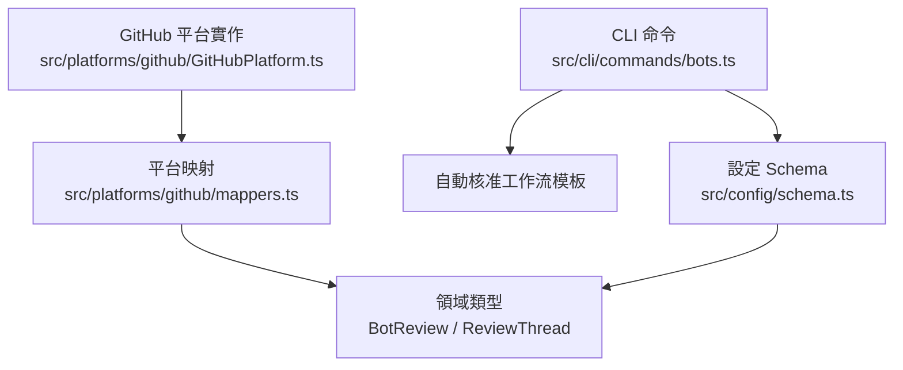
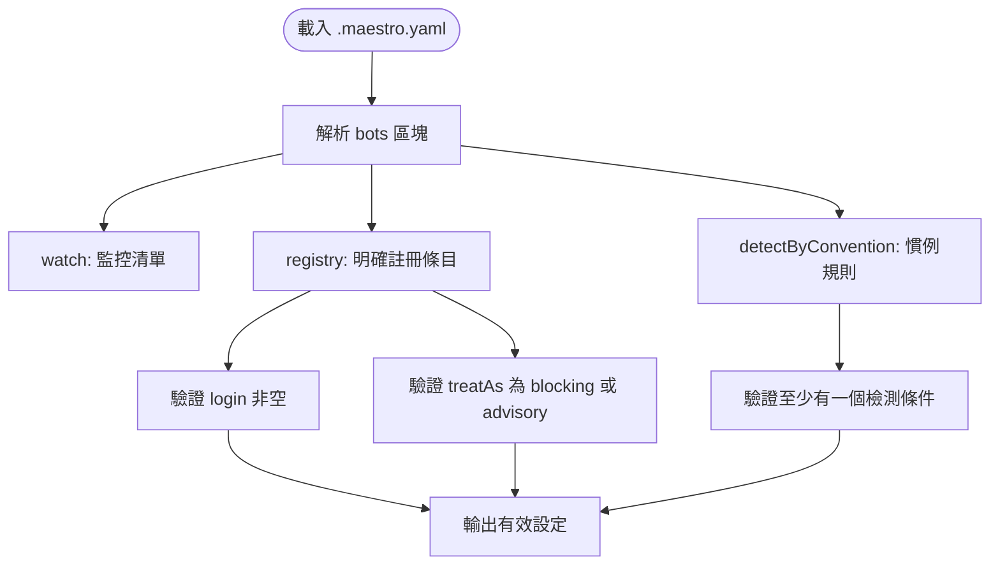
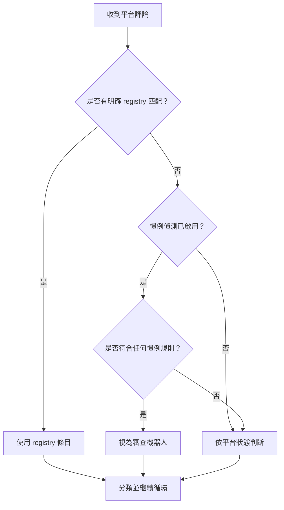
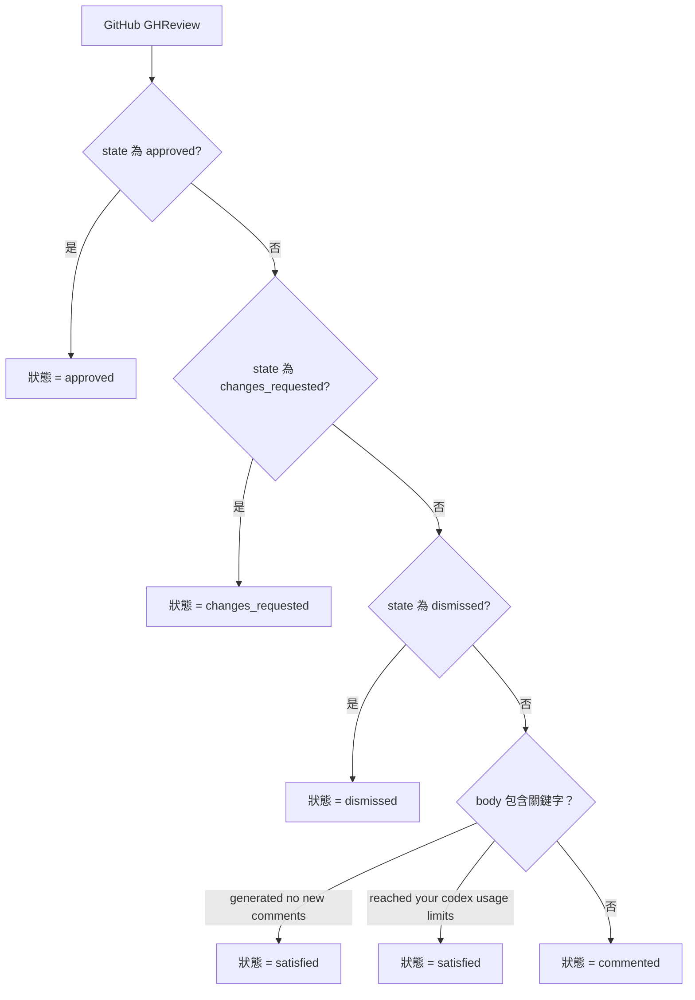
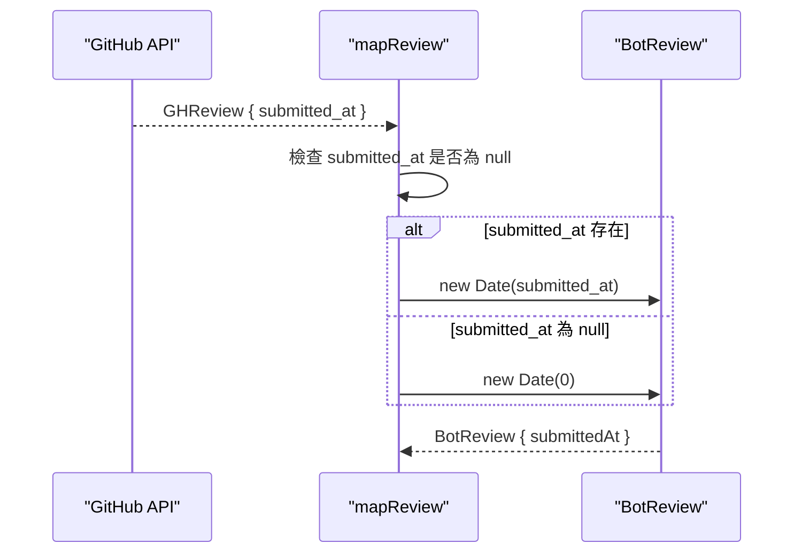
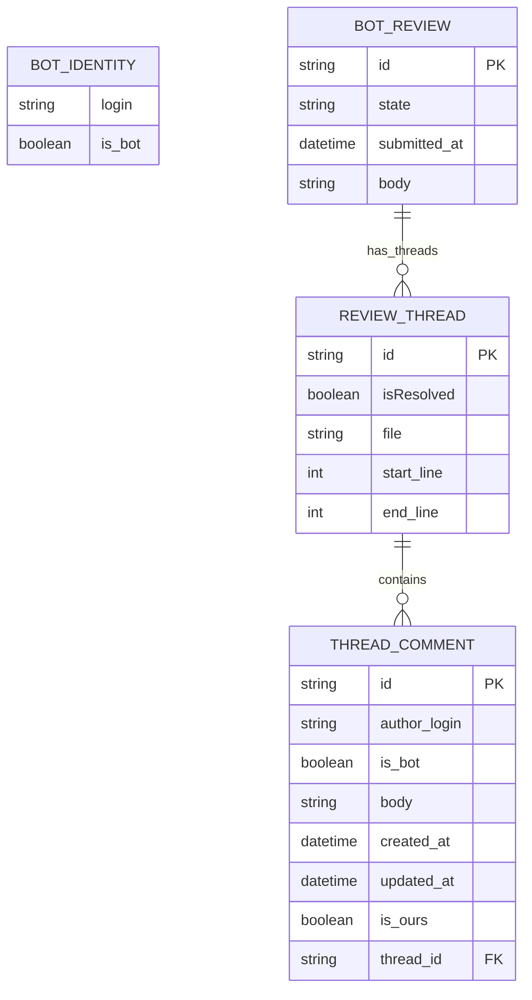
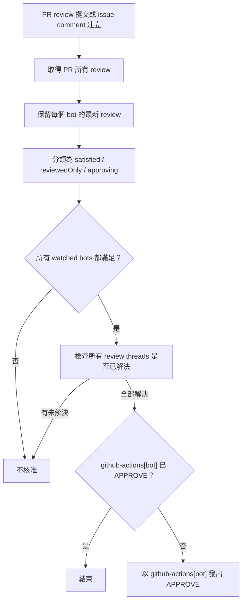
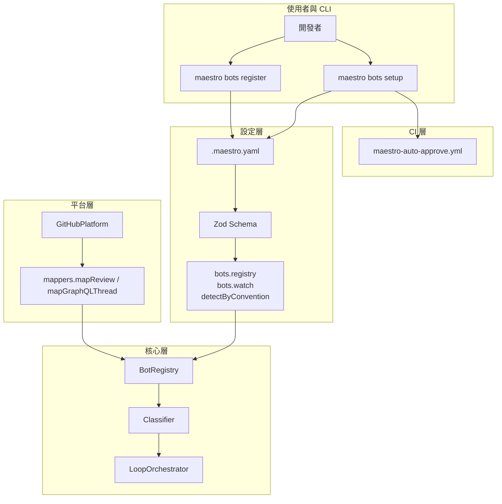

# Bot Registry 擴充

<cite>
**本文引用的檔案**   
- [src/cli/commands/bots.ts](https://github.com/mikeah2011/maestro/blob/master/src/cli/commands/bots.ts)
- [src/config/schema.ts](https://github.com/mikeah2011/maestro/blob/master/src/config/schema.ts)
- [src/platforms/github/mappers.ts](https://github.com/mikeah2011/maestro/blob/master/src/platforms/github/mappers.ts)
- [src/platforms/github/GitHubPlatform.ts](https://github.com/mikeah2011/maestro/blob/master/src/platforms/github/GitHubPlatform.ts)
- [README.md](https://github.com/mikeah2011/maestro/blob/master/README.md)
- [docs/DESIGN.md](https://github.com/mikeah2011/maestro/blob/master/docs/DESIGN.md)
</cite>

## 目錄

1. [簡介](#簡介)
2. [專案結構與 Bot Registry 位置](#專案結構與-bot-registry-位置)
3. [Bot Registry 設定格式](#bot-registry-設定格式)
4. [命令介面：`maestro bots register --login`](#命令介面maestro-bots-register--login)
5. [慣例偵測與 Fallback 機制](#慣例偵測與-fallback-機制)
6. [機器人評論識別規則](#機器人評論識別規則)
7. [Timestamp 處理](#timestamp-處理)
8. [ThreadId 關聯邏輯](#threadid-關聯邏輯)
9. [新增自訂機器人類型](#新增自訂機器人類型)
10. [自動核准工作流程](#自動核准工作流程)
11. [架構總覽圖](#架構總覽圖)
12. [故障排除指南](#故障排除指南)
13. [結論](#結論)

## 簡介

Maestro 的定位不是另一個程式碼審查工具，而是「審查機器人之上的收斂層」。它把 CodeRabbit、Ellipsis、Copilot Code Review、Codex、Gemini Code Assist、Sourcery、Greptile 等現有機器人視為輸入，負責分類問題、去重、修復、回覆、解決討論串、請求重新審查，並在有限輪數內強制收斂。

Bot Registry 是這個流程的入口之一：它決定哪些平台帳號或應用程式被視為「需要追蹤的審查機器人」，並根據該機器人的評論內容判斷其狀態（例如 `APPROVED`、`CHANGES_REQUESTED`、`COMMENTED`、`SATISFIED`）。當沒有明確註冊條目時，系統會退回到慣例偵測；若仍無法匹配，則以一般評論者身份處理。

設計文件指出 Bot Registry 是混合模式：

- 隨附精選登錄表與專屬解析器
- 慣例型 fallback
- 使用者覆寫
- CLI 子命令 `maestro bots register --login`

其中 CLI 註冊功能目前標記為 M4 placeholder，但設定 schema 與 workflows 生成邏輯已經可用，因此本文件同時說明「目前已實作的行為」與「未來擴充點」。

**章節來源**
- [README.md:1-120](https://github.com/mikeah2011/maestro/blob/master/README.md#L1-L120)
- [docs/DESIGN.md:1-120](https://github.com/mikeah2011/maestro/blob/master/docs/DESIGN.md#L1-L120)

## 專案結構與 Bot Registry 位置

Bot Registry 相關程式碼分散在三個主要層級：

| 層級 | 檔案 | 責任 |
|---|---|---|
| CLI 命令 | `src/cli/commands/bots.ts` | `bots list / register / inspect / setup` 子命令入口與自動核准 workflow 產生 |
| 設定 Schema | `src/config/schema.ts` | `.maestro.yaml` 中 `bots.watch`、`bots.registry`、`bots.detectByConvention` 的 Zod 驗證 |
| 平台映射 | `src/platforms/github/mappers.ts` | GitHub REST/GraphQL 回應轉為領域類型，包含評論狀態判斷 |
| 平台實作 | `src/platforms/github/GitHubPlatform.ts` | 取得 PR、review threads、reply、resolve thread 等能力 |



**圖表來源**
- [src/cli/commands/bots.ts:1-237](https://github.com/mikeah2011/maestro/blob/master/src/cli/commands/bots.ts#L1-L237)
- [src/config/schema.ts:1-226](https://github.com/mikeah2011/maestro/blob/master/src/config/schema.ts#L1-L226)
- [src/platforms/github/GitHubPlatform.ts:1-200](https://github.com/mikeah2011/maestro/blob/master/src/platforms/github/GitHubPlatform.ts#L1-L200)
- [src/platforms/github/mappers.ts:1-260](https://github.com/mikeah2011/maestro/blob/master/src/platforms/github/mappers.ts#L1-L260)

**章節來源**
- [src/cli/commands/bots.ts:1-237](https://github.com/mikeah2011/maestro/blob/master/src/cli/commands/bots.ts#L1-L237)
- [src/config/schema.ts:1-226](https://github.com/mikeah2011/maestro/blob/master/src/config/schema.ts#L1-L226)
- [src/platforms/github/GitHubPlatform.ts:1-200](https://github.com/mikeah2011/maestro/blob/master/src/platforms/github/GitHubPlatform.ts#L1-L200)
- [src/platforms/github/mappers.ts:1-260](https://github.com/mikeah2011/maestro/blob/master/src/platforms/github/mappers.ts#L1-L260)

## Bot Registry 設定格式

Bot Registry 的核心設定位於 `.maestro.yaml` 的 `bots` 區塊。Zod schema 定義了以下欄位：

| 設定路徑 | 型別 | 預設值 | 說明 |
|---|---|---:|---|
| `bots.watch` | `string[]` | `[]` | Maestro 要監控的機器人 login 清單，用於 `maestro bots setup` 產生自動核准 workflow |
| `bots.registry` | `BotRegistryEntry[]` | `[]` | 明確註冊的機器人條目 |
| `bots.detectByConvention.enabled` | `boolean` | `true` | 是否啟用慣例型偵測 |
| `bots.detectByConvention.rules` | `ConventionRule[]` | `[]` | 慣例型偵測規則 |

`BotRegistryEntry` 支援：

| 欄位 | 型別 | 預設值 | 說明 |
|---|---|---:|---|
| `login` | `string` | 必填 | 機器人帳號名稱，需至少一個字元 |
| `treatAs` | `'blocking' \| 'advisory'` | `'advisory'` | 將該機器人的結果視為阻斷式或建議式 |
| `severityMap` | `Record<string, string>` | 可選 | 針對特定機器人嚴重程度到內部分類的對應 |

`ConventionRule` 必須至少指定下列條件之一：

| 欄位 | 型別 | 說明 |
|---|---|---|
| `loginContains` | `string[]` | 若機器人的 login 包含這些子字串，則匹配 |
| `appSlugContains` | `string[]` | 若 GitHub App slug 包含這些子字串，則匹配 |
| `commentBodyContains` | `string[]` | 若評論內文包含這些子字串，則匹配 |

schema 使用 `refine` 確保每個 convention rule 至少有一個非空陣列條件，避免無意義規則進入配置。



**圖表來源**
- [src/config/schema.ts:120-170](https://github.com/mikeah2011/maestro/blob/master/src/config/schema.ts#L120-L170)
- [src/config/schema.ts:200-226](https://github.com/mikeah2011/maestro/blob/master/src/config/schema.ts#L200-L226)

**章節來源**
- [src/config/schema.ts:120-170](https://github.com/mikeah2011/maestro/blob/master/src/config/schema.ts#L120-L170)
- [src/config/schema.ts:200-226](https://github.com/mikeah2011/maestro/blob/master/src/config/schema.ts#L200-L226)

## 命令介面：`maestro bots register --login`

目前 `maestro bots register` 尚未實作，會回傳 M4 placeholder 訊息並結束程序。

| 子命令 | 選項 | 目前狀態 | 說明 |
|---|---|---|---|
| `maestro bots list` | 無 | M4 placeholder | 列出已配置與精選的審查機器人 |
| `maestro bots register` | `--login <login>`<br/>`--treat-as <mode>` | M4 placeholder | 註冊自託管或自訂機器人 |
| `maestro bots inspect` | `--bot <login>`<br/>`--comment <file>` | M4 placeholder | 顯示 BotRegistry 對範例評論的解析結果 |
| `maestro bots setup` | `--bots <logins>`<br/>`--force` | 已實作 | 產生 `.github/workflows/maestro-auto-approve.yml` |

### `register` 預期行為

雖然實作尚未完成，從 CLI 定義可推導出預期參數：

| 選項 | 必要 | 預設值 | 用途 |
|---|---:|---|---|
| `--login` | 是 | 無 | 機器人在平台上的 login 名稱 |
| `--treat-as` | 否 | `advisory` | 將該機器人的結果視為阻斷式或建議式 |

由於 `--login` 使用 commander 的 `.requiredOption()`，未提供時 commander 會直接拒絕執行。`--treat-as` 有預設值 `advisory`，未來實作應將其寫入 `bots.registry`，並允許重複註冊時覆寫。

### `inspect` 預期行為

`inspect` 是為了方便開發者驗證 BotRegistry 的解析邏輯而設計的診斷命令。預期輸入包括：

- `--bot`: 機器人 login
- `--comment`: 包含機器人生成評論內容的檔案路徑

未來實作應該讀取該檔案內容，套用 registry 與 convention rules，並輸出匹配的機器人身份、treatAs 模式以及解析出的評論狀態。

**章節來源**
- [src/cli/commands/bots.ts:1-200](https://github.com/mikeah2011/maestro/blob/master/src/cli/commands/bots.ts#L1-L200)

## 慣例偵測與 Fallback 機制

Bot Registry 的辨識順序可以理解為：

1. **明確 registry 匹配**：如果 `bots.registry` 中有符合 login 的條目，優先使用。
2. **慣例偵測**：若 `detectByConvention.enabled` 為真，且有任何 `loginContains`、`appSlugContains`、`commentBodyContains` 規則匹配，則視為審查機器人。
3. **平台原生狀態判斷**：若無法歸類為已知審查機器人，仍可能透過 GitHub review state 與 body 判斷狀態。
4. **一般評論者 fallback**：最終若完全不匹配，就作為普通使用者評論處理。

這與設計文件中所述一致：Bot Registry 是混合模式，結合精選解析器、慣例 fallback、使用者覆寫與 CLI 註冊。



**圖表來源**
- [src/config/schema.ts:120-170](https://github.com/mikeah2011/maestro/blob/master/src/config/schema.ts#L120-L170)
- [docs/DESIGN.md:1-120](https://github.com/mikeah2011/maestro/blob/master/docs/DESIGN.md#L1-L120)

**章節來源**
- [src/config/schema.ts:120-170](https://github.com/mikeah2011/maestro/blob/master/src/config/schema.ts#L120-L170)
- [docs/DESIGN.md:1-120](https://github.com/mikeah2011/maestro/blob/master/docs/DESIGN.md#L1-L120)

## 機器人評論識別規則

目前可觀察到的識別規則主要出現在兩個地方：Bot Registry 設定 schema，以及 GitHub mapper 的狀態判斷。

### 1. Login 匹配

透過 `bots.registry[].login` 精確匹配，或透過 `detectByConvention.loginContains` 子字串匹配。

### 2. GitHub App Slug 匹配

透過 `detectByConvention.appSlugContains` 匹配 GitHub App slug。這適用於以 GitHub App 形式部署的審查機器人，例如某些組織內建或第三方 app。

### 3. 評論內容匹配

透過 `detectByConvention.commentBodyContains` 匹配評論內文。這是擴充新機器人最常用方式。

### 4. 平台狀態與內容關鍵字

GitHub mapper 中的 `mapReview` 會根據以下邏輯判斷 BotReview 狀態：

| 條件 | 結果狀態 | 說明 |
|---|---|---|
| GitHub review state 為 `approved` | `approved` | 正式核准 |
| GitHub review state 為 `changes_requested` | `changes_requested` | 要求修改 |
| GitHub review state 為 `dismissed` | `dismissed` | 已撤銷 |
| body 包含 `generated no new comments` | `satisfied` | Copilot 常見模式 |
| body 包含 `reached your codex usage limits` | `satisfied` | Codex 用量限制模式 |
| 其他情況 | `commented` | 一般評論 |

這表示即使沒有 registry 條目，只要 GitHub API 回傳的 review body 包含特定關鍵字，系統也能將該機器人視為「已滿足」，從而停止等待。



**圖表來源**
- [src/platforms/github/mappers.ts:120-170](https://github.com/mikeah2011/maestro/blob/master/src/platforms/github/mappers.ts#L120-L170)

**章節來源**
- [src/config/schema.ts:120-170](https://github.com/mikeah2011/maestro/blob/master/src/config/schema.ts#L120-L170)
- [src/platforms/github/mappers.ts:120-170](https://github.com/mikeah2011/maestro/blob/master/src/platforms/github/mappers.ts#L120-L170)

## Timestamp 處理

Bot Registry 本身不直接處理 timestamp，但 BotReview 的提交時間由 GitHub REST review 物件映射而來。

`mapReview` 的行為如下：

- `submittedAt` 來自 `gh.submitted_at`
- 若 `submitted_at` 為 null，則使用 Unix epoch `0`
- 最終轉換為 JavaScript `Date` 物件

這意味著：

- 正常情況下，BotReview 的提交時間與 GitHub API 一致。
- 若某個平台或舊版 API 未回傳 `submitted_at`，系統不會崩潰，但會得到極早的時間戳。
- 後續比較最新 review 時，通常會依賴較可靠的時間比較或 platform 層級邏輯。

在自動核准 workflow 的 GitHub Script 部分，也有類似行為：workflow 會遍歷所有 review，保留每個 bot 的最新 review，並使用 `new Date(r.submitted_at)` 比較時間。



**圖表來源**
- [src/platforms/github/mappers.ts:120-140](https://github.com/mikeah2011/maestro/blob/master/src/platforms/github/mappers.ts#L120-L140)

**章節來源**
- [src/platforms/github/mappers.ts:120-140](https://github.com/mikeah2011/maestro/blob/master/src/platforms/github/mappers.ts#L120-L140)

## ThreadId 關聯邏輯

ThreadId 關聯主要由 GitHub Platform 與 mapper 共同處理。

### GraphQL Thread 結構

GitHub Platform 使用 GraphQL 查詢 review threads，包含：

| 欄位 | 用途 |
|---|---|
| `id` | 討論串 ID，用於 resolve mutation |
| `isResolved` | 討論串是否已解決 |
| `path` | 涉及檔案路徑 |
| `line` | 起始行號 |
| `originalLine` | 原始行號 |
| `comments.nodes` | 討論串中的評論節點 |

每個評論節點包含：

| 欄位 | 用途 |
|---|---|
| `id` | 評論節點 ID |
| `databaseId` | 資料庫 ID |
| `author.login` | 作者 login |
| `author.__typename` | 判斷是否為 Bot |
| `body` | 評論內容 |
| `createdAt` | 建立時間 |
| `updatedAt` | 更新時間 |
| `isMinimized` | 是否被最小化 |

### 映射到領域類型

`mapGraphQLThread` 將上述結構轉換為 `ReviewThread`：

- `id` 直接使用 GraphQL node id
- `isResolved` 直接映射
- `location.file`、`startLine`、`endLine` 可選填充
- `comments` 轉換為 `ThreadComment[]`
- `isOurs` 根據當前使用者 login 判斷



**圖表來源**
- [src/platforms/github/GitHubPlatform.ts:60-120](https://github.com/mikeah2011/maestro/blob/master/src/platforms/github/GitHubPlatform.ts#L60-L120)
- [src/platforms/github/mappers.ts:170-210](https://github.com/mikeah2011/maestro/blob/master/src/platforms/github/mappers.ts#L170-L210)

### Resolve Thread Mutation

GitHub Platform 定義了 `RESOLVE_THREAD_MUTATION`，使用 `resolveReviewThread` mutation 並傳入 `threadId`。這代表：

- 只有 GitHub（或其他支援該 GraphQL mutation 的平台）能真正關閉討論串。
- 不支援的平台會進入降級模式，例如在回覆中寫入解決標記。
- Auto-approve workflow 也會查詢 `reviewThreads.isResolved`，只有全部解決才觸發核准。

**章節來源**
- [src/platforms/github/GitHubPlatform.ts:60-120](https://github.com/mikeah2011/maestro/blob/master/src/platforms/github/GitHubPlatform.ts#L60-L120)
- [src/platforms/github/mappers.ts:170-210](https://github.com/mikeah2011/maestro/blob/master/src/platforms/github/mappers.ts#L170-L210)

## 新增自訂機器人類型

若要支援新的審查機器人，例如尚未被內建的某款工具，可依以下步驟進行：

### 方法一：使用 `bots.registry`

適合 login 固定、行為穩定的機器人。

步驟：

1. 在 `.maestro.yaml` 的 `bots.registry` 加入條目。
2. 設定 `login` 為機器人在平台的帳號名稱。
3. 設定 `treatAs`：
   - `blocking`：該機器人的負面結果會阻斷合併。
   - `advisory`：僅提供建議。
4. 若機器人使用不同的嚴重程度命名，可填寫 `severityMap`。

範例設定結構：

```yaml
bots:
  registry:
    - login: "my-custom-reviewer"
      treatAs: "advisory"
      severityMap:
        warning: "medium"
        error: "high"
```

### 方法二：使用 `detectByConvention`

適合 login 不穩定、但評論內容或 app slug 可預測的機器人。

範例：

```yaml
bots:
  detectByConvention:
    enabled: true
    rules:
      - loginContains:
          - "custom-review"
      - commentBodyContains:
          - "Custom Review Engine"
      - appSlugContains:
          - "custom-review-app"
```

### 方法三：擴充平台狀態判斷

若機器人以特殊 body 表達「已完成」或「無需修改」，可在 mapper 中加入對應判斷。目前已有：

- `generated no new comments` → `satisfied`
- `reached your codex usage limits` → `satisfied`

新增規則時應保持判斷純淨、可測試，並避免誤判一般 human reviewer。

### 方法四：使用 CLI 註冊（未來）

當 `maestro bots register --login` 實作後，可動態註冊：

```bash
maestro bots register --login my-custom-reviewer --treat-as advisory
```

此命令未來應：

- 驗證 login 非空
- 驗證 treatAs 為 `blocking` 或 `advisory`
- 寫入或更新 `bots.registry`
- 提供確認輸出

**章節來源**
- [src/config/schema.ts:120-170](https://github.com/mikeah2011/maestro/blob/master/src/config/schema.ts#L120-L170)
- [src/platforms/github/mappers.ts:140-170](https://github.com/mikeah2011/maestro/blob/master/src/platforms/github/mappers.ts#L140-L170)
- [src/cli/commands/bots.ts:160-190](https://github.com/mikeah2011/maestro/blob/master/src/cli/commands/bots.ts#L160-L190)

## 自動核准工作流程

`maestro bots setup` 是目前唯一完整實作的 bots 子命令。它會根據 `bots.watch` 或 CLI 的 `--bots` 選項，產生 `.github/workflows/maestro-auto-approve.yml`。

### 機器人分類

Workflow 模板將 watched bots 分為三類：

| 類別 | 判斷條件 | 要求 |
|---|---|---|
| `satisfied` | login 包含 `copilot-pull-request-reviewer` 或 `github-advanced-security` | 只需發表 COMMENTED 且 body 包含 `generated no new comments` |
| `reviewedOnly` | login 等於 `chatgpt-codex-connector[bot]` 或去除 `[bot]` 後相等 | 只需存在 review，不要求 APPROVED |
| `approving` | 其他 watched bots | 必須達到 `APPROVED` 狀態 |

### 判定流程



**圖表來源**
- [src/cli/commands/bots.ts:20-160](https://github.com/mikeah2011/maestro/blob/master/src/cli/commands/bots.ts#L20-L160)
- [src/cli/commands/bots.ts:201-237](https://github.com/mikeah2011/maestro/blob/master/src/cli/commands/bots.ts#L201-L237)

### 重要注意事項

- 若不指定 `--bots`，workflow 會使用 `config.bots.watch`；若 config 也無設定，則視為無 watched bots，workflow 條件會變成 always approve。
- 若 `.github/workflows/maestro-auto-approve.yml` 已存在且未加 `--force`，命令會失敗以避免覆蓋。
- Workflow 會先檢查 bot 滿意度，再檢查 discussion thread 是否全部解決，最後才發出核准。
- Auto-approve 本身以 `github-actions[bot]` 身份發出，避免重複核准。

**章節來源**
- [src/cli/commands/bots.ts:20-160](https://github.com/mikeah2011/maestro/blob/master/src/cli/commands/bots.ts#L20-L160)
- [src/cli/commands/bots.ts:201-237](https://github.com/mikeah2011/maestro/blob/master/src/cli/commands/bots.ts#L201-L237)

## 架構總覽圖

Bot Registry 在整個 Maestro 系統中的角色如下：



**圖表來源**
- [src/cli/commands/bots.ts:1-237](https://github.com/mikeah2011/maestro/blob/master/src/cli/commands/bots.ts#L1-L237)
- [src/config/schema.ts:120-226](https://github.com/mikeah2011/maestro/blob/master/src/config/schema.ts#L120-L226)
- [src/platforms/github/GitHubPlatform.ts:1-200](https://github.com/mikeah2011/maestro/blob/master/src/platforms/github/GitHubPlatform.ts#L1-L200)
- [src/platforms/github/mappers.ts:1-260](https://github.com/mikeah2011/maestro/blob/master/src/platforms/github/mappers.ts#L1-L260)

## 故障排除指南

### `maestro bots register` 立即退出

**現象**：執行 `maestro bots register --login foo` 後顯示 not yet implemented。

**原因**：該子命令目前是 M4 placeholder，尚未實作。

**解法**：

- 暫時手動編輯 `.maestro.yaml` 的 `bots.registry`。
- 等待未來版本實作 CLI 註冊。
- 使用 `detectByConvention` 快速讓系統識別新機器人。

### Workflow 未被觸發

**可能原因**：

1. 未執行 `maestro bots setup`。
2. `.github/workflows/maestro-auto-approve.yml` 不存在。
3. 未 commit 並 push workflow 檔。
4. `bots.watch` 未包含目標機器人 login。
5. 機器人 review 狀態不是 `APPROVED`，或不屬於 `satisfied` / `reviewedOnly` 模式。
6. 仍有未解決的 review thread。

**檢查步驟**：

1. 確認 workflow 檔存在於 `.github/workflows/maestro-auto-approve.yml`。
2. 確認 `bots.watch` 包含目標機器人。
3. 確認機器人已發表 review。
4. 確認所有 discussion thread 已解決。
5. 查看 GitHub Actions run log，確認 script 是否返回。

### 機器人被當成一般評論者

**可能原因**：

- 未加入 `bots.registry`。
- `detectByConvention` 未啟用。
- 沒有任何 convention rule 匹配 login、app slug 或評論內容。
- 平台狀態不是 `approved` / `changes_requested` / `dismissed`。

**解法**：

- 使用 `loginContains` 或 `commentBodyContains` 加入匹配規則。
- 若機器人以特殊 body 表達滿足狀態，考慮在 mapper 中加入判斷。
- 使用 `inspect` 子命令（未來）驗證解析結果。

### Timestamp 異常

**現象**：BotReview 的提交時間過早。

**可能原因**：平台回傳的 `submitted_at` 為 null。

**影響**：系統不會崩潰，但會使用 epoch 0。

**建議**：

- 確認平台 API 是否正確回傳 `submitted_at`。
- 若為自訂平台適配器，確保 mapper 正確處理 null timestamp。

**章節來源**
- [src/cli/commands/bots.ts:1-200](https://github.com/mikeah2011/maestro/blob/master/src/cli/commands/bots.ts#L1-L200)
- [src/platforms/github/mappers.ts:120-170](https://github.com/mikeah2011/maestro/blob/master/src/platforms/github/mappers.ts#L120-L170)

## 結論

Bot Registry 是 Maestro 調度多機器人審查流程的關鍵入口。目前可用的核心能力包括：

- 透過 `.maestro.yaml` 的 `bots.registry`、`bots.watch`、`bots.detectByConvention` 設定機器人。
- 使用 `maestro bots setup` 產生自動核准 workflow。
- 透過 GitHub mapper 將平台 review 轉換為領域類型，並根據狀態與 body 判斷機器人滿意度。
- 透過 GraphQL thread 管理 discussion thread 的 reply 與 resolve。

尚未實作的重點是 `maestro bots register`、`list`、`inspect`。這些功能未來應讓開發者更方便地註冊、檢視與除錯自訂機器人。

擴充新機器人的最佳實踐是：

1. 優先嘗試 `detectByConvention`，特別是 `commentBodyContains`。
2. 若 login 穩定，加入 `bots.registry`。
3. 若機器人以特殊 body 表達滿足狀態，考慮擴展 mapper 判斷。
4. 使用 `maestro bots setup` 產生 workflow，並確保所有 discussion thread 已解決。
5. 未來待 CLI 實作後，改用 `maestro bots register --login` 管理設定。