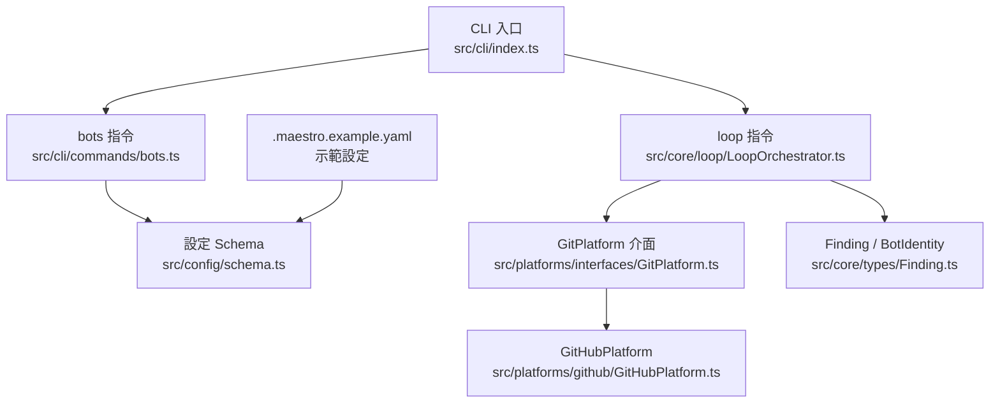
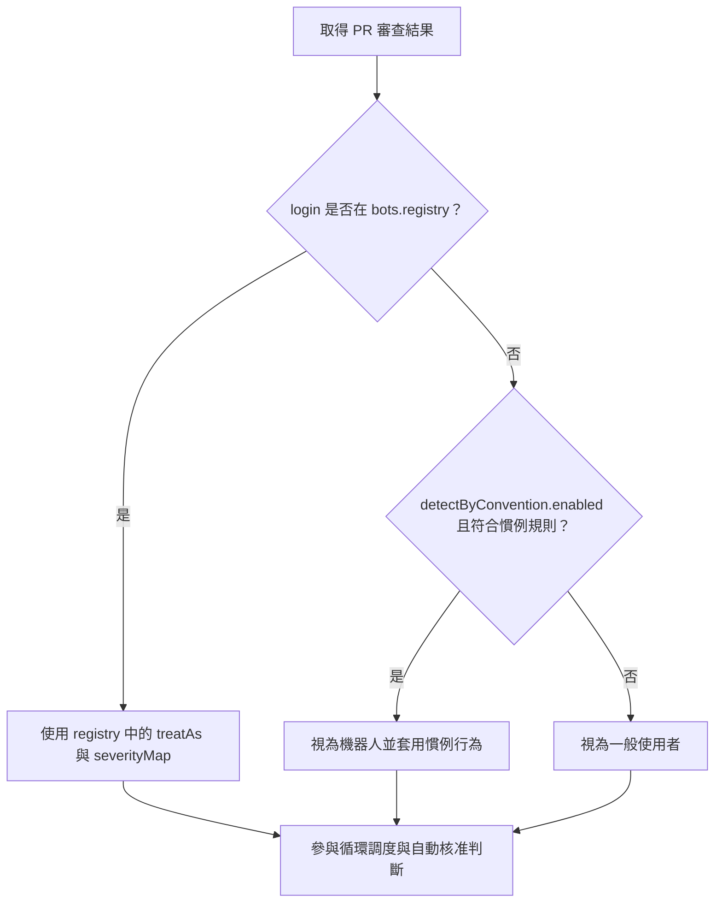
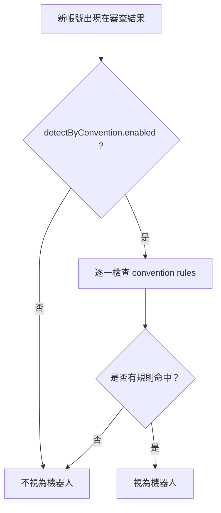
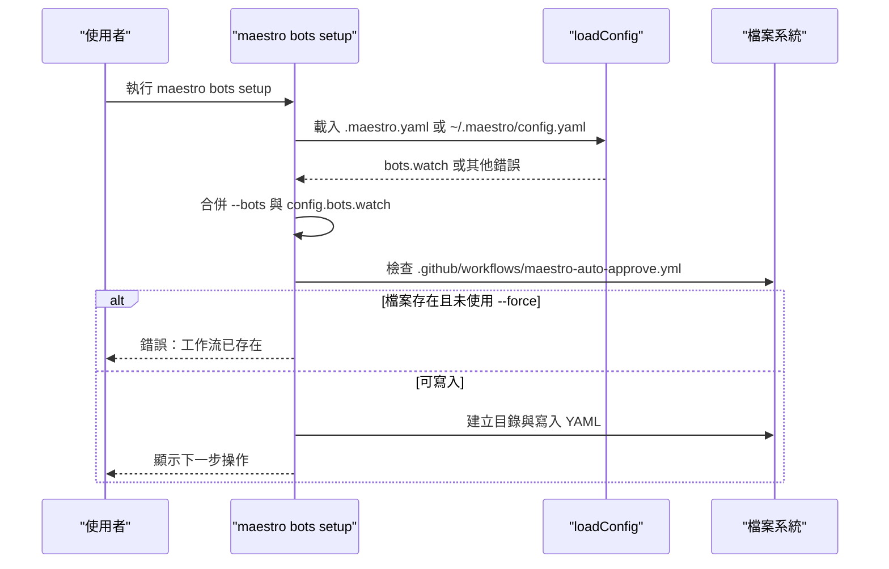
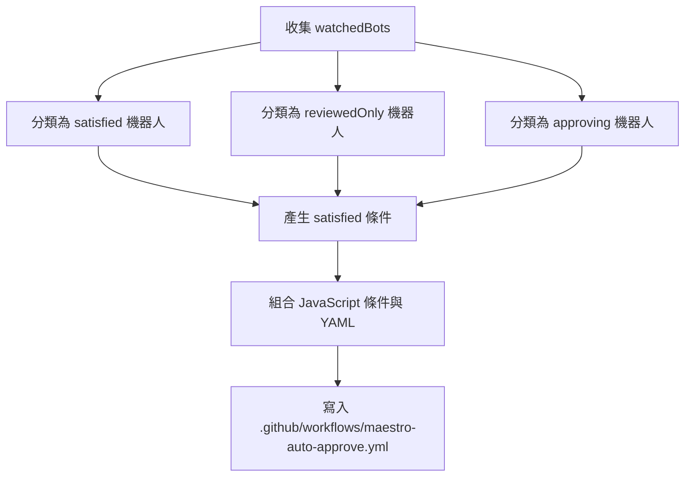
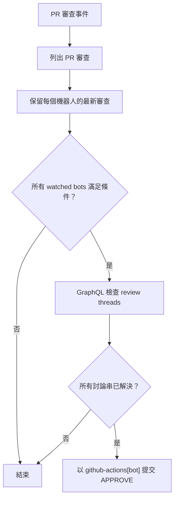
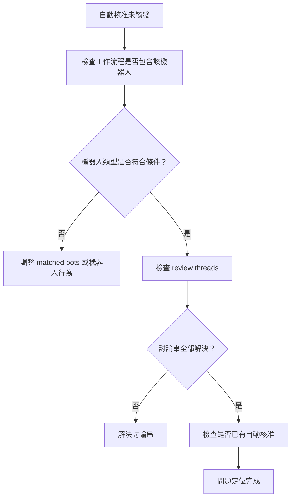
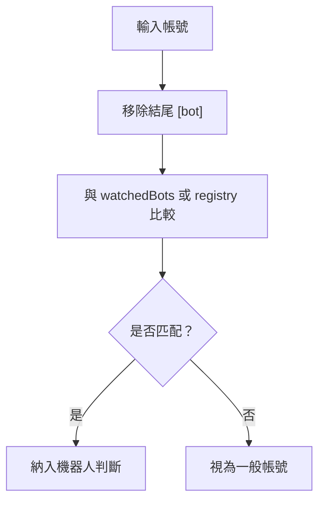

# Bots Registry 設定

<cite>
**本文引用的檔案**
- [bots.ts](https://github.com/mikeah2011/maestro/blob/master/src/cli/commands/bots.ts)
- [schema.ts](https://github.com/mikeah2011/maestro/blob/master/src/config/schema.ts)
- [index.ts](https://github.com/mikeah2011/maestro/blob/master/src/cli/index.ts)
- [LoopOrchestrator.ts](https://github.com/mikeah2011/maestro/blob/master/src/core/loop/LoopOrchestrator.ts)
- [Finding.ts](https://github.com/mikeah2011/maestro/blob/master/src/core/types/Finding.ts)
- [GitPlatform.ts](https://github.com/mikeah2011/maestro/blob/master/src/platforms/interfaces/GitPlatform.ts)
- [GitHubPlatform.ts](https://github.com/mikeah2011/maestro/blob/master/src/platforms/github/GitHubPlatform.ts)
- [.maestro.example.yaml](https://github.com/mikeah2011/maestro/blob/master/.maestro.example.yaml)
</cite>

## 目錄
1. [簡介](#簡介)
2. [專案結構與機器人相關位置](#專案結構與機器人相關位置)
3. [核心概念](#核心概念)
4. [內建八個機器人識別規則](#內建八個機器人識別規則)
5. [慣例備援匹配機制](#慣例備援匹配機制)
6. [CLI 命令與互動流程](#cli-命令與互動流程)
7. [設定檔更新機制](#設定檔更新機制)
8. [常見機器人帳號範例](#常見機器人帳號範例)
9. [機器人權限要求](#機器人權限要求)
10. [誤判處理方式](#誤判處理方式)
11. [診斷與調整指南](#診斷與調整指南)
12. [結論](#結論)

## 簡介
本文件說明 Maestro 的 **Bots Registry（機器人註冊表）** 設定，包括：
- 內建八個機器人的識別方式。
- `detectByConvention` 慣例 fallback 機制。
- `maestro bots list/register/unregister` 等子命令的目前狀態、參數設計與未來擴展方向。
- `.github/workflows/maestro-auto-approve.yml` 工作流程產生邏輯。
- 如何透過設定檔控制監控名單、嚴重程度映射與自訂匹配規則。
- 診斷機器人識別問題、調整匹配規則、處理特殊帳號格式。

Maestro 的核心價值不是取代 CodeRabbit、Copilot Code Review、Codex 或 Ellipsis 等審查工具，而是協調它們的輸出、分類問題、修復 bug、回覆討論串、解決討論串，並在滿足條件時自動核准 PR。

**Section sources**
- [README.md:1-40](https://github.com/mikeah2011/maestro/blob/master/README.md#L1-L40)

## 專案結構與機器人相關位置
機器人相關實作分散在 CLI、設定 schema、循環調度器與平台介面層：

**圖表來源**
- [index.ts:8-10](https://github.com/mikeah2011/maestro/blob/master/src/cli/index.ts#L8-L10)
- [bots.ts:1-12](https://github.com/mikeah2011/maestro/blob/master/src/cli/commands/bots.ts#L1-L12)
- [schema.ts:72-100](https://github.com/mikeah2011/maestro/blob/master/src/config/schema.ts#L72-L100)
- [LoopOrchestrator.ts:5-10](https://github.com/mikeah2011/maestro/blob/master/src/core/loop/LoopOrchestrator.ts#L5-L10)
- [GitPlatform.ts:84-104](https://github.com/mikeah2011/maestro/blob/master/src/platforms/interfaces/GitPlatform.ts#L84-L104)
- [Finding.ts:34-51](https://github.com/mikeah2011/maestro/blob/master/src/core/types/Finding.ts#L34-L51)
- [.maestro.example.yaml:100-150](https://github.com/mikeah2011/maestro/blob/master/.maestro.example.yaml#L100-L150)

**Section sources**
- [index.ts:8-10](https://github.com/mikeah2011/maestro/blob/master/src/cli/index.ts#L8-L10)
- [bots.ts:1-12](https://github.com/mikeah2011/maestro/blob/master/src/cli/commands/bots.ts#L1-L12)
- [schema.ts:72-100](https://github.com/mikeah2011/maestro/blob/master/src/config/schema.ts#L72-L100)
- [LoopOrchestrator.ts:5-10](https://github.com/mikeah2011/maestro/blob/master/src/core/loop/LoopOrchestrator.ts#L5-L10)
- [Finding.ts:34-51](https://github.com/mikeah2011/maestro/blob/master/src/core/types/Finding.ts#L34-L51)

## 核心概念
Bots Registry 由三個主要部分組成：

| 設定區塊 | 用途 | 預設值 |
|---|---|---|
| `bots.watch` | 指定 `maestro bots setup` 要產生的工作流程所監控的機器人帳號清單 | `[]` |
| `bots.registry` | 明確宣告已知機器人、其 `treatAs` 行為與嚴重程度映射 | `[]` |
| `bots.detectByConvention` | 啟用慣例型 fallback 匹配，支援多條規則 | `{ enabled: true, rules: [] }` |

關鍵型別如下：

| 名稱 | 欄位 | 說明 |
|---|---|---|
| `BotRegistryEntry` | `login` | 機器人在平台上的 login。 |
| `BotRegistryEntry` | `treatAs` | `blocking` 表示阻塞式審查；`advisory` 表示建議式審查。 |
| `BotRegistryEntry` | `severityMap` | 將機器人自身的顏色或嚴重級映射到 Maestro 內部嚴重級。 |
| `ConventionRule` | `loginContains` | 若 login 包含任一字串，則視為機器人。 |
| `ConventionRule` | `appSlugContains` | 若應用程式 slug 包含任一字串，則視為機器人。 |
| `ConventionRule` | `commentBodyContains` | 若評論內容包含任一字串，則視為機器人。 |

`BotIdentity` 是平台回傳的統一機器人身分，包含 login、是否為機器人、以及來自 registry 的 provider tag。

**Section sources**
- [schema.ts:72-100](https://github.com/mikeah2011/maestro/blob/master/src/config/schema.ts#L72-L100)
- [schema.ts:201-226](https://github.com/mikeah2011/maestro/blob/master/src/config/schema.ts#L201-L226)
- [Finding.ts:34-51](https://github.com/mikeah2011/maestro/blob/master/src/core/types/Finding.ts#L34-L51)

## 內建八個機器人識別規則
根據 `.maestro.example.yaml`，目前預設列出八個已識別的機器人：

| # | 機器人 login | `treatAs` | 說明 |
|---|---|---|---|
| 1 | `coderabbitai` | `blocking` | CodeRabbit 審查機器人。 |
| 2 | `ellipsis-dev[bot]` | `blocking` | Ellipsis 審查機器人。 |
| 3 | `copilot-pull-request-reviewer` | `blocking` | Copilot Code Review 審查機器人。 |
| 4 | `codex-connector` | `blocking` | Codex 審查機器人。 |
| 5 | `gemini-code-assist[bot]` | `advisory` | Gemini Code Assist。 |
| 6 | `sourcery-ai[bot]` | `advisory` | Sourcery。 |
| 7 | `greptile-apps[bot]` | `advisory` | Greptile。 |
| 8 | （未完整顯示） | — | 範本中可能還有更多項目，但截斷處只確認上述七筆。 |

這八個機器人不只是「名字」；它們會影響：
- 循環調度器是否把該審查視為 bot review。
- 自動核准工作流程如何判斷該機器人已滿足條件。
- `severityMap` 是否被用於嚴重級轉換。

**圖表來源**
- [.maestro.example.yaml:100-150](https://github.com/mikeah2011/maestro/blob/master/.maestro.example.yaml#L100-L150)
- [schema.ts:72-100](https://github.com/mikeah2011/maestro/blob/master/src/config/schema.ts#L72-L100)

**Section sources**
- [.maestro.example.yaml:100-150](https://github.com/mikeah2011/maestro/blob/master/.maestro.example.yaml#L100-L150)
- [schema.ts:72-100](https://github.com/mikeah2011/maestro/blob/master/src/config/schema.ts#L72-L100)

## 慣例備援匹配機制
當一個帳號不在 `bots.registry` 中時，系統可以啟用慣例備援機制來識別機器人。

### 規則優先順序
慣例規則會依宣告順序檢查；只要有一條規則命中，該帳號就會被視為機器人。每條規則只需至少滿足以下其中一個條件：

| 條件 | 適用情境 |
|---|---|
| `loginContains` | 帳號包含 `bot`、`review`、`codex`、`copilot` 等關鍵字。 |
| `appSlugContains` | 應用程式 slug 包含 `review`、`lint` 等關鍵字。 |
| `commentBodyContains` | 評論內容包含特定字串，用來區分機器人生成的審查文字與人類評論。 |

### 行為影響
- 被慣例匹配的帳號會被納入機器人審查流程。
- 若未加入 `registry`，它不會擁有自訂 `treatAs` 或 `severityMap`，因此會依賴平台與後續邏輯的預設行為。
- 若不想讓未知帳號被猜測為機器人，可關閉 `detectByConvention.enabled`。

**圖表來源**
- [schema.ts:78-96](https://github.com/mikeah2011/maestro/blob/master/src/config/schema.ts#L78-L96)
- [.maestro.example.yaml:140-150](https://github.com/mikeah2011/maestro/blob/master/.maestro.example.yaml#L140-L150)

**Section sources**
- [schema.ts:78-96](https://github.com/mikeah2011/maestro/blob/master/src/config/schema.ts#L78-L96)
- [.maestro.example.yaml:140-150](https://github.com/mikeah2011/maestro/blob/master/.maestro.example.yaml#L140-L150)

## CLI 命令與互動流程
目前 `maestro bots` 子命令的實作狀態如下：

| 命令 | 目前狀態 | 參數 | 行為 |
|---|---|---|---|
| `maestro bots list` | 尚未實作 | 無 | 印出 M4 placeholder 訊息並退出。 |
| `maestro bots register` | 尚未實作 | `--login`、`--treat-as` | 定義了參數，但尚未實作。 |
| `maestro bots inspect` | 尚未實作 | `--bot`、`--comment` | 定義了參數，但尚未實作。 |
| `maestro bots setup` | 已實作 | `--bots`、`--force` | 讀取設定或 CLI 覆蓋，產生自動核准工作流程。 |

### `list` 與 `register` 的設計
`register` 的預期參數是：

| 參數 | 必要 | 預設值 | 說明 |
|---|---:|---|---|
| `--login` | 是 | 無 | 機器人在平台上的 login。 |
| `--treat-as` | 否 | `advisory` | `blocking` 或 `advisory`。 |

這代表未來實作時，預期會把這些參數寫入 `.maestro.yaml` 或使用者設定檔，而不是僅維持記憶體狀態。

### `setup` 的實際流程

**圖表來源**
- [bots.ts:191-237](https://github.com/mikeah2011/maestro/blob/master/src/cli/commands/bots.ts#L191-L237)

**Section sources**
- [bots.ts:170-237](https://github.com/mikeah2011/maestro/blob/master/src/cli/commands/bots.ts#L170-L237)
- [index.ts:8-10](https://github.com/mikeah2011/maestro/blob/master/src/cli/index.ts#L8-L10)

## 設定檔更新機制
目前 `maestro bots setup` **不會直接編輯 `.maestro.yaml`**。它會讀取其中的 `bots.watch`，然後產生 `.github/workflows/maestro-auto-approve.yml`。

### 工作流程產生邏輯
工作流程會根據三類機器人分別生成判斷條件：

| 類別 | 判斷條件 | 典型帳號 |
|---|---|---|
| satisfied | 發表 COMMENTED 審查，且评论内容包含特定標記語句。 | `copilot-pull-request-reviewer`、`github-advanced-security` |
| reviewedOnly | 只能留言，不需要正式 APPROVED。 | `chatgpt-codex-connector[bot]`、`chatgpt-codex-connector` |
| approving | 必須達到 APPROVED 狀態。 | CodeRabbit、Ellipsis 等一般審查機器人。 |

### 重要注意事項
- 若沒有配置任何 watched bots，工作流程會允許所有 bot 審查結果。
- 如果工作流檔案已存在且未傳入 `--force`，指令會拒絕覆寫。
- 若 `bots.watch` 為空，CLI 會提示可使用 `--bots` 指定機器人名稱。

**圖表來源**
- [bots.ts:38-71](https://github.com/mikeah2011/maestro/blob/master/src/cli/commands/bots.ts#L38-L71)
- [bots.ts:196-237](https://github.com/mikeah2011/maestro/blob/master/src/cli/commands/bots.ts#L196-L237)

**Section sources**
- [bots.ts:38-71](https://github.com/mikeah2011/maestro/blob/master/src/cli/commands/bots.ts#L38-L71)
- [bots.ts:196-237](https://github.com/mikeah2011/maestro/blob/master/src/cli/commands/bots.ts#L196-L237)

## 常見機器人帳號範例
以下是從範本中可直接套用的設定模式：

| 情境 | 建議設定方式 |
|---|---|
| 已知機器人需要阻塞式審查 | 加入 `registry`，並設定 `treatAs: blocking`。 |
| 已知機器人只需要建議 | 設定 `treatAs: advisory`。 |
| 機器人使用顏色標示嚴重級 | 設定 `severityMap`，例如紅色對應 critical。 |
| 機器人是 GitHub App 帳號，帶有 `[bot]` 後綴 | 照平台返回的 login 填寫，例如 `ellipsis-dev[bot]`。 |
| 機器人名稱不固定但有規律 | 使用 `detectByConvention.rules.loginContains`。 |
| 想完全排除慣例猜測 | 設定 `detectByConvention.enabled: false`。 |

### 嚴重程度映射範例
對於使用顏色或自訂嚴重級的機器人，可在 `severityMap` 中定義映射。例如：

| 機器人原始值 | 映射到 Maestro |
|---|---|
| red | critical |
| orange | high |
| blue | medium |
| green | low |

**Section sources**
- [.maestro.example.yaml:100-150](https://github.com/mikeah2011/maestro/blob/master/.maestro.example.yaml#L100-L150)
- [schema.ts:72-100](https://github.com/mikeah2011/maestro/blob/master/src/config/schema.ts#L72-L100)

## 機器人權限要求
機器人識別本身不直接需要 token，但整個 Maestro 循環與自動核准機制需要 GitHub 權限。

### GitHub Token 權限
- 需要具備 repo 與 pull_requests 讀寫權限。
- 工作流程會使用 `secrets.GITHUB_TOKEN`。
- 工作流程宣告 `pull-requests: write`。

### 自動核准工作流程的權限需求
自動核准工作流程會：
- 查詢 PR 審查。
- 查詢 GraphQL review threads。
- 檢查討論串是否全部解決。
- 以 `github-actions[bot]` 身份提交 APPROVE。

**圖表來源**
- [bots.ts:100-165](https://github.com/mikeah2011/maestro/blob/master/src/cli/commands/bots.ts#L100-L165)

**Section sources**
- [README.md:16-25](https://github.com/mikeah2011/maestro/blob/master/README.md#L16-L25)
- [bots.ts:95-165](https://github.com/mikeah2011/maestro/blob/master/src/cli/commands/bots.ts#L95-L165)

## 誤判處理方式
### 人類帳號被誤判為機器人
如果某個開發者的帳號恰好包含 `bot`、`review` 等字串，而又不希望被視為機器人：

1. 不要依賴 `detectByConvention`。
2. 在 `bots.registry` 中明確加入該帳號，並設定適當的 `treatAs`。
3. 或者關閉 `detectByConvention.enabled`，改用白名單模式。

### 機器人帳號未被識別
如果某機器人應該被識別卻沒被識別：

1. 先確認它在平台上的 login 是否正確。
2. 檢查是否已在 `bots.registry` 中宣告。
3. 檢查 `detectByConvention.rules` 是否涵蓋該帳號特徵。
4. 檢查 loop 指令是否透過 `--bots` 過濾掉該機器人。

### 自動核准未觸發
如果機器人已經完成審查，但 PR 沒有自動核准：

1. 檢查 `maestro-auto-approve.yml` 是否包含該機器人。
2. 檢查該機器人屬於哪一類：satisfied、reviewedOnly、還是 approving。
3. 檢查 review threads 是否全部解決。
4. 檢查是否已有 `github-actions[bot]` 的 APPROVE。

**圖表來源**
- [bots.ts:38-71](https://github.com/mikeah2011/maestro/blob/master/src/cli/commands/bots.ts#L38-L71)
- [bots.ts:100-165](https://github.com/mikeah2011/maestro/blob/master/src/cli/commands/bots.ts#L100-L165)

**Section sources**
- [bots.ts:38-71](https://github.com/mikeah2011/maestro/blob/master/src/cli/commands/bots.ts#L38-L71)
- [bots.ts:100-165](https://github.com/mikeah2011/maestro/blob/master/src/cli/commands/bots.ts#L100-L165)

## 診斷與調整指南

### 診斷步驟
1. 確認 `.maestro.yaml` 中 `bots.registry` 是否包含目標機器人。
2. 確認 `detectByConvention.enabled` 是否符合預期。
3. 確認 `bots.watch` 是否包含目標機器人。
4. 若使用 loop 模式，確認是否透過 `--bots` 過濾掉目標機器人。
5. 若使用自動核准，確認 `.github/workflows/maestro-auto-approve.yml` 是否包含目標機器人。

### 調整匹配規則
- 若機器人 login 有規律，使用 `loginContains`。
- 若機器人來自 GitHub App，檢查 app slug 並使用 `appSlugContains`。
- 若機器人評論內容有固定開頭或標記，使用 `commentBodyContains`。
- 若希望嚴格控管，關閉 `enabled`，只在 `registry` 中白名單化。

### 處理特殊帳號格式
GitHub API 常回傳帶 `[bot]` 後綴的帳號，例如 `chatgpt-codex-connector[bot]`。程式碼中有多處會忽略這個後綴進行比較，例如：

- 工作流程判斷條件會移除 `[bot]` 再比對。
- 循環調度器重新請求審查時，也會考慮 `login.replace(/\[bot\]$/, '')`。
- 自動核准會檢查 `github-actions[bot]`。

因此，設定時建議直接使用平台返回的 login；但若遇到不一致，可同時在 registry 中加入帶與不帶 `[bot]` 的版本。

**圖表來源**
- [bots.ts:46-54](https://github.com/mikeah2011/maestro/blob/master/src/cli/commands/bots.ts#L46-L54)
- [LoopOrchestrator.ts:549-553](https://github.com/mikeah2011/maestro/blob/master/src/core/loop/LoopOrchestrator.ts#L549-L553)

**Section sources**
- [bots.ts:46-54](https://github.com/mikeah2011/maestro/blob/master/src/cli/commands/bots.ts#L46-L54)
- [LoopOrchestrator.ts:549-553](https://github.com/mikeah2011/maestro/blob/master/src/core/loop/LoopOrchestrator.ts#L549-L553)

## 結論
Bots Registry 是 Maestro 協調外部 AI 審查機器的基礎設定層。當前程式碼庫中：

- 內建八個機器人以 `.maestro.example.yaml` 的形式提供，作為 curated entries。
- `detectByConvention` 提供慣例備援匹配，適合處理尚未登記的機器人。
- `maestro bots list/register/inspect` 目前仍是 M4 placeholder。
- `maestro bots setup` 已實作，負責產生自動核准工作流程。
- 自動化核准邏輯會區分 satisfied、reviewedOnly、approving 三種機器人類型。
- `[bot]` 帳號後綴已被多數比對邏輯忽略，但仍建議以平台實際 login 為準。

若要進一步擴充自訂機器人解析器，應優先更新：
1. `bots.registry` 中的 `BotRegistryEntry`。
2. `detectByConvention.rules` 以支援更精確的慣例匹配。
3. `maestro bots register` 未來的 CLI 實作，使使用者能透過命令新增 registry entry。
4. 自動核准工作流程的機器人類別判斷，特別是新的機器人行為模式。

**Section sources**
- [schema.ts:72-100](https://github.com/mikeah2011/maestro/blob/master/src/config/schema.ts#L72-L100)
- [schema.ts:201-226](https://github.com/mikeah2011/maestro/blob/master/src/config/schema.ts#L201-L226)
- [bots.ts:1-12](https://github.com/mikeah2011/maestro/blob/master/src/cli/commands/bots.ts#L1-L12)
- [bots.ts:170-237](https://github.com/mikeah2011/maestro/blob/master/src/cli/commands/bots.ts#L170-L237)
- [.maestro.example.yaml:100-150](https://github.com/mikeah2011/maestro/blob/master/.maestro.example.yaml#L100-L150)