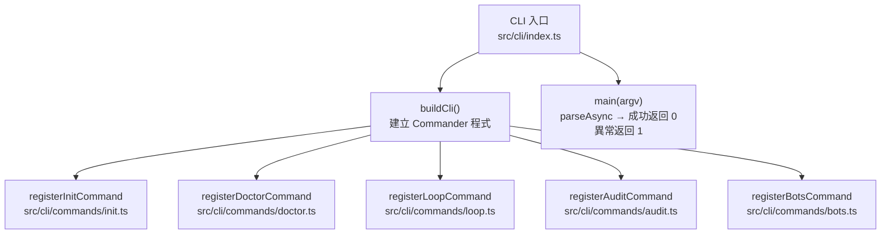
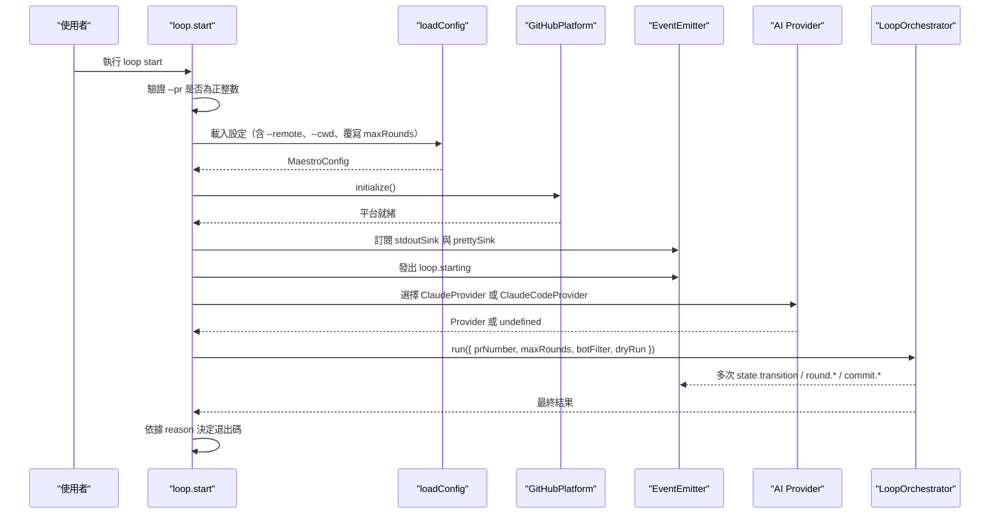

# CLI 命令參考

<cite>
**本文引用的檔案**
- [src/cli/index.ts](https://github.com/mikeah2011/maestro/blob/master/src/cli/index.ts)
- [src/cli/commands/init.ts](https://github.com/mikeah2011/maestro/blob/master/src/cli/commands/init.ts)
- [src/cli/commands/doctor.ts](https://github.com/mikeah2011/maestro/blob/master/src/cli/commands/doctor.ts)
- [src/cli/commands/loop.ts](https://github.com/mikeah2011/maestro/blob/master/src/cli/commands/loop.ts)
- [src/cli/commands/audit.ts](https://github.com/mikeah2011/maestro/blob/master/src/cli/commands/audit.ts)
- [src/cli/commands/bots.ts](https://github.com/mikeah2011/maestro/blob/master/src/cli/commands/bots.ts)
- [package.json](https://github.com/mikeah2011/maestro/blob/master/package.json)
- [README.md](https://github.com/mikeah2011/maestro/blob/master/README.md)
</cite>

## 目錄
1. [簡介](#簡介)
2. [專案結構與命令載入方式](#專案結構與命令載入方式)
3. [全域行為、錯誤碼與輸出格式](#全域行為錯誤碼與輸出格式)
4. [命令速查表](#命令速查表)
5. [詳細命令參考](#詳細命令參考)
6. [常見用法組合](#常見用法組合)
7. [進階參數說明](#進階參數說明)
8. [疑難排解](#疑難排解)
9. [結論](#結論)

## 簡介
`maestro` 是統一調度 AI PR 審查機器人的 CLI。它本身不是另一個審查工具，而是協調 CodeRabbit、Ellipsis、Copilot Code Review、Codex、Gemini Code Assist、Sourcery 等工具的收斂層。本文件聚焦於使用者可執行的所有 CLI 子命令，包含旗標、參數、預設值、輸出格式、錯誤碼與實際使用範例。

## 專案結構與命令載入方式
CLI 入口會建立 Commander 程式、讀取套件版本、載入 `.env`，並註冊五個主要子命令：`init`、`doctor`、`loop`、`audit`、`bots`。每個子命令由獨立模組透過 `registerXxxCommand(program)` 註冊。



**圖表來源**
- [src/cli/index.ts:1-86](https://github.com/mikeah2011/maestro/blob/master/src/cli/index.ts#L1-L86)

**章節來源**
- [src/cli/index.ts:1-86](https://github.com/mikeah2011/maestro/blob/master/src/cli/index.ts#L1-L86)

## 全域行為、錯誤碼與輸出格式

### 執行模式
- 直接執行二進位時，入口函式會解析命令；若返回非零狀態碼，則以該代碼呼叫 `process.exit`。
- 當 Commander 拋出異常時，CLI 會印出紅色錯誤訊息並返回退出碼 `1`。
- `.env` 會在執行時從工作目錄靜默載入。

### 全域錯誤碼
| 退出碼 | 意義 | 觸發情境 |
|---|---|---|
| `0` | 成功 | 命令正常完成 |
| `1` | 一般錯誤 | 未處理的異常、平台初始化失敗、循環結束原因為錯誤 |
| `2` | 無效使用 | 參數驗證失敗，例如 `--pr` 不是正整數 |
| `3` | 設定錯誤 | `.maestro.yaml` 載入或驗證失敗 |
| `4` | 尚未實作 | placeholder 子命令（`loop status/stop/resume`、`audit`、`bots list/register/inspect`） |

### 輸出格式
- 人類可讀進度與結果主要輸出至標準錯誤，讓標準輸出仍可保留給 JSONL 事件流。
- `loop start` 會訂閱 `EventEmitter` 並同時寫入標準輸出與美化後的標準錯誤。
- `doctor` 會列出檢查清單，每行顯示通過、失敗、警告或跳過的狀態符號。
- 其他 scaffold 型命令（`init`、`bots setup`）會列印下一步操作指引。

**章節來源**
- [src/cli/index.ts:1-86](https://github.com/mikeah2011/maestro/blob/master/src/cli/index.ts#L1-L86)
- [src/cli/commands/loop.ts:1-512](https://github.com/mikeah2011/maestro/blob/master/src/cli/commands/loop.ts#L1-L512)
- [src/cli/commands/doctor.ts:1-237](https://github.com/mikeah2011/maestro/blob/master/src/cli/commands/doctor.ts#L1-L237)

## 命令速查表

| 命令 | 用途 | 必要參數 | 重要選項 | 預設行為 | 成功狀態碼 |
|---|---|---|---|---|---|
| `maestro init` | 產生 `.maestro.yaml` 與審計目錄 | 無 | `--force`、`--cwd` | 不覆蓋已存在的設定檔 | `0` |
| `maestro doctor` | 檢查 Git、設定、平台 CLI、權杖與 AI Provider | 無 | `--cwd` | 使用目前目錄 | `0`（全部通過）、`1`（有失敗項目） |
| `maestro loop start` | 在指定 PR 上啟動多機器人收斂循環 | `--pr <number>` | `--max-rounds`、`--cost-budget`、`--bots`、`--dry-run`、`--remote`、`--cwd` | 讀取 `.maestro.yaml` 中的停止條件與平台設定 | `0` 或 `1` |
| `maestro loop status` | 查看進行中循環狀態 | 無 | `--pr <number>` | 尚未實作 | `4` |
| `maestro loop stop` | 停止進行中循環 | `--pr <number>` | 無 | 尚未實作 | `4` |
| `maestro loop resume` | 恢復暫停的循環 | `--pr <number>` | 無 | 尚未實作 | `4` |
| `maestro audit` | 重播分類決策 | `--pr <number>` | `--round`、`--format` | 尚未實作 | `4` |
| `maestro bots list` | 列出已配置與內建機器人 | 無 | 無 | 尚未實作 | `4` |
| `maestro bots register` | 註冊自訂機器人 | `--login <login>` | `--treat-as <mode>` | 預設 `advisory` | `4` |
| `maestro bots inspect` | 分析機器人評論樣本 | `--bot <login>`、`--comment <file>` | 無 | 尚未實作 | `4` |
| `maestro bots setup` | 產生自動核准工作流程 | 無 | `--bots <logins>`、`--force` | 使用設定中的監控機器人列表 | `0` 或 `1` |

**章節來源**
- [src/cli/commands/init.ts:1-87](https://github.com/mikeah2011/maestro/blob/master/src/cli/commands/init.ts#L1-L87)
- [src/cli/commands/doctor.ts:1-237](https://github.com/mikeah2011/maestro/blob/master/src/cli/commands/doctor.ts#L1-L237)
- [src/cli/commands/loop.ts:1-512](https://github.com/mikeah2011/maestro/blob/master/src/cli/commands/loop.ts#L1-L512)
- [src/cli/commands/audit.ts:1-25](https://github.com/mikeah2011/maestro/blob/master/src/cli/commands/audit.ts#L1-L25)
- [src/cli/commands/bots.ts:1-237](https://github.com/mikeah2011/maestro/blob/master/src/cli/commands/bots.ts#L1-L237)

## 詳細命令參考

### `maestro init`
用於在目前倉庫中產生 `.maestro.yaml` 設定檔與 `.maestro` 審計目錄。

#### 語法
```text
maestro init [--force] [--cwd <dir>]
```

#### 參數與選項
| 名稱 | 類型 | 必要 | 預設值 | 說明 |
|---|---|---|---|---|
| `--force` | 布林旗標 | 否 | `false` | 允許覆蓋現有的 `.maestro.yaml` |
| `--cwd <dir>` | 字串路徑 | 否 | 目前工作目錄 | 將設定檔產生到指定目錄 |

#### 行為規則
- 若目標位置已存在 `.maestro.yaml` 且未傳入 `--force`，命令會拋出錯誤。
- 會嘗試從安裝套件的路徑複製 `.maestro.example.yaml`。
- 若 `.maestro` 目錄不存在，會建立該目錄。
- 成功後會印出下一步操作指引。

#### 輸出
- 成功：綠色勾號提示，以及編輯設定、執行診斷、執行循環的步驟。
- 失敗：錯誤訊息包含衝突檔名或找不到範本設定檔的位置。

#### 錯誤碼
| 狀態 | 退出碼 |
|---|---|
| 成功 | `0` |
| 設定檔衝突或未覆蓋 | `1` |
| 找不到範本設定檔 | `1` |

#### 使用範例
- 在現有倉庫初始化設定：
  ```bash
  maestro init
  ```
- 強制覆蓋既有設定：
  ```bash
  maestro init --force
  ```
- 在其他目錄產生設定：
  ```bash
  maestro init --cwd ./workspaces/my-repo
  ```

**章節來源**
- [src/cli/commands/init.ts:1-87](https://github.com/mikeah2011/maestro/blob/master/src/cli/commands/init.ts#L1-L87)

### `maestro doctor`
檢查環境是否準備就緒，包括 Git、`.maestro.yaml`、平台 CLI、平台權杖與 AI Provider。此命令不會進行網路連線。

#### 語法
```text
maestro doctor [--cwd <dir>]
```

#### 參數與選項
| 名稱 | 類型 | 必要 | 預設值 | 說明 |
|---|---|---|---|---|
| `--cwd <dir>` | 字串路徑 | 否 | 目前工作目錄 | 檢查指定目錄的環境 |

#### 檢查項目
1. **Git 是否安裝**：檢查 `git` 是否在 PATH 中。
2. **是否位於 Git 倉庫**：執行 `git rev-parse --is-inside-work-tree`。
3. **`.maestro.yaml` 是否存在與可載入**：
   - 若不存在，會嘗試從 Git remote 自動偵測 owner/repo。
   - 若能載入並通過 schema 驗證，標示通過。
   - 若載入失敗，標示失敗並顯示錯誤摘要。
4. **平台 CLI 工具**：根據設定中的 `platform.type` 檢查對應 CLI：
   - `github` → `gh`
   - `gitlab` → `glab`
   - `gitea` → `tea`
   - `gitee` → `gitee`
5. **平台權杖**：檢查 `auth.token` 或 `auth.tokenEnv` 對應的環境變數。
6. **AI Provider 金鑰**：
   - 若任一 provider 設定 `apiKey`，標示通過。
   - 若無 API Key 但本機有 `claude` CLI，則視為 ClaudeCodeProvider 可用。
   - 否則標示警告，並指出修復引擎將被停用。

#### 輸出格式
每項檢查一行，格式如下：
```text
  ✓  git installed
  ✓  inside a git repo
  ✓  .maestro.yaml loads + validates
  ✓  gh installed (github) — /usr/local/bin/gh
  ✓  platform token configured — env var set
  ✓  AI provider keys — ok: claude (claude)
```
狀態符號含義：
- `✓`：通過
- `✗`：失敗
- `!`：警告
- `-`：跳過

最後會印出總結：
- 全部通過：「all checks passed.」
- 有任何失敗：「one or more checks failed; fix above before running the loop.」

#### 錯誤碼
| 狀態 | 退出碼 |
|---|---|
| 所有檢查皆非失敗 | `0` |
| 任一檢查為失敗 | `1` |

#### 使用範例
- 檢查目前環境：
  ```bash
  maestro doctor
  ```
- 檢查特定目錄：
  ```bash
  maestro doctor --cwd ./repo
  ```

**章節來源**
- [src/cli/commands/doctor.ts:1-237](https://github.com/mikeah2011/maestro/blob/master/src/cli/commands/doctor.ts#L1-L237)

### `maestro loop`
多機器人 PR 審查收斂循環的主命令，包含啟動、查詢、停止與恢復子命令。

#### 總覽
```text
maestro loop <subcommand>
```

| 子命令 | 狀態 | 說明 |
|---|---|---|
| `start` | 已實作 | 啟動 PR 收斂循環 |
| `status` | 尚未實作 | 顯示進行中循環狀態 |
| `stop` | 尚未實作 | 停止進行中循環 |
| `resume` | 尚未實作 | 恢復因外部修改而暫停的循環 |

#### `maestro loop start`
啟動對指定 PR 的多輪分類、修復、提交、回覆與討論串解決流程。

##### 語法
```text
maestro loop start --pr <number> [選項]
```

##### 參數與選項
| 名稱 | 類型 | 必要 | 預設值 | 說明 |
|---|---|---|---|---|
| `--pr <number>` | 數字 | 是 | 無 | 要驅動的 Pull Request 編號 |
| `--max-rounds <n>` | 數字 | 否 | 設定中的 `stopConditions.maxRounds` | 覆寫最大輪數 |
| `--cost-budget <usd>` | 浮點數 | 否 | 設定中的 `stopConditions.costBudgetUSD` | 覆寫成本上限 |
| `--bots <logins>` | 逗號分隔字串 | 否 | 空字串，代表監控所有機器人 | 只監控指定機器人登入名稱 |
| `--dry-run` | 布林旗標 | 否 | `false` | 只分類與報告發現，不執行修復、提交與回覆 |
| `--remote <name>` | 字串 | 否 | `upstream`，回退到 `origin` | 自動偵測 owner/repo 使用的 Git remote |
| `--cwd <path>` | 字串路徑 | 否 | 目前工作目錄 | 檔案修改與 Git 操作的工作目錄 |

##### 執行流程


**圖表來源**
- [src/cli/commands/loop.ts:1-512](https://github.com/mikeah2011/maestro/blob/master/src/cli/commands/loop.ts#L1-L512)

##### 關鍵行為
- `--pr` 必須是正整數，否則立即返回錯誤碼 `2`。
- 若設定載入失敗，會以錯誤碼 `3` 退出。
- 平台初始化失敗會返回錯誤碼 `1`。
- 在非 dry-run 模式下：
  - 會建立 `FixEngine` 並連接 `onFix`。
  - 會建立互動式決策介面，讓開發者確認修復、延後或拒絕。
  - 會使用 `simple-git` 新增檔案、提交與推送。
  - 可在 PR 獲得足夠審查後更新 PR 描述。
- 在 dry-run 模式下：
  - 仍會分類問題。
  - 不會執行修復、提交、回覆或更新 PR。
- 事件會以 JSONL 形式輸出至標準輸出，並同步以美化文字輸出至標準錯誤。

##### 輸出格式
- **標準輸出**：JSONL 事件，供 CI、Claude Code skill、MCP 或其他工具讀取。
- **標準錯誤**：美化後的進度資訊，包含：
  - 循環開始與最大輪數
  - CI 輪詢狀態
  - 機器人審查狀態
  - 分類結果與決策摘要
  - 修復、提交、回覆、討論串解決狀態
  - 循環結束原因與總輪數

##### 結束原因
| 原因 | 意義 | 通常表示 |
|---|---|---|
| `approved` | PR 已獲批准 | 機器人已滿足要求，準備合併 |
| `converged` | 已收斂 | 沒有新的關鍵問題 |
| stopped | 達到停止條件 | 可能到達最大輪數或觸發其他停止邏輯 |
| error | 發生錯誤 | 內部錯誤或平台/CI 問題 |

##### 錯誤碼
| 情境 | 退出碼 |
|---|---|
| `--pr` 無效 | `2` |
| 設定錯誤 | `3` |
| 平台初始化失敗 | `1` |
| 循環正常結束 | `0` |
| 循環結束原因為錯誤 | `1` |

##### 使用範例
- 基本啟動：
  ```bash
  maestro loop start --pr 42
  ```
- Dry-run 測試：
  ```bash
  maestro loop start --pr 42 --dry-run
  ```
- 限制最多兩輪：
  ```bash
  maestro loop start --pr 42 --max-rounds 2
  ```
- 只監控特定機器人：
  ```bash
  maestro loop start --pr 42 --bots copilot-pull-request-reviewer,chatgpt-codex-connector[bot]
  ```
- 指定遠端與工作目錄：
  ```bash
  maestro loop start --pr 42 --remote origin --cwd ./my-repo
  ```

#### `maestro loop status`
顯示正在執行的 PR 循環狀態。

- 當前為 placeholder，尚未實作。
- 提供 `--pr <number>` 選項。
- 輸出「not yet implemented」訊息並返回錯誤碼 `4`。

#### `maestro loop stop`
停止正在執行的 PR 循環。

- 當前為 placeholder，尚未實作。
- 需要 `--pr <number>`。
- 輸出「not yet implemented」訊息並返回錯誤碼 `4`。

#### `maestro loop resume`
恢復因外部修改而進入暫停狀態的循環。

- 當前為 placeholder，尚未實作。
- 需要 `--pr <number>`。
- 輸出「not yet implemented」訊息並返回錯誤碼 `4`。

**章節來源**
- [src/cli/commands/loop.ts:1-512](https://github.com/mikeah2011/maestro/blob/master/src/cli/commands/loop.ts#L1-L512)

### `maestro audit`
重播某個 PR 的分類決策，方便在擴大規模前除錯誤分類。

#### 語法
```text
maestro audit --pr <number> [--round <n>] [--format <fmt>]
```

#### 參數與選項
| 名稱 | 類型 | 必要 | 預設值 | 說明 |
|---|---|---|---|---|
| `--pr <number>` | 數字 | 是 | 無 | 要重播分類的 PR 編號 |
| `--round <n>` | 數字 | 否 | 無 | 僅重播指定輪次的分類決策 |
| `--format <fmt>` | 字串 | 否 | `text` | 輸出格式：`text` 或 `jsonl` |

#### 目前狀態
- 此命令尚未實作，屬於 M3 範圍。
- 未來預期會讀取 `.maestro/audit/pr-<N>-round-<R>.jsonl` 並重播分類紀錄。
- 目前會輸出黃色警告訊息並返回錯誤碼 `4`。

#### 錯誤碼
| 狀態 | 退出碼 |
|---|---|
| 尚未實作 | `4` |

#### 使用範例
- 重播 PR 分類：
  ```bash
  maestro audit --pr 42
  ```
- 限制特定輪次：
  ```bash
  maestro audit --pr 42 --round 2
  ```
- 以 JSONL 格式輸出：
  ```bash
  maestro audit --pr 42 --format jsonl
  ```

**章節來源**
- [src/cli/commands/audit.ts:1-25](https://github.com/mikeah2011/maestro/blob/master/src/cli/commands/audit.ts#L1-L25)

### `maestro bots`
機器人登錄表管理與工作流程產生的主命令。

#### 總覽
```text
maestro bots <subcommand>
```

| 子命令 | 狀態 | 說明 |
|---|---|---|
| `list` | 尚未實作 | 列出已配置與內建審查機器人 |
| `register` | 尚未實作 | 註冊自託管或自訂機器人 |
| `inspect` | 尚未實作 | 解析機器人評論樣本 |
| `setup` | 已實作 | 產生 `.github/workflows/maestro-auto-approve.yml` |

#### `maestro bots list`
列出已配置與內建審查機器人。

- 當前為 placeholder，尚未實作。
- 返回錯誤碼 `4`。

#### `maestro bots register`
註冊一個自託管或自訂機器人以便偵測。

##### 參數與選項
| 名稱 | 類型 | 必要 | 預設值 | 說明 |
|---|---|---|---|---|
| `--login <login>` | 字串 | 是 | 無 | 機器人在平台上的登入名稱 |
| `--treat-as <mode>` | 字串 | 否 | `advisory` | 機器人類型：`blocking` 或 `advisory` |

- 當前為 placeholder，尚未實作。
- 返回錯誤碼 `4`。

#### `maestro bots inspect`
對單一機器人評論樣本執行 BotRegistry 解析器，檢視解析結果。

##### 參數與選項
| 名稱 | 類型 | 必要 | 預設值 | 說明 |
|---|---|---|---|---|
| `--bot <login>` | 字串 | 是 | 無 | 機器人登入名稱 |
| `--comment <file>` | 字串路徑 | 是 | 無 | 包含機器人評論內容的檔案路徑 |

- 當前為 placeholder，尚未實作。
- 返回錯誤碼 `4`。

#### `maestro bots setup`
產生 GitHub Actions 工作流程，用於在所有監控機器人都滿意且討論串全數解決後自動核准 PR。

##### 語法
```text
maestro bots setup [--bots <logins>] [--force]
```

##### 參數與選項
| 名稱 | 類型 | 必要 | 預設值 | 說明 |
|---|---|---|---|---|
| `--bots <logins>` | 逗號分隔字串 | 否 | 設定中的 `bots.watch` | 要監控的機器人登入名稱 |
| `--force` | 布林旗標 | 否 | `false` | 覆蓋已存在的工作流程檔案 |

##### 工作流程邏輯
1. **機器人類別**：
   - `satisfied`：發布 `COMMENTED` 且正文包含「generated no new comments」的機器人（如 Copilot）。
   - `reviewedOnly`：只能留言、不能正式批准的機器人（如 Codex）。
   - `approving`：必須達到 `APPROVED` 狀態的機器人（如 CodeRabbit、Ellipsis）。
2. **條件檢查**：
   - 所有 `satisfied` 機器人必須出現且符合其模式。
   - 所有 `reviewedOnly` 機器人必須至少出現一次。
   - 所有 `approving` 機器人必須達到 `APPROVED`。
3. **討論串檢查**：透過 GraphQL 檢查所有 review threads 是否已解決。
4. **自動核准**：若上述條件都成立且尚未由 `github-actions[bot]` 核准，則送出 `APPROVE`。

##### 輸出
- 成功：綠色勾號提示已產生 `.github/workflows/maestro-auto-approve.yml`。
- 失敗：若檔案已存在且未傳入 `--force`，會印出黃色警告並返回錯誤碼 `1`。

##### 錯誤碼
| 狀態 | 退出碼 |
|---|---|
| 成功產生工作流程 | `0` |
| 檔案已存在且未強制覆蓋 | `1` |

##### 使用範例
- 使用設定中的機器人列表產生工作流程：
  ```bash
  maestro bots setup
  ```
- 指定監控機器人：
  ```bash
  maestro bots setup --bots copilot-pull-request-reviewer,chatgpt-codex-connector[bot]
  ```
- 覆蓋既有工作流程：
  ```bash
  maestro bots setup --force
  ```

**章節來源**
- [src/cli/commands/bots.ts:1-237](https://github.com/mikeah2011/maestro/blob/master/src/cli/commands/bots.ts#L1-L237)

## 常見用法組合

| 情境 | 命令組合 | 說明 |
|---|---|---|
| 初次安裝與設定 | `maestro init` → `maestro doctor` → `maestro loop start --pr <N>` | 最常見的初始流程 |
| 只在本地測試分類 | `maestro loop start --pr <N> --dry-run` | 不會修改任何檔案或推送到遠端 |
| 限制成本與輪數 | `maestro loop start --pr <N> --max-rounds 2 --cost-budget 3.00` | 適合預算有限的 CI 環境 |
| 只觀察特定機器人 | `maestro loop start --pr <N> --bots coderabbitai-bot,copilot-code-review` | 減少干擾並專注主要機器人 |
| 在非預設目錄執行 | `cd my-repo && maestro loop start --pr <N> --cwd .` | 支援從子目錄或 CI 腳本執行 |
| 自動化自動核准 | `maestro bots setup --force` | 產生 GitHub Actions 自動核准工作流程 |
| 檢查環境問題 | `maestro doctor --cwd ./ci-working-dir` | 在 CI 或 Docker 容器內診斷環境 |
| 除錯分類決策 | `maestro audit --pr <N> --round 2 --format jsonl` | 未來用於檢查分類歷史 |

**章節來源**
- [README.md:1-200](https://github.com/mikeah2011/maestro/blob/master/README.md#L1-L200)
- [src/cli/commands/init.ts:1-87](https://github.com/mikeah2011/maestro/blob/master/src/cli/commands/init.ts#L1-L87)
- [src/cli/commands/doctor.ts:1-237](https://github.com/mikeah2011/maestro/blob/master/src/cli/commands/doctor.ts#L1-L237)
- [src/cli/commands/loop.ts:1-512](https://github.com/mikeah2011/maestro/blob/master/src/cli/commands/loop.ts#L1-L512)
- [src/cli/commands/audit.ts:1-25](https://github.com/mikeah2011/maestro/blob/master/src/cli/commands/audit.ts#L1-L25)
- [src/cli/commands/bots.ts:1-237](https://github.com/mikeah2011/maestro/blob/master/src/cli/commands/bots.ts#L1-L237)

## 進階參數說明

### 設定優先順序
CLI 參數會覆寫設定檔中的值。整體優先順序如下：
1. CLI 旗標
2. 環境變數
3. 倉庫 `.maestro.yaml`
4. 使用者 `~/.maestro/config.yaml`
5. 系統預設值

### AI Provider 選擇順序
`loop start` 會依以下順序選擇 AI Provider：
1. 若 `ANTHROPIC_API_KEY` 或設定中任一 provider 的 `apiKey` 有值，則使用 `ClaudeProvider`。
2. 若本機 PATH 中有 `claude` CLI，則 fallback 到 `ClaudeCodeProvider`。
3. 若兩者皆不可用，循環仍會執行分類，但自動修復引擎被停用。

### 互動式決策逾時
非 dry-run 模式下，每輪分類完成後會顯示建議行動，並在 30 秒後自動採用建議。使用者可輸入指令覆蓋：
- `fix 1,3`：修復第 1 與第 3 項
- `defer 2`：延後第 2 項
- `reject 1`：拒絕第 1 項
- 直接 Enter：採用系統建議

### Git 操作行為
- 若有明確修改檔案，只會新增這些檔案。
- 若未指定檔案，會新增所有變更。
- 若 staging 階段沒有變更，會記錄 `nothing_to_stage` 錯誤並繼續。
- 提交成功後會自動 push。

### 平台與環境變數
- 預設平台權杖環境變數為 `GITHUB_TOKEN`，可由設定中的 `platform.auth.tokenEnv` 覆寫。
- `.env` 會在 CLI 啟動時靜默載入，因此不需手動 export 環境變數。

**章節來源**
- [README.md:1-200](https://github.com/mikeah2011/maestro/blob/master/README.md#L1-L200)
- [src/cli/commands/loop.ts:1-512](https://github.com/mikeah2011/maestro/blob/master/src/cli/commands/loop.ts#L1-L512)
- [src/cli/commands/doctor.ts:1-237](https://github.com/mikeah2011/maestro/blob/master/src/cli/commands/doctor.ts#L1-L237)

## 疑難排解

| 問題 | 可能原因 | 解決方案 |
|---|---|---|
| `error: --pr must be a positive integer` | `--pr` 不是正整數 | 確認傳入的是數字，例如 `--pr 42` |
| `config error: ...` | `.maestro.yaml` 格式錯誤或必填欄位缺失 | 使用 `maestro doctor` 檢查；重新執行 `maestro init` |
| `platform error: ...` | GitHub Token 無效、權限不足或網路問題 | 檢查 `GITHUB_TOKEN` 是否正確且具有 repo 與 pull_requests 讀寫權限 |
| `loop ended with error` | 內部錯誤、CI 失敗或平台 API 錯誤 | 查看標準輸出的 JSONL 事件，找出 `loop.error` 或 `commit.error` |
| `not yet implemented (lands in M3/M4/M7)` | 命令尚未實作 | 等待後續版本，或使用已實作的替代功能 |
| `workflow already exists` | `maestro bots setup` 已產生過工作流程 | 加上 `--force` 覆蓋，或手動編輯既有檔案 |
| `no AI provider available` | 沒有 API Key 也沒有 `claude` CLI | 設定 `ANTHROPIC_API_KEY` 或安裝 Claude Code CLI |
| `AI provider keys` 顯示警告 | 未設定任何 provider API Key | 設定 Anthropic API Key 或安裝 Claude Code CLI |
| `platform token configured` 顯示失敗 | 未設定 `tokenEnv` 對應的環境變數 | 設定 `.env` 或環境中的 `GITHUB_TOKEN` |
| `inside a git repo` 顯示失敗 | 不在 Git 倉庫目錄 | 先 `git init` 或切換到正確目錄 |

### 如何讀取事件輸出
`loop start` 會持續輸出 JSONL 事件，適合管道到檔案或第三方工具：
```bash
maestro loop start --pr 42 2>&1 | tee loop-events.jsonl
```

### 常見退出碼快速判斷
- `0`：一切正常
- `1`：環境或執行錯誤
- `2`：你傳入的參數有問題
- `3`：設定檔有問題
- `4`：命令尚未實作

**章節來源**
- [src/cli/commands/loop.ts:1-512](https://github.com/mikeah2011/maestro/blob/master/src/cli/commands/loop.ts#L1-L512)
- [src/cli/commands/doctor.ts:1-237](https://github.com/mikeah2011/maestro/blob/master/src/cli/commands/doctor.ts#L1-L237)
- [src/cli/commands/bots.ts:1-237](https://github.com/mikeah2011/maestro/blob/master/src/cli/commands/bots.ts#L1-L237)
- [src/cli/index.ts:1-86](https://github.com/mikeah2011/maestro/blob/master/src/cli/index.ts#L1-L86)

## 結論
`maestro` CLI 目前以 `init`、`doctor`、`loop start`、`bots setup` 作為核心可用能力，其餘子命令多數處於規劃階段並回報錯誤碼 `4`。實務上建議的起手式是：
1. 執行 `maestro init` 產生設定。
2. 執行 `maestro doctor` 確認環境。
3. 使用 `maestro loop start --pr <N> --dry-run` 測試。
4. 正式執行 `maestro loop start --pr <N>`。
5. 使用 `maestro bots setup --force` 產生自動核准工作流程。

隨著版本演進，`audit`、`bots list/register/inspect`、`loop status/stop/resume` 將逐步成為完整的生命週期管理工具。