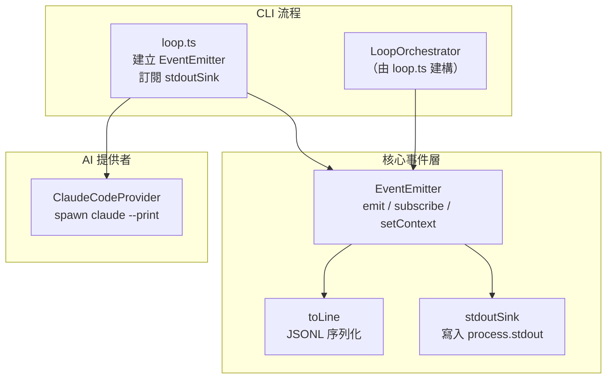
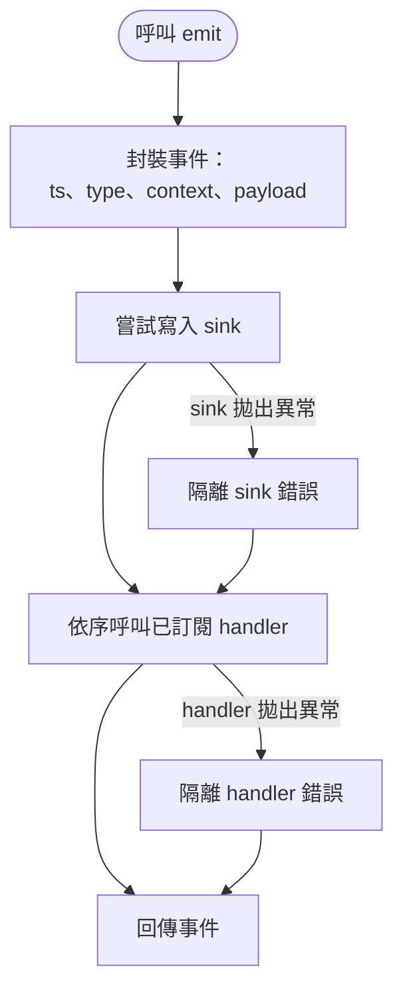
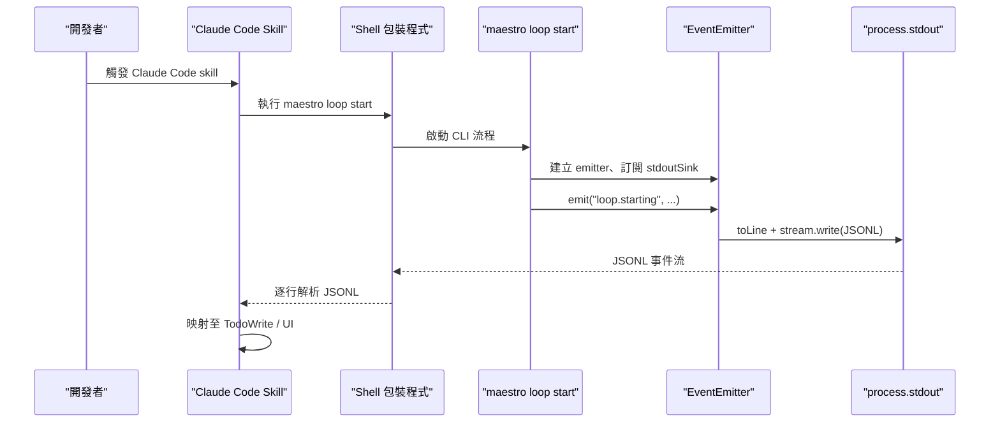
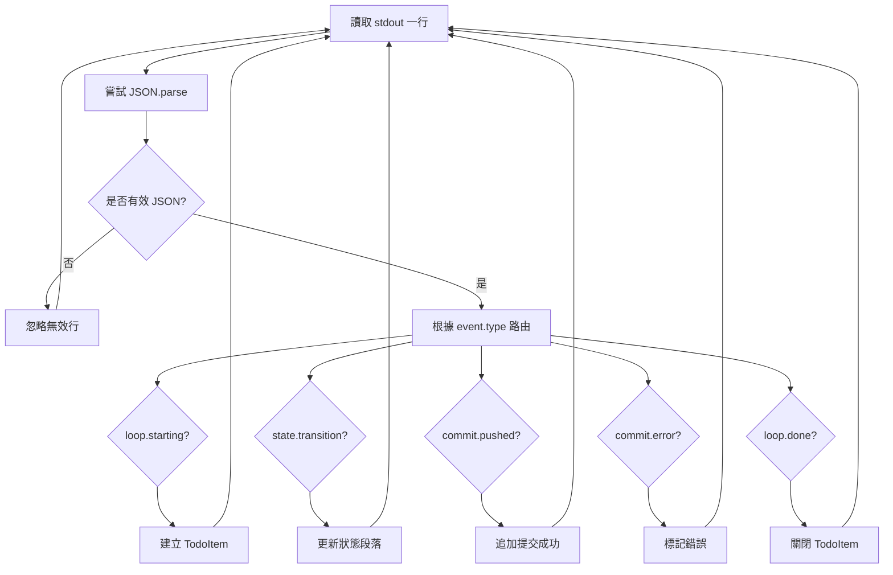
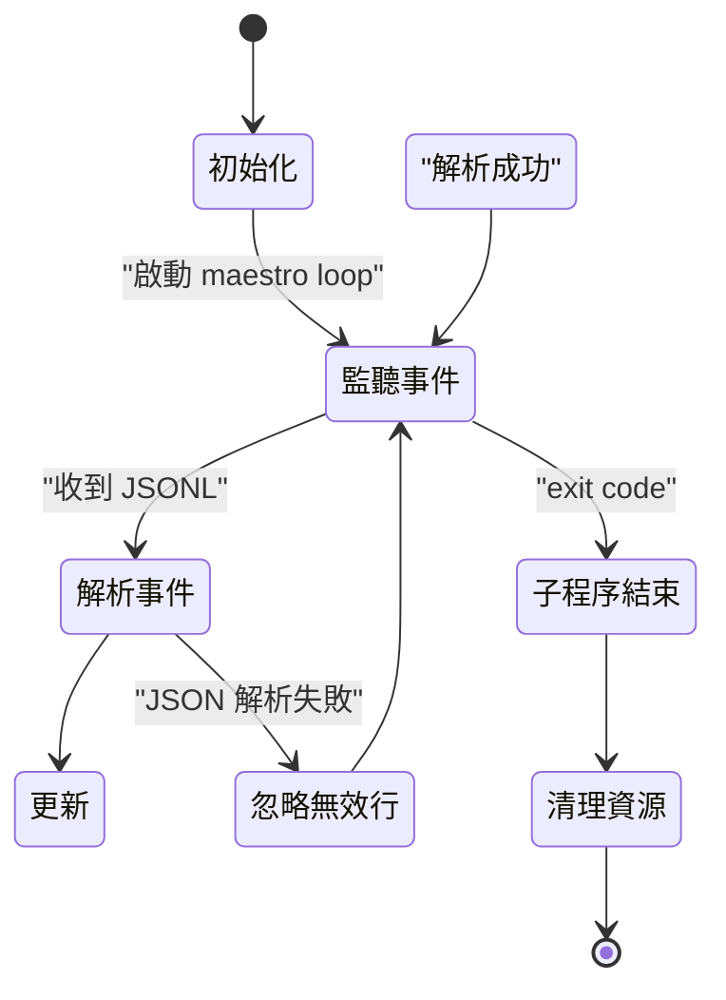
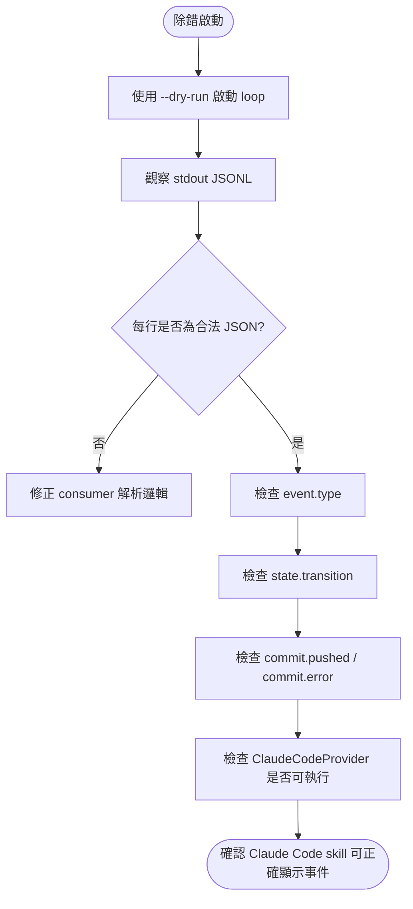
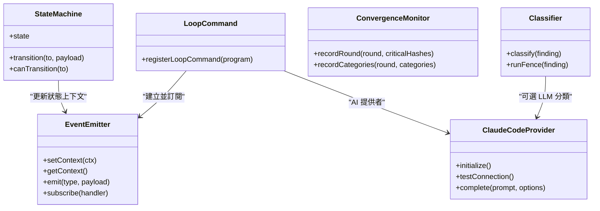

# Claude Code Skill 整合

**本文引用的檔案**

- [EventEmitter.ts](https://github.com/mikeah2011/maestro/blob/master/src/core/events/EventEmitter.ts)
- [ClaudeCodeProvider.ts](https://github.com/mikeah2011/maestro/blob/master/src/ai/providers/ClaudeCodeProvider.ts)
- [loop.ts](https://github.com/mikeah2011/maestro/blob/master/src/cli/commands/loop.ts)
- [StateMachine.ts](https://github.com/mikeah2011/maestro/blob/master/src/core/state/StateMachine.ts)
- [Classifier.ts](https://github.com/mikeah2011/maestro/blob/master/src/core/classify/Classifier.ts)
- [ConvergenceMonitor.ts](https://github.com/mikeah2011/maestro/blob/master/src/core/convergence/ConvergenceMonitor.ts)
- [DESIGN.md](https://github.com/mikeah2011/maestro/blob/master/docs/DESIGN.md)
- [CLAUDE.md](https://github.com/mikeah2011/maestro/blob/master/CLAUDE.md)
- [README.md](https://github.com/mikeah2011/maestro/blob/master/README.md)
- [EventEmitter.test.ts](https://github.com/mikeah2011/maestro/blob/master/tests/core/events/EventEmitter.test.ts)
- [ClaudeCodeProvider.test.ts](https://github.com/mikeah2011/maestro/blob/master/tests/ai/providers/ClaudeCodeProvider.test.ts)

## 目錄
1. [引言](#引言)
2. [專案結構與事件管道位置](#專案結構與事件管道位置)
3. [核心機制：EventEmitter、JSONL 與 stdout sink](#核心機制eventemitterjsonl-與-stdout-sink)
4. [Claude Code Skill 設定方式](#claude-code-skill-設定方式)
5. [領域事件模型與消費範例](#領域事件模型與消費範例)
6. [即時性、錯誤處理與重連機制](#即時性錯誤處理與重連機制)
7. [實際整合場景](#實際整合場景)
8. [除錯技巧](#除錯技巧)
9. [依賴關係分析](#依賴關係分析)
10. [結論](#結論)

## 引言
本文件說明如何將 Maestro 的內部事件管道到 Claude Code，使其透過 TodoWrite 等介面即時呈現 PR 審查收斂循環的狀態。重點在於：
- `EventEmitter` 是整個編排器的「UI 唯一真實來源」，所有狀態轉換、API 寫入、分類決策都經過此處。
- 事件以 JSONL 格式輸出，可被 CLI、Claude Code skill、MCP 伺服器或未來 GitHub Action UI 共同消費。
- Claude Code 端不需要 API Key；Maestro 使用 `ClaudeCodeProvider` 透過本地 `claude` CLI 子程序完成 AI 呼叫，而事件流由獨立的 `EventEmitter` 負責。

設計文件中明確指出：**CLI 是程序，Skill 是視窗**。長時運行的編排邏輯在 CLI 中；Claude Code skill 只負責監控事件並在其 UI 中渲染，不直接執行收斂邏輯。

**章節來源**
- [DESIGN.md:1-200](https://github.com/mikeah2011/maestro/blob/master/docs/DESIGN.md#L1-L200)
- [CLAUDE.md:1-98](https://github.com/mikeah2011/maestro/blob/master/CLAUDE.md#L1-L98)
- [README.md:1-200](https://github.com/mikeah2011/maestro/blob/master/README.md#L1-L200)

## 專案結構與事件管道位置
從模組組織來看，事件管道位於 `src/core/events`，由 `EventEmitter` 提供型別化事件、上下文、sink 抽象與 JSONL 序列化。Claude Code 相關實作則落在 `src/ai/providers/ClaudeCodeProvider.ts`，而 CLI 命令入口 `src/cli/commands/loop.ts` 會建立 emitter、訂閱 stdout sink，並將事件注入 LoopOrchestrator。



**圖表來源**
- [loop.ts:150-320](https://github.com/mikeah2011/maestro/blob/master/src/cli/commands/loop.ts#L150-L320)
- [EventEmitter.ts:1-108](https://github.com/mikeah2011/maestro/blob/master/src/core/events/EventEmitter.ts#L1-L108)
- [ClaudeCodeProvider.ts:1-146](https://github.com/mikeah2011/maestro/blob/master/src/ai/providers/ClaudeCodeProvider.ts#L1-L146)

**章節來源**
- [loop.ts:1-200](https://github.com/mikeah2011/maestro/blob/master/src/cli/commands/loop.ts#L1-L200)
- [EventEmitter.ts:1-108](https://github.com/mikeah2011/maestro/blob/master/src/core/events/EventEmitter.ts#L1-L108)
- [ClaudeCodeProvider.ts:1-146](https://github.com/mikeah2011/maestro/blob/master/src/ai/providers/ClaudeCodeProvider.ts#L1-L146)

## 核心機制：EventEmitter、JSONL 與 stdout sink

### 事件模型
每個事件是一個 `MaestroEvent`，包含：
- `ts`：ISO-8601 時間戳記，由 emitter 內部的 clock 產生。
- `type`：點號分層的類型字串，例如狀態轉換、round 生命週期、commit 結果等。
- `round`：當事件發生於某個 round 時附帶的輪數。
- `state`：當前狀態機狀態。
- `payload`：事件專屬欄位，型別為 `Record<string, unknown>`。

這個結構讓下游消費者可以根據 `type` 路由、根據 `round` 與 `state` 理解脈絡，並用 `payload` 攜帶具體資料。

### 上下文機制
`EventEmitter` 維護一個 `EventContext`，包含 `round` 與 `state`。透過 `setContext` 合併上下文，`getContext` 讀取副本。狀態機每次成功轉換後會更新 emitter 的 `state`，使後續事件自動帶上最新狀態。

### Sink 與訂閱者
`sink` 是單一主要輸出通道；預設為 no-op sink。`stdoutSink()` 會把事件序列化為 JSONL 並寫入 `process.stdout`。此外，`subscribe` 允許註冊多個 in-process handler，適合單元測試或進階整合。

關鍵行為：
- `emit(type, payload)` 會封裝事件、寫入 sink、依序通知所有 handler。
- sink 失敗不會讓 loop 崩潰；handler 失敗也會被隔離。
- `toLine(event)` 產生單行 JSONL，結尾帶有換行字元。
- `streamSink(stream)` 可用於任意具 `write` 方法的目標，不只是標準輸出。



**圖表來源**
- [EventEmitter.ts:40-108](https://github.com/mikeah2011/maestro/blob/master/src/core/events/EventEmitter.ts#L40-L108)

**章節來源**
- [EventEmitter.ts:1-108](https://github.com/mikeah2011/maestro/blob/master/src/core/events/EventEmitter.ts#L1-L108)
- [EventEmitter.test.ts:1-107](https://github.com/mikeah2011/maestro/blob/master/tests/core/events/EventEmitter.test.ts#L1-L107)

## Claude Code Skill 設定方式
Claude Code skill 的角色是「讀取 Maestro CLI 的事件輸出，並在 Claude Code UI 中呈現」。它不需要替換 `ClaudeCodeProvider`；兩者分工不同：
- `ClaudeCodeProvider`：用於分類、修復、摘要等 AI 呼叫。
- Claude Code skill：用於觀察 Maestro 的行為，並將其轉譯成 TodoWrite、訊息面板或其他 UI 元素。

設定建議如下：
1. **安裝 Claude Code CLI**：確保 `claude` 可在 PATH 中找到。若未安裝 Anthropic API Key，Maestro 會自動 fallback 到 `ClaudeCodeProvider`。
2. **設定 GitHub Token**：透過 `.env` 或環境變數提供 `GITHUB_TOKEN`，讓 platform 能存取 PR。
3. **準備 .maestro.yaml**：至少指定 `platform.owner`、`platform.repo`，以及必要的停止條件。
4. **啟動 loop**：使用 `maestro loop start --pr <PR編號>`，並可加上 `--dry-run` 先測試事件流。
5. **連接事件流**：在 Claude Code 環境中，透過 shell 包裝或 MCP 伺服器讀取 `maestro loop start` 的 stdout，將每行 JSONL 解析後映射到 TodoWrite。



**圖表來源**
- [loop.ts:150-320](https://github.com/mikeah2011/maestro/blob/master/src/cli/commands/loop.ts#L150-L320)
- [EventEmitter.ts:90-108](https://github.com/mikeah2011/maestro/blob/master/src/core/events/EventEmitter.ts#L90-L108)

**章節來源**
- [CLAUDE.md:1-98](https://github.com/mikeah2011/maestro/blob/master/CLAUDE.md#L1-L98)
- [README.md:1-200](https://github.com/mikeah2011/maestro/blob/master/README.md#L1-L200)
- [DESIGN.md:1-200](https://github.com/mikeah2011/maestro/blob/master/docs/DESIGN.md#L1-L200)

## 領域事件模型與消費範例

### 事件類別與用途
雖然目前 `loop.ts` 中明確 emit 的類型包括 `loop.starting`、`commit.error`、`commit.pushed`、`loop.done`，但 `EventEmitter` 的設計允許任何符合 `MaestroEvent` 的事件類型。結合狀態機與分類邏輯，常見的領域事件可分為以下幾類：

| 事件類別 | 典型 type | 主要 payload 欄位 | 用途 |
|---|---|---|---|
| 迴圈生命週期 | `loop.starting`、`loop.done` | `prNumber`、`maxRounds`、`botFilter`、`dryRun`、結束原因 | 標示 Claude Code 中的任務開始與結束 |
| 狀態轉換 | `state.transition` | `from`、`to`、額外狀態資訊 | 顯示當前階段，例如等待 CI、等待機器人、分類、修復、提交推送 |
| 分類事件 | 可自訂如 `classify.started`、`classify.completed` | `findingHash`、`category`、`confidence` | 在 TodoWrite 顯示問題分類結果 |
| 修復事件 | 可自訂如 `fix.started`、`fix.completed` | `files`、`round` | 顯示哪些檔案正在修復 |
| Git 事件 | `commit.error`、`commit.pushed` | `sha`、`round`、`fixCount`、`phase`、`error` | 顯示提交是否成功、失敗原因 |
| 收斂狀態 | 可自訂如 `convergence.decision` | `status`、`criticalCount`、`jaccard`、`message` | 顯示是否收斂、振盪、達到輪數上限 |

### 事件消費者的實作範例
Claude Code skill 的 consumer 通常應具備以下能力：
1. **逐行讀取 stdout**：因為 JSONL 是即時流式輸出，不能等到程式結束才讀。
2. **解析 JSON**：每行必須是可解析的 JSON，否則視為無效事件。
3. **根據 type 路由**：
   - `loop.starting` → 建立 TodoItem，標題包含 PR 編號與最大輪數。
   - `state.transition` → 更新 TodoItem 的狀態段落，顯示 `from` 與 `to`。
   - `commit.pushed` → 新增一筆已完成提交的記錄，包含 SHA 與修復數量。
   - `commit.error` → 標記錯誤階段與錯誤訊息。
   - `loop.done` → 關閉 TodoItem，顯示最終結果。
4. **忽略無效行**：如果一行不是有效 JSON，不應中斷整條管道。
5. **保留歷史**：TodoWrite 通常支援多段內容，consumer 可累積事件摘要而非僅覆蓋上一筆。



**圖表來源**
- [EventEmitter.ts:1-108](https://github.com/mikeah2011/maestro/blob/master/src/core/events/EventEmitter.ts#L1-L108)
- [loop.ts:150-320](https://github.com/mikeah2011/maestro/blob/master/src/cli/commands/loop.ts#L150-L320)
- [StateMachine.ts:1-114](https://github.com/mikeah2011/maestro/blob/master/src/core/state/StateMachine.ts#L1-L114)

**章節來源**
- [EventEmitter.ts:1-108](https://github.com/mikeah2011/maestro/blob/master/src/core/events/EventEmitter.ts#L1-L108)
- [loop.ts:150-320](https://github.com/mikeah2011/maestro/blob/master/src/cli/commands/loop.ts#L150-L320)
- [StateMachine.ts:1-114](https://github.com/mikeah2011/maestro/blob/master/src/core/state/StateMachine.ts#L1-L114)
- [Classifier.ts:1-191](https://github.com/mikeah2011/maestro/blob/master/src/core/classify/Classifier.ts#L1-L191)
- [ConvergenceMonitor.ts:1-200](https://github.com/mikeah2011/maestro/blob/master/src/core/convergence/ConvergenceMonitor.ts#L1-L200)

## 即時性、錯誤處理與重連機制

### 即時性
`stdoutSink` 使用 `streamSink(process.stdout)`，每次 `emit` 都會立即寫入一行 JSONL。這意味著：
- Claude Code skill 應該採用非阻塞讀取，例如逐行監聽 stdout。
- 不應該等到 `maestro loop start` 結束後再一次性讀取。
- 如果 Claude Code 的 UI 更新較慢，consumer 仍應繼續消耗事件，避免 pipe 緩衝區塞滿。

### 錯誤處理
`EventEmitter` 有明確的錯誤隔離策略：
- sink 失敗不會讓 loop 崩潰。
- handler 失敗也不會中斷其他 handler。
- 這是為了防止下游 consumer panic 導致整個 PR 審查循環失效。

對 Claude Code skill 而言，這表示：
- skill 本身的錯誤不應反向影響 Maestro CLI。
- skill 應自行處理 parse 錯誤、UI 更新錯誤、TodoWrite 寫入錯誤。
- 若 Claude Code 無法顯示某筆事件，仍應繼續處理後續事件。

### 重連機制
Maestro 本身沒有內建「Claude Code skill 重連」邏輯，因為 skill 是獨立 UI 工具。建議的重連策略：
1. **watch 模式**：skill 持續監聽 `maestro loop start` 的 stdout，直到子程序結束。
2. **重新啟動**：如果 Claude Code 或 shell 包裝程式崩潰，重新啟動子程序。
3. **事件去重**：若需要支援 resume 或多次啟動，consumer 可根據 `prNumber`、`round`、`sha` 等欄位做去重。
4. **超時與退避**：如果 Claude Code 長時間無回應，可加入心跳檢查或指數退避重試。
5. **分離關注點**：重連屬於 skill 層；Maestro 的責任是穩定輸出 JSONL，而不是管理外部 UI 的生命週期。



**圖表來源**
- [EventEmitter.ts:40-108](https://github.com/mikeah2011/maestro/blob/master/src/core/events/EventEmitter.ts#L40-L108)
- [ClaudeCodeProvider.ts:1-146](https://github.com/mikeah2011/maestro/blob/master/src/ai/providers/ClaudeCodeProvider.ts#L1-L146)

**章節來源**
- [EventEmitter.ts:1-108](https://github.com/mikeah2011/maestro/blob/master/src/core/events/EventEmitter.ts#L1-L108)
- [ClaudeCodeProvider.test.ts:1-200](https://github.com/mikeah2011/maestro/blob/master/tests/ai/providers/ClaudeCodeProvider.test.ts#L1-L200)

## 實際整合場景

### 場景一：在 Claude Code 中看到 PR 審查進度
開發者在 Claude Code 中觸發 skill，skill 執行 `maestro loop start --pr 123`，並即時顯示：
- 正在處理哪個 PR。
- 當前狀態：等待 CI、等待機器人、分類、修復、提交推送。
- 每輪的關鍵問題數量。
- 最終結果：approved、converged、或停止。

### 場景二：分類事件進入 TodoWrite
當分類完成時，skill 可將結果整理成 Todo 項目：
- 標題：發現摘要。
- 內容：分類結果、信心值、是否來自規則或 LLM。
- 狀態：待處理、已延後、已拒絕。

### 場景三：修復與提交狀態
當 FixEngine 與 Git 操作完成時，skill 顯示：
- 修復了哪些檔案。
- 是否成功提交與推送。
- 若失敗，顯示階段與錯誤訊息。

### 場景四：收斂狀態提示
當 ConvergenceMonitor 判斷收斂、振盪或超過輪數上限時，skill 可提醒開發者：
- 已無關鍵問題。
- 出現振盪，可能需要人工介入。
- 達到最大輪數，循環終止。

**章節來源**
- [Classifier.ts:1-191](https://github.com/mikeah2011/maestro/blob/master/src/core/classify/Classifier.ts#L1-L191)
- [ConvergenceMonitor.ts:1-200](https://github.com/mikeah2011/maestro/blob/master/src/core/convergence/ConvergenceMonitor.ts#L1-L200)
- [loop.ts:150-320](https://github.com/mikeah2011/maestro/blob/master/src/cli/commands/loop.ts#L150-L320)

## 除錯技巧

### 使用 dry-run 測試事件流
`loop start` 支援 `--dry-run`，可分類並報告發現，但不實際修復、提交或回覆。這非常適合先用 Claude Code skill 驗證 JSONL 格式與 UI 映射。

### 直接觀察 stdout
在一般 terminal 中執行：
```bash
bun run src/cli/index.ts loop start --pr 1 --dry-run
```
然後將輸出導向 `tail -f` 或 file，確認每行都是合法 JSONL。

### 驗證 JSONL 格式
根據測試檔，`toLine` 產生的字串必須：
- 結尾包含換行字元。
- 移除換行後可被 `JSON.parse` 還原為原始事件。

Claude Code skill 的 consumer 也應遵循相同假設：每行一個事件，結尾可能有換行，內容必須是合法 JSON。

### 檢查狀態轉換
狀態機會發出 `state.transition`，包含 `from` 與 `to`。若 Claude Code 顯示的狀態跳躍或不連續，可優先檢查：
- 是否正確訂閱 `state.transition`。
- 是否正確更新 emitter 的 state 上下文。
- 是否在 UI 中合併多次轉換，而不只是顯示最後一次。

### 檢查 Claude Code Provider 是否正常
`ClaudeCodeProvider` 的測試涵蓋：
- `initialize()` 會呼叫 `claude --version`。
- `testConnection()` 會呼叫 `claude --print ping`。
- `complete()` 會呼叫 `claude --print <prompt>`。
- 非零 exit code 會 reject。
- 逾時會 kill 子程序並回報錯誤。

若 Claude Code skill 無法正常取得 AI 結果，可先執行 doctor 或直接測試 `claude --print`。



**圖表來源**
- [EventEmitter.test.ts:1-107](https://github.com/mikeah2011/maestro/blob/master/tests/core/events/EventEmitter.test.ts#L1-L107)
- [ClaudeCodeProvider.test.ts:1-200](https://github.com/mikeah2011/maestro/blob/master/tests/ai/providers/ClaudeCodeProvider.test.ts#L1-L200)
- [loop.ts:150-320](https://github.com/mikeah2011/maestro/blob/master/src/cli/commands/loop.ts#L150-L320)

**章節來源**
- [EventEmitter.test.ts:1-107](https://github.com/mikeah2011/maestro/blob/master/tests/core/events/EventEmitter.test.ts#L1-L107)
- [ClaudeCodeProvider.test.ts:1-200](https://github.com/mikeah2011/maestro/blob/master/tests/ai/providers/ClaudeCodeProvider.test.ts#L1-L200)
- [loop.ts:150-320](https://github.com/mikeah2011/maestro/blob/master/src/cli/commands/loop.ts#L150-L320)

## 依賴關係分析



**圖表來源**
- [EventEmitter.ts:1-108](https://github.com/mikeah2011/maestro/blob/master/src/core/events/EventEmitter.ts#L1-L108)
- [StateMachine.ts:1-114](https://github.com/mikeah2011/maestro/blob/master/src/core/state/StateMachine.ts#L1-L114)
- [Classifier.ts:1-191](https://github.com/mikeah2011/maestro/blob/master/src/core/classify/Classifier.ts#L1-L191)
- [ConvergenceMonitor.ts:1-200](https://github.com/mikeah2011/maestro/blob/master/src/core/convergence/ConvergenceMonitor.ts#L1-L200)
- [ClaudeCodeProvider.ts:1-146](https://github.com/mikeah2011/maestro/blob/master/src/ai/providers/ClaudeCodeProvider.ts#L1-L146)
- [loop.ts:150-320](https://github.com/mikeah2011/maestro/blob/master/src/cli/commands/loop.ts#L150-L320)

**章節來源**
- [EventEmitter.ts:1-108](https://github.com/mikeah2011/maestro/blob/master/src/core/events/EventEmitter.ts#L1-L108)
- [StateMachine.ts:1-114](https://github.com/mikeah2011/maestro/blob/master/src/core/state/StateMachine.ts#L1-L114)
- [Classifier.ts:1-191](https://github.com/mikeah2011/maestro/blob/master/src/core/classify/Classifier.ts#L1-L191)
- [ConvergenceMonitor.ts:1-200](https://github.com/mikeah2011/maestro/blob/master/src/core/convergence/ConvergenceMonitor.ts#L1-L200)
- [ClaudeCodeProvider.ts:1-146](https://github.com/mikeah2011/maestro/blob/master/src/ai/providers/ClaudeCodeProvider.ts#L1-L146)
- [loop.ts:150-320](https://github.com/mikeah2011/maestro/blob/master/src/cli/commands/loop.ts#L150-L320)

## 結論
Maestro 的 Claude Code Skill 整合可以簡單歸納為：
- **Maestro CLI 負責生產事件**：透過 `EventEmitter` 輸出 JSONL。
- **Claude Code skill 負責消費事件**：讀取 stdout、解析 JSONL、映射到 TodoWrite 或其他 UI。
- **ClaudeCodeProvider 負責 AI 呼叫**：與事件流解耦，使用本地 `claude` CLI。
- **錯誤隔離是基本原則**：sink 與 handler 失敗不該拖垮整個 loop；skill 自身錯誤也不該反向影響 Maestro。
- **JSONL 是穩定契約**：每行一個事件，含 ISO 時間戳、事件類型、上下文與 payload。

若要進一步強化整合，可考慮：
- 在 Claude Code skill 中加入事件去重、歷史摘要、錯誤邊界與重連邏輯。
- 擴充更多領域事件，例如分類結果、收斂決策、機器人互動摘要。
- 未來導入 MCP 伺服器後，Claude Desktop、Cursor、Gemini Desktop 等代理可共用同一個事件來源。