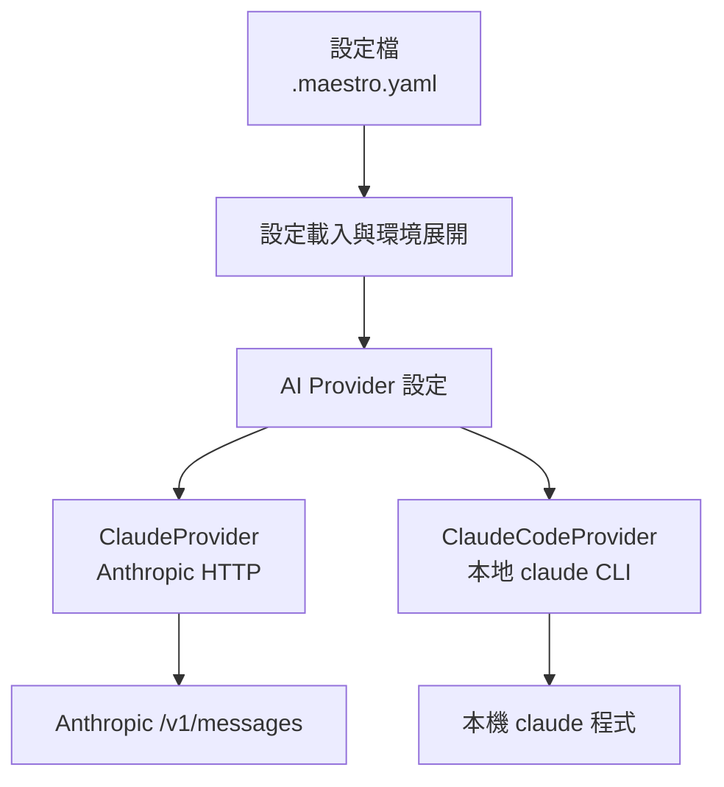
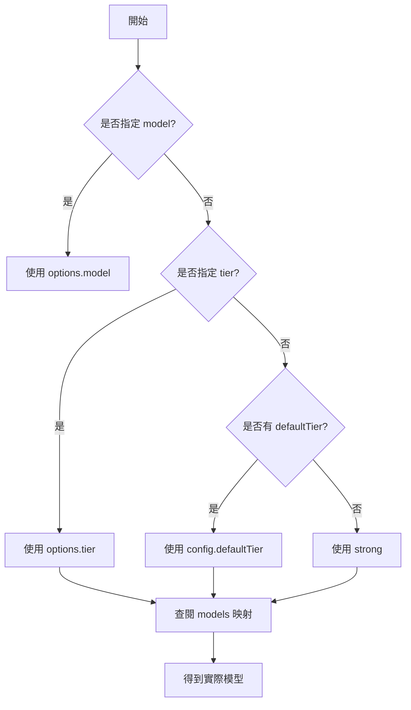
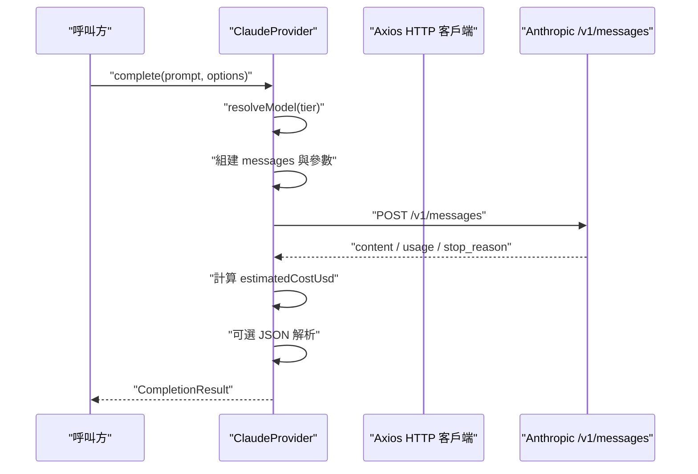
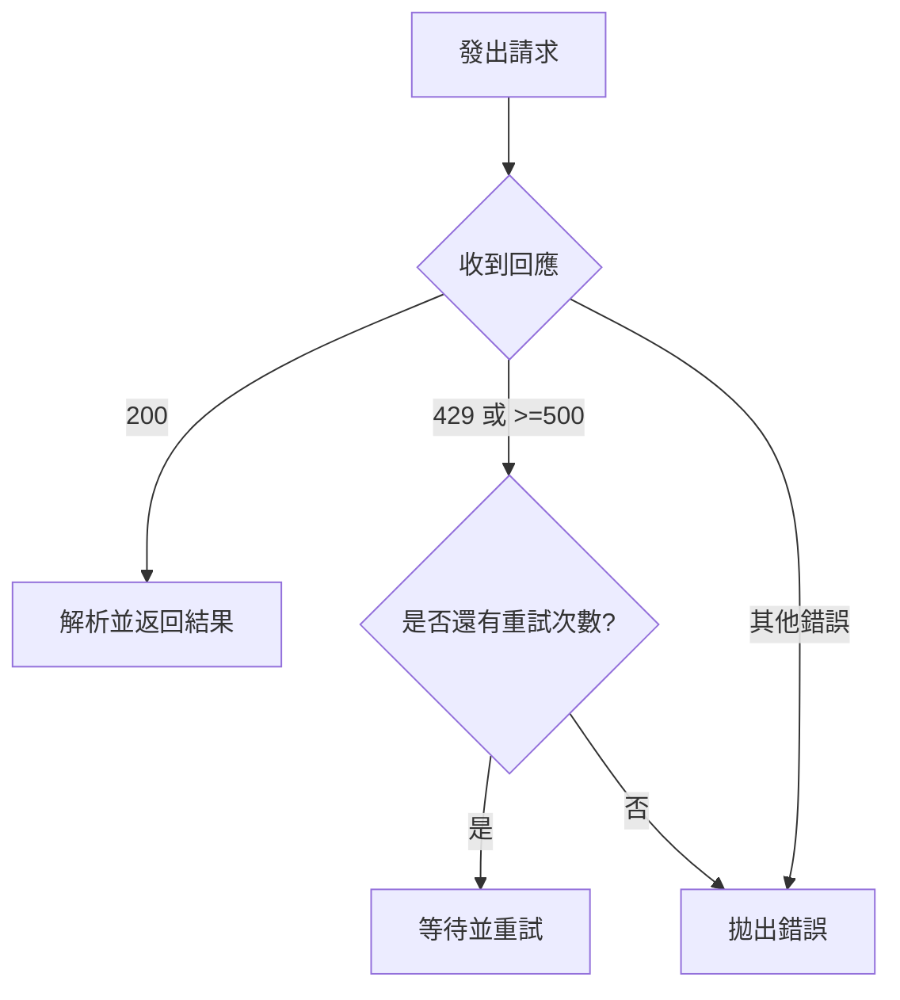

# Claude Provider（Anthropic API）

<cite>
**本文引用的檔案**   
- [src/ai/providers/ClaudeProvider.ts](https://github.com/mikeah2011/maestro/blob/master/src/ai/providers/ClaudeProvider.ts)
- [src/ai/providers/ClaudeCodeProvider.ts](https://github.com/mikeah2011/maestro/blob/master/src/ai/providers/ClaudeCodeProvider.ts)
- [src/ai/interfaces/AIProvider.ts](https://github.com/mikeah2011/maestro/blob/master/src/ai/interfaces/AIProvider.ts)
- [.maestro.example.yaml](https://github.com/mikeah2011/maestro/blob/master/.maestro.example.yaml)
- [tests/ai/providers/ClaudeProvider.test.ts](https://github.com/mikeah2011/maestro/blob/master/tests/ai/providers/ClaudeProvider.test.ts)
</cite>

## 目錄

1. [簡介](#簡介)
2. [專案結構與角色定位](#專案結構與角色定位)
3. [Claude Provider 設定總覽](#claude-provider-設定總覽)
4. [模型三層映射：cheap、strong、flagship](#模型三層映射-cheapstrongflagship)
5. [API Key 與環境變數注入](#api-key-與環境變數注入)
6. [完整 YAML 設定範例](#完整-yaml-設定範例)
7. [連線測試與請求流程](#連線測試與請求流程)
8. [重試機制與錯誤處理](#重試機制與錯誤處理)
9. [Token 用量與 Cost Attribution](#token-用量與-cost-attribution)
10. [效能調校建議](#效能調校建議)
11. [Claude Code CLI Provider 補充說明](#claude-code-cli-provider-補充說明)
12. [常見錯誤與故障排除](#常見錯誤與故障排除)
13. [最佳實踐](#最佳實踐)
14. [結論](#結論)

## 簡介

本文件說明 Maestro 中的 **Claude Provider**，也就是基於 Anthropic Messages API 的 `claude` AI Provider。它負責：

- 讀取 `.maestro.yaml` 中的 provider 設定。
- 將提示詞轉換為 Anthropic `/v1/messages` 請求。
- 解析 token 用量、結束原因與可選 JSON。
- 計算預估費用。
- 在限流或伺服器錯誤時自動重試。

專案同時提供另一個實現 `type: claude` 的 **Claude Code Provider**，它呼叫本機安裝的 `claude` CLI 而非直接走 Anthropic API；其權限、用量與費用估算行為不同，需特別注意。

**章節來源**
- [src/ai/interfaces/AIProvider.ts:1-22](https://github.com/mikeah2011/maestro/blob/master/src/ai/interfaces/AIProvider.ts#L1-L22)
- [src/ai/providers/ClaudeProvider.ts:1-20](https://github.com/mikeah2011/maestro/blob/master/src/ai/providers/ClaudeProvider.ts#L1-L20)
- [src/ai/providers/ClaudeCodeProvider.ts:1-21](https://github.com/mikeah2011/maestro/blob/master/src/ai/providers/ClaudeCodeProvider.ts#L1-L21)

## 專案結構與角色定位

Claude Provider 屬於 AI 子系統中的一個具體實作：



**圖表來源**
- [.maestro.example.yaml:7-29](https://github.com/mikeah2011/maestro/blob/master/.maestro.example.yaml#L7-L29)
- [src/ai/providers/ClaudeProvider.ts:21-48](https://github.com/mikeah2011/maestro/blob/master/src/ai/providers/ClaudeProvider.ts#L21-L48)
- [src/ai/providers/ClaudeCodeProvider.ts:22-43](https://github.com/mikeah2011/maestro/blob/master/src/ai/providers/ClaudeCodeProvider.ts#L22-L43)

Claude Provider 是「HTTP 型 provider」，使用 axios 直接呼叫 Anthropic；Claude Code Provider 是「CLI 型 provider」，透過 child process 執行 `claude --print`。兩者都實作相同的 `AIProvider` 介面，但支援能力不同。

**章節來源**
- [src/ai/interfaces/AIProvider.ts:23-114](https://github.com/mikeah2011/maestro/blob/master/src/ai/interfaces/AIProvider.ts#L23-L114)
- [src/ai/providers/ClaudeProvider.ts:49-66](https://github.com/mikeah2011/maestro/blob/master/src/ai/providers/ClaudeProvider.ts#L49-L66)
- [src/ai/providers/ClaudeCodeProvider.ts:44-70](https://github.com/mikeah2011/maestro/blob/master/src/ai/providers/ClaudeCodeProvider.ts#L44-L70)

## Claude Provider 設定總覽

| 設定欄位 | 類型 | 預設值 | 說明 |
|---|---|---:|---|
| `apiKey` | 字串 | 無 | Anthropic API Key，必填。未設定時初始化會失敗。 |
| `baseUrl` | 字串 | `https://api.anthropic.com` | Anthropic 區域端點或代理端點。 |
| `models` | 物件 | 內建 cheap/strong/flagship 對照 | 三層模型映射，可部分覆寫。 |
| `defaultTier` | 字串 | `strong` | 若呼叫方未指定 tier，則使用此預設等級。 |
| `timeout` | 數字（毫秒） | `60000` | Axios 每個請求的 HTTP timeout。 |
| `retries` | 數字 | `3` | p-retry 的重試次數。 |
| `[key]` | 任意 | — | 其他 provider-specific 額外欄位。 |

這些欄位定義在 `AIProviderConfig` 中，並由 Claude Provider 在 `initialize()` 和 `complete()` 中使用。

**章節來源**
- [src/ai/interfaces/AIProvider.ts:27-48](https://github.com/mikeah2011/maestro/blob/master/src/ai/interfaces/AIProvider.ts#L27-L48)
- [src/ai/providers/ClaudeProvider.ts:49-66](https://github.com/mikeah2011/maestro/blob/master/src/ai/providers/ClaudeProvider.ts#L49-L66)
- [src/ai/providers/ClaudeProvider.ts:78-100](https://github.com/mikeah2011/maestro/blob/master/src/ai/providers/ClaudeProvider.ts#L78-L100)

## 模型三層映射：cheap、strong、flagship

Claude Provider 預設使用以下模型：

| Tier | 預設模型 | 用途 |
|---|---|---|
| `cheap` | `claude-haiku-4-5-20251001` | 高量、低風險任務，例如訊息生成、分類備援。 |
| `strong` | `claude-sonnet-4-6` | 判斷類任務，也是整個 provider 的預設 tier。 |
| `flagship` | `claude-opus-4-7` | 最終輸出、總結等需要更高品質的結果。 |

選擇邏輯如下：

1. 若 `options.model` 有指定，直接使用該模型。
2. 否則使用 `options.tier`。
3. 若也未指定 tier，則回退到 `config.defaultTier`。
4. 若仍無 defaultTier，則使用 `strong`。
5. 最後依 tier 查表取得模型；若 config.models 中有同名 tier，則優先覆蓋。



**圖表來源**
- [src/ai/providers/ClaudeProvider.ts:21-32](https://github.com/mikeah2011/maestro/blob/master/src/ai/providers/ClaudeProvider.ts#L21-L32)
- [src/ai/providers/ClaudeProvider.ts:72-77](https://github.com/mikeah2011/maestro/blob/master/src/ai/providers/ClaudeProvider.ts#L72-L77)

**章節來源**
- [src/ai/providers/ClaudeProvider.ts:21-32](https://github.com/mikeah2011/maestro/blob/master/src/ai/providers/ClaudeProvider.ts#L21-L32)
- [src/ai/providers/ClaudeProvider.ts:72-77](https://github.com/mikeah2011/maestro/blob/master/src/ai/providers/ClaudeProvider.ts#L72-L77)
- [tests/ai/providers/ClaudeProvider.test.ts:58-79](https://github.com/mikeah2011/maestro/blob/master/tests/ai/providers/ClaudeProvider.test.ts#L58-L79)

## API Key 與環境變數注入

### 如何取得 API Key

Anthropic API Key 應從 Anthropic 官方管理控制台或相關帳號憑證頁面取得。取得後放入環境變數：

```text
ANTHROPIC_API_KEY=sk-ant-...
```

Maestro 設定中可使用環境變數語法：

```yaml
apiKey: ${ANTHROPIC_API_KEY}
```

這表示 `apiKey` 的值會在設定載入階段由環境變數展開，而不是把 `${ANTHROPIC_API_KEY}` 當作文字常量傳給 Anthropic。

### 驗證方式

- 若 `apiKey` 不存在，`ClaudeProvider.initialize()` 會拋出錯誤，指出必須設定 `ANTHROPIC_API_KEY`。
- 成功初始化後，axios 會加上頭：
  - `x-api-key`: 你的 API Key。
  - `anthropic-version`: `2023-06-01`。
  - `content-type`: `application/json`。

**章節來源**
- [.maestro.example.yaml:10-22](https://github.com/mikeah2011/maestro/blob/master/.maestro.example.yaml#L10-L22)
- [src/ai/providers/ClaudeProvider.ts:51-66](https://github.com/mikeah2011/maestro/blob/master/src/ai/providers/ClaudeProvider.ts#L51-L66)
- [tests/ai/providers/ClaudeProvider.test.ts:35-57](https://github.com/mikeah2011/maestro/blob/master/tests/ai/providers/ClaudeProvider.test.ts#L35-L57)

## 完整 YAML 設定範例

以下是 Claude Provider 的完整設定片段。請將其放在 `.maestro.yaml` 的 `ai.providers.claude` 區塊中：

| 欄位 | 建議值 | 說明 |
|---|---|---|
| `type` | `claude` | 指定使用 Anthropic Claude Provider。 |
| `apiKey` | `${ANTHROPIC_API_KEY}` | 從環境變數注入。 |
| `baseUrl` | 省略或留空 | 使用 `https://api.anthropic.com`；如需區域端點則填入。 |
| `models.cheap` | `claude-haiku-4-5-20251001` | 經濟型模型。 |
| `models.strong` | `claude-sonnet-4-6` | 均衡型模型，也是預設 tier。 |
| `models.flagship` | `claude-opus-4-7` | 旗艦型模型。 |
| `timeout` | `30000` 或 `60000` | 每個 HTTP 請求的 timeout。 |
| `retries` | `3` | 自動重試次數。 |

此外，routing 區塊會決定各階段使用哪個 provider 與 tier，例如：

- `commitMessage`：`provider: claude, tier: cheap`
- `prBodyDraft`：`provider: claude, tier: strong`
- `finalSummary`：`provider: claude, tier: flagship`

**章節來源**
- [.maestro.example.yaml:7-29](https://github.com/mikeah2011/maestro/blob/master/.maestro.example.yaml#L7-L29)
- [.maestro.example.yaml:31-45](https://github.com/mikeah2011/maestro/blob/master/.maestro.example.yaml#L31-L45)

## 連線測試與請求流程

### 連線測試

`testConnection()` 會：

1. 呼叫一次 `complete('ping', { maxTokens: 1, tier: 'cheap' })`。
2. 成功則回傳 `true`。
3. 任何錯誤則回傳 `false`。

因此連線測試不是單純 ping 網路，而是真正發出一個極小請求來驗證 API Key、base URL、模型解析與回應格式。

### 請求序列



**圖表來源**
- [src/ai/providers/ClaudeProvider.ts:72-100](https://github.com/mikeah2011/maestro/blob/master/src/ai/providers/ClaudeProvider.ts#L72-L100)
- [src/ai/providers/ClaudeProvider.ts:102-175](https://github.com/mikeah2011/maestro/blob/master/src/ai/providers/ClaudeProvider.ts#L102-L175)

**章節來源**
- [src/ai/providers/ClaudeProvider.ts:68-71](https://github.com/mikeah2011/maestro/blob/master/src/ai/providers/ClaudeProvider.ts#L68-L71)
- [src/ai/providers/ClaudeProvider.ts:72-175](https://github.com/mikeah2011/maestro/blob/master/src/ai/providers/ClaudeProvider.ts#L72-L175)

## 重試機制與錯誤處理

Claude Provider 使用 `p-retry` 包裹 `/v1/messages` 請求：

- 預設重試次數：`config.retries`，預設值為 `3`。
- 最小重試延遲：`1000 ms`。
- 最大重試延遲：`30000 ms`。
- 重試條件：只有當 axios 錯誤狀態碼為 `429` 或大於等於 `500` 時才重試。

這代表：

| 狀態碼 | 行為 |
|---:|---|
| `200` | 正常返回。 |
| `401` | 不會重試；通常是 API Key 錯誤或權限不足。 |
| `429` | 會重試；限流或速率限制。 |
| `500` | 會重試；伺服器錯誤。 |
| `502` | 會重試；閘道或上游錯誤。 |
| `503` | 會重試；服務暫不可用。 |



**圖表來源**
- [src/ai/providers/ClaudeProvider.ts:102-138](https://github.com/mikeah2011/maestro/blob/master/src/ai/providers/ClaudeProvider.ts#L102-L138)

**章節來源**
- [src/ai/providers/ClaudeProvider.ts:102-138](https://github.com/mikeah2011/maestro/blob/master/src/ai/providers/ClaudeProvider.ts#L102-L138)

## Token 用量與 Cost Attribution

### Usage 欄位

完成後的 `CompletionResult.usage` 包含：

| 欄位 | 類型 | 說明 |
|---|---|---|
| `inputTokens` | 數字 | 輸入 token 數。 |
| `outputTokens` | 數字 | 輸出 token 數。 |
| `cacheReadTokens` | 可選數字 | 從 prompt cache 讀取的 token。 |
| `cacheWriteTokens` | 可選數字 | 寫入 prompt cache 的 token。 |
| `estimatedCostUsd` | 可選數字 | 根據已知模型定價估算的美元費用。 |

### 費用計算邏輯

對於三個預設模型，系統使用每百萬 token 的近似價格計算：

| 模型 | 輸入每百萬美元 | 輸出每百萬美元 |
|---|---:|---:|
| `claude-haiku-4-5-20251001` | $0.80 | $4.00 |
| `claude-sonnet-4-6` | $3.00 | $15.00 |
| `claude-opus-4-7` | $15.00 | $75.00 |

公式為：

```text
estimatedCostUsd = (inputTokens / 1_000_000) * inputPrice
                 + (outputTokens / 1_000_000) * outputPrice
```

如果 Anthropic 回傳的 `model` 不在已知表中，`estimatedCostUsd` 會是 `undefined`。

### 成本歸因

`CompletionOptions` 提供 `callerTag`，可用於成本歸因與稽核紀錄。不過目前 Claude Provider 的 `complete()` 實作並未直接把 `callerTag` 寫入請求體；它主要用於上層 orchestrator 或稽核記錄。

**章節來源**
- [src/ai/providers/ClaudeProvider.ts:34-42](https://github.com/mikeah2011/maestro/blob/master/src/ai/providers/ClaudeProvider.ts#L34-L42)
- [src/ai/providers/ClaudeProvider.ts:140-175](https://github.com/mikeah2011/maestro/blob/master/src/ai/providers/ClaudeProvider.ts#L140-L175)
- [src/ai/interfaces/AIProvider.ts:61-114](https://github.com/mikeah2011/maestro/blob/master/src/ai/interfaces/AIProvider.ts#L61-L114)
- [tests/ai/providers/ClaudeProvider.test.ts:120-140](https://github.com/mikeah2011/maestro/blob/master/tests/ai/providers/ClaudeProvider.test.ts#L120-L140)

## 效能調校建議

### Timeout

- 預設為 `60000 ms`。
- 若 Anthropic 端點回應較慢，可調高至 `90000` 或 `120000`。
- 若希望快速失敗以避免長時間阻塞，可降低至 `15000` 或 `30000`。

### Retries

- 預設 `3` 次重試已能處理多數短暫限流與伺服器波動。
- 在穩定企業代理或內部端點環境，可考慮降低到 `1` 或 `2`。
- 在高延遲網路下，保留 `3` 次較保險。

### Max Tokens

- 預設 `maxTokens` 為 `4096`。
- 若產出被截斷，可增加 `maxTokens`。
- 若想控制 cost，可降低 `maxTokens`。

### Temperature

- 預設為 `0`，適合 orchestrator 的確定性決策。
- 若需要更多創意，可提高 temperature，但這通常不適用於自動化 review loop。

### Base URL

- 若部署於特定區域或透過企業代理，可設定 `baseUrl`。
- 確保 proxy 正確轉送 `x-api-key`、`anthropic-version`、`content-type`。

**章節來源**
- [src/ai/providers/ClaudeProvider.ts:51-66](https://github.com/mikeah2011/maestro/blob/master/src/ai/providers/ClaudeProvider.ts#L51-L66)
- [src/ai/providers/ClaudeProvider.ts:78-100](https://github.com/mikeah2011/maestro/blob/master/src/ai/providers/ClaudeProvider.ts#L78-L100)

## Claude Code CLI Provider 補充說明

`ClaudeCodeProvider` 也使用 `type: claude`，但它不是 HTTP Provider，而是 CLI Provider。

### 主要差異

| 特性 | ClaudeProvider | ClaudeCodeProvider |
|---|---|---|
| 通訊方式 | Anthropic `/v1/messages` | 本機 `claude --print` |
| 需要 API Key | 是 | 否 |
| 用量回報 | 有 input/output/cache tokens | 固定為 `0` |
| 費用估算 | 可能計算 | 不會計算 |
| 模型名稱 | 實際 Anthropic 模型 | `claude-code-cli` |
| System Prompt | 使用 `system` 欄位 | 前置到 user prompt |
| 重試機制 | p-retry | 無 |
| 預設 timeout | `60000 ms` | `120000 ms` |

### 何時使用 ClaudeCodeProvider

- 開發者本機已有 Claude Code 環境。
- 不想讓 API Key 進入 Maestro 設定。
- 接受無法精確追蹤 token 與費用。

### 注意事項

- 若 `claude` 不在 PATH 或未安裝，`initialize()` 會失敗。
- CLI 超時會以 `SIGTERM` 終止子程序。
- JSON 解析是鬆散模式：會嘗試從字串中提取最外層 `{}`。

**章節來源**
- [src/ai/providers/ClaudeCodeProvider.ts:1-21](https://github.com/mikeah2011/maestro/blob/master/src/ai/providers/ClaudeCodeProvider.ts#L1-L21)
- [src/ai/providers/ClaudeCodeProvider.ts:44-146](https://github.com/mikeah2011/maestro/blob/master/src/ai/providers/ClaudeCodeProvider.ts#L44-L146)

## 常見錯誤與故障排除

### 401 Unauthorized

**症狀：**

- Anthropic 回傳 `401`。
- `testConnection()` 失敗。
- `initialize()` 若缺少 `apiKey` 會直接拋錯。

**可能原因：**

- `ANTHROPIC_API_KEY` 未設定。
- API Key 過期或錯誤。
- `baseUrl` 指向非 Anthropic 端點，且 proxy 未正確轉送 key。
- Anthropic 帳號沒有對應模型存取權限。

**處理方式：**

1. 檢查環境變數是否已匯入。
2. 確認 `.maestro.yaml` 中 `apiKey` 是否正確展開。
3. 在 Anthropic 控制台驗證 API Key。
4. 若使用自訂 `baseUrl`，確認 proxy 不會修改或移除 `x-api-key`。

### 429 Too Many Requests

**症狀：**

- 請求頻繁失敗。
- 日誌出現限流或速率限制。

**可能原因：**

- 同一 API Key 同時發送太多請求。
- 團隊共用一個 Anthropic 帳號與配額。
- 迴圈階段觸發大量 Claude 呼叫。

**處理方式：**

1. 提高 `retries`，讓短期限流自動恢復。
2. 調整 orchestrator 的 concurrent calls。
3. 使用更便宜的 `cheap` tier 處理高量、低風險任務。
4. 若有企業配额，向 Anthropic 申請提高限流。

### 503 Service Unavailable

**症狀：**

- Anthropic 或代理端點暫時不可用。
- 請求偶發失敗。

**可能原因：**

- Anthropic 上游服務異常。
- 企業代理負載過高。
- 區域端點維護中。

**處理方式：**

1. 保留預設 `retries: 3`。
2. 檢查代理健康狀態。
3. 若長期 503，切換回 `https://api.anthropic.com` 或更換區域端點。
4. 在 CI 環境加入重試或跳過策略，避免單次雲端異常阻擋整個 PR。

### 輸出被截斷

**症狀：**

- 回覆內容不完整。
- JSON 解析失敗。

**處理方式：**

1. 增加 `maxTokens`。
2. 檢查 `finishReason` 是否為 `max_tokens`。
3. 若需要嚴格 JSON，使用 `responseFormat: json_object` 或 `json_schema`。

**章節來源**
- [src/ai/providers/ClaudeProvider.ts:51-66](https://github.com/mikeah2011/maestro/blob/master/src/ai/providers/ClaudeProvider.ts#L51-L66)
- [src/ai/providers/ClaudeProvider.ts:102-138](https://github.com/mikeah2011/maestro/blob/master/src/ai/providers/ClaudeProvider.ts#L102-L138)
- [tests/ai/providers/ClaudeProvider.test.ts:35-57](https://github.com/mikeah2011/maestro/blob/master/tests/ai/providers/ClaudeProvider.test.ts#L35-L57)

## 最佳實踐

1. **不要硬編碼 API Key。**  
   一律使用 `${ANTHROPIC_API_KEY}`，並由環境注入。

2. **按任務選用 tier。**  
   - `cheap`：分類、摘要草稿、重複檢測。  
   - `strong`：判斷、推理、PR 草稿。  
   - `flagship`：最終 PR body 或重要結論。

3. **為不同階段設定 routing。**  
   使用 `.maestro.yaml` 的 `ai.routing` 區段明確指定 provider 與 tier。

4. **保留合理 retries。**  
   預設 `3` 次已足夠處理短暫限流與伺服器錯誤。

5. **監控 estimatedCostUsd。**  
   雖然這是估算值，但仍可用於觀察 cost 趨勢與異常暴增。

6. **CI 環境優先使用穩定模型。**  
   避免依賴實驗性或尚未開放的模型。

7. **Proxy 環境要確認 Header 傳遞。**  
   特別是 `x-api-key`、`anthropic-version`、`content-type`。

8. **使用 ClaudeCodeProvider 僅限開發者本機。**  
   因為它不提供用量與費用資訊，也不具備自動重試。

**章節來源**
- [.maestro.example.yaml:7-45](https://github.com/mikeah2011/maestro/blob/master/.maestro.example.yaml#L7-L45)
- [src/ai/providers/ClaudeProvider.ts:34-42](https://github.com/mikeah2011/maestro/blob/master/src/ai/providers/ClaudeProvider.ts#L34-L42)
- [src/ai/providers/ClaudeCodeProvider.ts:1-21](https://github.com/mikeah2011/maestro/blob/master/src/ai/providers/ClaudeCodeProvider.ts#L1-L21)

## 結論

Claude Provider 在 Maestro 中扮演 Anthropic Messages API 的統一入口。它的設定核心是：

- `apiKey`：透過環境變數注入。
- `baseUrl`：支援區域端點或企業代理。
- `models`：三層映射 `cheap / strong / flagship`。
- `timeout`：控制 HTTP 請求逾時。
- `retries`：處理 `429` 與 `>=500` 的暫時錯誤。
- `cost attribution`：透過 `estimatedCostUsd` 與 `usage` 回報 token 與預估費用。

若需要完全離線或本機 Claude Code 環境，可改用 `ClaudeCodeProvider`，但要接受用量與費用估算的限制。整體而言，推薦在正式環境使用 `ClaudeProvider`，並依照工作重要性選擇適當 model tier。