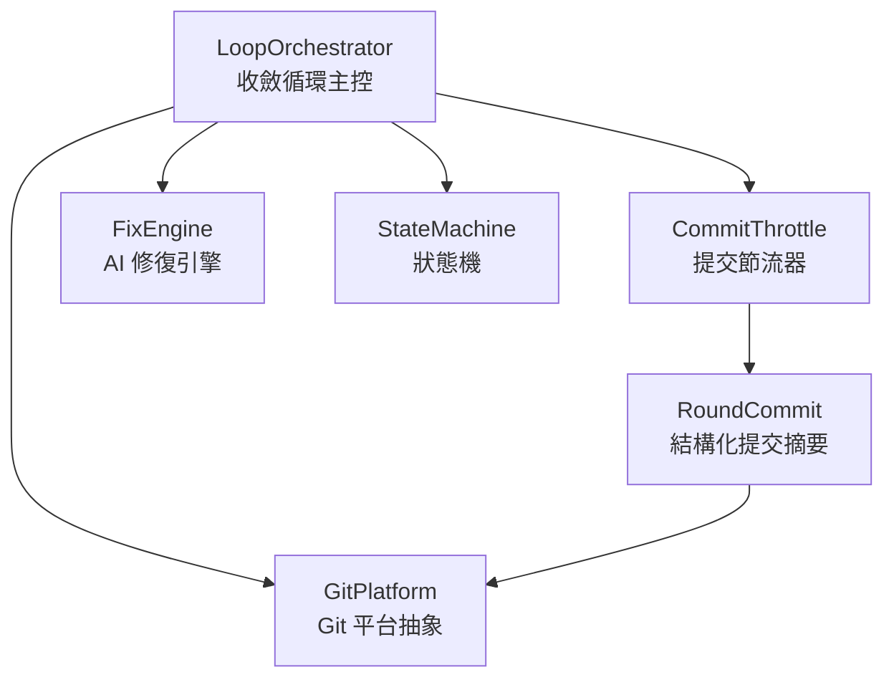
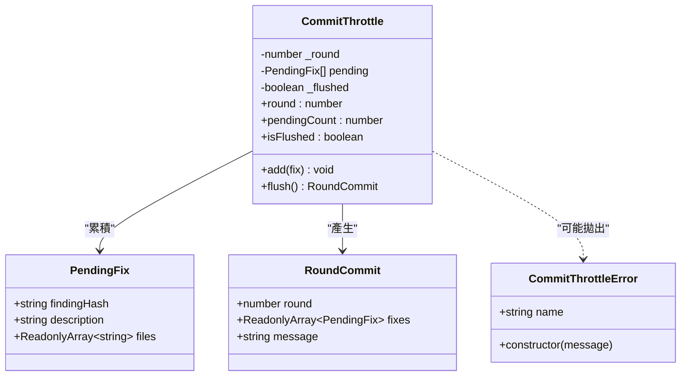
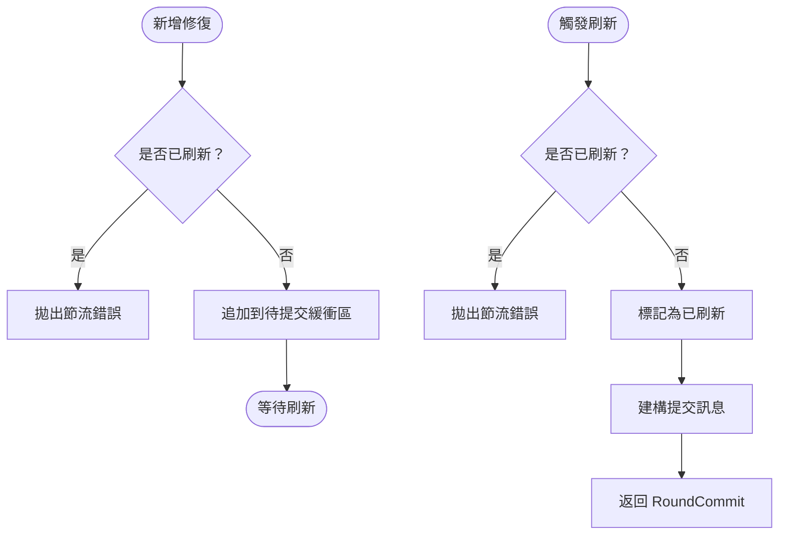
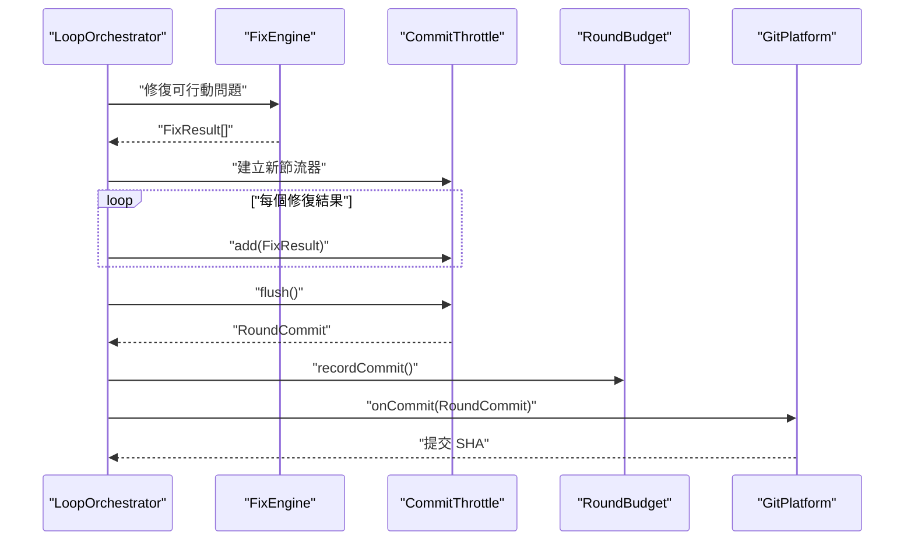
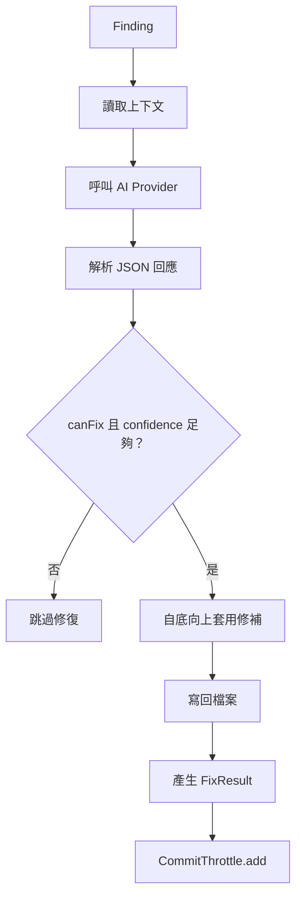
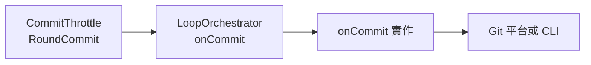
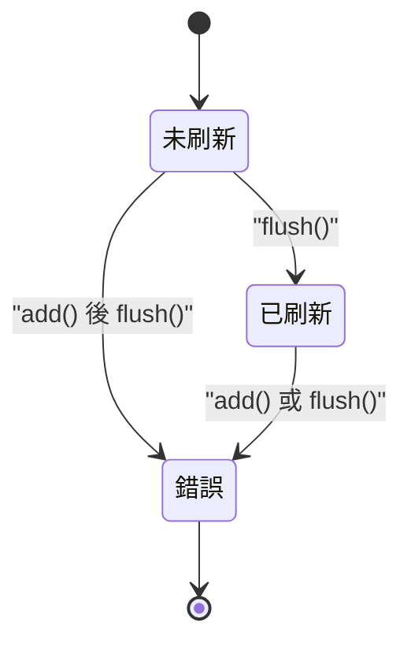

# CommitThrottle 提交節流

<cite>
**本文引用的檔案**   
- [CommitThrottle.ts](https://github.com/mikeah2011/maestro/blob/master/src/core/round/CommitThrottle.ts)
- [CommitThrottle.test.ts](https://github.com/mikeah2011/maestro/blob/master/tests/core/round/CommitThrottle.test.ts)
- [LoopOrchestrator.ts](https://github.com/mikeah2011/maestro/blob/master/src/core/loop/LoopOrchestrator.ts)
- [FixEngine.ts](https://github.com/mikeah2011/maestro/blob/master/src/core/fix/FixEngine.ts)
- [StateMachine.ts](https://github.com/mikeah2011/maestro/blob/master/src/core/state/StateMachine.ts)
- [DESIGN.md](https://github.com/mikeah2011/maestro/blob/master/docs/DESIGN.md)
- [GitPlatform.ts](https://github.com/mikeah2011/maestro/blob/master/src/platforms/interfaces/GitPlatform.ts)
- [GitHubPlatform.ts](https://github.com/mikeah2011/maestro/blob/master/src/platforms/github/GitHubPlatform.ts)
- [package.json](https://github.com/mikeah2011/maestro/blob/master/package.json)
</cite>

## 目錄

1. [簡介](#簡介)
2. [專案結構與定位](#專案結構與定位)
3. [核心資料模型](#核心資料模型)
4. [提交節流算法與策略](#提交節流算法與策略)
5. [在收斂循環中的使用場景](#在收斂循環中的使用場景)
6. [與 FixEngine 的協作模式](#與-fixengine-的協作模式)
7. [平台 API 對接與提交推送責任](#平台-api-對接與提交推送責任)
8. [錯誤處理與防禦性設計](#錯誤處理與防禦性設計)
9. [退避、速率限制與外部風險](#退避速率限制與外部風險)
10. [性能考量與調優參數](#性能考量與調優參數)
11. [故障排除指南](#故障排除指南)
12. [不同工作負載下的最佳實踐](#不同工作負載下的最佳實踐)
13. [結論](#結論)

## 簡介

CommitThrottle 是 Maestro 收斂循環中負責「一輪只產生一個提交」的提交節流器。它本身不直接執行 Git 操作，也不呼叫 Git 平台 API；它的職責是收集當輪所有修復結果，並在固定時機將它們合併成一份結構化訊息。

這個設計的關鍵在於：提交行為由上層 `LoopOrchestrator` 控制，而 CommitThrottle 透過狀態不可變的生命週期來保證每輪最多一次提交。若開發者誤用，例如重複 flush 或在 flush 後繼續新增修復，會立即拋出明確錯誤，而不是靜默產生多個提交。

從系統層面看，CommitThrottle 屬於「反垃圾郵件不變量」的一部分：每輪 ≤ 1 次提交。這與 RoundBudget、ConvergenceMonitor、StateMachine 共同構成可驗證的循環行為，而不依賴運行時警告或可被忽略的配置選項。

**章節來源**
- [CommitThrottle.ts:1-102](https://github.com/mikeah2011/maestro/blob/master/src/core/round/CommitThrottle.ts#L1-L102)
- [DESIGN.md:1-200](https://github.com/mikeah2011/maestro/blob/master/docs/DESIGN.md#L1-L200)

## 專案結構與定位

CommitThrottle 位於 `src/core/round`，與 RoundBudget 並列，代表「以輪為單位的寫入約束」。它不是平台適配器，也不是 AI 修復引擎；它是協調層中的一個純邏輯組件。

**圖表來源**
- [LoopOrchestrator.ts:1-200](https://github.com/mikeah2011/maestro/blob/master/src/core/loop/LoopOrchestrator.ts#L1-L200)
- [CommitThrottle.ts:1-102](https://github.com/mikeah2011/maestro/blob/master/src/core/round/CommitThrottle.ts#L1-L102)
- [FixEngine.ts:1-200](https://github.com/mikeah2011/maestro/blob/master/src/core/fix/FixEngine.ts#L1-L200)
- [StateMachine.ts:1-114](https://github.com/mikeah2011/maestro/blob/master/src/core/state/StateMachine.ts#L1-L114)
- [GitPlatform.ts:1-130](https://github.com/mikeah2011/maestro/blob/master/src/platforms/interfaces/GitPlatform.ts#L1-L130)

CommitThrottle 的輸入是 `FixResult`，輸出是 `RoundCommit`。真正的提交 SHA 由 `LoopOrchestrator.onCommit` 回呼返回，通常由平台適配器或 CLI 命令實現。

**章節來源**
- [CommitThrottle.ts:1-102](https://github.com/mikeah2011/maestro/blob/master/src/core/round/CommitThrottle.ts#L1-L102)
- [LoopOrchestrator.ts:200-500](https://github.com/mikeah2011/maestro/blob/master/src/core/loop/LoopOrchestrator.ts#L200-L500)

## 核心資料模型

### PendingFix

PendingFix 表示一個待提交的修復摘要，包含以下欄位：

| 欄位 | 型別 | 必要 | 說明 |
|---|---|---:|---|
| findingHash | string | 是 | 被修復問題的穩定雜湊，用於識別問題 |
| description | string | 是 | 一行式描述，作為提交訊息的項目 |
| files | ReadonlyArray\<string\> | 否 | 修改過的檔案路徑，用於 richer 訊息 |

### RoundCommit

RoundCommit 是一次 flush 的結果，供上層轉換為實際 Git 提交：

| 欄位 | 型別 | 說明 |
|---|---|---|
| round | number | 所屬循環輪次 |
| fixes | ReadonlyArray\<PendingFix\> | 該輪所有修復，保留插入順序 |
| message | string | 可直接傳給 Git 的 conventional commit 訊息 |

### CommitThrottleError

這是 CommitThrottle 專屬的錯誤類型，名稱固定為 `CommitThrottleError`。它不會被用來封裝外部平台錯誤，而是表達「節流器使用方式違反契約」，例如：

- 在已 flush 的 throttle 上繼續 add
- 重複 flush
- 建構時提供無效的 round 值

**圖表來源**
- [CommitThrottle.ts:1-102](https://github.com/mikeah2011/maestro/blob/master/src/core/round/CommitThrottle.ts#L1-L102)

**章節來源**
- [CommitThrottle.ts:1-102](https://github.com/mikeah2011/maestro/blob/master/src/core/round/CommitThrottle.ts#L1-L102)

## 提交節流算法與策略

CommitThrottle 的節流策略可以歸納為三件事：**緩衝、單次刷新、生命週期死亡**。

### 緩衝階段

每次呼叫 `add` 時，節流器會檢查是否已經 flush。如果尚未 flush，就將 PendingFix 追加到內部陣列。這裡使用陣列複製建立新陣列，而不是原地 mutate 舊陣列，使 pending 的行為更接近不可變集合。

時間複雜度為 O(n)，其中 n 是當前 pending 數量。由於一輪內通常只有幾個到數十個修復，這不是主要瓶頸。

### 刷新階段

`flush` 只做四件事：

1. 檢查 `_flushed`，避免重複 flush。
2. 標記為已 flush。
3. 取出 pending 參考。
4. 生成 RoundCommit，包含 round、fixes 和 conventional commit 訊息。

一旦 flush 完成，throttle 即進入「死亡」狀態。後續 add 或 flush 都會拋出 `CommitThrottleError`。

### 訊息格式

訊息採用 conventional commit 風格：

- 標題格式：`fix: address review feedback (round N)`
- 若有修復項目，則附加項目清單
- 每個項目使用 findingHash 的前 8 個字元作為短標識
- 修復項目維持插入順序

這種格式適合人類閱讀，也便於 CI 或發布工具解析。

**圖表來源**
- [CommitThrottle.ts:1-102](https://github.com/mikeah2011/maestro/blob/master/src/core/round/CommitThrottle.ts#L1-L102)

**章節來源**
- [CommitThrottle.ts:1-102](https://github.com/mikeah2011/maestro/blob/master/src/core/round/CommitThrottle.ts#L1-L102)

## 在收斂循環中的使用場景

LoopOrchestrator 是 CommitThrottle 的唯一生產者。每一輪的修復流程如下：

1. 分類問題。
2. 去重。
3. 計算收斂狀態。
4. 決定要修復的問題。
5. 呼叫 `onFix`。
6. 建立新的 CommitThrottle。
7. 把所有 FixResult 加入 throttle。
8. flush 得到 RoundCommit。
9. 記錄 budget。
10. 呼叫 `onCommit` 取得提交 SHA。

**圖表來源**
- [LoopOrchestrator.ts:200-500](https://github.com/mikeah2011/maestro/blob/master/src/core/loop/LoopOrchestrator.ts#L200-L500)
- [CommitThrottle.ts:1-102](https://github.com/mikeah2011/maestro/blob/master/src/core/round/CommitThrottle.ts#L1-L102)

### 關鍵特性

- 每輪新建一個 CommitThrottle，因此不存在跨輪污染。
- 只有當 fixes.length > 0 時才建立 throttle 並提交。
- 即使 onFix 返回空陣列，也不會觸發不必要的提交。
- 狀態機會先進入 `commit_pushed`，再進入 reply/resolving 階段，確保提交發生在回覆之前。

**章節來源**
- [LoopOrchestrator.ts:200-500](https://github.com/mikeah2011/maestro/blob/master/src/core/loop/LoopOrchestrator.ts#L200-L500)
- [StateMachine.ts:1-114](https://github.com/mikeah2011/maestro/blob/master/src/core/state/StateMachine.ts#L1-L114)

## 與 FixEngine 的協作模式

FixEngine 是 LoopOrchestrator 預設的 onFix 實作之一（M6）。它負責讀取上下文、呼叫 AI Provider、解析 JSON 回應、應用修補並寫回檔案。

FixEngine 的回傳型別是 FixResult，其結構與 PendingFix 高度對應：

| FixEngine.FixResult | CommitThrottle.PendingFix | 用途 |
|---|---|---|
| findingHash | findingHash | 問題識別 |
| description | description | 提交訊息項目 |
| files | files | 輔助訊息 |

FixEngine 的 description 來自 AI 回應，若沒有則降級為截斷後的固定前綴加上問題標題。這確保即使 AI 未提供描述，提交訊息仍可讀。

**圖表來源**
- [FixEngine.ts:1-200](https://github.com/mikeah2011/maestro/blob/master/src/core/fix/FixEngine.ts#L1-L200)
- [CommitThrottle.ts:1-102](https://github.com/mikeah2011/maestro/blob/master/src/core/round/CommitThrottle.ts#L1-L102)

### 容錯邊界

FixEngine 在以下情況會返回 null 或空結果：

- 無法讀取檔案
- AI Provider 失敗
- AI 回應無法解析
- canFix 為 false
- confidence 低於 minConfidence
- 沒有 replacements
- 寫入檔案失敗

這些路徑不會增加 CommitThrottle 的負擔，因為 LoopOrchestrator 只會把非 null 的 FixResult 加入 throttle。

**章節來源**
- [FixEngine.ts:1-200](https://github.com/mikeah2011/maestro/blob/master/src/core/fix/FixEngine.ts#L1-L200)
- [LoopOrchestrator.ts:200-500](https://github.com/mikeah2011/maestro/blob/master/src/core/loop/LoopOrchestrator.ts#L200-L500)

## 平台 API 對接與提交推送責任

CommitThrottle 不直接操作 Git。它只產生 RoundCommit，然後由 `LoopOrchestrator.onCommit` 負責真正推送。

這是一種有意義的分離：

| 組件 | 責任 | 不負責 |
|---|---|---|
| CommitThrottle | 累積修復、格式化訊息 | 推送到遠端、管理分支 |
| LoopOrchestrator | 控制何時提交、如何包裝 RoundCommit | 具體 Git 操作 |
| GitPlatform | 提供 PR、審查、CI、速率限制等能力 | 本地 Git 提交 |
| onCommit 實作 | 根據 RoundCommit 執行 git commit / push | 修復程式碼 |

GitPlatform 介面暴露了 `getRateLimitInfo`，但這個方法主要用在平台層的速率限制處理，而不是 CommitThrottle 內部。CommitThrottle 的「速率限制」本質上是「每輪一次提交」的業務規則，而非 HTTP API 限流。

**圖表來源**
- [CommitThrottle.ts:1-102](https://github.com/mikeah2011/maestro/blob/master/src/core/round/CommitThrottle.ts#L1-L102)
- [LoopOrchestrator.ts:1-200](https://github.com/mikeah2011/maestro/blob/master/src/core/loop/LoopOrchestrator.ts#L1-L200)
- [GitPlatform.ts:1-130](https://github.com/mikeah2011/maestro/blob/master/src/platforms/interfaces/GitPlatform.ts#L1-L130)

**章節來源**
- [GitPlatform.ts:1-130](https://github.com/mikeah2011/maestro/blob/master/src/platforms/interfaces/GitPlatform.ts#L1-L130)
- [LoopOrchestrator.ts:1-200](https://github.com/mikeah2011/maestro/blob/master/src/core/loop/LoopOrchestrator.ts#L1-L200)

## 錯誤處理與防禦性設計

CommitThrottle 的錯誤處理採保守設計：遇到非法使用就直接拋出異常，不嘗試恢復。

### 建構期錯誤

round 必須是正整數。否則拋出 `CommitThrottleError`，訊息中包含實際收到的 round 值，方便除錯。

### 使用期錯誤

| 操作 | 違規情境 | 行為 |
|---|---|---|
| add | throttle 已 flush | 拋出 `CommitThrottleError` |
| flush | throttle 已 flush | 拋出 `CommitThrottleError` |
| flush | 沒有新增任何修復 | 仍允許，產生標題-only 訊息 |

測試涵蓋了這些情境：

- 初始狀態 empty
- 累積多個修復
- flush 後重複 flush
- flush 後繼續 add
- isFlushed 狀態觀察
- 訊息格式與 hash 前綴長度
- 修復項目順序

**圖表來源**
- [CommitThrottle.ts:1-102](https://github.com/mikeah2011/maestro/blob/master/src/core/round/CommitThrottle.ts#L1-L102)
- [CommitThrottle.test.ts:1-93](https://github.com/mikeah2011/maestro/blob/master/tests/core/round/CommitThrottle.test.ts#L1-L93)

**章節來源**
- [CommitThrottle.ts:1-102](https://github.com/mikeah2011/maestro/blob/master/src/core/round/CommitThrottle.ts#L1-L102)
- [CommitThrottle.test.ts:1-93](https://github.com/mikeah2011/maestro/blob/master/tests/core/round/CommitThrottle.test.ts#L1-L93)

## 退避、速率限制與外部風險

需要明確區分兩種「速率限制」：

1. **CommitThrottle 的節流**：業務層面的「每輪最多一次提交」。
2. **Git 平台 API 的速率限制**：HTTP 請求次數、GraphQL cost、token 權限等。

CommitThrottle 本身不實作指數退避、等待 X-RateLimit-Remaining 或解析平台回傳頭。這些責任落在平台適配器和 orchestrator 的上層錯誤處理中。

### 已知外部風險

| 風險 | 影響範圍 | 建議處理方式 |
|---|---|---|
| GitHub REST/GraphQL 速率限制 | 平台層 API 呼叫 | 使用 GitPlatform.getRateLimitInfo 與回退策略 |
| Token 失效或權限不足 | 所有平台操作 | StateMachine 的 token_expired / rate_limited 狀態 |
| CI 持續失敗 | 收斂循環終止 | waitForCI 與狀態機控制 |
| AI Provider 限流或超時 | FixEngine | 在 onFix 層級重試或降級 |
| 提交衝突 | onCommit 實作 | 在推送前檢查分支狀態 |

DESIGN.md 指出，rate_limited 狀態允許回到 waiting_for_bot 或 waiting_for_ci，這表示整體系統預期外部 API 可能暫時受限。

**章節來源**
- [DESIGN.md:1-200](https://github.com/mikeah2011/maestro/blob/master/docs/DESIGN.md#L1-L200)
- [GitPlatform.ts:1-130](https://github.com/mikeah2011/maestro/blob/master/src/platforms/interfaces/GitPlatform.ts#L1-L130)
- [GitHubPlatform.ts:1-200](https://github.com/mikeah2011/maestro/blob/master/src/platforms/github/GitHubPlatform.ts#L1-L200)

## 性能考量與調優參數

### CommitThrottle 本身的成本

CommitThrottle 是一個輕量物件：

- 空間複雜度：O(k)，k 為當輪修復數量。
- add 的時間複雜度：O(k)。
- flush 的時間複雜度：O(k)，主要花在遍歷 fixes 產生訊息。
- 記憶體佔用極低，僅儲存字串與路徑。

### 主要效能瓶頸不在這裡

CommitThrottle 不是 I/O 密集組件。真正的成本集中在：

| 組件 | 主要成本 |
|---|---|
| FixEngine | AI Provider 呼叫、JSON 解析、檔案讀寫 |
| LoopOrchestrator | 平台 API 輪詢、狀態切換、事件發出 |
| GitPlatform | REST/GraphQL 請求 |
| ConvergenceMonitor | 問題雜湊與 Jaccard 相似度 |

### 可調參數

CommitThrottle 本身沒有公開配置參數。它依賴固定的行為契約：

- 每輪一個提交
- 使用 conventional commit 格式
- Hash 前綴固定為 8 個字元
- 不允許重複 flush
- 不允許 flush 後新增

若需要調整行為，應考慮：

| 需求 | 建議 |
|---|---|
| 改變提交訊息格式 | 擴充 RoundCommit.message 或使用上層 formatter |
| 允許分批提交 | 引入批次大小閾值，但這會破壞「每輪 ≤ 1 提交」不變量 |
| 追蹤節流統計 | 在 LoopOrchestrator 層增加計數器，不要改動 CommitThrottle 內部狀態 |
| 支援 dry run | 由 orchestrator 控制是否呼叫 onCommit，而非讓 throttle 判斷 |

**章節來源**
- [CommitThrottle.ts:1-102](https://github.com/mikeah2011/maestro/blob/master/src/core/round/CommitThrottle.ts#L1-L102)
- [FixEngine.ts:1-200](https://github.com/mikeah2011/maestro/blob/master/src/core/fix/FixEngine.ts#L1-L200)
- [LoopOrchestrator.ts:200-500](https://github.com/mikeah2011/maestro/blob/master/src/core/loop/LoopOrchestrator.ts#L200-L500)

## 故障排除指南

### 常見錯誤與解法

| 現象 | 可能原因 | 解法 |
|---|---|---|
| 看到 `CommitThrottleError: already flushed` | 重複呼叫 flush 或在 flush 後繼續 add | 檢查 LoopOrchestrator 或自訂 onFix/onCommit 邏輯 |
| 某輪沒有產生提交 | onFix 返回空陣列，或所有修復都被跳過 | 檢查 FixEngine 的 confidence、minConfidence、AI 回應 |
| 提交訊息缺少修復項目 | 修復結果沒有正確傳遞到 throttle | 確認 FixResult.description 與 findingHash 存在 |
| 提交後 CI 失敗 | 修復引入回歸或環境問題 | 查看狀態機是否進入 ci_failing |
| 平台 API 被限流 | GitHub/GitLab 限額耗盡 | 檢查 getRateLimitInfo、token、GraphQL cost |
| 測試中提交行為不符合預期 | onCommit 是注入式回呼 | 測試中使用 mock onCommit 驗證 RoundCommit |

### 除錯建議

1. 啟用 EventEmitter 的 JSONL 事件，觀察 round.committed 與 fix.applied。
2. 檢查 RoundBudget 是否記錄了 commit。
3. 在 onCommit 實作中加入日誌，確認 RoundCommit.round、fixes.length、message。
4. 若懷疑是節流器問題，先用最小測試用例驗證 add → flush → 第二次 add 的行為。
5. 若懷疑是平台問題，分離驗證 GitPlatform 的速率限制與權限。

**章節來源**
- [CommitThrottle.test.ts:1-93](https://github.com/mikeah2011/maestro/blob/master/tests/core/round/CommitThrottle.test.ts#L1-L93)
- [LoopOrchestrator.ts:200-500](https://github.com/mikeah2011/maestro/blob/master/src/core/loop/LoopOrchestrator.ts#L200-L500)
- [GitPlatform.ts:1-130](https://github.com/mikeah2011/maestro/blob/master/src/platforms/interfaces/GitPlatform.ts#L1-L130)

## 不同工作負載下的最佳實踐

### 小規模 Pull Request

- 通常只有少量發現，CommitThrottle 幾乎零成本。
- 重點放在 FixEngine 的 AI 品質與 minConfidence 設定。
- 不需要特別優化節流器。

### 大規模自動化迴圈

- 多機器人同時回覆，發現數量可能較高。
- 仍然保持每輪一個提交，避免 PR history 混亂。
- 可考慮提高 minConfidence，減少低品質修復帶來的提交。
- 監控 RoundBudget 與 ConvergenceMonitor，防止振盪。

### 高延遲平台環境

- Git 平台 API 延遲高時，重點是 platform 層重試與退避。
- CommitThrottle 不受網路延遲影響。
- 建議在 onCommit 實作中加入重試邏輯，但不改變 throttle 的語意。

### 測試環境

- 使用 mock onCommit 驗證 RoundCommit 內容。
- 使用 mock sleep 加速收斂測試。
- 針對 CommitThrottle 的边界條件撰寫單元測試，尤其是重複 flush 與 flush 後 add。

### 生產環境

- 不要暴露 `--force` 類旗標來繞過每輪一次提交。
- 保持 CommitThrottle 的嚴謹契約。
- 在 orchestrator 層集中處理平台錯誤、限額與重試。
- 將節流相關的可觀測性放在事件系統中，而不是分散在各組件內部。

**章節來源**
- [DESIGN.md:1-200](https://github.com/mikeah2011/maestro/blob/master/docs/DESIGN.md#L1-L200)
- [package.json:1-89](https://github.com/mikeah2011/maestro/blob/master/package.json#L1-L89)

## 結論

CommitThrottle 是一個刻意簡化的組件。它不處理網路、不管理 Git、不判斷修復品質；它只做一件事：**把一輪內的修復穩固地壓縮成一次提交**。

這個設計的好處是：

- 行為可預測：每輪最多一個提交。
- 錯誤明顯：非法使用直接拋出明確錯誤。
- 責任清晰：訊息格式由節流器負責，提交動作由上層負責。
- 可測試：無需模擬 Git 或平台即可驗證邏輯。
- 可組合：與 FixEngine、RoundBudget、ConvergenceMonitor、StateMachine 協作良好。

在 Maestro 的收斂循環中，CommitThrottle 扮演的是「提交紀律」的角色。它不是性能瓶頸，也不是平台適配器，而是確保自動化工具不會因過度提交而製造 PR 噪音的關鍵防線。