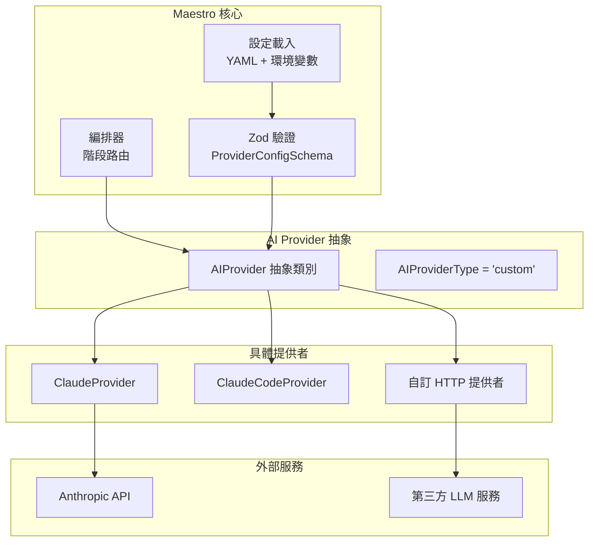
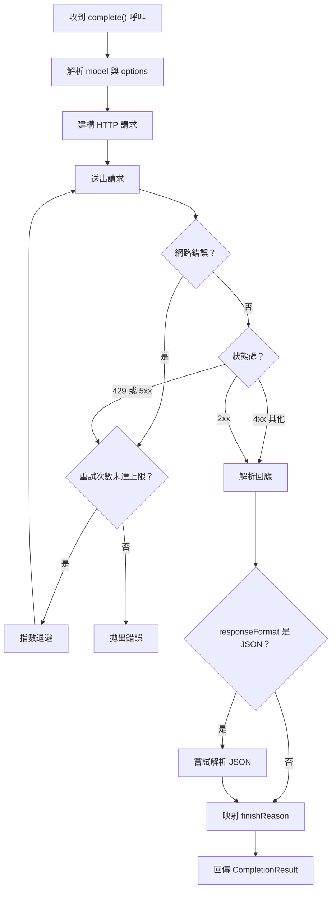
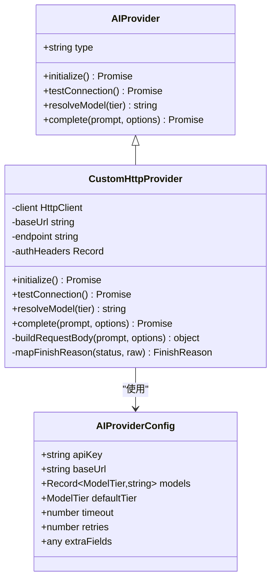

# 自訂 HTTP 提供者

**本文引用的檔案**

- [AIProvider.ts](https://github.com/mikeah2011/maestro/blob/master/src/ai/interfaces/AIProvider.ts)
- [ClaudeProvider.ts](https://github.com/mikeah2011/maestro/blob/master/src/ai/providers/ClaudeProvider.ts)
- [ClaudeCodeProvider.ts](https://github.com/mikeah2011/maestro/blob/master/src/ai/providers/ClaudeCodeProvider.ts)
- [schema.ts](https://github.com/mikeah2011/maestro/blob/master/src/config/schema.ts)
- [load.ts](https://github.com/mikeah2011/maestro/blob/master/src/config/load.ts)
- [.maestro.example.yaml](https://github.com/mikeah2011/maestro/blob/master/.maestro.example.yaml)
- [README.md](https://github.com/mikeah2011/maestro/blob/master/README.md)

## 目錄
1. [簡介](#簡介)
2. [專案結構與定位](#專案結構與定位)
3. [設定欄位總覽](#設定欄位總覽)
4. [模型三層映射](#模型三層映射)
5. [HTTP 請求與回應格式](#http-請求與回應格式)
6. [錯誤處理與重試策略](#錯誤處理與重試策略)
7. [實作自訂 HTTP 提供者](#實作自訂-http-提供者)
8. [認證機制整合](#認證機制整合)
9. [第三方 LLM 服務整合指南](#第三方-llm-服務整合指南)
10. [代理伺服器配置](#代理伺服器配置)
11. [安全注意事項](#安全注意事項)
12. [故障排除](#故障排除)
13. [結論](#結論)

## 簡介

Maestro 的 AI Provider 抽象層把「提示詞」和「完成結果」統一成一個穩定的程式介面，讓核心循環不必關心 Claude、OpenAI、Gemini、本機 Ollama 或自訂 HTTP 端點的差異。`custom` 提供者型別允許你透過 REST API 接入任意支援文字完成的後端，同時保留 Maestro 的階層路由、逾時控制、重試機制、Token 用量報告與可擴展額外欄位。

本文件專注於：

- `custom` 提供者的 YAML 設定選項。
- 如何設計第三方 LLM 端點以符合 Maestro 的預期。
- 認證、代理、錯誤處理與安全性實務。
- 完整的設定範例與排錯指引。

**章節來源**
- [README.md:1-200](https://github.com/mikeah2011/maestro/blob/master/README.md#L1-L200)

## 專案結構與定位



**圖表來源**
- [AIProvider.ts:1-114](https://github.com/mikeah2011/maestro/blob/master/src/ai/interfaces/AIProvider.ts#L1-L114)
- [schema.ts:1-60](https://github.com/mikeah2011/maestro/blob/master/src/config/schema.ts#L1-L60)
- [ClaudeProvider.ts:1-40](https://github.com/mikeah2011/maestro/blob/master/src/ai/providers/ClaudeProvider.ts#L1-L40)

Maestro 在啟動時會：

1. 讀取 `.maestro.yaml` 與使用者設定。
2. 展開環境變數。
3. 用 Zod schema 驗證 provider 設定。
4. 根據 stage 路由選擇 provider 與 tier。
5. 呼叫 `initialize()`、`resolveModel()`、`complete()`。

`custom` 提供者不改變這個流程；它只負責把通用提示轉換為目標 HTTP 端點的請求，再把回應轉回 `CompletionResult`。

**章節來源**
- [AIProvider.ts:1-114](https://github.com/mikeah2011/maestro/blob/master/src/ai/interfaces/AIProvider.ts#L1-L114)
- [schema.ts:1-60](https://github.com/mikeah2011/maestro/blob/master/src/config/schema.ts#L1-L60)
- [load.ts:1-60](https://github.com/mikeah2011/maestro/blob/master/src/config/load.ts#L1-L60)

## 設定欄位總覽

`custom` 提供者的設定使用與 `claude`、`openai`、`google`、`local` 相同的 `ProviderConfigSchema`。所有欄位都是可選的，但實際行為由欄位組合決定。

| 欄位 | 類型 | 必要 | 預設值 | 說明 |
|---|---|---:|---|---|
| `type` | `'custom'` | 是 | — | 宣告這是自訂 HTTP 提供者。 |
| `apiKey` | 字串 | 否 | 無 | 用於替換 `baseUrl`、`models`、`timeout`、`retries` 等值的環境變數，例如 `${MY_API_KEY}`。若未提供且你的端點需要認證，請改用額外欄位傳遞真實金鑰。 |
| `baseUrl` | URL 字串 | 否 | 無 | 目標 LLM 服務的基礎網址。必須是合法 URL。 |
| `models` | 物件 | 否 | 無 | 三層模型映射：`cheap`、`strong`、`flagship`。若省略，`resolveModel` 通常回傳空字串或需由實作自行處理。 |
| `defaultTier` | `'cheap' \| 'strong' \| 'flagship'` | 否 | 無 | 呼叫端未指定 tier 時的預設層級。 |
| `timeout` | 正整數（毫秒） | 否 | 無 | 每個 HTTP 要求的逾時。Claude provider 預設約 60 秒，CLI provider 預設約 120 秒，custom 應由實作定義合理預設值。 |
| `retries` | 非負整數 | 否 | 無 | 對暫時性錯誤自動重試次數。Claude provider 預設 3 次。 |
| 任意額外欄位 | 任意值 | 否 | 無 | 透過 `[key: string]: unknown` 與 schema 的 `.passthrough()` 傳遞給實作，例如 `endpoint`、`headers`、`method`、`bodyTemplate`、`tokenHeader`、`proxyUrl` 等。 |

### 設定驗證規則

Zod schema 對 `ProviderConfigSchema` 的要求如下：

- `type` 必須是 `claude`、`openai`、`google`、`local` 或 `custom`。
- `apiKey` 可選。
- `baseUrl` 若是字串，必須是合法 URL。
- `models` 的 key 必須是 `cheap`、`strong`、`flagship`，value 是字串。
- `defaultTier` 必須是三者之一。
- `timeout` 必須是正整數。
- `retries` 必須是非負整數。
- 其他欄位會被 passthrough，不會被拒絕。

這表示你可以自由擴充 custom provider 的設定，而不必修改核心 schema。

**章節來源**
- [AIProvider.ts:15-56](https://github.com/mikeah2011/maestro/blob/master/src/ai/interfaces/AIProvider.ts#L15-L56)
- [schema.ts:14-33](https://github.com/mikeah2011/maestro/blob/master/src/config/schema.ts#L14-L33)

## 模型三層映射

Maestro 不是讓 provider 自己猜測要叫哪個模型，而是由編排器按階段指派 tier：

| Tier | 用途 | 成本特性 |
|---|---|---|
| `cheap` | 高頻低風險操作，例如提交訊息、未知問題分類、語義去重。 | 優先便宜模型。 |
| `strong` | 判斷性操作，例如 PR 內容草稿、品味偵測。 | 能力較強。 |
| `flagship` | 最終輸出，例如 PR 內容摘要。 | 最高品質。 |

對於 `custom` provider，建議你在 `models` 中至少對應三個模型 ID：

```yaml
ai:
  providers:
    my_llm:
      type: custom
      baseUrl: "${LLM_BASE_URL}"
      models:
        cheap:    "fast-model"
        strong:   "balanced-model"
        flagship: "premium-model"
```

若省略 `models`，provider 的 `resolveModel(tier)` 仍會被呼叫。實作可以選擇：

- 使用 `defaultTier` 作為 fallback。
- 回傳空字串並讓 HTTP 層失敗，藉此暴露設定缺失。
- 使用硬式預設值，但這會降低設定可預測性。

最佳實務是把三個 tier 都寫明，這樣 routing 才能發揮「廉價到高品質」的分級效果。

**章節來源**
- [AIProvider.ts:18-23](https://github.com/mikeah2011/maestro/blob/master/src/ai/interfaces/AIProvider.ts#L18-L23)
- [schema.ts:14-33](https://github.com/mikeah2011/maestro/blob/master/src/config/schema.ts#L14-L33)
- [.maestro.example.yaml:1-35](https://github.com/mikeah2011/maestro/blob/master/.maestro.example.yaml#L1-L35)

## HTTP 請求與回應格式

Maestro 的核心只提供「提示詞」與「完成結果」，不規定 HTTP 路徑、標頭或 JSON body。因此，custom provider 必須把 `prompt`、`model`、`systemPrompt`、`maxTokens`、`temperature`、`stopSequences`、`responseFormat` 等資訊翻譯成目標服務要求的格式。

### 輸入參數

| 參數 | 說明 |
|---|---|
| `prompt` | 主要使用者提示詞。 |
| `options.model` | 明確覆寫 model；否則從 `tier` 解析。 |
| `options.tier` | 用來解析 model 的 tier。 |
| `options.systemPrompt` | 系統提示詞。某些 provider 直接支援 `system` 欄位，有些則需拼接到使用者提示前。 |
| `options.maxTokens` | 最大 token 數量。 |
| `options.temperature` | 溫度；Maestro 多數決策使用 0。 |
| `options.responseFormat` | 支援 `text`、`json_object`、`json_schema`。 |
| `options.stopSequences` | 停止序列。 |
| `options.timeout` | 單次呼叫逾時覆寫。 |
| `options.callerTag` | 供成本歸因與審計日誌使用。 |

### 輸出要求

`complete()` 必須回傳 `CompletionResult`：

| 欄位 | 說明 |
|---|---|
| `content` | 原始文字內容。 |
| `model` | 實際使用的模型名稱。 |
| `usage.inputTokens` | 輸入 token 數。 |
| `usage.outputTokens` | 輸出 token 數。 |
| `usage.cacheReadTokens` | 可選：快取讀取 token。 |
| `usage.cacheWriteTokens` | 可選：快寫入 token。 |
| `usage.estimatedCostUsd` | 可選：估算美元成本。 |
| `finishReason` | `stop`、`max_tokens`、`content_filter`、`tool_use`、`error`。 |
| `parsedJson` | 當 responseFormat 是 json/json_schema 時可解析的 JSON。 |
| `raw` | 可選：原生回應，供審計與重播。 |

### 建議的 REST API 格式

以下是一個適合 custom provider 的參考格式。這不是強制規範，但能大幅降低實作複雜度。

#### 請求

```
POST /v1/chat/completions
Content-Type: application/json
Authorization: Bearer <API_KEY>
```

```json
{
  "model": "my-model",
  "messages": [
    {"role": "system", "content": "<systemPrompt>"},
    {"role": "user", "content": "<prompt>"}
  ],
  "max_tokens": 4096,
  "temperature": 0,
  "stop": ["<sequence>"],
  "response_format": {
    "type": "json_object"
  }
}
```

#### 成功回應

```json
{
  "id": "req-123",
  "model": "my-model",
  "choices": [
    {
      "message": {
        "role": "assistant",
        "content": "回答文字"
      },
      "finish_reason": "stop"
    }
  ],
  "usage": {
    "prompt_tokens": 120,
    "completion_tokens": 80
  }
}
```

#### 錯誤回應

```json
{
  "error": {
    "code": "rate_limit_exceeded",
    "message": "Too many requests.",
    "type": "rate_limit_error"
  }
}
```

### ResponseFormat 對應

| `responseFormat.type` | 建議行為 |
|---|---|
| `text` | 回傳純文字。 |
| `json_object` | 要求服務回傳 JSON；parser 嘗試解析 `content`。 |
| `json_schema` | 將 `schema` 傳給支援結構化輸出的服務；parser 仍會嘗試解析 `content`。 |

若服務不支援某個 format，custom provider 應記錄警告或回傳未解析的 `parsedJson`，而不是靜默丟棄 `content`。

**章節來源**
- [AIProvider.ts:58-114](https://github.com/mikeah2011/maestro/blob/master/src/ai/interfaces/AIProvider.ts#L58-L114)
- [ClaudeProvider.ts:84-175](https://github.com/mikeah2011/maestro/blob/master/src/ai/providers/ClaudeProvider.ts#L84-L175)

## 錯誤處理與重試策略

### 哪些錯誤應該重試

參考 Claude provider 的做法，以下錯誤適合重試：

- HTTP 429：速率限制。
- HTTP 5xx：伺服器內部錯誤。
- 連線中斷、DNS 解析失敗、TLS 握手錯誤等網路錯誤。

以下錯誤通常不應自動重試：

- HTTP 400：請求格式錯誤。
- HTTP 401／403：認證失敗。
- 模型不存在。
- 輸入超過上下文長度。
- JSON 解析失敗。

### 重試參數

| 參數 | 建議值 | 說明 |
|---|---|---|
| `retries` | 2～3 | 避免無限重試消耗預算。 |
| 最小等待時間 | 1 秒 | 避免立即湧入。 |
| 最大等待時間 | 15～30 秒 | 避免長時間卡住。 |
| 退避策略 | 指數退避 | 每次失敗增加等待時間。 |
| 是否遵守速率限制標頭 | 是 | 若服務回傳剩餘配额，應延後而非重複撞擊。 |

### FinishReason 映射

| 服務狀態 | 建議 finishReason |
|---|---|
| 正常停止 | `stop` |
| 達到 maxTokens | `max_tokens` |
| 內容過濾 | `content_filter` |
| 工具呼叫 | `tool_use` |
| 異常 | `error` |

### Token 用量與成本

即使第三方服務不提供 token 統計，custom provider 也應該盡可能回報 `inputTokens` 與 `outputTokens`。若完全無法取得，應回傳 0，並在審計日誌中標示不可計算成本。



**圖表來源**
- [ClaudeProvider.ts:108-175](https://github.com/mikeah2011/maestro/blob/master/src/ai/providers/ClaudeProvider.ts#L108-L175)

**章節來源**
- [ClaudeProvider.ts:108-175](https://github.com/mikeah2011/maestro/blob/master/src/ai/providers/ClaudeProvider.ts#L108-L175)
- [AIProvider.ts:86-114](https://github.com/mikeah2011/maestro/blob/master/src/ai/interfaces/AIProvider.ts#L86-L114)

## 實作自訂 HTTP 提供者

### 必要步驟

1. 建立一個繼承 `AIProvider` 的類別。
2. 將 `type` 設為 `'custom'`。
3. 實作 `initialize()`：建立 HTTP client、載入憑證、驗證連線。
4. 實作 `testConnection()`：執行輕量檢查。
5. 實作 `resolveModel(tier)`：從 `config.models` 或 `defaultTier` 取得模型。
6. 實作 `complete(prompt, options)`：把 prompt 轉為 HTTP 請求，再轉為 `CompletionResult`。
7. 使用 Zod schema 的 passthrough 欄位讀取額外設定。

### 建議的類別結構



**圖表來源**
- [AIProvider.ts:1-114](https://github.com/mikeah2011/maestro/blob/master/src/ai/interfaces/AIProvider.ts#L1-L114)

### 實作重點

- 不要硬式綁定某個服務的路徑；把 `endpoint`、`method`、`headers`、`bodyTemplate` 放在额外欄位。
- 支援 JSON、流式、事件流等不同回應格式，但一律包裝成 `CompletionResult`。
- 若服務支援 stream，可累計 chunk 直到結束，然後回傳完整 `content`。
- 若服務返回多個 choice，選第一個有 content 的 choice。
- 若服務沒有 token 統計，可根據字元數粗略估算，但要清楚標示這是近似值。

### 額外欄位範例

以下欄位可以放在 custom provider 設定中：

| 額外欄位 | 用途 |
|---|---|
| `endpoint` | 完整 API 路徑，例如 `/v1/chat/completions`。 |
| `method` | HTTP method，預設 `POST`。 |
| `headers` | 固定標頭，例如自訂客戶識別。 |
| `tokenHeader` | 認證標頭名稱，例如 `Authorization`、`x-api-key`。 |
| `tokenPrefix` | 金鑰前置字串，例如 `Bearer `。 |
| `bodyTemplate` | 描述如何把 prompt 填入請求體。 |
| `successStatuses` | 成功狀態碼集合。 |
| `errorField` | 錯誤訊息所在的欄位。 |
| `retryableErrors` | 可重試錯誤字串或正規表示式。 |

這些欄位不會影響 core schema，因為 `ProviderConfigSchema` 使用 `.passthrough()`。

**章節來源**
- [AIProvider.ts:15-56](https://github.com/mikeah2011/maestro/blob/master/src/ai/interfaces/AIProvider.ts#L15-L56)
- [schema.ts:14-33](https://github.com/mikeah2011/maestro/blob/master/src/config/schema.ts#L14-L33)

## 認證機制整合

Maestro 本身只處理 `apiKey` 字串的環境變數展開，不直接管理 OAuth、JWT、短期權杖或服務帳戶。custom provider 可自行整合任何認證方式。

### 支援的常見模式

| 模式 | 實現方式 |
|---|---|
| Bearer Token | 在 `Authorization: Bearer <token>` 傳送。 |
| API Key Header | 使用自訂 header，例如 `x-api-key`。 |
| Query Parameter | 把 token 加入 base URL 查詢字串。 |
| OAuth2 | 在 `initialize()` 取得短期 token，並定期 refresh。 |
| mTLS | 在 HTTP client 設定憑證與私密金鑰。 |
| 內部網關 | 透過企業代理或反向 Proxy 注入憑證。 |
| 環境變數 | 使用 `${MY_TOKEN}` 動態載入。 |

### 認證最佳實務

- 不要把硬式金鑰寫進程式碼。
- 優先使用環境變數或秘密管理系統。
- 若 token 過期，回傳明確錯誤，讓 orchestrator 可中止或通知使用者。
- 不要在日誌或錯誤訊息中列印完整 token。
- 對 401／403 不重試，除非明確知道是短期 token 過期。
- 對 429 遵守速率限制頭部。

**章節來源**
- [load.ts:120-170](https://github.com/mikeah2011/maestro/blob/master/src/config/load.ts#L120-L170)
- [ClaudeProvider.ts:58-82](https://github.com/mikeah2011/maestro/blob/master/src/ai/providers/ClaudeProvider.ts#L58-L82)

## 第三方 LLM 服務整合指南

### OpenAI 相容服務

若第三方服務實作 OpenAI 相容 API，可直接套用「建議的 REST API 格式」。重點是：

- 使用 `/v1/chat/completions`。
- 支援 `model`、`messages`、`max_tokens`、`temperature`、`stop`。
- 回應包含 `choices[0].message.content`。
- 若有 `usage`，回報 `prompt_tokens` 與 `completion_tokens`。

### 區域端點與私有部署

使用 `baseUrl` 指向：

- GCP 區域端點。
- 私有雲端 VPC 內的 LLM 服務。
- 本地 Ollama、vLLM、TGI、LiteLLM 等轉接服務。

若服務位於企業代理之後，請在 custom provider 的 HTTP client 中設定代理。

### 多模型路由

雖然 custom provider 可支援多個模型，但建議保持簡單：

- 一個 provider 對應一個後端。
- 同一後端的不同模型透過 `models` 三層映射。
- 若需要完全不同的 endpoint、認證、格式，建立另一個 provider entry。

### 設定範例

```yaml
ai:
  providers:
    enterprise_llm:
      type: custom
      baseUrl: "${ENTERPRISE_LLM_BASE_URL}"
      apiKey: "${ENTERPRISE_LLM_API_KEY}"
      models:
        cheap:    "fast-v1"
        strong:   "balanced-v1"
        flagship: "premium-v1"
      timeout: 30000
      retries: 3
      endpoint: "/v1/chat/completions"
      tokenHeader: "Authorization"
      tokenPrefix: "Bearer "
      headers:
        X-Client-Id: "${CLIENT_ID}"
```

**章節來源**
- [.maestro.example.yaml:1-35](https://github.com/mikeah2011/maestro/blob/master/.maestro.example.yaml#L1-L35)
- [README.md:130-170](https://github.com/mikeah2011/maestro/blob/master/README.md#L130-L170)

## 代理伺服器配置

Maestro 本身沒有單一 `proxy` 設定欄位，但 custom provider 可使用 HTTP client 的代理功能。常見做法：

| 情境 | 配置方式 |
|---|---|
| 企業 HTTPS 代理 | 在 axios/fetch 設定 `proxy`。 |
| 公司網關 | 在 `baseUrl` 指向網關，並在 header 帶上內部憑證。 |
| 本地開發 | 使用 Ollama 或 LiteLLM 作為本地代理。 |
| 多地區路由 | 根據 tier 切換不同 `baseUrl`。 |

### 建議的 proxy 相關額外欄位

| 欄位 | 類型 | 說明 |
|---|---|---|
| `proxyUrl` | 字串 | 代理伺服器 URL。 |
| `proxyAuth` | 物件 | 代理認證，例如 `{ username, password }`。 |
| `tlsInsecureSkipVerify` | 布林值 | 僅限測試環境；生產環境不建議關閉 TLS 驗證。 |
| `requestTimeoutMs` | 數字 | 底層 HTTP 請求逾時。 |
| `connectTimeoutMs` | 數字 | 連線建立逾時。 |

注意：這些欄位屬於 custom provider 的額外欄位，不在核心 schema 內，因此不會被 Zod 驗證；它們只會被傳遞到 provider 實作。

**章節來源**
- [schema.ts:14-33](https://github.com/mikeah2011/maestro/blob/master/src/config/schema.ts#L14-L33)
- [ClaudeProvider.ts:58-82](https://github.com/mikeah2011/maestro/blob/master/src/ai/providers/ClaudeProvider.ts#L58-L82)

## 安全注意事項

Maestro 已有一些安全機制：

- 設定中的 `security.redactPatterns` 會遮蔽常見敏感字串。
- `SecretScanner` 會在回覆與 PR 更新前掃描外發內容。
- `costBudgetUSD` 提供硬性成本上限。
- `round budget` 與反垃圾郵件斷言防止濫用。

對於 custom provider，還需注意：

1. **不要在日誌中列印完整請求或回應。**
2. **不要在錯誤訊息中輸出 API Key。**
3. **不要信任第三方服務的 `usage` 數據為絕對正確。**
4. **限制 `maxTokens`，避免巨額 token 消耗。**
5. **對 `responseFormat` 做 JSON 大小限制。**
6. **限制 HTTP 跳轉與 DNS 解析範圍，避免 SSRF。**
7. **只在受控網路環境中使用 `tlsInsecureSkipVerify`。**
8. **定期輪換 API Key 與服務帳號。**
9. **審計日誌中只保留必要資訊。**
10. **對 rate limit 與 cost budget 做硬式上限檢查。**

**章節來源**
- [schema.ts:160-200](https://github.com/mikeah2011/maestro/blob/master/src/config/schema.ts#L160-L200)
- [README.md:1-120](https://github.com/mikeah2011/maestro/blob/master/README.md#L1-L120)

## 故障排除

### 常見錯誤與解法

| 現象 | 可能原因 | 解法 |
|---|---|---|
| `baseUrl` 驗證失敗 | URL 格式不合法 | 檢查是否漏掉協議或結尾斜線。 |
| 模型解析為空 | 缺少 `models` 或 `defaultTier` | 補齊三層映射。 |
| 401 未授權 | API Key 錯誤或未設定 | 檢查環境變數與額外欄位。 |
| 429 速率限制 | 呼叫太頻繁 | 增加 `retries` 與退避，或降低 tier。 |
| 5xx 錯誤 | 服務異常 | 開啟重試，確認服務健康狀態。 |
| JSON 解析失敗 | 服務回傳非 JSON | 調整 `responseFormat` 或 parser。 |
| 超時 | 服務太慢或網絡問題 | 提高 `timeout`，檢查代理。 |
| 成本超出預算 | 模型太大或迴圈太多 | 使用 `cheap` tier，檢查 `costBudgetUSD`。 |
| 設定欄位被忽略 | 使用了 schema 以外的欄位 | 確認欄位確實放在 custom provider 區塊內。 |

### 診斷步驟

1. 使用 `maestro doctor` 檢查基本環境。
2. 在 custom provider 中實作 `testConnection()`。
3. 打開 debug 日誌，觀察：
   - 最終使用的 model。
   - 請求 path 與 method。
   - 狀態碼。
   - finishReason。
   - token 用量。
4. 先用 `cheap` model 測試，確認格式正確。
5. 再切換到 `strong` 與 `flagship`。
6. 最後調整 `timeout`、`retries`、`proxy`。

### 最小可運作設定

```yaml
ai:
  providers:
    test_custom:
      type: custom
      baseUrl: "https://example-llm.example.com"
      models:
        cheap: "test-model"
      timeout: 10000
      retries: 2
      endpoint: "/v1/chat/completions"
```

此設定可用來驗證：

- YAML 能否通過 schema 驗證。
- provider 是否能解析 model。
- HTTP 端點是否可連通。
- 錯誤訊息是否清晰。

**章節來源**
- [schema.ts:14-33](https://github.com/mikeah2011/maestro/blob/master/src/config/schema.ts#L14-L33)
- [load.ts:170-216](https://github.com/mikeah2011/maestro/blob/master/src/config/load.ts#L170-L216)
- [ClaudeProvider.ts:108-175](https://github.com/mikeah2011/maestro/blob/master/src/ai/providers/ClaudeProvider.ts#L108-L175)

## 結論

Custom HTTP Provider 讓 Maestro 能連接任意 LLM 服務，而不需要為每個新服務改寫核心邏輯。關鍵原則是：

- 使用 `type: custom` 宣告自訂提供者。
- 透過 `baseUrl`、`models`、`timeout`、`retries` 控制連線與模型。
- 使用額外欄位彈性支援不同 API、認證與代理需求。
- 把第三方服務請求標準化為 `CompletionResult`。
- 正確處理 429、5xx、認證錯誤與 JSON 解析錯誤。
- 遵循安全最佳實務，避免洩露金鑰與過度消耗成本。

只要遵循這份文件提供的設定格式、HTTP 規範與錯誤處理策略，就能穩定地把新的 LLM 服務接入 Maestro 的收斂循環。