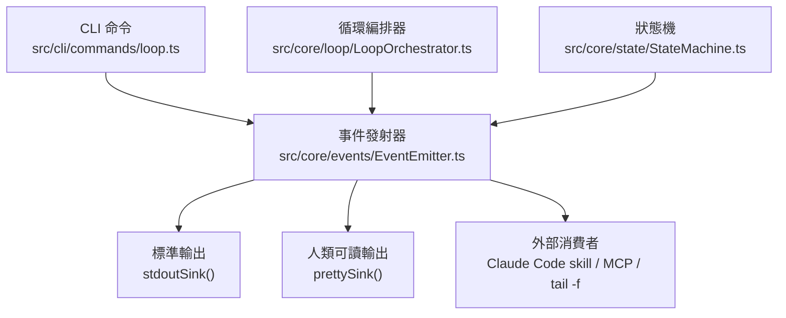
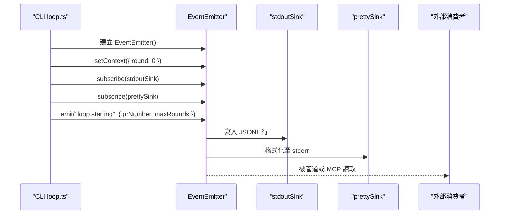
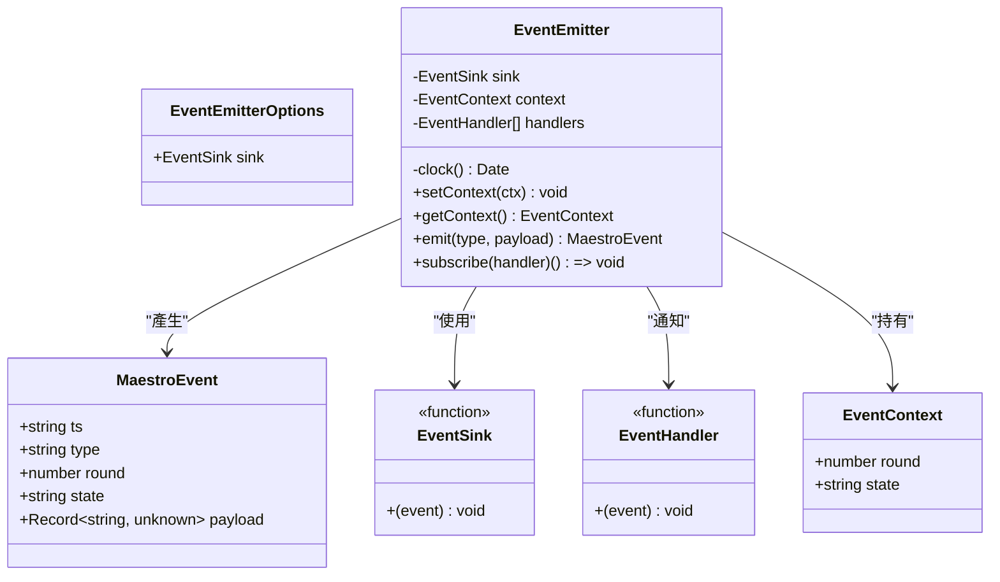
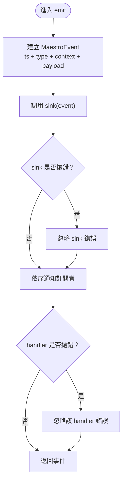
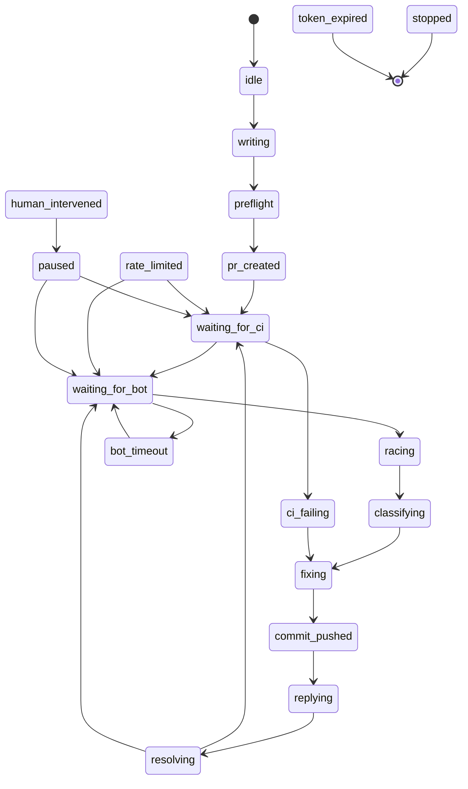
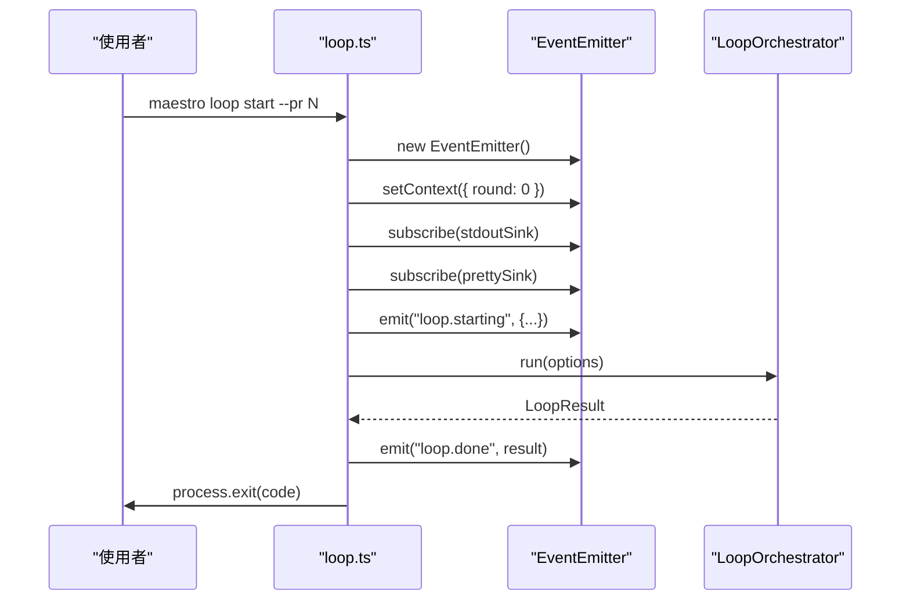
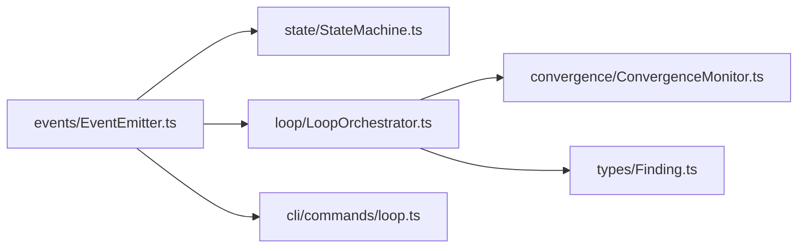
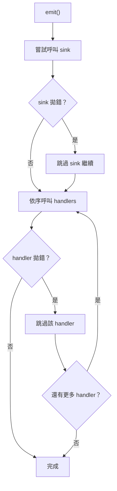
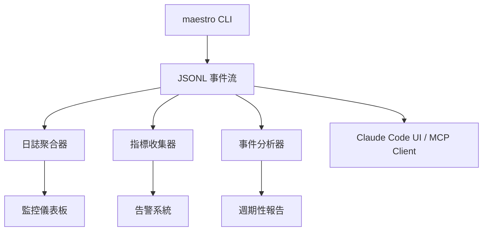
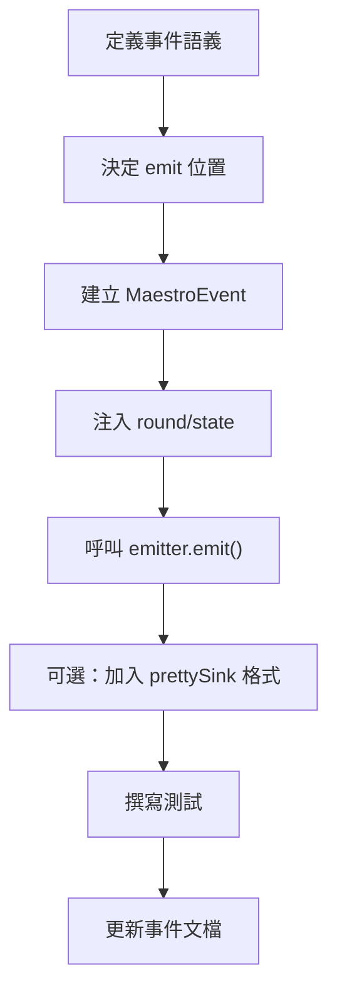

# EventEmitter 事件系統

**本文引用的檔案**

- [EventEmitter.ts](https://github.com/mikeah2011/maestro/blob/master/src/core/events/EventEmitter.ts)
- [EventEmitter.test.ts](https://github.com/mikeah2011/maestro/blob/master/tests/core/events/EventEmitter.test.ts)
- [loop.ts](https://github.com/mikeah2011/maestro/blob/master/src/cli/commands/loop.ts)
- [LoopOrchestrator.ts](https://github.com/mikeah2011/maestro/blob/master/src/core/loop/LoopOrchestrator.ts)
- [StateMachine.ts](https://github.com/mikeah2011/maestro/blob/master/src/core/state/StateMachine.ts)
- [ConvergenceMonitor.ts](https://github.com/mikeah2011/maestro/blob/master/src/core/convergence/ConvergenceMonitor.ts)
- [Finding.ts](https://github.com/mikeah2011/maestro/blob/master/src/core/types/Finding.ts)
- [DESIGN.md](https://github.com/mikeah2011/maestro/blob/master/docs/DESIGN.md)
- [CLAUDE.md](https://github.com/mikeah2011/maestro/blob/master/CLAUDE.md)

## 目錄
1. [簡介](#簡介)
2. [專案結構與角色定位](#專案結構與角色定位)
3. [核心元件](#核心元件)
4. [架構總覽](#架構總覽)
5. [詳細元件分析](#詳細元件分析)
6. [依賴關係分析](#依賴關係分析)
7. [JSONL 事件流規範](#jsonl-事件流規範)
8. [事件類型與資料結構](#事件類型與資料結構)
9. [訂閱機制、錯誤處理與背壓](#訂閱機制錯誤處理與背壓)
10. [與 Claude Code skill、MCP Server、tail -f 的整合](#與-claude-code-skill-mcp-server-tail--f-的整合)
11. [事件流分析工具與監控指標](#事件流分析工具與監控指標)
12. [效能優化建議](#效能優化建議)
13. [擴充自訂事件類型指南](#擴充自訂事件類型指南)
14. [故障排除指南](#故障排除指南)
15. [結論](#結論)

## 簡介
本文件針對 `EventEmitter` 及其在整個 Maestro 收斂循環中的角色，提供從設計到實作的完整技術說明。重點包括：

- JSONL（JSON Lines）事件流的序列化格式與 stdout 輸出協議。
- 事件型別定義、上下文注入與消費者兼容性。
- 事件訂閱、錯誤隔離與背壓考量。
- 與 `ClaudeCodeProvider`、Claude Code skill、MCP Server、`tail -f` 消費者的整合方式。
- 事件流可觀測性、分析工具與性能優化策略。
- 如何安全地擴充新事件類型。

Maestro 將 `EventEmitter` 視為「UI 的唯一真實來源」：所有狀態轉換、平台寫入、分類決策都必須經過這裡；外部消費者透過讀取事件來建構 UI、日誌、MCP 指令或自動化流程。

**章節來源**
- [DESIGN.md:1-200](https://github.com/mikeah2011/maestro/blob/master/docs/DESIGN.md#L1-L200)
- [CLAUDE.md:1-98](https://github.com/mikeah2011/maestro/blob/master/CLAUDE.md#L1-L98)

## 專案結構與角色定位
`EventEmitter` 位於 `src/core/events/`，屬於核心層模組。它不直接呼叫 GitHub API、AI Provider 或 Git 操作，而是作為跨模組的事件匯流點。



**圖表來源**
- [loop.ts:1-200](https://github.com/mikeah2011/maestro/blob/master/src/cli/commands/loop.ts#L1-L200)
- [EventEmitter.ts:1-108](https://github.com/mikeah2011/maestro/blob/master/src/core/events/EventEmitter.ts#L1-L108)
- [StateMachine.ts:1-114](https://github.com/mikeah2011/maestro/blob/master/src/core/state/StateMachine.ts#L1-L114)

**章節來源**
- [CLAUDE.md:1-98](https://github.com/mikeah2011/maestro/blob/master/CLAUDE.md#L1-L98)
- [DESIGN.md:1-200](https://github.com/mikeah2011/maestro/blob/master/docs/DESIGN.md#L1-L200)

## 核心元件
`EventEmitter` 的核心由以下部分組成：

| 名稱 | 用途 | 重要特性 |
|---|---|---|
| `MaestroEvent` | 單一事件的型別合約 | 包含時間戳、事件類型、回合與狀態上下文、任意 payload |
| `EventEmitter` | 事件發射中心 | 支援 sink、context、in-process handler、錯誤隔離 |
| `EventSink` | 外部輸出通道 | stdout、檔案、測試 capture |
| `EventHandler` | 程序內訂閱者 | 依註冊順序通知 |
| `toLine` | 序列化器 | 產生單行 JSONL |
| `streamSink` | 通用串流 sink | 包裝任何具 `write` 方法的目標 |
| `stdoutSink` | CLI 預設輸出 | 寫入 `process.stdout` |

**章節來源**
- [EventEmitter.ts:1-108](https://github.com/mikeah2011/maestro/blob/master/src/core/events/EventEmitter.ts#L1-L108)

## 架構總覽
事件系統在 CLI 啟動時建立 emitter，並掛載多個 sink：



**圖表來源**
- [loop.ts:1-200](https://github.com/mikeah2011/maestro/blob/master/src/cli/commands/loop.ts#L1-L200)
- [EventEmitter.ts:1-108](https://github.com/mikeah2011/maestro/blob/master/src/core/events/EventEmitter.ts#L1-L108)

**章節來源**
- [loop.ts:1-200](https://github.com/mikeah2011/maestro/blob/master/src/cli/commands/loop.ts#L1-L200)
- [EventEmitter.ts:1-108](https://github.com/mikeah2011/maestro/blob/master/src/core/events/EventEmitter.ts#L1-L108)

## 詳細元件分析

### 事件模型與上下文
`MaestroEvent` 是整個系統的統一事件契約：

- `ts`：由 emitter 內部 clock 產生的 ISO-8601 時間戳。
- `type`：點分命名空間的事件類型。
- `round`：當前輪次。
- `state`：當前狀態。
- `payload`：事件專屬資料。

上下文透過 `setContext` 合併，避免不同模組各自拼裝基礎欄位，也降低事件格式不一致的風險。



**圖表來源**
- [EventEmitter.ts:1-108](https://github.com/mikeah2011/maestro/blob/master/src/core/events/EventEmitter.ts#L1-L108)

**章節來源**
- [EventEmitter.ts:1-108](https://github.com/mikeah2011/maestro/blob/master/src/core/events/EventEmitter.ts#L1-L108)

### 事件發射流程
事件發射過程會執行以下步驟：

1. 根據 clock 產生時間戳。
2. 合併 current context。
3. 套用 payload。
4. 調用 sink。
5. 依序調用 in-process handlers。
6. 返回事件物件以支援鏈式使用。



**圖表來源**
- [EventEmitter.ts:1-108](https://github.com/mikeah2011/maestro/blob/master/src/core/events/EventEmitter.ts#L1-L108)

**章節來源**
- [EventEmitter.ts:1-108](https://github.com/mikeah2011/maestro/blob/master/src/core/events/EventEmitter.ts#L1-L108)

### 狀態機與事件
`StateMachine` 負責驗證狀態轉換，並在每次合法轉換後更新 emitter 的 `state` 上下文，同時發出 `state.transition` 事件。這使下游事件自動攜帶最新狀態。



**圖表來源**
- [StateMachine.ts:1-114](https://github.com/mikeah2011/maestro/blob/master/src/core/state/StateMachine.ts#L1-L114)

**章節來源**
- [StateMachine.ts:1-114](https://github.com/mikeah2011/maestro/blob/master/src/core/state/StateMachine.ts#L1-L114)

### CLI 事件接入點
`loop start` 命令建立 emitter、設定初始回合、訂閱 stdout 與 pretty sink，並發出 `loop.starting`。在循環結束後，會發出 `loop.done` 並根據結果決定 exit code。



**圖表來源**
- [loop.ts:1-200](https://github.com/mikeah2011/maestro/blob/master/src/cli/commands/loop.ts#L1-L200)
- [loop.ts:201-512](https://github.com/mikeah2011/maestro/blob/master/src/cli/commands/loop.ts#L201-L512)
- [LoopOrchestrator.ts:1-200](https://github.com/mikeah2011/maestro/blob/master/src/core/loop/LoopOrchestrator.ts#L1-L200)

**章節來源**
- [loop.ts:1-200](https://github.com/mikeah2011/maestro/blob/master/src/cli/commands/loop.ts#L1-L200)
- [loop.ts:201-512](https://github.com/mikeah2011/maestro/blob/master/src/cli/commands/loop.ts#L201-L512)

## 依賴關係分析
事件系統與其他模組的關係如下：



**圖表來源**
- [EventEmitter.ts:1-108](https://github.com/mikeah2011/maestro/blob/master/src/core/events/EventEmitter.ts#L1-L108)
- [StateMachine.ts:1-114](https://github.com/mikeah2011/maestro/blob/master/src/core/state/StateMachine.ts#L1-L114)
- [LoopOrchestrator.ts:1-200](https://github.com/mikeah2011/maestro/blob/master/src/core/loop/LoopOrchestrator.ts#L1-L200)
- [ConvergenceMonitor.ts:1-200](https://github.com/mikeah2011/maestro/blob/master/src/core/convergence/ConvergenceMonitor.ts#L1-L200)
- [Finding.ts:1-129](https://github.com/mikeah2011/maestro/blob/master/src/core/types/Finding.ts#L1-L129)

**章節來源**
- [EventEmitter.ts:1-108](https://github.com/mikeah2011/maestro/blob/master/src/core/events/EventEmitter.ts#L1-L108)
- [LoopOrchestrator.ts:1-200](https://github.com/mikeah2011/maestro/blob/master/src/core/loop/LoopOrchestrator.ts#L1-L200)

## JSONL 事件流規範

### 序列化格式
每個事件序列化為一行 JSON，並以換行結尾。這是一個典型的 JSONL 行格式，適合：

- `tail -f` 即時追檔。
- Node.js、Python、Bun 等語言逐行解析。
- 管道組合工具如 `jq`。

序列化函式 `toLine` 會把 `MaestroEvent` 轉成字符串，並在末尾追加換行字元。

### stdout 輸出協議
`sink` 抽象了事件輸出路徑：

- `stdoutSink()`：寫入 `process.stdout`。
- `streamSink(stream)`：寫入任何具 `write(chunk)` 方法的目標。
- 測試中可使用自訂 sink 收集事件。

這種設計讓同一份事件邏輯能同時服務 CLI、skill、MCP server 和未來 UI。

### 消費者兼容性
事件本身只要求：

- `ts` 為 ISO-8601 字符串。
- `type` 為點分命名空間字符串。
- `round`、`state` 可選。
- `payload` 為可序列化對象。

因此，即使 payload 內容變動，只要 `type` 穩定，舊版消費者仍可安全忽略未知欄位。

**章節來源**
- [EventEmitter.ts:1-108](https://github.com/mikeah2011/maestro/blob/master/src/core/events/EventEmitter.ts#L1-L108)
- [EventEmitter.test.ts:1-107](https://github.com/mikeah2011/maestro/blob/master/tests/core/events/EventEmitter.test.ts#L1-L107)

## 事件類型與資料結構

### 已出現的事件類型
目前代碼中明確使用的事件類型包含：

| 事件類型 | 主要用途 | 典型 payload |
|---|---|---|
| `loop.starting` | CLI 開始驅動循環 | `prNumber`、`maxRounds`、`botFilter`、`dryRun` |
| `state.transition` | 狀態機轉換 | `from`、`to` |
| `commit.pushed` | 成功推送提交 | `sha`、`round`、`fixCount` |
| `commit.error` | 提交階段失敗 | `round`、`phase`、`error` |
| `loop.done` | 循環結束 | `finalState`、`rounds`、`reason`、`error` |
| `round.start` | pretty sink 顯示第幾輪 | `round` |
| `round.classified` | 分類統計 | `total`、`unique`、`criticals`、`duplicates` |
| `round.decisions` | 決策摘要 | `fix`、`defer`、`reject` |
| `fix.applied` | AI 修復應用 | `description` |
| `fix.skipped` | 跳過修復 | `categories` |
| `thread.replied` | 回覆討論串 | `category` |
| `thread.resolved` | 解決討論串 | 無或空 payload |
| `reviewers.requested` | 重新請求審查 | `bots` |
| `rerequest.skipped` | 跳過重新請求 | 無或空 payload |
| `round.waiting` | 等待機器人重新審查 | `intervalMs` |
| `pr.body_updated` | PR 描述更新 | `length` |
| `loop.error` | 錯誤報告 | `error` |

這些事件大部分來自 `prettySink` 的映射表，代表 CLI 預期接收的領域事件集合。

### 關鍵事件資料結構
以下是幾個重要事件的資料結構說明：

#### `state.transition`
| 欄位 | 型別 | 說明 |
|---|---|---|
| `from` | string | 原狀態 |
| `to` | string | 新狀態 |
| 其他 | 任意 | 擴展上下文 |

#### `commit.pushed`
| 欄位 | 型別 | 說明 |
|---|---|---|
| `sha` | string | Git commit SHA |
| `round` | number | 所屬輪次 |
| `fixCount` | number | 本輪修復數量 |

#### `commit.error`
| 欄位 | 型別 | 說明 |
|---|---|---|
| `round` | number | 所屬輪次 |
| `phase` | string | git add、git commit、git push 等階段 |
| `error` | string | 錯誤訊息 |

#### `loop.done`
| 欄位 | 型別 | 說明 |
|---|---|---|
| `finalState` | string | 最終狀態 |
| `rounds` | number | 執行的輪數 |
| `reason` | string | approved、converged、max_rounds、stopped、error |
| `error` | Error 或 string | 錯誤資訊（當 reason 為 error） |

**章節來源**
- [loop.ts:201-512](https://github.com/mikeah2011/maestro/blob/master/src/cli/commands/loop.ts#L201-L512)
- [StateMachine.ts:1-114](https://github.com/mikeah2011/maestro/blob/master/src/core/state/StateMachine.ts#L1-L114)
- [Finding.ts:1-129](https://github.com/mikeah2011/maestro/blob/master/src/core/types/Finding.ts#L1-L129)

## 訂閱機制、錯誤處理與背壓

### 訂閱機制
`subscribe` 會把 handler 加入內部陣列，並回傳一個取消訂閱函式。取消後，該 handler 不會再接收後續事件。

訂閱順序是註冊順序，這對需要固定輸出順序的 UI 或稽核很重要。

### 錯誤隔離
事件系統採用「sink 與 handler 錯誤隔離」策略：

- sink 拋錯不會中斷 event emission。
- 任一 handler 拋錯不會影響其他 handler。
- 這樣做的原因是：下游消費者可能關閉 stdout、重啟 MCP server、或暫時無法處理事件，但主循環不能因此崩潰。



**圖表來源**
- [EventEmitter.ts:1-108](https://github.com/mikeah2011/maestro/blob/master/src/core/events/EventEmitter.ts#L1-L108)

### 背壓處理
目前的實現沒有背壓控制：

- `emit` 同步呼叫 sink 與 handlers。
- 如果 stdout 或某個 consumer 很慢，可能會阻塞主循環。
- `streamSink` 也不檢查 `stream.write` 的回傳值或 `drain` 事件。

這在 CLI 環境通常可接受，因為 stdout 通常是終端或快速管道；但在高吞吐 MCP server、大量 JSONL 檔案或慢速第三方 consumer 上，可能需要額外的緩衝與限流。

**章節來源**
- [EventEmitter.ts:1-108](https://github.com/mikeah2011/maestro/blob/master/src/core/events/EventEmitter.ts#L1-L108)

## 與 Claude Code skill、MCP Server、tail -f 的整合

### 與 Claude Code skill 的整合
根據設計文件，Claude Code skill 是一個約 30 行的 shell 包裝，呼叫 `maestro` CLI 並將 JSONL 事件流管道到 Claude 的 TodoWrite 或其他 UI 能力。

實際整合方式：

1. Claude Code skill 執行 `maestro loop start --pr <N>`。
2. CLI 將事件寫入 stdout。
3. Skill 讀取 stdout 並渲染為任務清單、進度條或對話摘要。
4. 若需要互動，skill 可透過 MCP server 發送控制指令。

### 與 MCP Server 的整合
MCP Server 可封裝 `start_loop`、`get_status`、`stop_loop`、`get_round_summary` 等工具：

- `start_loop`：啟動 loop 並連接事件 stream。
- `get_status`：查詢當前狀態與輪次。
- `stop_loop`：停止正在執行的循環。
- `get_round_summary`：根據事件歷史重建輪次摘要。

由於事件是 JSONL，MCP server 可在 server-side 累積狀態，並向 client 暴露穩定的 REST 或 Streamable HTTP API。

### 與 `tail -f` 消費者的整合
JSONL 格式天然適合 `tail -f`：

```bash
maestro loop start --pr 123 2>/dev/null | jq '.'
```

或搭配 `grep`、`awk`、Python 腳本進行過濾與聚合。

**章節來源**
- [DESIGN.md:1-200](https://github.com/mikeah2011/maestro/blob/master/docs/DESIGN.md#L1-L200)
- [EventEmitter.ts:1-108](https://github.com/mikeah2011/maestro/blob/master/src/core/events/EventEmitter.ts#L1-L108)

## 事件流分析工具與監控指標

### 基本分析技巧
可用現有 Unix 工具對事件流進行初步分析：

| 目的 | 方法 |
|---|---|
| 查看所有事件 | `tail -f` 或管道到 `jq` |
| 過濾特定事件 | `grep` 匹配 `type` |
| 計算事件數量 | `wc -l` |
| 提取時間戳 | `jq '.ts'` |
| 計算循環輪數 | 統計 `round.start` 或 `round.committed` |
| 偵測錯誤 | 過濾 `loop.error`、`commit.error` |

### 推薦監控指標
基於事件類型，可定義以下監控指標：

| 指標 | 來源事件 | 意義 |
|---|---|---|
| 循環啟動次數 | `loop.starting` | 每日啟動量 |
| 循環完成率 | `loop.done` 且 `reason !== 'error'` | 健康度 |
| 平均輪數 | `loop.done.rounds` | 收斂效率 |
| 提交成功率 | `commit.pushed` / `commit.error` | 寫入穩定性 |
| 狀態轉換速率 | `state.transition` | 活動強度 |
| 分類問題數量 | `round.classified.total` | 工作量 |
| 關鍵問題數量 | `round.classified.criticals` | 風險程度 |
| 修復成功率 | `fix.applied` / `fix.skipped` | AI 修復有效性 |
| 錯誤率 | `loop.error` | 系統穩定性 |

### 事件流分析架構


[此圖為概念性架構，不對應特定程式碼檔案]

**章節來源**
- [loop.ts:201-512](https://github.com/mikeah2011/maestro/blob/master/src/cli/commands/loop.ts#L201-L512)
- [EventEmitter.ts:1-108](https://github.com/mikeah2011/maestro/blob/master/src/core/events/EventEmitter.ts#L1-L108)

## 效能優化建議

### 目前性能特徵
- 事件發射是同步且輕量的。
- 序列化成本為 O(n)，n 為 payload 大小。
- handler 通知是線性遍歷。
- 沒有背壓控制。
- 沒有事件去重。
- 沒有批量寫入。

### 優化方向

#### 1. 背壓支援
為 `EventEmitter` 新增非同步 sink 支援，例如：

- 使用 `stream.once('drain', ...)` 控制寫入速度。
- 為 slow consumers 建立緩衝佇列。
- 超過上限時延遲事件或丟棄低優先級事件。

#### 2. 批量寫入
對於檔案或網路 sink，可批次彙整多筆事件後一次寫入，減少 syscall 次數。

#### 3. 事件去重
在高頻狀態事件中，可根據 `(ts, type, round, state)` 做短期去重，避免 UI 重複渲染。

#### 4. 分段緩衝區
將事件分為 critical、info、debug 等級，允許 MCP server 或 UI 選擇性拉取。

#### 5. 計時與診斷
增加 emit 耗時統計，識別慢 handler 或阻塞 sink。

#### 6. 記憶體控制
限制 handler 數量與事件歷史長度，防止長期運行後記憶體增長。

**章節來源**
- [EventEmitter.ts:1-108](https://github.com/mikeah2011/maestro/blob/master/src/core/events/EventEmitter.ts#L1-L108)

## 擴充自訂事件類型指南

### 新增事件類型的步驟

1. **定義事件語義**  
   清楚說明事件觸發時機、必要欄位與可選欄位。

2. **選擇事件命名空間**  
   使用點分命名，例如 `loop.*`、`commit.*`、`classify.*`、`ai.*`、`platform.*`。

3. **在適當位置 emit**  
   由實際觸發副作用的模組發出事件，而不是集中在一個地方。

4. **更新 prettySink（若需 CLI 顯示）**  
   若希望 `loop.ts` 的 pretty sink 顯示該事件，需加入對應格式化函式。

5. **更新測試**  
   驗證事件結構、context 注入、序列化與錯誤隔離。

6. **更新事件文檔**  
   維護事件類型表格與 payload 說明。

### 新增事件類型的範例流程



**圖表來源**
- [EventEmitter.ts:1-108](https://github.com/mikeah2011/maestro/blob/master/src/core/events/EventEmitter.ts#L1-L108)
- [loop.ts:201-512](https://github.com/mikeah2011/maestro/blob/master/src/cli/commands/loop.ts#L201-L512)

### 注意事項
- payload 不應包含敏感資訊；如需紀錄密鑰，應先經 `SecretScanner`。
- payload 必須是可序列化對象，避免包含函式或循環引用。
- 若事件頻率很高，考慮降低 payload 大小。
- 若事件僅供內部使用，仍應保留 `type` 穩定性，方便日後升級。

**章節來源**
- [EventEmitter.ts:1-108](https://github.com/mikeah2011/maestro/blob/master/src/core/events/EventEmitter.ts#L1-L108)
- [loop.ts:201-512](https://github.com/mikeah2011/maestro/blob/master/src/cli/commands/loop.ts#L201-L512)

## 故障排除指南

### 常見問題

| 問題 | 可能原因 | 解法 |
|---|---|---|
| 事件未出現在 stdout | sink 未訂閱或 stdout 被遮蔽 | 確認 `stdoutSink` 已訂閱，檢查 stderr/stdout 分離 |
| 事件亂碼或截斷 | 消費者未正確處理換行 | 確保逐行解析 JSONL |
| 子程序崩潰導致主程序退出 | sink 或 handler 拋出未攔截異常 | 檢查 custom sink/handler 的錯誤處理 |
| 事件順序不一致 | 多個 async sink 競爭 | 改用單一有序 sink 或加鎖 |
| 記憶體成長 | handler 儲存全部事件 | 限制 history 長度或使用 streaming processor |
| MCP server 卡住 | consumer 讀取太慢 | 增加緩衝與背壓控制 |
| 狀態事件缺少 state | StateMachine 未初始化 emitter | 確認 orchestrator 建立時帶入 emitter |

### 診斷建議
- 先用 `tail -f` 或 `cat` 確認原始 JSONL。
- 再用 `jq` 驗證 JSON 結構。
- 過濾 `loop.error` 與 `commit.error` 找出失敗路徑。
- 比較 `state.transition` 與 `loop.done.reason` 判斷是否正常終止。
- 對 high-frequency events 觀察是否有重複或抖動。

**章節來源**
- [EventEmitter.ts:1-108](https://github.com/mikeah2011/maestro/blob/master/src/core/events/EventEmitter.ts#L1-L108)
- [EventEmitter.test.ts:1-107](https://github.com/mikeah2011/maestro/blob/master/tests/core/events/EventEmitter.test.ts#L1-L107)
- [loop.ts:201-512](https://github.com/mikeah2011/maestro/blob/master/src/cli/commands/loop.ts#L201-L512)

## 結論
`EventEmitter` 是 Maestro 事件化架構的基礎：它將狀態機、循環編排器、CLI 與外部消費者解耦，並以 JSONL 作為穩定協定。其設計重點在於：

- 單一事件來源。
- 可插拔 sink。
- 錯誤隔離。
- 清晰的上下文注入。
- 適合管道與 MCP 的 JSONL 格式。

未來若要提高吞吐與可觀測性，建議優先加入背壓、批量寫入、事件計時與消費者健康檢查。對於 Claude Code skill、MCP server 與 `tail -f` 消費者而言，這個事件系統已經提供了足夠穩定且易於整合的輸出形式。