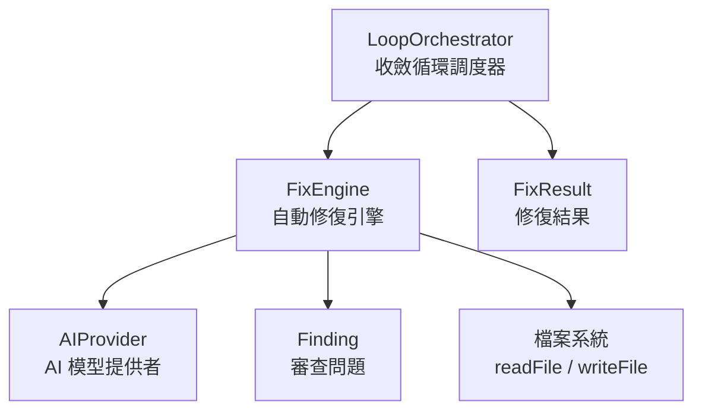
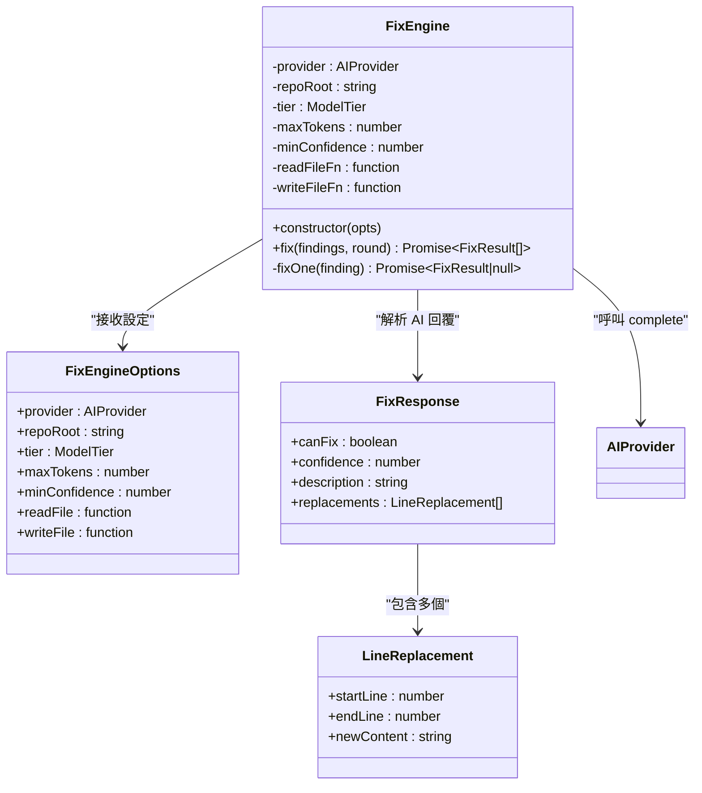
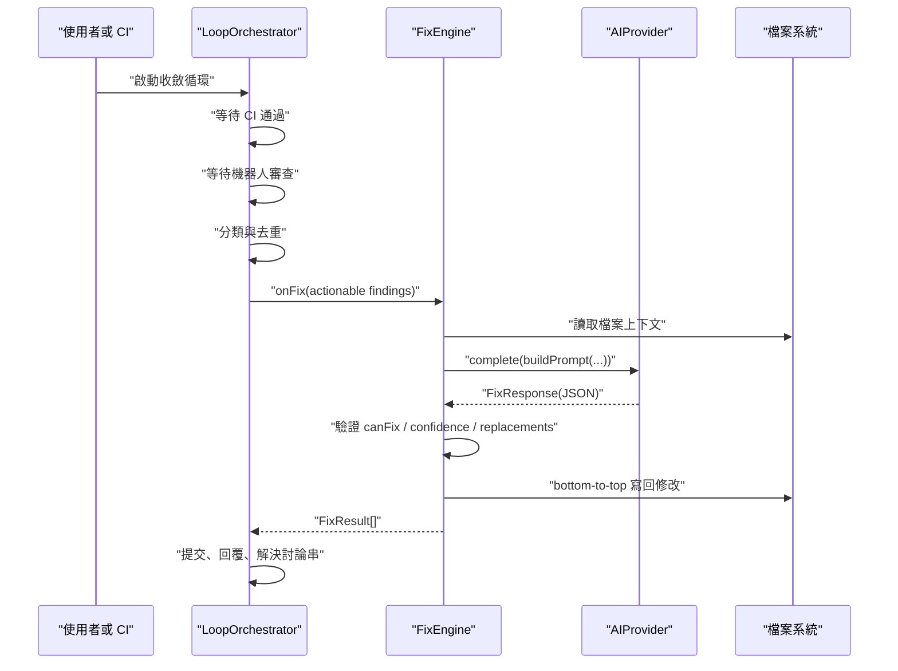
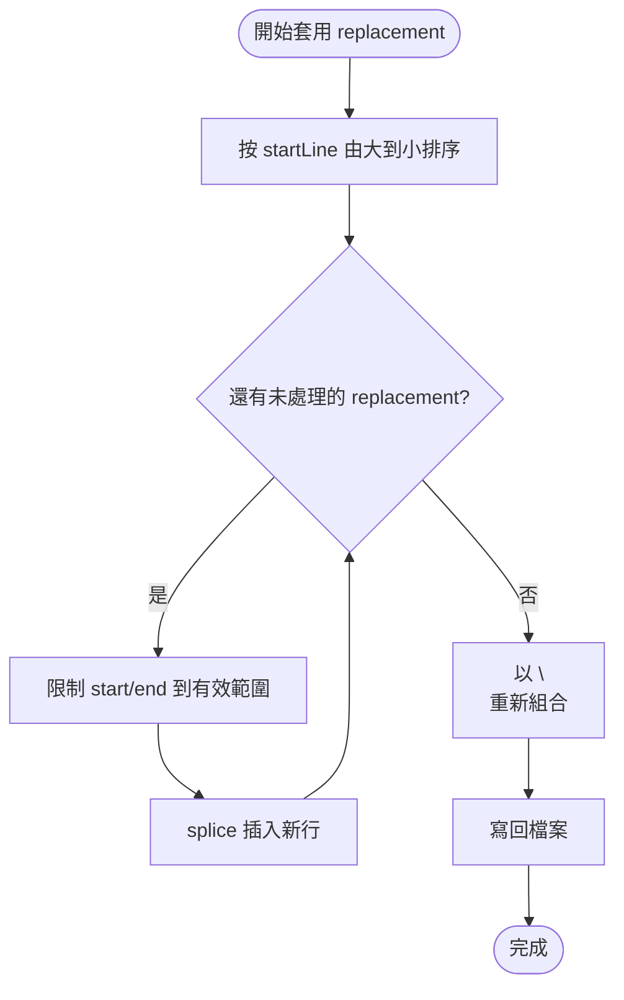
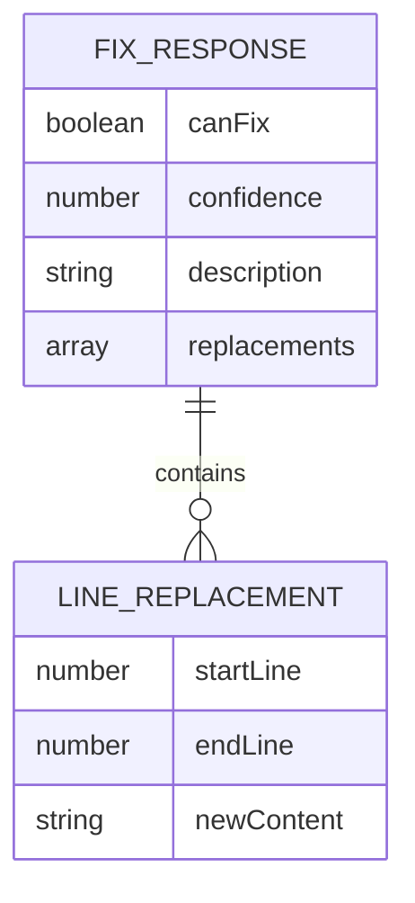
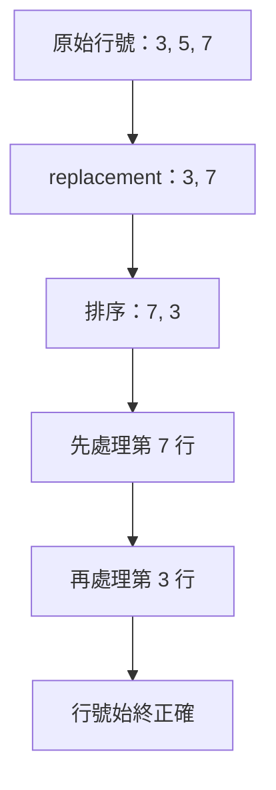
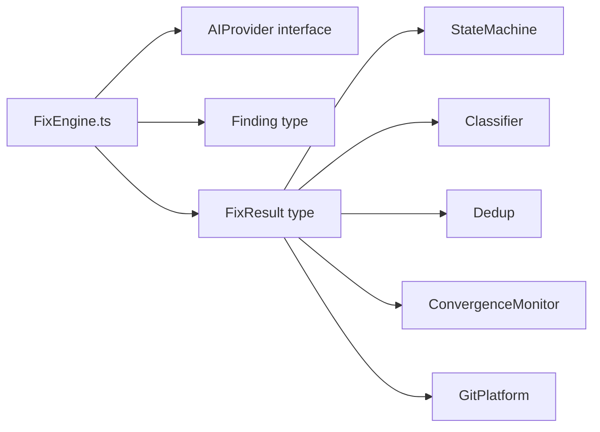
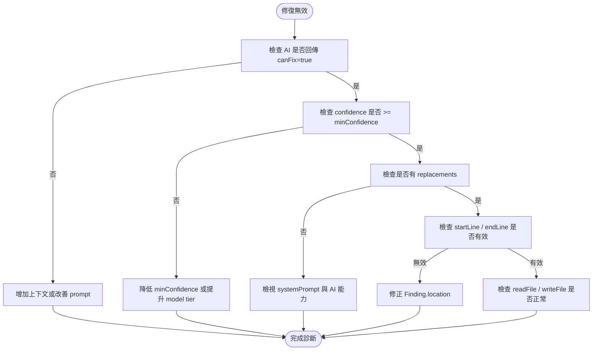

# FixEngine 修復引擎

<cite>
**本文引用的檔案**
- [FixEngine.ts](https://github.com/mikeah2011/maestro/blob/master/src/core/fix/FixEngine.ts)
- [Finding.ts](https://github.com/mikeah2011/maestro/blob/master/src/core/types/Finding.ts)
- [LoopOrchestrator.ts](https://github.com/mikeah2011/maestro/blob/master/src/core/loop/LoopOrchestrator.ts)
- [PullRequest.ts](https://github.com/mikeah2011/maestro/blob/master/src/core/types/PullRequest.ts)
- [DESIGN.md](https://github.com/mikeah2011/maestro/blob/master/docs/DESIGN.md)
- [README.md](https://github.com/mikeah2011/maestro/blob/master/README.md)
- [FixEngine.test.ts](https://github.com/mikeah2011/maestro/blob/master/tests/core/fix/FixEngine.test.ts)
</cite>

## 目錄
1. [簡介](#簡介)
2. [專案結構與角色定位](#專案結構與角色定位)
3. [核心元件分析](#核心元件分析)
4. [架構總覽](#架構總覽)
5. [詳細流程說明](#詳細流程說明)
6. [配置選項與參數定義](#配置選項與參數定義)
7. [JSON Replacement Schema 與驗證](#json-replacement-schema-與驗證)
8. [Bottom-to-top 寫入策略](#bottom-to-top-寫入策略)
9. [實際修復範例](#實際修復範例)
10. [依賴關係分析](#依賴關係分析)
11. [效能考量](#效能考量)
12. [故障診斷指南](#故障診斷指南)
13. [結論](#結論)

## 簡介

FixEngine 是 Maestro 的自動修復引擎，負責把「已分類、可修復」的審查問題轉換為真實程式碼修改。它的設計目標很明確：只修一個問題，不重構、不過度改動，並用穩定可測試的方式完成「讀取上下文 → 生成提示 → AI 回覆 → 解析 JSON replacement → 由下而上寫回」的全流程。

FixEngine 本身是無狀態的：它不保留跨輪次的可變狀態；所有檔案讀寫都透過注入的 `readFile` / `writeFile` 函式完成，讓單元測試可以完全替換真實硬碟行為。

從系統層級看，FixEngine 處於「分類 → 修復 → 提交 → 回覆 → 解決討論串」這個收斂循環中的 **Fixing** 階段。

**章節來源**
- [FixEngine.ts:1-20](https://github.com/mikeah2011/maestro/blob/master/src/core/fix/FixEngine.ts#L1-L20)
- [README.md:1-40](https://github.com/mikeah2011/maestro/blob/master/README.md#L1-L40)
- [DESIGN.md:1-150](https://github.com/mikeah2011/maestro/blob/master/docs/DESIGN.md#L1-L150)

## 專案結構與角色定位

FixEngine 位於 `src/core/fix/`，屬於核心業務邏輯層，而不是 CLI 或平台適配層。它的主要協作者如下：

| 元件 | 位置 | 角色 |
|---|---|---|
| `AIProvider` | `src/ai/interfaces/AIProvider.ts` | 抽象 AI 模型呼叫介面 |
| `Finding` | `src/core/types/Finding.ts` | 單一審查問題的標準化資料結構 |
| `LoopOrchestrator` | `src/core/loop/LoopOrchestrator.ts` | 調度整輪修復流程，並提供 `onFix` 鉤子 |
| `FixResult` | `src/core/loop/LoopOrchestrator.ts` | 單個修復結果的返回結構 |
| `PullRequestDiff` | `src/core/types/PullRequest.ts` | PR diff 的標準化表示（供上層使用） |



**圖表來源**
- [LoopOrchestrator.ts:1-70](https://github.com/mikeah2011/maestro/blob/master/src/core/loop/LoopOrchestrator.ts#L1-L70)
- [FixEngine.ts:1-20](https://github.com/mikeah2011/maestro/blob/master/src/core/fix/FixEngine.ts#L1-L20)
- [Finding.ts:1-30](https://github.com/mikeah2011/maestro/blob/master/src/core/types/Finding.ts#L1-L30)
- [PullRequest.ts:1-30](https://github.com/mikeah2011/maestro/blob/master/src/core/types/PullRequest.ts#L1-L30)

**章節來源**
- [FixEngine.ts:1-20](https://github.com/mikeah2011/maestro/blob/master/src/core/fix/FixEngine.ts#L1-L20)
- [LoopOrchestrator.ts:1-70](https://github.com/mikeah2011/maestro/blob/master/src/core/loop/LoopOrchestrator.ts#L1-L70)
- [Finding.ts:1-30](https://github.com/mikeah2011/maestro/blob/master/src/core/types/Finding.ts#L1-L30)
- [PullRequest.ts:1-30](https://github.com/mikeah2011/maestro/blob/master/src/core/types/PullRequest.ts#L1-L30)

## 核心元件分析

### FixEngine 類別

FixEngine 是一個簡單的同步執行引擎：

- 建構子接收 `FixEngineOptions`。
- 公開方法 `fix(findings, round)` 會依序處理每個 `Finding`。
- 內部方法 `fixOne(finding)` 完成單一問題的完整修復週期。
- 靜態常數 `CONTEXT_LINES = 20` 決定每側上下文行數。
- 內部類型 `LineReplacement` 與 `FixResponse` 描述 AI 回覆結構。



**圖表來源**
- [FixEngine.ts:1-20](https://github.com/mikeah2011/maestro/blob/master/src/core/fix/FixEngine.ts#L1-L20)
- [FixEngine.ts:20-45](https://github.com/mikeah2011/maestro/blob/master/src/core/fix/FixEngine.ts#L20-L45)
- [FixEngine.ts:45-100](https://github.com/mikeah2011/maestro/blob/master/src/core/fix/FixEngine.ts#L45-L100)
- [FixEngine.ts:100-160](https://github.com/mikeah2011/maestro/blob/master/src/core/fix/FixEngine.ts#L100-L160)

**章節來源**
- [FixEngine.ts:20-160](https://github.com/mikeah2011/maestro/blob/master/src/core/fix/FixEngine.ts#L20-L160)

### Prompt 建構器

`buildPrompt` 根據 `Finding` 與編號上下文產生最終提示。其內容包含：

- `FINDING` 區段：檔名、行號範圍、嚴重程度、標題、完整說明。
- `FILE CONTEXT` 區段：帶行號的程式碼片段。
- 明確要求輸出純 JSON。

`SYSTEM_PROMPT` 則定義 AI 的行為規則，包括：

- 只進行最小修復，不重構。
- 必須輸出符合 schema 的 JSON。
- `canFix`、`confidence`、`description`、`replacements` 的語意。
- `newContent` 以 `\n` 連接多行。
- 避免不必要的 import。
- 一次只修一個問題。

**章節來源**
- [FixEngine.ts:160-216](https://github.com/mikeah2011/maestro/blob/master/src/core/fix/FixEngine.ts#L160-L216)

### 輸入資料結構：Finding

`Finding` 代表來自某個 bot 的一次審查意見。FixEngine 主要使用以下欄位：

| 欄位 | 型別 | 用途 |
|---|---|---|
| `hash` | `string` | 穩定雜湊，用於追蹤同一問題 |
| `location.file` | `string` | 要修復的檔案路徑 |
| `location.startLine` | `number?` | 起始行（1-based） |
| `location.endLine` | `number?` | 結束行（1-based），可省略 |
| `severity` | `Severity` | 正規化後的嚴重程度 |
| `title` | `string` | 人類可讀的問題標題 |
| `body` | `string` | 完整的審查說明文字 |

**章節來源**
- [Finding.ts:1-90](https://github.com/mikeah2011/maestro/blob/master/src/core/types/Finding.ts#L1-L90)

## 架構總覽

FixEngine 被 `LoopOrchestrator` 以 `onFix` 鉤子形式調用。整個自動化流程如下：



**圖表來源**
- [LoopOrchestrator.ts:350-370](https://github.com/mikeah2011/maestro/blob/master/src/core/loop/LoopOrchestrator.ts#L350-L370)
- [FixEngine.ts:80-160](https://github.com/mikeah2011/maestro/blob/master/src/core/fix/FixEngine.ts#L80-L160)

**章節來源**
- [LoopOrchestrator.ts:1-70](https://github.com/mikeah2011/maestro/blob/master/src/core/loop/LoopOrchestrator.ts#L1-L70)
- [LoopOrchestrator.ts:350-370](https://github.com/mikeah2011/maestro/blob/master/src/core/loop/LoopOrchestrator.ts#L350-L370)
- [FixEngine.ts:80-160](https://github.com/mikeah2011/maestro/blob/master/src/core/fix/FixEngine.ts#L80-L160)

## 詳細流程說明

### 第一階段：上下文讀取 Read context

1. 取得 `finding.location.file`。如果沒有檔案路徑，直接跳過該問題。
2. 使用 `repoRoot` 與 `resolve` 計算絕對路徑。
3. 透過注入的 `readFileFn` 讀取檔案內容。
4. 以 `\n` 切分行陣列。
5. 若讀取失敗，整體 `fixOne` 回傳 `null`，不會中斷其他問題。

上下文行數固定為左右各 `CONTEXT_LINES = 20` 行：

- `ctxStart = max(1, startLine - 20)`
- `ctxEnd = min(lines.length, startLine + 20)`
- 切片後加上行號前綴，形成易讀的編號上下文。

這種設計保證 AI 能看到問題周圍的程式碼，而不是一次性載入整個檔案。

**章節來源**
- [FixEngine.ts:80-120](https://github.com/mikeah2011/maestro/blob/master/src/core/fix/FixEngine.ts#L80-L120)

### 第二階段：AI prompt 生成

`buildPrompt` 組合出三段關鍵資訊：

1. **Finding 資訊**：檔名、行號、嚴重程度、標題、正文。
2. **文件上下文**：帶有行號的程式碼片段。
3. **明確指令**：要求 AI 輸出 JSON。

同時，`systemPrompt` 作為系統提示傳入，約束 AI 的行為。

重要設計原則：

| 原則 | 說明 |
|---|---|
| 最小化改動 | 只修復當前 finding，不做大規模重構 |
| 結構化輸出 | 強制 JSON，便於程式端解析 |
| 可追溯描述 | `description` 用作 commit message |
| 置信度過濾 | 低於 `minConfidence` 的修復會被忽略 |
| 多行支援 | `newContent` 可用 `\n` 連接多行 |
| 行號穩定 | 使用 1-based 行號，配合 bottom-to-top 寫入 |

**章節來源**
- [FixEngine.ts:160-216](https://github.com/mikeah2011/maestro/blob/master/src/core/fix/FixEngine.ts#L160-L216)

### 第三階段：JSON replacement 解析

AI 的回覆被期望是 `FixResponse`：

| 欄位 | 型別 | 必填 | 說明 |
|---|---|---|---|
| `canFix` | `boolean` | 是 | 是否能夠修復 |
| `confidence` | `number` | 否 | 0–1 之間的置信度 |
| `description` | `string` | 否 | ≤72 字元的過去時態描述 |
| `replacements` | `LineReplacement[]` | 否 | 要套用的行範圍與新內容 |

`LineReplacement`：

| 欄位 | 型別 | 說明 |
|---|---|---|
| `startLine` | `number` | 1-based 起始行 |
| `endLine` | `number` | 1-based 結束行 |
| `newContent` | `string` | 以 `\n` 連接的新行內容 |

解析策略：

- 若 AI 拋錯，直接回傳 `null`。
- 若 `completion.parsedJson` 不存在，回退到 `{ canFix: false }`。
- 這意味著即使 AI 回覆格式不完全正確，也不會導致整個修復流程崩潰。

**章節來源**
- [FixEngine.ts:45-70](https://github.com/mikeah2011/maestro/blob/master/src/core/fix/FixEngine.ts#L45-L70)
- [FixEngine.ts:100-140](https://github.com/mikeah2011/maestro/blob/master/src/core/fix/FixEngine.ts#L100-L140)

### 第四階段：Validation 與過濾

在套用 replacement 之前，FixEngine 會執行三層檢查：

1. `canFix === true`
2. `confidence >= minConfidence`
3. `replacements` 存在且長度大於 0

若任一條件不滿足，該 finding 不會產生修復結果。

預設 `minConfidence = 0.7`，但可透過建構選項調整。

**章節來源**
- [FixEngine.ts:100-140](https://github.com/mikeah2011/maestro/blob/master/src/core/fix/FixEngine.ts#L100-L140)

### 第五階段：Bottom-to-top 寫入

這是 FixEngine 最關鍵的穩定性設計。

步驟：

1. 複製 `replacements` 陣列，避免修改原始物件。
2. 按 `startLine` 由大到小排序。
3. 對每個 replacement：
   - 將 1-based 行號轉為 0-based 索引。
   - 使用 `lines.splice(start, end - start, ...newContent.split('\n'))` 插入新行。
4. 最後以 `\n` 重新組合成字串並寫回。

為什麼要由下往上？

因為如果先修改較小的行號，後面較大行號的相對位置可能已經改變；而由下往上修改時，尚未處理的行號仍保持原始意義。



**圖表來源**
- [FixEngine.ts:120-160](https://github.com/mikeah2011/maestro/blob/master/src/core/fix/FixEngine.ts#L120-L160)

**章節來源**
- [FixEngine.ts:120-160](https://github.com/mikeah2011/maestro/blob/master/src/core/fix/FixEngine.ts#L120-L160)

## 配置選項與參數定義

### FixEngineOptions

| 選項 | 型別 | 預設值 | 說明 |
|---|---|---|---|
| `provider` | `AIProvider` | 無 | AI 模型提供者實作 |
| `repoRoot` | `string` | `process.cwd()` | 倉庫根目錄，用於解析檔案路徑 |
| `tier` | `ModelTier` | `'strong'` | AI 模型等級 |
| `maxTokens` | `number` | `2048` | 每次 fix 呼叫的最大輸出 token 數 |
| `minConfidence` | `number` | `0.7` | 最低置信度門檻 |
| `readFile` | `(path) => Promise<string>` | `node:fs/promises.readFile` | 可注入的檔案讀取函式 |
| `writeFile` | `(path, content) => Promise<void>` | `node:fs/promises.writeFile` | 可注入的檔案寫入函式 |

### FixResult

| 欄位 | 型別 | 說明 |
|---|---|---|
| `findingHash` | `string` | 對應原始 finding 的穩定雜湊 |
| `description` | `string` | 修復描述，優先使用 AI 提供的 description |
| `files` | `string[]?` | 被修改的檔案路徑列表 |

當 AI 沒有提供 `description` 時，會回退為 `"Fixed: <finding.title>"`，並截斷至 72 字元。

**章節來源**
- [FixEngine.ts:20-45](https://github.com/mikeah2011/maestro/blob/master/src/core/fix/FixEngine.ts#L20-L45)
- [FixEngine.ts:140-160](https://github.com/mikeah2011/maestro/blob/master/src/core/fix/FixEngine.ts#L140-L160)
- [LoopOrchestrator.ts:30-50](https://github.com/mikeah2011/maestro/blob/master/src/core/loop/LoopOrchestrator.ts#L30-L50)

## JSON Replacement Schema 與驗證

### Schema 結構



**圖表來源**
- [FixEngine.ts:45-70](https://github.com/mikeah2011/maestro/blob/master/src/core/fix/FixEngine.ts#L45-L70)

### 驗證機制

FixEngine 目前採用「程式碼層面的必要條件檢查」，而非 Zod 等外部 schema validator：

| 檢查項目 | 行為 |
|---|---|
| `canFix` | 非 `true` 直接跳過 |
| `confidence` | 低於 `minConfidence` 跳過 |
| `replacements` | 不存在或空陣列跳過 |
| AI 回覆解析錯誤 | 捕獲例外並回傳 `null` |
| 檔案讀寫錯誤 | 捕獲例外並回傳 `null` |

這種設計讓 FixEngine 在面對不完整或不正確的 AI 回覆時仍能穩定運行，但缺點是無法精確回報「哪個 replacement 欄位不符合預期」。

### 改進建議

若未來需要更嚴格的驗證，可考慮：

1. 引入 Zod 或類似工具驗證 `FixResponse`。
2. 對每個 `LineReplacement` 檢查：
   - `startLine` 與 `endLine` 是否為正整數。
   - `startLine <= endLine`。
   - `newContent` 是否為字串。
3. 記錄驗證失敗的 finding hash 與錯誤訊息，方便審計。

**章節來源**
- [FixEngine.ts:45-70](https://github.com/mikeah2011/maestro/blob/master/src/core/fix/FixEngine.ts#L45-L70)
- [FixEngine.ts:100-140](https://github.com/mikeah2011/maestro/blob/master/src/core/fix/FixEngine.ts#L100-L140)

## Bottom-to-top 寫入策略

### 為什麼行號偏移是問題

假設程式碼如下：

```
第 3 行：A
第 5 行：B
第 7 行：C
```

若 AI 同時要求修改第 3 行和第 7 行：

- 若先改第 3 行，第 7 行的原始行號仍正確。
- 但若 AI 要求在第 3 行插入 10 行，第 7 行在記憶體中的索引就會偏移。
- 因此不能單純依原順序套用。

### FixEngine 的解法

1. 將所有 replacement 按 `startLine` 降冪排列。
2. 先處理較大的行號，再處理較小的行號。
3. 這樣即使前面插入或刪除行，後面尚未處理的行號仍然指向原始位置。



**圖表來源**
- [FixEngine.ts:120-140](https://github.com/mikeah2011/maestro/blob/master/src/core/fix/FixEngine.ts#L120-L140)

### 邊界保護

寫入前會做基本邊界檢查：

- `start = max(0, rep.startLine - 1)`
- `end = min(lines.length, rep.endLine)`

這能防止極端情況下越界，但也意味著：

- 如果 AI 報告的行號超出檔案範圍，修改可能被吞掉。
- 這不是安全漏洞，而是「安靜忽略不可靠修复」的設計選擇。

**章節來源**
- [FixEngine.ts:120-140](https://github.com/mikeah2011/maestro/blob/master/src/core/fix/FixEngine.ts#L120-L140)

## 實際修復範例

### 範例一：空指標防護

假設 `Finding` 指出第 5 行存取 `user.profile` 前缺少空值檢查。

AI 可能回傳：

| 欄位 | 值 |
|---|---|
| `canFix` | `true` |
| `confidence` | `0.9` |
| `description` | `"Added null guard before profile access"` |
| `replacements[0].startLine` | `5` |
| `replacements[0].endLine` | `5` |
| `replacements[0].newContent` | `if (user) return user.profile;` |

FixEngine 會：

1. 讀取 `src/auth.ts`。
2. 取出第 5 行前後 20 行上下文。
3. 將上下文與 finding 資訊組合成 prompt。
4. 解析 AI 回覆。
5. 確認置信度 ≥ 0.7。
6. 套用 replacement。
7. 寫回檔案。
8. 回傳 `FixResult`。

這個流程由測試檔模擬，確保：

- 空 findings 回傳空陣列。
- 沒有檔案的 finding 被跳過。
- 讀檔失敗不影響其他 finding。
- provider 拋錯時回傳空陣列。
- 多個 replacement 會按逆序套用。
- 沒有 description 時回退到 title。

**章節來源**
- [FixEngine.test.ts:1-120](https://github.com/mikeah2011/maestro/blob/master/tests/core/fix/FixEngine.test.ts#L1-L120)
- [FixEngine.test.ts:120-225](https://github.com/mikeah2011/maestro/blob/master/tests/core/fix/FixEngine.test.ts#L120-L225)

### 範例二：多個 replacement

當 AI 判斷同一個 root cause 需要多個位置的修改時，它可以回傳多個 `LineReplacement`。FixEngine 會：

1. 複製並排序這些 replacement。
2. 由大到小套用。
3. 只寫一次檔案。

這避免多次 I/O，也避免中間狀態不一致。

**章節來源**
- [FixEngine.ts:120-140](https://github.com/mikeah2011/maestro/blob/master/src/core/fix/FixEngine.ts#L120-L140)
- [FixEngine.test.ts:150-200](https://github.com/mikeah2011/maestro/blob/master/tests/core/fix/FixEngine.test.ts#L150-L200)

## 依賴關係分析

### 模組依賴



**圖表來源**
- [FixEngine.ts:1-20](https://github.com/mikeah2011/maestro/blob/master/src/core/fix/FixEngine.ts#L1-L20)
- [LoopOrchestrator.ts:1-70](https://github.com/mikeah2011/maestro/blob/master/src/core/loop/LoopOrchestrator.ts#L1-L70)

### 耦合度評估

| 關係 | 耦合程度 | 說明 |
|---|---|---|
| FixEngine ↔ AIProvider | 低 | 透過抽象介面，可替換 Claude、OpenAI 等 |
| FixEngine ↔ Finding | 低 | 只使用必要欄位 |
| FixEngine ↔ File System | 低 | 透過注入函式隔離 |
| FixEngine ↔ LoopOrchestrator | 中 | 共用 `FixResult`，但 FixEngine 不反向依賴 orchestrator |
| LoopOrchestrator ↔ FixEngine | 中 | orchestrator 調度 engine，engine 是被動元件 |

### 外部整合點

| 整合點 | 目的 |
|---|---|
| `AIProvider.complete` | 取得 AI 生成的 replacement |
| `readFile` | 讀取程式碼上下文 |
| `writeFile` | 寫回修改後的檔案 |
| `LoopOrchestrator.onFix` | 接入收斂循環 |
| `Finding.hash` | 追蹤修復結果對應的原始問題 |

**章節來源**
- [FixEngine.ts:1-20](https://github.com/mikeah2011/maestro/blob/master/src/core/fix/FixEngine.ts#L1-L20)
- [LoopOrchestrator.ts:1-70](https://github.com/mikeah2011/maestro/blob/master/src/core/loop/LoopOrchestrator.ts#L1-L70)
- [Finding.ts:1-90](https://github.com/mikeah2011/maestro/blob/master/src/core/types/Finding.ts#L1-L90)

## 效能考量

### 時間複雜度

| 步驟 | 複雜度 | 說明 |
|---|---|---|
| 讀取檔案 | O(n) | n 為檔案行數 |
| 上下文切片 | O(1) | 最多 ±20 行 |
| 建構 prompt | O(k) | k 為上下文長度 |
| AI 呼叫 | 外生成本 | 取決於 model tier 與 token 數 |
| JSON 解析 | O(m) | m 為 AI 回覆大小 |
| 排序 replacement | O(r log r) | r 為 replacement 數量 |
| splice 寫入 | O(n) | 每次插入可能移動後續元素 |
| 寫回檔案 | O(n) | n 為檔案大小 |

通常 `r` 很小，所以主要瓶頸是 AI 呼叫與檔案 I/O。

### 空間複雜度

- 主要記憶體使用集中在：
  - 完整檔案行陣列。
  - numberedContext 字串。
  - AI 回覆字串。
  - 修改後的 lines 陣列。

### 優化機會

1. **快取檔案內容**：同一輪內重複處理同一檔案時可重用行陣列。
2. **批次寫入**：目前已是每筆 finding 寫一次；若多個 finding 修改同一檔案，可合併為一次寫入。
3. **流式讀取**：超大檔案可考慮只讀需要的上下文區塊。
4. **AI 回應壓縮**：減少 `newContent` 中不必要的空白或註解。
5. **retry 機制**：對 rate limit 或暫時性網路錯誤加入指數退避。

**章節來源**
- [FixEngine.ts:80-160](https://github.com/mikeah2011/maestro/blob/master/src/core/fix/FixEngine.ts#L80-L160)

## 故障診斷指南

### 常見問題與診斷方式

| 現象 | 可能原因 | 診斷方法 |
|---|---|---|
| 沒有任何修復結果 | AI 回傳 `canFix: false` | 檢查 system prompt 與上下文是否足夠 |
| 修復被跳過 | `confidence < minConfidence` | 調整 `minConfidence` 或改善 prompt |
| 沒有 `replacements` | AI 無法確定如何修改 | 提供更多上下文或改用更強 model tier |
| 行號錯誤 | AI 報了錯誤行號 | 檢查 `startLine` / `endLine` 是否合理 |
| 檔案沒被修改 | 讀檔或寫檔失敗 | 檢查 `readFile` / `writeFile` 是否能訪問路徑 |
| 多個 replacement 順序錯誤 | AI 回傳順序不穩定 | 確認 engine 已做 bottom-to-top 排序 |
| 修復引入新問題 | AI 過度改動 | 縮小上下文、強化 system prompt |

### 測試覆蓋的關鍵場景

測試檔涵蓋了以下情境：

- 空 findings 回傳空陣列。
- 沒有檔案路徑的 finding 被跳過。
- 讀檔失敗不中斷其他 finding。
- provider 拋錯時回傳空陣列。
- 成功修復會寫入檔案。
- `canFix: false` 時不產生修復。
- 低於 `minConfidence` 時跳過。
- 自訂 `minConfidence` 生效。
- 多個 replacement 按逆序套用。
- 沒有 description 時回退到 title。
- 多個 finding 可平行產出多個結果。

**章節來源**
- [FixEngine.test.ts:1-225](https://github.com/mikeah2011/maestro/blob/master/tests/core/fix/FixEngine.test.ts#L1-L225)

### 排查建議流程



**圖表來源**
- [FixEngine.ts:80-160](https://github.com/mikeah2011/maestro/blob/master/src/core/fix/FixEngine.ts#L80-L160)
- [FixEngine.test.ts:60-225](https://github.com/mikeah2011/maestro/blob/master/tests/core/fix/FixEngine.test.ts#L60-L225)

## 結論

FixEngine 是一個刻意保持簡單、可測試、可替換的自動修復引擎。它沒有試圖取代人類開發者的判斷，而是把「AI 審查發現的問題」轉化為「最小、可驗證的程式碼修改」。

它的核心價值不在於複雜的架構，而在於以下幾個穩定設計：

1. **上下文有限**：只讀 ±20 行，避免浪費 token。
2. **結構化輸出**：強制 JSON replacement schema。
3. **置信度過濾**：避免低品質修復污染程式碼。
4. **Bottom-to-top 寫入**：避免行號偏移造成的錯誤修改。
5. **無狀態設計**：方便測試、重試與擴展。
6. **注入式 I/O**：讓單元測試完全不觸碰真實檔案系統。

未來若要擴展，最適合的方向包括：

- 加入 strict schema validation。
- 增加 retry 與 rate-limit 處理。
- 合併同一檔案的多筆修改。
- 紀錄每次 AI 呼叫與修復結果的 audit trail。
- 支援更多 AI provider 與 model tier。
- 提供更詳細的錯誤診斷訊息。

但這些都應該建立在現有穩定基礎之上，而不是一開始就增加複雜度。

**章節來源**
- [FixEngine.ts:1-216](https://github.com/mikeah2011/maestro/blob/master/src/core/fix/FixEngine.ts#L1-L216)
- [README.md:1-120](https://github.com/mikeah2011/maestro/blob/master/README.md#L1-L120)
- [DESIGN.md:1-150](https://github.com/mikeah2011/maestro/blob/master/docs/DESIGN.md#L1-L150)