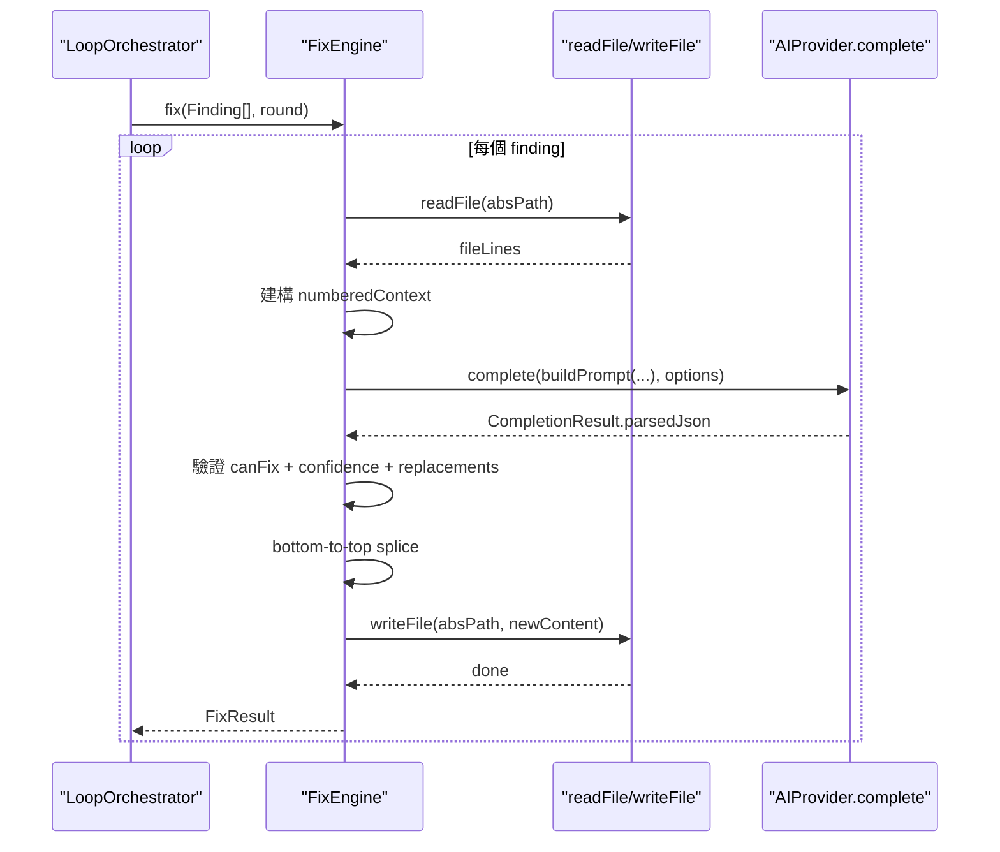
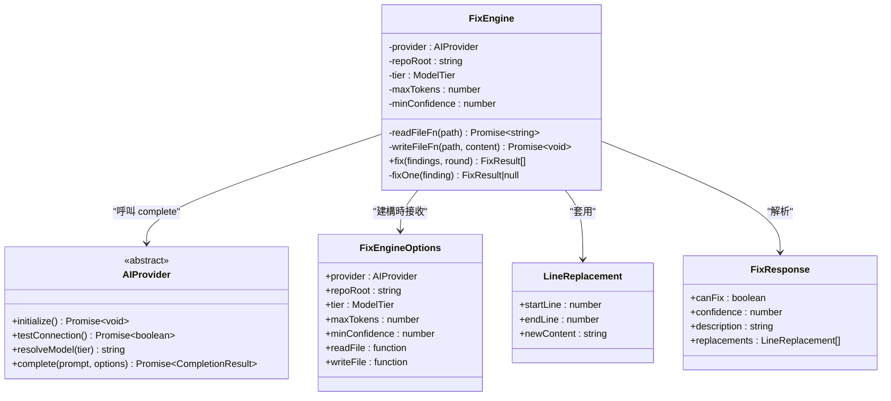
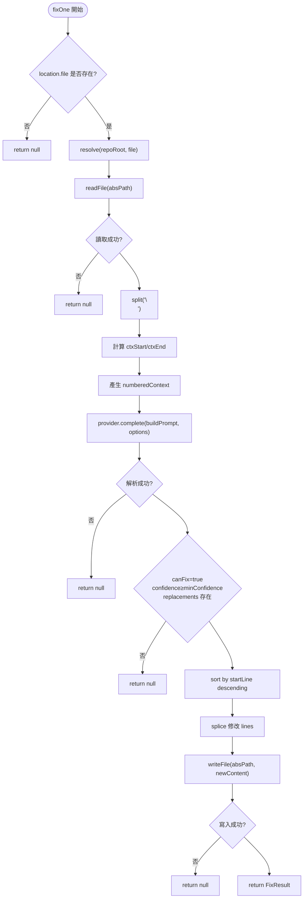
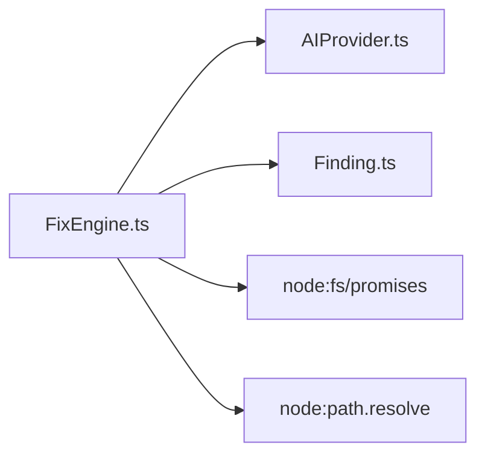
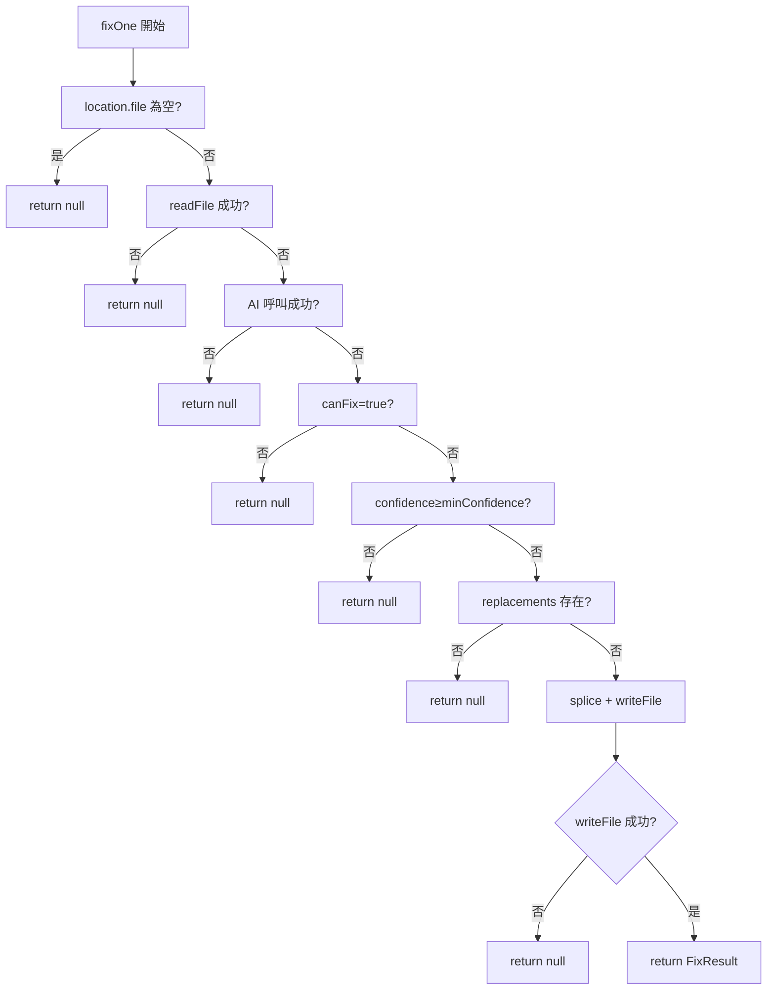

# FixEngine 自動修復引擎

<cite>
**本文引用的檔案**   
- [src/core/fix/FixEngine.ts](https://github.com/mikeah2011/maestro/blob/master/src/core/fix/FixEngine.ts)
- [tests/core/fix/FixEngine.test.ts](https://github.com/mikeah2011/maestro/blob/master/tests/core/fix/FixEngine.test.ts)
- [src/ai/interfaces/AIProvider.ts](https://github.com/mikeah2011/maestro/blob/master/src/ai/interfaces/AIProvider.ts)
- [src/core/types/Finding.ts](https://github.com/mikeah2011/maestro/blob/master/src/core/types/Finding.ts)
</cite>

## 目錄
1. [簡介](#簡介)
2. [專案結構與定位](#專案結構與定位)
3. [核心資料模型](#核心資料模型)
4. [架構總覽](#架構總覽)
5. [詳細元件分析](#詳細元件分析)
6. [依賴關係分析](#依賴關係分析)
7. [效能考量](#效能考量)
8. [測試策略](#測試策略)
9. [異常處理與故障排除指南](#異常處理與故障排除指南)
10. [結論](#結論)

## 簡介
FixEngine 是 Maestro 的「自動修復引擎」，負責在 Classifier 完成分類後，對每一個 finding 執行端到端的 AI 輔助修復流程。其職責包括：
- 讀取發現位置附近 ±CONTEXT_LINES（預設 20 行）的檔案上下文。
- 產生帶有行號的 numberedContext。
- 組合結構化 prompt，並呼叫 AIProvider.complete()。
- 解析 AI 回傳的 JSON replacement。
- 以 bottom-to-top 順序套用變更，保留原始行號。
- 將修改後的內容寫回檔案。

FixEngine 本身為無狀態元件；所有檔案 I/O 都透過可注入的 readFile/writeFile 選項進行，方便單元測試替換為記憶體模擬實作。

**章節來源**
- [src/core/fix/FixEngine.ts:1-216](https://github.com/mikeah2011/maestro/blob/master/src/core/fix/FixEngine.ts#L1-L216)

## 專案結構與定位
FixEngine 位於核心模組 `core/fix`，與 classify、dedup、convergence、loop 等子系統協同工作。它不是獨立 CLI，而是 LoopOrchestrator 在修復階段調用的 onFix 實作之一。

```mermaid
graph TB
    subgraph "核心流程"
        Classifier["Classifier<br/>分類 Finding"]
        FixEngine["FixEngine<br/>自動修復"]
        LoopOrchestrator["LoopOrchestrator<br/>修復週期協調"]
    end

    subgraph "外部能力"
        AIProvider["AIProvider<br/>抽象介面"]
        ClaudeProvider["ClaudeProvider / ClaudeCodeProvider"]
        FileSystem["檔案系統<br/>readFile / writeFile"]
    end

    Classifier -->|Finding[]| FixEngine
    LoopOrchestrator -->|onFix| FixEngine
    FixEngine -->|complete(prompt, options)| AIProvider
    AIProvider --> ClaudeProvider
    FixEngine -->|讀取/寫入| FileSystem
```

**圖表來源**
- [src/core/fix/FixEngine.ts:1-216](https://github.com/mikeah2011/maestro/blob/master/src/core/fix/FixEngine.ts#L1-L216)
- [src/ai/interfaces/AIProvider.ts:1-114](https://github.com/mikeah2011/maestro/blob/master/src/ai/interfaces/AIProvider.ts#L1-L114)

**章節來源**
- [src/core/fix/FixEngine.ts:1-40](https://github.com/mikeah2011/maestro/blob/master/src/core/fix/FixEngine.ts#L1-L40)
- [src/ai/interfaces/AIProvider.ts:1-40](https://github.com/mikeah2011/maestro/blob/master/src/ai/interfaces/AIProvider.ts#L1-L40)

## 核心資料模型

### FixEngineOptions
FixEngine 的所有可選參數如下：

| 欄位 | 型別 | 預設值 | 說明 |
|---|---|---:|---|
| provider | AIProvider | 必填 | 用於呼叫 LLM 完成請求的提供者 |
| repoRoot | string | process.cwd() | 用於解析相對檔案路徑的倉庫根目錄 |
| tier | ModelTier | 'strong' | 修復階段的模型等級 |
| maxTokens | number | 2048 | 每次 complete 的最大輸出 token |
| minConfidence | number | 0.7 | 低於此值的 confidence 會被跳過 |
| readFile | (path) → Promise\<string\> | node:fs/promises.readFile | 可注入的檔案讀取函式 |
| writeFile | (path, content) → Promise\<void\> | node:fs/promises.writeFile | 可注入的檔案寫入函式 |

ModelTier 由 AIProvider 定義，包含 'cheap'、'strong'、'flagship'。

**章節來源**
- [src/core/fix/FixEngine.ts:24-46](https://github.com/mikeah2011/maestro/blob/master/src/core/fix/FixEngine.ts#L24-L46)
- [src/ai/interfaces/AIProvider.ts:20-24](https://github.com/mikeah2011/maestro/blob/master/src/ai/interfaces/AIProvider.ts#L20-L24)

### LineReplacement
| 欄位 | 型別 | 說明 |
|---|---|---|
| startLine | number | 1-based，包含起始行 |
| endLine | number | 1-based，包含結束行 |
| newContent | string | 使用 `\n` 連接的取代行文字 |

### FixResponse
| 欄位 | 型別 | 說明 |
|---|---|---|
| canFix | boolean | 表示是否能夠針對該 finding 進行修復 |
| confidence | number? | 0–1 的置信度；低於 minConfidence 時不套用 |
| description | string? | ≤72 字過去式描述，用作 commit message |
| replacements | LineReplacement[]? | 要套用的行取代區間清單 |

**章節來源**
- [src/core/fix/FixEngine.ts:50-78](https://github.com/mikeah2011/maestro/blob/master/src/core/fix/FixEngine.ts#L50-L78)
- [src/ai/interfaces/AIProvider.ts:20-24](https://github.com/mikeah2011/maestro/blob/master/src/ai/interfaces/AIProvider.ts#L20-L24)

### Finding 與 Location
FixEngine 主要使用以下欄位：
- location.file：目標檔案相對路徑。
- location.startLine / location.endLine：1-based 行號範圍。
- title、body：提供給 AI 的問題摘要與說明。
- severity：嚴重性標籤，會進入 prompt。

**章節來源**
- [src/core/types/Finding.ts:28-46](https://github.com/mikeah2011/maestro/blob/master/src/core/types/Finding.ts#L28-L46)
- [src/core/types/Finding.ts:66-89](https://github.com/mikeah2011/maestro/blob/master/src/core/types/Finding.ts#L66-L89)

## 架構總覽
FixEngine 作為修復管道中的轉換器，把「分類結果」轉化為「實際檔案修改」。



**圖表來源**
- [src/core/fix/FixEngine.ts:80-160](https://github.com/mikeah2011/maestro/blob/master/src/core/fix/FixEngine.ts#L80-L160)
- [src/ai/interfaces/AIProvider.ts:70-114](https://github.com/mikeah2011/maestro/blob/master/src/ai/interfaces/AIProvider.ts#L70-L114)

## 詳細元件分析

### FixEngine 類別設計
FixEngine 是一個無狀態類別，建構子接收 FixEngineOptions，並設定：
- provider：AI 提供者。
- repoRoot：絕對化前用於 resolve(file)。
- tier、maxTokens、minConfidence：AI 呼叫與過濾參數。
- readFileFn、writeFileFn：包裝或替換的 I/O 函式。



**圖表來源**
- [src/core/fix/FixEngine.ts:24-160](https://github.com/mikeah2011/maestro/blob/master/src/core/fix/FixEngine.ts#L24-L160)
- [src/ai/interfaces/AIProvider.ts:70-114](https://github.com/mikeah2011/maestro/blob/master/src/ai/interfaces/AIProvider.ts#L70-L114)

**章節來源**
- [src/core/fix/FixEngine.ts:80-160](https://github.com/mikeah2011/maestro/blob/master/src/core/fix/FixEngine.ts#L80-L160)

### fixOne() 完整流程
fixOne() 是單一 finding 的修復主流程，關鍵步驟如下：

1. **取得目標檔案**  
   從 finding.location.file 取得相對路徑；若不存在則直接跳過。

2. **解析絕對路徑**  
   使用 resolve(repoRoot, file) 計算 absPath。

3. **讀取檔案並分割為行陣列**  
   透過 this.readFileFn(absPath) 讀取內容，再以 '\n' 分割為 lines。  
   若拋出異常（例如 ENOENT），返回 null，表示本次 finding 不修復。

4. **計算上下文範圍**  
   - startLine = finding.location.startLine ?? 1  
   - ctxStart = Math.max(1, startLine − CONTEXT_LINES)  
   - ctxEnd = Math.min(lines.length, startLine + CONTEXT_LINES)

5. **產出 numberedContext**  
   對 lines.slice(ctxStart−1, ctxEnd) 加上「行號：內容」格式，並以 '\n' 連接。

6. **呼叫 AIProvider.complete**  
   - prompt：buildPrompt(finding, numberedContext, ctxStart, ctxEnd)  
   - options：
     - tier：this.tier（預設 'strong'）
     - maxTokens：this.maxTokens（預設 2048）
     - temperature：0（確定性決策）
     - responseFormat：{ type: 'json_object' }
     - systemPrompt：SYSTEM_PROMPT
     - callerTag：'fix_engine'

7. **解析回應**  
   從 completion.parsedJson 取出 FixResponse；若解析失敗或缺少 canFix，視為 { canFix: false }。

8. **驗證修復條件**  
   - canFix 必須為 true  
   - confidence ?? 1 必須 ≥ minConfidence（預設 0.7）  
   - replacements 必須存在且長度 > 0

9. **按行號倒序套用變更**  
   - 複製 replacements 並依 startLine 降冪排序  
   - 將 1-based startLine/endLine 轉換為 0-based splice 索引  
   - splice(start, end−start, ...newContent.split('\n'))  
   - bottom-to-top 確保先修改較下行，避免上行修改影響後續行號

10. **寫回檔案**  
    將 lines.join('\n') 寫入 absPath；寫入失敗時返回 null。

11. **產出 FixResult**  
    - findingHash：finding.hash  
    - description：fixResp.description 或 「Fixed: ${title}」截斷至 72 字  
    - files：[file]



**圖表來源**
- [src/core/fix/FixEngine.ts:80-160](https://github.com/mikeah2011/maestro/blob/master/src/core/fix/FixEngine.ts#L80-L160)

**章節來源**
- [src/core/fix/FixEngine.ts:80-160](https://github.com/mikeah2011/maestro/blob/master/src/core/fix/FixEngine.ts#L80-L160)

### buildPrompt() 設計
buildPrompt() 負責把 finding 訊息與程式碼上下文組合成一個可直接送給 LLM 的字串。

組合要素：
- FINDING 區塊：
  - File：finding.location.file
  - Line：單行或 start–end 範圍
  - Severity：finding.severity
  - Title：finding.title
  - Body：finding.body
- FILE CONTEXT 區塊：
  - 標註 ctxStart–ctxEnd
  - numberedContext，每行帶行號

這樣做的目的是讓 AI 同時看到「問題描述」與「真實程式碼片段」，減少誤判，並提高 replacement 的行號準確性。

**章節來源**
- [src/core/fix/FixEngine.ts:180-216](https://github.com/mikeah2011/maestro/blob/master/src/core/fix/FixEngine.ts#L180-L216)

### SYSTEM_PROMPT 設計原則
SYSTEM_PROMPT 是 FixEngine 強加給 AI 的行為約束，核心原則是：

| 原則 | 目的 |
|---|---|
| surgical fix | 只修當前 finding，不做 refactoring |
| 最小必要修改 | 降低引入新錯誤的風險 |
| 輸出合法 JSON | 配合 responseFormat json_object |
| canFix=false 時省略 replacements | 明確表達無法修復 |
| confidence 0.0–1.0 | 供 engine 過濾低品質修復 |
| description ≤72 字、過去式 | 適合 commit line |
| newContent 用 \n 連接 | 便於 splice |
| 保留縮排與風格 | 維持程式碼一致性 |
| 非必要不加 import | 避免副作用 |
| 一次 fixing 多個 replacement 僅限同一根因 | 避免分散修復焦點 |

**章節來源**
- [src/core/fix/FixEngine.ts:162-179](https://github.com/mikeah2011/maestro/blob/master/src/core/fix/FixEngine.ts#L162-L179)

## 依賴關係分析



- FixEngine 對 AIProvider 的耦合是介面級，不關心具體 claude/openai/local/provider。
- FixEngine 對 node:fs 的耦合被 readFile/writeFile 選項解耦。
- FixEngine 對 node:path 的耦合僅用於 repoRoot + file → absPath。

**圖表來源**
- [src/core/fix/FixEngine.ts:17-22](https://github.com/mikeah2011/maestro/blob/master/src/core/fix/FixEngine.ts#L17-L22)
- [src/ai/interfaces/AIProvider.ts:1-114](https://github.com/mikeah2011/maestro/blob/master/src/ai/interfaces/AIProvider.ts#L1-L114)
- [src/core/types/Finding.ts:1-129](https://github.com/mikeah2011/maestro/blob/master/src/core/types/Finding.ts#L1-L129)

**章節來源**
- [src/core/fix/FixEngine.ts:17-22](https://github.com/mikeah2011/maestro/blob/master/src/core/fix/FixEngine.ts#L17-L22)
- [src/ai/interfaces/AIProvider.ts:1-40](https://github.com/mikeah2011/maestro/blob/master/src/ai/interfaces/AIProvider.ts#L1-L40)

## 效能考量
1. **bottom-to-top 修改**  
   將 replacements 依 startLine 降冪排序後 splice，能避免「先改上方行導致下方行號偏移」的問題。這是 FixEngine 最重要的正確性優化。

2. **CONTEXT_LINES=20**  
   上下各 20 行能提供足夠語境，但也不會過度膨脹 prompt；溫度設為 0 有助於穩定行為。

3. **minConfidence 閾值**  
   透過 minConfidence 過濾低品質修復，避免大量低價值寫入。

4. **逐 finding 處理**  
   fix() 對 findings 做串行處理，簡單可靠；若未來需要高吞吐，可在不改變 fixOne 契約的前提下加入批次或併發控制。

5. **I/O 注入**  
   readFile/writeFile 注入讓測試完全避開真實檔案系統，提升測試速度與隔離性。

[本節為一般性能討論，未直接分析特定程式碼段落]

## 測試策略
測試檔 tests/core/fix/FixEngine.test.ts 採用以下策略：

- **Mock AIProvider**  
  透過 makeProvider() 建立 complete 回傳指定 parsedJson 的 AIProvider，避免真實網路請求。

- **注入 readFile/writeFile**  
  makeOpts() 提供虛擬檔案儲存 map，readFile 根據 path 回傳內容，writeFile 記錄呼叫。

- **覆蓋場景**
  - 空 findings 列表回傳 []
  - 沒有 location.file 的 finding 被跳過
  - readFile 拋錯時返回 []
  - prompt 中包含 file 名稱與 title
  - 成功時回傳 FixResult.findingHash、description、files
  - writeFile 被呼叫且內容包含新修正行
  - canFix=false 時不修復
  - confidence < minConfidence 時跳過
  - 自訂 minConfidence 生效
  - provider.complete 拋錯時返回 []
  - 多個 replacement 以逆行號順序套用
  - description 缺失時 fallback 到 title
  - 多個 finding 都能被處理並回傳對應 results

這代表 FixEngine 的核心邏輯幾乎全部可由注入式測試覆蓋，而不依賴真實 LLM 或檔案系統。

**章節來源**
- [tests/core/fix/FixEngine.test.ts:1-225](https://github.com/mikeah2011/maestro/blob/master/tests/core/fix/FixEngine.test.ts#L1-L225)

## 異常處理與故障排除指南

### 常見錯誤分支

| 情境 | FixEngine 行為 | 建議排查 |
|---|---|---|
| finding.location.file 空白 | 直接 return null | 檢查 Classifier/Dedup 產生的 location |
| readFile 拋出異常 | catch 後 return null | 確認 repoRoot 與 file 路徑、權限 |
| AIProvider.complete 拋出異常 | catch 後 return null | 檢查 provider.initialize、連線、rate limit |
| parsedJson 缺 canFix | 視為 canFix=false | 檢查 SYSTEM_PROMPT 與 model 能力 |
| canFix=false | return null | 檢視 AI 回傳 description 或重新調整 prompt |
| confidence < minConfidence | return null | 調降 minConfidence 或改用更高 tier |
| replacements 不存在或為空 | return null | 檢查 AI 是否只給 description 而沒給 replacements |
| writeFile 拋出異常 | catch 後 return null | 檢查檔案寫入權限、磁碟空間、唯讀目錄 |

### 錯誤分支示意圖



**圖表來源**
- [src/core/fix/FixEngine.ts:80-160](https://github.com/mikeah2011/maestro/blob/master/src/core/fix/FixEngine.ts#L80-L160)

### 診斷建議
1. **確認 repoRoot**  
   若檔案找不到，優先檢查 constructor 中 repoRoot 是否指向正確倉庫根。

2. **檢查編號上下文**  
   numberedContext 的行號必須與 AI 回傳的 startLine/endLine 一致；否則 splice 可能寫錯位置。

3. **觀察 AI 回傳 JSON**  
   若 parsedJson 缺少 replacements，即使 canFix=true 也會被忽略。

4. **逐步調降 minConfidence**  
   若修復太保守，可暫時調低 minConfidence 觀察 AI 是否願意嘗試更多修復。

5. **分離測試**  
   先用 mock readFile/writeFile 驗證 splice 邏輯，再切換到真實檔案系統驗證 write 權限。

**章節來源**
- [src/core/fix/FixEngine.ts:80-160](https://github.com/mikeah2011/maestro/blob/master/src/core/fix/FixEngine.ts#L80-L160)

## 結論
FixEngine 是 Maestro 自動化修復管道的關鍵環節。它以嚴格的資料模型、清晰的 prompt 工程、以及 bottom-to-top 的行替換策略，確保 AI 產生的修復能在不破壞原始行號的前提下安全應用。透過可注入的 readFile/writeFile，FixEngine 同時具備生產可用與測試友好的雙重特質。

對於使用者而言：
- 若希望更謹慎的修復，可提高 minConfidence 或使用更低 tier。
- 若希望更積極的修復，可降低 minConfidence 或使用更高 tier。
- 若修復經常失敗，應優先檢查 location.file、line range、SYSTEM_PROMPT 與 AI 回傳 JSON 是否符合預期。

[本節為總結，未直接分析特定檔案]