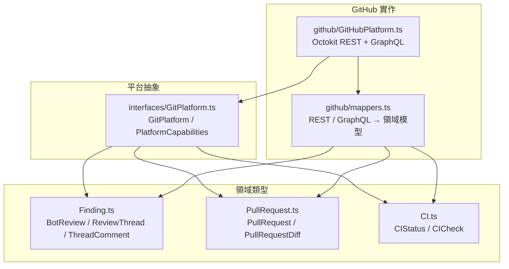
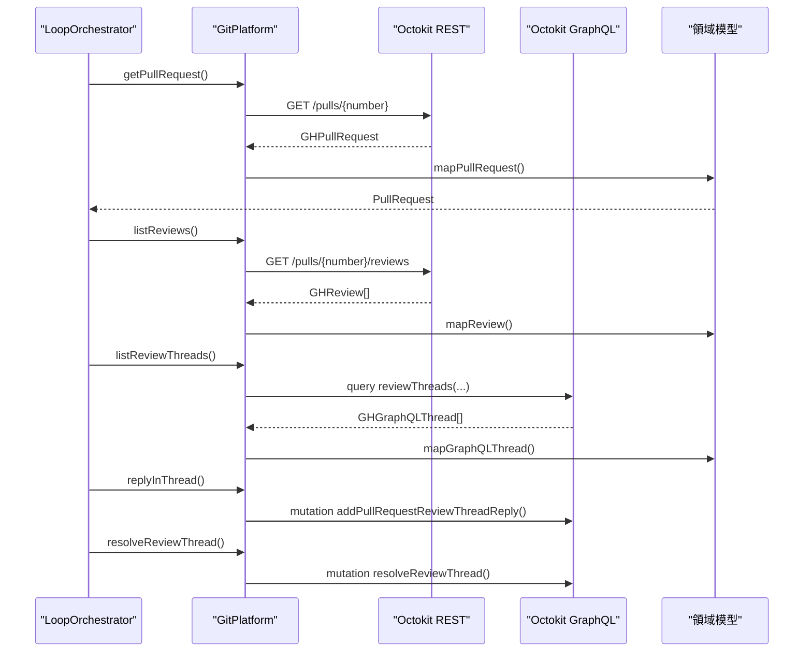
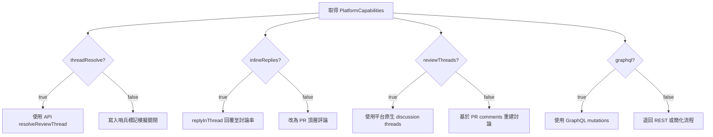
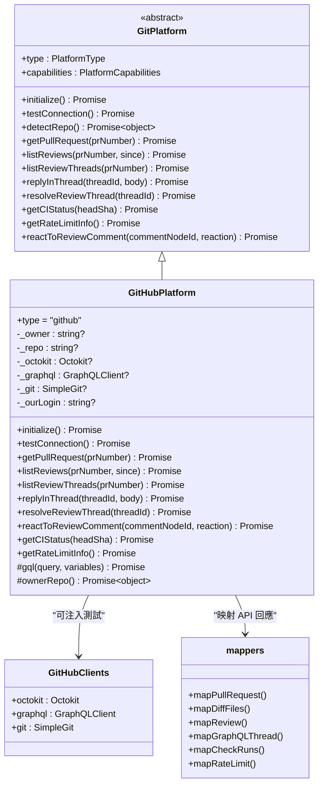
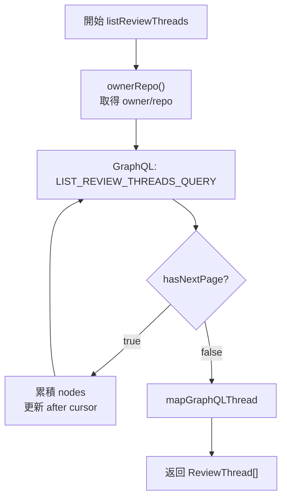
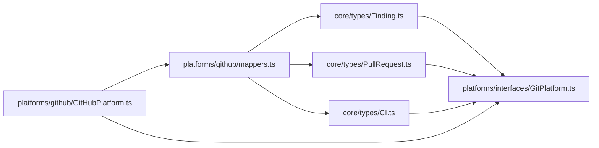
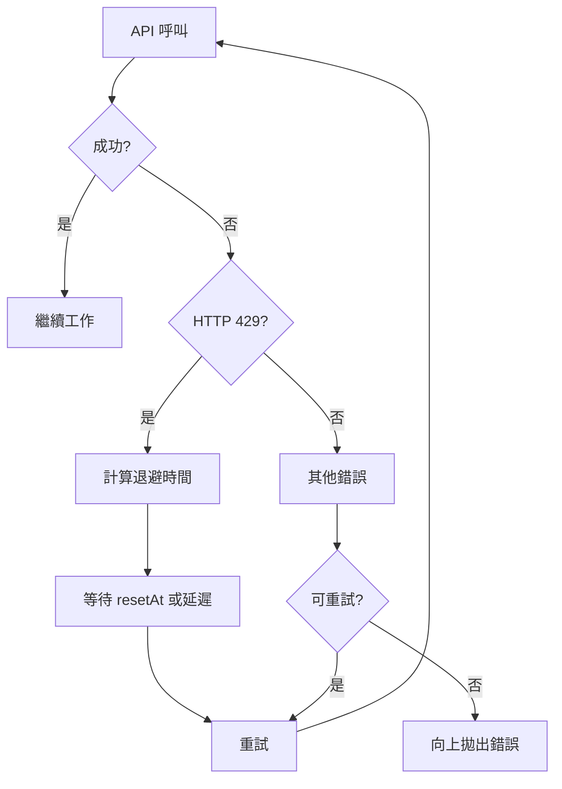

# Git Platform 整合

**本文引用的檔案**

- [GitPlatform.ts](https://github.com/mikeah2011/maestro/blob/master/src/platforms/interfaces/GitPlatform.ts)
- [GitHubPlatform.ts](https://github.com/mikeah2011/maestro/blob/master/src/platforms/github/GitHubPlatform.ts)
- [mappers.ts](https://github.com/mikeah2011/maestro/blob/master/src/platforms/github/mappers.ts)
- [Finding.ts](https://github.com/mikeah2011/maestro/blob/master/src/core/types/Finding.ts)
- [PullRequest.ts](https://github.com/mikeah2011/maestro/blob/master/src/core/types/PullRequest.ts)
- [CI.ts](https://github.com/mikeah2011/maestro/blob/master/src/core/types/CI.ts)
- [README.md](https://github.com/mikeah2011/maestro/blob/master/README.md)

## 目錄

1. [簡介](#簡介)
2. [專案結構與平台抽象](#專案結構與平台抽象)
3. [核心資料模型](#核心資料模型)
4. [架構總覽](#架構總覽)
5. [能力旗標與平台降級策略](#能力旗標與平台降級策略)
6. [GitHubPlatform 實作分析](#githubplatform-實作分析)
7. [API 映射層 mappers.ts](#api-映射層-mappersts)
8. [平台擴充指南：GitLab、Gitea、Gitee](#平台擴充指南gitlabgiteagitee)
9. [依賴關係分析](#依賴關係分析)
10. [效能考量](#效能考量)
11. [錯誤處理與 API 速率限制恢復](#錯誤處理與-api-速率限制恢復)
12. [故障排除指南](#故障排除指南)
13. [結論](#結論)

## 簡介

本文件說明 Maestro 的 Git Platform 整合設計，重點如下：

- `GitPlatform` 抽象介面如何定義跨平台 PR、審查、討論串、CI 與速率限制能力。
- GitHub 平台如何結合 Octokit REST 與 GraphQL 實現完整功能。
- `mappers.ts` 如何把 GitHub API 回應映射到內部領域模型。
- 能力旗標 `threadResolve / inlineReplies / reviewThreads / graphql` 如何驅動平台降級。
- 新增 GitLab、Gitea、Gitee 支援時的擴充方式。
- API 呼叫序列圖、能力檢測流程與錯誤恢復策略。

Maestro 的定位不是另一個審查機器人，而是「收斂層」：它調度 CodeRabbit、Copilot、Codex 等外部審查工具，並持續回覆討論串、解決問題、直到達到停止條件。Git Platform 整合就是這個收斂層與不同 Git 服務之間的橋樑。

**Section sources**
- [README.md:1-120](https://github.com/mikeah2011/maestro/blob/master/README.md#L1-L120)

## 專案結構與平台抽象



**圖表來源**
- [GitPlatform.ts:1-130](https://github.com/mikeah2011/maestro/blob/master/src/platforms/interfaces/GitPlatform.ts#L1-L130)
- [GitHubPlatform.ts:1-200](https://github.com/mikeah2011/maestro/blob/master/src/platforms/github/GitHubPlatform.ts#L1-L200)
- [mappers.ts:1-60](https://github.com/mikeah2011/maestro/blob/master/src/platforms/github/mappers.ts#L1-L60)
- [Finding.ts:1-129](https://github.com/mikeah2011/maestro/blob/master/src/core/types/Finding.ts#L1-L129)
- [PullRequest.ts:1-56](https://github.com/mikeah2011/maestro/blob/master/src/core/types/PullRequest.ts#L1-L56)
- [CI.ts:1-34](https://github.com/mikeah2011/maestro/blob/master/src/core/types/CI.ts#L1-L34)

### 設計要點

- `GitPlatform` 是 orchestrator-grade 抽象，所有 loop、BotRegistry 需要的方法都在這裡宣告。
- 註解明確指出未來應支援 `github`、`gitlab`、`gitea`、`gitee` 四種平台。
- `PlatformType` 型別已經包含這四個值，代表擴充點已準備好。
- `GitPlatformConfig` 允許設定 token、環境變數名稱、自託管 base URL、owner 與 repo。
- 平台能力透過 `PlatformCapabilities` 暴露，讓上層選擇策略而非硬編碼行為。

**Section sources**
- [GitPlatform.ts:1-130](https://github.com/mikeah2011/maestro/blob/master/src/platforms/interfaces/GitPlatform.ts#L1-L130)
- [README.md:150-200](https://github.com/mikeah2011/maestro/blob/master/README.md#L150-L200)

## 核心資料模型

### BotReview 與 ReviewThread

| 欄位 | 用途 | 重要性 |
|---|---|---|
| `BotReview.id` | 平台原生 review ID，例如 GitHub 的 `PRR_*` | 追蹤單一機器人審查批次 |
| `BotReview.bot.login` | 機器人名稱，例如 `coderabbitai` | 識別是哪個審查機器人 |
| `BotReview.state` | 統一狀態：`commented`、`changes_requested`、`approved`、`dismissed`、`satisfied` | 決定循環是否繼續 |
| `BotReview.submittedAt` | 提交時間 | 用於 `since` 過濾與排序 |
| `ReviewThread.id` | 平台原生 thread ID，例如 GitHub 的 `PRRT_*` | 回覆與解決的最小單位 |
| `ReviewThread.reviewId` | 關聯的 review ID | 將 thread 歸屬回某次機器人審查 |
| `ReviewThread.isResolved` | 是否已解決 | 判斷是否需要進一步處理 |
| `ReviewThread.location` | 指向程式碼位置的 finding location | 對應 inline comment |
| `ThreadComment.isOurs` | 是否由 Maestro 自己發表 | 避免自我迴圈回覆 |

**Section sources**
- [Finding.ts:1-129](https://github.com/mikeah2011/maestro/blob/master/src/core/types/Finding.ts#L1-L129)

### PullRequest 與 PullRequestDiff

| 欄位 | 用途 |
|---|---|
| `number` | PR 編號或 GitLab MR IID |
| `headSha / baseSha` | PR 分支與目標分支的 commit SHA |
| `baseBranch / headBranch` | 目標分支與開發分支 |
| `requestedReviewers` | 已請求審查者 |
| `reviewedBy` | 已完成審查者 |
| `PullRequestDiff.files` | 變更檔清單 |
| `PullRequestDiff.stats.additions / deletions / filesChanged` | 統計資訊 |

**Section sources**
- [PullRequest.ts:1-56](https://github.com/mikeah2011/maestro/blob/master/src/core/types/PullRequest.ts#L1-L56)

### CIStatus

| 欄位 | 用途 |
|---|---|
| `state` | 聚合狀態：`pending`、`success`、`failure`、`error`、`cancelled`、`skipped` |
| `failingCount` | 失敗檢查數量 |
| `pendingCount` | 進行中檢查數量 |
| `checks` | 個別檢查結果 |

**Section sources**
- [CI.ts:1-34](https://github.com/mikeah2011/maestro/blob/master/src/core/types/CI.ts#L1-L34)

## 架構總覽



**圖表來源**
- [GitHubPlatform.ts:201-350](https://github.com/mikeah2011/maestro/blob/master/src/platforms/github/GitHubPlatform.ts#L201-L350)
- [GitHubPlatform.ts:351-450](https://github.com/mikeah2011/maestro/blob/master/src/platforms/github/GitHubPlatform.ts#L351-L450)
- [mappers.ts:1-260](https://github.com/mikeah2011/maestro/blob/master/src/platforms/github/mappers.ts#L1-L260)

### 控制流程摘要

1. **取得 PR**：REST 取得 `GHPullRequest`，映射為 `PullRequest`。
2. **取得審查**：REST 列出所有 review，映射為 `BotReview`。
3. **取得討論串**：GraphQL 查詢 `reviewThreads`，映射為 `ReviewThread[]`。
4. **回覆討論串**：GraphQL mutation 在 thread 內新增留言。
5. **解決討論串**：GraphQL mutation 標記 thread 為已解決。
6. **CI 狀態**：REST checks API 聚合為 `CIStatus`。
7. **速率限制**：REST rateLimit API 轉換為 `RateLimitInfo`。

**Section sources**
- [GitHubPlatform.ts:201-450](https://github.com/mikeah2011/maestro/blob/master/src/platforms/github/GitHubPlatform.ts#L201-L450)

## 能力旗標與平台降級策略

### 能力旗標定義

| 旗標 | 型別 | 意義 |
|---|---:|---|
| `threadResolve` | boolean | 能否透過 API 將討論串標記為已解決 |
| `inlineReplies` | boolean | 能否在 thread 內回覆，而不只是 PR 頂層評論 |
| `reviewThreads` | boolean | 平台是否以一等公民形式提供 review threads |
| `requestReviewers` | boolean | 能否透過 API 請求審查者 |
| `ciStatus` | boolean | 能否透過 API 取得 CI 檢查狀態 |
| `graphql` | boolean | 是否能使用 GraphQL mutations（批量操作更快） |
| `emojiReactions` | boolean | 能否對審查留言加上 emoji reaction |

### GitHub 的能力宣告

GitHubPlatform 目前宣告全部能力皆可用：

- `threadResolve: true`
- `inlineReplies: true`
- `reviewThreads: true`
- `requestReviewers: true`
- `ciStatus: true`
- `graphql: true`
- `emojiReactions: true`

這表示 GitHub 平台不觸發任何降級路徑。

### 降級策略

根據 `GitPlatform` 註解，當某些平台不支持 `threadResolve` 時，orchestrator 會退而求其次：使用「sentinel-in-body markers」（正文中的哨兵標記）來模擬討論串關閉。這是平台抽象的關鍵設計：

- 高能力平台直接使用 API。
- 低能力平台可改用 body marker 或簡化邏輯。
- 上層 orchestrator 只依賴 `capabilities`，不需要知道每個平台的實作細節。



**圖表來源**
- [GitPlatform.ts:1-60](https://github.com/mikeah2011/maestro/blob/master/src/platforms/interfaces/GitPlatform.ts#L1-L60)

**Section sources**
- [GitPlatform.ts:1-60](https://github.com/mikeah2011/maestro/blob/master/src/platforms/interfaces/GitPlatform.ts#L1-L60)
- [GitHubPlatform.ts:140-170](https://github.com/mikeah2011/maestro/blob/master/src/platforms/github/GitHubPlatform.ts#L140-L170)

## GitHubPlatform 實作分析

### 客戶端初始化

GitHubPlatform 使用可注入的客戶端結構：



**圖表來源**
- [GitPlatform.ts:60-130](https://github.com/mikeah2011/maestro/blob/master/src/platforms/interfaces/GitPlatform.ts#L60-L130)
- [GitHubPlatform.ts:1-200](https://github.com/mikeah2011/maestro/blob/master/src/platforms/github/GitHubPlatform.ts#L1-L200)
- [GitHubPlatform.ts:201-450](https://github.com/mikeah2011/maestro/blob/master/src/platforms/github/GitHubPlatform.ts#L201-L450)
- [mappers.ts:1-260](https://github.com/mikeah2011/maestro/blob/master/src/platforms/github/mappers.ts#L1-L260)

### Token 解析

`resolveToken` 優先順序：

1. `config.token` 直接提供。
2. `config.tokenEnv` 指定的環境變數。
3. 預設使用 `GITHUB_TOKEN`。
4. 若都找不到，拋出錯誤。

這種設計允許：

- 開發環境使用環境變數。
- CLI 或 Action 傳入明文 token。
- 自託管環境指定不同環境變數名稱。

### owner/repo 偵測

`detectRepo` 支援兩種 Git remote URL：

- SSH：`git@github.com:owner/repo.git`
- HTTPS：`https://github.com/owner/repo.git`

若無法解析，則拋出包含原始 URL 的錯誤訊息，方便使用者診斷。

### PR I/O 方法

| 方法 | 使用的 Octokit API | 返回 / 副作用 |
|---|---|---|
| `getPullRequest` | `rest.pulls.get` | 映射為 `PullRequest` |
| `getPullRequestDiff` | `rest.pulls.listFiles` | 映射為 `PullRequestDiff` |
| `updatePullRequestBody` | `rest.pulls.update` | 更新 PR 描述 |
| `requestReviewers` | `rest.pulls.requestReviewers` | 請求審查者 |
| `createPRComment` | `rest.issues.createComment` | 建立 PR 頂層評論 |
| `listPRComments` | `rest.issues.listComments` | 列出 top-level 評論 |

注意：`listPRComments` 取得的是 PR issue comments，而不是 review thread comments。這與 `listReviewThreads` 有明確區分。

**Section sources**
- [GitHubPlatform.ts:201-280](https://github.com/mikeah2011/maestro/blob/master/src/platforms/github/GitHubPlatform.ts#L201-L280)

### 審查與討論串管理

#### listReviews

流程：

1. REST 取得所有 `GHReview`。
2. 映射為 `BotReview`。
3. 依 `since` 過濾。
4. 額外呼叫 `listReviewThreads`。
5. 將 threads 依 `reviewId` 群組後回填到每個 review。

時間複雜度：

- REST 取得 reviews：O(n)。
- GraphQL 取得 threads：O(m)。
- 群組 threads：O(m)。
- 回填：O(n)。

整體為 O(n + m)，n 為 review 數量，m 為 thread 數量。

#### listReviewThreads

使用 GraphQL 查詢，並手動實作游標分頁：



**圖表來源**
- [GitHubPlatform.ts:300-370](https://github.com/mikeah2011/maestro/blob/master/src/platforms/github/GitHubPlatform.ts#L300-L370)

#### replyInThread 與 resolveReviewThread

兩者都使用 GraphQL mutation：

- `REPLY_IN_THREAD_MUTATION`：`addPullRequestReviewThreadReply`
- `RESOLVE_THREAD_MUTATION`：`resolveReviewThread`

若 API 回傳 null，代表權限不足或 thread 不存在，會拋出明確錯誤訊息，提示 token 可能缺乏寫入權限。

#### reactToReviewComment

這是可覆寫的預設 no-op。GitHubPlatform 覆寫它以支援 emoji reactions，使用 `ADD_REACTION_MUTATION`。

**Section sources**
- [GitHubPlatform.ts:280-450](https://github.com/mikeah2011/maestro/blob/master/src/platforms/github/GitHubPlatform.ts#L280-L450)

## API 映射層 mappers.ts

### 設計原則

`mappers.ts` 的設計原則是：

- 純函式映射。
- 無 side effects。
- 無 I/O。
- 只保留需要的最小字段。
- 所有映射函式都 export，方便測試。

### 主要映射函式

| 輸入 | 輸出 | 關鍵轉換邏輯 |
|---|---|---|
| `GHPullRequest` | `PullRequest` | draft/closed/open 狀態映射；日期字串轉 Date |
| `GHDiffFile[]` | `PullRequestDiff` | 累計 additions/deletions；status 映射 |
| `GHReview` | `BotReview` | 狀態映射；Bot 身分辨識 |
| `GHGraphQLThread` | `ReviewThread` | 從 GraphQL thread 重建 comments 與 isOurs |
| `GHCheckRun[]` | `CIStatus` | 聚合 pending/failure/success |
| `GHRateLimit` | `RateLimitInfo` | core/graphql remaining/limit/reset |

### BotReview.state 映射

這是 `mappers.ts` 中最值得注意的業務邏輯之一：

| GitHub state | 行為 |
|---|---|
| `APPROVED` | `approved` |
| `CHANGES_REQUESTED` | `changes_requested` |
| `DISMISSED` | `dismissed` |
| `COMMENTED` + 包含「generated no new comments」 | `satisfied` |
| `COMMENTED` + 包含「reached your codex usage limits」 | `satisfied` |
| 其他 | `commented` |

這個設計讓 Maestro 不會因為 Copilot 或 Codex 回報「沒有新發現」或「用量上限」而陷入無限等待。

### ReviewThread.comments.isOurs

`mapGraphQLThread` 使用 `ourLogin` 標記哪些留言是由 Maestro 自己發表。這樣上層可以：

- 避免自我迴圈回覆。
- 正確計算 bot 與 human 留言。
- 在 UI 或日誌中區分來源。

**Section sources**
- [mappers.ts:1-260](https://github.com/mikeah2011/maestro/blob/master/src/platforms/github/mappers.ts#L1-L260)

## 平台擴充指南：GitLab、Gitea、Gitee

### 步驟一：建立平台類別

新增一個類別繼承 `GitPlatform`：

```text
src/platforms/gitlab/GitLabPlatform.ts
src/platforms/gitea/GiteaPlatform.ts
src/platforms/gitee/GiteePlatform.ts
```

每個實作必須宣告：

- `readonly type`：`'gitlab' | 'gitea' | 'gitee'`
- `readonly capabilities`：根據實際平台能力設定旗標
- `constructor(config)`：儲存配置
- `initialize()`：建立 HTTP client、驗證 token
- `testConnection()`：輕量連線測試
- `detectRepo()`：從 git remote 或 API 取得 owner/repo

### 步驟二：設定能力旗標

| 平台 | 建議能力 |
|---|---|
| GitLab | `threadResolve` 視版本而定；`inlineReplies` 通常支援；`graphql` 可考慮禁用或有限啟用 |
| Gitea | 多數能力受限，建議 `threadResolve=false`、`graphql=false` |
| Gitee | 能力最受限，建議保守設定 |

若 `threadResolve=false`，實作應實作「body sentinel marker」作為替代方案。

### 步驟三：實作必要方法

最少必要方法：

1. `getPullRequest`
2. `listReviews`
3. `listReviewThreads`
4. `replyInThread`
5. `resolveReviewThread`
6. `getCIStatus`
7. `getRateLimitInfo`

其他方法可沿用 `GitPlatform` 預設 no-op。

### 步驟四：建立自己的映射層

建議仿照 `github/mappers.ts`，建立：

- `GitLabTypes.ts`：定義 GitLab API 回應形狀
- `mappers.ts`：定義純映射函式

### 步驟五：註冊平台

目前 `PlatformType` 已包含三個新平台值，但尚未看到平台工廠或註冊表。新增平台後，需要在 orchestrator 或 CLI 初始化處加入平台選擇邏輯。

### 常見差異提醒

| 項目 | GitHub | GitLab | Gitea | Gitee |
|---|---|---|---|---|
| PR 編號 | `number` | MR IID | `number` | `number` |
| 討論串 | `reviewThreads` (GraphQL) | Discussion / Notes | 較弱 | 較弱 |
| CI | Checks API | Pipelines / Jobs | Actions | CI |
| GraphQL | 完整 | 部分 | 非常有限 | 非常有限 |
| Rate Limit | 明確 header | 不同格式 | 可能無 | 可能無 |

**Section sources**
- [GitPlatform.ts:1-60](https://github.com/mikeah2011/maestro/blob/master/src/platforms/interfaces/GitPlatform.ts#L1-L60)
- [README.md:170-200](https://github.com/mikeah2011/maestro/blob/master/README.md#L170-L200)

## 依賴關係分析



### 耦合度分析

- `GitPlatform` 僅依賴領域類型，耦合度低。
- `GitHubPlatform` 依賴 Octokit、simple-git，但這些依賴可透過注入替換。
- `mappers.ts` 是純函式模組，幾乎零副作用，適合單元測試。
- 領域類型位於 `core/types`，是所有平台共享的契約。

### 潛在循環依賴

目前沒有明顯循環依賴：

- `core/types` 不依賴 `platforms`。
- `platforms/interfaces` 不依賴具體 platform 實作。
- `platforms/github` 依賴 interface 與 core types。

### 外部依賴

| 依賴 | 用途 |
|---|---|
| `@octokit/rest` | PR、comments、reviews、checks、rate limit |
| `@octokit/graphql` | review threads、mutations |
| `simple-git` | 取得 git remote URL |

**Section sources**
- [GitPlatform.ts:1-130](https://github.com/mikeah2011/maestro/blob/master/src/platforms/interfaces/GitPlatform.ts#L1-L130)
- [GitHubPlatform.ts:1-60](https://github.com/mikeah2011/maestro/blob/master/src/platforms/github/GitHubPlatform.ts#L1-L60)
- [mappers.ts:1-40](https://github.com/mikeah2011/maestro/blob/master/src/platforms/github/mappers.ts#L1-L40)

## 效能考量

### 分頁策略

GitHubPlatform 使用分頁的地方：

1. `listFiles`：`per_page: 100`
2. `listComments`：`per_page: 100`
3. `listReviews`：`per_page: 100`
4. `listReviewThreads`：GraphQL `first: 100` + `after` cursor
5. `listForRef`：`per_page: 100`

建議：

- 大型 PR 應確認 GitHub API 的分頁上限。
- GraphQL 游標分頁已正確實作。
- 若未來有更多分頁需求，可考慮合併分頁邏輯。

### 批次操作

GraphQL 優勢：

- 一次取得多個 thread 與其 comments。
- 一次執行 mutation。
- 減少網路往返。

缺點：

- GraphQL cost 與 rate limit 獨立於 REST core limit。
- 需分別監控 `remaining` 與 `graphqlCost`。

### 記憶體使用

- `listReviewThreads` 會累積所有 thread 再返回。
- 對於極大型 PR，可考慮流式處理或分批回傳。
- 目前設計以簡潔性優先，適合一般規模 PR。

[No sources needed since this section provides general guidance]

## 錯誤處理與 API 速率限制恢復

### 錯誤分類

| 錯誤類型 | 發生位置 | 處理建議 |
|---|---|---|
| Token 未設定 | `resolveToken` | 立即拋錯，阻止後續 API 呼叫 |
| Remote URL 無法解析 | `detectRepo` | 拋出包含原始 URL 的錯誤 |
| 未呼叫 `initialize()` | octokit getter / gql getter | 拋出明確錯誤 |
| GraphQL mutation 回傳 null | `replyInThread` / `resolveReviewThread` | 提示權限不足 |
| CI 檢查無結果 | `mapCheckRuns` | 視為 success（無檢查等同通過） |
| Rate limit 接近耗盡 | `getRateLimitInfo` | 由 orchestrator 決定 backoff |

### 速率限制監控

`getRateLimitInfo` 返回：

| 欄位 | 意義 |
|---|---|
| `remaining` | 剩餘請求數 |
| `limit` | 總配額 |
| `resetAt` | 窗口重置時間 |
| `graphqlCost` | GraphQL 剩餘成本（若有） |

`mapRateLimit` 會同時處理 REST core 與 GraphQL 資源。

### 建議的恢復策略

orchestrator 可根據 `RateLimitInfo` 實作以下策略：

1. **警告**：當 `remaining < 10%` 時記錄警告。
2. **暫停**：當 `remaining === 0` 時等待 `resetAt`。
3. **退避**：指數退避 + jitter，避免雪崩。
4. **隔離**：REST 與 GraphQL 各自擁有獨立的 rate limit tracker。
5. **重試**：針對暫時性錯誤（如 429、5xx）自動重試。



**圖表來源**
- [GitHubPlatform.ts:420-450](https://github.com/mikeah2011/maestro/blob/master/src/platforms/github/GitHubPlatform.ts#L420-L450)
- [mappers.ts:240-260](https://github.com/mikeah2011/maestro/blob/master/src/platforms/github/mappers.ts#L240-L260)

**Section sources**
- [GitHubPlatform.ts:400-450](https://github.com/mikeah2011/maestro/blob/master/src/platforms/github/GitHubPlatform.ts#L400-L450)
- [mappers.ts:230-260](https://github.com/mikeah2011/maestro/blob/master/src/platforms/github/mappers.ts#L230-L260)

## 故障排除指南

### 常見問題

| 症狀 | 可能原因 | 排查方式 |
|---|---|---|
| `token not found` | 未設定 `GITHUB_TOKEN` 或 `config.token` | 檢查環境變數與 `.maestro.yaml` |
| `cannot detect owner/repo` | git remote 非 GitHub URL | 手動設定 `owner` 與 `repo` |
| `initialize must be called` | 先呼叫方法後才 initialize | 確保 lifecycle 順序正確 |
| `replyInThread returned null` | token 無寫入權限 | 檢查 token scope |
| `resolveReviewThread returned null` | thread 不存在或無權限 | 檢查 threadId 與權限 |
| CI 顯示 success 但實際有檢查 | 無檢查或全部通過 | 檢查 `checks` 陣列 |
| 速率限制耗盡 | 過快呼叫 API | 使用 `getRateLimitInfo` 監控 |

### 診斷建議

1. 使用 `doctor` 指令驗證環境。
2. 使用 dry-run 模式測試 loop。
3. 查看 GitHub 平台的 GraphQL mutation 錯誤回應。
4. 檢查 token 是否具備 `repo` 與 `pull_requests` 權限。
5. 若使用 self-hosted GitHub Enterprise，確認 `baseUrl` 正確。

**Section sources**
- [README.md:30-90](https://github.com/mikeah2011/maestro/blob/master/README.md#L30-L90)
- [GitHubPlatform.ts:170-220](https://github.com/mikeah2011/maestro/blob/master/src/platforms/github/GitHubPlatform.ts#L170-L220)

## 結論

Maestro 的 Git Platform 整合以 `GitPlatform` 抽象為核心，將 GitHub 的 REST 與 GraphQL 能力封裝成一致的領域模型。當前 GitHub 實作提供了完整功能，包括 PR 元資料、審查評論、inline replies、review threads 管理與 emoji reactions。

未來新增 GitLab、Gitea、Gitee 時，最重要的設計決策是：

1. 根據平台能力精確設定 `PlatformCapabilities`。
2. 在 `threadResolve=false` 時實作 body sentinel marker。
3. 保持 `mappers.ts` 為純函式，方便測試。
4. 正確處理 rate limit、錯誤與重試。
5. 避免在平台實作中硬編碼 orchestrator 策略。

這樣的架構讓 Maestro 能在不同 Git 平台上保持一致的收斂行為，同時保留足夠彈性容納能力較弱的平台。

[No sources needed since this section summarizes without analyzing specific files]