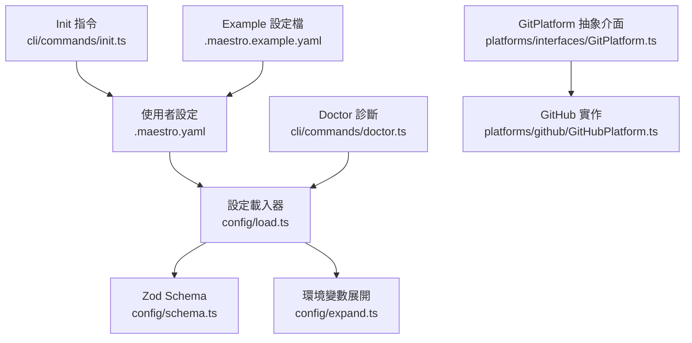
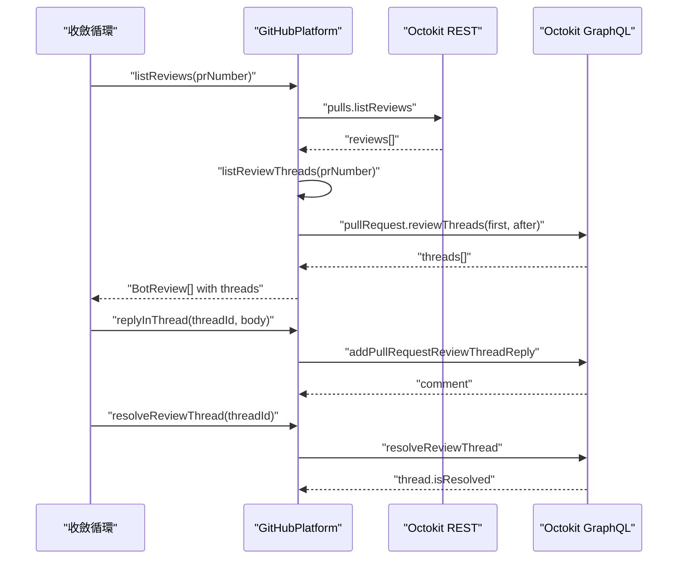
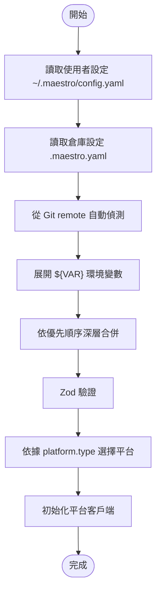
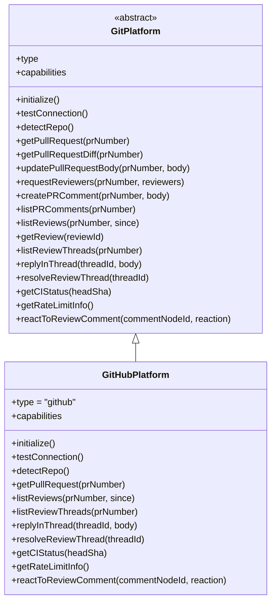

# Git Platforms 設定

**本文引用的檔案**

- [README.md](https://github.com/mikeah2011/maestro/blob/master/README.md)
- [.maestro.example.yaml](https://github.com/mikeah2011/maestro/blob/master/.maestro.example.yaml)
- [src/platforms/interfaces/GitPlatform.ts](https://github.com/mikeah2011/maestro/blob/master/src/platforms/interfaces/GitPlatform.ts)
- [src/platforms/github/GitHubPlatform.ts](https://github.com/mikeah2011/maestro/blob/master/src/platforms/github/GitHubPlatform.ts)
- [src/config/schema.ts](https://github.com/mikeah2011/maestro/blob/master/src/config/schema.ts)
- [src/config/load.ts](https://github.com/mikeah2011/maestro/blob/master/src/config/load.ts)
- [src/config/expand.ts](https://github.com/mikeah2011/maestro/blob/master/src/config/expand.ts)
- [src/cli/commands/init.ts](https://github.com/mikeah2011/maestro/blob/master/src/cli/commands/init.ts)
- [src/cli/commands/doctor.ts](https://github.com/mikeah2011/maestro/blob/master/src/cli/commands/doctor.ts)

## 目錄
1. [簡介](#簡介)
2. [專案結構與平台模組位置](#專案結構與平台模組位置)
3. [支援的 Git 平台總覽](#支援的-git-平台總覽)
4. [GitPlatform 抽象介面與能力旗標](#gitplatform-抽象介面與能力旗標)
5. [GitHub 實作分析](#github-實作分析)
6. [其他平台（GitLab、Gitea、Gitee）現況與限制](#其他平台gitlabgiteagitee-現況與限制)
7. [認證方式與環境變數展開](#認證方式與環境變數展開)
8. [API Endpoint 與 Base URL 設定](#api-endpoint-與-base-url-設定)
9. [Repository URL 格式與自動偵測](#repository-url-格式與自動偵測)
10. [Branch 策略說明](#branch-策略說明)
11. [多平台切換與 Fallback 機制](#多平台切換與-fallback-機制)
12. [Capability Flags 行為差異](#capability-flags-行為差異)
13. [各平台設定範例](#各平台設定範例)
14. [常見問題與解決方案](#常見問題與解決方案)
15. [架構圖與資料流](#架構圖與資料流)
16. [結論](#結論)

## 簡介
本文件說明 Maestro 工具的 Git Platforms 設定，涵蓋支援平台、認證方式、API endpoint、repository URL 解析、branch 策略、能力旗標行為、多平台切換與 fallback、以及各平台限制與常見問題。

Maestro 的核心是「收斂循環」：它不是另一個審查工具，而是調度外部 AI 審查機器人，並負責分類、修復、回覆討論串、解決討論串、請求重新審查，直到達到停止條件或升級人工處理。Git Platform 層則把 GitHub、GitLab、Gitea、Gitee 等平台的差異隱藏在統一的 `GitPlatform` 抽象介面背後。

**章節來源**
- [README.md:1-200](https://github.com/mikeah2011/maestro/blob/master/README.md#L1-L200)

## 專案結構與平台模組位置
與 Git Platforms 設定直接相關的程式碼主要集中在以下位置：

**圖表來源**
- [src/config/load.ts:1-200](https://github.com/mikeah2011/maestro/blob/master/src/config/load.ts#L1-L200)
- [src/config/schema.ts:1-200](https://github.com/mikeah2011/maestro/blob/master/src/config/schema.ts#L1-L200)
- [src/config/expand.ts:1-81](https://github.com/mikeah2011/maestro/blob/master/src/config/expand.ts#L1-L81)
- [src/cli/commands/doctor.ts:1-200](https://github.com/mikeah2011/maestro/blob/master/src/cli/commands/doctor.ts#L1-L200)
- [src/cli/commands/init.ts:1-87](https://github.com/mikeah2011/maestro/blob/master/src/cli/commands/init.ts#L1-L87)
- [src/platforms/interfaces/GitPlatform.ts:1-130](https://github.com/mikeah2011/maestro/blob/master/src/platforms/interfaces/GitPlatform.ts#L1-L130)
- [src/platforms/github/GitHubPlatform.ts:1-200](https://github.com/mikeah2011/maestro/blob/master/src/platforms/github/GitHubPlatform.ts#L1-L200)
- [.maestro.example.yaml:1-200](https://github.com/mikeah2011/maestro/blob/master/.maestro.example.yaml#L1-L200)

**章節來源**
- [README.md:120-200](https://github.com/mikeah2011/maestro/blob/master/README.md#L120-L200)
- [src/config/load.ts:1-60](https://github.com/mikeah2011/maestro/blob/master/src/config/load.ts#L1-L60)

## 支援的 Git 平台總覽
根據設定 schema、example 設定檔與 doctor 診斷邏輯，系統明確支援以下四種平台類型：

| 平台 | 設定值 | 預設 tokenEnv | Doctor 檢查的 CLI | 備註 |
|---|---|---|---|---|
| GitHub | `github` | `GITHUB_TOKEN` | `gh` | 目前唯一有完整 REST + GraphQL 實作 |
| GitLab | `gitlab` | `GITLAB_TOKEN` | `glab` | 透過 remote host 自動偵測 |
| Gitea | `gitea` | `GITEA_TOKEN` | `tea` | 透過 remote host 自動偵測 |
| Gitee | `gitee` | 未特別指定 | `gitee` | 透過 remote host 自動偵測 |

這些平台類型都屬於 `PlatformType` 字面型別，且 `platform.type` 僅允許這四個值之一。

**章節來源**
- [src/config/schema.ts:80-100](https://github.com/mikeah2011/maestro/blob/master/src/config/schema.ts#L80-L100)
- [src/platforms/interfaces/GitPlatform.ts:20-25](https://github.com/mikeah2011/maestro/blob/master/src/platforms/interfaces/GitPlatform.ts#L20-L25)
- [src/cli/commands/doctor.ts:30-40](https://github.com/mikeah2011/maestro/blob/master/src/cli/commands/doctor.ts#L30-L40)

## GitPlatform 抽象介面與能力旗標
所有 Git 平台都必須實作 `GitPlatform` 抽象類別。這個介面的設計目標是讓「收斂循環」與 Bot 管理邏輯不需要知道具體平台細節，只依賴統一方法與能力宣告。

### 主要責任分區
- **生命週期**：`initialize()`、`testConnection()`、`detectRepo()`
- **Pull Request I/O**：取得 PR、取得 diff、更新 PR body、指派 reviewer、建立 PR comment、列出 PR comment
- **Review 與 Thread**：列出 review、取得單一 review、列出 review threads、在 thread 中回覆、標記 thread 為已解決
- **CI 狀態**：查詢 head SHA 對應的 CI check run
- **Rate Limit**：回傳剩餘請求數與重置時間
- **Emoji Reaction**：可選擴充點，預設不執行任何動作

### 能力旗標
`PlatformCapabilities` 是用來告訴 orchestrator 當前平台能支援哪些功能：

| 旗標 | 類型 | 意義 |
|---|---:|---|
| `threadResolve` | boolean | 是否能透過 API 將 review thread 標記為 resolved |
| `inlineReplies` | boolean | 是否能回覆到 review thread 內，而不只是 PR 頂層 comment |
| `reviewThreads` | boolean | 平台是否把 review threads 當作一等公民物件暴露 |
| `requestReviewers` | boolean | 是否能透過 API 指派 reviewer |
| `ciStatus` | boolean | 是否能透過 API 取得 CI 狀態 |
| `graphql` | boolean | 是否有可用的 GraphQL 端點以加速大量操作 |
| `emojiReactions` | boolean? | 是否支援對 review thread comment 加上 emoji reaction |

**章節來源**
- [src/platforms/interfaces/GitPlatform.ts:1-130](https://github.com/mikeah2011/maestro/blob/master/src/platforms/interfaces/GitPlatform.ts#L1-L130)

## GitHub 實作分析
目前只有 `GitHubPlatform` 提供完整實作。它使用兩個主要客戶端：
- `@octokit/rest`：用於 REST 操作，例如 PR、issues、check runs、rate limit。
- `@octokit/graphql`：用於 thread 相關操作，因為 GitHub REST API 沒有第一階段的 review thread 支援。

### GitHub 能力宣告
GitHubPlatform 宣告的能力如下：

| 能力 | 值 | 說明 |
|---|---:|---|
| `threadResolve` | true | 支援 `resolveReviewThread` mutation |
| `inlineReplies` | true | 支援 `addPullRequestReviewThreadReply` mutation |
| `reviewThreads` | true | 支援 `pullRequest.reviewThreads` query |
| `requestReviewers` | true | 支援 REST `pulls.requestReviewers` |
| `ciStatus` | true | 支援 `checks.listForRef` |
| `graphql` | true | 使用 Octokit GraphQL client |
| `emojiReactions` | true | 支援 `addReaction` mutation |

### GitHub 關鍵流程

**圖表來源**
- [src/platforms/github/GitHubPlatform.ts:201-450](https://github.com/mikeah2011/maestro/blob/master/src/platforms/github/GitHubPlatform.ts#L201-L450)

### GitHub Token 解析
GitHubPlatform 會優先使用 `config.token`；若未設定，則讀取 `tokenEnv`（預設為 `GITHUB_TOKEN`），再從 `process.env` 取值。如果兩者都沒有，會拋出錯誤，提示使用者設定環境變數或直接在設定檔中寫入 token。

### Repository 自動偵測
若未提供 `owner` 與 `repo`，GitHubPlatform 會用 `simple-git` 呼叫 `git remote get-url origin`，並解析以下兩種格式：
- SSH：`git@github.com:owner/repo.git`
- HTTPS：`https://github.com/owner/repo.git`

若無法解析，會拋出錯誤訊息，包含實際取得的 remote URL。

**章節來源**
- [src/platforms/github/GitHubPlatform.ts:1-200](https://github.com/mikeah2011/maestro/blob/master/src/platforms/github/GitHubPlatform.ts#L1-L200)
- [src/platforms/github/GitHubPlatform.ts:201-450](https://github.com/mikeah2011/maestro/blob/master/src/platforms/github/GitHubPlatform.ts#L201-L450)

## 其他平台（GitLab、Gitea、Gitee）現況與限制
目前程式碼庫中只有 GitHub 的具體實作類別。GitLab、Gitea、Gitee 在設定層、remote 偵測層與 doctor 診斷層都有支援，但尚未看到對應的 platform 實作類別。

### 現有支援面向
- **設定 schema**：`platform.type` 接受 `gitlab`、`gitea`、`gitee`。
- **Remote 自動偵測**：`parseRemoteUrl` 會根據 host 判斷平台類型。
- **Doctor 診斷**：會檢查對應平台 CLI 是否存在。
- **Example 設定檔**：提供 gitlab、gitea、gitee 的設定註解範例。

### 重要限制
由於沒有對應的 platform 實作，若使用者將 `platform.type` 設為非 `github` 的值，而核心邏輯需要呼叫 platform 實例，就會遇到缺少實作的問題。實務上建議：
- 若只需要 Maestro 的設定驗證與 doctor 檢查，可先保留 `github` 作為 placeholder。
- 若需要使用 PR / review / thread / CI 等核心功能，目前仍應使用 `github`。
- 未來若要支援其他平台，需新增對應的 `GitPlatform` 實作類別，並實作所有 abstract 方法。

**章節來源**
- [src/config/schema.ts:80-100](https://github.com/mikeah2011/maestro/blob/master/src/config/schema.ts#L80-L100)
- [src/config/load.ts:110-170](https://github.com/mikeah2011/maestro/blob/master/src/config/load.ts#L110-L170)
- [src/cli/commands/doctor.ts:30-40](https://github.com/mikeah2011/maestro/blob/master/src/cli/commands/doctor.ts#L30-L40)
- [.maestro.example.yaml:60-90](https://github.com/mikeah2011/maestro/blob/master/.maestro.example.yaml#L60-L90)

## 認證方式與環境變數展開
### 支援的認證欄位
`GitPlatformConfig` 支援兩個認證欄位：

| 欄位 | 用途 |
|---|---|
| `token` | 直接寫入 token 字串 |
| `tokenEnv` | 指定環境變數名稱，例如 `GITHUB_TOKEN`、`GITLAB_TOKEN` |

`PlatformAuthSchema` 要求這兩個欄位至少有一個存在時才有意義；schema 本身允許兩者皆不存在，但實際平台實作通常會在初始化階段檢查。

### 環境變數展開規則
`.maestro.yaml` 中的字串支援以下 `${...}` 語法：

| 模式 | 行為 |
|---|---|
| `${VAR}` | 必要變數；若未設定會拋錯 |
| `${VAR:-default}` | 若 VAR 未設定或未填值，使用 default |
| `${VAR:?error}` | 若 VAR 未設定，拋出自訂錯誤訊息 |
| 巢狀展開 | 支援遞迴展開，但深度上限為 10 |

### 設定優先順序
設定載入器的合併順序由低到高為：

1. Git remote 自動偵測
2. 使用者設定檔 `~/.maestro/config.yaml`
3. 倉庫設定檔 `.maestro.yaml`
4. 環境變數覆蓋
5. CLI flags 覆蓋

這表示 CLI flag 權限最高，`.maestro.yaml` 次之，使用者層級設定再次之，Git remote 自動偵測最低。

**章節來源**
- [src/platforms/interfaces/GitPlatform.ts:25-45](https://github.com/mikeah2011/maestro/blob/master/src/platforms/interfaces/GitPlatform.ts#L25-L45)
- [src/config/schema.ts:80-100](https://github.com/mikeah2011/maestro/blob/master/src/config/schema.ts#L80-L100)
- [src/config/expand.ts:1-81](https://github.com/mikeah2011/maestro/blob/master/src/config/expand.ts#L1-L81)
- [src/config/load.ts:1-60](https://github.com/mikeah2011/maestro/blob/master/src/config/load.ts#L1-L60)
- [src/config/load.ts:170-216](https://github.com/mikeah2011/maestro/blob/master/src/config/load.ts#L170-L216)

## API Endpoint 與 Base URL 設定
`platform.baseUrl` 是一個可選的 URL 欄位，適合以下情境：
- GitHub Enterprise
- 自託管 GitHub、GitLab、Gitea、Gitee
- 代理或反向代理後的 API endpoint

### GitHub 的行為
GitHubPlatform 在建立 Octokit REST client 時，若 `baseUrl` 存在就套用；GraphQL client 則會把 base URL 加上 `/graphql` 後掛上去。因此 self-hosted GitHub Enterprise 的 REST base URL 通常類似 `https://github.example.com/api/v3`，GraphQL base URL 則是 `https://github.example.com/api/graphql`。

### 其他平台
雖然 schema 允許 `baseUrl`，但目前只有 GitHubPlatform 明確在初始化中使用該欄位。若未來新增其他平台實作，仍需確認其是否會讀取 `baseUrl`。

**章節來源**
- [src/platforms/interfaces/GitPlatform.ts:30-45](https://github.com/mikeah2011/maestro/blob/master/src/platforms/interfaces/GitPlatform.ts#L30-L45)
- [src/platforms/github/GitHubPlatform.ts:150-200](https://github.com/mikeah2011/maestro/blob/master/src/platforms/github/GitHubPlatform.ts#L150-L200)
- [src/config/schema.ts:90-100](https://github.com/mikeah2011/maestro/blob/master/src/config/schema.ts#L90-L100)

## Repository URL 格式與自動偵測
### Git Remote 自動偵測
`detectGitRemote` 會嘗試執行 `git remote get-url`，預設優先嘗試 `upstream`，失敗或 disabled 時退回 `origin`。若找到 URL，會解析成 `{ type, owner, repo }`。

### Host 到平台類型的映射
- `github` → `github`
- `gitlab` → `gitlab`
- `gitee` → `gitee`
- 其他 → `gitea`

### 支援的 Remote URL 格式
支援 SSH 與 HTTPS：
- SSH：`git@host:owner/repo.git`
- HTTPS：`https://host/owner/repo.git`

### GitHub 專屬遠端解析
GitHubPlatform 額外實作 `parseGitHubRemote`，只處理 GitHub 主機：
- `git@github.com:owner/repo.git`
- `https://github.com/owner/repo.git`

### 預設 tokenEnv
當從 Git remote 自動偵測時：
- `github` → `GITHUB_TOKEN`
- `gitlab` → `GITLAB_TOKEN`
- 其他 → `GITEA_TOKEN`

**章節來源**
- [src/config/load.ts:110-170](https://github.com/mikeah2011/maestro/blob/master/src/config/load.ts#L110-L170)
- [src/platforms/github/GitHubPlatform.ts:120-145](https://github.com/mikeah2011/maestro/blob/master/src/platforms/github/GitHubPlatform.ts#L120-L145)

## Branch 策略說明
從現有程式碼來看，Maestro 並未定義一個通用的 branch 策略配置。它的核心是針對 Pull Request 運作：
- 取得 PR：`getPullRequest(prNumber)`
- 取得 PR diff：`getPullRequestDiff(prNumber)`
- 更新 PR body：`updatePullRequestBody(prNumber, body)`
- CI 狀態查詢：`getCIStatus(headSha)`

因此，branch 策略實際上是由使用者如何建立 PR 決定。常見的合理做法是：
- 開發分支推送到遠端後建立 PR。
- Maestro 透過 `--pr <number>` 指定要處理的 PR。
- 若 PR 的 source branch 不符合團隊政策，應在 Git platform 或 CI 層面處理，而不是 Maestro。

目前程式碼中沒有 `branch`、`sourceBranch`、`targetBranch` 等平台設定欄位。

**章節來源**
- [src/platforms/interfaces/GitPlatform.ts:60-110](https://github.com/mikeah2011/maestro/blob/master/src/platforms/interfaces/GitPlatform.ts#L60-L110)
- [src/platforms/github/GitHubPlatform.ts:230-320](https://github.com/mikeah2011/maestro/blob/master/src/platforms/github/GitHubPlatform.ts#L230-L320)

## 多平台切換與 Fallback 機制
### 設定層切換
使用者可在 `.maestro.yaml` 中變更 `platform.type`：
- `github`
- `gitlab`
- `gitea`
- `gitee`

### Auto-detect Fallback
若沒有 `.maestro.yaml`，doctor 會嘗試從 Git remote 自動偵測平台與 owner/repo。這是一個較弱的 fallback：它不會幫你安裝 token，也不會幫你選擇平台實作。

### Platform Implementation Fallback
目前沒有「若 GitHub 不可用就自動改用 GitLab」這類 runtime platform fallback。平台類型是靜態設定，且只有 GitHub 有完整實作。

### Doctor 的 Platform CLI Fallback
doctor 只會檢查對應平台 CLI 是否存在，不會替換 platform 類型。

**章節來源**
- [src/config/load.ts:110-216](https://github.com/mikeah2011/maestro/blob/master/src/config/load.ts#L110-L216)
- [src/cli/commands/doctor.ts:1-200](https://github.com/mikeah2011/maestro/blob/master/src/cli/commands/doctor.ts#L1-L200)

## Capability Flags 行為差異
### GitHub
GitHubPlatform 全部啟用：
- `threadResolve: true`
- `inlineReplies: true`
- `reviewThreads: true`
- `requestReviewers: true`
- `ciStatus: true`
- `graphql: true`
- `emojiReactions: true`

這代表 Maestro 可以：
- 使用 GraphQL 列出 review threads
- 在 thread 中回覆
- 標記 thread 為已解決
- 指派 reviewer
- 查詢 CI check runs
- 對 review thread comment 加上 emoji reaction

### 其他平台
由於沒有實作，無法宣告 `capabilities`。若未來新增實作，應根據平台 API 能力調整這些旗標。例如：
- 舊版 Gitea 可能不支援 thread resolve → `threadResolve: false`
- 某些平台可能只提供 top-level comment → `inlineReplies: false`
- 某些平台沒有 first-class review threads → `reviewThreads: false`

當 `threadResolve` 為 false 時，orchestrator 可使用 sentinel marker 寫入 thread body 作為替代方案。這是抽象介面文件中說明的設計意圖。

**章節來源**
- [src/platforms/interfaces/GitPlatform.ts:1-25](https://github.com/mikeah2011/maestro/blob/master/src/platforms/interfaces/GitPlatform.ts#L1-L25)
- [src/platforms/github/GitHubPlatform.ts:140-170](https://github.com/mikeah2011/maestro/blob/master/src/platforms/github/GitHubPlatform.ts#L140-L170)

## 各平台設定範例
以下範例基於 `.maestro.example.yaml` 與 schema，僅描述結構，不直接複製程式碼內容。

### GitHub 基本設定
- `platform.type` 設為 `github`
- `platform.auth.tokenEnv` 設為 `GITHUB_TOKEN`
- 若使用 GitHub Enterprise，補充 `platform.baseUrl`
- `owner` 與 `repo` 可省略，讓 Git remote 自動偵測

### GitLab 基本設定
- `platform.type` 設為 `gitlab`
- `platform.auth.tokenEnv` 設為 `GITLAB_TOKEN`
- 自託管時補充 `platform.baseUrl`，通常是 GitLab API v4 base URL

### Gitea 基本設定
- `platform.type` 設為 `gitea`
- `platform.auth.tokenEnv` 設為 `GITEA_TOKEN`
- 自託管時補充 `platform.baseUrl`，通常是 Gitea API v1 base URL

### Gitee 基本設定
- `platform.type` 設為 `gitee`
- `platform.auth.tokenEnv` 可留空或由使用者自行指定
- 若使用官方雲端，通常不需 baseUrl；企業版可參考其他平台的 baseUrl 慣例

### 共用注意事項
- token 也可直接寫在 `platform.auth.token`，但不建議把敏感 token 放入版本控制。
- 所有字串皆可使用 `${VAR}`、`${VAR:-default}`、`${VAR:?message}` 進行環境變數展開。
- 若同時存在多個設定檔，請注意設定優先順序。

**章節來源**
- [.maestro.example.yaml:60-90](https://github.com/mikeah2011/maestro/blob/master/.maestro.example.yaml#L60-L90)
- [src/config/schema.ts:80-100](https://github.com/mikeah2011/maestro/blob/master/src/config/schema.ts#L80-L100)
- [src/config/expand.ts:1-81](https://github.com/mikeah2011/maestro/blob/master/src/config/expand.ts#L1-L81)

## 常見問題與解決方案

### 問題一：找不到 token
**現象**：初始化或連線測試時出現 token 相關錯誤。  
**原因**：未設定 `platform.auth.token`，也未設定 `platform.auth.tokenEnv` 指向有效的環境變數。  
**解決**：
- 設定 `GITHUB_TOKEN`、`GITLAB_TOKEN` 或你指定的 `tokenEnv` 環境變數。
- 或在 `.maestro.yaml` 的 `platform.auth.tokenEnv` 指明正確環境變數名稱。
- 開發環境短期可用 `platform.auth.token`，但請避免提交到版本控制。

**章節來源**
- [src/platforms/github/GitHubPlatform.ts:100-120](https://github.com/mikeah2011/maestro/blob/master/src/platforms/github/GitHubPlatform.ts#L100-L120)
- [src/cli/commands/doctor.ts:120-170](https://github.com/mikeah2011/maestro/blob/master/src/cli/commands/doctor.ts#L120-L170)

### 問題二：無法自動偵測 owner/repo
**現象**：出現無法從 remote URL 解析 owner/repo 的錯誤。  
**原因**：`git remote get-url origin` 回傳的 URL 不符合預期格式，或工作目錄不在 git repo 中。  
**解決**：
- 確認已在 git repo 中執行命令。
- 檢查 `origin` 或 `upstream` remote URL 格式。
- 在 `.maestro.yaml` 中明確設定 `platform.owner` 與 `platform.repo`。

**章節來源**
- [src/platforms/github/GitHubPlatform.ts:210-235](https://github.com/mikeah2011/maestro/blob/master/src/platforms/github/GitHubPlatform.ts#L210-L235)
- [src/config/load.ts:130-170](https://github.com/mikeah2011/maestro/blob/master/src/config/load.ts#L130-L170)

### 問題三：Doctor 顯示平台 CLI 未安裝
**現象**：doctor 回報 `gh`、`glab`、`tea` 或 `gitee` CLI 未安裝。  
**原因**：Doctor 會根據 `platform.type` 檢查對應 CLI。  
**解決**：
- GitHub → 安裝 `gh`
- GitLab → 安裝 `glab`
- Gitea → 安裝 `tea`
- Gitee → 安裝 `gitee`

**章節來源**
- [src/cli/commands/doctor.ts:30-40](https://github.com/mikeah2011/maestro/blob/master/src/cli/commands/doctor.ts#L30-L40)
- [src/cli/commands/doctor.ts:80-120](https://github.com/mikeah2011/maestro/blob/master/src/cli/commands/doctor.ts#L80-L120)

### 問題四：想使用 GitLab 但功能不完整
**現象**：設定 `platform.type: gitlab` 後，PR / review / thread 功能異常。  
**原因**：目前只有 GitHubPlatform 有完整實作；GitLab、Gitea、Gitee 尚無對應 platform 類別。  
**解決**：
- 短期使用 `github`。
- 長期需新增對應 platform 實作，並實作 `GitPlatform` 的所有抽象方法。

**章節來源**
- [src/platforms/interfaces/GitPlatform.ts:1-20](https://github.com/mikeah2011/maestro/blob/master/src/platforms/interfaces/GitPlatform.ts#L1-L20)
- [src/config/schema.ts:80-100](https://github.com/mikeah2011/maestro/blob/master/src/config/schema.ts#L80-L100)

### 問題五：環境變數展開失敗
**現象**：載入設定時拋出 env expansion error。  
**原因**：使用了 `${VAR}` 但未設定該環境變數，也沒有提供 `-default` 或 `:?message`。  
**解決**：
- 設定對應環境變數。
- 使用 `${VAR:-default}` 提供預設值。
- 使用 `${VAR:?custom message}` 得到更清楚的錯誤訊息。

**章節來源**
- [src/config/expand.ts:1-81](https://github.com/mikeah2011/maestro/blob/master/src/config/expand.ts#L1-L81)

## 架構圖與資料流

### 設定載入與平台選擇流程

**圖表來源**
- [src/config/load.ts:1-60](https://github.com/mikeah2011/maestro/blob/master/src/config/load.ts#L1-L60)
- [src/config/load.ts:110-216](https://github.com/mikeah2011/maestro/blob/master/src/config/load.ts#L110-L216)
- [src/config/expand.ts:1-81](https://github.com/mikeah2011/maestro/blob/master/src/config/expand.ts#L1-L81)
- [src/config/schema.ts:80-100](https://github.com/mikeah2011/maestro/blob/master/src/config/schema.ts#L80-L100)

### 平台實作關係

**圖表來源**
- [src/platforms/interfaces/GitPlatform.ts:1-130](https://github.com/mikeah2011/maestro/blob/master/src/platforms/interfaces/GitPlatform.ts#L1-L130)
- [src/platforms/github/GitHubPlatform.ts:140-450](https://github.com/mikeah2011/maestro/blob/master/src/platforms/github/GitHubPlatform.ts#L140-L450)

## 結論
- Maestro 支援的四個 Git 平台類型是 `github`、`gitlab`、`gitea`、`gitee`。
- 目前只有 GitHub 有完整 platform 實作，包含 REST、GraphQL、thread、CI、rate limit、reaction 等功能。
- GitLab、Gitea、Gitee 在設定、remote 偵測與 doctor 診斷層有支援，但缺少 platform 實作。
- 認證方式支援 `token` 與 `tokenEnv`，並支援 `${VAR}`、`${VAR:-default}`、`${VAR:?message}` 環境變數展開。
- `platform.baseUrl` 適用於 self-hosted 或 enterprise 情境，GitHubPlatform 會將其套用到 REST 與 GraphQL client。
- repository owner/repo 可透過 Git remote 自動偵測，也支援明確設定。
- 目前沒有通用 branch 策略設定；branch 策略應由 Git workflow 與 CI 管理。
- capability flags 是平台能力的契約，GitHub 全部啟用，其他平台未來實作時應按 API 能力調整。
- 多平台切換是設定層行為，而非 runtime fallback；若需真正切換平台，應修改 `.maestro.yaml` 並確保有對應 platform 實作。