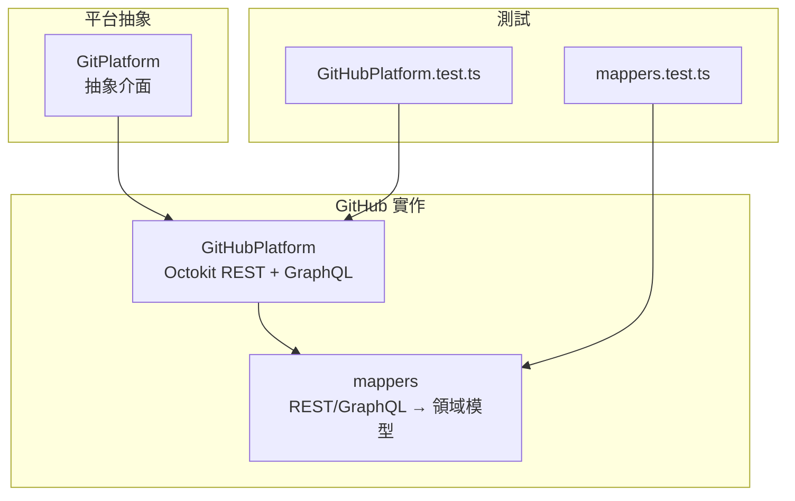
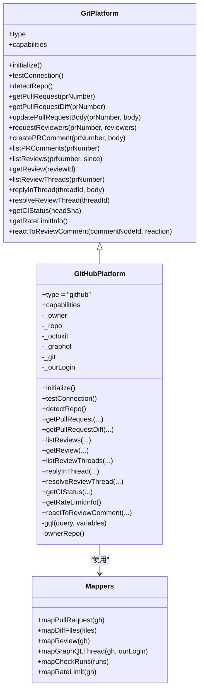
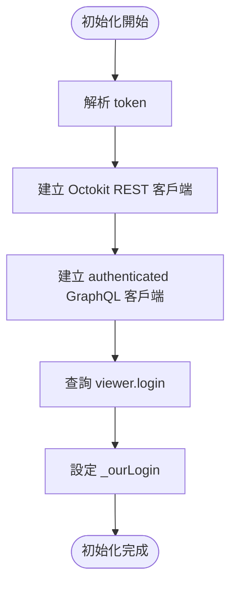
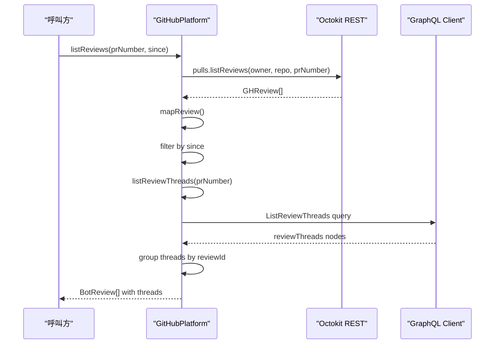
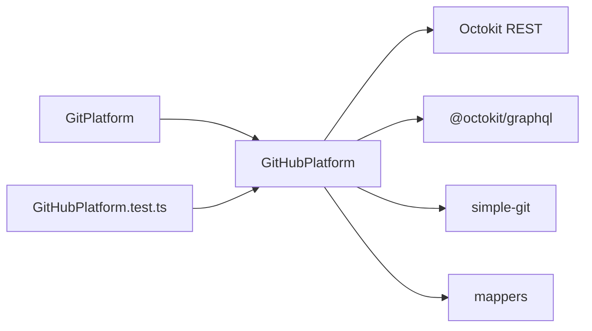
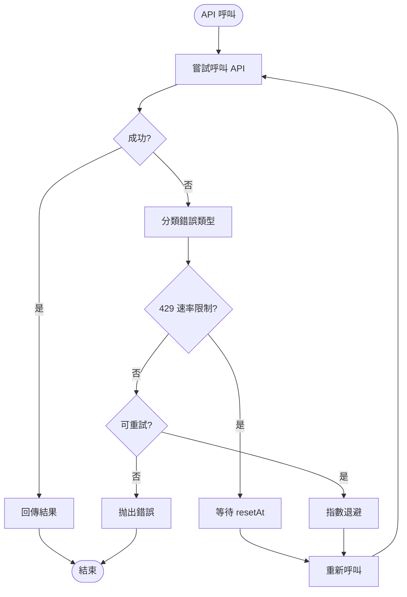
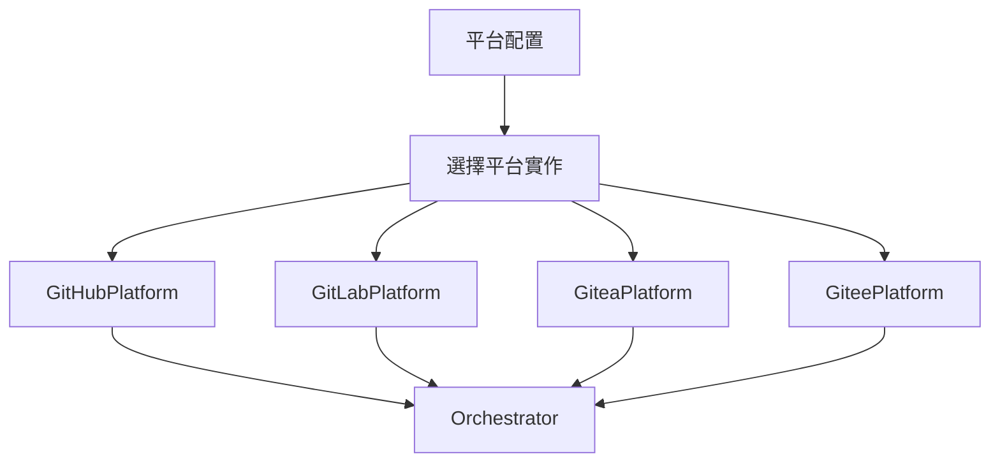

# Git 平台整合

**本文引用的檔案**

- [GitPlatform.ts](https://github.com/mikeah2011/maestro/blob/master/src/platforms/interfaces/GitPlatform.ts)
- [GitHubPlatform.ts](https://github.com/mikeah2011/maestro/blob/master/src/platforms/github/GitHubPlatform.ts)
- [mappers.ts](https://github.com/mikeah2011/maestro/blob/master/src/platforms/github/mappers.ts)
- [GitHubPlatform.test.ts](https://github.com/mikeah2011/maestro/blob/master/tests/platforms/github/GitHubPlatform.test.ts)
- [mappers.test.ts](https://github.com/mikeah2011/maestro/blob/master/tests/platforms/github/mappers.test.ts)

## 目錄
1. [引言](#引言)
2. [專案結構](#專案結構)
3. [核心元件](#核心元件)
4. [架構總覽](#架構總覽)
5. [詳細元件分析](#詳細元件分析)
6. [依賴關係分析](#依賴關係分析)
7. [效能與速率限制](#效能與速率限制)
8. [錯誤處理與重試策略](#錯誤處理與重試策略)
9. [認證機制](#認證機制)
10. [擴充其他 Git 平台指南](#擴充其他-git-平台指南)
11. [開發與測試指引](#開發與測試指引)
12. [故障排除](#故障排除)
13. [結論](#結論)

## 引言
本文件說明 Git 平台整合的抽象介面、GitHub 實作與擴充方式，重點涵蓋：
- `GitPlatform` 抽象介面的能力標誌與降級策略。
- GitHub 平台基於 Octokit REST 與 GraphQL 的實作。
- Review threads 處理、`replyInThread`、`resolveReviewThread` 與 mappers 轉換邏輯。
- API 速率限制資訊、錯誤處理與可觀察的重試建議。
- 如何支援 GitLab、Gitea、Gitee 等其它平台，以及平台切換與自訂平台的開發流程。

## 專案結構
與 Git 平台整合相關的程式碼主要集中在 `src/platforms` 下：
- `interfaces/GitPlatform.ts`：定義所有平台必須實作的抽象介面。
- `github/GitHubPlatform.ts`：GitHub 的具體實作。
- `github/mappers.ts`：GitHub REST/GraphQL 資料型別與領域模型之間的純函式映射。
- `tests/platforms/github/*`：針對 GitHub 實作與映射器的單元測試。

**圖表來源**
- [GitPlatform.ts:1-130](https://github.com/mikeah2011/maestro/blob/master/src/platforms/interfaces/GitPlatform.ts#L1-L130)
- [GitHubPlatform.ts:1-450](https://github.com/mikeah2011/maestro/blob/master/src/platforms/github/GitHubPlatform.ts#L1-L450)
- [mappers.ts:1-260](https://github.com/mikeah2011/maestro/blob/master/src/platforms/github/mappers.ts#L1-L260)
- [GitHubPlatform.test.ts:1-478](https://github.com/mikeah2011/maestro/blob/master/tests/platforms/github/GitHubPlatform.test.ts#L1-L478)
- [mappers.test.ts:1-367](https://github.com/mikeah2011/maestro/blob/master/tests/platforms/github/mappers.test.ts#L1-L367)

**章節來源**
- [GitPlatform.ts:1-130](https://github.com/mikeah2011/maestro/blob/master/src/platforms/interfaces/GitPlatform.ts#L1-L130)
- [GitHubPlatform.ts:1-450](https://github.com/mikeah2011/maestro/blob/master/src/platforms/github/GitHubPlatform.ts#L1-L450)
- [mappers.ts:1-260](https://github.com/mikeah2011/maestro/blob/master/src/platforms/github/mappers.ts#L1-L260)

## 核心元件
### GitPlatform 抽象介面
`GitPlatform` 是 orchestrator 與 BotRegistry 操作 Git 平台的核心契約。它提供：
- 平台識別與配置：`type`、`capabilities`、`initialize`、`testConnection`、`detectRepo`。
- Pull Request I/O：取得 PR、取得 diff、更新 body、請求 reviewer、建立與列出 PR 評論。
- Reviews 與 review threads：列出 reviews、取得單一 review、列出 review threads、在 thread 中回覆、標記 thread 為已解決。
- CI 狀態查詢。
- 速率限制資訊查詢。
- 可選的 emoji reactions 支援。

其中，`PlatformCapabilities` 的能力標誌是平台降級策略的關鍵：
- `threadResolve`：是否可用 API 直接標記 review thread 為 resolved。
- `inlineReplies`：是否在 thread 內回覆，而不只是頂層 PR comment。
- `reviewThreads`：是否把 review threads 當作一等公民物件。
- `requestReviewers`：是否能指派 reviewer。
- `ciStatus`：是否能透過 API 取得 CI checks。
- `graphql`：是否可使用 GraphQL mutation（用於 bulk 或 thread 相關操作）。
- `emojiReactions`：是否可在 review thread comment 上加 emoji reaction。

當某個平台不支援某些功能時，orchestrator 會根據這些標誌選擇較弱的策略；例如當 `threadResolve` 為 false 時，系統可能改用「在內容中寫入哨兵標記」的方式模擬 thread 關閉。

**章節來源**
- [GitPlatform.ts:1-130](https://github.com/mikeah2011/maestro/blob/master/src/platforms/interfaces/GitPlatform.ts#L1-L130)

### GitHubPlatform 實作概覽
`GitHubPlatform` 繼承 `GitPlatform`，並宣告完整能力：
- `threadResolve: true`
- `inlineReplies: true`
- `reviewThreads: true`
- `requestReviewers: true`
- `ciStatus: true`
- `graphql: true`
- `emojiReactions: true`

這表示 GitHub 平台可以使用：
- Octokit REST：PR I/O、CI checks、rate limit、list reviews。
- Octokit GraphQL：review threads、reply in thread、resolve thread、add reaction。
- simple-git：偵測 owner/repo。

**章節來源**
- [GitHubPlatform.ts:120-160](https://github.com/mikeah2011/maestro/blob/master/src/platforms/github/GitHubPlatform.ts#L120-L160)
- [GitHubPlatform.ts:201-450](https://github.com/mikeah2011/maestro/blob/master/src/platforms/github/GitHubPlatform.ts#L201-L450)

## 架構總覽
GitHub 平台的整體運作可以分為以下層次：
- 抽象層：`GitPlatform` 定義統一 API。
- 實作層：`GitHubPlatform` 使用 Octokit REST 與 GraphQL。
- 映射層：`mappers` 將 GitHub REST/GraphQL 回應轉為內部領域型別。
- 測試層：注入 mock Octokit、GraphQL client、simple-git，避免真實網路呼叫。

**圖表來源**
- [GitPlatform.ts:1-130](https://github.com/mikeah2011/maestro/blob/master/src/platforms/interfaces/GitPlatform.ts#L1-L130)
- [GitHubPlatform.ts:1-450](https://github.com/mikeah2011/maestro/blob/master/src/platforms/github/GitHubPlatform.ts#L1-L450)
- [mappers.ts:1-260](https://github.com/mikeah2011/maestro/blob/master/src/platforms/github/mappers.ts#L1-L260)

## 詳細元件分析

### PlatformCapabilities 與降級策略
能力標誌決定了 orchestrator 能使用哪些進階功能：
- 若 `threadResolve` 為 false：
  - 無法用 API 標記 thread 為已解決。
  - 平台實作可以選擇在 thread 內容中寫入哨兵標記，並認為該 thread 已關閉。
- 若 `inlineReplies` 為 false：
  - 只能寫頂層 PR comment，不能在 review thread 中回覆。
- 若 `reviewThreads` 為 false：
  - 沒有第一級的 review thread 物件，只能透過一般評論近似處理。
- 若 `graphql` 為 false：
  - 不能使用 GraphQL mutations；platform 實作需改用 REST 或無此功能。
- 若 `emojiReactions` 未啟用：
  - `reactToReviewComment` 預設為 no-op。

這種設計讓同一套 orchestrator 能在不同 Git 平台上運作，即使某些平台能力不足也能繼續工作。

**章節來源**
- [GitPlatform.ts:1-130](https://github.com/mikeah2011/maestro/blob/master/src/platforms/interfaces/GitPlatform.ts#L1-L130)

### GitHubPlatform：初始化與客戶端管理
`GitHubPlatform.initialize()` 主要做三件事：
1. 解析 token：從 `config.token` 或 `config.tokenEnv` 對應的環境變數取得 token。
2. 建立 Octokit REST client，支援 self-hosted 或 Enterprise 的 `baseUrl`。
3. 建立 authenticated GraphQL client，並支援 GraphQL endpoint 的 baseUrl。
4. 取得當前使用者 login（`viewer.login`），用於判斷評論是否來自本平台。
5. 準備 simple-git 客戶端，用於遠端 URL 解析。

未呼叫 `initialize()` 就使用平台方法時，會拋出明確錯誤訊息，要求先初始化。

**圖表來源**
- [GitHubPlatform.ts:120-220](https://github.com/mikeah2011/maestro/blob/master/src/platforms/github/GitHubPlatform.ts#L120-L220)

**章節來源**
- [GitHubPlatform.ts:120-220](https://github.com/mikeah2011/maestro/blob/master/src/platforms/github/GitHubPlatform.ts#L120-L220)

### GitHubPlatform：Pull Request I/O
- `getPullRequest`：使用 `pulls.get`，再由 `mapPullRequest` 轉換為領域模型。
- `getPullRequestDiff`：使用 `pulls.listFiles`，再由 `mapDiffFiles` 轉換。
- `updatePullRequestBody`：使用 `pulls.update`。
- `requestReviewers`：使用 `pulls.requestReviewers`。
- `createPRComment`：使用 `issues.createComment`。
- `listPRComments`：使用 `issues.listComments`，並過濾 bot 身份。

所有方法都先取得 `{ owner, repo }`，優先使用已解析值，否則呼叫 `detectRepo()`。

**章節來源**
- [GitHubPlatform.ts:220-310](https://github.com/mikeah2011/maestro/blob/master/src/platforms/github/GitHubPlatform.ts#L220-L310)

### GitHubPlatform：Reviews 與 Review Threads
#### listReviews
`listReviews` 的流程：
1. 使用 REST `pulls.listReviews` 取得 reviews。
2. 若有 `since`，則依 `submittedAt` 過濾。
3. 呼叫 `listReviewThreads` 取得全部 review threads。
4. 以 `reviewId` 為 key，將 threads 分組到每個 review。
5. 回傳帶上 `threads[]` 的 `BotReview`。

這裡有一個重要細節：只有當 thread 有 `reviewId` 且與 review id 一致時，才會掛到該 review 上。

**圖表來源**
- [GitHubPlatform.ts:310-370](https://github.com/mikeah2011/maestro/blob/master/src/platforms/github/GitHubPlatform.ts#L310-L370)

**章節來源**
- [GitHubPlatform.ts:310-370](https://github.com/mikeah2011/maestro/blob/master/src/platforms/github/GitHubPlatform.ts#L310-L370)

#### listReviewThreads
使用 GraphQL `ListReviewThreads` 查詢，支援分頁：
- 每次查詢最多 100 個 thread。
- 每個 thread 最多包含 50 個 comments。
- 使用 `pageInfo.hasNextPage` 與 `endCursor` 持續拉取。
- 每筆 thread 由 `mapGraphQLThread` 轉換為領域模型，並標記 `isOurs`。

**章節來源**
- [GitHubPlatform.ts:370-410](https://github.com/mikeah2011/maestro/blob/master/src/platforms/github/GitHubPlatform.ts#L370-L410)

#### replyInThread
使用 GraphQL mutation `addPullRequestReviewThreadReply`：
- 參數：`threadId`、`body`。
- 如果返回 null，代表權限不足或執行失敗，會拋出錯誤訊息。

**章節來源**
- [GitHubPlatform.ts:410-425](https://github.com/mikeah2011/maestro/blob/master/src/platforms/github/GitHubPlatform.ts#L410-L425)

#### resolveReviewThread
使用 GraphQL mutation `resolveReviewThread`：
- 參數：`threadId`。
- 如果返回 null，代表權限不足或執行失敗，會拋出錯誤訊息。

**章節來源**
- [GitHubPlatform.ts:425-440](https://github.com/mikeah2011/maestro/blob/master/src/platforms/github/GitHubPlatform.ts#L425-L440)

### Mappers：REST/GraphQL 到領域模型的轉換
`mappers.ts` 是純函式集合，不含 side effect：

| Mapper | 輸入 | 輸出 | 關鍵行為 |
|---|---|---|---|
| `mapPullRequest` | GitHub REST PR | `PullRequest` | 處理 draft/closed/open、author、labels、requestedReviewers、時間字串轉 Date |
| `mapDiffFiles` | GitHub REST diff files | `PullRequestDiff` | 計算 additions/deletions、filesChanged、status mapping、optional patch/oldPath |
| `mapReview` | GitHub REST review | `BotReview` | 處理 bot identity、review state、特殊 Copilot/Codex body 視為 satisfied |
| `mapGraphQLThread` | GraphQL review thread | `ReviewThread` | 轉換 location、comments、isOurs、isResolved |
| `mapCheckRuns` | GitHub REST check runs | `CIStatus` | 聚合 failure/pending/success、個別檢查狀態映射 |
| `mapRateLimit` | GitHub REST rate limit | `RateLimitInfo` | core remaining/limit/reset、可選 graphqlCost |

#### Review State 映射規則
- `APPROVED` → `approved`
- `CHANGES_REQUESTED` → `changes_requested`
- `DISMISSED` → `dismissed`
- `COMMENTED` 且 body 包含特定語句時 → `satisfied`
- 未知狀態 → `commented`

這個設計讓 orchestrator 不會因為第三方 bot 回報「沒有新意見」而無限等待。

**章節來源**
- [mappers.ts:1-260](https://github.com/mikeah2011/maestro/blob/master/src/platforms/github/mappers.ts#L1-L260)

### GitHubPlatform：CI 狀態與速率限制
#### getCIStatus
- 使用 `checks.listForRef` 取得 head SHA 的所有 check run。
- 使用 `mapCheckRuns` 產生聚合狀態：
  - 任一 failure/error → `failure`
  - 任一 pending → `pending`
  - 無檢查或全部成功 → `success`

#### getRateLimitInfo
- 使用 `rateLimit.get` 取得 core 與可選 graphql resource。
- 轉換為 `RateLimitInfo`：remaining、limit、resetAt、可選 graphqlCost。

注意：目前 `GitHubPlatform` 只讀取並轉換速率限制資訊，並沒有自動重試或 backoff 邏輯。

**章節來源**
- [GitHubPlatform.ts:440-450](https://github.com/mikeah2011/maestro/blob/master/src/platforms/github/GitHubPlatform.ts#L440-L450)
- [mappers.ts:201-260](https://github.com/mikeah2011/maestro/blob/master/src/platforms/github/mappers.ts#L201-L260)

## 依賴關係分析
GitHubPlatform 的依賴關係如下：
- 外部套件：
  - `@octokit/rest`：REST API。
  - `@octokit/graphql`：GraphQL API。
  - `simple-git`：讀取 git remote origin URL。
- 內部模組：
  - `GitPlatform`：抽象父類別。
  - `mappers`：純映射函式。
- 測試依賴：
  - 注入 mock Octokit、GraphQL function、simple-git，避免真實網路。

**圖表來源**
- [GitHubPlatform.ts:1-60](https://github.com/mikeah2011/maestro/blob/master/src/platforms/github/GitHubPlatform.ts#L1-L60)
- [GitHubPlatform.test.ts:1-120](https://github.com/mikeah2011/maestro/blob/master/tests/platforms/github/GitHubPlatform.test.ts#L1-L120)

**章節來源**
- [GitHubPlatform.ts:1-60](https://github.com/mikeah2011/maestro/blob/master/src/platforms/github/GitHubPlatform.ts#L1-L60)
- [GitHubPlatform.test.ts:1-120](https://github.com/mikeah2011/maestro/blob/master/tests/platforms/github/GitHubPlatform.test.ts#L1-L120)

## 效能與速率限制
### GraphQL 優勢
GitHub 平台使用 GraphQL 處理 review threads，原因包括：
- REST API 沒有第一級 review thread 概念。
- GraphQL 可直接取得 thread、comments、resolved 狀態，減少多次 REST 呼叫。
- 可一次取得多個 field，降低往返次數。

### 分頁與批次
- `listReviewThreads` 使用 `first: 100` 與 cursor-based pagination。
- `listPRComments`、`listReviews`、`pulls.listFiles`、`checks.listForRef` 均使用 `per_page: 100`。
- 這有助於減少 API 呼叫次數，但同時也要留意 GraphQL cost。

### 速率限制資訊
- `getRateLimitInfo` 暴露 `remaining`、`limit`、`resetAt`、`graphqlCost`。
- 目前 orchestrator 可讀取這些資訊來決定是否要延遲，但 GitHubPlatform 本身不實作自動重試。
- 建議 orchestrator 在 `remaining` 接近 0 或超過 `resetAt` 前暫停非關鍵請求。

**章節來源**
- [GitHubPlatform.ts:370-450](https://github.com/mikeah2011/maestro/blob/master/src/platforms/github/GitHubPlatform.ts#L370-L450)
- [mappers.ts:201-260](https://github.com/mikeah2011/maestro/blob/master/src/platforms/github/mappers.ts#L201-L260)

## 錯誤處理與重試策略
### 現有錯誤處理
- 未初始化就使用平台：accessor 會拋出明確錯誤，提示必須先呼叫 `initialize()`。
- `replyInThread` 返回 null：拋出錯誤，指出 token 可能缺乏寫入權限。
- `resolveReviewThread` 返回 null：同上。
- `detectRepo` 無法解析遠端 URL：拋出錯誤，包含原始 URL。
- `testConnection`：捕獲異常並回傳 `false`，不向上拋錯。

### 缺失的重試機制
目前 GitHubPlatform 沒有：
- HTTP 重試。
- 429 Too Many Requests 自動 backoff。
- 5xx 重試。
- 連線錯誤重試。

### 建議的重試策略
對於 orchestrator 或未來增強的 platform 層，建議：
1. 對 429：
   - 讀取 `resetAt`。
   - 計算等待時間，加入 jitter。
   - 限制最大重試次數。
2. 對 5xx：
   - 使用指數退避。
   - 限制重試次數與總等待時間。
3. 對網路錯誤：
   - 短暫重試，但不對永久錯誤重試。
4. 對 GraphQL mutation 失敗：
   - 區分權限錯誤與暫時性錯誤。
   - 權限錯誤不應重試。
5. 對速率限制：
   - 監控 `remaining` 與 `graphqlCost`。
   - 在低剩餘量時降低批大小或延長間隔。

[本流程為建議策略，不對應現有程式碼]

## 認證機制
GitHubPlatform 的認證流程：
1. 若 `config.token` 存在，直接使用。
2. 否則使用 `config.tokenEnv`，預設為 `GITHUB_TOKEN`。
3. 若環境變數不存在，建構階段即拋出錯誤。
4. Octokit 使用 `auth: token`。
5. GraphQL client 使用 header `authorization: token ${token}`。
6. 支援 `baseUrl`，適合 GitHub Enterprise 或自託管 GitHub 相容服務。

此外，`testConnection` 會呼叫 `users.getAuthenticated` 驗證 token 是否有效。

**章節來源**
- [GitHubPlatform.ts:80-120](https://github.com/mikeah2011/maestro/blob/master/src/platforms/github/GitHubPlatform.ts#L80-L120)
- [GitHubPlatform.ts:201-220](https://github.com/mikeah2011/maestro/blob/master/src/platforms/github/GitHubPlatform.ts#L201-L220)

## 擴充其他 Git 平台指南

### 新增平台的基本步驟
1. 在 `src/platforms` 下新增子目錄，例如 `gitlab`、`gitea`、`gitee`。
2. 建立 `XxxPlatform.ts`，繼承 `GitPlatform`。
3. 實作所有 abstract 方法。
4. 設定正確的 `type`，例如 `'gitlab'`、`'gitea'`、`'gitee'`。
5. 根據平台實際能力設定 `capabilities`。
6. 如果需要，新增專屬 mapper 檔案。
7. 新增單元測試，注入 mock 客戶端。

### 能力標誌與降級建議
| 平台特性 | 建議能力設定 | 降級行為 |
|---|---|---|
| 支援 REST PR I/O | `requestReviewers: true`、`ciStatus: true` | 仍可基本操作 PR |
| 不支援 review threads | `reviewThreads: false`、`inlineReplies: false`、`threadResolve: false` | 使用頂層 PR comment 作為 bot 互動入口 |
| 不支援 GraphQL | `graphql: false` | 不使用 GraphQL mutations |
| 不支援 emoji reactions | 不設定或省略 `emojiReactions` | `reactToReviewComment` 保持 no-op |
| 支援 CI status | `ciStatus: true` | 顯示 CI 狀態 |

### GitLab 實作建議
- REST API：GitLab 有 `/projects/:id/merge_requests`、`/projects/:id/merge_requests/:iid/comments`、`/projects/:id/merge_requests/:iid/notes`、`/projects/:id/statuses`。
- GraphQL：GitLab 也有 GraphQL，但 schema 與 GitHub 不同，需要自訂 query。
- Review threads：GitLab MR notes 可近似處理，但沒有完全相同的 thread model。
- Rate limit：GitLab 有 `ratelimit-*` response headers，可映射到 `RateLimitInfo`。
- Authentication：支援 personal access token、project token。

### Gitea 實作建議
- REST API：Gitea API 支援 issues、comments、reviews、statuses。
- GraphQL：早期版本可能沒有 GraphQL，能力可設為 `graphql: false`。
- Review threads：可用 issue comment 或 PR comment 近似。
- Rate limit：部分部署可透過 middleware 或 proxy 控制。
- Authentication：支援 personal access token、service account。

### Gitee 實作建議
- REST API：Gitee 有類似 GitHub 的 REST API。
- GraphQL：需確認當前版本是否支援 GraphQL。
- Review threads：可先用 PR comments 模擬。
- Rate limit：依部署環境而定。
- Authentication：支援 access token。

### 平台切換與註冊
目前 `PlatformType` 定義為 `'github' | 'gitlab' | 'gitea' | 'gitee'`，因此新增平台時應：
1. 更新 `PlatformType` union type。
2. 建立平台 factory 或 registry，根據配置選擇實作。
3. 在 orchestrator 中讀取 `platform` 配置。
4. 根據 `capabilities` 選擇不同處理路徑。

[本圖為概念性平台切換流程，不對應現有程式碼]

## 開發與測試指引

### GitHubPlatform 測試模式
測試中使用 `injected` 參數注入：
- `octokit`：mock REST API。
- `graphql`：mock GraphQL function。
- `git`：mock simple-git。

這樣可以避免真實網路呼叫，並精確驗證：
- 是否呼叫正確 API。
- 是否傳遞正確參數。
- 是否正確映射回應。
- 錯誤情境是否按預期處理。

### 測試覆蓋範圍
現有測試涵蓋：
- 平台型別與能力宣告。
- `initialize` 與 `testConnection`。
- `detectRepo`：config owner/repo、SSH URL、HTTPS URL、無效 URL。
- PR I/O：取得 PR、diff、更新 body、請求 reviewer。
- Reviews：基本 reviews、since 過濾、thread hydration。
- Review threads：空列表、分頁。
- `replyInThread`、`resolveReviewThread`。
- CI 狀態與速率限制。
- Mapper：PR、diff、review、thread、check runs、rate limit。

**章節來源**
- [GitHubPlatform.test.ts:1-478](https://github.com/mikeah2011/maestro/blob/master/tests/platforms/github/GitHubPlatform.test.ts#L1-L478)
- [mappers.test.ts:1-367](https://github.com/mikeah2011/maestro/blob/master/tests/platforms/github/mappers.test.ts#L1-L367)

## 故障排除

### 常見問題與解法
| 問題 | 可能原因 | 建議處理 |
|---|---|---|
| 初始化前使用平台 | 未呼叫 `initialize()` | 確保 orchestrator 先呼叫 `initialize()` |
| Token 找不到 | 沒有 `config.token` 且環境變數未設定 | 設定 `GITHUB_TOKEN` 或 `tokenEnv` 對應變數 |
| 無法解析 owner/repo | git remote origin URL 不是 GitHub URL | 在 config 中手動設定 owner/repo |
| replyInThread 或 resolveReviewThread 失敗 | token 權限不足 | 檢查 token scope 與 repository access |
| testConnection 回傳 false | token 無效或網路不可達 | 檢查 token、baseUrl、網路連線 |
| 速率限制過低 | 大量 API 呼叫 | 使用 `getRateLimitInfo()` 調整排程與批次大小 |
| CI 狀態始終 success | 沒有 check runs 或全部通過 | 確認 HEAD commit 確實觸發 CI |

### 診斷建議
1. 先確認 `testConnection()` 是否回傳 `true`。
2. 檢查 `getRateLimitInfo()` 的 `remaining`、`limit`、`resetAt`。
3. 使用 `detectRepo()` 確認 owner/repo 正確。
4. 驗證 GraphQL mutation 是否因權限失敗。
5. 檢查 mapper 輸入是否符合預期 GitHub API 格式。

**章節來源**
- [GitHubPlatform.ts:80-220](https://github.com/mikeah2011/maestro/blob/master/src/platforms/github/GitHubPlatform.ts#L80-L220)
- [GitHubPlatform.ts:440-450](https://github.com/mikeah2011/maestro/blob/master/src/platforms/github/GitHubPlatform.ts#L440-L450)
- [GitHubPlatform.test.ts:120-478](https://github.com/mikeah2011/maestro/blob/master/tests/platforms/github/GitHubPlatform.test.ts#L120-L478)

## 結論
`GitPlatform` 抽象介面提供了跨平台 Git 操作的穩定契約，而 `PlatformCapabilities` 能力標誌使 orchestrator 能在不同 Git 平台上進行降級與策略選擇。`GitHubPlatform` 透過 Octokit REST 與 GraphQL 實現了完整的 PR、reviews、review threads、CI 與速率限制功能，並透過純函式 `mappers` 將 GitHub 資料結構轉換為內部領域模型。

若要擴充 GitLab、Gitea、Gitee 等平台，重點在於：
- 實作 `GitPlatform` 所有抽象方法。
- 正確設定 `capabilities`。
- 處理各自平台的 REST/GraphQL API。
- 實作適當的錯誤處理與速率限制策略。
- 提供完善的單元測試，避免依賴真實網路。

目前 GitHubPlatform 尚未內建自動重試與 backoff，建議由 orchestrator 或未來 platform 層增強，以提升系統在速率限制與網路不穩定時的健壯性。