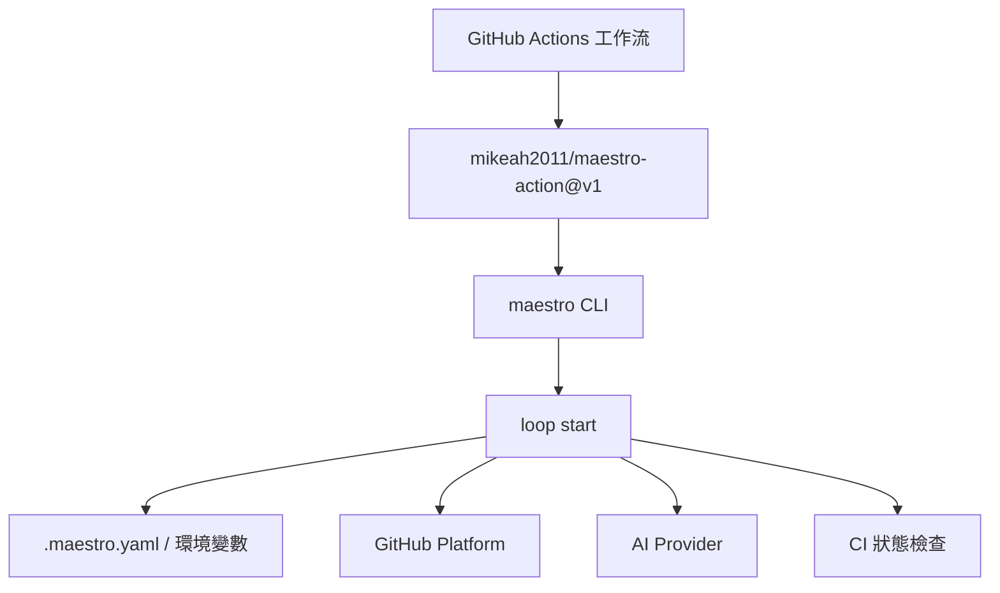
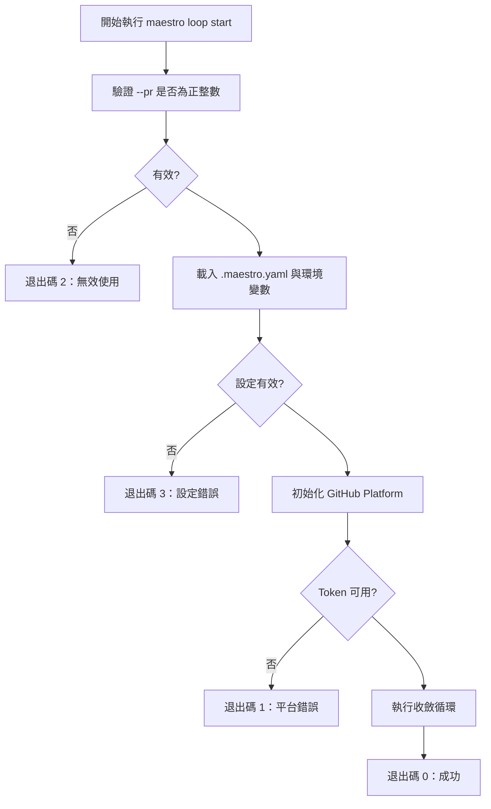
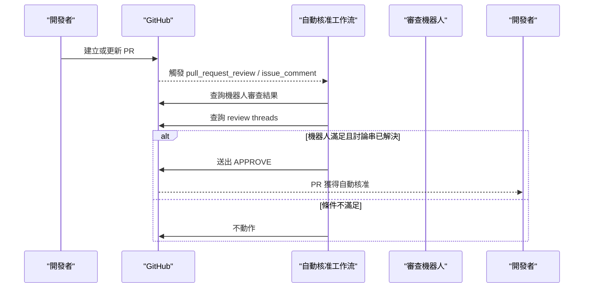
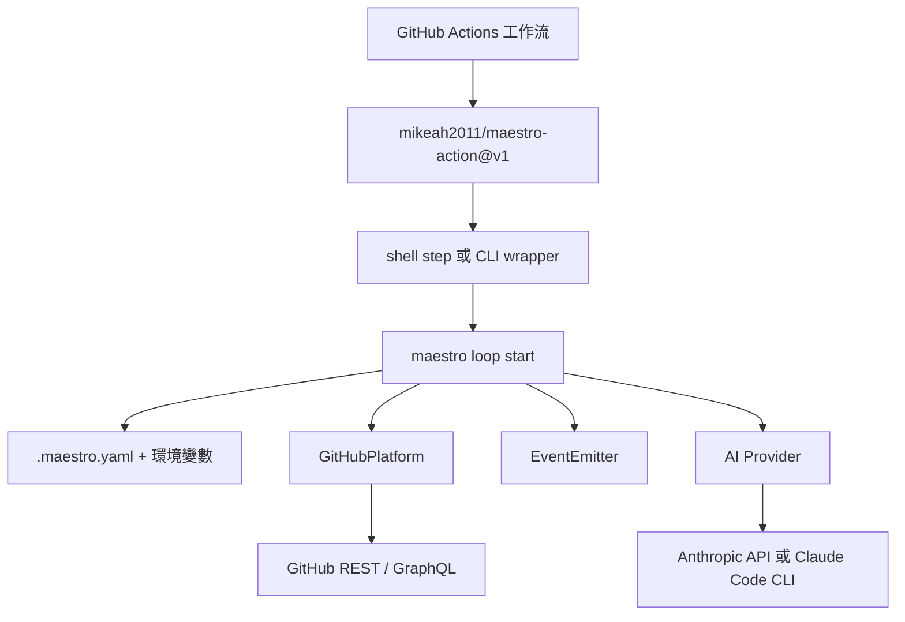

# GitHub Action 使用

<cite>
**本文引用的檔案**   
- [README.md](https://github.com/mikeah2011/maestro/blob/master/README.md)
- [.github/workflows/maestro-auto-approve.yml](https://github.com/mikeah2011/maestro/blob/master/.github/workflows/maestro-auto-approve.yml)
- [package.json](https://github.com/mikeah2011/maestro/blob/master/package.json)
- [src/index.ts](https://github.com/mikeah2011/maestro/blob/master/src/index.ts)
- [src/cli/index.ts](https://github.com/mikeah2011/maestro/blob/master/src/cli/index.ts)
- [src/cli/commands/loop.ts](https://github.com/mikeah2011/maestro/blob/master/src/cli/commands/loop.ts)
- [src/config/load.ts](https://github.com/mikeah2011/maestro/blob/master/src/config/load.ts)
- [src/core/types/CI.ts](https://github.com/mikeah2011/maestro/blob/master/src/core/types/CI.ts)
- [src/platforms/github/GitHubPlatform.ts](https://github.com/mikeah2011/maestro/blob/master/src/platforms/github/GitHubPlatform.ts)
- [docs/DESIGN.md](https://github.com/mikeah2011/maestro/blob/master/docs/DESIGN.md)
</cite>

## 目錄
1. [簡介](#簡介)
2. [專案結構與發布模型](#專案結構與發布模型)
3. [安裝 mikeah2011/maestro-action@v1](#安裝-mikeah2011maestro-actionv1)
4. [基本設定方式](#基本設定方式)
5. [輸入參數、環境變數與輸出結果](#輸入參數環境變數與輸出結果)
6. [完整工作流範例：PR 審查收斂循環](#完整工作流範例pr-審查收斂循環)
7. [GitHub Secrets 與權限設定](#github-secrets與權限設定)
8. [錯誤處理與退出碼](#錯誤處理與退出碼)
9. [常見使用場景](#常見使用場景)
10. [最佳實踐](#最佳實踐)
11. [依賴關係分析](#依賴關係分析)
12. [故障排除指南](#故障排除指南)
13. [結論](#結論)

## 簡介
Maestro 是一個「審查機器人之上的收斂層」，主要目標不是取代 CodeRabbit、Ellipsis、Copilot Code Review、Codex 等工具，而是把這些審查機器人產出的問題分類、去重、修復、回覆、解決討論串，並在有確定停止條件的情況下自動完成 PR 審查循環。它支援最多三輪的硬性上限、關鍵問題數量不得增加、重複問題振盪偵測，以及執行期斷言來防止垃圾郵件行為。

對 GitHub Action 使用者而言，mikeah2011/maestro-action@v1 的核心價值是讓你在 PR 事件觸發後，以單一步驟啟動 `maestro loop start`，自動調度已配置的 AI 審查機器人，並在可設定的預算與輪次限制內嘗試收斂。

**章節來源**
- [README.md:1-120](https://github.com/mikeah2011/maestro/blob/master/README.md#L1-L120)
- [docs/DESIGN.md:1-120](https://github.com/mikeah2011/maestro/blob/master/docs/DESIGN.md#L1-L120)

## 專案結構與發布模型
這個專案是 TypeScript 套件，透過 Bun 編譯 CLI 二進位，並透過 Node.js 或 Bun 執行。公開入口會重新匯出許多核心類型與類別，但從目前提供的程式碼來看，專案的主要交付物是：

- npm 套件名稱 `@mikeah2011/maestro`
- CLI 二進位 `dist/cli.js`，對應 package.json 中的 `bin.maestro`
- 預期的 GitHub Action `mikeah2011/maestro-action@v1`

技術設計文件中明確提到 GitHub Action 的定位是「單行 `run: maestro loop start --pr ${{ github.event.number }}`」。這表示 action 的角色主要是包裝 CLI 命令，而不是在 JavaScript 中直接實作完整的收斂邏輯。



**圖表來源**
- [package.json:1-89](https://github.com/mikeah2011/maestro/blob/master/package.json#L1-L89)
- [docs/DESIGN.md:120-200](https://github.com/mikeah2011/maestro/blob/master/docs/DESIGN.md#L120-L200)
- [src/cli/commands/loop.ts:1-40](https://github.com/mikeah2011/maestro/blob/master/src/cli/commands/loop.ts#L1-L40)

**章節來源**
- [package.json:1-89](https://github.com/mikeah2011/maestro/blob/master/package.json#L1-L89)
- [src/index.ts:1-150](https://github.com/mikeah2011/maestro/blob/master/src/index.ts#L1-L150)
- [docs/DESIGN.md:120-200](https://github.com/mikeah2011/maestro/blob/master/docs/DESIGN.md#L120-L200)

## 安裝 mikeah2011/maestro-action@v1
根據當前專案的發布計畫，GitHub Action `mikeah2011/maestro-action@v1` 屬於 MVP 階段的功能之一。它的設計概念是用一行指令啟動 Maestro 收斂循環，並依賴本機可用的 `maestro` CLI。

在實際使用前，請確認以下事項：

| 項目 | 說明 |
|---|---|
| Action 版本 | `mikeah2011/maestro-action@v1` |
| 預期行為 | 在工作流中執行 `maestro loop start --pr <PR 編號>` |
| 依賴工具 | `bun` 或 Node.js（依專案要求）、`git`、GitHub Token |
| 主要任務 | 啟動 PR 審查收斂循環，而非取代所有其他 CI 步驟 |

如果你已經在自託管 runner 上安裝了 `maestro` CLI，也可以直接在 GitHub Actions 中使用 shell 步驟呼叫 CLI，而不一定需要專屬 action。不過若團隊希望統一入口、隱藏細節，則可以採用 mikeah2011/maestro-action@v1。

**章節來源**
- [docs/DESIGN.md:120-200](https://github.com/mikeah2011/maestro/blob/master/docs/DESIGN.md#L120-L200)
- [package.json:1-89](https://github.com/mikeah2011/maestro/blob/master/package.json#L1-L89)

## 基本設定方式
Maestro 的設定優先順序如下：

1. CLI 旗標
2. 環境變數
3. 倉庫 `.maestro.yaml`
4. 使用者 `~/.maestro/config.yaml`
5. 預設值

在 GitHub Actions 環境中，最常見的組合是：

- 透過 `GITHUB_TOKEN` 提供 GitHub 存取權限
- 透過 `.maestro.yaml` 指定平台、owner、repo、AI provider 與停止條件
- 透過 workflow YAML 傳遞 `--pr`、`--max-rounds`、`--cost-budget`、`--dry-run` 等 CLI 選項
- 可選地設定 Anthropic API Key 或使用 Claude Code CLI

CLI 的 `loop start` 命令會先載入設定、初始化 GitHub Platform、建立事件系統、解析 AI Provider，然後啟動 LoopOrchestrator。

**章節來源**
- [src/config/load.ts:1-120](https://github.com/mikeah2011/maestro/blob/master/src/config/load.ts#L1-L120)
- [src/cli/commands/loop.ts:1-80](https://github.com/mikeah2011/maestro/blob/master/src/cli/commands/loop.ts#L1-L80)

## 輸入參數、環境變數與輸出結果

### CLI 輸入參數
`maestro loop start` 是目前已實現且最重要的子命令。其相關參數包括：

| 參數 | 用途 | 備註 |
|---|---|---|
| `--pr <number>` | 指定要驅動的 PR 編號 | 必須為正整數 |
| `--max-rounds <n>` | 覆寫 `stopConditions.maxRounds` | 用於 CI 環境控制最大輪次 |
| `--cost-budget <usd>` | 覆寫 `stopConditions.costBudgetUSD` | 用於控制 AI 成本上限 |
| `--bots <logins>` | 指定要監控的機器人登入名稱 | 逗號分隔 |
| `--dry-run` | 僅分類與報告，不修復、不提交、不回覆 | 適合 CI 安全驗證 |
| `--remote <name>` | 指定 git remote 名稱 | 用於 owner/repo 自動偵測 |
| `--cwd <path>` | 指定目標 repo 目錄 | 用於文件修復與 git 操作 |

其中 `--pr` 是唯一必要參數；其他參數可與 `.maestro.yaml` 及環境變數搭配使用。

**章節來源**
- [src/cli/commands/loop.ts:40-120](https://github.com/mikeah2011/maestro/blob/master/src/cli/commands/loop.ts#L40-L120)

### 環境變數
配置載入器支援以下環境變數：

| 環境變數 | 作用域 | 說明 |
|---|---|---|
| `MAESTRO_MAX_ROUNDS` | 停止條件 | 覆寫最大輪次 |
| `MAESTRO_COST_BUDGET_USD` | 停止條件 | 覆寫美元成本預算 |
| `MAESTRO_LOG_LEVEL` | 日誌 | 支援 debug、info、warn、error |
| `MAESTRO_AUDIT_DIR` | 審計 | 指定審計目錄 |
| `GITHUB_TOKEN` | GitHub Platform | GitHub REST/GraphQL 存取權 |
| `ANTHROPIC_API_KEY` | AI Provider | Anthropic API 金鑰（若未設定，可能退回 Claude Code CLI） |

GitHub Platform 在找不到 token 時會拋出明確錯誤，指出應設定哪個環境變數或提供 `config.token`。

**章節來源**
- [src/config/load.ts:120-216](https://github.com/mikeah2011/maestro/blob/master/src/config/load.ts#L120-L216)
- [src/platforms/github/GitHubPlatform.ts:120-200](https://github.com/mikeah2011/maestro/blob/master/src/platforms/github/GitHubPlatform.ts#L120-L200)

### 輸出結果
LoopOrchestrator 的事件系統會將流程輸出為 JSONL。CLI 會訂閱標準輸出 sink 與美觀輸出 sink。在互動模式中，CLI 也會顯示每輪評論分析摘要、建議行動與使用者覆寫提示。

Action 使用者通常關注的是：

- 標準輸出中的 JSONL 事件
- CLI 錯誤訊息
- GitHub Actions job 的退出狀態
- PR 上的評論、討論串狀態、提交內容與 PR Body 更新

**章節來源**
- [src/cli/commands/loop.ts:1-40](https://github.com/mikeah2011/maestro/blob/master/src/cli/commands/loop.ts#L1-L40)
- [src/index.ts:70-150](https://github.com/mikeah2011/maestro/blob/master/src/index.ts#L70-L150)

## 完整工作流範例：PR 審查收斂循環
以下是一個概念性的 GitHub Actions 工作流，展示如何在 PR 審查流程中自動執行 Maestro 收斂循環。此範例僅說明結構與設定位置，不直接複製原始程式碼內容。

```yaml
name: "Maestro PR 收斂循環"

on:
  pull_request:
    types: [opened, synchronize, review_requested]

permissions:
  contents: read
  pull-requests: write
  checks: read

jobs:
  maestro-loop:
    name: "Maestro 收斂循環"
    runs-on: ubuntu-latest
    timeout-minutes: 30
    steps:
      - name: "取得原始碼"
        uses: actions/checkout@v4
        with:
          fetch-depth: 0

      - name: "設定 Node.js"
        uses: actions/setup-node@v4
        with:
          node-version: 20

      - name: "安裝 bun"
        run: npm install -g bun

      - name: "安裝依賴"
        run: bun install

      - name: "執行 Maestro 收斂循環"
        env:
          GITHUB_TOKEN: "${{ secrets.GITHUB_TOKEN }}"
          ANTHROPIC_API_KEY: "${{ secrets.ANTHROPIC_API_KEY }}"
          MAESTRO_MAX_ROUNDS: "3"
          MAESTRO_COST_BUDGET_USD: "5.00"
          MAESTRO_LOG_LEVEL: "info"
        run: |
          maestro loop start \
            --pr "${{ github.event.pull_request.number }}" \
            --max-rounds 3 \
            --cost-budget 5.00 \
            --dry-run
```

這個範例的重點：

- 只在 `pull_request` 事件中觸發
- 使用 `actions/checkout@v4` 取得完整歷史以便 git remote 偵測
- 使用 `bun install` 安裝依賴
- 透過環境變數設定 GitHub Token、Anthropic API Key、最大輪次、成本預算與日誌等級
- 使用 `--dry-run` 避免在首次整合時意外修改 PR

**章節來源**
- [src/cli/commands/loop.ts:40-120](https://github.com/mikeah2011/maestro/blob/master/src/cli/commands/loop.ts#L40-L120)
- [src/config/load.ts:120-216](https://github.com/mikeah2011/maestro/blob/master/src/config/load.ts#L120-L216)
- [README.md:60-120](https://github.com/mikeah2011/maestro/blob/master/README.md#L60-L120)

## GitHub Secrets 與權限設定

### 需要的 Secrets
| Secret | 用途 | 建議範圍 |
|---|---|---|
| `GITHUB_TOKEN` | GitHub REST/GraphQL 存取 | 由 GitHub Actions 自動注入，也可放入 secrets 管理 |
| `ANTHROPIC_API_KEY` | Anthropic API 使用 | 僅限需要 LLM 修復或分類的情境 |
| `MAESTRO_*` | 可作為環境變數，但敏感值仍建議放在 secrets | 非必要時可不使用 |

### 最小權限
GitHub Actions 工作流應遵循最小權限原則：

| 權限 | 用途 |
|---|---|
| `contents: read` | 讀取 repository content |
| `pull-requests: write` | 讀寫 PR、評論、討論串、審核狀態 |
| `checks: read` | 讀取 CI check 狀態 |

若只需要自動核准邏輯，可參考專案現有的 `maestro-auto-approve.yml`，該工作流只授予 `pull-requests: write`，並透過 GitHub Script 檢查機器人審查狀態與討論串是否全部解決。

**章節來源**
- [.github/workflows/maestro-auto-approve.yml:1-93](https://github.com/mikeah2011/maestro/blob/master/.github/workflows/maestro-auto-approve.yml#L1-L93)
- [src/platforms/github/GitHubPlatform.ts:120-200](https://github.com/mikeah2011/maestro/blob/master/src/platforms/github/GitHubPlatform.ts#L120-L200)

## 錯誤處理與退出碼
CLI 定義了明確的退出碼，方便 CI 判斷失敗原因：

| 退出碼 | 意義 |
|---|---|
| `0` | 成功 |
| `1` | 一般錯誤 |
| `2` | 無效使用，例如 `--pr` 不是正整數 |
| `3` | 設定錯誤，例如 `.maestro.yaml` 無法解析或驗證失敗 |
| `4` | 尚未實作的功能佔位符 |

此外，`ConfigError` 會包含人類可讀的錯誤訊息，並保留原始 cause。GitHub Platform 在找不到 token 時也會拋出明確錯誤。



**圖表來源**
- [src/cli/index.ts:1-86](https://github.com/mikeah2011/maestro/blob/master/src/cli/index.ts#L1-L86)
- [src/cli/commands/loop.ts:40-120](https://github.com/mikeah2011/maestro/blob/master/src/cli/commands/loop.ts#L40-L120)
- [src/config/load.ts:1-120](https://github.com/mikeah2011/maestro/blob/master/src/config/load.ts#L1-L120)
- [src/platforms/github/GitHubPlatform.ts:120-200](https://github.com/mikeah2011/maestro/blob/master/src/platforms/github/GitHubPlatform.ts#L120-L200)

**章節來源**
- [src/cli/index.ts:1-86](https://github.com/mikeah2011/maestro/blob/master/src/cli/index.ts#L1-L86)
- [src/cli/commands/loop.ts:40-120](https://github.com/mikeah2011/maestro/blob/master/src/cli/commands/loop.ts#L40-L120)
- [src/config/load.ts:1-120](https://github.com/mikeah2011/maestro/blob/master/src/config/load.ts#L1-L120)
- [src/platforms/github/GitHubPlatform.ts:120-200](https://github.com/mikeah2011/maestro/blob/master/src/platforms/github/GitHubPlatform.ts#L120-L200)

## 常見使用場景

### 場景一：PR 開啟時自動執行 Maestro 收斂循環
- 觸發條件：`pull_request` 的 `opened`、`synchronize`、`review_requested`
- 目的：讓 Maestro 立即開始分類、修復、回覆與解決討論串
- 風險控制：初次整合建議使用 `--dry-run`，確認行為再移除

### 場景二：CI 失敗時停止循環
- 依據設計，狀態機會等待 CI 通過；若 CI 失敗，會進入 `CIFailing` 狀態
- 在 Action 中，可將 `maestro loop start` 放在其他 CI 步驟之後，確保只有當基礎測試通過時才允許 AI 修復繼續推進
- 也可用 `timeout-minutes` 限制整體執行時間，避免長期卡住

### 場景三：CI 失敗時停止循環並通知開發者
- 若 CI 失敗，Maestro 的設計會傾向於不繼續修復，因為修復可能引入迴歸
- 你可以在工作流中加入條件步驟，在退出碼非零時發送通知
- 對於嚴重錯誤，可直接讓 job 失敗，使 PR 無法合併

### 場景四：自動審批
專案已提供 `maestro-auto-approve.yml`，會在以下條件成立時自動 approve：

- 被監控的機器人（例如 Copilot Pull Request Reviewer、ChatGPT Codex Connector）都已審查完畢
- 所有 review thread 都已解決
- 沒有重複 approve

這個機制與 Maestro 的收斂循環不同：前者是「機器人滿意且討論串已解決就 approve」，後者是「主動驅動多個機器人並嘗試收斂」。



**圖表來源**
- [.github/workflows/maestro-auto-approve.yml:1-93](https://github.com/mikeah2011/maestro/blob/master/.github/workflows/maestro-auto-approve.yml#L1-L93)

**章節來源**
- [.github/workflows/maestro-auto-approve.yml:1-93](https://github.com/mikeah2011/maestro/blob/master/.github/workflows/maestro-auto-approve.yml#L1-L93)
- [docs/DESIGN.md:60-120](https://github.com/mikeah2011/maestro/blob/master/docs/DESIGN.md#L60-L120)

## 最佳實踐

1. **先在 dry-run 模式驗證**  
   使用 `--dry-run` 確認分類、成本預算、輪次限制是否符合預期，再切換到真實修復模式。

2. **設定明確的最大輪次與成本預算**  
   透過 `--max-rounds` 與 `--cost-budget` 控制 CI 資源消耗，避免無限循環。

3. **只授予必要權限**  
   工作流應使用最小權限；若只需要自動核准，可參考現有 `maestro-auto-approve.yml` 的權限設定。

4. **使用 `.maestro.yaml` 集中設定**  
   將 platform、owner、repo、AI provider、停止條件寫入 `.maestro.yaml`，減少每個 workflow 的重複設定。

5. **將敏感資料放入 GitHub Secrets**  
   `GITHUB_TOKEN` 可由 GitHub 自動注入；`ANTHROPIC_API_KEY` 建議放在 secrets，不要寫入 workflow YAML。

6. **為 CI 失敗設計明確路徑**  
   讓 CI 失敗時 job 失敗，而不是讓 Maestro 靜默繼續。這樣 PR 不會因為 AI 修復而繞過測試。

7. **區分「自動審批」與「自動修復」**  
   自動審批是基於機器人審查結果與討論串狀態；自動修復是基於 Maestro 的收斂循環。兩者不應混為一談。

8. **監控 JSONL 事件與日誌**  
   在 CI 失敗時，查看 JSONL 事件與 `MAESTRO_LOG_LEVEL` 輸出來診斷問題。

**章節來源**
- [src/cli/commands/loop.ts:40-120](https://github.com/mikeah2011/maestro/blob/master/src/cli/commands/loop.ts#L40-L120)
- [src/config/load.ts:120-216](https://github.com/mikeah2011/maestro/blob/master/src/config/load.ts#L120-L216)
- [.github/workflows/maestro-auto-approve.yml:1-93](https://github.com/mikeah2011/maestro/blob/master/.github/workflows/maestro-auto-approve.yml#L1-L93)

## 依賴關係分析

Maestro 的 GitHub Action 使用方式依賴多層元件：

- GitHub Actions 觸發工作流
- Action 或 shell step 執行 `maestro` CLI
- CLI 載入 `.maestro.yaml` 與環境變數
- CLI 初始化 GitHub Platform
- CLI 建立事件系統與 AI Provider
- LoopOrchestrator 協調分類、修復、提交、回覆、討論串解決與 CI 狀態檢查



**圖表來源**
- [src/cli/commands/loop.ts:1-80](https://github.com/mikeah2011/maestro/blob/master/src/cli/commands/loop.ts#L1-L80)
- [src/platforms/github/GitHubPlatform.ts:1-120](https://github.com/mikeah2011/maestro/blob/master/src/platforms/github/GitHubPlatform.ts#L1-L120)
- [src/config/load.ts:1-120](https://github.com/mikeah2011/maestro/blob/master/src/config/load.ts#L1-L120)
- [docs/DESIGN.md:120-200](https://github.com/mikeah2011/maestro/blob/master/docs/DESIGN.md#L120-L200)

**章節來源**
- [src/cli/index.ts:1-86](https://github.com/mikeah2011/maestro/blob/master/src/cli/index.ts#L1-L86)
- [src/cli/commands/loop.ts:1-120](https://github.com/mikeah2011/maestro/blob/master/src/cli/commands/loop.ts#L1-L120)
- [src/platforms/github/GitHubPlatform.ts:1-200](https://github.com/mikeah2011/maestro/blob/master/src/platforms/github/GitHubPlatform.ts#L1-L200)
- [src/config/load.ts:1-120](https://github.com/mikeah2011/maestro/blob/master/src/config/load.ts#L1-L120)

## 故障排除指南

### 問題一：`--pr` 不是正整數
**現象**：CLI 回報 `--pr must be a positive integer`，並返回退出碼 `2`。  
**原因**：傳入的 PR 編號無法解析為有限數值或小於 1。  
**解法**：確認 `github.event.pull_request.number` 存在且正確。

**章節來源**
- [src/cli/commands/loop.ts:40-80](https://github.com/mikeah2011/maestro/blob/master/src/cli/commands/loop.ts#L40-L80)

### 問題二：設定載入失敗
**現象**：CLI 回報 `config error`，並返回退出碼 `3`。  
**原因**：`.maestro.yaml` 格式錯誤、Zod 驗證失敗、或環境變數展開失敗。  
**解法**：檢查 `.maestro.yaml` 結構、確認 environment expansion 語法正確，並降低 `MAESTRO_LOG_LEVEL` 觀察更多資訊。

**章節來源**
- [src/cli/commands/loop.ts:80-120](https://github.com/mikeah2011/maestro/blob/master/src/cli/commands/loop.ts#L80-L120)
- [src/config/load.ts:1-120](https://github.com/mikeah2011/maestro/blob/master/src/config/load.ts#L1-L120)

### 問題三：找不到 GitHub Token
**現象**：GitHub Platform 初始化失敗，回報 token 未找到。  
**原因**：`GITHUB_TOKEN` 或其他 `tokenEnv` 指定的環境變數未設定。  
**解法**：在 workflow 中注入 `secrets.GITHUB_TOKEN`，或在 `.env` 與環境變數中設定對應 key。

**章節來源**
- [src/platforms/github/GitHubPlatform.ts:120-200](https://github.com/mikeah2011/maestro/blob/master/src/platforms/github/GitHubPlatform.ts#L120-L200)

### 問題四：CI 一直等待或報錯
**現象**：Maestro 卡在等待 CI，或 CI 失敗導致循環終止。  
**原因**：CI 尚未通過，或 CI 狀態被判定為 `failure`、`error`。  
**解法**：先確認 CI job 本身是否成功；若需要 Maestro 只在 CI 成功後執行，可調整工作流順序或加入條件判斷。

**章節來源**
- [src/core/types/CI.ts:1-34](https://github.com/mikeah2011/maestro/blob/master/src/core/types/CI.ts#L1-L34)
- [docs/DESIGN.md:60-120](https://github.com/mikeah2011/maestro/blob/master/docs/DESIGN.md#L60-L120)

### 問題五：自動核准沒有觸發
**現象**：機器人審查完畢且討論串已解決，但沒有自動 approve。  
**原因**：可能是機器人 login 不符合預期、機器人評論內容不包含特定字串、仍有未解決的 review thread，或已被自動 approve。  
**解法**：檢查 `maestro-auto-approve.yml` 中的機器人匹配邏輯與 GraphQL review threads 查詢結果。

**章節來源**
- [.github/workflows/maestro-auto-approve.yml:1-93](https://github.com/mikeah2011/maestro/blob/master/.github/workflows/maestro-auto-approve.yml#L1-L93)

## 結論
mikeah2011/maestro-action@v1 的核心是使用 GitHub Actions 自動化 Maestro 的 PR 審查收斂循環。它不是獨立的審查工具，而是把既有 AI 審查機器人串成一個有停止條件、可監督、可控制的閉環流程。

對團隊來說，最穩健的起步方式是：

1. 先用 `.maestro.yaml` 設定平台與 AI provider。
2. 在 GitHub Actions 中以 `--dry-run` 執行 `maestro loop start --pr ${{ github.event.pull_request.number }}`。
3. 設定 `GITHUB_TOKEN` 與 `ANTHROPIC_API_KEY`。
4. 觀察 JSONL 事件與 CLI 輸出。
5. 確認 CI 失敗時會阻止進一步修復。
6. 如需自動審批，再獨立啟用 `maestro-auto-approve.yml` 的邏輯。

這樣既能享受 AI 審查機器人的發現能力，又能依靠 Maestro 的收斂保證與執行期斷言，減少 PR 審查的疲勞與混亂。