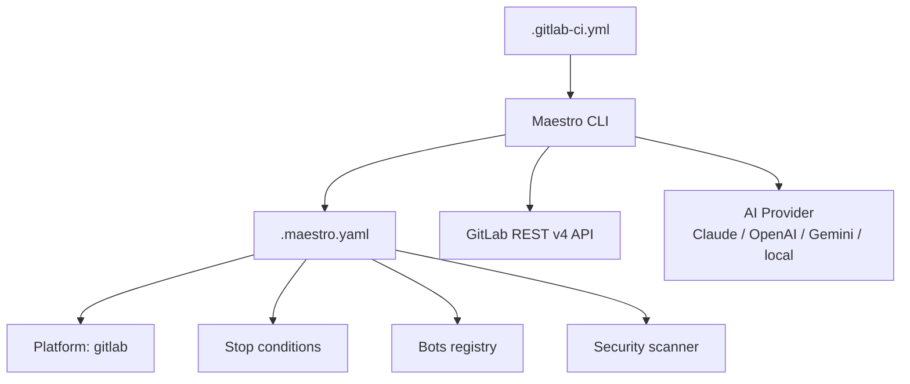
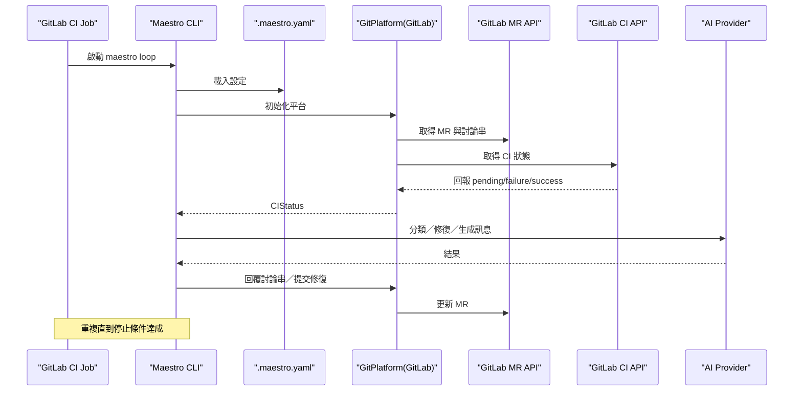
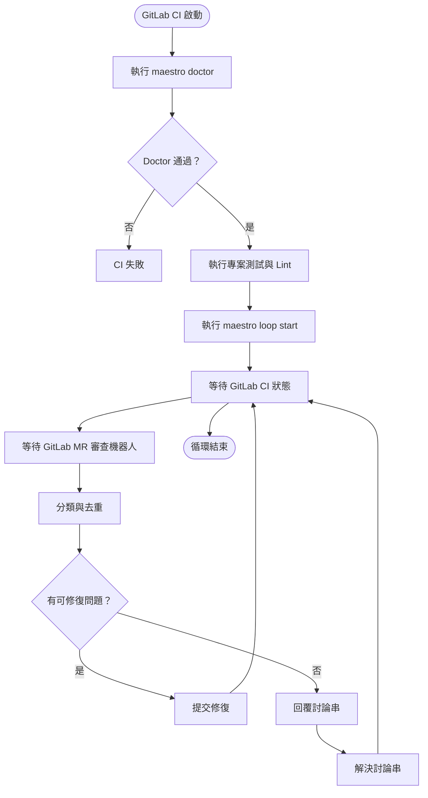
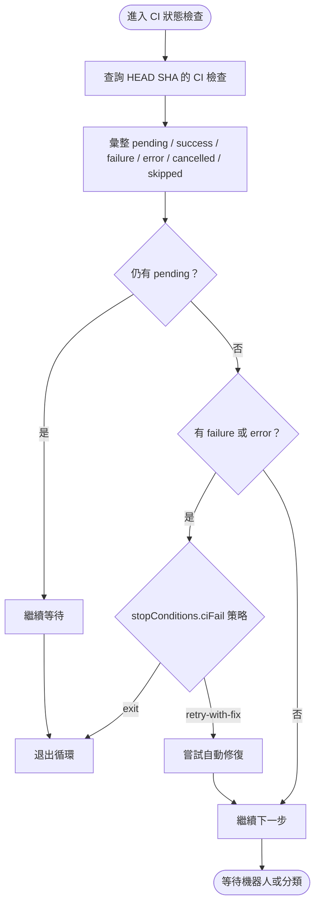
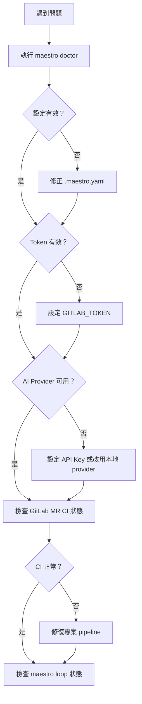

# GitLab CI 範本

**本文引用的檔案**

- [README.md](https://github.com/mikeah2011/maestro/blob/master/README.md)
- [.maestro.example.yaml](https://github.com/mikeah2011/maestro/blob/master/.maestro.example.yaml)
- [CLAUDE.md](https://github.com/mikeah2011/maestro/blob/master/CLAUDE.md)
- [package.json](https://github.com/mikeah2011/maestro/blob/master/package.json)
- [docs/DESIGN.md](https://github.com/mikeah2011/maestro/blob/master/docs/DESIGN.md)
- [src/core/types/CI.ts](https://github.com/mikeah2011/maestro/blob/master/src/core/types/CI.ts)
- [src/platforms/interfaces/GitPlatform.ts](https://github.com/mikeah2011/maestro/blob/master/src/platforms/interfaces/GitPlatform.ts)
- [src/platforms/github/GitHubPlatform.ts](https://github.com/mikeah2011/maestro/blob/master/src/platforms/github/GitHubPlatform.ts)
- [src/config/schema.ts](https://github.com/mikeah2011/maestro/blob/master/src/config/schema.ts)
- [src/cli/commands/doctor.ts](https://github.com/mikeah2011/maestro/blob/master/src/cli/commands/doctor.ts)
- [src/core/types/PullRequest.ts](https://github.com/mikeah2011/maestro/blob/master/src/core/types/PullRequest.ts)
- [.github/workflows/maestro-auto-approve.yml](https://github.com/mikeah2011/maestro/blob/master/.github/workflows/maestro-auto-approve.yml)

## 目錄
1. [簡介](#簡介)
2. [專案結構與 CI 相關位置](#專案結構與-ci-相關位置)
3. [核心元件](#核心元件)
4. [架構總覽](#架構總覽)
5. [GitLab CI 設定指南](#gitlab-ci-設定指南)
6. [完整 CI Pipeline 範例](#完整-ci-pipeline-範例)
7. [與 GitHub Actions 的差異、平台限制與替代方案](#與-github-actions-的差異平台限制與替代方案)
8. [Secrets 管理與 CI 狀態偵測](#secrets-管理與-ci-狀態偵測)
9. [部署注意事項](#部署注意事項)
10. [除錯指引](#除錯指引)
11. [結論](#結論)

## 簡介
Maestro 是一個「統一調度 AI PR 審查機器人」的收斂層工具，而不是另一個獨立的程式碼審查工具。它的重點是：在多個機器人的評論之上，分類問題、去重、修復、回覆討論串、解決討論串，並在硬式上限（預設最多三輪）內讓 PR 真正合併。

在 CI 環境中，Maestro 的核心使用方式是：

- 在 GitLab CI 中安裝並執行 `maestro` CLI。
- 透過 `.maestro.yaml` 指定 Git 平台為 `gitlab`，並設定 GitLab Token。
- 在 CI job 中觸發 `maestro loop start`，由 Maestro 驅動等待 CI、等待機器人、分類、修復、回覆與解決討論串的循環。
- 若使用 GitLab MR 審查流程，Maestro 會利用 GitLab REST v4 API 取得 MR、審查、討論串與 CI 狀態。

需要特別說明的是：此專案尚未提供可直接以 GitLab CI Component URL 引入的官方元件；但由於 Maestro 支援多平台且設計文件明確把「GitLab CI Component / `.gitlab-ci.yml` 範本」列為開發計畫的一部分，因此可透過在 `.gitlab-ci.yml` 中直接導入的方式使用。

**Section sources**
- [README.md:1-40](https://github.com/mikeah2011/maestro/blob/master/README.md#L1-L40)
- [docs/DESIGN.md:125-155](https://github.com/mikeah2011/maestro/blob/master/docs/DESIGN.md#L125-L155)

## 專案結構與 CI 相關位置
Maestro 本身不是 GitLab CI 套件，而是一個 TypeScript CLI 與 Node/Bun 套件。CI 相關的參考內容主要來自以下幾處：

| 路徑 | 用途 |
|---|---|
| `.maestro.example.yaml` | 完整的 Maestro 設定範例，包含 Git 平台、AI Provider、機器人、停止條件、PR Body 標記等 |
| `src/config/schema.ts` | `.maestro.yaml` 的 Zod Schema，定義所有欄位型別與預設值 |
| `src/platforms/interfaces/GitPlatform.ts` | Git 平台抽象介面，定義 PR、討論串、CI 狀態等能力 |
| `src/core/types/CI.ts` | CI 狀態的通用型別定義 |
| `src/cli/commands/doctor.ts` | `maestro doctor` 診斷工具，檢查 git、config、platform token、AI provider |
| `.github/workflows/maestro-auto-approve.yml` | GitHub Actions 自動核准範例，用於理解 Maestro 與 MR/PR 審查流程的整合模式 |
| `package.json` | 套件名稱、二進位入口、Bun/Node 版本需求與腳本 |
| `docs/DESIGN.md` | 技術設計文件，說明多平台、CI、狀態機與發布計畫 |

**Diagram sources**
- [.maestro.example.yaml:1-200](https://github.com/mikeah2011/maestro/blob/master/.maestro.example.yaml#L1-L200)
- [src/config/schema.ts:1-226](https://github.com/mikeah2011/maestro/blob/master/src/config/schema.ts#L1-L226)
- [src/platforms/interfaces/GitPlatform.ts:1-130](https://github.com/mikeah2011/maestro/blob/master/src/platforms/interfaces/GitPlatform.ts#L1-L130)
- [src/core/types/CI.ts:1-34](https://github.com/mikeah2011/maestro/blob/master/src/core/types/CI.ts#L1-L34)

**Section sources**
- [.maestro.example.yaml:1-200](https://github.com/mikeah2011/maestro/blob/master/.maestro.example.yaml#L1-L200)
- [src/config/schema.ts:1-226](https://github.com/mikeah2011/maestro/blob/master/src/config/schema.ts#L1-L226)
- [src/platforms/interfaces/GitPlatform.ts:1-130](https://github.com/mikeah2011/maestro/blob/master/src/platforms/interfaces/GitPlatform.ts#L1-L130)
- [src/core/types/CI.ts:1-34](https://github.com/mikeah2011/maestro/blob/master/src/core/types/CI.ts#L1-L34)
- [package.json:1-89](https://github.com/mikeah2011/maestro/blob/master/package.json#L1-L89)
- [docs/DESIGN.md:125-200](https://github.com/mikeah2011/maestro/blob/master/docs/DESIGN.md#L125-L200)

## 核心元件
從 CI 使用者角度，最重要的核心元件如下：

### 1. `.maestro.yaml` 設定檔
設定檔決定 Maestro 如何連線到 GitLab、如何選擇 AI Provider、要監控哪些機器人、何時停止循環，以及是否掃描外發文字中的敏感資訊。

關鍵區塊：

| 設定區段 | 重要性 | 說明 |
|---|---:|---|
| `platform.type` | 高 | 必須設為 `gitlab` |
| `platform.auth.tokenEnv` | 高 | 建議使用環境變數載入 GitLab Token |
| `platform.baseUrl` | 中 | 自託管 GitLab 時必填 |
| `ai.providers` | 高 | Claude、OpenAI、Google、local 等多提供者 |
| `stopConditions` | 高 | 最大輪數、CI 失敗策略、靜默期、成本上限 |
| `bots.registry` | 中 | 要監聽的審查機器人清單 |
| `security.scanOutgoing` | 高 | 防止回覆或 PR Body 洩漏密鑰 |

**Section sources**
- [.maestro.example.yaml:1-200](https://github.com/mikeah2011/maestro/blob/master/.maestro.example.yaml#L1-L200)
- [src/config/schema.ts:1-226](https://github.com/mikeah2011/maestro/blob/master/src/config/schema.ts#L1-L226)

### 2. Git 平台抽象
Maestro 不直接寫死 GitHub。它透過 `GitPlatform` 抽象類別操作 PR、MR、討論串與 CI 狀態。GitLab 對應的平台型別是 `gitlab`，其能力由 `PlatformCapabilities` 描述，例如：

| 能力 | 意義 |
|---|---|
| `threadResolve` | 能否透過 API 將討論串標記為已解決 |
| `inlineReplies` | 能否在討論串內回覆 |
| `reviewThreads` | 平台是否提供一級審查討論串 |
| `ciStatus` | 是否能查詢 CI 狀態 |
| `graphql` | 是否支援 GraphQL |
| `requestReviewers` | 是否能指派審查者 |

這表示 Maestro 在 GitLab 上的行為取決於該平台實作所宣告的能力。

**Section sources**
- [src/platforms/interfaces/GitPlatform.ts:1-130](https://github.com/mikeah2011/maestro/blob/master/src/platforms/interfaces/GitPlatform.ts#L1-L130)

### 3. CI 狀態型別
Maestro 不需要知道每個平台的 API 細節，只需要統一的 CI 狀態模型：

| 欄位 | 說明 |
|---|---|
| `state` | 聚合狀態：pending、success、failure、error、cancelled、skipped |
| `totalCount` | 檢查項目總數 |
| `failingCount` | 失敗或錯誤數量 |
| `pendingCount` | 仍待執行數量 |
| `checks` | 詳細檢查清單 |
| `targetUrl` | 平台上的檢查頁面 URL |
| `output` | 平台提供的摘要輸出 |

這個型別是 Maestro 判斷「CI 是否通過」、「是否需要等待」的重要基礎。

**Section sources**
- [src/core/types/CI.ts:1-34](https://github.com/mikeah2011/maestro/blob/master/src/core/types/CI.ts#L1-L34)

### 4. Doctor 診斷工具
`maestro doctor` 不會進行網路呼叫，主要檢查：

- 是否安裝 `git`
- 是否在 git repo 中
- `.maestro.yaml` 是否能載入並驗證
- 是否安裝平台 CLI（GitHub 用 `gh`，GitLab 用 `glab`，Gitea 用 `tea`，Gitee 用 `gitee`）
- 平台 token 是否設定
- AI provider 是否可用

在 CI 中，你可以把它作為前置檢查步驟，提早發現環境問題。

**Section sources**
- [src/cli/commands/doctor.ts:1-200](https://github.com/mikeah2011/maestro/blob/master/src/cli/commands/doctor.ts#L1-L200)

## 架構總覽
Maestro 在 CI 中的角色可以視為一個長時執行的協調器：

**Diagram sources**
- [src/platforms/interfaces/GitPlatform.ts:1-130](https://github.com/mikeah2011/maestro/blob/master/src/platforms/interfaces/GitPlatform.ts#L1-L130)
- [src/core/types/CI.ts:1-34](https://github.com/mikeah2011/maestro/blob/master/src/core/types/CI.ts#L1-L34)
- [.maestro.example.yaml:1-200](https://github.com/mikeah2011/maestro/blob/master/.maestro.example.yaml#L1-L200)

## GitLab CI 設定指南
以下說明如何在 GitLab CI 中使用 Maestro。

### 基本設定原則
1. 在 GitLab 專案的 CI/CD 設定中加入 job。
2. 安裝 Bun 或 Node.js，並下載 Maestro CLI。
3. 將 GitLab Token 放入 GitLab Secrets。
4. 建立或複製 `.maestro.yaml`，將 `platform.type` 設為 `gitlab`。
5. 在 CI job 中執行 `maestro doctor` 與 `maestro loop start`。

### Git 平台設定
根據 `.maestro.example.yaml`，GitLab 的 platform 設定應類似：

| 欄位 | 建議值 | 說明 |
|---|---|---|
| `platform.type` | `gitlab` | 選擇 GitLab 平台 |
| `platform.auth.tokenEnv` | `GITLAB_TOKEN` | 從環境變數讀取 Token |
| `platform.baseUrl` | GitLab 主機 URL | 自託管 GitLab 時填寫 |
| `platform.owner` | 可省略 | 可從 git remote 自動偵測 |
| `platform.repo` | 可省略 | 可從 git remote 自動偵測 |

### AI Provider 設定
CI 環境通常沒有 `claude` CLI，因此較安全的做法是直接設定 API Key：

| Provider | 環境變數 | 適用情境 |
|---|---|---|
| Claude | `ANTHROPIC_API_KEY` | 專案已有 Anthropic 金鑰 |
| OpenAI | `OPENAI_API_KEY` | 使用 OpenAI 模型 |
| Google | `GOOGLE_API_KEY` | 使用 Gemini |
| local | 無 API Key | 需要有 Ollama 或其他本地服務 |

### 停止條件
CI 中最重要的是停止條件，避免無限輪詢：

| 設定 | 建議 |
|---|---|
| `stopConditions.maxRounds` | 保持預設 3，或視專案風險調整 |
| `stopConditions.ciFail` | 可選 `exit` 或 `retry-with-fix` |
| `stopConditions.quietPeriodSec` | 避免多個機器人同時發文造成抖動 |
| `stopConditions.costBudgetUSD` | 控制單次 CI 任務的 AI 費用上限 |

### 安全掃描
建議開啟 `security.scanOutgoing`，並保留預設的遮蔽模式，避免回覆或 PR Body 意外包含 API Key、密碼、token 等敏感字串。

**Section sources**
- [.maestro.example.yaml:1-200](https://github.com/mikeah2011/maestro/blob/master/.maestro.example.yaml#L1-L200)
- [src/config/schema.ts:1-226](https://github.com/mikeah2011/maestro/blob/master/src/config/schema.ts#L1-L226)
- [src/cli/commands/doctor.ts:1-200](https://github.com/mikeah2011/maestro/blob/master/src/cli/commands/doctor.ts#L1-L200)

## 完整 CI Pipeline 範例
以下是一個概念性的 `.gitlab-ci.yml` 流程。請注意：這裡不貼出實際 YAML 內容，而是以步驟與變數命名說明。

### Pipeline 階段
| 階段 | Job | 目的 |
|---|---|---|
| `setup` | `maestro-doctor` | 檢查環境、配置、Token、AI Provider |
| `lint-test` | `test-and-lint` | 執行專案自己的測試與 lint，產生 CI status |
| `maestro-loop` | `maestro-run` | 啟動 Maestro 收斂循環 |
| `finalize` | `report-status` | 匯出事件或日誌，供 MR 檢視 |

### 必要 CI Variables
| 變數 | 來源 | 用途 |
|---|---|---|
| `GITLAB_TOKEN` | GitLab Secret | GitLab API Token |
| `ANTHROPIC_API_KEY` | GitLab Secret | Claude API Key |
| `MAESTRO_PR_IID` | GitLab Variable | GitLab Merge Request IID |
| `CI_COMMIT_SHA` | GitLab CI 環境變數 | MR HEAD commit SHA |

### 建議流程
1. **Doctor 檢查**：執行 `maestro doctor`，失敗則立即中止。
2. **專案 CI**：執行 lint、typecheck、test，確保 MR 的 CI status 反映真實狀態。
3. **啟動 Maestro**：執行 `maestro loop start --pr $MAESTRO_PR_IID`。
4. **等待循環結束**：Maestro 會自行處理 CI 狀態、機器人審查、討論串回覆與解決。
5. **產出報告**：可將 JSONL 事件或 log 作為 artifact 保存。

**Diagram sources**
- [src/cli/commands/doctor.ts:1-200](https://github.com/mikeah2011/maestro/blob/master/src/cli/commands/doctor.ts#L1-L200)
- [src/core/types/CI.ts:1-34](https://github.com/mikeah2011/maestro/blob/master/src/core/types/CI.ts#L1-L34)
- [.maestro.example.yaml:1-200](https://github.com/mikeah2011/maestro/blob/master/.maestro.example.yaml#L1-L200)

**Section sources**
- [.maestro.example.yaml:1-200](https://github.com/mikeah2011/maestro/blob/master/.maestro.example.yaml#L1-L200)
- [src/cli/commands/doctor.ts:1-200](https://github.com/mikeah2011/maestro/blob/master/src/cli/commands/doctor.ts#L1-L200)
- [src/core/types/CI.ts:1-34](https://github.com/mikeah2011/maestro/blob/master/src/core/types/CI.ts#L1-L34)

## 與 GitHub Actions 的差異、平台限制與替代方案

### 現有 GitHub Actions 範例
專案中包含一個 GitHub Actions 自動核准工作：`.github/workflows/maestro-auto-approve.yml`。這個工作會在滿足特定條件時自動對 PR 給予 APPROVE：

- 被監控的機器人（例如 Copilot Code Review、Codex Connector）都滿意。
- 所有審查討論串都已解決。
- 尚未由 GitHub Actions Bot 核准過。

這個範例展示的是「自動化核准」邏輯，而不是 Maestro 主循環本身。Maestro 主循環是由 CLI 驅動的，Action 只是輔助 MR 審查流程的邊角邏輯。

### GitLab 差異
| 項目 | GitHub Actions | GitLab CI |
|---|---|---|
| 觸發機制 | `pull_request_review`、`issue_comment` | `pipeline`、`merge_requests`、手動 job |
| Secrets | `${{ secrets.GITHUB_TOKEN }}` | GitLab CI/CD Variables |
| MR/IID | `github.event.pull_request.number` | `$CI_MERGE_REQUEST_IID` |
| 自動核准 | 可使用 GitHub Action | 需自行撰寫 GitLab job 或使用 API |
| GraphQL | GitHub GraphQL API 支援討論串 | GitLab GraphQL 能力因版本不同而有差異 |

### 平台限制
根據 `GitPlatform` 抽象介面，GitLab 的行為受 `PlatformCapabilities` 影響。若某個平台實作未宣告某些能力，Maestro 會採用降級策略，例如：

- 不支援 `threadResolve`：可能改用 body marker 或其他方式記錄解決狀態。
- 不支援 `graphql`：減少 GraphQL 依賴，改回 REST。
- 不支援 `inlineReplies`：只能使用頂層評論而非討論串內回覆。

這些限制會直接影響 Maestro 在 GitLab 上處理討論串與回覆的能力。

### 替代方案
如果 GitLab 環境無法完整支援 Maestro 的討論串功能，可考慮：

1. **只使用 CI status 與 MR Body 標記**：讓 Maestro 更新 MR Body 中的 `<!-- maestro:start -->` 與 `<!-- maestro:end -->` 區塊。
2. **簡化機器人監控**：只追蹤重要機器人，降低討論串複雜度。
3. **搭配 GitLab 自訂 job**：用 GitLab API 模擬自動核准或通知。
4. **使用 Docker 映像**：包裝 `glab`、`curl`、`jq` 與 Maestro CLI，便於在受限 CI 環境中執行。

**Section sources**
- [.github/workflows/maestro-auto-approve.yml:1-93](https://github.com/mikeah2011/maestro/blob/master/.github/workflows/maestro-auto-approve.yml#L1-L93)
- [src/platforms/interfaces/GitPlatform.ts:1-130](https://github.com/mikeah2011/maestro/blob/master/src/platforms/interfaces/GitPlatform.ts#L1-L130)

## Secrets 管理與 CI 狀態偵測

### Secrets 管理
在 GitLab CI 中，Maestro 需要的 Secrets 建議放在 GitLab CI/CD Variables：

| Secret | 用途 | 建議設定方式 |
|---|---|---|
| `GITLAB_TOKEN` | GitLab API Token | GitLab Secret，限專案或群組範圍 |
| `ANTHROPIC_API_KEY` | Claude API Key | GitLab Secret |
| `OPENAI_API_KEY` | OpenAI API Key | 選用 |
| `GOOGLE_API_KEY` | Gemini API Key | 選用 |
| `OLLAMA_BASE_URL` | 本地 AI 服務 | 選用 |

`.maestro.yaml` 支援 `${ENV_VAR}` 語法展開。例如：

- `apiKey: ${ANTHROPIC_API_KEY}`
- `baseUrl: ${OLLAMA_BASE_URL:-http://localhost:11434}`

在 CI 中，不要直接把 Token 寫入 `.maestro.yaml`，也不要把 `.env` 檔案提交到版本控制。

**Section sources**
- [.maestro.example.yaml:1-200](https://github.com/mikeah2011/maestro/blob/master/.maestro.example.yaml#L1-L200)
- [CLAUDE.md:1-98](https://github.com/mikeah2011/maestro/blob/master/CLAUDE.md#L1-L98)

### CI 狀態偵測
Maestro 使用 `CIStatus` 來聚合 CI 狀態。當 CI 仍在 pending 時，Maestro 會繼續等待；當 CI failure 或 error 出現時，根據 `stopConditions.ciFail` 決定是退出還是嘗試修復。

**Diagram sources**
- [src/core/types/CI.ts:1-34](https://github.com/mikeah2011/maestro/blob/master/src/core/types/CI.ts#L1-L34)
- [.maestro.example.yaml:1-200](https://github.com/mikeah2011/maestro/blob/master/.maestro.example.yaml#L1-L200)

**Section sources**
- [src/core/types/CI.ts:1-34](https://github.com/mikeah2011/maestro/blob/master/src/core/types/CI.ts#L1-L34)
- [.maestro.example.yaml:1-200](https://github.com/mikeah2011/maestro/blob/master/.maestro.example.yaml#L1-L200)

## 部署注意事項

### 執行環境
Maestro 套件要求：

| 項目 | 最低版本 |
|---|---|
| Node.js | >= 20 |
| Bun | >= 1.1 |

在 GitLab CI 中，建議明確指定 runner image，例如使用 Node 或 Bun 的官方 image，並確認 `PATH` 能執行 `bun` 或 `node`。

**Section sources**
- [package.json:1-89](https://github.com/mikeah2011/maestro/blob/master/package.json#L1-L89)

### 安裝方式
Maestro 的二進位名稱為 `maestro`，由 `dist/cli.js` 提供。常見安裝方式包括：

- 透過 npm 安裝後執行 `npx maestro`。
- 使用 Bun 執行原始碼或編譯後的 CLI。
- 使用專案提供的 build script 建置 dist。

在 CI 中，請避免每次重新編譯整個專案，除非你有自訂修改。

**Section sources**
- [package.json:1-89](https://github.com/mikeah2011/maestro/blob/master/package.json#L1-L89)
- [CLAUDE.md:1-98](https://github.com/mikeah2011/maestro/blob/master/CLAUDE.md#L1-L98)

### GitLab Runner 權限
GitLab Token 必須具備足夠權限存取：

- MR 讀取
- MR 評論與討論串
- MR Body 更新
- CI status 查詢
- 必要時指派 reviewer

若使用自託管 GitLab，請確認 `platform.baseUrl` 指向正確的 API base URL。

**Section sources**
- [src/platforms/interfaces/GitPlatform.ts:1-130](https://github.com/mikeah2011/maestro/blob/master/src/platforms/interfaces/GitPlatform.ts#L1-L130)
- [.maestro.example.yaml:1-200](https://github.com/mikeah2011/maestro/blob/master/.maestro.example.yaml#L1-L200)

## 除錯指引

### 常用診斷步驟
1. **執行 Doctor**：`maestro doctor` 可檢查 git、config、platform CLI、token 與 AI provider。
2. **檢查 `.maestro.yaml`**：確認 `platform.type`、`auth.tokenEnv`、AI provider 與 stop conditions。
3. **檢查 GitLab Token**：確認 `GITLAB_TOKEN` 已正確設定且具足夠權限。
4. **檢查 AI Provider**：確認 API Key 或本地服務可用。
5. **查看 CI 狀態**：確認 GitLab MR 的 pipeline 是否正常執行。
6. **查看事件與日誌**：Maestro 會產生結構化事件，適合串接 CI artifact 或外部觀察工具。

### 常見問題
| 問題 | 可能原因 | 建議處理 |
|---|---|---|
| `maestro doctor` 報錯找不到 platform CLI | GitLab 環境未安裝 `glab` | 安裝 `glab` 或在 CI 中跳過 platform CLI 檢查 |
| Token 未設定 | `GITLAB_TOKEN` 未在 CI 環境變數中 | 檢查 GitLab CI/CD Variables |
| AI provider 不可用 | 缺少 API Key 或未安裝 `claude` CLI | 設定 `ANTHROPIC_API_KEY` 或其他 provider |
| CI 永遠 pending | GitLab CI 尚未完成或 Maestro 輪詢間隔過短 | 檢查 MR pipeline 狀態與 `idleTimeoutPolls` |
| 討論串無法解決 | GitLab 實作未宣告 `threadResolve` 能力 | 改用 body marker 降級模式 |

### 診斷流程圖

**Diagram sources**
- [src/cli/commands/doctor.ts:1-200](https://github.com/mikeah2011/maestro/blob/master/src/cli/commands/doctor.ts#L1-L200)
- [.maestro.example.yaml:1-200](https://github.com/mikeah2011/maestro/blob/master/.maestro.example.yaml#L1-L200)

**Section sources**
- [src/cli/commands/doctor.ts:1-200](https://github.com/mikeah2011/maestro/blob/master/src/cli/commands/doctor.ts#L1-L200)
- [.maestro.example.yaml:1-200](https://github.com/mikeah2011/maestro/blob/master/.maestro.example.yaml#L1-L200)

## 結論
Maestro 在 GitLab CI 中的使用方式是以 CLI 為主：在 `.gitlab-ci.yml` 中安裝並執行 `maestro`，並透過 `.maestro.yaml` 指定 GitLab 平台與 Secrets。雖然目前沒有官方 GitLab CI Component URL，但專案的設計文件已明確將 GitLab CI Component 與範本列入規劃。

實務上，最穩健的做法是：

- 使用 GitLab CI/CD Variables 管理 `GITLAB_TOKEN` 與 AI Provider Key。
- 在 CI 中先執行 `maestro doctor`，再執行 `maestro loop start`。
- 根據專案風險調整 `stopConditions`，特別是最大輪數與 CI 失敗策略。
- 啟用安全掃描，避免回覆或 MR Body 洩漏敏感資訊。
- 若 GitLab 討論串能力不完整，改用 body marker 降級模式。
- 參考 GitHub Actions 自動核准範例，了解如何把 Maestro 與 MR 審查流程整合，並在 GitLab 中以自訂 job 實現類似行為。

這樣可以在 GitLab MR 審查流程中，獲得與 GitHub 相近的收斂循環體驗，同時保留 GitLab 本身的 CI、MR 與平台特性。