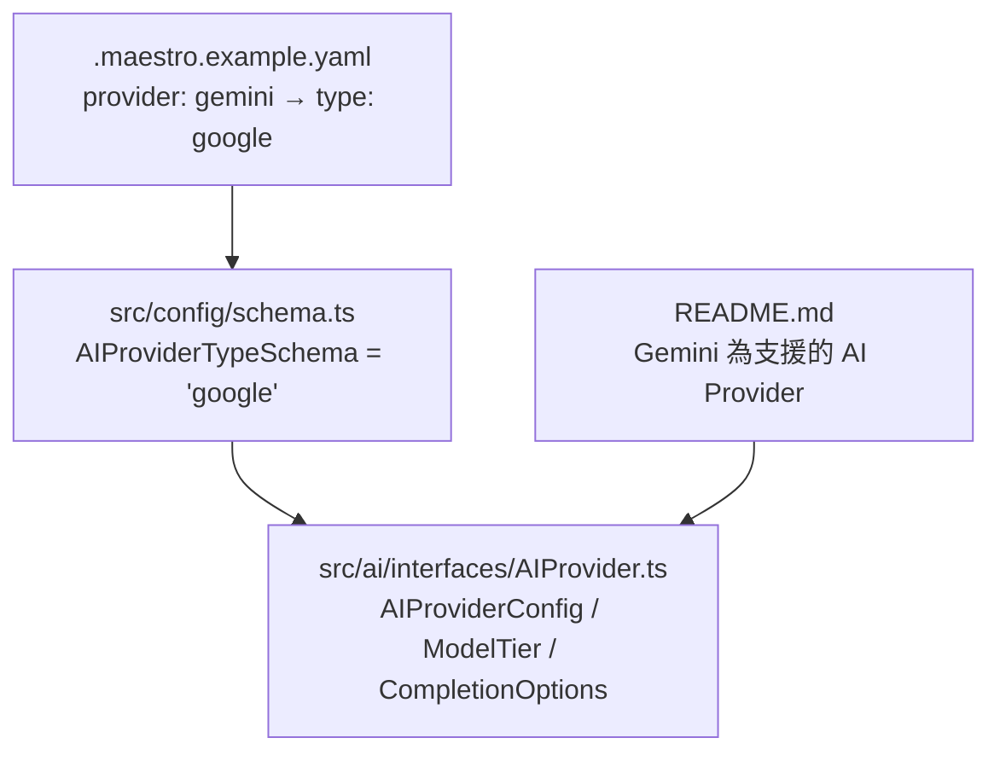
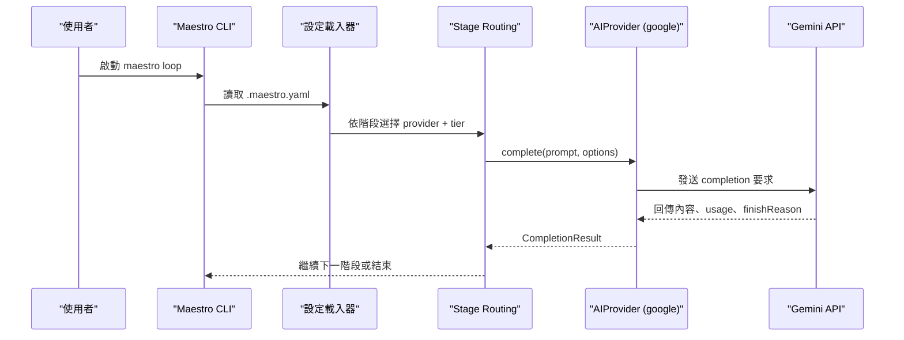
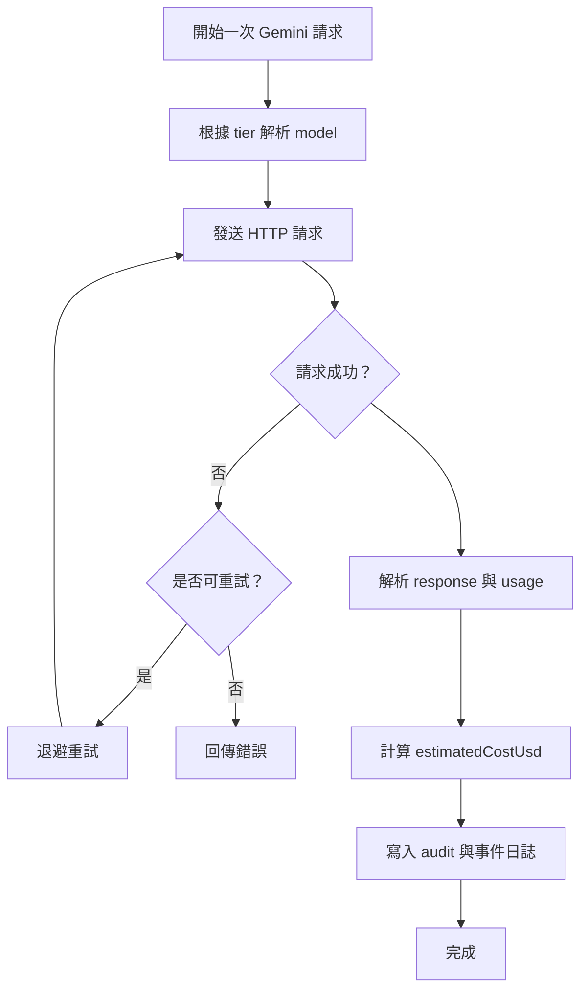

# Google Gemini Provider

**本文引用的檔案**

- [.maestro.example.yaml](https://github.com/mikeah2011/maestro/blob/master/.maestro.example.yaml)
- [src/config/schema.ts](https://github.com/mikeah2011/maestro/blob/master/src/config/schema.ts)
- [src/ai/interfaces/AIProvider.ts](https://github.com/mikeah2011/maestro/blob/master/src/ai/interfaces/AIProvider.ts)
- [env.template](https://github.com/mikeah2011/maestro/blob/master/.env.template)
- [README.md](https://github.com/mikeah2011/maestro/blob/master/README.md)

## 目錄
1. [簡介](#簡介)
2. [專案結構與定位](#專案結構與定位)
3. [核心設定選項](#核心設定選項)
4. [Gemini Provider 架構總覽](#gemini-provider-架構總覽)
5. [詳細設定說明](#詳細設定說明)
6. [YAML 設定範例](#yaml-設定範例)
7. [環境變數注入方式](#環境變數注入方式)
8. [安全設定與費用控制](#安全設定與費用控制)
9. [模型版本選擇建議](#模型版本選擇建議)
10. [地區端點配置](#地區端點配置)
11. [常見問題排除](#常見問題排除)
12. [效能調優指南](#效能調優指南)
13. [結論](#結論)

## 簡介
本文件說明如何在 Maestro 中使用 **Google Gemini Provider**。在當前程式碼庫中，`google` provider 屬於可選的 AI Provider 之一：它透過 `.maestro.yaml` 中的 `ai.providers` 區塊註冊，並由 stage routing（如 `commitMessage`、`prBodyDraft`、`finalSummary` 等）決定哪個階段使用哪一個 provider 與 model tier。

重點：
- Provider type 為 `google`。
- API Key 透過 `${GOOGLE_API_KEY}` 注入。
- 模型以三層映射 `cheap`、`strong`、`flagship` 指定。
- 支援 `baseUrl`、`timeout`、`retries` 等通用 provider 設定。
- Gemini 目前作為「完成式」提供者被呼叫；具體 prompt、分類與修復邏輯不在 Gemini provider 內，而在 orchestrator 與 prompt 層。

**Section sources**
- [.maestro.example.yaml:1-60](https://github.com/mikeah2011/maestro/blob/master/.maestro.example.yaml#L1-L60)
- [src/ai/interfaces/AIProvider.ts:1-40](https://github.com/mikeah2011/maestro/blob/master/src/ai/interfaces/AIProvider.ts#L1-L40)

## 專案結構與定位
Maestro 並未在提供的程式碼樹中找到獨立的 `GoogleProvider.ts` 實現；Gemini provider 的定義集中在以下位置：

| 位置 | 責任 |
|---|---|
| `.maestro.example.yaml` | 提供 `type: google`、`apiKey`、`models` 的實際設定範例 |
| `src/config/schema.ts` | 定義 `AIProviderTypeSchema`，允許 `google` |
| `src/ai/interfaces/AIProvider.ts` | 定義所有 provider 共享的抽象介面、config、tier、completion 合約 |
| `README.md` | 說明 Gemini 是支持的 provider 之一，並列出支援的審查機器人包含 Gemini Code Assist |



**Diagram sources**
- [.maestro.example.yaml:25-45](https://github.com/mikeah2011/maestro/blob/master/.maestro.example.yaml#L25-L45)
- [src/config/schema.ts:14-35](https://github.com/mikeah2011/maestro/blob/master/src/config/schema.ts#L14-L35)
- [src/ai/interfaces/AIProvider.ts:10-40](https://github.com/mikeah2011/maestro/blob/master/src/ai/interfaces/AIProvider.ts#L10-L40)
- [README.md:40-70](https://github.com/mikeah2011/maestro/blob/master/README.md#L40-L70)

**Section sources**
- [.maestro.example.yaml:1-60](https://github.com/mikeah2011/maestro/blob/master/.maestro.example.yaml#L1-L60)
- [src/config/schema.ts:14-35](https://github.com/mikeah2011/maestro/blob/master/src/config/schema.ts#L14-L35)
- [src/ai/interfaces/AIProvider.ts:1-40](https://github.com/mikeah2011/maestro/blob/master/src/ai/interfaces/AIProvider.ts#L1-L40)
- [README.md:40-70](https://github.com/mikeah2011/maestro/blob/master/README.md#L40-L70)

## 核心設定選項
Gemini provider 使用通用的 `AIProviderConfig`，因此其設定選項與其他 provider 一致。

| 選項 | 型別 | 必要 | 預設值 | 說明 |
|---|---|---:|---|---|
| `type` | `string` | 是 | — | 必須設為 `google` |
| `apiKey` | `string` | 否* | 無 | 解析後的 API Key；通常來自環境變數 |
| `baseUrl` | `string` | 否 | 無 | Gemini API endpoint；用於地區或自-hosted 情境 |
| `models` | `object` | 否 | 無 | 三層模型映射：`cheap`、`strong`、`flagship` |
| `defaultTier` | `cheap \| strong \| flagship` | 否 | 未設定 | 當 caller 未指定 tier 時使用的預設 tier |
| `timeout` | `number` | 否 | 無 | 單一請求的 HTTP 逾時（毫秒） |
| `retries` | `number` | 否 | 無 | 自動重試次數 |

> *若程式碼庫中沒有其他程式模組實作 `google` provider，則 `apiKey` 可能僅出現在設定檔中但尚未被執行期使用。實務上應確認部署環境是否另有 provider factory 載入 `google`。

**Section sources**
- [src/ai/interfaces/AIProvider.ts:16-40](https://github.com/mikeah2011/maestro/blob/master/src/ai/interfaces/AIProvider.ts#L16-L40)
- [src/config/schema.ts:14-35](https://github.com/mikeah2011/maestro/blob/master/src/config/schema.ts#L14-L35)

## Gemini Provider 架構總覽
從程式碼角度看，Gemini provider 的整合模式如下：



這個流程強調：**model 選擇是由 routing 與 provider 的 `resolveModel(tier)` 共同決定，而不是由 prompt 自行判斷。**

**Diagram sources**
- [src/ai/interfaces/AIProvider.ts:58-114](https://github.com/mikeah2011/maestro/blob/master/src/ai/interfaces/AIProvider.ts#L58-L114)
- [.maestro.example.yaml:45-60](https://github.com/mikeah2011/maestro/blob/master/.maestro.example.yaml#L45-L60)

**Section sources**
- [src/ai/interfaces/AIProvider.ts:58-114](https://github.com/mikeah2011/maestro/blob/master/src/ai/interfaces/AIProvider.ts#L58-L114)
- [.maestro.example.yaml:45-60](https://github.com/mikeah2011/maestro/blob/master/.maestro.example.yaml#L45-L60)

## 詳細設定說明

### `apiKey`
- 型別：字串
- 用途：Gemini API 驗證金鑰
- 推薦來源：環境變數 `${GOOGLE_API_KEY}`
- 驗證規則：schema 接受可選字串；是否真正必要取決於 provider 實作

### `baseUrl`
- 型別：URL 字串
- 用途：指定 Gemini API endpoint
- 典型用途：
  - 切換到特定地區 endpoint
  - 企業代理或反向 Proxy
  - 未來自-hosted LLM gateway
- schema 要求是 URL 格式

### `models`
- 型別：`Record<ModelTier, string>`
- 支援 tier：
  - `cheap`：高頻率、低風險任務
  - `strong`：需要判斷力的任務
  - `flagship`：最終輸出或重要摘要
- 範例中已示範：
  - `cheap: gemini-2.0-flash`
  - `strong: gemini-1.5-pro`

### `timeout`
- 單位：毫秒
- 用途：限制單次 Gemini 請求的等待時間
- 建議：
  - 本地或區域網路較短
  - 跨區或大型 PR 可延長
  - 避免過長導致 CI 長時間卡住

### `retries`
- 類型：非負整數
- 用途：對暫時性錯誤進行自動重試
- 建議：
  - 一般設為 1～3
  - 配合 rate limit 與 backoff 策略使用
  - 不建議無限重試，以免掩蓋真實錯誤

**Section sources**
- [src/ai/interfaces/AIProvider.ts:16-40](https://github.com/mikeah2011/maestro/blob/master/src/ai/interfaces/AIProvider.ts#L16-L40)
- [src/config/schema.ts:14-35](https://github.com/mikeah2011/maestro/blob/master/src/config/schema.ts#L14-L35)
- [.maestro.example.yaml:33-43](https://github.com/mikeah2011/maestro/blob/master/.maestro.example.yaml#L33-L43)

## YAML 設定範例
以下是基於專案現有範例檔整理的 Gemini provider 設定片段。請將其放入 `ai.providers` 區塊，並配合 `ai.routing` 使用。

```yaml
ai:
  providers:
    gemini:
      type: google
      apiKey: ${GOOGLE_API_KEY}
      models:
        cheap:    gemini-2.0-flash
        strong:   gemini-1.5-pro
        flagship: gemini-2.0-flash-thinking-exp
      baseUrl: https://generativelanguage.googleapis.com/v1beta/models
      timeout: 30000
      retries: 2

  routing:
    commitMessage:     { provider: gemini, tier: cheap }
    prBodyDraft:       { provider: gemini, tier: strong }
    classifyUnknown:   { provider: gemini, tier: cheap }
    semanticDedup:     { provider: gemini, tier: cheap }
    tasteDetection:    { provider: gemini, tier: strong }
    finalSummary:      { provider: gemini, tier: flagship }
    fallback:          { provider: gemini, tier: cheap }
```

注意事項：
- `type` 必須是 `google`，即使 key name 是 `gemini`。
- `models` 的三個 tier 不必全部填寫，但未填寫的 tier 會依賴 provider 的預設邏輯。
- `baseUrl` 若省略，將使用 provider 內部預設 endpoint。

**Section sources**
- [.maestro.example.yaml:25-60](https://github.com/mikeah2011/maestro/blob/master/.maestro.example.yaml#L25-L60)
- [src/config/schema.ts:14-35](https://github.com/mikeah2011/maestro/blob/master/src/config/schema.ts#L14-L35)

## 環境變數注入方式
Maestro 使用 `${ENV_VAR}` 語法在 YAML 中注入環境變數。Gemini 對應的環境變數為：

| 環境變數 | 用途 | 取得方式 |
|---|---|---|
| `GOOGLE_API_KEY` | Gemini API 金鑰 | Google AI Studio 或 Google Cloud Vertex AI |

### 設定步驟
1. 前往 Google AI Studio 或 Google Cloud 控制台取得 Gemini API Key。
2. 在系統環境或 CI secret 中設定 `GOOGLE_API_KEY`。
3. 在 `.maestro.yaml` 中使用 `${GOOGLE_API_KEY}`。
4. 執行 `maestro doctor` 檢查環境。

專案中也提供了 `.env.template` 欄位，顯示 `GOOGLE_API_KEY` 是可選的 Gemini 相關環境變數。

**Section sources**
- [.maestro.example.yaml:33-35](https://github.com/mikeah2011/maestro/blob/master/.maestro.example.yaml#L33-L35)
- [.env.template:37-38](https://github.com/mikeah2011/maestro/blob/master/.env.template#L37-L38)

## 安全設定與費用控制

### 金鑰管理
- 不要直接把 `GOOGLE_API_KEY` 寫進 git 追蹤的設定檔。
- 優先使用：
  - CI/CD secret manager
  - 作業系統環境變數
  - 容器 runtime 注入
- 若使用 `.env` 檔，應加入 `.gitignore`。

### 輸出敏感資料保護
Maestro 的 `security` 區塊會掃描 outgoing 訊息，並可根據 pattern 遮蔽敏感內容。Gemini provider 產生的回覆也會經過此機制，減少意外洩漏。

| 設定 | 說明 |
|---|---|
| `security.scanOutgoing` | 啟用前送出訊息的敏感資料掃描 |
| `security.redactPatterns` | 遮蔽 pattern，例如 `api[_-]?key`、`secret`、`password`、`token` |

### 費用控制
Maestro 提供兩層費用控制：

1. **每輪預算**：`stopConditions.costBudgetUSD`
2. **per-call usage**：`CompletionUsage.estimatedCostUsd`

| 項目 | 說明 |
|---|---|
| `costBudgetUSD` | 整個 loop run 的 USD 上限 |
| `estimatedCostUsd` | 每次 completion 返回的預估費用 |
| `inputTokens` / `outputTokens` | 輸入與輸出 token 數量 |
| `cacheReadTokens` / `cacheWriteTokens` | 若支援 prompt cache，可觀察 cache 效益 |

**Section sources**
- [.maestro.example.yaml:160-200](https://github.com/mikeah2011/maestro/blob/master/.maestro.example.yaml#L160-L200)
- [src/config/schema.ts:100-135](https://github.com/mikeah2011/maestro/blob/master/src/config/schema.ts#L100-L135)
- [src/ai/interfaces/AIProvider.ts:68-114](https://github.com/mikeah2011/maestro/blob/master/src/ai/interfaces/AIProvider.ts#L68-L114)

## 模型版本選擇建議
專案範例中的 Gemini 模型映射如下：

| Tier | 範例模型 | 適用場景 |
|---|---|---|
| `cheap` | `gemini-2.0-flash` | 大量生成、草稿、重複性高的任務 |
| `strong` | `gemini-1.5-pro` | 需要較高理解力與推理能力的任務 |
| `flagship` | 可搭配 thinking/expensive model | 最終摘要、關鍵決策輸出 |

### 選擇原則
- 高頻低風險：用 `cheap`，降低 token 與延遲成本。
- 判斷性任務：用 `strong`，提升品質。
- 最終輸出：用 `flagship`，確保穩定與完整性。
- 若 cost budget 緊縮，可將 `flagship` 暫時降為 `strong`。
- 若發現 `gemini-1.5-pro` 在某些任務表現不足，可考慮升級至更新的 pro 或 reasoning 系列模型。

**Section sources**
- [.maestro.example.yaml:33-43](https://github.com/mikeah2011/maestro/blob/master/.maestro.example.yaml#L33-L43)
- [src/ai/interfaces/AIProvider.ts:10-20](https://github.com/mikeah2011/maestro/blob/master/src/ai/interfaces/AIProvider.ts#L10-L20)

## 地區端點配置
`baseUrl` 是用來設定 Gemini API endpoint 的位置。雖然當前範例檔未提供 Gemini 的地區變體，但 schema 允許透過 `baseUrl` 調整 endpoint。

常見用法：
- 使用官方 endpoint：
  ```yaml
  baseUrl: https://generativelanguage.googleapis.com/v1beta/models
  ```
- 使用企業代理或反向 Proxy：
  ```yaml
  baseUrl: https://proxy.example.com/gemini/v1beta/models
  ```
- 未來若 GCP 提供多地區 endpoint，可在同一 provider 下複製多個 entry，再透過 routing 切換。

注意：
- `baseUrl` 必須是合法 URL。
- 若 endpoint 需要額外 path 或參數，請確認 provider 實作是否會正確拼接。
- 若使用代理，需同時處理認證、TLS、CORS 等問題。

**Section sources**
- [src/ai/interfaces/AIProvider.ts:16-25](https://github.com/mikeah2011/maestro/blob/master/src/ai/interfaces/AIProvider.ts#L16-L25)
- [src/config/schema.ts:14-35](https://github.com/mikeah2011/maestro/blob/master/src/config/schema.ts#L14-L35)

## 常見問題排除

| 問題 | 可能原因 | 解決方法 |
|---|---|---|
| `GOOGLE_API_KEY` 未設定 | 環境變數未注入 | 在 CI、shell profile 或環境管理器中設定 |
| YAML 解析失敗 | `${GOOGLE_API_KEY}` 無法展開 | 確認執行環境有該變數 |
| `baseUrl` 驗證失敗 | URL 格式錯誤 | 改為完整且合法的 URL |
| 請求超時 | `timeout` 太短或網路慢 | 提高 `timeout`，或改用較快模型 |
| 重試過多 | `retries` 太高或上游不稳定 | 調整 `retries`，並檢查 upstream 狀態 |
| 費用過高 | 使用旗艦模型或大量 round | 降低 tier、增加 `costBudgetUSD` 監控、減少 round |
| 輸出包含敏感資訊 | redact pattern 未匹配 | 調整 `security.redactPatterns` |

**Section sources**
- [.maestro.example.yaml:33-43](https://github.com/mikeah2011/maestro/blob/master/.maestro.example.yaml#L33-L43)
- [src/config/schema.ts:14-35](https://github.com/mikeah2011/maestro/blob/master/src/config/schema.ts#L14-L35)
- [src/ai/interfaces/AIProvider.ts:68-114](https://github.com/mikeah2011/maestro/blob/master/src/ai/interfaces/AIProvider.ts#L68-L114)

## 效能調優指南

### 1. 合理選擇 model tier
- 提交訊息、去重、分類等高頻任務使用 `cheap`。
- PR body draft、taste detection 使用 `strong`。
- 最終摘要使用 `flagship`。

### 2. 調整 `timeout`
- 短 timeout：快速失敗，適合 CI 嚴格時限。
- 長 timeout：容許大模型或跨區延遲。
- 建議分階段設定不同 timeout，或在 orchestrator 層統一控管。

### 3. 調整 `retries`
- 輕微抖動：`retries: 1~2`
- 不穩定環境：`retries: 2~3`
- 避免把 retries 設成過高，以免掩蓋 API 限流或權限錯誤。

### 4. 利用 token usage 優化 prompt
- 觀察 `inputTokens`、`outputTokens`。
- 若 `cacheReadTokens` / `cacheWriteTokens` 可用，盡量重用 system prompt 與上下文。
- 精簡 prompt，避免冗長 instruction。

### 5. 費用監控
- 開啟 `security.scanOutgoing`。
- 設定 `costBudgetUSD`。
- 在事件日誌中記錄 `estimatedCostUsd`。
- 定期檢視 `.maestro/events.jsonl`。



**Diagram sources**
- [src/ai/interfaces/AIProvider.ts:58-114](https://github.com/mikeah2011/maestro/blob/master/src/ai/interfaces/AIProvider.ts#L58-L114)
- [src/config/schema.ts:180-226](https://github.com/mikeah2011/maestro/blob/master/src/config/schema.ts#L180-L226)

**Section sources**
- [src/ai/interfaces/AIProvider.ts:58-114](https://github.com/mikeah2011/maestro/blob/master/src/ai/interfaces/AIProvider.ts#L58-L114)
- [src/config/schema.ts:180-226](https://github.com/mikeah2011/maestro/blob/master/src/config/schema.ts#L180-L226)

## 結論
Gemini provider 在 Maestro 中以 `type: google` 的形式存在，並共用標準的 provider 設定與完成式 API。目前專案已提供：
- `apiKey` 環境變數注入
- 三層模型映射
- `baseUrl`、`timeout`、`retries` 等基本選項
- 與 routing、budget、audit、security 的整體整合

若要完整使用 Gemini，下一步建議：
1. 確認部署環境確實載入並實作 `google` provider。
2. 根據任務性質設定 `cheap` / `strong` / `flagship`。
3. 使用 `costBudgetUSD` 與 `estimatedCostUsd` 監控費用。
4. 透過 `baseUrl` 設定地區或企業 endpoint。
5. 持續觀察 events 與 audit log，優化 prompt 與 model 選擇。

[No sources needed since this section summarizes without analyzing specific files]