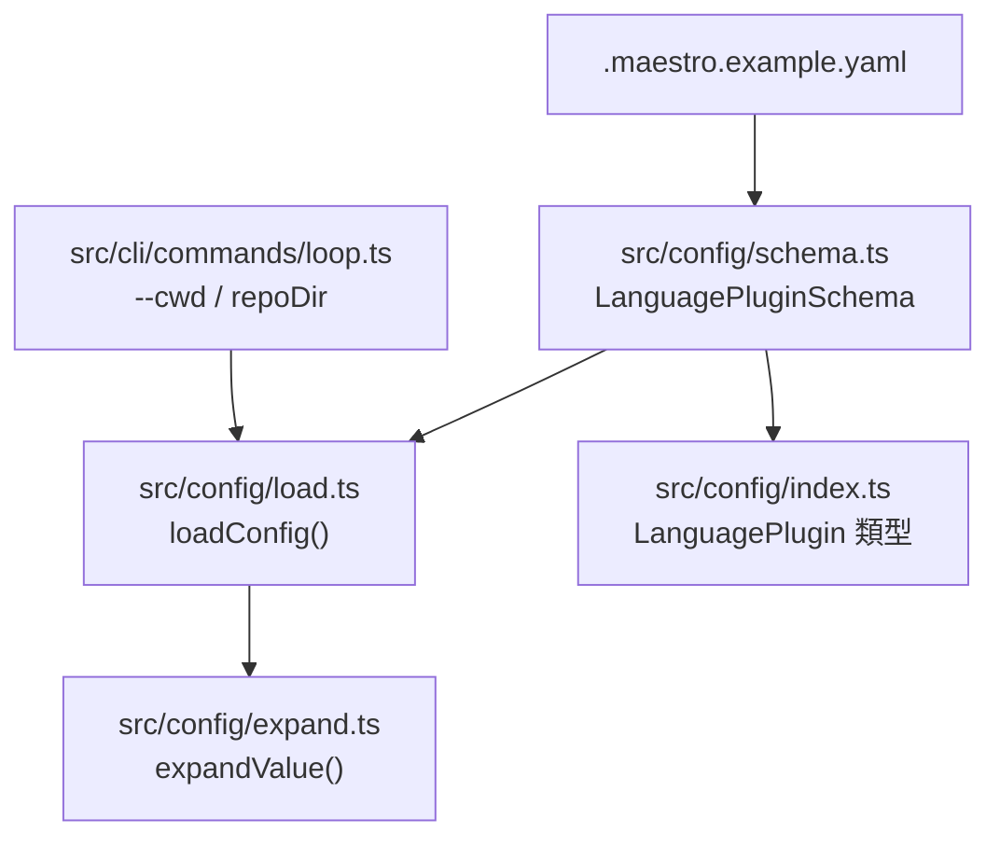
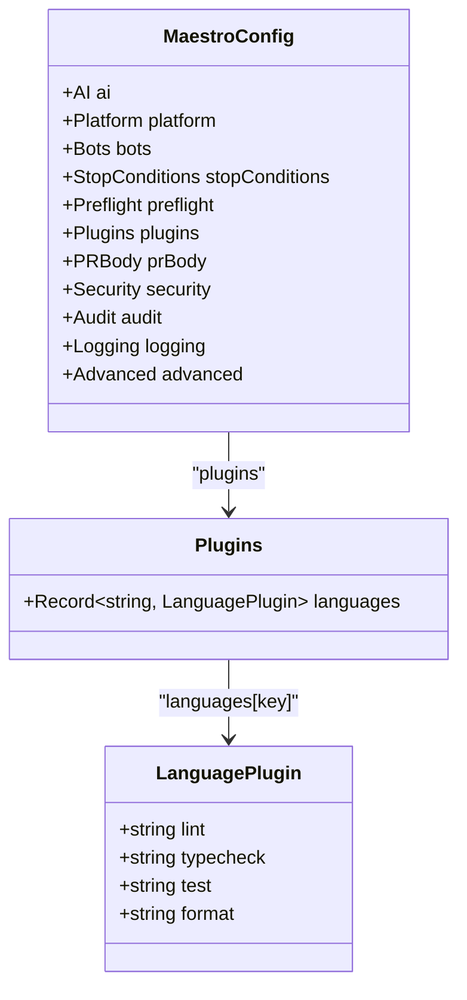
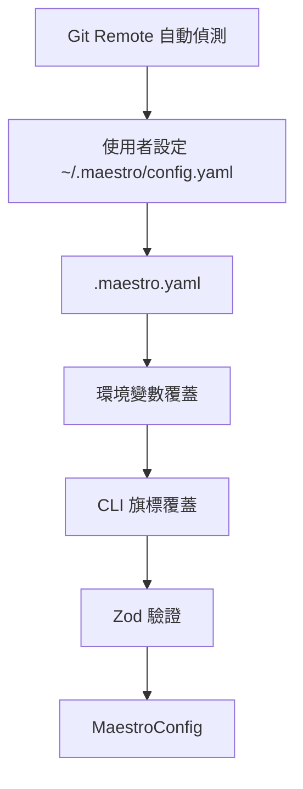
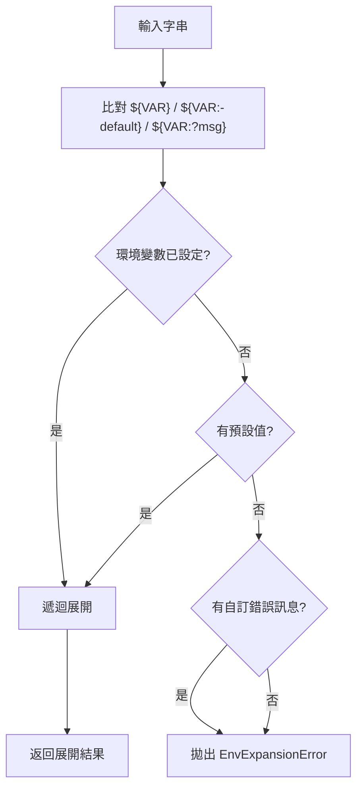
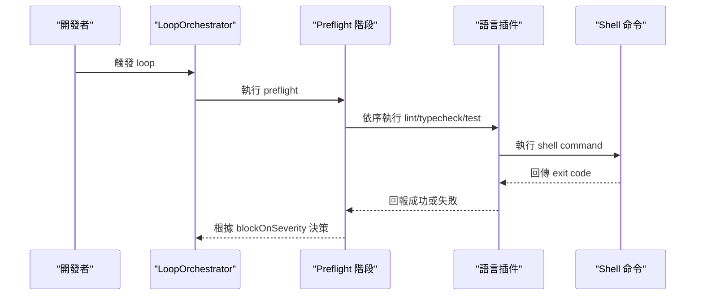
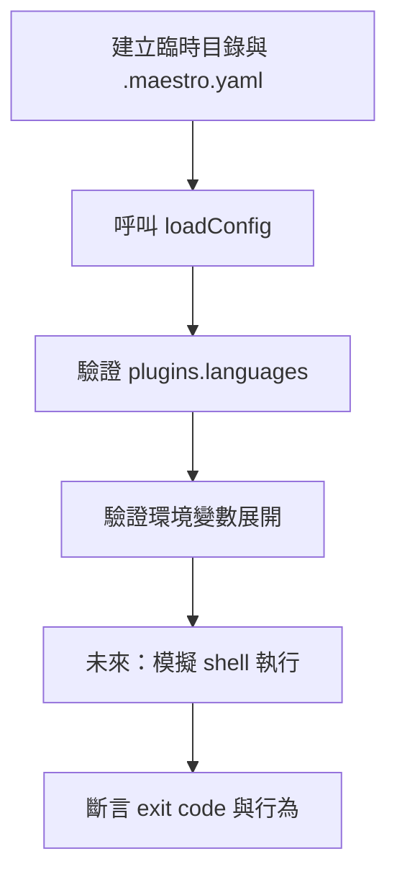

# Language Plugins 設定

**本文引用的檔案**

- [README.md](https://github.com/mikeah2011/maestro/blob/master/README.md)
- [DESIGN.md](https://github.com/mikeah2011/maestro/blob/master/docs/DESIGN.md)
- [.maestro.example.yaml](https://github.com/mikeah2011/maestro/blob/master/.maestro.example.yaml)
- [package.json](https://github.com/mikeah2011/maestro/blob/master/package.json)
- [schema.ts](https://github.com/mikeah2011/maestro/blob/master/src/config/schema.ts)
- [load.ts](https://github.com/mikeah2011/maestro/blob/master/src/config/load.ts)
- [expand.ts](https://github.com/mikeah2011/maestro/blob/master/src/config/expand.ts)
- [index.ts（配置模組）](https://github.com/mikeah2011/maestro/blob/master/src/config/index.ts)
- [loop.ts](https://github.com/mikeah2011/maestro/blob/master/src/cli/commands/loop.ts)
- [LoadConfig 測試](https://github.com/mikeah2011/maestro/blob/master/tests/config/load.test.ts)
- [EnvExpansion 測試](https://github.com/mikeah2011/maestro/blob/master/tests/config/expand.test.ts)

## 目錄

1. [簡介](#簡介)
2. [專案結構與語言插件位置](#專案結構與語言插件位置)
3. [核心資料模型](#核心資料模型)
4. [設定載入與優先順序](#設定載入與優先順序)
5. [環境變數展開語法](#環境變數展開語法)
6. [語言插件欄位說明](#語言插件欄位說明)
7. [常見程式語言插件範例](#常見程式語言插件範例)
8. [執行流程、順序與並行控制](#執行流程順序與並行控制)
9. [錯誤處理策略](#錯誤處理策略)
10. [自訂語言支援開發指南](#自訂語言支援開發指南)
11. [測試方法](#測試方法)
12. [除錯技巧](#除錯技巧)
13. [效能與限制](#效能與限制)
14. [常見問題排解](#常見問題排解)
15. [結論](#結論)

## 簡介

Language Plugins 是 Maestro 中「語言特定工具」的設定層。它讓使用者透過 `.maestro.yaml` 宣告各語言的 `lint`、`typecheck`、`test`、`format` 步驟，使工具鏈能識別 TypeScript、Python、Go、Rust 等語言，並在預先檢查階段調用對應命令。

根據設計文件，語言插件層是「即插即用」的設計：每個插件暴露 `lint()`、`typecheck()`、`test()`、`format()` 的概念介面，並透過 shell 呼叫執行。目前隨附的語言包括 TypeScript/JS、Python、Go、Rust；其他語言可透過社群貢獻或自訂設定加入。

這個文件聚焦於以下主題：

- 如何在 `plugins.languages` 中定義語言插件。
- shell command 字串的語法與環境變數展開。
- 插件在 preflight 中的角色與執行順序。
- 錯誤碼、工作目錄、timeout、並行控制的現況與限制。
- 如何擴充未內建支援的語言。
- 如何測試與除錯語言插件。

需要特別強調的是：**目前的程式碼實作只對 plugins 做 YAML schema 驗證，尚未發現實際執行這些 shell command 的核心邏輯。** 因此，關於工作目錄、錯誤碼映射、timeout、並行控制的行為，必須以「現有程式碼證據」與「未來實作建議」兩部分區分說明。

**章節來源**
- [DESIGN.md:1-200](https://github.com/mikeah2011/maestro/blob/master/docs/DESIGN.md#L1-L200)
- [README.md:1-200](https://github.com/mikeah2011/maestro/blob/master/README.md#L1-L200)

## 專案結構與語言插件位置

Maestro 的語言插件設定屬於設定層，而不是獨立的程式語言套件。它由以下幾個層級共同組成：

| 層級 | 檔案 | 職責 |
|---|---|---|
| 設定範例 | [.maestro.example.yaml](https://github.com/mikeah2011/maestro/blob/master/.maestro.example.yaml) | 提供 TypeScript、Python、Go、Rust 的插件範例 |
| Schema 驗證 | [schema.ts](https://github.com/mikeah2011/maestro/blob/master/src/config/schema.ts) | 定義 `LanguagePluginSchema`、`PluginsSchema` |
| 設定載入 | [load.ts](https://github.com/mikeah2011/maestro/blob/master/src/config/load.ts) | 合併多層設定、讀取 `.maestro.yaml` |
| 環境展開 | [expand.ts](https://github.com/mikeah2011/maestro/blob/master/src/config/expand.ts) | 展開 `${VAR}`、`${VAR:-default}`、`${VAR:?error}` |
| 公共匯出 | [index.ts（配置模組）](https://github.com/mikeah2011/maestro/blob/master/src/config/index.ts) | 重新匯出 `LanguagePlugin` 類型 |
| CLI 入口 | [loop.ts](https://github.com/mikeah2011/maestro/blob/master/src/cli/commands/loop.ts) | 載入設定時使用 repo 根目錄作為工作目錄 |

**圖表來源**
- [.maestro.example.yaml:1-200](https://github.com/mikeah2011/maestro/blob/master/.maestro.example.yaml#L1-L200)
- [schema.ts:120-140](https://github.com/mikeah2011/maestro/blob/master/src/config/schema.ts#L120-L140)
- [load.ts:170-216](https://github.com/mikeah2011/maestro/blob/master/src/config/load.ts#L170-L216)
- [expand.ts:1-81](https://github.com/mikeah2011/maestro/blob/master/src/config/expand.ts#L1-L81)
- [loop.ts:50-68](https://github.com/mikeah2011/maestro/blob/master/src/cli/commands/loop.ts#L50-L68)
- [index.ts:1-25](https://github.com/mikeah2011/maestro/blob/master/src/config/index.ts#L1-L25)

**章節來源**
- [.maestro.example.yaml:1-200](https://github.com/mikeah2011/maestro/blob/master/.maestro.example.yaml#L1-L200)
- [schema.ts:120-140](https://github.com/mikeah2011/maestro/blob/master/src/config/schema.ts#L120-L140)
- [load.ts:170-216](https://github.com/mikeah2011/maestro/blob/master/src/config/load.ts#L170-L216)
- [expand.ts:1-81](https://github.com/mikeah2011/maestro/blob/master/src/config/expand.ts#L1-L81)
- [loop.ts:50-68](https://github.com/mikeah2011/maestro/blob/master/src/cli/commands/loop.ts#L50-L68)
- [index.ts:1-25](https://github.com/mikeah2011/maestro/blob/master/src/config/index.ts#L1-L25)

## 核心資料模型

語言插件的資料模型非常簡潔。整個結構由 Zod schema 定義，主要分為三個層次：

1. **`LanguagePluginSchema`**：單一語言插件，包含四個可選的 shell command。
2. **`PluginsSchema`**：包裝 `languages` 物件。
3. **`MaestroConfigSchema.plugins`**：整合進完整設定，預設為空語言集合。

**圖表來源**
- [schema.ts:120-140](https://github.com/mikeah2011/maestro/blob/master/src/config/schema.ts#L120-L140)
- [schema.ts:200-226](https://github.com/mikeah2011/maestro/blob/master/src/config/schema.ts#L200-L226)

### LanguagePlugin 欄位

| 欄位 | 型別 | 是否必要 | 說明 |
|---|---|---:|---|
| `lint` | `string` | 否 | 語言特定 linter 的 shell command |
| `typecheck` | `string` | 否 | 型別檢查的 shell command |
| `test` | `string` | 否 | 測試執行的 shell command |
| `format` | `string` | 否 | 程式碼格式化的 shell command |

所有欄位都是 `z.string().optional()`，也就是說：

- 你可以只定義其中一個步驟。
- 可以只為某一種語言定義 plugin。
- 如果某個語言沒有 plugin，不會造成驗證錯誤。
- 若未來實作語言插件執行器，則會決定哪些步驟是可選、哪些是必要。

### Plugins 與 Languages

`plugins.languages` 是一個以語言名稱為 key 的記錄物件。從範例可以看到以下語言鍵值：

| 語言鍵值 | 用途 |
|---|---|
| `typescript` | TypeScript / JavaScript 專案 |
| `python` | Python 專案 |
| `go` | Go 專案 |
| `rust` | Rust 專案 |

這個設計允許同一個專案同時註冊多個語言，例如 TypeScript frontend 與 Python backend 共存的情況。

**章節來源**
- [schema.ts:120-140](https://github.com/mikeah2011/maestro/blob/master/src/config/schema.ts#L120-L140)
- [schema.ts:200-226](https://github.com/mikeah2011/maestro/blob/master/src/config/schema.ts#L200-L226)
- [.maestro.example.yaml:140-180](https://github.com/mikeah2011/maestro/blob/master/.maestro.example.yaml#L140-L180)

## 設定載入與優先順序

語言插件設定遵循 Maestro 統一的多層設定機制。設定載入順序如下：

**圖表來源**
- [load.ts:170-216](https://github.com/mikeah2011/maestro/blob/master/src/config/load.ts#L170-L216)

### 優先順序

1. **CLI 旗標**：最高優先權。
2. **環境變數覆蓋**：例如 `MAESTRO_MAX_ROUNDS`、`MAESTRO_COST_BUDGET_USD`、`MAESTRO_LOG_LEVEL`、`MAESTRO_AUDIT_DIR`。
3. **倉庫設定 `.maestro.yaml`**。
4. **使用者設定 `~/.maestro/config.yaml`**。
5. **Git remote 自動偵測結果**。
6. **Schema 預設值**。

語言插件本身不直接受 `MAESTRO_*` 環境變數覆蓋；它們只是普通 YAML 字串，但其中的環境變數引用會在解析階段被展開。

### 載入過程重點

- `loadConfig` 會讀取使用者路徑與倉庫路徑。
- 每個 YAML 檔使用 `yaml.loadAll`，取第一個文件。
- 載入後會進行 `expandValue` 環境變數展開。
- 最後使用 `MaestroConfigSchema` 驗證。
- 驗證失敗會拋出 `ConfigError`。

**章節來源**
- [load.ts:1-216](https://github.com/mikeah2011/maestro/blob/master/src/config/load.ts#L1-L216)
- [load.ts:170-216](https://github.com/mikeah2011/maestro/blob/master/src/config/load.ts#L170-L216)
- [load.test.ts:1-228](https://github.com/mikeah2011/maestro/blob/master/tests/config/load.test.ts#L1-L228)

## 環境變數展開語法

語言插件的 shell command 字串可以包含 Maestro 的環境變數展開語法。這不是普通的 shell `$VAR`，而是由 `expandString` 處理的 `${...}` 模式。

### 支援的語法

| 語法 | 行為 |
|---|---|
| `${VAR}` | 必要變數；若未設定且無預設值，拋出 `EnvExpansionError` |
| `${VAR:-default}` | 若 VAR 未設定或為空字串，使用 default |
| `${VAR:?error message}` | 若 VAR 未設定，拋出自訂錯誤訊息 |
| `${OUTER:${INNER}}` | 巢狀展開支援，深度上限為 10 |
| `$NAME` | 不使用大括號的 shell 風格寫法**不會**被展開 |

### 重要特性

- 展開會遞迴解析環境變數的內容。
- 循環引用會被限制最大深度。
- 展開後的值會進入 Zod schema 驗證。
- 非字串值不會被展開。
- 展開過程不會修改原始輸入物件。

**圖表來源**
- [expand.ts:1-81](https://github.com/mikeah2011/maestro/blob/master/src/config/expand.ts#L1-L81)
- [expand.test.ts:1-79](https://github.com/mikeah2011/maestro/blob/master/tests/config/expand.test.ts#L1-L79)

### 與 Shell 的差異

Maestro 的配置環境變數展開不是 bash/shell 的子集：

- 它只認得 `${VAR}`，不認得 `$VAR`。
- 它支援 `${VAR:?message}` 這種錯誤訊息語法。
- 它支援巢狀展開，但深度有限制。
- 它不是真正的 shell 指令解析器。

因此，語言插件的 shell command 應該視為「最終要交給 shell 執行的字串」，而 `${...}` 是在 Maestro 載入設定時先展開一次。

**章節來源**
- [expand.ts:1-81](https://github.com/mikeah2011/maestro/blob/master/src/config/expand.ts#L1-L81)
- [expand.test.ts:1-79](https://github.com/mikeah2011/maestro/blob/master/tests/config/expand.test.ts#L1-L79)
- [load.ts:180-190](https://github.com/mikeah2011/maestro/blob/master/src/config/load.ts#L180-L190)

## 語言插件欄位說明

### lint

用於執行語言特定的程式碼檢查工具。常見用途包括：

- ESLint、Prettier（當 Prettier 用作檢查而非格式化）。
- Ruff、pylint。
- golangci-lint。
- Clippy。

lint 步驟通常不需要針對單檔操作，因為範例多使用專案根層級的命令。

### typecheck

用於執行型別檢查。常見用途包括：

- TypeScript：`tsc --noEmit`。
- Python：`mypy`。
- Go：`go vet ./...`。
- Rust：`cargo check`。

typecheck 通常也不會針對單一檔案執行，而是檢查整個模組或專案。

### test

用於執行測試套件。常見用途包括：

- Vitest、Jest、Mocha。
- pytest。
- go test。
- cargo test。

test 步驟通常是最耗時的步驟，也是 CI 中最關鍵的步驟之一。

### format

用於執行程式碼格式化。常見用途包括：

- Prettier。
- ruff format。
- gofmt。
- cargo fmt。

需要注意的是，`.maestro.example.yaml` 中 TypeScript 的 format 使用了 `$FILE_PATH` 變數，這代表該範例假設未來執行器會替換該變數。但目前 schema 和載入器並未將此變數視為特殊欄位。

### 當前限制

| 項目 | 現況 |
|---|---|
| 欄位驗證 | 僅驗證為 string |
| 命令長度限制 | 無明確限制 |
| 命令數量限制 | 每語言最多 4 個步驟 |
| 步驟選擇 | 全部可選 |
| 步驟順序 | 由 preflight 決定，plugins 本身不指定順序 |
| 並行控制 | 未在 plugins schema 中定義 |
| timeout | 未在 plugins schema 中定義 |
| workdir | 未在 plugins schema 中定義 |
| exit code 映射 | 未在 plugins schema 中定義 |

**章節來源**
- [schema.ts:120-140](https://github.com/mikeah2011/maestro/blob/master/src/config/schema.ts#L120-L140)
- [.maestro.example.yaml:140-180](https://github.com/mikeah2011/maestro/blob/master/.maestro.example.yaml#L140-L180)

## 常見程式語言插件範例

以下範例皆來自 `.maestro.example.yaml`。請注意：這些是設定範例，不代表當前程式碼已經實現完整的插件執行邏輯。

### TypeScript

TypeScript 插件使用 pnpm 管理工具鏈，並分別設定 lint、typecheck、test、format。

| 步驟 | 預期行為 |
|---|---|
| `lint` | 對單一檔案執行 ESLint，並嘗試修復 |
| `typecheck` | 使用 TypeScript Compiler 進行無輸出型別檢查 |
| `test` | 使用 Vitest 執行測試 |
| `format` | 使用 Prettier 寫回單一檔案 |

這個範例顯示了兩種用法：

1. 專案層級命令：如 `pnpm tsc --noEmit`、`pnpm vitest run`。
2. 檔案層級命令：如 `pnpm eslint --fix "$FILE_PATH"`、`pnpm prettier --write "$FILE_PATH"`。

### Python

Python 插件使用 Ruff 作為 lint 與 formatter，並搭配 mypy 與 pytest。

| 步驟 | 預期行為 |
|---|---|
| `lint` | 使用 Ruff 檢查並嘗試修復 |
| `typecheck` | 使用 mypy 檢查整個專案 |
| `test` | 使用 pytest 執行測試 |
| `format` | 使用 ruff format 格式化整個專案 |

### Go

Go 插件使用 golangci-lint、go vet、go test 與 gofmt。

| 步驟 | 預期行為 |
|---|---|
| `lint` | 使用 golangci-lint 執行整組 linter |
| `typecheck` | 使用 go vet 檢查整個模組 |
| `test` | 使用 go test 執行所有測試 |
| `format` | 使用 gofmt 格式化整個專案 |

### Rust

Rust 插件使用 Cargo toolchain 提供的 clippy、check、test、fmt。

| 步驟 | 預期行為 |
|---|---|
| `lint` | 使用 Clippy 並嘗試修復 |
| `typecheck` | 使用 cargo check |
| `test` | 使用 cargo test |
| `format` | 使用 cargo fmt |

### 範例比較表

| 語言 | lint | typecheck | test | format |
|---|---|---|---|---|
| TypeScript | ESLint | TypeScript compiler | Vitest | Prettier |
| Python | Ruff | mypy | pytest | ruff format |
| Go | golangci-lint | go vet | go test | gofmt |
| Rust | Clippy | cargo check | cargo test | cargo fmt |

**章節來源**
- [.maestro.example.yaml:140-180](https://github.com/mikeah2011/maestro/blob/master/.maestro.example.yaml#L140-L180)

## 執行流程、順序與並行控制

### 語言插件在 Pre-flight 中的角色

Maestro 的 preflight 階段在推送前執行本機自我審查與工具檢查。其步驟由 `preflight.steps` 控制，預設包含：

1. `selfReview`
2. `lint`
3. `typecheck`
4. `test`

`blockOnSeverity` 控制遇到什麼嚴重度時停止流程，預設為 `critical`。

**圖表來源**
- [schema.ts:120-135](https://github.com/mikeah2011/maestro/blob/master/src/config/schema.ts#L120-L135)
- [.maestro.example.yaml:120-140](https://github.com/mikeah2011/maestro/blob/master/.maestro.example.yaml#L120-L140)

### 執行順序

根據 schema 與範例，執行順序應為：

1. `selfReview`
2. `lint`
3. `typecheck`
4. `test`

這個順序有意義：

- lint 通常最快，可早期發現基本問題。
- typecheck 依賴語言編譯器或分析工具。
- test 通常最慢，放在最後避免浪費時間。

### 並行控制

**目前程式碼中沒有針對語言插件步驟的並行控制選項。**

`preflight.steps` 是一個陣列，schema 只驗證元素是否為已知步驟，沒有 `concurrency`、`parallel`、`maxConcurrent` 等欄位。這表示：

- 現有設計傾向於順序執行。
- 若未來實作並行，需要新增 schema 欄位。
- 對於 I/O 密集的工具（如 `pytest`、`cargo test`），並行可能提升效能，但也可能增加記憶體與 CPU 壓力。

### 步驟可選性

雖然 `preflight.steps` 預設包含四個步驟，但它是一個可配置的陣列。你可以：

- 移除 `selfReview`。
- 只保留 `lint`。
- 新增自訂步驟（若未來 schema 開放擴展）。
- 完全停用 preflight。

但這與 `plugins.languages` 不同：plugins 是「有哪些語言工具有」，preflight 是「哪些步驟要跑」。

**章節來源**
- [schema.ts:120-140](https://github.com/mikeah2011/maestro/blob/master/src/config/schema.ts#L120-L140)
- [.maestro.example.yaml:120-180](https://github.com/mikeah2011/maestro/blob/master/.maestro.example.yaml#L120-L180)

## 錯誤處理策略

### 設定層錯誤

語言插件相關的設定錯誤主要發生在兩個階段：

1. **YAML 解析錯誤**：由 `readYamlIfExists` 處理，會拋出 `ConfigError`。
2. **Zod 驗證錯誤**：若 plugins 結構不符合 schema，會拋出 `ConfigError`。

### 環境變數展開錯誤

若語言插件的命令中包含未設定的必要環境變數，會拋出 `EnvExpansionError`。例如：

- `${MISSING}`：未設定時拋出錯誤。
- `${VAR:?custom message}`：使用自訂錯誤訊息。
- 巢狀展開超過深度限制：拋出「超過最大深度」錯誤。

### Shell 命令錯誤碼

**目前程式碼中沒有語言插件 shell command 的執行器，因此也沒有現成的 exit code 映射。**

不過，根據系統整體設計，可推論未來實作時應考慮以下錯誤分類：

| 退出碼範圍 | 建議分類 | 處理方式 |
|---:|---|---|
| `0` | 成功 | 繼續下一個步驟 |
| `1` | 一般失敗 | 依據 `blockOnSeverity` 判斷 |
| `2` | Lint 常用錯誤碼 | 通常視為高或中等嚴重度 |
| `>128` | 信號或系統錯誤 | 視為外部工具異常 |
| `timeout` | 逾時 | 視為超時錯誤 |

這部分是未來實作建議，不是現有行為。

### Pre-flight 停止策略

`preflight.blockOnSeverity` 目前支援：

| 嚴重度 | 行為 |
|---|---|
| `critical` | 遇到 critical 問題就停止 |
| `high` | 遇到 high 或更嚴重問題就停止 |
| `medium` | 遇到 medium 或更嚴重問題就停止 |

預設值是 `critical`，表示只有最嚴重的問題會阻止 preflight。

**章節來源**
- [schema.ts:120-135](https://github.com/mikeah2011/maestro/blob/master/src/config/schema.ts#L120-L135)
- [load.ts:40-60](https://github.com/mikeah2011/maestro/blob/master/src/config/load.ts#L40-L60)
- [expand.ts:10-30](https://github.com/mikeah2011/maestro/blob/master/src/config/expand.ts#L10-L30)
- [expand.test.ts:1-79](https://github.com/mikeah2011/maestro/blob/master/tests/config/expand.test.ts#L1-L79)

## 自訂語言支援開發指南

### 第一步：確認是否需要新語言

若你的專案使用的程式語言不在 TypeScript、Python、Go、Rust 之中，才需要新增語言插件。常見情況包括：

- Java
- C#
- Ruby
- PHP
- Swift
- Kotlin
- Dart
- Elixir
- OCaml
- Haskell

### 第二步：決定語言鍵值

`plugins.languages` 的 key 是任意字串。建議使用小寫、具語意的語言名稱：

- `java`
- `csharp`
- `ruby`
- `php`
- `swift`
- `kotlin`
- `dart`
- `elixir`

### 第三步：定義步驟

至少定義你確實想執行的步驟。不必強求四個步驟都有。

建議最小可行組合：

- `lint`：快速靜態檢查。
- `test`：CI 最重視的步驟。

可選組合：

- `typecheck`：若有型別系統。
- `format`：若團隊要求一致性格式。

### 第四步：處理環境變數

若命令需要環境變數，使用 `${VAR}`、`${VAR:-default}`、`${VAR:?message}`。

例如：

- `${JAVA_HOME}`
- `${NODE_ENV}`
- `${GOFLAGS}`
- `${CARGO_TARGET_DIR}`

### 第五步：處理工作目錄

目前 shell command 的工作目錄由 CLI 與 loader 的 `cwd` 決定。未來插件執行器若需要語言專屬目錄，可考慮新增 `workdir` 欄位。

### 第六步：處理 Timeout

目前 plugins schema 沒有 `timeout` 欄位。未來可考慮：

- 全域 timeout：所有插件共用。
- 步驟級 timeout：每個步驟獨立設定。
- 語言級 timeout：每個語言設定預設 timeout。

### 第七步：處理並行

若語言工具支援並行測試，可考慮：

- 在 shell command 中直接傳遞並行參數，例如 `pytest -n auto`。
- 在未來 executor 中加入 `concurrency` 欄位。

### 第八步：撰寫測試

參考現有測試模式：

1. 建立臨時目錄。
2. 寫入 `.maestro.yaml`。
3. 呼叫 `loadConfig`。
4. 驗證 plugins.languages 結構。
5. 驗證環境變數展開結果。

**章節來源**
- [.maestro.example.yaml:140-180](https://github.com/mikeah2011/maestro/blob/master/.maestro.example.yaml#L140-L180)
- [schema.ts:120-140](https://github.com/mikeah2011/maestro/blob/master/src/config/schema.ts#L120-L140)
- [expand.ts:1-81](https://github.com/mikeah2011/maestro/blob/master/src/config/expand.ts#L1-L81)
- [load.test.ts:1-228](https://github.com/mikeah2011/maestro/blob/master/tests/config/load.test.ts#L1-L228)

## 測試方法

Maestro 目前沒有專門的「language plugin executor」測試，但有完善的設定載入與環境變數測試。你可以沿用以下測試策略：

### 測試設定載入

驗證語言插件是否能正確載入：

| 測試目標 | 驗證內容 |
|---|---|
| 單一語言 | TypeScript plugin 存在且欄位正確 |
| 多語言 | 同時註冊多個語言 |
| 部分步驟 | 只定義 lint 與 test |
| 空語言 | `plugins.languages` 為空物件 |
| 環境變數 | `${VAR}` 展開正確 |
| 預設值 | `${VAR:-default}` 使用預設值 |
| 錯誤訊息 | `${VAR:?message}` 拋出自訂錯誤 |

### 測試環境變數展開

參考 `tests/config/expand.test.ts`：

- 未設定必要變數時拋出 `EnvExpansionError`。
- 空字串視為未設定。
- 巢狀展開正確。
- 循環引用被限制深度。
- 非字串值不被展開。
- 輸入物件不被 mutate。

### 測試設定優先順序

參考 `tests/config/load.test.ts`：

- user config 與 repo config 合併。
- repo config 優先於 user config。
- env overrides 優先於檔案設定。
- CLI overrides 優先於一切。

### 建議的插件測試架構

**圖表來源**
- [load.test.ts:1-228](https://github.com/mikeah2011/maestro/blob/master/tests/config/load.test.ts#L1-L228)
- [expand.test.ts:1-79](https://github.com/mikeah2011/maestro/blob/master/tests/config/expand.test.ts#L1-L79)

**章節來源**
- [load.test.ts:1-228](https://github.com/mikeah2011/maestro/blob/master/tests/config/load.test.ts#L1-L228)
- [expand.test.ts:1-79](https://github.com/mikeah2011/maestro/blob/master/tests/config/expand.test.ts#L1-L79)

## 除錯技巧

### 使用 doctor 指令

`bun run src/cli/index.ts doctor` 可用於診斷環境與設定。它會檢查：

- Git 狀態。
- `.maestro.yaml` 是否存在。
- 設定是否能正確載入。
- 相關工具是否安裝。

### 檢查設定載入

若要確認 plugins 是否被正確載入，可在測試中使用 `loadConfig` 並輸出結果。由於 plugins 是設定的一部分，任何 YAML 或 zod 驗證錯誤都會在載入階段失敗。

### 檢查環境變數展開

若 shell command 沒有按預期執行，先檢查環境變數展開是否正確：

1. 確認使用的是 `${VAR}`，不是 `$VAR`。
2. 確認變數確實存在於 process.env。
3. 若是可選變數，加上 `-default`。
4. 若是必要變數，加上 `:?message` 取得清楚錯誤。

### 檢查工作目錄

CLI loop 指令支援 `--cwd <path>`，會把目標 repo 目錄作為 `cwd` 載入設定。這意味著：

- `.maestro.yaml` 會從 `repoDir` 讀取。
- Git 操作會以 `repoDir` 為基準。
- 未來插件 shell command 也應以 repo root 為預設工作目錄。

### 常見除錯情境

| 現象 | 可能原因 | 解決方式 |
|---|---|---|
| 設定載入失敗 | YAML 結構錯誤 | 檢查 plugins.languages 結構 |
| 環境變數展開失敗 | 必要變數未設定 | 使用 `${VAR:-default}` 或設定環境變數 |
| shell 命令找不到 | PATH 或工具未安裝 | 使用絕對路徑或在 CI 中安裝工具 |
| 命令在錯誤目錄執行 | 工作目錄設定問題 | 使用 `--cwd` 或命令中明確切換目錄 |
| 測試很慢 | 測試套件太大 | 調整 shell command 縮小範圍 |

**章節來源**
- [loop.ts:50-68](https://github.com/mikeah2011/maestro/blob/master/src/cli/commands/loop.ts#L50-L68)
- [expand.ts:1-81](https://github.com/mikeah2011/maestro/blob/master/src/config/expand.ts#L1-L81)
- [expand.test.ts:1-79](https://github.com/mikeah2011/maestro/blob/master/tests/config/expand.test.ts#L1-L79)

## 效能與限制

### 現有效能特性

| 項目 | 現況 |
|---|---|
| 語言插件執行器 | 未發現核心程式碼實作 |
| 步驟並行 | 未定義 |
| 步驟 timeout | 未定義 |
| 工作目錄 | 由 CLI `--cwd` 與 loader `cwd` 決定 |
| 錯誤碼映射 | 未定義 |
| 步驟計時 | 未定義 |
| 步驟日誌 | 未定義 |
| 快取 | 未定義 |
| 增量檢查 | 未定義 |

### 未來優化建議

#### 步驟級 timeout

建議為每個步驟支援：

- `timeoutMs`：毫秒。
- `interruptible`：是否允許中斷。
- `retry`：是否重試。

#### 並行控制

建議支援：

- `concurrency`：全步驟並行數。
- `stage.concurrency`：個別步驟並行數。
- `memoryLimit`：記憶體限制。

#### 工作目錄

建議支援：

- `workdir`：步驟執行目錄。
- `relativeTo`：相對於 repo root、workspace root 或 package root。

#### 錯誤分類

建議支援：

- `exitCodes.success`：成功退出碼。
- `exitCodes.failure`：失敗退出碼。
- `exitCodes.retryable`：可重試退出碼。
- `severityMap`：將 exit code 映射到嚴重度。

#### 增量模式

對於大型專案，建議支援：

- 只檢查變更檔案。
- 只執行影響範圍內的測試。
- 利用語言工具的 cache。

### 當前效能風險

若未來實作語言插件執行器，需注意：

1. `test` 步驟可能非常耗時。
2. 多個語言同時測試可能造成資源競爭。
3. shell command 可能卡住。
4. 環境變數展開失敗會阻擋整個流程。
5. 若未設定 timeout，shell command 可能永遠執行。

**章節來源**
- [schema.ts:120-140](https://github.com/mikeah2011/maestro/blob/master/src/config/schema.ts#L120-L140)
- [loop.ts:50-68](https://github.com/mikeah2011/maestro/blob/master/src/cli/commands/loop.ts#L50-L68)
- [load.ts:170-216](https://github.com/mikeah2011/maestro/blob/master/src/config/load.ts#L170-L216)

## 常見問題排解

### Q1：為什麼我的 language plugin 沒有執行？

**原因**：目前程式碼中只有設定 schema，尚未看到語言插件 shell command 的執行器。

**驗證方式**：

1. 確認 `.maestro.yaml` 中有 `plugins.languages`。
2. 確認語言 key 正確。
3. 確認 `preflight.steps` 包含你要執行的步驟。
4. 使用 `loadConfig` 驗證設定能否載入。

### Q2：environment variable 展開失敗怎麼辦？

**原因**：`${VAR}` 未設定，且沒有預設值。

**解決方式**：

- 使用 `${VAR:-default}`。
- 使用 `${VAR:?clear error message}`。
- 在 shell 或 CI 中設定該環境變數。

### Q3：能不能只執行 lint，不執行 test？

**原因**：plugins 本身不控制執行順序；順序由 `preflight.steps` 控制。

**解決方式**：

- 調整 `preflight.steps`。
- 移除不必要的步驟。
- 停用 preflight。

### Q4：能不能設定每個步驟的 timeout？

**現況**：不能。plugins schema 沒有 `timeout` 欄位。

**替代方案**：

- 在 shell command 外包裝 timeout 工具。
- 在 CI 層面設定 job timeout。
- 未來實作時新增 schema 欄位。

### Q5：能不能設定每個步驟的工作目錄？

**現況**：不能。plugins schema 沒有 `workdir` 欄位。

**替代方案**：

- 在 shell command 中使用 `cd`。
- 使用絕對路徑。
- 未來實作時新增 `workdir`。

### Q6：能不能並行執行多個語言的 test？

**現況**：plugins schema 沒有並行設定。

**替代方案**：

- 在 CI 中使用 matrix。
- 在 shell command 中傳遞語言工具原生並行參數。
- 未來實作時新增 `concurrency`。

**章節來源**
- [schema.ts:120-140](https://github.com/mikeah2011/maestro/blob/master/src/config/schema.ts#L120-L140)
- [.maestro.example.yaml:120-180](https://github.com/mikeah2011/maestro/blob/master/.maestro.example.yaml#L120-L180)
- [expand.ts:1-81](https://github.com/mikeah2011/maestro/blob/master/src/config/expand.ts#L1-L81)

## 結論

Maestro 的 Language Plugins 目前處於「設定模型已定義、範例已提供、核心執行器待實作」的狀態。

最重要的事實是：

- `plugins.languages` 是一個以字串為 key、以 `LanguagePlugin` 為 value 的記錄。
- 每個插件有四種可選步驟：`lint`、`typecheck`、`test`、`format`。
- 每個步驟都是一個 shell command 字串。
- 字串支援 `${VAR}`、`${VAR:-default}`、`${VAR:?message}` 環境變數展開。
- 設定載入遵循 CLI > env > repo yaml > user yaml > git remote > defaults 的優先順序。
- TypeScript、Python、Go、Rust 已有完整範例。
- 目前沒有並行、timeout、workdir、exit code mapping 的 schema 欄位。
- 未來若實作插件執行器，應優先處理 timeout、錯誤分類、工作目錄、並行控制與日誌。

對使用者而言，最安全的做法是：

1. 先用 `.maestro.example.yaml` 複製語言插件。
2. 調整 shell command 符合你的工具鏈。
3. 使用環境變數處理敏感資訊與環境差異。
4. 透過 `loadConfig` 與測試驗證設定。
5. 等待或參與語言插件執行器的實作。

對開發者而言，最需要注意的事是：

- 不要假設 plugins 已經被執行。
- 不要把 plugins schema 誤認為完整 executor API。
- 未來新增欄位時，務必更新 schema、loader、測試與文件。
- 若新增並行或 timeout，需考慮資源限制與取消機制。
- 若新增工作目錄，需考慮 relative path、symlink、monorepo 等情境。