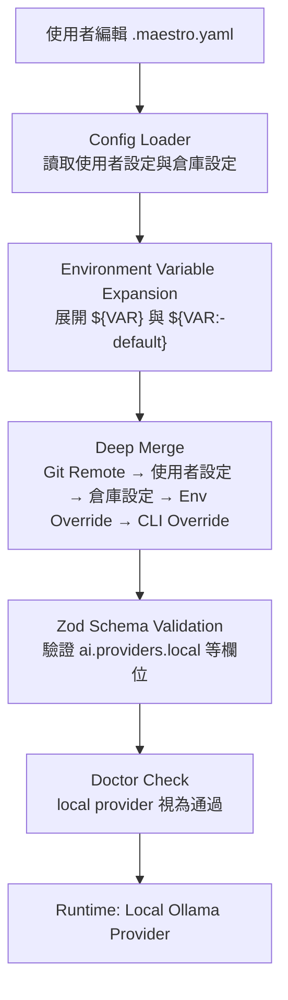
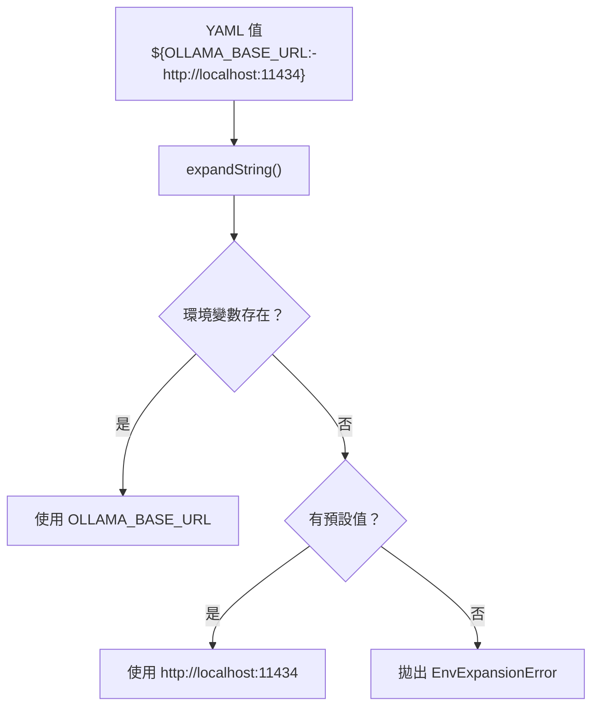

# Local Ollama Provider

<cite>
**本文引用的檔案**   
- [.maestro.example.yaml](https://github.com/mikeah2011/maestro/blob/master/.maestro.example.yaml)
- [AIProvider.ts](https://github.com/mikeah2011/maestro/blob/master/src/ai/interfaces/AIProvider.ts)
- [schema.ts](https://github.com/mikeah2011/maestro/blob/master/src/config/schema.ts)
- [load.ts](https://github.com/mikeah2011/maestro/blob/master/src/config/load.ts)
- [expand.ts](https://github.com/mikeah2011/maestro/blob/master/src/config/expand.ts)
- [doctor.ts](https://github.com/mikeah2011/maestro/blob/master/src/cli/commands/doctor.ts)
- [init.ts](https://github.com/mikeah2011/maestro/blob/master/src/cli/commands/init.ts)
- [README.md](https://github.com/mikeah2011/maestro/blob/master/README.md)
</cite>

## 目錄
1. [簡介](#簡介)
2. [專案結構與設定載入流程](#專案結構與設定載入流程)
3. [Local Provider 設定選項總覽](#local-provider-設定選項總覽)
4. [YAML 設定範例](#yaml-設定範例)
5. [環境變數注入方式](#環境變數注入方式)
6. [Ollama 安裝、啟動與模型管理](#ollama-安裝啟動與模型管理)
7. [模型選擇建議與資源消耗考量](#模型選擇建議與資源消耗考量)
8. [本地開發環境設定指南](#本地開發環境設定指南)
9. [常見問題排除](#常見問題排除)
10. [結論](#結論)

## 簡介
本文件說明如何在 Maestro 中設定並使用 **Local Ollama Provider**。Local provider 讓系統透過 Ollama 的 HTTP API 呼叫本機部署的語言模型，適合本地開發、離線測試或需要完全控制模型權重與推理資源的情境。

Maestro 支援多個 AI provider，其中 `local` 型別由設定檔中的 `baseUrl` 指向 Ollama 服務，並以三層模型映射（`cheap`、`strong`、`flagship`）配合路由機制，在不同階段選用合適的本地模型。

## 專案結構與設定載入流程
Maestro 的 AI provider 抽象定義位於 `src/ai/interfaces/AIProvider.ts`，而 `.maestro.yaml` 的結構由 `src/config/schema.ts` 的 Zod schema 驗證；實際載入與合併邏輯在 `src/config/load.ts`，環境變數展開則由 `src/config/expand.ts` 提供。



**圖表來源**
- [schema.ts:15-29](https://github.com/mikeah2011/maestro/blob/master/src/config/schema.ts#L15-L29)
- [load.ts:13-26](https://github.com/mikeah2011/maestro/blob/master/src/config/load.ts#L13-L26)
- [expand.ts:6-18](https://github.com/mikeah2011/maestro/blob/master/src/config/expand.ts#L6-L18)
- [doctor.ts:135-152](https://github.com/mikeah2011/maestro/blob/master/src/cli/commands/doctor.ts#L135-L152)

**章節來源**
- [AIProvider.ts:1-41](https://github.com/mikeah2011/maestro/blob/master/src/ai/interfaces/AIProvider.ts#L1-L41)
- [schema.ts:15-29](https://github.com/mikeah2011/maestro/blob/master/src/config/schema.ts#L15-L29)
- [load.ts:13-26](https://github.com/mikeah2011/maestro/blob/master/src/config/load.ts#L13-L26)
- [expand.ts:6-18](https://github.com/mikeah2011/maestro/blob/master/src/config/expand.ts#L6-L18)

## Local Provider 設定選項總覽
Local provider 使用與 OpenAI、Claude、Google provider 相同的 provider 設定結構，主要差異在於它沒有雲端 API key，而是透過 `baseUrl` 連接本地 Ollama。

| 選項 | 類型 | 是否必要 | 預設值 | 說明 |
|---|---|---:|---|---|
| `type` | 字串 | 是 | — | 固定為 `local` |
| `baseUrl` | URL | 否 | 未內建預設值，但範例使用 `${OLLAMA_BASE_URL:-http://localhost:11434}` | Ollama HTTP API 端點 |
| `models` | 物件 | 否 | 無預設模型 | 三層模型映射：`cheap`、`strong`、`flagship` |
| `apiKey` | 字串 | 否 | 空 | Local provider 通常不填 |
| `defaultTier` | `cheap` \| `strong` \| `flagship` | 否 | 未指定時由 routing 決定 | 當呼叫端未指定 tier 時的預設層級 |
| `timeout` | 正整數 | 否 | 未指定 | 每個 HTTP 請求的逾時毫秒數 |
| `retries` | 非負整數 | 否 | 未指定 | 暫時性錯誤的自動重試次數 |

以上欄位由以下 schema 共同約束：
- `AIProviderTypeSchema` 允許 `local`。
- `ProviderConfigSchema` 允許 `baseUrl`、`models`、`defaultTier`、`timeout`、`retries`。
- `AIProviderConfig` 介面進一步描述這些欄位的用途。

**章節來源**
- [schema.ts:15-29](https://github.com/mikeah2011/maestro/blob/master/src/config/schema.ts#L15-L29)
- [AIProvider.ts:16-41](https://github.com/mikeah2011/maestro/blob/master/src/ai/interfaces/AIProvider.ts#L16-L41)

## YAML 設定範例
以下是一個完整且可直接複製到 `.maestro.yaml` 的 local provider 設定片段。請注意：此處僅展示與 local provider 相關區塊，實際使用時需保留其他需要的 provider 與平台設定。

```yaml
ai:
  providers:
    ollama:
      type: local
      baseUrl: ${OLLAMA_BASE_URL:-http://localhost:11434}
      models:
        cheap:  mistral
        strong: llama3.1:70b
      timeout: 60000
      retries: 2
  routing:
    commitMessage:     { provider: ollama, tier: cheap }
    prBodyDraft:       { provider: ollama, tier: strong }
    classifyUnknown:   { provider: ollama, tier: cheap }
    semanticDedup:     { provider: ollama, tier: cheap }
    tasteDetection:    { provider: ollama, tier: strong }
    finalSummary:      { provider: ollama, tier: flagship }
    fallback:          { provider: ollama, tier: cheap }
```

重點說明：
- `provider` 名稱可自訂，例如 `ollama`、`local-model`。
- `models` 的三個層級分別對應高頻低風險任務、判斷型任務與最終輸出。
- `routing` 會決定每個階段使用哪個 provider 與哪個 tier。
- `timeout` 和 `retries` 建議根據本地硬體效能調整。

參考專案提供的範例配置：
- [`.maestro.example.yaml`](https://github.com/mikeah2011/maestro/blob/master/.maestro.example.yaml)

**章節來源**
- [.maestro.example.yaml:12-39](https://github.com/mikeah2011/maestro/blob/master/.maestro.example.yaml#L12-L39)
- [schema.ts:15-29](https://github.com/mikeah2011/maestro/blob/master/src/config/schema.ts#L15-L29)

## 環境變數注入方式
Maestro 支援三種環境變數展開模式：
- `${VAR}`：必要變數。
- `${VAR:-default}`：若未設定則使用預設值。
- `${VAR:?error message}`：未設定時拋出錯誤訊息。

對於 local Ollama provider，推薦使用：

```text
${OLLAMA_BASE_URL:-http://localhost:11434}
```

這樣做的好處是：
- 若 `OLLAMA_BASE_URL` 已設定，就使用該地址。
- 若未設定，就回退到 `http://localhost:11434`。
- 不需要修改 YAML 即可切換不同 Ollama 執行環境。

環境變數展開由 `expand.ts` 處理，並在 config loader 中對使用者設定與倉庫設定都進行遞迴展開。



**圖表來源**
- [expand.ts:6-18](https://github.com/mikeah2011/maestro/blob/master/src/config/expand.ts#L6-L18)
- [expand.ts:20-47](https://github.com/mikeah2011/maestro/blob/master/src/config/expand.ts#L20-L47)
- [load.ts:123-131](https://github.com/mikeah2011/maestro/blob/master/src/config/load.ts#L123-L131)

**章節來源**
- [expand.ts:6-18](https://github.com/mikeah2011/maestro/blob/master/src/config/expand.ts#L6-L18)
- [expand.ts:20-47](https://github.com/mikeah2011/maestro/blob/master/src/config/expand.ts#L20-L47)
- [expand.ts:49-81](https://github.com/mikeah2011/maestro/blob/master/src/config/expand.ts#L49-L81)
- [load.ts:123-131](https://github.com/mikeah2011/maestro/blob/master/src/config/load.ts#L123-L131)

## Ollama 安裝、啟動與模型管理
以下內容是本地開發 Ollama 的實務建議。由於本專案只負責以 HTTP 方式呼叫 Ollama，具體安裝步驟會因作業系統與套件管理器而異。

### 安裝 Ollama
常見方式包括官方安裝程式、Homebrew、容器或原始碼編譯。選擇一種能產生 `ollama` 命令的方式即可。

### 啟動 Ollama
一般情況下，啟動後 Ollama 會監聽：

```text
http://localhost:11434
```

這正是 `baseUrl` 預設值所指向的位置。若使用 Docker、遠端機器、代理或非預設埠，請透過 `OLLAMA_BASE_URL` 覆蓋。

### 拉取與檢查模型
常用命令包含：
- 拉取模型：`ollama pull <model>`
- 列出模型：`ollama list`
- 刪除模型：`ollama rm <model>`
- 測試模型：`ollama run <model>`

### 可用的本地模型
常見可用模型包括：
- `mistral`
- `llama3.1:70b`
- `llama3.1`
- `qwen2.5`
- `phi3`
- `gemma`

模型可用性取決於你使用的 Ollama 版本與作業系統支援能力。

### API 端點
Local provider 預期 Ollama 暴露標準 HTTP API。常見的端點包含：
- `/api/tags`：列出已下載模型
- `/api/generate`：生成回應
- `/api/chat`：聊天格式呼叫
- `/api/show`：查詢模型資訊

若你的 Ollama 部署在子路徑或反向代理後，請確保 `baseUrl` 指向正確的根端點。

[本節為通用操作指引，不直接分析特定程式碼檔案]

## 模型選擇建議與資源消耗考量
三層模型映射的設計目的是把「高頻、低風險」任務放在便宜模型上，把「需要判斷力」的任務放在強模型上，最後的總結輸出放在最高品質模型上。

| 層級 | 典型用途 | 模型建議 | 資源特性 |
|---|---|---|---|
| `cheap` | 訊息摘要、分類、去重、重複率較高的任務 | `mistral`、`llama3.1`、小型 quantized 模型 | 記憶體占用較低、延遲較短 |
| `strong` | 審判型任務、語意去重、品味檢測 | `llama3.1:70b`、中型 quantized 模型 | 需要更多 CPU/GPU 與記憶體 |
| `flagship` | 最終 PR body 總結、重要決策輸出 | 最大可用本地模型 | 資源消耗最高，可能影響其他工作 |

### 資源消耗考量
- 大型模型（例如 `llama3.1:70b`）通常需要較大 RAM 或 GPU VRAM。
- 如果同時執行多個 LLM 任務，應限制 `maxRounds`、`costBudgetUSD` 與 `timeout`。
- 在開發機上，可先用 `mistral` 驗證 pipeline，再換成 `llama3.1:70b` 測試品質。
- 若本地資源不足，可將 `flagship` 保留給雲端 provider，或改用較小本地模型。

### Timeout 與 Retries 建議
- `timeout`：本地推理延遲較高時，可設為 `30000` 到 `120000` 毫秒。
- `retries`：網路或 Ollama 暫時不可用時可設為 `1` 到 `3`。
- 過大的 `retries` 會延長整個 loop 時間，應配合 `stopConditions.maxRounds` 一起考慮。

[本節為概念性指導，不直接分析特定程式碼檔案]

## 本地開發環境設定指南
以下是一套適合本地開發的逐步設定流程。

### 步驟一：初始化專案設定
執行：

```bash
bun run src/cli/index.ts init
```

這個指令會：
- 複製 `.maestro.example.yaml` 到 `.maestro.yaml`。
- 建立 `.maestro/` 稽核目錄。
- 印出下一步指示。

**章節來源**
- [init.ts:13-45](https://github.com/mikeah2011/maestro/blob/master/src/cli/commands/init.ts#L13-L45)
- [init.ts:64-87](https://github.com/mikeah2011/maestro/blob/master/src/cli/commands/init.ts#L64-L87)

### 步驟二：編輯 `.maestro.yaml`
在 `ai.providers` 中加入 local provider，並設定：
- `type: local`
- `baseUrl: ${OLLAMA_BASE_URL:-http://localhost:11434}`
- `models.chief`、`models.strong`、`models.flagship`
- 可選的 `timeout` 與 `retries`

### 步驟三：安裝並啟動 Ollama
確保 `ollama` 命令可用，並啟動服務。確認 `/api/tags` 可取得模型清單。

### 步驟四：設定環境變數
在 shell 或 `.env` 中設定：

```text
export OLLAMA_BASE_URL=http://localhost:11434
```

若使用容器或代理，改為對應地址。

### 步驟五：執行環境診斷
執行：

```bash
bun run src/cli/index.ts doctor
```

Doctor 會對 local provider 給予 pass，因為它不要求 API key。

**章節來源**
- [doctor.ts:135-152](https://github.com/mikeah2011/maestro/blob/master/src/cli/commands/doctor.ts#L135-L152)

### 步驟六：測試本地推理
完成上述步驟後，可透過 maestro 的 loop 或相關指令測試本地模型是否能正常被路由與呼叫。若遇到連線錯誤，優先檢查 `baseUrl` 與 Ollama 服務狀態。

[本節部分內容引用程式碼，部分為通用開發流程]

## 常見問題排除

### 問題一：`baseUrl` 不是有效 URL
**現象**：設定驗證失敗，提示 `baseUrl` 必須是 URL。  
**原因**：Zod schema 使用 `z.string().url()` 驗證 `baseUrl`。  
**解決**：確保 `baseUrl` 包含協議與主機，例如 `http://localhost:11434` 或 `https://ollama.internal/api`。

**章節來源**
- [schema.ts:19-22](https://github.com/mikeah2011/maestro/blob/master/src/config/schema.ts#L19-L22)

### 問題二：`OLLAMA_BASE_URL` 未設定且無預設值
**現象**：展開環境變數時拋出錯誤。  
**原因**：`${OLLAMA_BASE_URL}` 若沒有 `-` 預設值，且環境變數未設定，會觸發 `EnvExpansionError`。  
**解決**：使用 `${OLLAMA_BASE_URL:-http://localhost:11434}`。

**章節來源**
- [expand.ts:20-47](https://github.com/mikeah2011/maestro/blob/master/src/config/expand.ts#L20-L47)

### 問題三：Ollama 連線失敗
**現象**：本地推理回報連線錯誤或逾時。  
**排查項目**：
- Ollama 是否正在執行。
- `baseUrl` 是否正確。
- 是否有防火牆或反向代理阻擋。
- `timeout` 是否太短。
- 模型是否已 `ollama pull`。

**建議**：先用瀏覽器或 `curl` 測試 `/api/tags`。

### 問題四：模型不存在
**現象**：呼叫某個 `models.chief` 或 `models.strong` 對應的模型時失敗。  
**排查項目**：
- 執行 `ollama list`。
- 確認模型名稱與大小寫一致。
- 確認模型已拉取成功。

### 問題五：Doctor 顯示 local provider 通過，但推理仍失敗
**現象**：`maestro doctor` 顯示 local provider 為 pass。  
**原因**：Doctor 對 `type: local` 的 provider 只做 pass，不會實際呼叫 Ollama API。  
**解決**：除了 doctor，還要手動測試 Ollama 連線與模型可用性。

**章節來源**
- [doctor.ts:135-152](https://github.com/mikeah2011/maestro/blob/master/src/cli/commands/doctor.ts#L135-L152)

### 問題六：本地模型太慢或耗盡記憶體
**現象**：loop 執行時間很長、CPU/GPU 使用率高、系統卡頓。  
**解決**：
- 降低 `models.strong` 或 `models.flagship` 的模型大小。
- 增加 `timeout`，避免提早取消。
- 減少 `maxRounds`。
- 關閉不必要的本地任務。
- 使用 quantized 模型。

[本節部分內容引用程式碼，部分為通用排錯指引]

## 結論
Local Ollama Provider 讓 Maestro 能在本地環境中使用自管語言模型，適合開發、測試與隱私敏感場景。核心設定集中在：
- `type: local`
- `baseUrl` 指向 Ollama HTTP API
- `models` 的三層映射
- `timeout` 與 `retries` 的穩定性參數

搭配環境變數 `${OLLAMA_BASE_URL:-http://localhost:11434}`，可在不同開發環境間快速切換。實際部署前，請先確認 Ollama 已安裝、模型已拉取、API 可連線，並根據硬體資源調整模型大小與超時策略。

[本節為總結，不直接分析特定程式碼檔案]