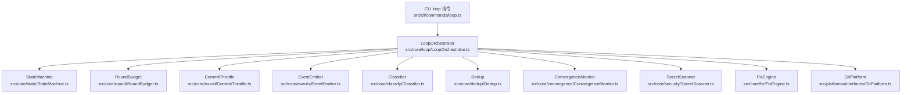
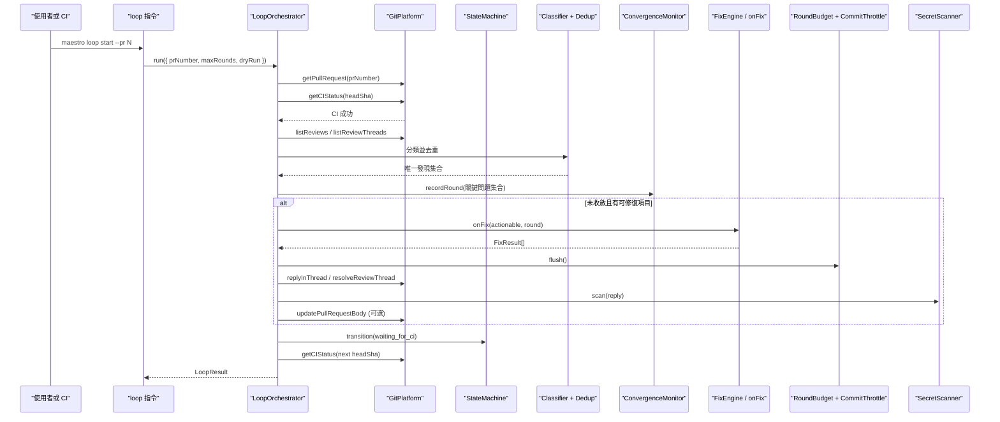
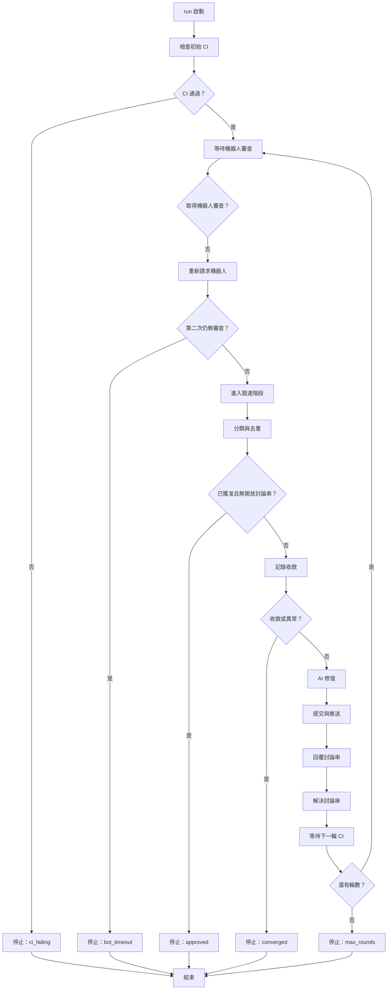
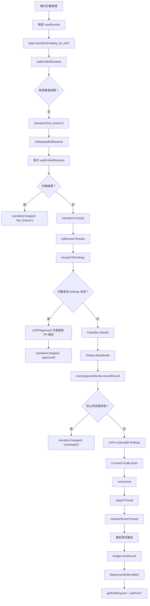
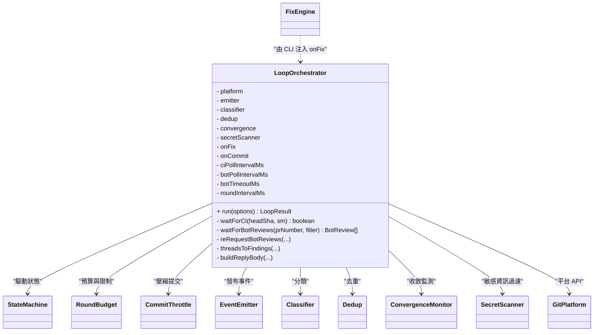

# LoopOrchestrator 循環協調器

**本文引用的檔案**

- [LoopOrchestrator.ts](https://github.com/mikeah2011/maestro/blob/master/src/core/loop/LoopOrchestrator.ts)
- [LoopOrchestrator.test.ts](https://github.com/mikeah2011/maestro/blob/master/tests/core/loop/LoopOrchestrator.test.ts)
- [loop.ts](https://github.com/mikeah2011/maestro/blob/master/src/cli/commands/loop.ts)
- [StateMachine.ts](https://github.com/mikeah2011/maestro/blob/master/src/core/state/StateMachine.ts)
- [RoundBudget.ts](https://github.com/mikeah2011/maestro/blob/master/src/core/round/RoundBudget.ts)
- [CommitThrottle.ts](https://github.com/mikeah2011/maestro/blob/master/src/core/round/CommitThrottle.ts)
- [EventEmitter.ts](https://github.com/mikeah2011/maestro/blob/master/src/core/events/EventEmitter.ts)
- [ConvergenceMonitor.ts](https://github.com/mikeah2011/maestro/blob/master/src/core/convergence/ConvergenceMonitor.ts)
- [Classifier.ts](https://github.com/mikeah2011/maestro/blob/master/src/core/classify/Classifier.ts)
- [Dedup.ts](https://github.com/mikeah2011/maestro/blob/master/src/core/dedup/Dedup.ts)
- [SecretScanner.ts](https://github.com/mikeah2011/maestro/blob/master/src/core/security/SecretScanner.ts)
- [FixEngine.ts](https://github.com/mikeah2011/maestro/blob/master/src/core/fix/FixEngine.ts)
- [GitPlatform.ts](https://github.com/mikeah2011/maestro/blob/master/src/platforms/interfaces/GitPlatform.ts)
- [README.md](https://github.com/mikeah2011/maestro/blob/master/README.md)

## 目錄

1. [簡介](#簡介)
2. [專案結構與角色定位](#專案結構與角色定位)
3. [核心類型與選項](#核心類型與選項)
4. [架構總覽](#架構總覽)
5. [生命週期：啟動、狀態檢查、停止與恢復](#生命週期啟動狀態檢查停止與恢復)
6. [每輪處理流程](#每輪處理流程)
7. [組件依賴關係](#組件依賴關係)
8. [異常處理與重試機制](#異常處理與重試機制)
9. [資源清理與防抖約束](#資源清理與防抖約束)
10. [實際使用範例](#實際使用範例)
11. [除錯技巧與事件診斷](#除錯技巧與事件診斷)
12. [效能考量](#效能考量)
13. [常見問題排解](#常見問題排解)
14. [結論](#結論)

## 簡介

`LoopOrchestrator` 是 Maestro 收斂循環的核心協調器。它不直接實現所有領域邏輯，而是把以下能力串成一個有明確開始、結束條件和可觀察狀態的自動化流程：

| 角色 | 責任 |
|---|---|
| `StateMachine` | 管理「等待 CI → 等待機器人 → 競速 → 分類 → 修復 → 提交推送 → 回覆 → 解決討論串」等狀態轉換 |
| `RoundBudget` | 追蹤每輪配額，防止同一輪重複提交或回覆同一討論串 |
| `CommitThrottle` | 將多項修復壓縮為單次提交，避免一輪多次寫入 Git |
| `EventEmitter` | 向外發布 JSONL 格式的事件，供 CLI、測試與外部系統觀測 |
| `Classifier` | 把機器人的審查評論分類為 bug、taste、wrong、yagni、unknown |
| `Dedup` | 三層去重：精確雜湊、模糊匹配、LLM 語義匹配 |
| `ConvergenceMonitor` | 記錄關鍵問題集合，偵測振盪、非單調增加或類別違規，作為提前終止依據 |
| `SecretScanner` | 掃描回覆內容，移除敏感資訊 |
| `FixEngine` | 由 CLI 注入，根據分類結果執行 AI 自動修復；在 dry-run 或無 AI Provider 時跳過 |
| `GitPlatform` | 抽象 GitHub（或其他平台）的 PR、CI、討論串、審查、提交與推送操作 |

從高層看，它的目標不是取代 CodeRabbit、Copilot、Codex 等審查機器人，而是讓這些機器人留下的問題能夠被分類、去重、修復、回覆、解決，並在達到穩定狀態或硬性上限時停止。

**章節來源**
- [README.md:1-20](https://github.com/mikeah2011/maestro/blob/master/README.md#L1-L20)
- [README.md:35-60](https://github.com/mikeah2011/maestro/blob/master/README.md#L35-L60)
- [README.md:100-140](https://github.com/mikeah2011/maestro/blob/master/README.md#L100-L140)

## 專案結構與角色定位



**圖表來源**
- [LoopOrchestrator.ts:1-70](https://github.com/mikeah2011/maestro/blob/master/src/core/loop/LoopOrchestrator.ts#L1-L70)
- [loop.ts:1-40](https://github.com/mikeah2011/maestro/blob/master/src/cli/commands/loop.ts#L1-L40)

`LoopOrchestrator` 本身只持有對 `GitPlatform` 的依賴；其餘子組件透過建構式參數注入，這讓：

1. 測試可以替換所有外部副作用。
2. CLI 可以把真實的 `FixEngine`、AI Provider、互動決策函式接入生產流程。
3. 未來要支援其他平台時，只需實作 `GitPlatform`，不需修改主循環邏輯。

**章節來源**
- [LoopOrchestrator.ts:70-150](https://github.com/mikeah2011/maestro/blob/master/src/core/loop/LoopOrchestrator.ts#L70-L150)
- [loop.ts:100-170](https://github.com/mikeah2011/maestro/blob/master/src/cli/commands/loop.ts#L100-L170)

## 核心類型與選項

### 運行選項

`run` 接收 `LoopRunOptions`，主要控制一次執行的範圍：

| 欄位 | 類型 | 預設值 | 說明 |
|---|---|---:|---|
| `prNumber` | `number` | 必填 | 要驅動的 Pull Request 編號 |
| `maxRounds` | `number` | `3` | 收斂循環最大輪數 |
| `botFilter` | `string[]` | `[]` | 僅接受指定 bot login 的問題；空陣列表示接受所有機器人 |
| `dryRun` | `boolean` | `false` | 只分類與報告，跳過修復、提交、回覆與重新請求 |

### 協調器選項

`LoopOrchestratorOptions` 定義如何組裝這個協調器：

| 欄位 | 類型 | 預設行為 |
|---|---|---|
| `platform` | `GitPlatform` | 必填，負責所有平台 API |
| `emitter` | `EventEmitter?` | 可選；未提供時不發送事件 |
| `classifier` | `Classifier?` | 未提供則建立預設實作 |
| `dedup` | `Dedup?` | 未提供則建立預設實作 |
| `convergence` | `ConvergenceMonitor?` | 未提供則建立預設實作 |
| `secretScanner` | `SecretScanner?` | 未提供則建立預設實作 |
| `onFix` | `(findings, round) => Promise<FixResult[]>` | 預設回傳空陣列，代表 M5 placeholder |
| `onCommit` | `(commit) => Promise<string>` | 預設回傳空字串 |
| `onDecide` | `(findings, round) => Promise<Map>` | 可選互動決策；dry-run 不會呼叫 |
| `ciPollIntervalMs` | `number` | `10_000` |
| `botPollIntervalMs` | `number` | `30_000` |
| `botTimeoutMs` | `number` | `300_000` |
| `roundIntervalMs` | `number` | `300_000` |
| `sleep` | `(ms) => Promise<void>` | 測試可替換為立即解析 |
| `onPRApproved` | `(pr, diff) => Promise<string|null>` | 允許在 PR 獲准時更新描述 |
| `botTriggerComments` | `Record<string,string>` | 用於需要留言觸發的機器人，例如 Codex |

### 返回結果

`run` 回傳 `LoopResult`：

| 欄位 | 說明 |
|---|---|
| `finalState` | 最終狀態機狀態 |
| `rounds` | 已執行的完整輪數 |
| `reason` | `approved`、`converged`、`max_rounds`、`stopped`、`error` |
| `error` | 當 reason 為 `error` 時包含原始錯誤 |

**章節來源**
- [LoopOrchestrator.ts:20-110](https://github.com/mikeah2011/maestro/blob/master/src/core/loop/LoopOrchestrator.ts#L20-L110)
- [LoopOrchestrator.ts:110-190](https://github.com/mikeah2011/maestro/blob/master/src/core/loop/LoopOrchestrator.ts#L110-L190)

## 架構總覽



**圖表來源**
- [LoopOrchestrator.ts:150-533](https://github.com/mikeah2011/maestro/blob/master/src/core/loop/LoopOrchestrator.ts#L150-L533)
- [loop.ts:170-300](https://github.com/mikeah2011/maestro/blob/master/src/cli/commands/loop.ts#L170-L300)

## 生命週期：啟動、狀態檢查、停止與恢復

### 啟動：`start`

目前 CLI 中 `maestro loop start` 是主要入口，但 `LoopOrchestrator` 本身的啟動點是 `run(options)`。CLI 會先完成設定載入、平台初始化、AI Provider 解析、事件監聽，再呼叫 orchestrator：

1. 驗證 `--pr` 為正整數。
2. 載入 `.maestro.yaml`。
3. 初始化 `GitHubPlatform`。
4. 建立 `EventEmitter` 並訂閱標準輸出與美化輸出。
5. 解析 AI Provider。
6. 建立 `Classifier`，若有 AI Provider 則使用 LLM 分類。
7. 在非 dry-run 且存在 AI Provider 時建立 `FixEngine`。
8. 建立互動式 `onDecide`。
9. 建立 `onCommit`，負責 `git add / commit / push`。
10. 建立 `onPRApproved`，在 PR 獲准時嘗試補寫描述。
11. 呼叫 `orchestrator.run()`。

**章節來源**
- [loop.ts:40-120](https://github.com/mikeah2011/maestro/blob/master/src/cli/commands/loop.ts#L40-L120)
- [loop.ts:170-300](https://github.com/mikeah2011/maestro/blob/master/src/cli/commands/loop.ts#L170-L300)

### 狀態檢查：`status`

`maestro loop status` 目前是佔位命令，尚未實作持久化狀態。CLI 直接印出「尚未實作」訊息並離開程式。

**章節來源**
- [loop.ts:300-320](https://github.com/mikeah2011/maestro/blob/master/src/cli/commands/loop.ts#L300-L320)

### 停止：`stop`

`maestro loop stop` 同樣是佔位命令，預期在 M7 加入持久化層後才實作。當前會直接退出並提示該功能尚未實作。

**章節來源**
- [loop.ts:320-340](https://github.com/mikeah2011/maestro/blob/master/src/cli/commands/loop.ts#L320-L340)

### 恢復：`resume`

`maestro loop resume` 也是未來規劃，預期對應狀態機的 `HumanIntervened` 等持久化狀態。目前仍為佔位命令。

**章節來源**
- [loop.ts:340-360](https://github.com/mikeah2011/maestro/blob/master/src/cli/commands/loop.ts#L340-L360)

### 即時停止條件

雖然 CLI 的 `status/stop/resume` 尚未實作，但 `LoopOrchestrator.run` 內部已有明確停止條件：

| 條件 | 最終 reason | 說明 |
|---|---|---|
| CI 初始失敗 | `stopped` | 還沒進入收斂循環就中止 |
| 機器人超時 | `stopped` | 第一次沒有收到任何機器人審查，重試後仍無結果 |
| PR 獲准且無開放討論串 | `approved` | 可能同時更新 PR 描述 |
| 關鍵問題集不再變化 | `converged` | 偵測到振盪、非單調或類別違規 |
| 超過 `maxRounds` | `max_rounds` | 硬性上限 |
| 未預期例外 | `error` | 包裝原始錯誤並持續發送事件 |



**圖表來源**
- [LoopOrchestrator.ts:150-533](https://github.com/mikeah2011/maestro/blob/master/src/core/loop/LoopOrchestrator.ts#L150-L533)

## 每輪處理流程

每輪由 `for(;;)` 無限迴圈驅動，並在每次迭代前檢查 `maxRounds`。以下是單一輪次的順序：



**圖表來源**
- [LoopOrchestrator.ts:200-533](https://github.com/mikeah2011/maestro/blob/master/src/core/loop/LoopOrchestrator.ts#L200-L533)

### 步驟一：拉取 PR 與初始 CI

`run` 一開始就抓取 PR，取得 `headSha`，然後呼叫 `waitForCI`。CI 檢查最多等待 30 分鐘，並以 `ciPollIntervalMs` 間隔輪詢。若 CI 狀態為 failure 或 error，立刻停止。

**章節來源**
- [LoopOrchestrator.ts:130-170](https://github.com/mikeah2011/maestro/blob/master/src/core/loop/LoopOrchestrator.ts#L130-L170)
- [LoopOrchestrator.ts:533-570](https://github.com/mikeah2011/maestro/blob/master/src/core/loop/LoopOrchestrator.ts#L533-L570)

### 步驟二：等待機器人審查

`waitForBotReviews` 會輪詢 `listReviews`，直到取得至少一筆機器人審查，或在 `botTimeoutMs` 內仍未取得。若首次未取得，會先呼叫 `reRequestBotReviews`，再重试一次。

這裡有一個重要細節：已經顯示終端訊息（如用量限制）的機器人會被預先標記，避免再次浪費 API 請求。

**章節來源**
- [LoopOrchestrator.ts:150-210](https://github.com/mikeah2011/maestro/blob/master/src/core/loop/LoopOrchestrator.ts#L150-L210)

### 步驟三：分類問題

分類流程：

1. 從平台取得 `listReviewThreads`。
2. 過濾掉已解決、人類作者、自己發表過第一則評論的討論串。
3. 套用 `botFilter`。
4. 將每個討論串轉為 `Finding`。
5. 使用 `RoundBudget` 保護分類成本，並交由 `Classifier.classify` 分類。
6. 預設行動：bug 與 unknown 嘗試修復；taste 與 yagni 延後；wrong 拒絕。
7. 若提供 `onDecide`，則允許使用者覆蓋預設決策。

**章節來源**
- [LoopOrchestrator.ts:230-320](https://github.com/mikeah2011/maestro/blob/master/src/core/loop/LoopOrchestrator.ts#L230-L320)
- [loop.ts:140-240](https://github.com/mikeah2011/maestro/blob/master/src/cli/commands/loop.ts#L140-L240)

### 步驟四：去重

`Dedup.deduplicate` 會對分類結果進行去重。`LoopOrchestrator` 接著：

- 計算關鍵問題集合：僅包含 `category === 'bug'` 且 `severity` 為 critical 或 high 的 finding。
- 把這個集合交給 `ConvergenceMonitor.recordRound`。
- 若收斂監測回報振盪、非單調或類別違規，則停止。

**章節來源**
- [LoopOrchestrator.ts:320-400](https://github.com/mikeah2011/maestro/blob/master/src/core/loop/LoopOrchestrator.ts#L320-L400)

### 步驟五：AI 修復

只有以下條件都成立才會執行修復：

- 不是 dry-run。
- 有至少一個 `decision === 'fix'` 的 finding。
- `onFix` 非空。

`onFix` 預設回傳空陣列；CLI 會注入 `FixEngine.fix`，由 AI Provider 產生實際修復。

**章節來源**
- [LoopOrchestrator.ts:400-440](https://github.com/mikeah2011/maestro/blob/master/src/core/loop/LoopOrchestrator.ts#L400-L440)
- [loop.ts:160-200](https://github.com/mikeah2011/maestro/blob/master/src/cli/commands/loop.ts#L160-L200)

### 步驟六：提交推送

多個修復會被 `CommitThrottle` 合併為一個 `RoundCommit`，確保每輪最多一次提交。`RoundBudget.recordCommit` 也會紀錄提交次數。

CLI 的 `onCommit` 會：

1. `git add` 受影響檔案。
2. 檢查 staged 是否為空。
3. `git commit`。
4. `git push`。
5. 回傳 commit SHA。

**章節來源**
- [LoopOrchestrator.ts:440-470](https://github.com/mikeah2011/maestro/blob/master/src/core/loop/LoopOrchestrator.ts#L440-L470)
- [loop.ts:200-240](https://github.com/mikeah2011/maestro/blob/master/src/cli/commands/loop.ts#L200-L240)

### 步驟七：回覆討論串

對於每個 unique finding：

1. 判斷是否需要回覆。
2. 由 `buildReplyBody` 產生回覆內容。
3. 用 `SecretScanner.scan` 清除敏感資訊。
4. 呼叫 `platform.replyInThread`。
5. 若平台支援 emoji 反應，則對機器人原始評論加上 ROCKET（修復）或 EYES（確認）。
6. 對被去重的 duplicate finding 回覆統一處理訊息。

**章節來源**
- [LoopOrchestrator.ts:470-520](https://github.com/mikeah2011/maestro/blob/master/src/core/loop/LoopOrchestrator.ts#L470-L520)

### 步驟八：解決討論串

若平台支援 `threadResolve`，則逐一呼叫 `resolveReviewThread`。這代表「我們已處理此問題，請機器人閉嘴」。

**章節來源**
- [LoopOrchestrator.ts:520-540](https://github.com/mikeah2011/maestro/blob/master/src/core/loop/LoopOrchestrator.ts#L520-L540)

### 步驟九：重新請求審查

只有在以下條件下才會重新請求：

- 不是 dry-run。
- 本輪至少回覆了一個討論串。
- 所有討論串都已關閉。
- 機器人尚未在本輪被重新請求。
- 機器人不屬於 satisfied/approved/requestedBots。

**章節來源**
- [LoopOrchestrator.ts:540-570](https://github.com/mikeah2011/maestro/blob/master/src/core/loop/LoopOrchestrator.ts#L540-L570)

## 組件依賴關係



**圖表來源**
- [LoopOrchestrator.ts:120-190](https://github.com/mikeah2011/maestro/blob/master/src/core/loop/LoopOrchestrator.ts#L120-L190)
- [loop.ts:140-200](https://github.com/mikeah2011/maestro/blob/master/src/cli/commands/loop.ts#L140-L200)

## 異常處理與重試機制

### CI 失敗

| 階段 | 行為 |
|---|---|
| 初始 CI | 立即停止，reason 為 `stopped` |
| 每輪結尾 CI | 若下一個 headSha 的 CI 失敗，進入 `ci_failing` 並停止 |
| CI pending | 持續輪詢，直到 success、failure、error 或 30 分鐘逾時 |

### 機器人超時

1. 首次 `waitForBotReviews` 未取得審查。
2. 狀態轉為 `bot_timeout`。
3. 呼叫 `reRequestBotReviews`。
4. 再次等待。
5. 若仍無結果，狀態轉為 `stopped`，reason 為 `bot_timeout`。

### API 限流

API 限流並非由 `LoopOrchestrator` 自行解析速率限制頭；它依賴 `GitPlatform` 提供的介面。當前測試中的 mock 平台提供了 `getRateLimitInfo`，但 orchestrator 主流程並未直接讀取剩餘配额來退避。因此：

- 若平台層面能處理限流，orchestrator 繼續正常運作。
- 若平台拋出限流例外，orchestrator 的頂層 catch 會把它包裝成 `error`。

### 一般異常

整個 `run` 方法包裹在 try-catch 中：

1. 把任意錯誤轉換為 `Error`。
2. 發送 `loop.error` 事件。
3. 嘗試轉移到 `stopped` 狀態。
4. 回傳 `{ finalState: 'stopped', reason: 'error', error }`。

**章節來源**
- [LoopOrchestrator.ts:500-533](https://github.com/mikeah2011/maestro/blob/master/src/core/loop/LoopOrchestrator.ts#L500-L533)
- [LoopOrchestrator.test.ts:260-320](https://github.com/mikeah2011/maestro/blob/master/tests/core/loop/LoopOrchestrator.test.ts#L260-L320)

## 資源清理與防抖約束

### 每輪最多一次提交

`CommitThrottle` 在每輪建立新實例，把所有 `FixResult` 加入後呼叫 `flush()`，只產出一個 `RoundCommit`。這是反垃圾郵件設計的一部分。

### 每輪最多一次 PR 內容更新

PR 描述更新只在「已獲准且無開放討論串」的路徑中發生，且由 `onPRApproved` 決定是否更新。

### 每討論串每輪最多一次回覆

`RoundBudget.recordReply(threadId)` 用來追蹤已回覆的討論串，避免重複回覆。

### 安全掃描

所有回覆都會經過 `SecretScanner.scan`，取得 `redacted` 版本後才送出平台 API。

### 非致命錯誤

許多平台操作使用 try-catch 包起來，例如：

- 預先掃描現有 PR 評論以識別終端機器人。
- 預先掃描既有審查以識別已滿足的機器人。
- PR 描述更新失敗時忽略。
- emoji 反應失敗時忽略。
- duplicate 回覆失敗時忽略。
- 狀態轉換失敗時忽略（可能已在 stopped）。

這讓 orchestrator 在部分外圍操作失敗時仍能繼續收斂流程。

**章節來源**
- [LoopOrchestrator.ts:160-190](https://github.com/mikeah2011/maestro/blob/master/src/core/loop/LoopOrchestrator.ts#L160-L190)
- [LoopOrchestrator.ts:440-533](https://github.com/mikeah2011/maestro/blob/master/src/core/loop/LoopOrchestrator.ts#L440-L533)

## 實際使用範例

### 基本啟動

```bash
bun run src/cli/index.ts loop start --pr 42
```

這會：

1. 載入 `.maestro.yaml`。
2. 初始化 GitHub 平台。
3. 連接 AI Provider。
4. 啟動收斂循環。
5. 以 JSONL 和美化文字輸出事件。

### Dry-run 模式

```bash
bun run src/cli/index.ts loop start --pr 42 --dry-run
```

dry-run 模式下：

- 仍會拉取 PR 與 CI 狀態。
- 仍會拉取機器人審查與討論串。
- 仍會分類與去重。
- 不會執行 `onFix`。
- 不會提交或推送。
- 不會回覆或解決討論串。
- 不會重新請求審查。

### 限制機器人種類

```bash
bun run src/cli/index.ts loop start --pr 42 --bots coderabbitai,copilot-pull-request-reviewer
```

只會接受這些 bot login 的問題。

### 調整最大輪數

```bash
bun run src/cli/index.ts loop start --pr 42 --max-rounds 5
```

注意：預設是 3 輪，這是收斂策略的硬上限。

### 指定工作目錄

```bash
bun run src/cli/index.ts loop start --pr 42 --cwd /path/to/repo
```

這會讓所有 git 操作和 `.maestro.yaml` 載入都針對該目錄。

**章節來源**
- [README.md:60-120](https://github.com/mikeah2011/maestro/blob/master/README.md#L60-L120)
- [loop.ts:40-120](https://github.com/mikeah2011/maestro/blob/master/src/cli/commands/loop.ts#L40-L120)

## 除錯技巧與事件診斷

### 觀察事件

CLI 預設訂閱兩個 sink：

1. `stdoutSink`：JSONL 格式事件，適合管道到其他工具。
2. `prettySink`：人類可讀的彩色進度訊息。

常用事件：

| 事件 | 用途 |
|---|---|
| `loop.starting` | 確認啟動參數 |
| `state.transition` | 追蹤狀態機移動 |
| `ci.polling` | 觀察 CI 輪詢 |
| `round.start` | 每輪開始 |
| `round.bot_status` | 查看各機器人狀態 |
| `classify.result` | 查看單個 finding 的分類結果 |
| `round.classified` | 查看分類摘要 |
| `round.decisions` | 查看 fix/defer/reject 數量 |
| `fix.applied` | 查看修復描述 |
| `fix.skipped` | 為何跳過修復 |
| `round.committed` | 本輪提交摘要 |
| `thread.replied` | 討論串回覆 |
| `thread.resolved` | 討論串解決 |
| `loop.error` | 異常診斷 |
| `loop.done` | 最終原因 |

### 測試中模擬平台

測試檔展示了如何建立 `makeMockPlatform`，並用 `ciStates`、`reviewRounds`、`threadRounds` 控制每輪的行為。這非常適合模擬：

- CI 從 pending 變 success。
- 機器人從 changes_requested 變 approved。
- 討論串從 open 變 resolved。
- API 限流或網路錯誤。

### 快速除錯建議

1. 先用 `--dry-run` 確認分類與決策是否符合預期。
2. 觀察 `classify.result` 與 `round.decisions`。
3. 若 AI 修復未觸發，檢查 `fix.skipped`。
4. 若討論串未解決，確認 `onFix` 回傳的 `findingHash` 是否與 finding hash 一致。
5. 若機器人一直重複審查，檢查 `requestedBots`、`approvedBots`、`botFilter`。
6. 若 CI 卡住，檢查 `ciPollIntervalMs` 與 CI 實際狀態。

**章節來源**
- [LoopOrchestrator.test.ts:1-120](https://github.com/mikeah2011/maestro/blob/master/tests/core/loop/LoopOrchestrator.test.ts#L1-L120)
- [loop.ts:360-512](https://github.com/mikeah2011/maestro/blob/master/src/cli/commands/loop.ts#L360-L512)

## 效能考量

| 項目 | 考量 |
|---|---|
| CI 輪詢 | 預設 10 秒間隔，最多 30 分鐘；可降低頻繁 API 請求 |
| 機器人輪詢 | 預設 30 秒間隔；超時 300 秒 |
| 輪次間休息 | 預設 300 秒，讓機器人重新審查 |
| 分類成本 | 使用 `RoundBudget` 限制每輪分類成本 |
| 提交次數 | 每輪最多一次提交 |
| 回覆次數 | 每討論串每輪最多一次回覆 |
| 平台 API | 所有平台操作透過 `GitPlatform`，便於未來加緩存或限流退避 |
| AI 呼叫 | 分類與修復都可能呼叫 LLM；dry-run 可完全避免 |

若要優化：

- 在測試環境使用 `sleep: () => Promise.resolve()` 消除等待。
- 在開發環境增大 `roundIntervalMs`，減少 CI 與平台壓力。
- 使用 `botFilter` 只處理必要機器人。
- 使用 `--dry-run` 先驗證分類與決策。
- 若平台支援 GraphQL 或批次 API，優先實作於 `GitPlatform` 而非 orchestrator。

[本節為一般性能指導，未直接分析特定程式碼片段]

## 常見問題排解

### 為什麼沒有修復？

可能原因：

1. `--dry-run` 已啟用。
2. 沒有 AI Provider。
3. 分類結果都是 taste、yagni 或 wrong。
4. `onDecide` 把全部改為 defer 或 reject。
5. `onFix` 回傳空陣列。
6. `FixEngine` 無法產生修復。

檢查事件：`round.decisions`、`fix.skipped`、`fix.applied`。

**章節來源**
- [LoopOrchestrator.ts:380-440](https://github.com/mikeah2011/maestro/blob/master/src/core/loop/LoopOrchestrator.ts#L380-L440)
- [loop.ts:140-200](https://github.com/mikeah2011/maestro/blob/master/src/cli/commands/loop.ts#L140-L200)

### 為什麼討論串沒有解決？

可能原因：

1. `onFix` 沒有回傳匹配的 `findingHash`。
2. 平台不支援 `threadResolve`。
3. discussion 仍然開放，導致重新請求審查被跳過。
4. CI 在回合結束前失敗。

**章節來源**
- [LoopOrchestrator.ts:520-570](https://github.com/mikeah2011/maestro/blob/master/src/core/loop/LoopOrchestrator.ts#L520-L570)

### 為什麼機器人不斷重新審查？

可能原因：

1. 討論串仍未解決。
2. 機器人狀態不是 approved/satisfied。
3. `requestedBots` 未正確累積。
4. `botFilter` 過濾掉了某些機器人。
5. 機器人自身仍持續產生新評論。

**章節來源**
- [LoopOrchestrator.ts:200-250](https://github.com/mikeah2011/maestro/blob/master/src/core/loop/LoopOrchestrator.ts#L200-L250)
- [LoopOrchestrator.ts:540-570](https://github.com/mikeah2011/maestro/blob/master/src/core/loop/LoopOrchestrator.ts#L540-L570)

### 為什麼循環停在 converged？

`ConvergenceMonitor` 偵測到：

- 關鍵問題集振盪。
- 關鍵問題集比上一輪還多。
- 類別違規。

這代表問題可能沒被真正修復，或者分類結果波動太大。建議檢查分類品質、修復有效性與 `botFilter`。

**章節來源**
- [LoopOrchestrator.ts:360-400](https://github.com/mikeah2011/maestro/blob/master/src/core/loop/LoopOrchestrator.ts#L360-L400)

### 為什麼出現 error？

最常見的來源是平台 API 錯誤，例如：

- GitHub token 無效。
- 網路連線失敗。
- API 限流。
- PR 不存在。
- GraphQL 查詢失敗。

orchestrator 會把錯誤包裝成 `LoopResult.reason === 'error'`，並發送 `loop.error`。

**章節來源**
- [LoopOrchestrator.ts:500-533](https://github.com/mikeah2011/maestro/blob/master/src/core/loop/LoopOrchestrator.ts#L500-L533)
- [LoopOrchestrator.test.ts:280-320](https://github.com/mikeah2011/maestro/blob/master/tests/core/loop/LoopOrchestrator.test.ts#L280-L320)

## 結論

`LoopOrchestrator` 是一個高度模組化的收斂循環協調器。它的價值不在於單獨實現某個領域能力，而在於把狀態機、預算、分類、去重、收斂監測、安全掃描、修復引擎與平台 API 整合成一個可預測、可觀察、可測試的流程。

最重要的設計原則包括：

1. **明確的生命週期**：啟動、輪次、停止都有清晰狀態。
2. **可注入的外部依賴**：平台、AI、事件、預算都可以替換。
3. **反垃圾郵件約束**：每輪最多一次提交、每討論串每輪最多一次回覆。
4. **可觀測性**：所有關鍵路徑都發送事件。
5. **容錯設計**：多數外圍操作失敗不會中斷整體收斂。
6. **確定性停止**：approved、converged、max_rounds、stopped、error 五種原因。

對於維護者而言，修改 `LoopOrchestrator` 時應優先考慮：

- 是否破壞狀態機轉換順序。
- 是否違反 RoundBudget 或 CommitThrottle 約束。
- 是否應該發送對應事件。
- 是否能在 dry-run 與測試環境中正常運作。
- 是否讓異常路徑仍保持可觀測。