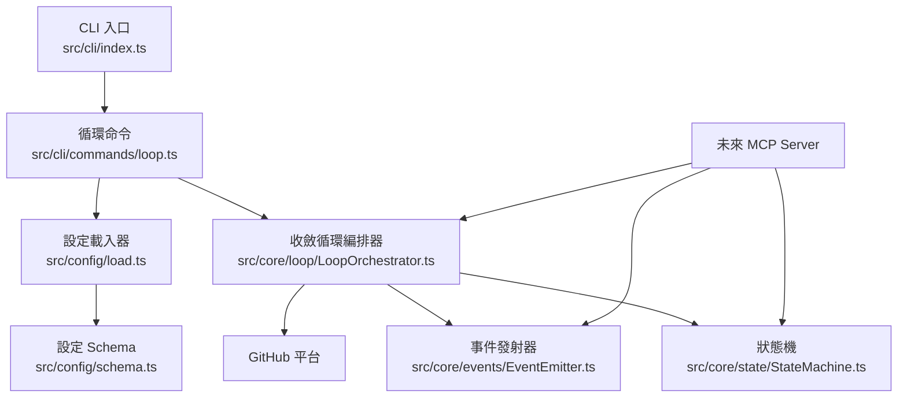
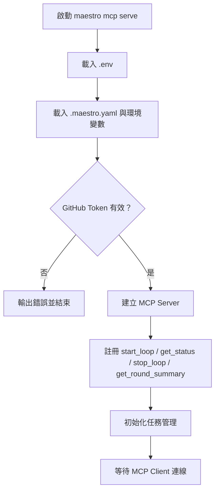
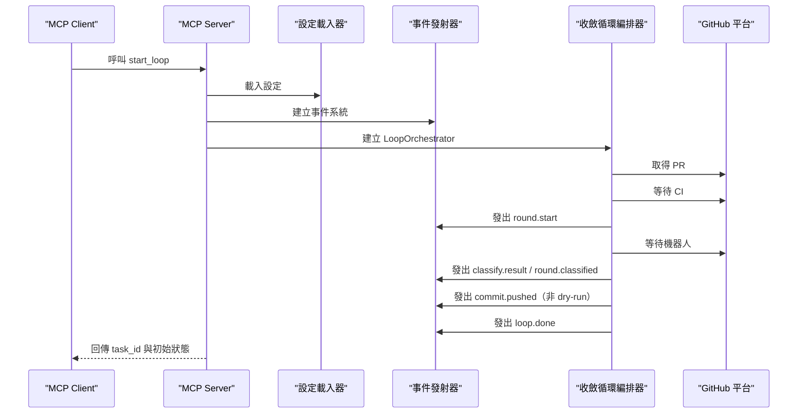
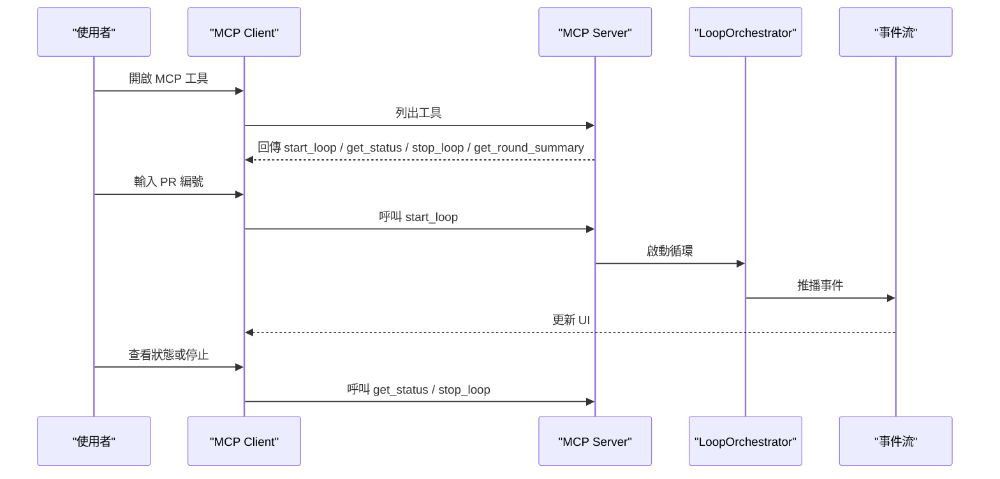
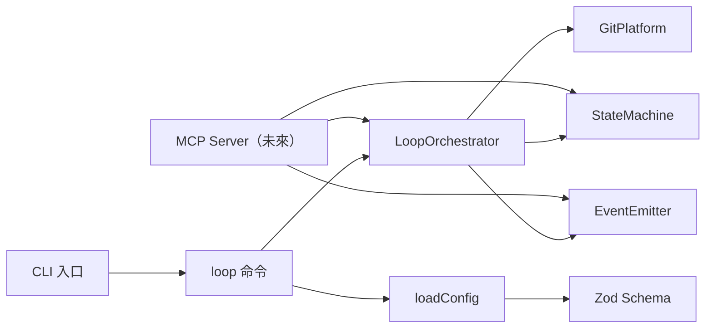

# MCP Server 整合

**本文引用的檔案**

- [README.md](https://github.com/mikeah2011/maestro/blob/master/README.md)
- [package.json](https://github.com/mikeah2011/maestro/blob/master/package.json)
- [CLAUDE.md](https://github.com/mikeah2011/maestro/blob/master/CLAUDE.md)
- [docs/DESIGN.md](https://github.com/mikeah2011/maestro/blob/master/docs/DESIGN.md)
- [src/index.ts](https://github.com/mikeah2011/maestro/blob/master/src/index.ts)
- [src/cli/index.ts](https://github.com/mikeah2011/maestro/blob/master/src/cli/index.ts)
- [src/cli/commands/loop.ts](https://github.com/mikeah2011/maestro/blob/master/src/cli/commands/loop.ts)
- [src/core/loop/LoopOrchestrator.ts](https://github.com/mikeah2011/maestro/blob/master/src/core/loop/LoopOrchestrator.ts)
- [src/core/events/EventEmitter.ts](https://github.com/mikeah2011/maestro/blob/master/src/core/events/EventEmitter.ts)
- [src/core/state/StateMachine.ts](https://github.com/mikeah2011/maestro/blob/master/src/core/state/StateMachine.ts)
- [src/config/load.ts](https://github.com/mikeah2011/maestro/blob/master/src/config/load.ts)
- [src/config/schema.ts](https://github.com/mikeah2011/maestro/blob/master/src/config/schema.ts)

## 目錄

1. [簡介](#簡介)
2. [專案結構與現有能力](#專案結構與現有能力)
3. [MCP Server 設計目標](#mcp-server-設計目標)
4. [未來暴露的 MCP 工具定義](#未來暴露的-mcp-工具定義)
5. [MCP Protocol 訊息格式與工具規範](#mcp-protocol-訊息格式與工具規範)
6. [MCP Server 啟動設定](#mcp-server-啟動設定)
7. [工具調用請求與回應範例](#工具調用請求與回應範例)
8. [與其他 MCP Clients 整合](#與其他-mcp-clients-整合)
9. [與 Claude Code Skill 的差異與適用場景](#與-claude-code-skill-的差異與適用場景)
10. [安全性考量、權限控制與監控建議](#安全性考量權限控制與監控建議)
11. [依賴關係分析](#依賴關係分析)
12. [故障排除指南](#故障排除指南)
13. [結論](#結論)

## 簡介

Maestro 的核心價值不是另一個程式碼審查工具，而是「審查機器人之上的收斂層」：它協調多個 AI 機器人（例如 CodeRabbit、Ellipsis、Copilot Code Review、Codex、Gemini Code Assist、Sourcery），把分散的 PR 討論串轉成可執行的修復流程，並在最多三輪內強制收斂。

從系統設計來看，Maestro 已經明確規劃了 MCP Server 角色：

- CLI 是程序。
- Skill、GitHub Action、MCP Server 都是 UI 或通道適配器。
- 長時運行的編排邏輯集中在 CLI 與 `LoopOrchestrator`。
- 單一 MCP Server 將暴露 `start_loop`、`get_status`、`stop_loop`、`get_round_summary` 四個工具。
- 所有有狀態事件統一透過 `EventEmitter` 以 JSONL 輸出。

這份文件說明未來如何基於現有架構實作 MCP Server，而不改變核心收斂循環的行為。

**章節來源**
- [README.md:1-120](https://github.com/mikeah2011/maestro/blob/master/README.md#L1-L120)
- [docs/DESIGN.md:55-70](https://github.com/mikeah2011/maestro/blob/master/docs/DESIGN.md#L55-L70)
- [docs/DESIGN.md:170-185](https://github.com/mikeah2011/maestro/blob/master/docs/DESIGN.md#L170-L185)

## 專案結構與現有能力

目前專案尚未包含 `maestro mcp serve` 命令，但已有足夠的基礎元件：

| 層級 | 現有元件 | 與 MCP Server 的關係 |
|---|---|---|
| CLI 入口 | `src/cli/index.ts` | 負責註冊 `init`、`doctor`、`loop`、`audit`、`bots`；未來應新增 `mcp` 子命令 |
| 循環命令 | `src/cli/commands/loop.ts` | 負責 `loop start/status/stop/resume`；其中 `status`、`stop`、`resume` 目前標記為尚未實作 |
| 核心編排器 | `src/core/loop/LoopOrchestrator.ts` | 提供 `run(options)`，是 MCP 工具的實際執行中心 |
| 事件系統 | `src/core/events/EventEmitter.ts` | 所有狀態變化、分類結果、提交結果都經由此處 |
| 狀態機 | `src/core/state/StateMachine.ts` | 定義 `waiting_for_ci`、`classifying`、`fixing`、`commit_pushed`、`replying`、`resolving`、`stopped` 等狀態 |
| 設定載入 | `src/config/load.ts`、`src/config/schema.ts` | 提供環境變數、YAML、CLI flags 的多層設定 |
| 公開 API | `src/index.ts` | 重新匯出供外部模組使用的型別與類別 |



**圖表來源**
- [src/cli/index.ts:1-86](https://github.com/mikeah2011/maestro/blob/master/src/cli/index.ts#L1-L86)
- [src/cli/commands/loop.ts:1-60](https://github.com/mikeah2011/maestro/blob/master/src/cli/commands/loop.ts#L1-L60)
- [src/core/loop/LoopOrchestrator.ts:111-150](https://github.com/mikeah2011/maestro/blob/master/src/core/loop/LoopOrchestrator.ts#L111-L150)
- [src/core/state/StateMachine.ts:1-60](https://github.com/mikeah2011/maestro/blob/master/src/core/state/StateMachine.ts#L1-L60)
- [src/core/events/EventEmitter.ts:1-40](https://github.com/mikeah2011/maestro/blob/master/src/core/events/EventEmitter.ts#L1-L40)
- [src/config/load.ts:1-40](https://github.com/mikeah2011/maestro/blob/master/src/config/load.ts#L1-L40)
- [src/config/schema.ts:1-30](https://github.com/mikeah2011/maestro/blob/master/src/config/schema.ts#L1-L30)

**章節來源**
- [src/cli/index.ts:1-86](https://github.com/mikeah2011/maestro/blob/master/src/cli/index.ts#L1-L86)
- [src/cli/commands/loop.ts:1-60](https://github.com/mikeah2011/maestro/blob/master/src/cli/commands/loop.ts#L1-L60)
- [src/core/loop/LoopOrchestrator.ts:111-150](https://github.com/mikeah2011/maestro/blob/master/src/core/loop/LoopOrchestrator.ts#L111-L150)
- [src/core/events/EventEmitter.ts:1-40](https://github.com/mikeah2011/maestro/blob/master/src/core/events/EventEmitter.ts#L1-L40)
- [src/config/load.ts:1-40](https://github.com/mikeah2011/maestro/blob/master/src/config/load.ts#L1-L40)
- [src/config/schema.ts:1-30](https://github.com/mikeah2011/maestro/blob/master/src/config/schema.ts#L1-L30)

## MCP Server 設計目標

根據設計文件，MCP Server 應該遵循以下原則：

1. **不重複核心邏輯**：MCP Server 不應複製 `LoopOrchestrator.run()`，而應調用現有的循環引擎。
2. **事件即事實來源**：所有長期狀態都應透過 `EventEmitter` 的事件推播給 MCP Client。
3. **工具只是操作介面**：`start_loop`、`get_status`、`stop_loop`、`get_round_summary` 是面向客戶端的控制點，背後仍是同一個狀態機與平台適配器。
4. **錯誤必須大聲失敗**：RoundBudget 與狀態機的設計哲學是「違反規則就 throw」，MCP Server 也應維持這個不變量。
5. **安全預設**：MCP Server 不應隱式取得比 CLI 更高的權限；GitHub Token、AI Provider Key 仍來自環境或設定。

設計文件中特別指出：

> 「CLI 是程序，Skill 是視窗。」  
> 「單一 MCP 伺服器暴露 `start_loop / get_status / stop_loop / get_round_summary`——一旦上線，每個支援 MCP 的代理都能免費整合。」

這表示 MCP Server 的定位是「可被任何 MCP Client 調用的控制器」，而不是獨立於 CLI 的另一套業務邏輯。

**章節來源**
- [docs/DESIGN.md:55-70](https://github.com/mikeah2011/maestro/blob/master/docs/DESIGN.md#L55-L70)
- [docs/DESIGN.md:170-185](https://github.com/mikeah2011/maestro/blob/master/docs/DESIGN.md#L170-L185)
- [src/core/loop/LoopOrchestrator.ts:111-150](https://github.com/mikeah2011/maestro/blob/master/src/core/loop/LoopOrchestrator.ts#L111-L150)

## 未來暴露的 MCP 工具定義

### 工具總覽

| 工具名稱 | 用途 | 是否會寫入外部系統 | 主要回傳內容 |
|---|---|---:|---|
| `start_loop` | 針對指定 PR 啟動收斂循環 | 是（可能觸發 CI、機器人、提交、回覆） | 任務 ID、初始狀態、事件流 |
| `get_status` | 查詢某個 PR 循環的當前狀態 | 否（只讀） | 狀態、輪數、原因、相關事件摘要 |
| `stop_loop` | 停止正在執行的循環 | 是（記錄停止原因） | 任務 ID、最終狀態 |
| `get_round_summary` | 取得某輪或最近一輪的分析摘要 | 否（只讀） | 問題數量、關鍵問題、決策分佈、收斂狀態 |

### `start_loop`

**目的**：啟動一個新的 Maestro 收斂循環。

**必要參數**

| 參數 | 類型 | 必要 | 說明 |
|---|---|---:|---|
| `pr_number` | 整數 | 是 | PR 編號；對應 CLI 的 `--pr` |
| `repository_owner` | 字串 | 可選 | 覆寫設定中的 owner |
| `repository_name` | 字串 | 可選 | 覆寫設定中的 repo |
| `max_rounds` | 整數 | 可選 | 覆寫 `stopConditions.maxRounds`，上限仍受 schema 限制為 5 |
| `cost_budget_usd` | 數字 | 可選 | 單次循環成本上限 |
| `bot_filter` | 字串陣列 | 可選 | 只監聽指定 bot login |
| `dry_run` | 布林值 | 可選 | 若為 true，只分類與報告，不修復、不提交、不回覆 |
| `cwd` | 字串 | 可選 | 目標 Git 倉庫目錄 |

**行為準則**

- 驗證 `pr_number` 為正整數。
- 載入並合併設定。
- 建立 `EventEmitter`。
- 解析 AI Provider。
- 建立 `LoopOrchestrator`。
- 回傳 `task_id`，並開始推播事件。
- 在 dry-run 模式下不執行 `onFix`、`onCommit`、`onDecide`。

**風險等級**：高。這是唯一會觸發外部副作用的工具。

### `get_status`

**目的**：查詢某個 PR 或某個 `task_id` 的當前狀態。

**必要參數**

| 參數 | 類型 | 必要 | 說明 |
|---|---|---:|---|
| `pr_number` | 整數 | 可選 | 依 PR 查詢 |
| `task_id` | 字串 | 可選 | 依任務查詢 |

**回傳欄位建議**

| 欄位 | 類型 | 說明 |
|---|---|---|
| `task_id` | 字串 | 內部任務識別 |
| `pr_number` | 整數 | PR 編號 |
| `state` | 字串 | 來自 `LoopState`，例如 `waiting_for_ci`、`classifying`、`stopped` |
| `round` | 整數 | 目前已完成的輪數 |
| `reason` | 字串 | `approved`、`converged`、`max_rounds`、`stopped`、`error` |
| `last_event_ts` | 字串 | 最後一個事件的 ISO-8601 時間戳 |
| `events_snapshot` | 物件陣列 | 最近若干筆事件，供前端快速渲染 |

**風險等級**：低。只讀操作。

### `stop_loop`

**目的**：停止正在執行的循環。

**必要參數**

| 參數 | 類型 | 必要 | 說明 |
|---|---:|---|
| `task_id` | 字串 | 是 | 要停止的任務 |

**行為準則**

- 若找不到任務，回傳錯誤。
- 若任務已終止，回傳其最終狀態。
- 若任務仍在運行，標記為停止，並發出 `loop.stopped` 或類似事件。
- 不得強行中斷正在執行的平台 API 呼叫；應透過狀態機轉換到 `stopped`。

**風險等級**：中。會改變系統狀態，但不應直接修改 PR。

### `get_round_summary`

**目的**：取得某一輪或最近一輪的詳細分析摘要。

**必要參數**

| 參數 | 類型 | 必要 | 說明 |
|---|---|---:|---|
| `task_id` | 字串 | 是 | 任務識別 |
| `round` | 整數 | 可選 | 指定輪數；省略時回傳最近一輪 |

**回傳欄位建議**

| 欄位 | 類型 | 說明 |
|---|---|---|
| `task_id` | 字串 | 任務識別 |
| `round` | 整數 | 輪數 |
| `total_findings` | 整數 | 原始發現數量 |
| `unique_findings` | 整數 | 去重後數量 |
| `critical_count` | 整數 | 關鍵問題數量 |
| `duplicate_count` | 整數 | 重複問題數量 |
| `fix_decisions` | 物件 | fix / defer / reject 數量 |
| `convergence_status` | 字串 | `stable`、`oscillating`、`non_monotone`、`category_violation` |
| `has_fixes` | 布林值 | 本輪是否有實際修復 |
| `commit_sha` | 字串 | 本輪提交的 SHA（若有） |
| `events` | 物件陣列 | 該輪相關事件 |

**風險等級**：低。只讀操作。

**章節來源**
- [src/cli/commands/loop.ts:60-120](https://github.com/mikeah2011/maestro/blob/master/src/cli/commands/loop.ts#L60-L120)
- [src/core/loop/LoopOrchestrator.ts:151-190](https://github.com/mikeah2011/maestro/blob/master/src/core/loop/LoopOrchestrator.ts#L151-L190)
- [src/core/state/StateMachine.ts:10-45](https://github.com/mikeah2011/maestro/blob/master/src/core/state/StateMachine.ts#L10-L45)

## MCP Protocol 訊息格式與工具規範

### MCP 訊息的基本結構

MCP 使用 JSON-RPC 作為傳輸協議。雖然此專案尚未引入 MCP SDK，但未來實現時應遵循以下基本原則：

| 訊息方向 | 常見用途 |
|---|---|
| Client → Server | 初始化、列出工具、呼叫工具 |
| Server → Client | 工具結果、錯誤、事件通知 |
| Server → Client | 可選擇推送事件流（例如 `notifications/message`） |

### 工具定義結構

MCP 工具定義應包含：

| 欄位 | 類型 | 說明 |
|---|---|---|
| `name` | 字串 | 工具名稱，例如 `start_loop` |
| `description` | 字串 | 人類可讀的說明 |
| `inputSchema` | JSON Schema | 參數驗證與自動完成依據 |
| `annotations` | 可選 | 提示是否需要權限、是否產生副作用 |

### 工具調用請求

Client 調用工具時，通常會發送：

```json
{
  "jsonrpc": "2.0",
  "id": 1,
  "method": "tools/call",
  "params": {
    "name": "start_loop",
    "arguments": {
      "pr_number": 42,
      "dry_run": false
    }
  }
}
```

### 工具調用回應

成功回應：

```json
{
  "jsonrpc": "2.0",
  "id": 1,
  "result": {
    "content": [
      {
        "type": "text",
        "text": "已啟動 PR #42 的收斂循環。"
      }
    ],
    "isError": false,
    "metadata": {
      "task_id": "loop-pr-42-...",
      "state": "waiting_for_ci"
    }
  }
}
```

錯誤回應：

```json
{
  "jsonrpc": "2.0",
  "id": 1,
  "result": {
    "content": [
      {
        "type": "text",
        "text": "PR 編號必須是正整數。"
      }
    ],
    "isError": true,
    "error": {
      "code": -32602,
      "message": "Invalid argument: pr_number"
    }
  }
}
```

### 事件通知

MCP Server 可選擇使用通知機制推送長時間事件：

```json
{
  "jsonrpc": "2.0",
  "method": "notifications/message",
  "params": {
    "event_type": "round.classified",
    "payload": {
      "round": 1,
      "total": 12,
      "unique": 7,
      "criticals": 3,
      "duplicates": 5
    }
  }
}
```

**注意**：此節描述的是未來 MCP Server 的建議格式，並非目前程式碼中已存在的 MCP 實作。

**章節來源**
- [docs/DESIGN.md:55-70](https://github.com/mikeah2011/maestro/blob/master/docs/DESIGN.md#L55-L70)
- [docs/DESIGN.md:170-185](https://github.com/mikeah2011/maestro/blob/master/docs/DESIGN.md#L170-L185)
- [src/core/events/EventEmitter.ts:1-40](https://github.com/mikeah2011/maestro/blob/master/src/core/events/EventEmitter.ts#L1-L40)

## MCP Server 啟動設定

### 啟動方式

未來建議新增 CLI 子命令：

```bash
maestro mcp serve
```

這個命令應：

1. 載入 `.env` 與 `.maestro.yaml`。
2. 驗證 GitHub Token 與 AI Provider。
3. 建立 MCP Server。
4. 註冊四個工具。
5. 維護一個活躍任務表。
6. 將 `EventEmitter` 的事件轉送到 MCP Client。

### 啟動流程



**圖表來源**
- [src/cli/index.ts:1-86](https://github.com/mikeah2011/maestro/blob/master/src/cli/index.ts#L1-L86)
- [src/config/load.ts:1-40](https://github.com/mikeah2011/maestro/blob/master/src/config/load.ts#L1-L40)
- [src/config/load.ts:140-200](https://github.com/mikeah2011/maestro/blob/master/src/config/load.ts#L140-L200)

### 所需環境變數

| 變數 | 用途 | 建議預設 |
|---|---|---|
| `GITHUB_TOKEN` | GitHub 平台存取權 | 必填 |
| `ANTHROPIC_API_KEY` | Claude API（可選） | 留空時改用 Claude Code CLI |
| `MAESTRO_MAX_ROUNDS` | 覆寫最大輪數 | 3 |
| `MAESTRO_COST_BUDGET_USD` | 成本上限 | 5 |
| `MAESTRO_LOG_LEVEL` | 日誌層級 | info |
| `MAESTRO_AUDIT_DIR` | 審計目錄 | `.maestro/audit` |

### 設定優先順序

MCP Server 應沿用現有的設定優先順序：

1. CLI 旗標
2. 環境變數
3. 倉庫 `.maestro.yaml`
4. 使用者 `~/.maestro/config.yaml`
5. 預設值

這確保 MCP Server 與 CLI 使用相同的設定模型。

**章節來源**
- [src/cli/index.ts:1-86](https://github.com/mikeah2011/maestro/blob/master/src/cli/index.ts#L1-L86)
- [src/config/load.ts:1-40](https://github.com/mikeah2011/maestro/blob/master/src/config/load.ts#L1-L40)
- [src/config/load.ts:140-200](https://github.com/mikeah2011/maestro/blob/master/src/config/load.ts#L140-L200)
- [src/config/schema.ts:130-170](https://github.com/mikeah2011/maestro/blob/master/src/config/schema.ts#L130-L170)

## 工具調用請求與回應範例

### `start_loop` 範例

**請求**

| 欄位 | 值 |
|---|---|
| `name` | `start_loop` |
| `pr_number` | `42` |
| `dry_run` | `false` |
| `max_rounds` | `3` |

**預期流程**



**圖表來源**
- [src/cli/commands/loop.ts:60-120](https://github.com/mikeah2011/maestro/blob/master/src/cli/commands/loop.ts#L60-L120)
- [src/core/loop/LoopOrchestrator.ts:151-240](https://github.com/mikeah2011/maestro/blob/master/src/core/loop/LoopOrchestrator.ts#L151-L240)
- [src/core/events/EventEmitter.ts:40-108](https://github.com/mikeah2011/maestro/blob/master/src/core/events/EventEmitter.ts#L40-L108)

### `get_status` 範例

**請求**

| 欄位 | 值 |
|---|---|
| `name` | `get_status` |
| `pr_number` | `42` |

**預期回應**

| 欄位 | 值 |
|---|---|
| `state` | `classifying` |
| `round` | `1` |
| `reason` | `null` |
| `events_snapshot` | 最近五筆事件 |

### `stop_loop` 範例

**請求**

| 欄位 | 值 |
|---|---|
| `name` | `stop_loop` |
| `task_id` | `"loop-pr-42-abc123"` |

**預期行為**

- 若任務不存在，回傳錯誤。
- 若任務已完成，回傳最終狀態。
- 若任務仍在運行，轉換狀態為 `stopped`。

### `get_round_summary` 範例

**請求**

| 欄位 | 值 |
|---|---|
| `name` | `get_round_summary` |
| `task_id` | `"loop-pr-42-abc123"` |
| `round` | `1` |

**預期回應**

| 欄位 | 值 |
|---|---|
| `total_findings` | `12` |
| `unique_findings` | `7` |
| `critical_count` | `3` |
| `fix_decisions.fix` | `2` |
| `fix_decisions.defer` | `3` |
| `fix_decisions.reject` | `2` |
| `convergence_status` | `stable` |
| `commit_sha` | `"a1b2c3..."` |

**章節來源**
- [src/cli/commands/loop.ts:60-120](https://github.com/mikeah2011/maestro/blob/master/src/cli/commands/loop.ts#L60-L120)
- [src/core/loop/LoopOrchestrator.ts:151-360](https://github.com/mikeah2011/maestro/blob/master/src/core/loop/LoopOrchestrator.ts#L151-L360)
- [src/core/events/EventEmitter.ts:40-108](https://github.com/mikeah2011/maestro/blob/master/src/core/events/EventEmitter.ts#L40-L108)

## 與其他 MCP Clients 整合

### 支援的 Client

設計文件提到：

> 「一旦上線，Cursor / Gemini Desktop / Claude Desktop / 任何支援 MCP 的代理均可免費整合。」

因此，MCP Server 不需要為每個 Agent 撰寫客製化適配器。只要符合 MCP Protocol，Claude Desktop、Cursor、Gemini Desktop 等 Client 都可以：

1. 連接 MCP Server。
2. 取得工具清單。
3. 調用 `start_loop`。
4. 顯示狀態與事件。
5. 允許使用者手動停止或查看摘要。

### 典型整合流程



**圖表來源**
- [docs/DESIGN.md:55-70](https://github.com/mikeah2011/maestro/blob/master/docs/DESIGN.md#L55-L70)
- [docs/DESIGN.md:170-185](https://github.com/mikeah2011/maestro/blob/master/docs/DESIGN.md#L170-L185)
- [src/core/events/EventEmitter.ts:40-108](https://github.com/mikeah2011/maestro/blob/master/src/core/events/EventEmitter.ts#L40-L108)

**章節來源**
- [docs/DESIGN.md:55-70](https://github.com/mikeah2011/maestro/blob/master/docs/DESIGN.md#L55-L70)
- [docs/DESIGN.md:170-185](https://github.com/mikeah2011/maestro/blob/master/docs/DESIGN.md#L170-L185)

## 與 Claude Code Skill 的差異與適用場景

### Claude Code Skill 的角色

Claude Code Skill 是一個約 30 行的 shell 包裝，它：

- 呼叫 `maestro` CLI。
- 讀取 JSONL 事件流。
- 將事件管道到 Claude Code UI（例如 TodoWrite）。
- 讓使用者在 Claude Code 介面中看到循環進度。

它的重點是「在 Claude Code 中監控與驅動」。

### MCP Server 的角色

MCP Server 的重點是「標準化工具接口」：

- 不限定 UI。
- 可被多個不同 Agent 共用。
- 工具定義由 MCP Protocol 描述。
- 適合需要程式化控制的環境，例如自動化工作流、多 Agent 協作、跨工具平台。

### 比較表

| 維度 | Claude Code Skill | MCP Server |
|---|---|---|
| 耦合度 | 專屬於 Claude Code | 通用 MCP Protocol |
| 安裝成本 | 少量 shell 指令 | 需服務化或進程管理 |
| 可觀察性 | 透過 JSONL 事件 | 透過事件通知與工具回傳 |
| 控制模式 | 對話式為主 | 工具調用為主 |
| 適合場景 | 開發者直接在 Claude Code 中使用 | 多 Agent、自動化、跨平台 |
| 擴展性 | 較窄 | 較高 |

### 適用場景建議

- 個人開發者使用 Claude Code：先使用 Skill。
- 團隊需要 Cursor、Gemini Desktop、Claude Desktop 共用同一個 Maestro：使用 MCP Server。
- CI 或自動化系統需要程式化控制循環：使用 MCP Server 或 CLI。
- 需要對多個 Agent 暴露相同工具合約：使用 MCP Server。

**章節來源**
- [docs/DESIGN.md:55-70](https://github.com/mikeah2011/maestro/blob/master/docs/DESIGN.md#L55-L70)
- [docs/DESIGN.md:170-185](https://github.com/mikeah2011/maestro/blob/master/docs/DESIGN.md#L170-L185)
- [CLAUDE.md:1-40](https://github.com/mikeah2011/maestro/blob/master/CLAUDE.md#L1-L40)

## 安全性考量、權限控制與監控建議

### 權限最小化

MCP Server 不應擁有比 CLI 更大的權限。GitHub Token 和 AI Provider Key 應來自：

- 環境變數。
- `.maestro.yaml`。
- 安全憑證管理系統。

不應把 token 寫入事件 payload，也不應把敏感資訊放入 `get_round_summary` 或事件快照。

### 敏感資訊防護

Maestro 已經內建 `SecretScanner`，用於掃描外發回覆與 PR 內容更新。MCP Server 應：

- 避免直接把完整 PR body、token、API key 輸出到事件。
- 對事件進行脫敏。
- 僅在受控日誌或審計檔中保留高敏感度資料。
- 在 MCP Client 端預設隱藏敏感字段。

### 操作風險控制

`start_loop` 是唯一具有高風險的工具。建議：

- 預設啟用 dry-run。
- 要求使用者明確確認會寫入外部系統。
- 限制同時執行的循環數量。
- 為每個 `task_id` 加上 owner、repo、pr_number 的稽核標籤。
- 禁止 MCP Server 自動提升 GitHub Token 權限。

### 狀態與監控

建議監控以下指標：

| 指標 | 說明 |
|---|---|
| `active_tasks` | 同時執行的循環數量 |
| `started_per_minute` | 每分鐘啟動次數 |
| `stopped_per_minute` | 每分鐘停止次數 |
| `error_rate` | 錯誤比例 |
| `average_rounds` | 平均輪數 |
| `cost_per_task` | 單次任務成本 |
| `platform_error_rate` | GitHub API 錯誤率 |
| `ai_provider_error_rate` | AI Provider 錯誤率 |

這些指標可從 `EventEmitter` 的事件中彙整，並寫入日誌、指標系統或審計目錄。

### 防濫用設計

- 限制單一使用者或 IP 的 `start_loop` 頻率。
- 拒絕無效或危險的 `cwd`（例如 `/etc`、`/`）。
- 限制 `max_rounds` 上限。
- 拒絕未經授權的 repository owner/repo。
- 在停止時保留不可否認的停止原因。

**章節來源**
- [src/core/security/SecretScanner.ts](https://github.com/mikeah2011/maestro/blob/master/src/core/security/SecretScanner.ts)
- [src/config/schema.ts:170-200](https://github.com/mikeah2011/maestro/blob/master/src/config/schema.ts#L170-L200)
- [src/core/events/EventEmitter.ts:1-40](https://github.com/mikeah2011/maestro/blob/master/src/core/events/EventEmitter.ts#L1-L40)

## 依賴關係分析

### 核心依賴圖



**圖表來源**
- [src/cli/index.ts:1-86](https://github.com/mikeah2011/maestro/blob/master/src/cli/index.ts#L1-L86)
- [src/cli/commands/loop.ts:1-120](https://github.com/mikeah2011/maestro/blob/master/src/cli/commands/loop.ts#L1-L120)
- [src/core/loop/LoopOrchestrator.ts:111-240](https://github.com/mikeah2011/maestro/blob/master/src/core/loop/LoopOrchestrator.ts#L111-L240)
- [src/core/state/StateMachine.ts:1-60](https://github.com/mikeah2011/maestro/blob/master/src/core/state/StateMachine.ts#L1-L60)
- [src/core/events/EventEmitter.ts:1-40](https://github.com/mikeah2011/maestro/blob/master/src/core/events/EventEmitter.ts#L1-L40)
- [src/config/load.ts:140-200](https://github.com/mikeah2011/maestro/blob/master/src/config/load.ts#L140-L200)

### 耦合度評估

| 組件 | 耦合度 | 風險 |
|---|---|---|
| MCP Server ↔ LoopOrchestrator | 中高 | 應透過明確的 `LoopRunOptions` 耦合 |
| MCP Server ↔ StateMachine | 中 | 主要用於狀態查詢與事件上下文 |
| MCP Server ↔ EventEmitter | 中 | 事件是主要觀測面 |
| MCP Server ↔ Config | 低 | 設定載入是獨立函式 |
| LoopOrchestrator ↔ Platform | 高 | 直接影響 GitHub/GitLab/Gitea/Gitee |
| LoopOrchestrator ↔ AI Provider | 中 | 可選，dry-run 可跳過 |

### 潛在迴圈依賴

目前核心模組之間沒有明顯的迴圈導入：

- `LoopOrchestrator` 依賴 `StateMachine`、`EventEmitter`、`Classifier`、`Dedup`、`ConvergenceMonitor`、`SecretScanner`。
- `StateMachine` 只依賴 `EventEmitter`。
- `EventEmitter` 不反向依賴其他核心模組。
- MCP Server 是新加入的通道層，不應反向依賴 CLI 的 Commander 邏輯。

**章節來源**
- [src/core/loop/LoopOrchestrator.ts:111-240](https://github.com/mikeah2011/maestro/blob/master/src/core/loop/LoopOrchestrator.ts#L111-L240)
- [src/core/state/StateMachine.ts:1-60](https://github.com/mikeah2011/maestro/blob/master/src/core/state/StateMachine.ts#L1-L60)
- [src/core/events/EventEmitter.ts:1-40](https://github.com/mikeah2011/maestro/blob/master/src/core/events/EventEmitter.ts#L1-L40)

## 故障排除指南

### `start_loop` 無法啟動

**可能原因**

- 未設定 `GITHUB_TOKEN`。
- `.maestro.yaml` 中的 owner/repo 錯誤。
- `pr_number` 不是正整數。
- `cwd` 指向無 Git 倉庫的路徑。
- AI Provider 初始化失敗（不會阻止 classify-only 模式）。

**檢查步驟**

1. 執行 `maestro doctor`。
2. 確認 `.env` 與 `.maestro.yaml`。
3. 使用 dry-run 測試。
4. 檢查 `EventEmitter` 輸出的事件。

### `get_status` 回傳 stopped

**可能原因**

- CI 失敗。
- 機器人逾時。
- 達到最大輪數。
- 收斂條件觸發。
- 發生異常。

**檢查步驟**

1. 查看 `reason`。
2. 檢視最近事件。
3. 檢查 GitHub PR 狀態。
4. 檢查 CI 狀態。

### `stop_loop` 無作用

**可能原因**

- `task_id` 不存在。
- 任務已終止。
- 狀態機已進入終止狀態。

**檢查步驟**

1. 使用 `get_status` 確認任務是否存在。
2. 檢查事件流中的 `loop.error` 或 `loop.done`。
3. 確認狀態是否已是 `stopped`。

### `get_round_summary` 缺少資料

**可能原因**

- 任務尚未完成任何輪。
- 事件尚未持久化。
- 指定輪數不存在。

**檢查步驟**

1. 確認任務已完成至少一輪。
2. 檢查事件流中的 `round.classified`。
3. 嘗試省略 `round` 以取得最近一輪。

**章節來源**
- [src/cli/commands/loop.ts:60-120](https://github.com/mikeah2011/maestro/blob/master/src/cli/commands/loop.ts#L60-L120)
- [src/core/loop/LoopOrchestrator.ts:532-697](https://github.com/mikeah2011/maestro/blob/master/src/core/loop/LoopOrchestrator.ts#L532-L697)
- [src/core/events/EventEmitter.ts:40-108](https://github.com/mikeah2011/maestro/blob/master/src/core/events/EventEmitter.ts#L40-L108)

## 結論

Maestro 已經具備 MCP Server 所需的核心能力：

- `LoopOrchestrator` 提供確定性的收斂循環。
- `StateMachine` 定義清晰狀態轉換。
- `EventEmitter` 提供結構化 JSONL 事件。
- `loadConfig` 與 Zod Schema 提供一致的設定模型。
- 設計文件明確規劃 `start_loop`、`get_status`、`stop_loop`、`get_round_summary` 四個工具。

未來實作 MCP Server 時，最重要的原則是：

1. 不要複製循環邏輯，而是調用 `LoopOrchestrator`。
2. 使用事件作為狀態的唯一真實來源。
3. 嚴格區分只讀工具與會寫入外部系統的 tool。
4. 保持與 CLI 相同的設定、權限與安全模型。
5. 把 Claude Code Skill 視為一種早期 UI，把 MCP Server 視為通用控制平面。

這樣可以確保 Maestro 繼續維持「CLI 是程序，Skill 是視窗」的架構一致性，同時讓 Claude Desktop、Cursor、Gemini Desktop 和其他 MCP Client 都能穩定整合。