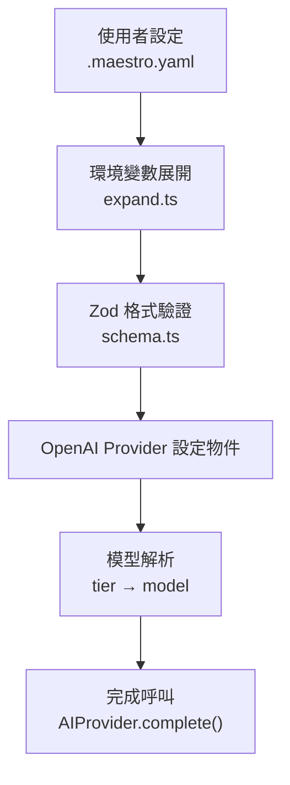
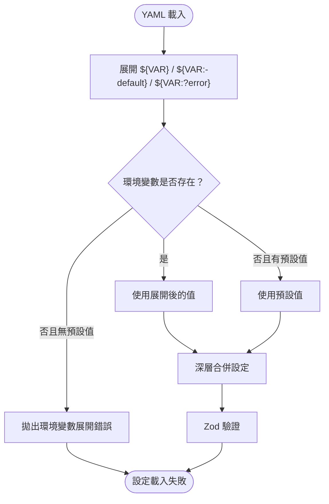
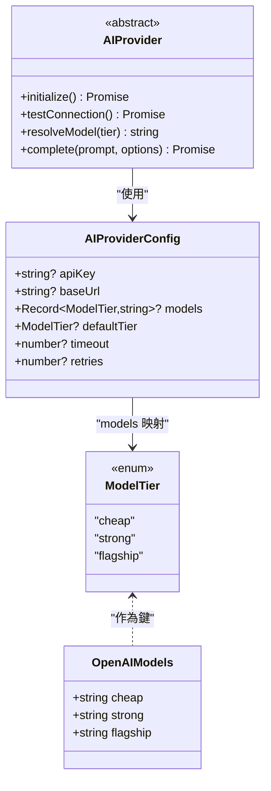
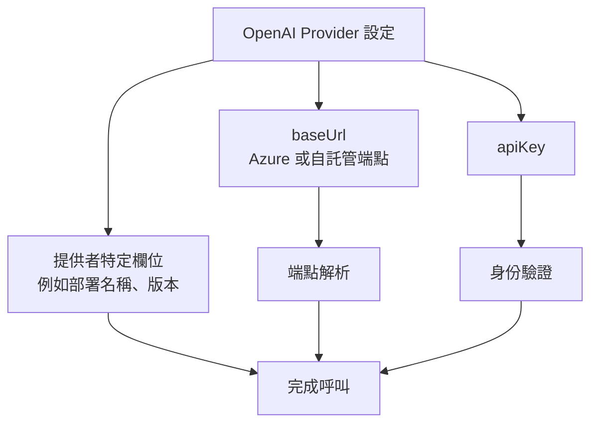
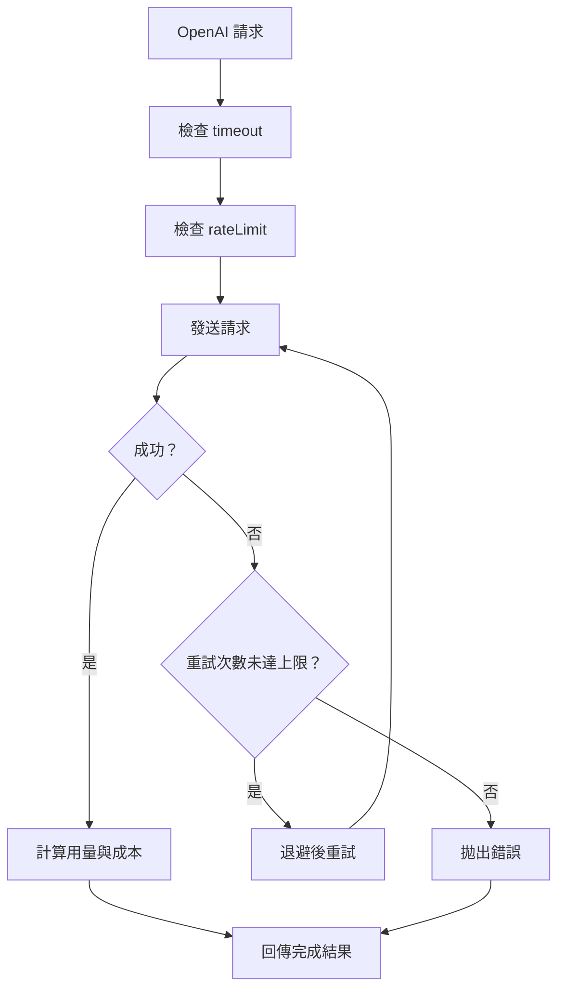
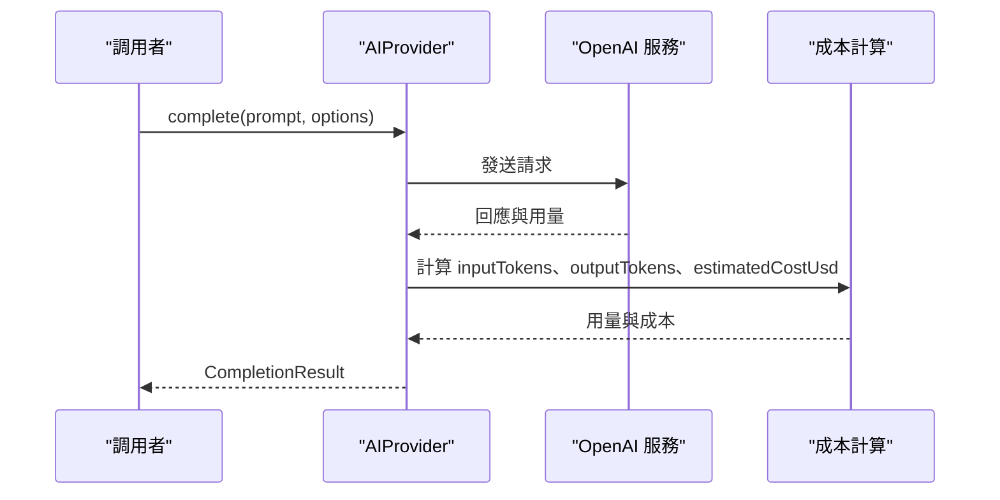

# OpenAI Provider

<cite>
**本文引用的檔案**   
- [.maestro.example.yaml](https://github.com/mikeah2011/maestro/blob/master/.maestro.example.yaml)
- [README.md](https://github.com/mikeah2011/maestro/blob/master/README.md)
- [src/ai/interfaces/AIProvider.ts](https://github.com/mikeah2011/maestro/blob/master/src/ai/interfaces/AIProvider.ts)
- [src/config/schema.ts](https://github.com/mikeah2011/maestro/blob/master/src/config/schema.ts)
- [src/config/load.ts](https://github.com/mikeah2011/maestro/blob/master/src/config/load.ts)
- [src/config/expand.ts](https://github.com/mikeah2011/maestro/blob/master/src/config/expand.ts)
- [src/core/dedup/Dedup.ts](https://github.com/mikeah2011/maestro/blob/master/src/core/dedup/Dedup.ts)
</cite>

## 目錄
1. [簡介](#簡介)
2. [OpenAI Provider 設定總覽](#openai-provider-設定總覽)
3. [設定欄位說明](#設定欄位說明)
4. [環境變數與值展開](#環境變數與值展開)
5. [模型映射與選擇建議](#模型映射與選擇建議)
6. [Azure OpenAI 與自託管端點](#azure-openai-與自託管端點)
7. [完整 YAML 設定範例](#完整-yaml-設定範例)
8. [速率限制、重試與效能優化](#速率限制重試與效能優化)
9. [成本估算機制](#成本估算機制)
10. [常見錯誤排除](#常見錯誤排除)
11. [結論](#結論)

## 簡介
本文件說明如何在 Maestro 中使用 `openai` provider，涵蓋 API key、base URL、三層模型映射、timeout、retries、Azure OpenAI 部署名稱、環境變數注入、速率限制、成本估算與常見問題。Maestro 的 AI provider 抽象介面定義了統一模型、選項、用量與完成結果結構；具體 OpenAI SDK 實作目前未出現在這個程式碼庫中，因此本文以配置層與抽象介面的實際程式碼為依據，並標示哪些內容屬於專案內已驗證資訊，哪些是基於該架構的可行實踐建議。

## OpenAI Provider 設定總覽
在 `.maestro.yaml` 中，OpenAI provider 位於 `ai.providers.openai`：
- `type: openai`
- `apiKey`：透過環境變數注入
- `baseUrl`：支援 Azure OpenAI 或自託管 OpenAI 相容端點
- `models`：包含 `cheap`、`strong`、`flagship` 三層模型映射
- `timeout`：每個 HTTP 請求的超時時間
- `retries`：自動重試次數
- `defaultTier`：未指定 tier 時的預設模型等級



**圖表來源**
- [.maestro.example.yaml:12-33](https://github.com/mikeah2011/maestro/blob/master/.maestro.example.yaml#L12-L33)
- [src/config/expand.ts:1-81](https://github.com/mikeah2011/maestro/blob/master/src/config/expand.ts#L1-L81)
- [src/config/schema.ts:15-36](https://github.com/mikeah2011/maestro/blob/master/src/config/schema.ts#L15-L36)
- [src/ai/interfaces/AIProvider.ts:21-114](https://github.com/mikeah2011/maestro/blob/master/src/ai/interfaces/AIProvider.ts#L21-L114)

**章節來源**
- [.maestro.example.yaml:12-33](https://github.com/mikeah2011/maestro/blob/master/.maestro.example.yaml#L12-L33)
- [src/config/schema.ts:15-36](https://github.com/mikeah2011/maestro/blob/master/src/config/schema.ts#L15-L36)
- [src/ai/interfaces/AIProvider.ts:21-114](https://github.com/mikeah2011/maestro/blob/master/src/ai/interfaces/AIProvider.ts#L21-L114)

## 設定欄位說明
| 欄位 | 型別 | 必要 | 說明 |
|---|---|---:|---|
| `type` | 字串 | 是 | 固定為 `openai` |
| `apiKey` | 字串 | 否，但使用 OpenAI API 時通常必要 | 由環境變數注入，例如 `${OPENAI_API_KEY}` |
| `baseUrl` | 字串 | 否 | OpenAI 相容端點；用於 Azure OpenAI 或自託管服務 |
| `models` | 物件 | 否 | 三個 tier：`cheap`、`strong`、`flagship` |
| `defaultTier` | 字串 | 否 | 未指定 tier 時的預設等級，可選 `cheap`、`strong`、`flagship` |
| `timeout` | 整數 | 否 | 每個請求的毫秒數 |
| `retries` | 整數 | 否 | 非暫時性錯誤以外的自動重試次數 |

這些欄位的型別規則由 Zod schema 定義：
- `type`：必須是 `claude`、`openai`、`google`、`local` 或 `custom`
- `apiKey`：可選字串
- `baseUrl`：可選有效 URL 字串
- `models`：可選物件，鍵為 tier，值為字串
- `defaultTier`：可選 tier
- `timeout`：正整數
- `retries`：非負整數

**章節來源**
- [src/config/schema.ts:15-36](https://github.com/mikeah2011/maestro/blob/master/src/config/schema.ts#L15-L36)
- [src/ai/interfaces/AIProvider.ts:21-45](https://github.com/mikeah2011/maestro/blob/master/src/ai/interfaces/AIProvider.ts#L21-L45)

## 環境變數與值展開
Maestro 會將 YAML 中的 `${VAR}` 語法展開為實際環境變數值。OpenAI provider 的典型寫法是：

```yaml
openai:
  type: openai
  apiKey: ${OPENAI_API_KEY}
```

支援的展開模式包括：
- `${VAR}`：必要變數
- `${VAR:-預設值}`：若未設定則使用預設值
- `${VAR:?錯誤訊息}`：未設定時拋出自訂錯誤訊息

展開過程會遞迴處理環境變數值本身是否也包含 `${...}`，並限制最大深度以避免循環參考。

此外，Maestro 也會從 process environment 讀取少量高優先級覆蓋值，例如：
- `MAESTRO_MAX_ROUNDS`
- `MAESTRO_COST_BUDGET_USD`
- `MAESTRO_LOG_LEVEL`
- `MAESTRO_AUDIT_DIR`

這些環境變數不會直接覆蓋 OpenAI provider 的 `apiKey`，但會影響整體 loop 行為與成本上限。



**圖表來源**
- [src/config/expand.ts:1-81](https://github.com/mikeah2011/maestro/blob/master/src/config/expand.ts#L1-L81)
- [src/config/load.ts:115-153](https://github.com/mikeah2011/maestro/blob/master/src/config/load.ts#L115-L153)

**章節來源**
- [src/config/expand.ts:1-81](https://github.com/mikeah2011/maestro/blob/master/src/config/expand.ts#L1-L81)
- [src/config/load.ts:94-153](https://github.com/mikeah2011/maestro/blob/master/src/config/load.ts#L94-L153)

## 模型映射與選擇建議
OpenAI provider 使用三層模型映射：
- `cheap`：高容量、低成本的任務，例如大量分類、去重、草稿生成
- `strong`：需要判斷力的任務，例如 PR body 草稿、品味偵測
- `flagship`：最終輸出，例如總結、關鍵決策結果

`.maestro.example.yaml` 中的預設映射為：
- `cheap`：`gpt-4o-mini`
- `strong`：`gpt-4o`
- `flagship`：`o1-preview`

這個設計符合以下原則：
- 高頻率、容錯空間大的步驟使用較便宜模型
- 需要推理品質的步驟使用較強模型
- 最終產出使用旗艦模型



**圖表來源**
- [src/ai/interfaces/AIProvider.ts:21-45](https://github.com/mikeah2011/maestro/blob/master/src/ai/interfaces/AIProvider.ts#L21-L45)
- [.maestro.example.yaml:12-33](https://github.com/mikeah2011/maestro/blob/master/.maestro.example.yaml#L12-L33)

**章節來源**
- [.maestro.example.yaml:12-33](https://github.com/mikeah2011/maestro/blob/master/.maestro.example.yaml#L12-L33)
- [src/ai/interfaces/AIProvider.ts:21-45](https://github.com/mikeah2011/maestro/blob/master/src/ai/interfaces/AIProvider.ts#L21-L45)

## Azure OpenAI 與自託管端點
當使用 Azure OpenAI 或自託管 OpenAI 相容服務時，可以透過 `baseUrl` 指定端點。根據 schema，`baseUrl` 會被視為可選的有效 URL；而 provider 配置介面允許額外欄位，因此 Azure OpenAI 所需的部署名稱、API version 等提供者特定參數可以透過 provider-specific extras 傳遞。

實務上常見做法：
- `baseUrl`：指向 Azure OpenAI resource endpoint 或自託管 OpenAI server
- `apiKey`：Azure OpenAI key 或自託管服務對應的 token
- 其他 Azure/OpenAI 相容參數：放在 provider 設定中，由未來 OpenAI provider 實作解讀

由於目前程式碼庫中沒有 OpenAI provider 實作檔，這裡僅列出架構允許的配置方式；具體參數命名需依實際 OpenAI SDK 或 Azure OpenAI REST API 實作而定。



**圖表來源**
- [src/config/schema.ts:15-36](https://github.com/mikeah2011/maestro/blob/master/src/config/schema.ts#L15-L36)
- [src/ai/interfaces/AIProvider.ts:21-45](https://github.com/mikeah2011/maestro/blob/master/src/ai/interfaces/AIProvider.ts#L21-L45)

**章節來源**
- [src/config/schema.ts:15-36](https://github.com/mikeah2011/maestro/blob/master/src/config/schema.ts#L15-L36)
- [src/ai/interfaces/AIProvider.ts:21-45](https://github.com/mikeah2011/maestro/blob/master/src/ai/interfaces/AIProvider.ts#L21-L45)

## 完整 YAML 設定範例
以下是一個聚焦 OpenAI provider 的 `.maestro.yaml` 片段，包含 API key、Azure 端點、三層模型、timeout、retries、路由與成本預算：

```yaml
ai:
  providers:
    openai:
      type: openai
      apiKey: ${OPENAI_API_KEY}
      baseUrl: https://your-resource.openai.azure.com
      models:
        cheap: gpt-4o-mini
        strong: gpt-4o
        flagship: o1-preview
      timeout: 30000
      retries: 3
      defaultTier: strong

  routing:
    commitMessage:     { provider: openai, tier: cheap }
    prBodyDraft:       { provider: openai, tier: strong }
    classifyUnknown:   { provider: openai, tier: cheap }
    semanticDedup:     { provider: openai, tier: cheap }
    tasteDetection:    { provider: openai, tier: strong }
    finalSummary:      { provider: openai, tier: flagship }
    fallback:          { provider: openai, tier: cheap }

stopConditions:
  maxRounds: 3
  costBudgetUSD: 5.00
```

重點說明：
- `apiKey` 使用 `${OPENAI_API_KEY}` 注入
- `baseUrl` 可改為 Azure OpenAI 或自託管端點
- `models` 三層分別對應不同工作負載
- `routing` 控制各階段使用的 provider 與 tier
- `costBudgetUSD` 提供單次 loop 的成本上限

**章節來源**
- [.maestro.example.yaml:12-66](https://github.com/mikeah2011/maestro/blob/master/.maestro.example.yaml#L12-L66)
- [src/config/schema.ts:15-36](https://github.com/mikeah2011/maestro/blob/master/src/config/schema.ts#L15-L36)

## 速率限制、重試與效能優化
### 重試與超時
- `timeout`：單一 OpenAI 請求的超時時間（毫秒）
- `retries`：自動重試次數
- `AIProvider.complete()` 的呼叫選項也允許 per-call `timeout` 覆蓋

### 全局速率限制
schema 提供 `advanced.rateLimit`：
- `honorRemainingHeader`：是否尊重供應商返回的剩餘請求頭
- `minInterRequestMs`：最小請求間隔毫秒數

這表示 Maestro 可在更上層對所有 provider 施加速率限制策略，而不只限於 OpenAI。

### 成本與效能相關優化
- 使用 `cheap` 模型處理高頻次、低風險任務
- 使用 `semanticDedup` 搭配 LLM 去重時，系統有 `maxLlmCalls` 上限，避免無限 LLM 呼叫
- 調整 `costBudgetUSD` 限制整個 loop 的最大成本
- 透過 `logging.level` 調整日誌量，減少 I/O 開銷



**圖表來源**
- [src/ai/interfaces/AIProvider.ts:46-114](https://github.com/mikeah2011/maestro/blob/master/src/ai/interfaces/AIProvider.ts#L46-L114)
- [src/config/schema.ts:193-226](https://github.com/mikeah2011/maestro/blob/master/src/config/schema.ts#L193-L226)
- [src/core/dedup/Dedup.ts:33-153](https://github.com/mikeah2011/maestro/blob/master/src/core/dedup/Dedup.ts#L33-L153)

**章節來源**
- [src/ai/interfaces/AIProvider.ts:46-114](https://github.com/mikeah2011/maestro/blob/master/src/ai/interfaces/AIProvider.ts#L46-L114)
- [src/config/schema.ts:193-226](https://github.com/mikeah2011/maestro/blob/master/src/config/schema.ts#L193-L226)
- [src/core/dedup/Dedup.ts:33-153](https://github.com/mikeah2011/maestro/blob/master/src/core/dedup/Dedup.ts#L33-L153)

## 成本估算機制
OpenAI provider 完成的回應類型包含用量與成本欄位：
- `inputTokens`：輸入 token 數
- `outputTokens`：輸出 token 數
- `cacheReadTokens`：提示緩存讀取 token（若支援）
- `cacheWriteTokens`：提示緩存寫入 token（若支援）
- `estimatedCostUsd`：估計美元成本（若可計算）

這些欄位來自 `CompletionUsage`，並在 `CompletionResult.usage` 中回傳。由於目前沒有 OpenAI provider 實作，實際成本如何由 token 轉換為 USD 尚未可見；但架構明確保留此能力。

此外，loop 層也有 `costBudgetUSD`，用於限制一次 loop 執行的總成本。



**圖表來源**
- [src/ai/interfaces/AIProvider.ts:70-114](https://github.com/mikeah2011/maestro/blob/master/src/ai/interfaces/AIProvider.ts#L70-L114)

**章節來源**
- [src/ai/interfaces/AIProvider.ts:70-114](https://github.com/mikeah2011/maestro/blob/master/src/ai/interfaces/AIProvider.ts#L70-L114)

## 常見錯誤排除
| 問題 | 可能原因 | 解決方法 |
|---|---|---|
| `OPENAI_API_KEY` 未設定 | YAML 展開找不到環境變數 | 設定 shell 環境變數或使用 `${OPENAI_API_KEY:-預設值}` |
| `baseUrl` 不是有效 URL | schema 要求 URL 格式 | 確認 `baseUrl` 以 `https://` 開頭且格式正確 |
| Azure OpenAI 連線失敗 | 端點、部署名稱或 API version 不正確 | 檢查 `baseUrl` 與提供者特定欄位 |
| 請求逾時 | `timeout` 過短或網路延遲 | 增加 `timeout` 或檢查網路連線 |
| 觸發速率限制 | 請求太密集或供應商剩餘配額用完 | 調整 `retries`、`advanced.rateLimit.minInterRequestMs` |
| 成本超過預算 | loop 執行次數過多或模型太貴 | 降低 `costBudgetUSD`、改用 `cheap` 模型 |
| LLM 去重成本過高 | 語義去重呼叫太多 | 調整 `maxLlmCalls` 或關閉語義去重 |

**章節來源**
- [src/config/expand.ts:1-81](https://github.com/mikeah2011/maestro/blob/master/src/config/expand.ts#L1-L81)
- [src/config/schema.ts:15-36](https://github.com/mikeah2011/maestro/blob/master/src/config/schema.ts#L15-L36)
- [src/config/schema.ts:193-226](https://github.com/mikeah2011/maestro/blob/master/src/config/schema.ts#L193-L226)
- [src/core/dedup/Dedup.ts:33-153](https://github.com/mikeah2011/maestro/blob/master/src/core/dedup/Dedup.ts#L33-L153)

## 結論
Maestro 的 OpenAI provider 設定建立在統一的 AI provider 抽象之上，透過 YAML schema 規範欄位型別，並結合環境變數展開與多層設定載入。雖然當前程式碼庫未包含 OpenAI provider 實作，但現有架構已清楚支援：
- API key 注入
- Azure OpenAI 與自託管端點
- 三層模型映射
- 請求超時與重試
- 用量與成本估算
- 全域速率限制
- 成本預算控制

在部署時，請優先確保 `OPENAI_API_KEY` 正確注入，確認 `baseUrl` 格式正確，並根據工作負載選擇合適的 `cheap`、`strong`、`flagship` 模型。若使用 Azure OpenAI，請同時確認端點與提供者特定參數是否符合未來 OpenAI provider 實作的預期。