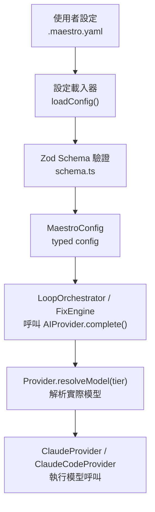
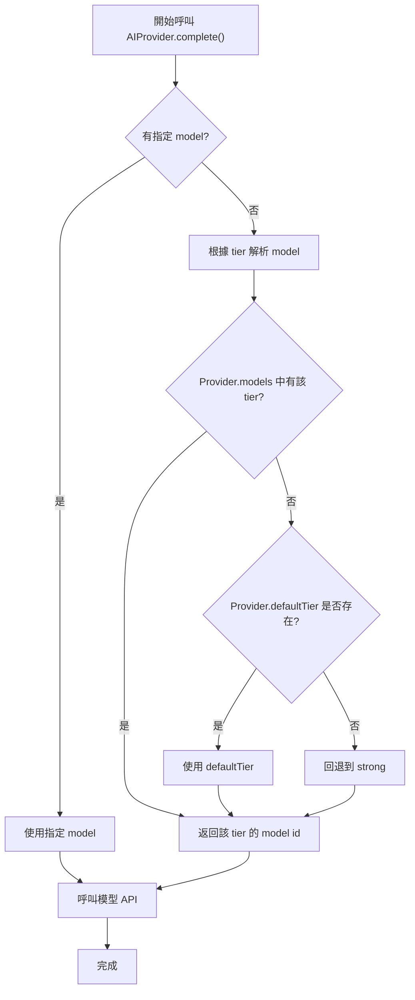

# Provider Routing Table 配置

<cite>
**本文引用的檔案**
- [schema.ts](https://github.com/mikeah2011/maestro/blob/master/src/config/schema.ts)
- [load.ts](https://github.com/mikeah2011/maestro/blob/master/src/config/load.ts)
- [index.ts](https://github.com/mikeah2011/maestro/blob/master/src/config/index.ts)
- [.maestro.example.yaml](https://github.com/mikeah2011/maestro/blob/master/.maestro.example.yaml)
- [AIProvider.ts](https://github.com/mikeah2011/maestro/blob/master/src/ai/interfaces/AIProvider.ts)
- [ClaudeProvider.ts](https://github.com/mikeah2011/maestro/blob/master/src/ai/providers/ClaudeProvider.ts)
- [ClaudeCodeProvider.ts](https://github.com/mikeah2011/maestro/blob/master/src/ai/providers/ClaudeCodeProvider.ts)
- [Dedup.ts](https://github.com/mikeah2011/maestro/blob/master/src/core/dedup/Dedup.ts)
- [loop.ts](https://github.com/mikeah2011/maestro/blob/master/src/cli/commands/loop.ts)
</cite>

## 目錄
1. [簡介](#簡介)
2. [專案結構與設定位置](#專案結構與設定位置)
3. [Routing Table 核心概念](#routing-table-核心概念)
4. [各階段路由配置](#各階段路由配置)
5. [Tier 解析與 Fallback 機制](#tier-解析與-fallback-機制)
6. [完整路由配置範例](#完整路由配置範例)
7. [成本優化策略](#成本優化策略)
8. [效能調校建議](#效能調校建議)
9. [常見使用場景與最佳實踐](#常見使用場景與最佳實踐)
10. [故障排除](#故障排除)
11. [總結](#總結)

## 簡介

Provider Routing Table 是 Maestro 用來決定「每個處理階段使用哪個 AI provider 以及哪個 tier」的設定層。它位於 `ai.routing`，把使用者定義的 stage → provider + tier 對應表，與 provider 定義中的 `models`、`defaultTier`、`timeout`、`retries` 等屬性組合起來，形成最終可執行的 AI 呼叫路徑。

簡單來說：

- **provider**：選擇哪一家模型服務，例如 `claude`、`openai`、`google`、`local`、`custom`。
- **tier**：在同一個 provider 內，選擇不同能力與成本的模型等級。
- **stage**：Maestro 在 PR 審查收斂循環中使用的具體任務，例如產生 commit message、撰寫 PR body draft、分類未知機器人意見、語義去重、品味檢測、最終摘要、以及 fallback。

這個設計讓系統可以同時滿足三個目標：

| 目標 | 說明 |
|---|---|
| 成本控制 | 高頻、低風險的任務使用 `cheap` tier。 |
| 判斷品質 | 需要推理或審判的任務使用 `strong` tier。 |
| 最終輸出品質 | 對外可見的最終內容使用 `flagship` tier。 |

**章節來源**
- [schema.ts:11-48](https://github.com/mikeah2011/maestro/blob/master/src/config/schema.ts#L11-L48)
- [AIProvider.ts:1-18](https://github.com/mikeah2011/maestro/blob/master/src/ai/interfaces/AIProvider.ts#L1-L18)
- [.maestro.example.yaml:14-46](https://github.com/mikeah2011/maestro/blob/master/.maestro.example.yaml#L14-L46)

## 專案結構與設定位置

Routing table 相關的核心程式碼集中在以下幾個位置：



**圖表來源**
- [.maestro.example.yaml:14-46](https://github.com/mikeah2011/maestro/blob/master/.maestro.example.yaml#L14-L46)
- [load.ts:122-216](https://github.com/mikeah2011/maestro/blob/master/src/config/load.ts#L122-L216)
- [schema.ts:11-48](https://github.com/mikeah2011/maestro/blob/master/src/config/schema.ts#L11-L48)
- [AIProvider.ts:101-114](https://github.com/mikeah2011/maestro/blob/master/src/ai/interfaces/AIProvider.ts#L101-L114)
- [ClaudeProvider.ts:97-106](https://github.com/mikeah2011/maestro/blob/master/src/ai/providers/ClaudeProvider.ts#L97-L106)
- [ClaudeCodeProvider.ts:63-64](https://github.com/mikeah2011/maestro/blob/master/src/ai/providers/ClaudeCodeProvider.ts#L63-L64)

設定載入器的優先順序為：

1. CLI 旗標
2. 環境變數
3. 倉庫 `.maestro.yaml`
4. 使用者 `~/.maestro/config.yaml`
5. Git remote 自動偵測
6. Schema 預設值

這表示 routing table 可以在多個層級覆蓋，適合「企業共用 default routing、個別專案微調」的組織情境。

**章節來源**
- [load.ts:1-30](https://github.com/mikeah2011/maestro/blob/master/src/config/load.ts#L1-L30)
- [load.ts:122-216](https://github.com/mikeah2011/maestro/blob/master/src/config/load.ts#L122-L216)
- [index.ts:1-25](https://github.com/mikeah2011/maestro/blob/master/src/config/index.ts#L1-L25)

## Routing Table 核心概念

### Routing Target 結構

每個 routing stage 都是一個 `RoutingTarget`，包含兩個主要欄位：

| 欄位 | 型別 | 預設值 | 說明 |
|---|---|---:|---|
| `provider` | 字串 | 無 | provider 名稱，必須與 `ai.providers` 下的 key 一致。 |
| `tier` | `cheap` \| `strong` \| `flagship` | `cheap` | 該階段要使用的模型等級。 |

Schema 定義了七個 routing stage：

| Stage | 用途 | 建議 tier | 原因 |
|---|---|---:|---|
| `commitMessage` | 每輪產生的 commit message | `cheap` | 高頻生成，但格式相對固定。 |
| `prBodyDraft` | 每次 PR 產生一次 PR body 草稿 | `strong` | 需要綜合整理多輪審查結果。 |
| `classifyUnknown` | 分類未知機器人的審查意見 | `cheap` | 作為圍欄分類器的備援，不需最強的判斷力。 |
| `semanticDedup` | 第三層語義去重 | `cheap` | 已透過 exact hash 和 fuzzy match 過濾大量重複；LLM 語義層只保留少量剩餘案例。 |
| `tasteDetection` | 偵測「討論已變成 bikeshedding」 | `strong` | 需要理解討論脈絡與品質判斷。 |
| `finalSummary` | 循環結束時的 PR body 總整理 | `flagship` | 最終對外輸出，品質最重要。 |
| `fallback` | 未明確指定 stage 時的預設 provider/tier | `cheap` | 避免意外升級到昂貴模型。 |

**章節來源**
- [schema.ts:13-42](https://github.com/mikeah2011/maestro/blob/master/src/config/schema.ts#L13-L42)
- [.maestro.example.yaml:28-46](https://github.com/mikeah2011/maestro/blob/master/.maestro.example.yaml#L28-L46)

### Model Tier 定義

`ModelTier` 是一個三值 enum：

| Tier | 定位 | 典型使用時機 |
|---|---|---|
| `cheap` | 高容量、低成本、高頻率 | commit message、分類備援、語義去重、fallback。 |
| `strong` | 中等成本、較強推理能力 | PR body draft、品味檢測、修復引擎預設 tier。 |
| `flagship` | 最高成本、最高品質 | 最終摘要、關鍵決策輸出。 |

注意：`ModelTier` 的合法值只有這三個，任何不在這裡的值都會被 Zod schema 拒絕。

**章節來源**
- [schema.ts:13](https://github.com/mikeah2011/maestro/blob/master/src/config/schema.ts#L13)
- [AIProvider.ts:19](https://github.com/mikeah2011/maestro/blob/master/src/ai/interfaces/AIProvider.ts#L19)
- [loop.ts:125](https://github.com/mikeah2011/maestro/blob/master/src/cli/commands/loop.ts#L125)

### Provider 定義與 Routing 的關係

`ai.providers` 是命名空間，`ai.routing` 是指向這些命名空間的指標。

舉例來說：

- `ai.providers.claude` 是一個 provider 定義。
- `ai.routing.commitMessage.provider = 'claude'` 表示 commitMessage 階段走 claude provider。
- `ai.routing.commitMessage.tier = 'cheap'` 表示使用 claude provider 的 cheap model。

如果 routing 指定的 provider 不存在，會在校驗階段失敗；如果 provider 存在但沒有對應 tier 的 model，則由 provider 的 `resolveModel()` 決定是否回退到預設模型。

**章節來源**
- [schema.ts:15-27](https://github.com/mikeah2011/maestro/blob/master/src/config/schema.ts#L15-L27)
- [schema.ts:34-42](https://github.com/mikeah2011/maestro/blob/master/src/config/schema.ts#L34-L42)
- [AIProvider.ts:23-26](https://github.com/mikeah2011/maestro/blob/master/src/ai/interfaces/AIProvider.ts#L23-L26)

## 各階段路由配置

### `commitMessage`

| 項目 | 說明 |
|---|---|
| 觸發時機 | 每次 fix round 產生 commit message。 |
| 成本特性 | 高頻、短文本、格式穩定。 |
| 建議 tier | `cheap`。 |
| 品質要求 | 能產出符合 convention 的 commit message 即可，不需要極致推理。 |
| 風險 | 若錯誤地升級到 flagship，會在多次 push 下快速累積成本。 |

**配置原則**：除非你的 commit message 非常複雜且高度依賴上下文，否則保持 `cheap`。

**章節來源**
- [.maestro.example.yaml:31](https://github.com/mikeah2011/maestro/blob/master/.maestro.example.yaml#L31)
- [schema.ts:35](https://github.com/mikeah2011/maestro/blob/master/src/config/schema.ts#L35)

### `prBodyDraft`

| 項目 | 說明 |
|---|---|
| 觸發時機 | 針對一個 PR 通常只會產生一次草稿。 |
| 成本特性 | 單次呼叫，但輸入可能包含多個 bot 的審查結果。 |
| 建議 tier | `strong`。 |
| 品質要求 | 需要整合多個發現、測試計畫與回覆摘要。 |
| 風險 | 若使用 `cheap`，可能無法正確歸納複雜 PR 的內容。 |

**配置原則**：這是「一次性但重要」的輸出，不應該為了省一點 cost 而犧牲可讀性。

**章節來源**
- [.maestro.example.yaml:32](https://github.com/mikeah2011/maestro/blob/master/.maestro.example.yaml#L32)
- [schema.ts:36](https://github.com/mikeah2011/maestro/blob/master/src/config/schema.ts#L36)

### `classifyUnknown`

| 項目 | 說明 |
|---|---|
| 觸發時機 | 遇到未在 bots registry 中明確註冊的機器人時。 |
| 成本特性 | 發生次數取決於外部 bot 行為。 |
| 建議 tier | `cheap`。 |
| 品質要求 | 作為圍欄 Markdown 分類器的 fallback，只要大致區分 bug / taste / wrong / yagni 即可。 |
| 風險 | 分類錯誤可能導致後續流程誤判，因此仍應監控 audit log。 |

**配置原則**：這是一個「防禦性」stage，便宜但不代表完全不可用；若你的 classifier prompt 很敏感，可以考慮提升到 `strong`。

**章節來源**
- [.maestro.example.yaml:33](https://github.com/mikeah2011/maestro/blob/master/.maestro.example.yaml#L33)
- [schema.ts:37](https://github.com/mikeah2011/maestro/blob/master/src/config/schema.ts#L37)

### `semanticDedup`

| 項目 | 說明 |
|---|---|
| 觸發時機 | Dedup pipeline 的第三層，即語義相似度檢查。 |
| 成本特性 | 已受 `maxLlmCalls` 限制，預設每回合最多 10 次 LLM 呼叫。 |
| 建議 tier | `cheap`。 |
| 品質要求 | 只需要判斷兩筆 finding 是否語義重複。 |
| 風險 | 若提高 maxLlmCalls，成本會隨 findings 數量增加。 |

Dedup 有三層：

1. **Exact hash**：相同 stable hash 直接視為重複。
2. **Fuzzy Levenshtein**：標題相似度高於閾值視為重複。
3. **Semantic LLM**：最後才呼叫 LLM。

因此 routing 中的 `semanticDedup` 不是每次都打 LLM，而是「只有在前三層都無法確定時」才進入語義層。

**章節來源**
- [.maestro.example.yaml:34](https://github.com/mikeah2011/maestro/blob/master/.maestro.example.yaml#L34)
- [schema.ts:38](https://github.com/mikeah2011/maestro/blob/master/src/config/schema.ts#L38)
- [Dedup.ts:1-107](https://github.com/mikeah2011/maestro/blob/master/src/core/dedup/Dedup.ts#L1-L107)

### `tasteDetection`

| 項目 | 說明 |
|---|---|
| 觸發時機 | 偵測當前 review 是否已經變成 bikeshedding（無關緊要的爭論）。 |
| 成本特性 | 通常是每輪一次。 |
| 建議 tier | `strong`。 |
| 品質要求 | 需要理解討論品質、技術深度與人類協作脈絡。 |
| 風險 | 判斷太弱會導致無意義討論繼續；判斷太強可能過度中止。 |

**配置原則**：這是一個「判斷型」stage，不適合用最便宜的模型。

**章節來源**
- [.maestro.example.yaml:35](https://github.com/mikeah2011/maestro/blob/master/.maestro.example.yaml#L35)
- [schema.ts:39](https://github.com/mikeah2011/maestro/blob/master/src/config/schema.ts#L39)

### `finalSummary`

| 項目 | 說明 |
|---|---|
| 觸發時機 | 收斂循環結束後，產生最終 PR body 摘要。 |
| 成本特性 | 只在 loop 結束時呼叫一次。 |
| 建議 tier | `flagship`。 |
| 品質要求 | 這是最終給 reviewer 和團隊看到的總結，品質優先。 |
| 風險 | 成本最高，但因為呼叫次數少，整體影響可控。 |

**配置原則**：如果你希望合併前的最終摘要具有最高一致性與完整性，請使用 flagship。

**章節來源**
- [.maestro.example.yaml:36](https://github.com/mikeah2011/maestro/blob/master/.maestro.example.yaml#L36)
- [schema.ts:40](https://github.com/mikeah2011/maestro/blob/master/src/config/schema.ts#L40)

### `fallback`

| 項目 | 說明 |
|---|---|
| 觸發時機 | 某個 stage 沒有明確 routing 配置時使用。 |
| 成本特性 | 預設為 `cheap`，防止意外升級。 |
| 建議 tier | `cheap`。 |
| 品質要求 | 作為安全網，不應該成為主力。 |
| 風險 | 如果所有 stage 都遺漏 routing，fallback 會承接所有未定義任務。 |

**配置原則**：不要依賴 fallback 作為正式路由；明確寫出每個 stage 的配置，方便稽核與調整。

**章節來源**
- [.maestro.example.yaml:37](https://github.com/mikeah2011/maestro/blob/master/.maestro.example.yaml#L37)
- [schema.ts:41](https://github.com/mikeah2011/maestro/blob/master/src/config/schema.ts#L41)

## Tier 解析與 Fallback 機制

### Tier 解析流程

當 orchestrator 或 engine 呼叫 AI provider 時，會經過以下步驟：



**圖表來源**
- [AIProvider.ts:41-44](https://github.com/mikeah2011/maestro/blob/master/src/ai/interfaces/AIProvider.ts#L41-L44)
- [AIProvider.ts:109-110](https://github.com/mikeah2011/maestro/blob/master/src/ai/interfaces/AIProvider.ts#L109-L110)
- [ClaudeProvider.ts:97-106](https://github.com/mikeah2011/maestro/blob/master/src/ai/providers/ClaudeProvider.ts#L97-L106)

### Provider 實作的差異

#### ClaudeProvider

ClaudeProvider 的 `resolveModel` 會依序嘗試：

1. `config.models[tier]`
2. provider 內部預設的 `DEFAULT_MODELS[tier]`

此外，當呼叫時沒有指定 tier，它會依照：

1. `options.tier`
2. `config.defaultTier`
3. `'strong'`

這表示 ClaudeProvider 的隱式預設值是 `strong`，而不是 routing schema 的 `cheap`。兩者作用範圍不同：

- routing schema 的 `tier: cheap` 是 stage 層級的預設值。
- ClaudeProvider 的預設值是用於 provider 層級未指定 tier 的情況。

#### ClaudeCodeProvider

ClaudeCodeProvider 的 `resolveModel` 比較簡單：

1. 從 `config.models[_tier]` 取得 model id。
2. 若找不到，回退到 `'claude-code-cli'`。

這適合本地開發情境，即使沒有完整 models 映射也能運作。

**章節來源**
- [ClaudeProvider.ts:97-106](https://github.com/mikeah2011/maestro/blob/master/src/ai/providers/ClaudeProvider.ts#L97-L106)
- [ClaudeCodeProvider.ts:63-64](https://github.com/mikeah2011/maestro/blob/master/src/ai/providers/ClaudeCodeProvider.ts#L63-L64)
- [AIProvider.ts:109-110](https://github.com/mikeah2011/maestro/blob/master/src/ai/interfaces/AIProvider.ts#L109-L110)

### Routing 與 Provider 預設值的關係

| 情境 | 最終 tier |
|---|---|
| routing 明確指定 tier | 使用 routing 的 tier。 |
| routing 未指定 tier | 使用 routing schema 的預設值 `cheap`。 |
| 呼叫時又未指定 options.tier | 使用 provider 的 `defaultTier`，再回退到 `strong`。 |
| provider 沒有該 tier 的 model | 使用 provider 的 fallback 邏輯。 |

因此，最安全的做法是：**在 routing 中明確指定每個 stage 的 tier，並在 provider 中也提供完整的 models 映射**。

**章節來源**
- [schema.ts:29-32](https://github.com/mikeah2011/maestro/blob/master/src/config/schema.ts#L29-L32)
- [schema.ts:22-24](https://github.com/mikeah2011/maestro/blob/master/src/config/schema.ts#L22-L24)
- [ClaudeProvider.ts:97-106](https://github.com/mikeah2011/maestro/blob/master/src/ai/providers/ClaudeProvider.ts#L97-L106)

## 完整路由配置範例

以下是一個基於官方範本的完整 routing 配置說明，不包含原始程式碼內容，只描述結構與行為。

### 基本配置

```yaml
ai:
  providers:
    claude:
      type: claude
      apiKey: ${ANTHROPIC_API_KEY}
      models:
        cheap: claude-haiku-4-5-20251001
        strong: claude-sonnet-4-6
        flagship: claude-opus-4-7
      timeout: 30000
      retries: 3

  routing:
    commitMessage:     { provider: claude, tier: cheap }
    prBodyDraft:       { provider: claude, tier: strong }
    classifyUnknown:   { provider: claude, tier: cheap }
    semanticDedup:     { provider: claude, tier: cheap }
    tasteDetection:    { provider: claude, tier: strong }
    finalSummary:      { provider: claude, tier: flagship }
    fallback:          { provider: claude, tier: cheap }
```

### 多 provider 混合配置

你可以根據不同任務選擇不同 provider：

```yaml
ai:
  providers:
    claude:
      type: claude
      apiKey: ${ANTHROPIC_API_KEY}
      models:
        cheap: claude-haiku-4-5-20251001
        strong: claude-sonnet-4-6
        flagship: claude-opus-4-7

    openai:
      type: openai
      apiKey: ${OPENAI_API_KEY}
      models:
        cheap: gpt-4o-mini
        strong: gpt-4o
        flagship: o1-preview

    gemini:
      type: google
      apiKey: ${GOOGLE_API_KEY}
      models:
        cheap: gemini-2.0-flash
        strong: gemini-1.5-pro

  routing:
    commitMessage:     { provider: claude, tier: cheap }
    prBodyDraft:       { provider: openai, tier: strong }
    classifyUnknown:   { provider: gemini, tier: cheap }
    semanticDedup:     { provider: claude, tier: cheap }
    tasteDetection:    { provider: openai, tier: strong }
    finalSummary:      { provider: claude, tier: flagship }
    fallback:          { provider: claude, tier: cheap }
```

這種配置適合：

- 某些 provider 在特定 model 上表現更好。
- 分散不同 provider 的 quota。
- 利用不同 provider 的價格優勢。

**章節來源**
- [.maestro.example.yaml:14-46](https://github.com/mikeah2011/maestro/blob/master/.maestro.example.yaml#L14-L46)
- [schema.ts:15-42](https://github.com/mikeah2011/maestro/blob/master/src/config/schema.ts#L15-L42)

## 成本優化策略

### 1. 以 stage 為單位控制成本

| 策略 | 說明 |
|---|---|
| 高頻任務用 `cheap` | commitMessage、classifyUnknown、semanticDedup 都是高頻或可替換的任務。 |
| 一次性重要輸出用 `strong` | prBodyDraft 只會產生一次，值得投入更多推理能力。 |
| 最終輸出用 `flagship` | finalSummary 是對外的最終版本，品質優先。 |
| fallback 保持 `cheap` | 避免未定義 stage 意外消耗昂貴模型。 |

### 2. 控制 LLM 語義去重成本

Dedup 的 third tier 支援 `maxLlmCalls`，預設為 10。如果你的 PR 有大量 findings，這個限制非常重要。

| 參數 | 預設值 | 建議 |
|---|---:|---|
| `fuzzyThreshold` | `0.8` | 較高值減少 false positive；較低值增加 sensitivity。 |
| `maxLlmCalls` | `10` | 大型 PR 可提高，但要配合 costBudgetUSD。 |
| `semanticDedup.tier` | `cheap` | 語義層只是最後一道防線，不需 flagship。 |

### 3. 使用 stopConditions.costBudgetUSD

stopConditions 中的 `costBudgetUSD` 提供整次 loop 的成本上限。搭配 routing table，可以確保即使某個 stage 配置錯誤，也不會無限燒錢。

| 情境 | 建議 costBudgetUSD |
|---|---:|
| 個人開發 | 1～5 USD |
| 小型團隊 | 5～15 USD |
| 大型 enterprise PR | 15～50 USD |
| CI/CD 自動化 | 嚴格限制並配合 dry-run |

### 4. Provider 層級超時與重試

provider 的 `timeout` 和 `retries` 會影響整體穩定性：

- `timeout`：避免長等待卡住整個 loop。
- `retries`：緩解網路抖動或暫定錯誤。
- `advanced.retryStrategy.maxRetries`：全域重試策略。
- `advanced.rateLimit.minInterRequestMs`：控制請求間隔以避免 rate limit。

**章節來源**
- [schema.ts:15-27](https://github.com/mikeah2011/maestro/blob/master/src/config/schema.ts#L15-L27)
- [schema.ts:174-200](https://github.com/mikeah2011/maestro/blob/master/src/config/schema.ts#L174-L200)
- [Dedup.ts:41-53](https://github.com/mikeah2011/maestro/blob/master/src/core/dedup/Dedup.ts#L41-L53)
- [schema.ts:127-156](https://github.com/mikeah2011/maestro/blob/master/src/config/schema.ts#L127-L156)

## 效能調校建議

### 1. 避免不必要的旗艦模型

`flagship` 通常是最貴的模型。除非是最終摘要或關鍵決策，否則不要把它用在中間階段。

### 2. 善用 caching 與 prompt 穩定性

Maestro 的 orchestrator 傾向使用確定性輸出（temperature 預設為 0），這有助於：

- 重複輸入產生一致結果。
- 提升下游分類與去重的穩定性。
- 減少因 randomness 造成的額外 loop。

### 3. 監控 Dedup 的 tierStats

DedupResult 會回報 `tierStats.exact`、`tierStats.fuzzy`、`tierStats.llm`。如果 `llm` 比例過高，代表前兩層過濾效果不足，可能需要：

- 調整 `fuzzyThreshold`。
- 改善 upstream bot 的 finding 標題一致性。
- 檢查是否有異常大量的 duplicate findings。

### 4. 使用 advanced.cacheProviders

`advanced.cacheProviders` 預設啟用，可減少相同 provider 呼叫的重複開銷。

### 5. 控制 logging 與 audit

- `logging.level`：開發期可用 `debug`，生產期建議 `info` 或 `warn`。
- `audit.enabled`：開啟後可追蹤分類決策與路由使用情形。
- `security.scanOutgoing`：確保 outgoing content 不會洩漏敏感資訊。

**章節來源**
- [Dedup.ts:34-40](https://github.com/mikeah2011/maestro/blob/master/src/core/dedup/Dedup.ts#L34-L40)
- [Dedup.ts:101-107](https://github.com/mikeah2011/maestro/blob/master/src/core/dedup/Dedup.ts#L101-L107)
- [schema.ts:158-200](https://github.com/mikeah2011/maestro/blob/master/src/config/schema.ts#L158-L200)

## 常見使用場景與最佳實踐

### 場景一：個人開發者

| 特點 | 建議 |
|---|---|
| 預算有限 | 全部 routing 使用 `cheap`，僅 `finalSummary` 使用 `flagship`。 |
| 單一 provider | 直接使用 claude 或 local Ollama。 |
| 快速迭代 | 降低 `maxRounds`，提高 `fuzzyThreshold`。 |

### 場景二：中型團隊 PR 審查

| 特點 | 建議 |
|---|---|
| 多 bot 混雜 | 強化 `classifyUnknown` 與 `tasteDetection` 的 tier。 |
| 成本可控 | 設定 `costBudgetUSD` 與 `maxRounds`。 |
| 輸出品質重要 | `prBodyDraft` 與 `finalSummary` 使用 stronger model。 |

### 場景三：Enterprise 多 provider

| 特點 | 建議 |
|---|---|
| 多 vendor | 將不同 stage 分配到不同 provider。 |
| 合規要求 | 使用自託管 provider 或 local model。 |
| 稽核需求 | 開啟 audit、event stream、security scan。 |

### 最佳實踐清單

1. **明確寫出所有 routing stage**，不要依賴 fallback。
2. **provider 與 routing 分離**：provider 定義能力，routing 定義使用策略。
3. **為每個 provider 提供完整 models 映射**。
4. **在高頻 stage 使用 cheap tier**。
5. **在最終輸出使用 flagship tier**。
6. **設定 costBudgetUSD 作為硬限制**。
7. **定期檢視 audit log 與 dedup tierStats**。
8. **使用 `.maestro.yaml` 做 repo 級路由，`~/.maestro/config.yaml` 做企業級預設**。
9. **CI 環境務必使用 dry-run 先驗證路由**。
10. **不要把 fallback 當作功能配置**。

**章節來源**
- [.maestro.example.yaml:28-46](https://github.com/mikeah2011/maestro/blob/master/.maestro.example.yaml#L28-L46)
- [schema.ts:11-48](https://github.com/mikeah2011/maestro/blob/master/src/config/schema.ts#L11-L48)
- [Dedup.ts:1-107](https://github.com/mikeah2011/maestro/blob/master/src/core/dedup/Dedup.ts#L1-L107)

## 故障排除

### 問題一：routing 指定了不存在的 provider

**症狀**：設定載入或驗證時拋出錯誤。

**原因**：`ai.routing.*.provider` 指向的名稱不在 `ai.providers` 中。

**解法**：

1. 檢查 `ai.providers` 的 key。
2. 確認 routing 的 provider 名稱完全一致。
3. 使用 `.maestro.yaml` 或 `~/.maestro/config.yaml` 統一管理 provider 名稱。

**章節來源**
- [schema.ts:15-27](https://github.com/mikeah2011/maestro/blob/master/src/config/schema.ts#L15-L27)
- [schema.ts:34-42](https://github.com/mikeah2011/maestro/blob/master/src/config/schema.ts#L34-L42)
- [load.ts:201-216](https://github.com/mikeah2011/maestro/blob/master/src/config/load.ts#L201-L216)

### 問題二：tier 不是 cheap / strong / flagship

**症狀**：Zod validation error。

**原因**：使用了非 enum 值。

**解法**：改為 `cheap`、`strong` 或 `flagship`。

**章節來源**
- [schema.ts:13](https://github.com/mikeah2011/maestro/blob/master/src/config/schema.ts#L13)
- [schema.ts:29-32](https://github.com/mikeah2011/maestro/blob/master/src/config/schema.ts#L29-L32)
- [load.ts:201-216](https://github.com/mikeah2011/maestro/blob/master/src/config/load.ts#L201-L216)

### 問題三：provider 沒有該 tier 的 model

**症狀**：呼叫 provider 時可能回退到其他 model。

**原因**：provider 的 `models` 缺少對應 tier。

**解法**：

1. 在 provider 定義中補齊 models。
2. 或使用 provider 的 `defaultTier`。
3. 或在呼叫時明確指定 `model`。

**章節來源**
- [schema.ts:22-24](https://github.com/mikeah2011/maestro/blob/master/src/config/schema.ts#L22-L24)
- [ClaudeProvider.ts:97-106](https://github.com/mikeah2011/maestro/blob/master/src/ai/providers/ClaudeProvider.ts#L97-L106)
- [ClaudeCodeProvider.ts:63-64](https://github.com/mikeah2011/maestro/blob/master/src/ai/providers/ClaudeCodeProvider.ts#L63-L64)

### 問題四：成本超出預期

**症狀**：loop 結束時成本超過 `costBudgetUSD`。

**可能原因**：

- 太多 rounds。
- 語義去重呼叫過多。
- 錯誤地把 high-volume stage 設成 flagship。
- 外部 bot 產生大量 duplicate findings。

**解法**：

1. 降低 `maxRounds`。
2. 檢查 `semanticDedup.tier`。
3. 調整 `fuzzyThreshold`。
4. 查看 audit log 與 dedup tierStats。
5. 降低 `costBudgetUSD`。

**章節來源**
- [schema.ts:127-156](https://github.com/mikeah2011/maestro/blob/master/src/config/schema.ts#L127-L156)
- [Dedup.ts:41-53](https://github.com/mikeah2011/maestro/blob/master/src/core/dedup/Dedup.ts#L41-L53)
- [Dedup.ts:63-107](https://github.com/mikeah2011/maestro/blob/master/src/core/dedup/Dedup.ts#L63-L107)

### 問題五：unknown bot 分類品質不佳

**症狀**：分類結果不準確，導致後續流程異常。

**解法**：

1. 檢查 bots registry 是否已涵蓋常見 bot。
2. 調整 `classifyUnknown.tier`。
3. 改進 classifier prompt。
4. 開啟 audit shadow log。

**章節來源**
- [.maestro.example.yaml:72-120](https://github.com/mikeah2011/maestro/blob/master/.maestro.example.yaml#L72-L120)
- [schema.ts:37](https://github.com/mikeah2011/maestro/blob/master/src/config/schema.ts#L37)

## 總結

Provider Routing Table 是 Maestro 成本與品質之間的重要平衡點。它的設計哲學很明確：

- **cheap → high-volume**：commitMessage、classifyUnknown、semanticDedup。
- **strong → judgment**：prBodyDraft、tasteDetection。
- **flagship → final output**：finalSummary。
- **fallback → safety net**：預設為 cheap，避免意外升級。

要掌握這個系統，最重要的是理解三層分工：

1. **設定層**：`.maestro.yaml` 或 `~/.maestro/config.yaml` 定義 routing。
2. **驗證層**：Zod schema 確保 tier 與 provider 有效。
3. **執行層**：AIProvider 根據 tier 解析實際 model 並執行呼叫。

推薦的起手式是：

- 複製 `.maestro.example.yaml`。
- 填入 provider 與 API key。
- 維持預設 routing。
- 根據團隊需求逐步調整。
- 使用 costBudgetUSD 與 audit log 監控實際成本與品質。

這樣既能獲得穩定的 PR 審查收斂體驗，又能有效控制 AI 成本。