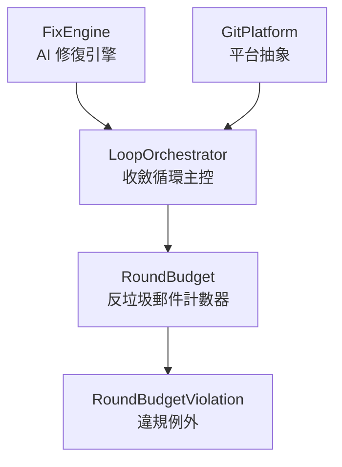
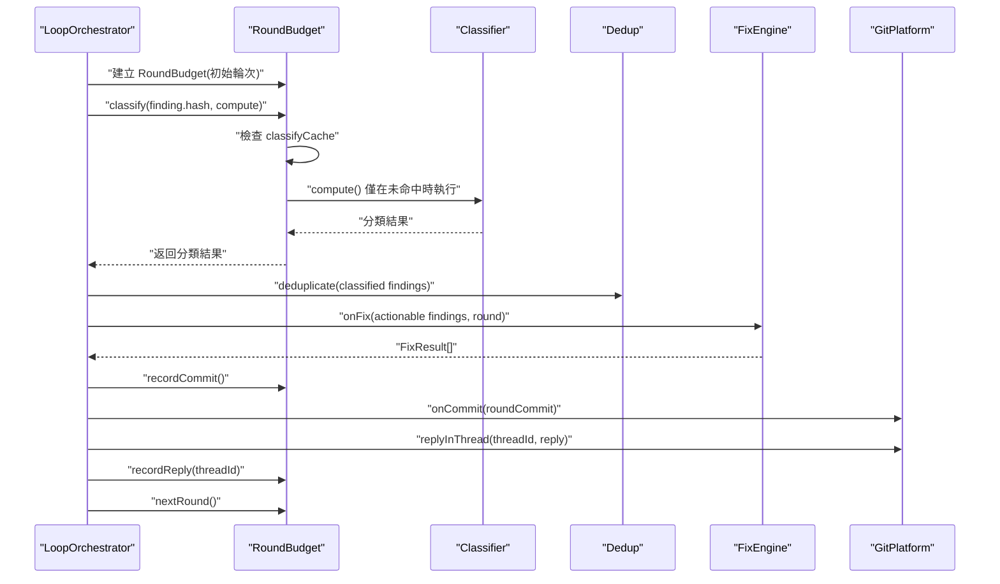
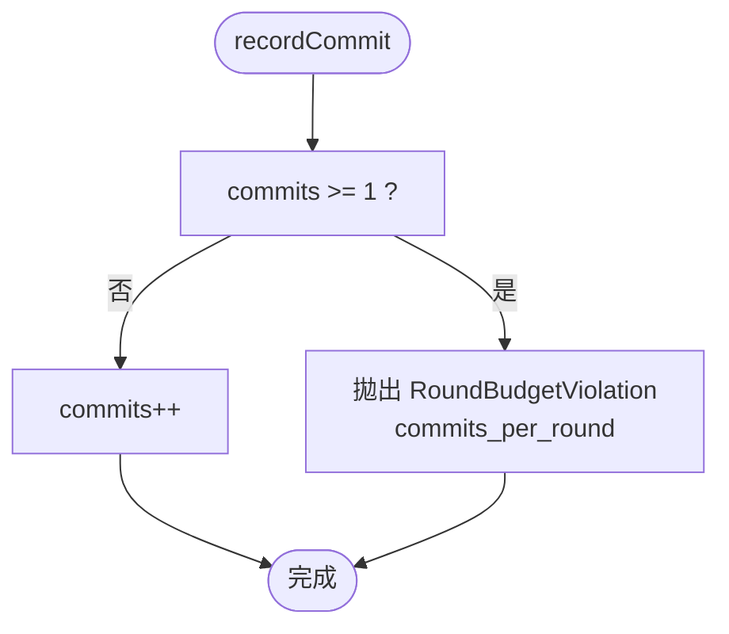
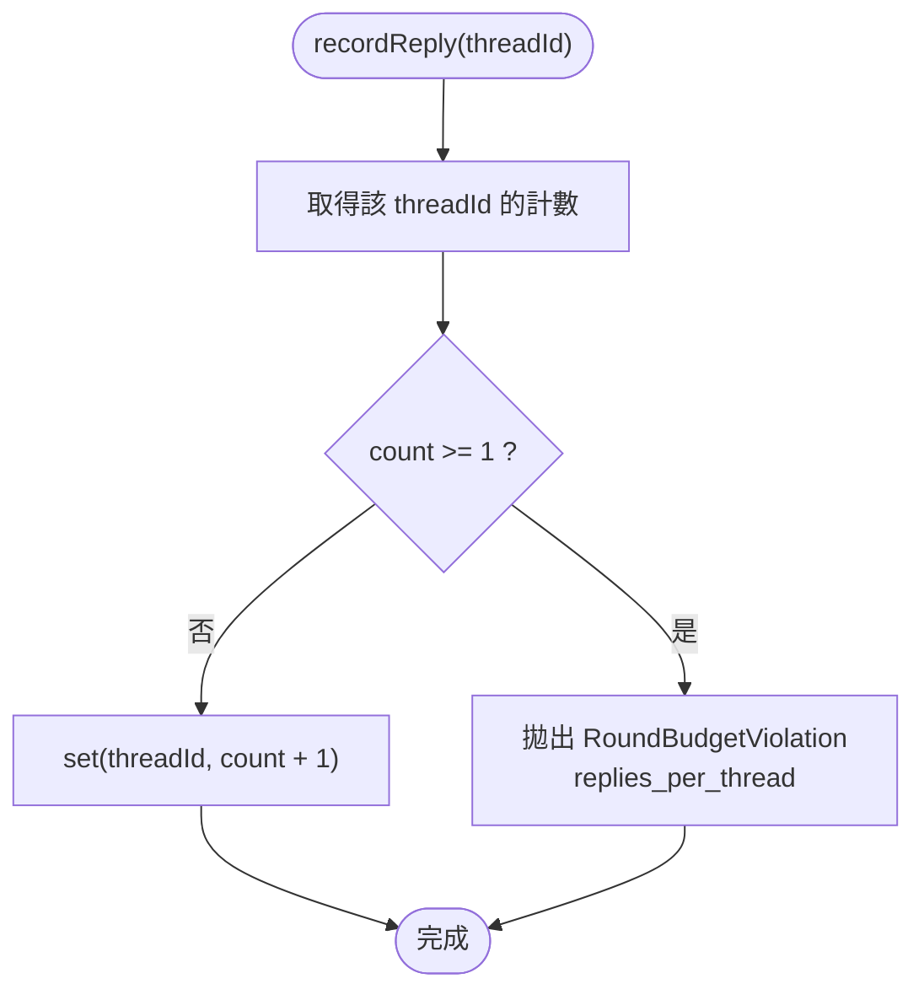
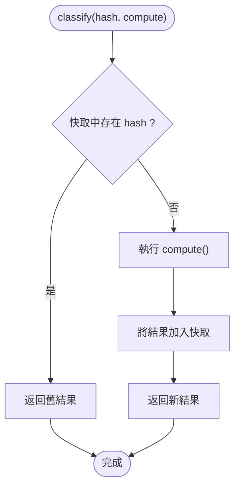
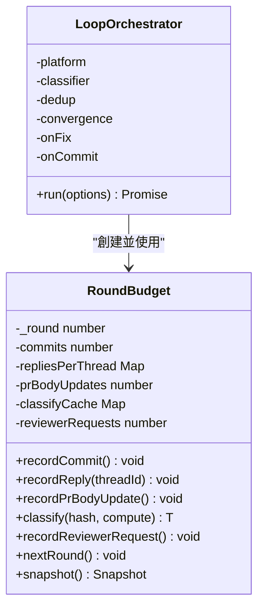
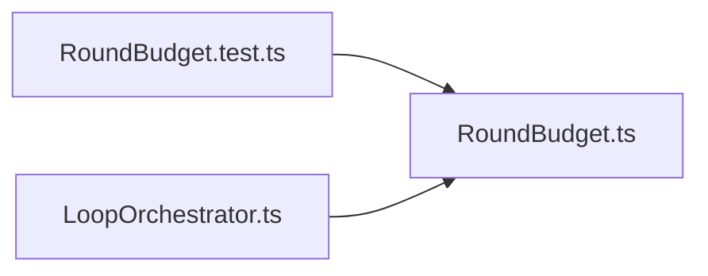

# RoundBudget 輪次預算

**本文引用的檔案**

- [RoundBudget.ts](https://github.com/mikeah2011/maestro/blob/master/src/core/round/RoundBudget.ts)
- [RoundBudget.test.ts](https://github.com/mikeah2011/maestro/blob/master/tests/core/round/RoundBudget.test.ts)
- [LoopOrchestrator.ts](https://github.com/mikeah2011/maestro/blob/master/src/core/loop/LoopOrchestrator.ts)
- [FixEngine.ts](https://github.com/mikeah2011/maestro/blob/master/src/core/fix/FixEngine.ts)
- [.maestro.example.yaml](https://github.com/mikeah2011/maestro/blob/master/.maestro.example.yaml)
- [DESIGN.md](https://github.com/mikeah2011/maestro/blob/master/docs/DESIGN.md)
- [schema.ts](https://github.com/mikeah2011/maestro/blob/master/src/config/schema.ts)

## 目錄
1. [引言](#引言)
2. [專案結構與角色定位](#專案結構與角色定位)
3. [核心元件分析](#核心元件分析)
4. [架構總覽](#架構總覽)
5. [詳細元件解析](#詳細元件解析)
6. [與其他組件的集成關係](#與其他組件的集成關係)
7. [依賴與耦合分析](#依賴與耦合分析)
8. [性能與成本特性](#性能與成本特性)
9. [配置參數與調優範例](#配置參數與調優範例)
10. [故障排除指南](#故障排除指南)
11. [結論](#結論)

## 引言
RoundBudget 是 Maestro 的「反垃圾郵件執行期不變量」引擎。它不是策略設定，也不是可透過警告繼續執行的軟性檢查；它是「違反即崩潰」的硬性斷言。每輪允許的操作都被嚴格限制：最多一次提交、每個討論串最多一次回覆、最多一次 PR 內容更新、每個問題的分類計算只執行一次（記憶化）、每輪最多一次審查者請求。

這種設計的核心哲學是：當收斂循環的行為異常時，必須「大聲失敗」。如果工具只是記錄警告並繼續運行，錯誤行為會隨著時間累積成真正的垃圾郵件。因此，RoundBudget 選擇在違規發生時立即拋出 `RoundBudgetViolation`，讓整個流程停止，而不是靜默漂移。

## 專案結構與角色定位
RoundBudget 位於核心層 `core/round` 子模組中，是一個低耦合、高內聚的狀態計數器。它不直接呼叫 Git 平台 API，也不直接呼叫 AI 模型；它只負責追蹤一輪內哪些寫入型操作已經被使用。

**圖表來源**
- [RoundBudget.ts:20-131](https://github.com/mikeah2011/maestro/blob/master/src/core/round/RoundBudget.ts#L20-L131)
- [LoopOrchestrator.ts:1-200](https://github.com/mikeah2011/maestro/blob/master/src/core/loop/LoopOrchestrator.ts#L1-L200)
- [FixEngine.ts:1-216](https://github.com/mikeah2011/maestro/blob/master/src/core/fix/FixEngine.ts#L1-L216)

RoundBudget 的角色非常明確：
- 維護當前輪次編號。
- 記錄每輪已使用的操作次數。
- 提供每輪重置機制。
- 提供快照觀察能力。
- 為分類計算提供記憶體去重。

**章節來源**
- [RoundBudget.ts:1-131](https://github.com/mikeah2011/maestro/blob/master/src/core/round/RoundBudget.ts#L1-L131)
- [DESIGN.md:1-200](https://github.com/mikeah2011/maestro/blob/master/docs/DESIGN.md#L1-L200)

## 核心元件分析

### 資料結構與狀態
RoundBudget 內部維護以下狀態：

| 欄位 | 類型 | 用途 | 空間複雜度 |
|---|---|---|---|
| `_round` | 數字 | 當前輪次編號 | O(1) |
| `commits` | 數字 | 本輪提交次數 | O(1) |
| `repliesPerThread` | Map | 每個討論串的本輪回覆次數 | O(n)，n 為本輪不同討論串數量 |
| `prBodyUpdates` | 數字 | 本輪 PR 內容更新次數 | O(1) |
| `classifyCache` | Map | 問題雜湊到分類結果的記憶化快取 | O(m)，m 為本輪已分類問題數量 |
| `reviewerRequests` | 數字 | 本輪審查者請求次數 | O(1) |

所有狀態都屬於單一實例，沒有外部副作用。這使 RoundBudget 非常容易測試、模擬和組合。

**章節來源**
- [RoundBudget.ts:20-60](https://github.com/mikeah2011/maestro/blob/master/src/core/round/RoundBudget.ts#L20-L60)

### 不變量與違規模型
RoundBudget 定義五種不變量：

| 不變量 | 限制 | 觸發時機 |
|---|---|---|
| `commits_per_round` | 每輪最多一次提交 | 第二次 `recordCommit()` |
| `replies_per_thread` | 每個討論串每輪最多一次回覆 | 同一討論串第二次 `recordReply()` |
| `pr_body_updates` | 每輪最多一次 PR 內容更新 | 第二次 `recordPrBodyUpdate()` |
| `findingsClassified` | 每個問題雜湊只計算一次分類 | 由 `classify()` 內部處理 |
| `reviewer_requests` | 每輪最多一次審查者請求 | 第二次 `recordReviewerRequest()` |

違規物件包含三個關鍵資訊：
- 哪一個不變量被違反。
- 哪個輪次發生違規。
- 人類可讀的錯誤訊息。

這個設計讓除錯時可以直接知道「第幾輪、什麼規則、什麼動作」導致了崩潰。

**章節來源**
- [RoundBudget.ts:14-35](https://github.com/mikeah2011/maestro/blob/master/src/core/round/RoundBudget.ts#L14-L35)
- [RoundBudget.ts:62-115](https://github.com/mikeah2011/maestro/blob/master/src/core/round/RoundBudget.ts#L62-L115)

### 為什麼違規就崩潰？
原始程式碼註解清楚說明原因：「警告並繼續」的模式會讓工具隨時間積累垃圾郵件。生產環境中的工具如果只記錄警告卻繼續執行，開發者可能忽略這些警告，直到系統產生大量無意義的提交、回覆或 API 呼叫。

RoundBudget 的設計假設是：
1. 反垃圾郵件規則不可妥協。
2. 任何違反這些規則的程式路徑都是 bug。
3. 應該在 bug 剛出現時就停止，而不是讓它污染更多狀態。
4. 不需要 `--force` 或「忽略此警告」選項。

這不是性能優化，而是安全性與可維護性的工程決策。

**章節來源**
- [RoundBudget.ts:1-13](https://github.com/mikeah2011/maestro/blob/master/src/core/round/RoundBudget.ts#L1-L13)
- [DESIGN.md:1-200](https://github.com/mikeah2011/maestro/blob/master/docs/DESIGN.md#L1-L200)

## 架構總覽

**圖表來源**
- [LoopOrchestrator.ts:200-532](https://github.com/mikeah2011/maestro/blob/master/src/core/loop/LoopOrchestrator.ts#L200-L532)
- [RoundBudget.ts:62-115](https://github.com/mikeah2011/maestro/blob/master/src/core/round/RoundBudget.ts#L62-L115)
- [FixEngine.ts:60-160](https://github.com/mikeah2011/maestro/blob/master/src/core/fix/FixEngine.ts#L60-L160)

## 詳細元件解析

### 提交限制
每次 `recordCommit()` 都會檢查 `commits >= 1`。若為真，立刻拋出違規例外；否則將計數器加一。

這確保每輪只會有一個結構化提交。多個修復會被 `CommitThrottle` 合併成單一提交，然後才透過 `budget.recordCommit()` 標記已使用。

**圖表來源**
- [RoundBudget.ts:62-72](https://github.com/mikeah2011/maestro/blob/master/src/core/round/RoundBudget.ts#L62-L72)
- [LoopOrchestrator.ts:330-360](https://github.com/mikeah2011/maestro/blob/master/src/core/loop/LoopOrchestrator.ts#L330-L360)

### 討論串回覆限制
`recordReply(threadId)` 使用 Map 追蹤每個討論串的回覆次數。同一輪內，同一個 threadId 只能被記錄一次。

這防止對同一條機器人評論反覆回覆，也防止重複處理重複問題時產生多餘回覆。

**圖表來源**
- [RoundBudget.ts:74-85](https://github.com/mikeah2011/maestro/blob/master/src/core/round/RoundBudget.ts#L74-L85)
- [LoopOrchestrator.ts:360-430](https://github.com/mikeah2011/maestro/blob/master/src/core/loop/LoopOrchestrator.ts#L360-L430)

### PR 內容更新限制
`recordPrBodyUpdate()` 同樣是「最多一次」的寫入保護。PR 內容更新只在 approved 且存在回傳新內容時觸發，而且會經過 SecretScanner 掃描。

**章節來源**
- [RoundBudget.ts:87-96](https://github.com/mikeah2011/maestro/blob/master/src/core/round/RoundBudget.ts#L87-L96)
- [LoopOrchestrator.ts:240-270](https://github.com/mikeah2011/maestro/blob/master/src/core/loop/LoopOrchestrator.ts#L240-L270)

### 分類記憶化
`classify<T>(findingHash, compute)` 是 RoundBudget 唯一不拋出違規的方法，但它的行為仍然受約束：

1. 若 `findingHash` 已在快取中，直接返回舊結果。
2. 否則執行 `compute()`。
3. 將結果存入快取。
4. 下一輪時快取被清空。

這避免同一問題在多處重複進行昂貴分類計算，同時確保分類結果不會跨輪持久化。

**圖表來源**
- [RoundBudget.ts:98-109](https://github.com/mikeah2011/maestro/blob/master/src/core/round/RoundBudget.ts#L98-L109)
- [LoopOrchestrator.ts:270-310](https://github.com/mikeah2011/maestro/blob/master/src/core/loop/LoopOrchestrator.ts#L270-L310)

### 審查者請求限制
`recordReviewerRequest()` 目前暴露給外部，但根據 LoopOrchestrator 的實際邏輯，重新請求審查者是按「每輪一次、每個符合條件的機器人名單一次」的方式控制。RoundBudget 提供的是最底層的每輪上限。

**章節來源**
- [RoundBudget.ts:111-115](https://github.com/mikeah2011/maestro/blob/master/src/core/round/RoundBudget.ts#L111-L115)
- [LoopOrchestrator.ts:430-532](https://github.com/mikeah2011/maestro/blob/master/src/core/loop/LoopOrchestrator.ts#L430-L532)

### 輪次切換與快照
`nextRound()` 會：
- 增加輪次編號。
- 重置提交計數。
- 重建討論串回覆 Map。
- 重置 PR 內容更新計數。
- 清空分類快取。
- 重置審查者請求計數。

`snapshot()` 則提供監控用快照，包含輪次、提交數、討論串回覆數、PR 更新數、已分類問題數、審查者請求數。

**章節來源**
- [RoundBudget.ts:117-131](https://github.com/mikeah2011/maestro/blob/master/src/core/round/RoundBudget.ts#L117-L131)

## 與其他組件的集成關係

### 與 LoopOrchestrator 的協作
LoopOrchestrator 是 RoundBudget 的主要使用者。它在以下位置與 RoundBudget 互動：

| 階段 | 動作 | RoundBudget 參與方式 |
|---|---|---|
| 分類階段 | 對每個 finding 進行分類 | 使用 `budget.classify()` |
| 修復階段 | 收集修復結果 | 不直接互動 |
| 提交階段 | 推出一個結構化提交 | 使用 `budget.recordCommit()` |
| 回覆階段 | 在討論串內回覆 | 使用 `budget.recordReply(threadId)` |
| 下一輪 | 準備下一輪 | 使用 `budget.nextRound()` |

LoopOrchestrator 在進入主迴圈前建立 `new RoundBudget(1)`，並在每次成功完成一輪後呼叫 `nextRound()`。如果任何 `record*` 方法拋出例外，整個 `run()` 會被 catch 區塊攔截，發出 `loop.error` 事件並回到 stopped 狀態。

**圖表來源**
- [LoopOrchestrator.ts:120-200](https://github.com/mikeah2011/maestro/blob/master/src/core/loop/LoopOrchestrator.ts#L120-L200)
- [RoundBudget.ts:20-131](https://github.com/mikeah2011/maestro/blob/master/src/core/round/RoundBudget.ts#L20-L131)

**章節來源**
- [LoopOrchestrator.ts:200-532](https://github.com/mikeah2011/maestro/blob/master/src/core/loop/LoopOrchestrator.ts#L200-L532)
- [RoundBudget.ts:20-131](https://github.com/mikeah2011/maestro/blob/master/src/core/round/RoundBudget.ts#L20-L131)

### 與 FixEngine 的間接關係
FixEngine 本身不直接使用 RoundBudget。它接收 LoopOrchestrator 提供的 `onFix` 函式簽章，並在每輪中被呼叫。RoundBudget 的關聯在於：

1. FixEngine 產生的修復結果會被 LoopOrchestrator 匯總。
2. LoopOrchestrator 透過 CommitThrottle 把多個修復合併成一個提交。
3. 提交前呼叫 `budget.recordCommit()`，確保每輪只有一個提交。
4. 如果 FixEngine 產生過多文件修改，RoundBudget 不會阻止；它只限制「提交次數」。

這意味著 FixEngine 可以修改多個文件，但不能在同一輪內推送多次提交。這是有意為之的分離：修復粒度由 FixEngine 決定，提交粒度由 RoundBudget 與 CommitThrottle 共同控制。

**章節來源**
- [FixEngine.ts:60-160](https://github.com/mikeah2011/maestro/blob/master/src/core/fix/FixEngine.ts#L60-L160)
- [LoopOrchestrator.ts:330-360](https://github.com/mikeah2011/maestro/blob/master/src/core/loop/LoopOrchestrator.ts#L330-L360)

## 依賴與耦合分析

RoundBudget 的依賴極少：
- 沒有外部模組。
- 沒有平台依賴。
- 沒有 AI 依賴。
- 只有標準 JavaScript Map 與 Error。

它的耦合方向是單向的：
- LoopOrchestrator 依賴 RoundBudget。
- RoundBudget 不依賴 LoopOrchestrator。
- 測試依賴 RoundBudget。
- 其他組件不直接依賴 RoundBudget。

**圖表來源**
- [RoundBudget.test.ts:1-153](https://github.com/mikeah2011/maestro/blob/master/tests/core/round/RoundBudget.test.ts#L1-L153)
- [RoundBudget.ts:1-131](https://github.com/mikeah2011/maestro/blob/master/src/core/round/RoundBudget.ts#L1-L131)
- [LoopOrchestrator.ts:1-200](https://github.com/mikeah2011/maestro/blob/master/src/core/loop/LoopOrchestrator.ts#L1-L200)

這種低耦合設計的好處是：
- 容易替換或模擬。
- 不會因為平台 API 變化而影響預算邏輯。
- 不會因為 AI provider 變化而影響反垃圾郵件規則。
- 可以獨立驗證每條不變量。

**章節來源**
- [RoundBudget.ts:1-131](https://github.com/mikeah2011/maestro/blob/master/src/core/round/RoundBudget.ts#L1-L131)
- [RoundBudget.test.ts:1-153](https://github.com/mikeah2011/maestro/blob/master/tests/core/round/RoundBudget.test.ts#L1-L153)

## 性能與成本特性

### 時間複雜度
- `recordCommit()`：O(1)
- `recordPrBodyUpdate()`：O(1)
- `recordReviewerRequest()`：O(1)
- `recordReply(threadId)`：O(1) 平均情況
- `classify(hash, compute)`：O(1) 平均情況
- `nextRound()`：O(n + m)，其中 n 為討論串數量、m 為分類快取大小
- `snapshot()`：O(1)

### 空間複雜度
- 基本計數器：O(1)
- 討論串回覆 Map：O(t)，t 為本輪不同討論串數量
- 分類快取：O(h)，h 為本輪不同問題雜湊數量

### 成本控制
RoundBudget 本身不計算費用，但它間接控制成本：
- 限制提交次數，減少 Git API 寫入。
- 限制討論串回覆次數，減少平台 API 呼叫。
- 限制 PR 內容更新次數，避免重複寫入。
- 記憶化分類結果，減少 Classifier 與 AI 相關邏輯的重複呼叫。

更重要的是，RoundBudget 能防止「無限迴圈式垃圾行為」。如果某個 bug 導致程式不斷回覆同一討論串，RoundBudget 會在第二次嘗試時立即中止，而不是持續消耗 API 配額。

**章節來源**
- [RoundBudget.ts:62-131](https://github.com/mikeah2011/maestro/blob/master/src/core/round/RoundBudget.ts#L62-L131)
- [LoopOrchestrator.ts:270-430](https://github.com/mikeah2011/maestro/blob/master/src/core/loop/LoopOrchestrator.ts#L270-L430)

## 配置參數與調優範例

### RoundBudget 本身沒有可調整參數
RoundBudget 的設計刻意不提供 `maxCommits`、`maxReplies`、`allowMultipleCommits` 等選項。所有反垃圾郵件規則都是硬編碼的不變量。

### 可配置的相關參數
雖然 RoundBudget 不可配置，但與它相關的收斂與成本參數可以在 `.maestro.yaml` 中調整：

| 參數 | 預設值 | 作用 | 與 RoundBudget 的關係 |
|---|---:|---|---|
| `stopConditions.maxRounds` | 3 | 最大輪次數 | 控制 RoundBudget 可被重置多少次 |
| `stopConditions.costBudgetUSD` | 5.00 | 每次執行的硬性費用上限 | 與 RoundBudget 共同防止成本失控 |
| `ai.routing.*` | 依階段路由 | 不同階段使用不同模型 | 分類記憶化可降低重複 AI 呼叫 |
| `security.scanOutgoing` | true | 掃描外發內容 | 與 PR body / 回覆更新配合 |

#### 調優建議
1. **不要試圖提高每輪提交或回覆上限**。這是反垃圾郵件的核心規則。
2. **調整 `maxRounds` 時注意上限為 5**。即使配置更高，schema 也會限制。
3. **合理設定 `costBudgetUSD`**。RoundBudget 防止操作濫用，CostTracker 防止費用超支。
4. **善用分類記憶化**。相同問題的多次分類不會重複計算，適合大量重複發現的情境。
5. **使用 dryRun 模式診斷**。dryRun 跳過修復、提交、回覆等寫入操作，可用於觀察分類與收斂行為而不觸發 RoundBudget 的寫入限制。

**章節來源**
- [.maestro.example.yaml:1-239](https://github.com/mikeah2011/maestro/blob/master/.maestro.example.yaml#L1-L239)
- [schema.ts:130-170](https://github.com/mikeah2011/maestro/blob/master/src/config/schema.ts#L130-L170)

## 故障排除指南

### 常見問題一：無限迴圈
**現象**：程式似乎一直跑輪次，沒有停止。

**可能原因**：
- 每個輪次都產生新的 critical/high 問題。
- 修復引入回歸，導致關鍵問題集合不單調遞減。
- 新問題類別在第 3 輪出現。
- 收斂偵測未啟動或誤判。

**排查步驟**：
1. 查看 `round.classified` 事件，確認 unique 問題數量是否穩定。
2. 檢查 convergence 狀態是否為 `oscillating`、`non_monotone` 或 `category_violation`。
3. 確認 FixEngine 的 `minConfidence` 與 `maxTokens` 是否過於寬鬆。
4. 檢查是否有多個 FixEngine 實例同時寫入同一份文件。

**相關程式碼路徑**
- [LoopOrchestrator.ts:310-360](https://github.com/mikeah2011/maestro/blob/master/src/core/loop/LoopOrchestrator.ts#L310-L360)
- [schema.ts:130-170](https://github.com/mikeah2011/maestro/blob/master/src/config/schema.ts#L130-L170)

### 常見問題二：API 費用過高
**現象**：單次 loop 執行超過預期費用。

**可能原因**：
- 每個輪次都有大量待修復問題。
- AI 模型 tier 太高。
- 分類沒有有效去重。
- 同一問題在不同討論串中重複出現。

**排查步驟**：
1. 檢查 `costBudgetUSD` 是否足夠。
2. 查看 `ai.routing` 是否將高頻分類任務路由到 cheap 模型。
3. 確認 Dedup 的三層去重是否正常運作。
4. 確認 RoundBudget 的分類記憶化是否被正確使用。

**相關程式碼路徑**
- [LoopOrchestrator.ts:270-310](https://github.com/mikeah2011/maestro/blob/master/src/core/loop/LoopOrchestrator.ts#L270-L310)
- [FixEngine.ts:60-160](https://github.com/mikeah2011/maestro/blob/master/src/core/fix/FixEngine.ts#L60-L160)

### 常見問題三：RoundBudgetViolation 崩潰
**現象**：程式拋出 `RoundBudgetViolation` 並終止。

**可能原因**：
- 程式碼中有重複提交邏輯。
- 同一討論串被多次回覆。
- PR body 被多次更新。
- 分類函式被重複呼叫且繞過 `budget.classify()`。
- 審查者請求被重複觸發。

**排查步驟**：
1. 從錯誤訊息中找到 invariant 名稱與 round。
2. 搜尋對應的 `record*` 呼叫點。
3. 確認是否有雙重呼叫路徑。
4. 如果是分類重複，確認是否應改用 `budget.classify()` 而非直接呼叫 classifier。

**相關程式碼路徑**
- [RoundBudget.ts:62-115](https://github.com/mikeah2011/maestro/blob/master/src/core/round/RoundBudget.ts#L62-L115)
- [RoundBudget.test.ts:1-153](https://github.com/mikeah2011/maestro/blob/master/tests/core/round/RoundBudget.test.ts#L1-L153)

### 常見問題四：同一討論串反覆回覆
**現象**：機器人評論只有一個，但收到多筆回覆。

**可能原因**：
- 重複問題被分別處理，且沒有共用同一 threadId。
- 去重後仍嘗試對 duplicate finding 回覆。
- 自訂回覆邏輯未檢查 `budget.recordReply()` 的結果。

**解決方案**：
- 確保 LoopOrchestrator 對 canonical 與 duplicate finding 各只調用一次 `recordReply()`。
- 檢查 platform.replyInThread 的錯誤處理是否吞掉異常但仍繼續後續邏輯。

**相關程式碼路徑**
- [LoopOrchestrator.ts:360-430](https://github.com/mikeah2011/maestro/blob/master/src/core/loop/LoopOrchestrator.ts#L360-L430)
- [RoundBudget.ts:74-85](https://github.com/mikeah2011/maestro/blob/master/src/core/round/RoundBudget.ts#L74-L85)

## 結論
RoundBudget 不是普通的速率限制器，而是反垃圾郵件的執行期斷言引擎。它的設計哲學很明確：與其讓錯誤行為緩慢腐蝕系統，不如在第一次違規時就讓程序崩潰。

它通過五個簡單但不容妥協的不變量，保護 Maestro 的收斂循環不被無限迴圈、重複回覆、重複提交與重複分類拖垮。它與 LoopOrchestrator 緊密協作，與 FixEngine 間接配合，並與配置文件中的 maxRounds、costBudgetUSD 形成完整的防線。

對於開發者來說，最重要的實踐原則是：
1. 永遠不要試圖繞過 RoundBudget。
2. 如果觸發違規，優先檢視程式邏輯，而不是降低限制。
3. 使用 snapshot 與事件流觀察每輪行為。
4. 結合 ConvergenceMonitor 與 CostTracker，實現「行為正確、成本可控、終止有保證」的自動 PR 審查閉環。