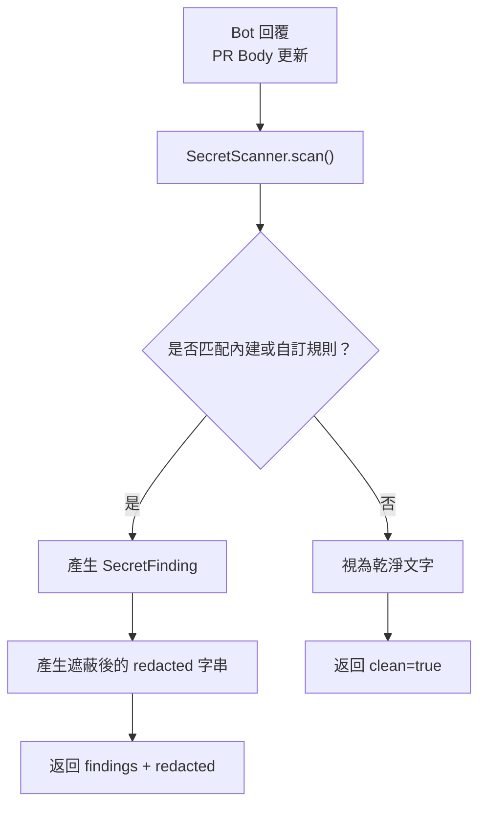
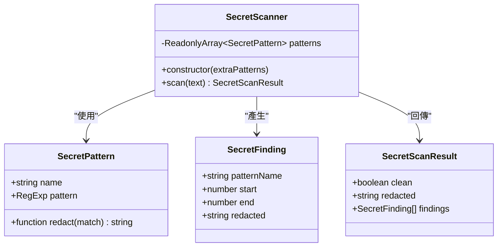
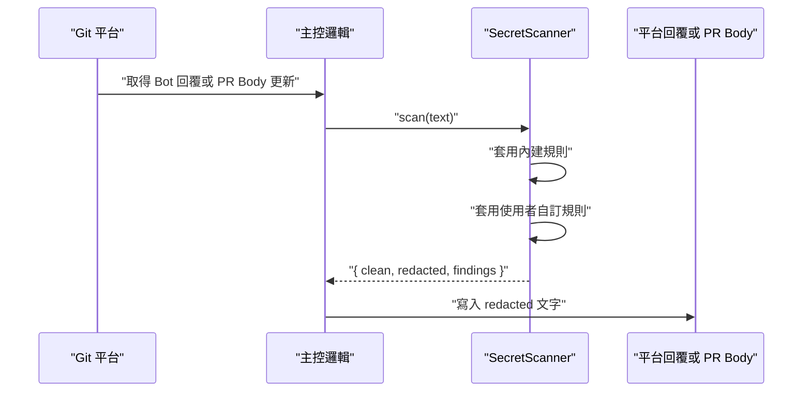
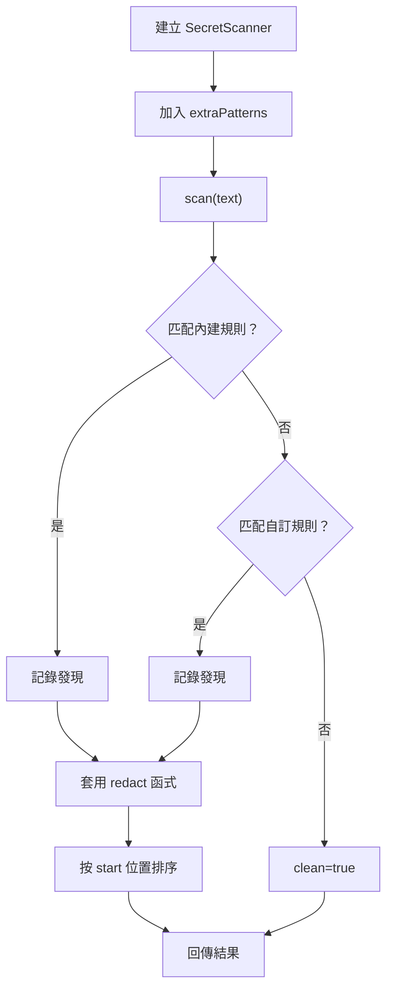

# Security 設定

<cite>
**本文引用的檔案**
- [SecretScanner.ts](https://github.com/mikeah2011/maestro/blob/master/src/core/security/SecretScanner.ts)
- [SecretScanner.test.ts](https://github.com/mikeah2011/maestro/blob/master/tests/core/security/SecretScanner.test.ts)
- [schema.ts](https://github.com/mikeah2011/maestro/blob/master/src/config/schema.ts)
- [.maestro.example.yaml](https://github.com/mikeah2011/maestro/blob/master/.maestro.example.yaml)
- [audit.ts](https://github.com/mikeah2011/maestro/blob/master/src/cli/commands/audit.ts)
- [Finding.ts](https://github.com/mikeah2011/maestro/blob/master/src/core/types/Finding.ts)
- [README.md](https://github.com/mikeah2011/maestro/blob/master/README.md)
</cite>

## 目錄
1. [簡介](#簡介)
2. [專案結構與安全模組位置](#專案結構與安全模組位置)
3. [核心元件：敏感資訊掃描器](#核心元件敏感資訊掃描器)
4. [設定模型與配置方式](#設定模型與配置方式)
5. [支援的敏感資訊類型](#支援的敏感資訊類型)
6. [遮蔽策略與輸出結果](#遮蔽策略與輸出結果)
7. [掃描時機與執行流程](#掃描時機與執行流程)
8. [路徑模式與關鍵字規則](#路徑模式與關鍵字規則)
9. [自訂規則定義](#自訂規則定義)
10. [性能與複雜度分析](#性能與複雜度分析)
11. [安全最佳實踐](#安全最佳實踐)
12. [常見敏感資訊模式](#常見敏感資訊模式)
13. [安全審計工具使用指南](#安全審計工具使用指南)
14. [問題排查指南](#問題排查指南)
15. [結論](#結論)

## 簡介
本文件說明 Maestro 專案中的 Security 設定，重點包括：
- 敏感資訊掃描器的實作、資料結構與處理流程。
- `.maestro.yaml` 中 `security` 區段的設定欄位與預設值。
- 內建敏感資訊模式、遮蔽策略、掃描時機與輸出格式。
- 如何擴充自訂規則、評估效能影響、進行安全審計與問題排查。

此模組的主要目標是防止 Bot 回覆、PR Body 更新等「向外輸出」的文字意外攜帶 API Key、Token、密碼、私密金鑰或憑證。

## 專案結構與安全模組位置
Security 功能的核心實作位於 `src/core/security`，其輸入來自外部平台（例如 GitHub）產生的 Bot 回覆或 PR Body 更新；輸出為已遮蔽的安全文字與發現紀錄。

**圖表來源**
- [SecretScanner.ts:1-136](https://github.com/mikeah2011/maestro/blob/master/src/core/security/SecretScanner.ts#L1-L136)

**段落來源**
- [README.md:120-170](https://github.com/mikeah2011/maestro/blob/master/README.md#L120-L170)

## 核心元件：敏感資訊掃描器
`SecretScanner` 提供以下能力：
- 接收一段文字。
- 依序套用內建與使用者提供的 `SecretPattern`。
- 記錄每個匹配的起始位置、結束位置、遮蔽後內容。
- 回傳 `clean`、`redacted`、`findings`。

### 主要資料結構
| 結構名稱 | 用途 | 重要欄位 |
|---|---|---|
| `SecretPattern` | 定義一個敏感資訊規則 | `name`、`pattern`、`redact` |
| `SecretFinding` | 一次匹配的發現紀錄 | `patternName`、`start`、`end`、`redacted` |
| `SecretScanResult` | 掃描結果 | `clean`、`redacted`、`findings` |

這些結構皆由 `SecretScanner.ts` 匯出，並被測試檔引用，代表它們是對外公開的掃描介面。

**段落來源**
- [SecretScanner.ts:13-53](https://github.com/mikeah2011/maestro/blob/master/src/core/security/SecretScanner.ts#L13-L53)
- [SecretScanner.test.ts:1-20](https://github.com/mikeah2011/maestro/blob/master/tests/core/security/SecretScanner.test.ts#L1-L20)

### 類別關係圖

**圖表來源**
- [SecretScanner.ts:13-136](https://github.com/mikeah2011/maestro/blob/master/src/core/security/SecretScanner.ts#L13-L136)

## 設定模型與配置方式
Security 設定由 Zod Schema 驗證，並由 `.maestro.example.yaml` 提供範例。

### `security` 區段
| 欄位 | 型別 | 預設值 | 說明 |
|---|---|---:|---|
| `scanOutgoing` | `boolean` | `true` | 是否在每次回覆或 PR Body 更新前執行敏感資訊掃描。 |
| `redactPatterns` | `string[]` | 包含數個關鍵字與 Token 前綴模式 | 用於設定層級的字串規則；實際敏感內容掃描由 `SecretScanner` 的 `SecretPattern` 處理。 |

預設的 `redactPatterns` 包含：
- `(?i)api[_-]?key`
- `(?i)secret`
- `(?i)password`
- `(?i)token`
- `ghp_[A-Za-z0-9]{20,}`
- `sk-[A-Za-z0-9]{20,}`

範例組態也顯示可加入更多字串規則，例如：
- `(?i)api[_-]?key`
- `(?i)secret`
- `(?i)password`
- `(?i)token`

**段落來源**
- [schema.ts:140-176](https://github.com/mikeah2011/maestro/blob/master/src/config/schema.ts#L140-L176)
- [.maestro.example.yaml:201-239](https://github.com/mikeah2011/maestro/blob/master/.maestro.example.yaml#L201-L239)

### 設定優先順序
Maestro 採用多層設定載入機制，優先順序為：
CLI 旗標 → 環境變數 → 倉庫 `.maestro.yaml` → 使用者 `~/.maestro/config.yaml` → 預設值。

這表示 `security` 設定可透過不同層級覆蓋，但當前程式碼中未看到 CLI 直接控制 `security` 的旗標；因此實務上最常調整的是 `.maestro.yaml`。

**段落來源**
- [README.md:170-200](https://github.com/mikeah2011/maestro/blob/master/README.md#L170-L200)
- [schema.ts:1-20](https://github.com/mikeah2011/maestro/blob/master/src/config/schema.ts#L1-L20)

## 支援的敏感資訊類型
`SecretScanner` 的內建規則涵蓋以下主要類型：

| 類型 | 規則名稱 | 特徵 | 遮蔽行為 |
|---|---|---|---|
| AWS Access Key ID | `aws_access_key_id` | 以 `AKIA` 開頭且長度固定 | 替換為 `[REDACTED]` |
| AWS Secret Access Key | `aws_secret_access_key` | 符合特定變數名與 40 字元值 | 僅遮蔽值部分 |
| GitHub Token | `github_token` | `ghp_`、`ghs_`、`gho_`、`ghr_`、`github_pat_` 前綴 | 保留前 8 字元後接 `[REDACTED]` |
| Private Key PEM | `private_key_pem` | `-----BEGIN ... PRIVATE KEY-----` 區塊 | 整段替換為 `[PRIVATE KEY REDACTED]` |
| JWT | `jwt` | 三段 base64url 片段，最小長度限制 | 保留前 10 字元後接 `[JWT REDACTED]` |
| Stripe Key | `stripe_key` | `sk_live_`、`pk_test_` 等前綴 | 保留前 12 字元後接 `[REDACTED]` |
| Slack Token | `slack_token` | `xoxb`、`xoxa`、`xoxp`、`xoxr`、`xoxs` 開頭的 Token | 保留前 12 字元後接 `[REDACTED]` |
| Generic API Key | `generic_api_key` | `api_key`、`apikey`、`access_token` 等鍵名 | 遮蔽長值部分 |

這些規則在測試中分別驗證了：
- 乾淨文字不誤判。
- AWS Key、GitHub Token、PEM Private Key、JWT、Stripe Key、Slack Token、Generic API Key 都能被偵測。
- 遮蔽後原始秘密不會出現在 `redacted` 字串中。
- 多個不同秘密可在同一則文字中被同時遮蔽。

**段落來源**
- [SecretScanner.ts:55-104](https://github.com/mikeah2011/maestro/blob/master/src/core/security/SecretScanner.ts#L55-L104)
- [SecretScanner.test.ts:21-190](https://github.com/mikeah2011/maestro/blob/master/tests/core/security/SecretScanner.test.ts#L21-L190)

## 遮蔽策略與輸出結果
目前 `SecretScanner` 的遮蔽策略統一歸類為 **redact**。

### 遮蔽策略比較
| 策略 | 意義 | 目前狀態 |
|---|---|---|
| `mask` | 通常指部分遮蔽，例如只顯示前後若干字元 | 概念性策略；目前無獨立實作 |
| `redact` | 將敏感內容替換為安全標示字串 | 實際使用的策略 |
| `hash` | 用雜湊值取代敏感內容 | 目前未實作 |

每個 `SecretPattern.redact` 是一個函式，根據匹配到的原始字串產生安全版本。例如：
- AWS Key：直接替換為 `[REDACTED]`。
- GitHub Token：保留前 8 字元，避免完全不可辨識。
- Private Key：整體替換為 `[PRIVATE KEY REDACTED]`。
- JWT：保留前 10 字元，減少上下文破壞。

### 掃描結果結構
| 欄位 | 說明 |
|---|---|
| `clean` | 若無發現則為 `true` |
| `redacted` | 若有發現，則為所有秘密都被遮蔽的字串；否則等於輸入 |
| `findings` | 所有匹配的發現列表，按起始位置排序 |

這個結果可用於：
- 判斷是否需要進一步處理。
- 將遮蔽後的文字寫回平台。
- 將發現紀錄寫入稽核或事件系統。

**段落來源**
- [SecretScanner.ts:22-53](https://github.com/mikeah2011/maestro/blob/master/src/core/security/SecretScanner.ts#L22-L53)
- [SecretScanner.ts:106-136](https://github.com/mikeah2011/maestro/blob/master/src/core/security/SecretScanner.ts#L106-L136)
- [SecretScanner.test.ts:160-190](https://github.com/mikeah2011/maestro/blob/master/tests/core/security/SecretScanner.test.ts#L160-L190)

## 掃描時機與執行流程
根據註解，`SecretScanner` 會掃描「每一個向外輸出的字串」，包含 Bot 回覆與 PR Body 更新。這樣做的目的是防止 Bot 引用 Diff 中的敏感資訊時，再次將其持久化到 PR 討論串或 PR Body。

**圖表來源**
- [SecretScanner.ts:1-21](https://github.com/mikeah2011/maestro/blob/master/src/core/security/SecretScanner.ts#L1-L21)
- [SecretScanner.ts:106-136](https://github.com/mikeah2011/maestro/blob/master/src/core/security/SecretScanner.ts#L106-L136)

**段落來源**
- [SecretScanner.ts:1-21](https://github.com/mikeah2011/maestro/blob/master/src/core/security/SecretScanner.ts#L1-L21)

## 路徑模式與關鍵字規則
需要注意的是，`security.redactPatterns` 在 Schema 中被定義為 `string[]`，並非一般意義上的 Git path patterns。它更像是「字串規則」或「關鍵字/模式清單」，用來描述哪些字串應被特別關注。

| 規則類型 | 用途 | 是否真正驅動 `SecretScanner` |
|---|---|---|
| `security.redactPatterns` | 設定層級的字串規則清單 | 目前未直接注入 `SecretScanner` |
| `SecretPattern.pattern` | 正規表達式，用於實際敏感內容掃描 | 是 |
| `SecretPattern.name` | 人類可讀的規則名稱 | 是 |
| `SecretPattern.redact` | 遮蔽函式 | 是 |

因此，若要嚴格對應程式碼行為：
- `security.redactPatterns` 屬於設定模型的一部分，適合用來描述組織希望被注意的關鍵字或字串模式。
- 實際敏感內容掃描由 `SecretScanner` 的 `BUILTIN_PATTERNS` 與建構子接受的 `extraPatterns` 驅動。

**段落來源**
- [schema.ts:140-176](https://github.com/mikeah2011/maestro/blob/master/src/config/schema.ts#L140-L176)
- [SecretScanner.ts:55-104](https://github.com/mikeah2011/maestro/blob/master/src/core/security/SecretScanner.ts#L55-L104)
- [SecretScanner.ts:106-136](https://github.com/mikeah2011/maestro/blob/master/src/core/security/SecretScanner.ts#L106-L136)

## 自訂規則定義
要新增自訂敏感資訊規則，需實作 `SecretPattern`：

| 欄位 | 必要 | 說明 |
|---|---:|---|
| `name` | 是 | 規則名稱，會出現在發現紀錄中 |
| `pattern` | 是 | `RegExp`，不可使用 `/g` 旗標；掃描器內部會複製為全域模式 |
| `redact` | 是 | 接收匹配字串，回傳安全字串 |

測試展示了兩個典型用法：
1. 自訂服務金鑰：`INTSVC-[A-Z0-9]{16}`。
2. 自訂規則與內建規則共存：`CUSTOM-[A-Z]{8}`。

### 自訂規則流程

**圖表來源**
- [SecretScanner.ts:106-136](https://github.com/mikeah2011/maestro/blob/master/src/core/security/SecretScanner.ts#L106-L136)
- [SecretScanner.test.ts:191-200](https://github.com/mikeah2011/maestro/blob/master/tests/core/security/SecretScanner.test.ts#L191-L200)

**段落來源**
- [SecretScanner.ts:13-21](https://github.com/mikeah2011/maestro/blob/master/src/core/security/SecretScanner.ts#L13-L21)
- [SecretScanner.ts:106-136](https://github.com/mikeah2011/maestro/blob/master/src/core/security/SecretScanner.ts#L106-L136)
- [SecretScanner.test.ts:191-200](https://github.com/mikeah2011/maestro/blob/master/tests/core/security/SecretScanner.test.ts#L191-L200)

## 性能與複雜度分析
假設：
- 輸入文字長度為 `N`。
- 規則數量為 `P`。
- 每則規則的平均匹配次數為 `M`。

### 時間複雜度
- 對每則規則建立全域正規表達式：`O(P)`。
- 對每則規則掃描原始文字：`O(P × N)`。
- 收集並排序發現：`O(F log F)`，其中 `F` 是總發現數。
- 重建 `redacted` 字串：取決於匹配次數與替換長度，最壞情況可接近 `O(N × F)`。

整體而言，掃描過程對每則規則都重新執行一次正規表達式，因此在規則很多、文字很長、或匹配次數很高時，可能成為瓶頸。

### 空間複雜度
- `findings` 陣列：`O(F)`。
- `redacted` 字串：最壞情況下可能比原始文字更大或更小，取決於遮蔽字串長度。
- 全域正規表達式複本：`O(P)`。

### 優化建議
1. 將高命中率的規則放在前面，減少後續規則對已經遮蔽區域的重複匹配風險。
2. 避免過度寬鬆的正規表達式，以降低誤判和匹配成本。
3. 若掃描大量長文本，可考慮先做快速關鍵字篩選，再執行精確正規表達式。
4. 謹慎設計 `redact` 函式，避免在其中執行昂貴運算。

**段落來源**
- [SecretScanner.ts:106-136](https://github.com/mikeah2011/maestro/blob/master/src/core/security/SecretScanner.ts#L106-L136)

## 安全最佳實踐
1. **啟用 outgoing 掃描**  
   保持 `security.scanOutgoing` 為 `true`，確保 Bot 回覆與 PR Body 更新都會經過敏感資訊檢查。

2. **優先遮蔽完整秘密**  
   自訂規則的 `redact` 函式應確保原始敏感值不出現在 `redacted` 中。

3. **保留有限上下文**  
   對於 Token 或 JWT，可保留少量前綴，讓人類仍能辨識是哪一種憑證，但不得洩露有效值。

4. **避免過寬的關鍵字規則**  
   `redactPatterns` 與 `SecretPattern.pattern` 都不宜過於寬鬆，以免產生大量誤報。

5. **定期檢視發現紀錄**  
   雖然目前 `maestro audit` 尚未實作，但仍可觀察事件與稽核日誌，確認是否有敏感資訊外洩跡象。

6. **將敏感資訊集中管理**  
   不要硬編碼 API Key、Token、Password 或 Private Key；改用環境變數或密鑰管理系統。

7. **限制 CI/CD 權限**  
   即使有掃描器，也不應授予不必要的長期高權限 Token。

8. **審查自訂規則**  
   每個自訂規則都應經過安全審查，避免引入新的漏網之魚或誤判。

[無段落來源，因為這是通用安全建議]

## 常見敏感資訊模式
以下模式已在內建規則或測試中被驗證：

| 情境 | 常見模式 | 處理建議 |
|---|---|---|
| AWS 存取金鑰 | `AKIA...` | 立即重發憑證；檢查是否已提交至遠端 |
| GitHub Token | `ghp_`、`ghs_`、`gho_`、`ghr_`、`github_pat_` | 撤銷並重新產生；檢查個人存取權限 |
| JWT | 三段 base64url | 不應出現在 PR 或 Bot 回覆中；檢查 Authorization Header 是否被轉錄 |
| Stripe Key | `sk_live_`、`pk_test_` | 生產環境 Key 更危險；立即重發 |
| Slack Token | `xoxb-`、`xoxp-` 等 | 撤銷 App 或 Bot Token |
| Private Key | PEM 區塊 | 立即重發憑證；檢查私鑰是否已提交 |
| Generic API Key | `api_key=`、`access_token:` | 檢查配置文件、環境變數、CI 設定 |

**段落來源**
- [SecretScanner.ts:55-104](https://github.com/mikeah2011/maestro/blob/master/src/core/security/SecretScanner.ts#L55-L104)
- [SecretScanner.test.ts:21-190](https://github.com/mikeah2011/maestro/blob/master/tests/core/security/SecretScanner.test.ts#L21-L190)

## 安全審計工具使用指南
專案提供 `maestro audit` 指令，但目前仍是佔位實作：

- 目的：重播某個 Pull Request 的分類決策。
- 參數：
  - `--pr <number>`：必填，Pull Request 編號。
  - `--round <n>`：可選，限制到特定輪次。
  - `--format <fmt>`：可選，輸出格式 `text` 或 `jsonl`，預設 `text`。
- 目前行為：輸出警告訊息並退出。

未來若擴展為真實的安全審計工具，可考慮：
- 重播 `SecretScanner` 的掃描結果。
- 列出曾出現過的敏感資訊規則與遮蔽結果。
- 統計誤判與漏判。
- 產出安全報告與合規摘要。

**段落來源**
- [audit.ts:1-25](https://github.com/mikeah2011/maestro/blob/master/src/cli/commands/audit.ts#L1-L25)

## 問題排查指南

### 問題一：Bot 回覆仍包含敏感資訊
**可能原因：**
- 掃描未啟用。
- 敏感資訊不在 `SecretPattern` 或 `redactPatterns` 範圍內。
- 自訂規則的 `redact` 函式沒有正確遮蔽原始值。

**排查步驟：**
1. 確認 `security.scanOutgoing` 為 `true`。
2. 檢查文字是否匹配現有內建規則。
3. 新增自訂 `SecretPattern`，並在 `redact` 中確保原始值消失。
4. 查看 `findings` 是否包含該規則名稱。

**段落來源**
- [schema.ts:140-176](https://github.com/mikeah2011/maestro/blob/master/src/config/schema.ts#L140-L176)
- [SecretScanner.ts:106-136](https://github.com/mikeah2011/maestro/blob/master/src/core/security/SecretScanner.ts#L106-L136)

### 問題二：正常文字被誤判為敏感資訊
**可能原因：**
- 正規表達式太寬鬆。
- 關鍵字如 `api_key`、`token` 出現在非敏感內容中。
- `redactPatterns` 或自訂規則過於泛用。

**排查步驟：**
1. 檢查 `findings` 中的 `patternName`。
2. 縮小規則範圍，增加邊界條件或長度限制。
3. 避免單一字串規則只依賴 `(?i)token` 這類極泛模式。

**段落來源**
- [SecretScanner.ts:55-104](https://github.com/mikeah2011/maestro/blob/master/src/core/security/SecretScanner.ts#L55-L104)
- [schema.ts:140-176](https://github.com/mikeah2011/maestro/blob/master/src/config/schema.ts#L140-L176)

### 問題三：遮蔽後文字仍可識別原始秘密
**可能原因：**
- `redact` 函式保留了過多內容。
- 遮蔽字串本身包含足夠語意。

**排查步驟：**
1. 檢查 `SecretFinding.redacted`。
2. 調整 `redact` 函式，使原始值完全消失。
3. 對 Token 與 JWT 保留最少必要前綴。

**段落來源**
- [SecretScanner.ts:22-53](https://github.com/mikeah2011/maestro/blob/master/src/core/security/SecretScanner.ts#L22-L53)
- [SecretScanner.ts:106-136](https://github.com/mikeah2011/maestro/blob/master/src/core/security/SecretScanner.ts#L106-L136)

### 問題四：找不到 `maestro audit` 功能
**說明：**
`maestro audit` 目前尚未實作，屬於 M3 規劃項目。它預期會重播 `.maestro/audit/pr-<N>-round-<R>.jsonl` 中的分類決策，但目前只會顯示未實作的提示。

**段落來源**
- [audit.ts:1-25](https://github.com/mikeah2011/maestro/blob/master/src/cli/commands/audit.ts#L1-L25)

## 結論
Maestro 的 Security 設定提供了一個明確的防禦點：在 Bot 回覆與 PR Body 更新輸出前，對敏感資訊進行掃描與遮蔽。當前實作涵蓋 AWS Key、GitHub Token、Private Key、JWT、Stripe Key、Slack Token 與 Generic API Key 等常見類型，並允許透過 `SecretPattern` 擴充自訂規則。

實務上建議：
- 保持 outgoing 掃描啟用。
- 謹慎設計自訂規則。
- 定期審查發現與遮蔽結果。
- 將敏感資訊從程式碼與設定中移除，改由環境變數或密鑰管理系統管理。
- 待 `maestro audit` 實作完成後，建立正式的安全審計與回溯機制。

[無段落來源，因為這是總結性內容]