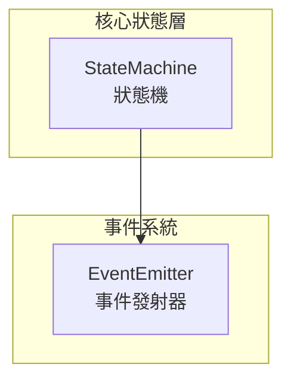
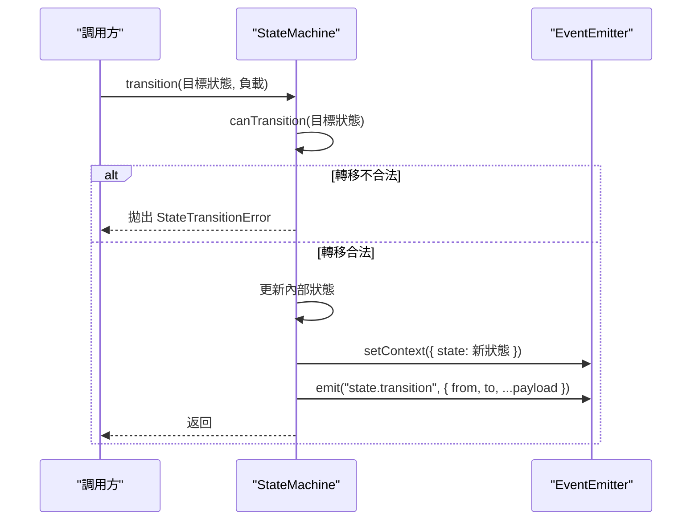
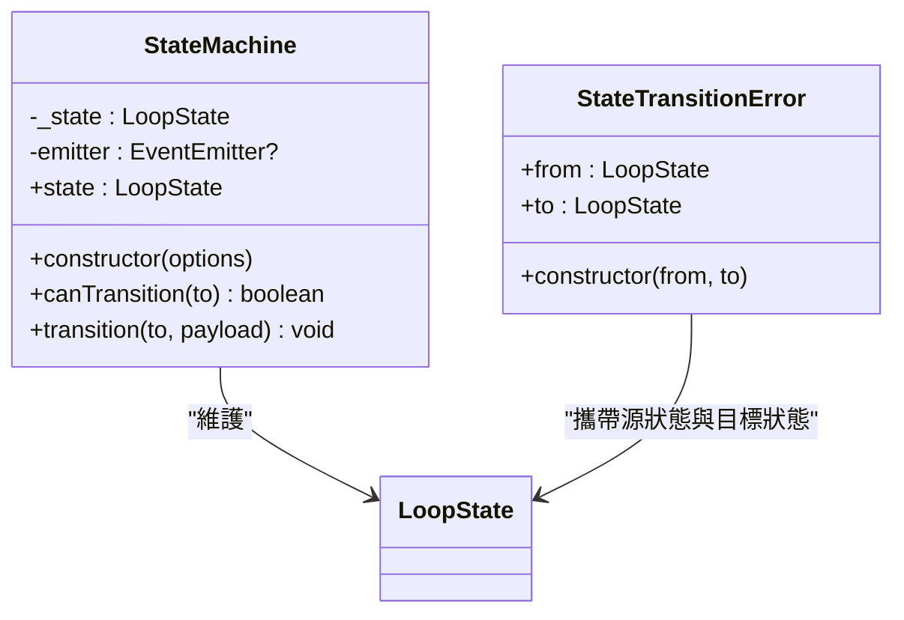
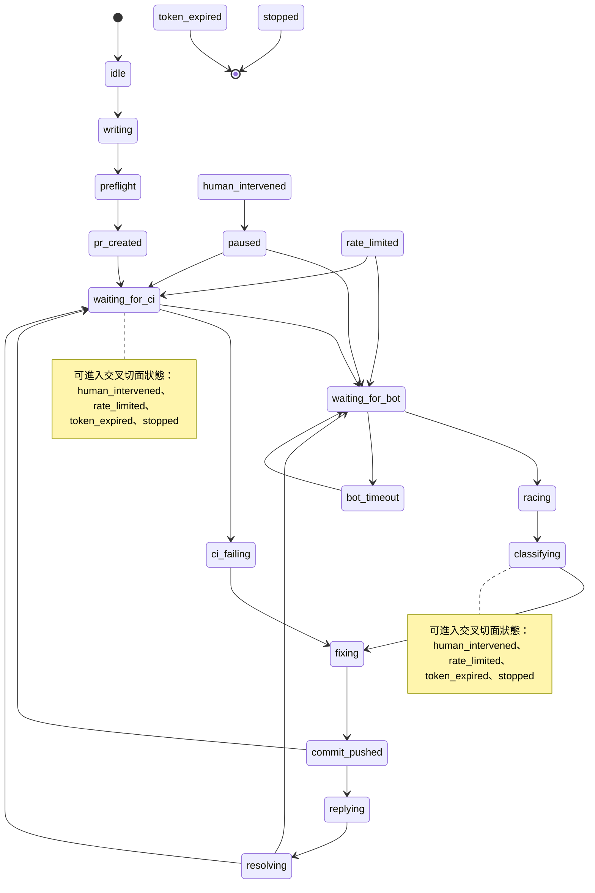
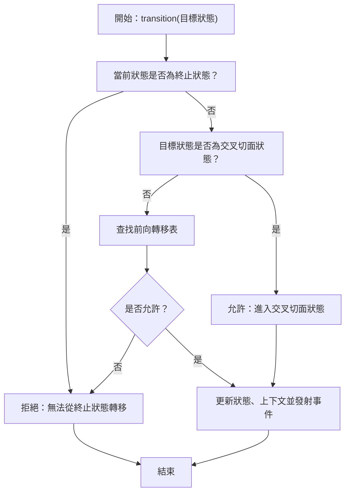
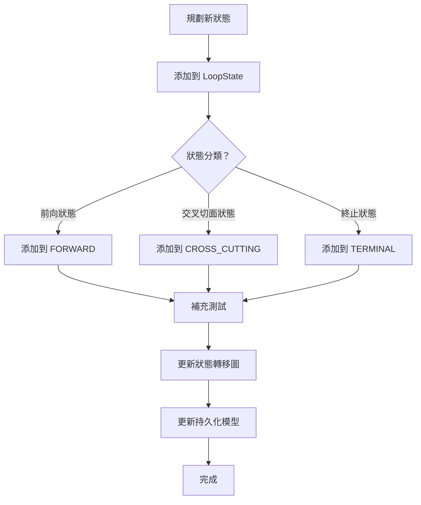
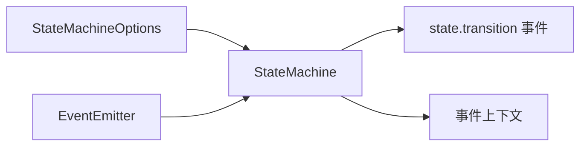

# StateMachine 狀態機

<cite>
**本文引用的文件**   
- [StateMachine.ts](https://github.com/mikeah2011/maestro/blob/master/src/core/state/StateMachine.ts)
- [StateMachine.test.ts](https://github.com/mikeah2011/maestro/blob/master/tests/core/state/StateMachine.test.ts)
</cite>

## 目錄

1. [引言](#引言)
2. [項目結構與定位](#項目結構與定位)
3. [核心類型與狀態分類](#核心類型與狀態分類)
4. [架構總覽](#架構總覽)
5. [詳細組件分析](#詳細組件分析)
6. [狀態轉移表設計與驗證機制](#狀態轉移表設計與驗證機制)
7. [當前使用模式：事件追蹤而非控制流](#當前使用模式事件追蹤而非控制流)
8. [錯誤處理策略](#錯誤處理策略)
9. [狀態持久化方案與擴展指南](#狀態持久化方案與擴展指南)
10. [依賴關係分析](#依賴關係分析)
11. [性能考量](#性能考量)
12. [故障排查指南](#故障排查指南)
13. [結論](#結論)

## 引言

本文件為 `StateMachine` 的狀態機文檔，聚焦於以下目標：

- 解釋三種狀態定義：前向轉移、交叉切面狀態與終止狀態。
- 說明狀態轉移表的設計原則、合法轉移規則與驗證機制。
- 明確當前實現的使用模式：主要用於事件追蹤與上下文標記，而不是嚴格控制業務流程。
- 提供完整的狀態轉移圖、錯誤處理策略與狀態持久化建議。
- 給出擴展新狀態的步驟與最佳實踐。
- 指出未來可能的重構方向，使狀態機從「觀察型」升級為「可控型」。

## 項目結構與定位

`StateMachine` 位於 `src/core/state/StateMachine.ts`，屬於核心狀態層；其測試位於 `tests/core/state/StateMachine.test.ts`。它依賴事件系統中的 `EventEmitter`，但不直接調用其他業務模塊。這使得狀態機本身保持輕量、可組合，適合被編排器、修復引擎或循環控制器引用。

**圖表來源**
- [StateMachine.ts:1-114](https://github.com/mikeah2011/maestro/blob/master/src/core/state/StateMachine.ts#L1-L114)

**章節來源**
- [StateMachine.ts:1-114](https://github.com/mikeah2011/maestro/blob/master/src/core/state/StateMachine.ts#L1-L114)

## 核心類型與狀態分類

### 核心類型

| 名稱 | 類型 | 說明 |
|---|---|---|
| `LoopState` | 字面量聯合類型 | 所有允許狀態的集合，包含正常狀態、錯誤狀態與交叉切面狀態。 |
| `FORWARD` | 映射 | 每個狀態到合法下一狀態數組的前向轉移表。 |
| `CROSS_CUTTING` | 集合 | 可從任意非終止狀態進入的交叉切面狀態。 |
| `TERMINAL` | 集合 | 沒有 outgoing transitions 的終止狀態。 |
| `StateMachineOptions` | 接口 | 構造函數選項，包含初始狀態與可選的事件發射器。 |
| `StateMachine` | 類 | 狀態機實現，負責當前狀態、合法性檢查、轉移與事件發射。 |
| `StateTransitionError` | 異常類 | 非法狀態轉移時拋出的錯誤，攜帶源狀態與目標狀態。 |

**章節來源**
- [StateMachine.ts:14-114](https://github.com/mikeah2011/maestro/blob/master/src/core/state/StateMachine.ts#L14-L114)

### 狀態分類

#### 前向轉移狀態

這些狀態構成主循環的主要執行路徑。典型路徑是：

`idle → writing → preflight → pr_created → waiting_for_ci → waiting_for_bot → racing → classifying → fixing → commit_pushed → replying → resolving`

其中 `commit_pushed` 和 `resolving` 可以重新進入 CI 或機器人等待階段，形成可重複的修復循環。

| 狀態 | 主要含義 | 典型後續 |
|---|---|---|
| `idle` | 空閒 | `writing` |
| `writing` | 寫入代碼 | `preflight` |
| `preflight` | 預檢 | `pr_created` |
| `pr_created` | 拉取請求已創建 | `waiting_for_ci` |
| `waiting_for_ci` | 等待持續集成結果 | `waiting_for_bot` 或 `ci_failing` |
| `waiting_for_bot` | 等待機器人回應 | `racing` 或 `bot_timeout` |
| `racing` | 競態階段 | `classifying` |
| `classifying` | 分類問題 | `fixing` |
| `fixing` | 修復中 | `commit_pushed` |
| `commit_pushed` | 提交已推送 | `waiting_for_ci` 或 `replying` |
| `replying` | 回覆中 | `resolving` |
| `resolving` | 解決中 | `waiting_for_ci` 或 `waiting_for_bot` |

#### 交叉切面狀態

交叉切面狀態代表跨業務流程的外部干預或系統性限制，例如：

- `human_intervened`：人類介入。
- `rate_limited`：速率限制。
- `token_expired`：憑證過期。
- `stopped`：手動停止。
- `paused`：暫停（由人類介入後進入）。

它們的設計原則是：**任何非終止狀態都可以無條件進入這些狀態**，但從這些狀態出發通常有受限的恢復路徑。

| 狀態 | 是否可從任意非終止狀態進入 | 典型恢復路徑 |
|---|---:|---|
| `human_intervened` | 是 | `paused` |
| `rate_limited` | 是 | `waiting_for_bot`、`waiting_for_ci` |
| `token_expired` | 是 | 無；屬終止狀態 |
| `stopped` | 是 | 無；屬終止狀態 |
| `paused` | 否；需先經 `human_intervened` | `waiting_for_bot`、`waiting_for_ci` |

#### 終止狀態

終止狀態表示該次執行的生命周期已經結束，不能再繼續前向轉移。當前實現中：

- `stopped`：人工停止。
- `token_expired`：憑證過期。

這兩個狀態在 `TERMINAL` 集合中，因此 `canTransition` 會拒絕從它們再轉移。

| 狀態 | 是否終止 | 是否可恢復 |
|---|---:|---|
| `stopped` | 是 | 否 |
| `token_expired` | 是 | 否 |
| `ci_failing` | 否 | 可恢復至 `fixing` |
| `bot_timeout` | 否 | 可恢復至 `waiting_for_bot` |
| `human_intervened` | 否 | 可恢復至 `paused` |
| `rate_limited` | 否 | 可恢復至等待階段 |
| `paused` | 否 | 可恢復至等待階段 |

**章節來源**
- [StateMachine.ts:14-63](https://github.com/mikeah2011/maestro/blob/master/src/core/state/StateMachine.ts#L14-L63)
- [StateMachine.test.ts:19-62](https://github.com/mikeah2011/maestro/blob/master/tests/core/state/StateMachine.test.ts#L19-L62)

## 架構總覽

`StateMachine` 是一個封閉的狀態管理對象，主要職責包括：

1. 維護當前狀態。
2. 根據轉移表判斷轉移是否合法。
3. 更新內部狀態。
4. 更新事件發射器的上下文。
5. 發出 `state.transition` 事件。

**圖表來源**
- [StateMachine.ts:64-114](https://github.com/mikeah2011/maestro/blob/master/src/core/state/StateMachine.ts#L64-L114)

**章節來源**
- [StateMachine.ts:64-114](https://github.com/mikeah2011/maestro/blob/master/src/core/state/StateMachine.ts#L64-L114)

## 詳細組件分析

### 狀態類與錯誤類

**圖表來源**
- [StateMachine.ts:64-114](https://github.com/mikeah2011/maestro/blob/master/src/core/state/StateMachine.ts#L64-L114)

#### 構造函數

- 默認初始狀態為 `idle`。
- 若傳入 `initialState`，則使用該狀態。
- 若傳入 `emitter`，則初始化事件上下文，使後續事件自動帶有當前狀態。

#### 狀態讀取

`state` 屬性只讀暴露當前狀態，避免外部直接修改內部狀態。

#### 合法性檢查

`canTransition` 的邏輯順序非常重要：

1. 如果當前狀態已是終止狀態，直接拒絕。
2. 如果目標狀態是交叉切面狀態，允許。
3. 否則檢查前向轉移表是否包含該目標狀態。

這種設計讓錯誤處理和外部干預可以優先於正常流程。

#### 狀態轉移

`transition` 執行以下步驟：

1. 調用 `canTransition`。
2. 若不合法，拋出 `StateTransitionError`。
3. 保存舊狀態。
4. 更新內部狀態。
5. 更新事件上下文。
6. 發出 `state.transition` 事件，並攜帶源狀態、目標狀態與額外負載。

**章節來源**
- [StateMachine.ts:64-114](https://github.com/mikeah2011/maestro/blob/master/src/core/state/StateMachine.ts#L64-L114)
- [StateMachine.test.ts:10-17](https://github.com/mikeah2011/maestro/blob/master/tests/core/state/StateMachine.test.ts#L10-L17)
- [StateMachine.test.ts:134-174](https://github.com/mikeah2011/maestro/blob/master/tests/core/state/StateMachine.test.ts#L134-L174)

### 狀態轉移圖

**圖表來源**
- [StateMachine.ts:24-63](https://github.com/mikeah2011/maestro/blob/master/src/core/state/StateMachine.ts#L24-L63)

### 狀態轉移驗證流程

**圖表來源**
- [StateMachine.ts:82-114](https://github.com/mikeah2011/maestro/blob/master/src/core/state/StateMachine.ts#L82-L114)

**章節來源**
- [StateMachine.ts:24-114](https://github.com/mikeah2011/maestro/blob/master/src/core/state/StateMachine.ts#L24-L114)

## 狀態轉移表設計與驗證機制

### 設計原則

1. **前向轉移可預測**  
   主循環通過 `FORWARD` 控制預期流程，避免隨意跳躍。

2. **交叉切面狀態優先**  
   錯誤、限流、憑證過期與人工停止等情況不需要知道當前業務狀態即可進入。

3. **終止狀態不可逆**  
   `stopped` 與 `token_expired` 不允許再次轉移，防止錯誤恢復邏輯誤解終止原因。

4. **錯誤狀態部分可恢復**  
   `ci_failing` 可恢復到 `fixing`，`bot_timeout` 可重新等待機器人，`human_intervened` 可進入 `paused` 後恢復。

5. **事件驅動觀測**  
   每次合法轉移都發射事件，便於審計、日誌與下游上下文同步。

### 驗證機制

驗證集中在 `canTransition`：

- 終止狀態檢查確保生命周期不可繼續。
- 交叉切面集合允許快速放行。
- 前向映射確保主流程不被繞過。

測試覆蓋了以下場景：

- 默認初始狀態。
- 注入初始狀態。
- 完整主路徑。
- 可重新進入 CI 門。
- 非法前向跳躍。
- 從終止狀態轉移。
- 錯誤攜帶 `from` 與 `to`。
- 交叉切面狀態從多個起始狀態進入。
- 終止狀態不能繼續 escalation。
- 錯誤狀態恢復。
- 事件發射與上下文更新。
- `canTransition` 的真假分支。

**章節來源**
- [StateMachine.ts:24-114](https://github.com/mikeah2011/maestro/blob/master/src/core/state/StateMachine.ts#L24-L114)
- [StateMachine.test.ts:19-174](https://github.com/mikeah2011/maestro/blob/master/tests/core/state/StateMachine.test.ts#L19-L174)

## 當前使用模式：事件追蹤而非控制流

當前 `StateMachine` 的核心價值在於：

- 記錄一次 Maestro 執行過程中的狀態變化。
- 透過事件系統向下傳遞當前狀態。
- 提供統一的狀態查詢入口。
- 阻止明顯非法的轉移。

但它目前並未：

- 作為業務流程的唯一決策點。
- 強制調用方只能按既定順序調用方法。
- 封裝狀態對應的具體行為。
- 自動觸發下一步動作。

也就是說，當前它是「觀察型狀態機」，而不是「控制型狀態機」。業務邏輯仍由調用方決定何時調用 `transition`，而狀態機主要保證「這個轉移是否合理」以及「事件是否帶上正確狀態」。

這種模式的優點是簡單、耦合低；缺點是狀態機本身不掌握完整業務上下文，容易出現調用方忽略狀態的情況。

**章節來源**
- [StateMachine.ts:1-114](https://github.com/mikeah2011/maestro/blob/master/src/core/state/StateMachine.ts#L1-L114)

## 錯誤處理策略

### 非法轉移錯誤

當調用 `transition` 時，如果轉移不合法，會拋出 `StateTransitionError`。該錯誤包含：

- `from`：轉移前的狀態。
- `to`：試圖轉移到的狀態。
- 消息中包含箭頭形式的轉移描述。

測試確認了：

- 非法前向跳躍會拋錯。
- 從 `stopped` 繼續轉移會拋錯。
- 錯誤對象確實攜帶 `from` 與 `to`。

### 錯誤狀態恢復

錯誤狀態並非全部終止：

| 錯誤狀態 | 恢復方式 | 說明 |
|---|---|---|
| `ci_failing` | 轉移到 `fixing` | CI 失敗後重新修復。 |
| `bot_timeout` | 轉移到 `waiting_for_bot` | 機器人超時後重新等待。 |
| `human_intervened` | 先轉移到 `paused`，再恢復 | 人類介入後可暫停並恢復。 |
| `rate_limited` | 回到等待階段 | 限流後等待 API 恢復。 |
| `token_expired` | 無 | 需要外部處理憑證刷新。 |
| `stopped` | 無 | 人工停止，不應自動恢復。 |

### 錯誤處理建議

- 捕獲 `StateTransitionError` 時應記錄 `from` 與 `to`，便於審計。
- 不要僅吞掉異常；應區分「非法調用」與「業務錯誤」。
- 對於 `token_expired`，應引入外部恢復流程，而不是讓狀態機自動繼續。
- 對於 `stopped`，應視為最終狀態，除非業務上明確支持「重新啟動一次獨立執行」。

**章節來源**
- [StateMachine.ts:64-114](https://github.com/mikeah2011/maestro/blob/master/src/core/state/StateMachine.ts#L64-L114)
- [StateMachine.test.ts:64-133](https://github.com/mikeah2011/maestro/blob/master/tests/core/state/StateMachine.test.ts#L64-L133)

## 狀態持久化方案與擴展指南

### 當前實現的限制

當前 `StateMachine` 只在內存中維護 `_state`，沒有提供：

- 持久化接口。
- 加載已有狀態的方法。
- 狀態版本管理。
- 狀態快照序列化。

因此，如果需要跨進程、重啟或可恢復執行的狀態，必須在外層實現持久化。

### 推薦的持久化方案

建議將狀態持久化放在狀態機外層，而不是直接修改狀態機內部。

| 層次 | 責任 |
|---|---|
| 狀態機 | 管理當前狀態與轉移合法性。 |
| 持久化適配器 | 序列化和反序列化狀態。 |
| 業務編排器 | 在關鍵節點讀寫持久化狀態。 |
| 事件系統 | 記錄狀態變化事件。 |

推薦的數據模型包含：

| 字段 | 類型 | 說明 |
|---|---|---|
| `state` | 字面量 | 當前 `LoopState`。 |
| `from` | 字面量 | 上次轉移的源狀態。 |
| `to` | 字面量 | 上次轉移的目標狀態。 |
| `payload` | 對象 | 轉移時的業務上下文。 |
| `createdAt` | 時間戳 | 狀態首次進入時間。 |
| `updatedAt` | 時間戳 | 狀態最後更新時間。 |
| `version` | 數字 | 狀態版本，用於衝突檢測。 |

### 擴展新狀態的最佳實踐

新增狀態時，請遵循以下步驟：

1. 在 `LoopState` 中添加新字面量。
2. 在前向轉移表中添加合法轉移。
3. 判斷是否屬於交叉切面狀態，若是則加入 `CROSS_CUTTING`。
4. 判斷是否為終止狀態，若是則加入 `TERMINAL`。
5. 更新狀態轉移圖。
6. 為新轉移補充單元測試。
7. 為事件審計補充集成測試。
8. 若涉及持久化，更新版本遷移邏輯。

**圖表來源**
- [StateMachine.ts:14-63](https://github.com/mikeah2011/maestro/blob/master/src/core/state/StateMachine.ts#L14-L63)

**章節來源**
- [StateMachine.ts:14-63](https://github.com/mikeah2011/maestro/blob/master/src/core/state/StateMachine.ts#L14-L63)

## 依賴關係分析

`StateMachine` 的依賴非常清晰：

- 輸入：初始狀態與可選 `EventEmitter`。
- 輸出：當前狀態、事件。
- 內部：靜態轉移表與集合。

**圖表來源**
- [StateMachine.ts:64-114](https://github.com/mikeah2011/maestro/blob/master/src/core/state/StateMachine.ts#L64-L114)

耦合度分析：

- 與事件系統的耦合是必要的，因為狀態變化需要被觀測。
- 與業務邏輯的耦合很低，狀態機不關心業務細節。
- 與持久化的耦合不存在，這有利於擴展。
- 潛在風險是：如果業務層忽略狀態合法性檢查，狀態機可能只成為「日誌工具」。

**章節來源**
- [StateMachine.ts:1-114](https://github.com/mikeah2011/maestro/blob/master/src/core/state/StateMachine.ts#L1-L114)

## 性能考量

當前實現的性能特徵如下：

- 狀態存儲：O(1)。
- 合法性檢查：O(k)，k 為前向轉移列表中最多元素數量。
- 事件發射：取決於事件系統實現。
- 空間複雜度：常數級，僅依賴有限狀態集合。

由於狀態數量固定且較少，`FORWARD` 的線性查找不會成為瓶頸。若未來狀態數量顯著增長，可考慮：

- 將 `FORWARD` 改為邊界檢查表或狀態圖鄰接表。
- 對交叉切面狀態使用前綴或類別標記。
- 緩存常用轉移結果。
- 在批量狀態更新時合併事件。

但在當前規模下，當前實現足夠高效且易於理解。

[無需章節來源，此節為一般性能討論]

## 故障排查指南

### 常見問題

| 現象 | 可能原因 | 排查步驟 |
|---|---|---|
| 調用 `transition` 拋出 `StateTransitionError` | 轉移不在 `FORWARD` 中，或當前狀態是終止狀態。 | 檢查 `from` 與 `to`，確認是否符合轉移表。 |
| 狀態跳到 `stopped` 後不再變化 | `stopped` 是終止狀態。 | 確認是否為預期的人工停止；如需恢復，應啟動新的執行實例。 |
| 狀態跳到 `token_expired` 後卡住 | 憑證過期未刷新。 | 檢查外部認證流程，不應依賴狀態機自動恢復。 |
| 事件沒有狀態標籤 | 狀態機未連接 `EventEmitter`，或在事件發生前未轉移。 | 檢查構造時是否注入 emitter，並確認 `transition` 已調用。 |
| 狀態未按預期重新進入 CI | 未正確從 `commit_pushed` 或 `resolving` 轉移到 `waiting_for_ci`。 | 檢查業務邏輯是否調用了正確的狀態轉移。 |

### 診斷建議

1. 開啟 `state.transition` 事件審計。
2. 記錄每次轉移的 `from`、`to` 與 `payload`。
3. 在關鍵節點打印當前狀態。
4. 使用 `canTransition` 做防禦性檢查，特別是在外部輸入觸發轉移時。
5. 對於 `token_expired` 與 `stopped`，應在業務層增加明確的恢復或重啟策略。

**章節來源**
- [StateMachine.ts:64-114](https://github.com/mikeah2011/maestro/blob/master/src/core/state/StateMachine.ts#L64-L114)
- [StateMachine.test.ts:104-174](https://github.com/mikeah2011/maestro/blob/master/tests/core/state/StateMachine.test.ts#L104-L174)

## 結論

`StateMachine` 當前是一個輕量、可審計的狀態追蹤組件。它的優勢在於：

- 狀態定義清晰。
- 前向轉移可預測。
- 交叉切面狀態統一處理。
- 終止狀態不可逆。
- 事件與上下文同步一致。

主要局限在於：

- 主要用於事件追蹤，不是嚴格控制流。
- 沒有內置持久化。
- 業務邏輯仍需調用方負責正確調用狀態轉移。

未來重構方向可分為兩條路線：

1. **輕量增強路線**：保留當前事件驅動模式，增加持久化適配器、狀態快照、版本遷移與更豐富的審計事件。
2. **控制型狀態機路線**：將狀態與行為綁定，提供受控接口，例如 `enterWaitingForCI()`、`recoverFromFailure()`，減少調用方直接操作字面量狀態的風險。

無論選擇哪條路線，都應保留現有轉移表的可見性與可測試性，因為這是狀態機可信度的基礎。

[無需章節來源，此節為總結性內容]