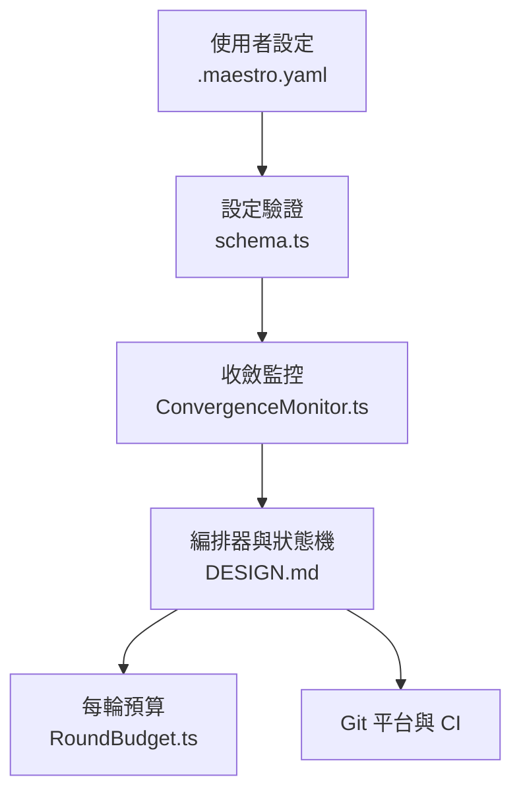
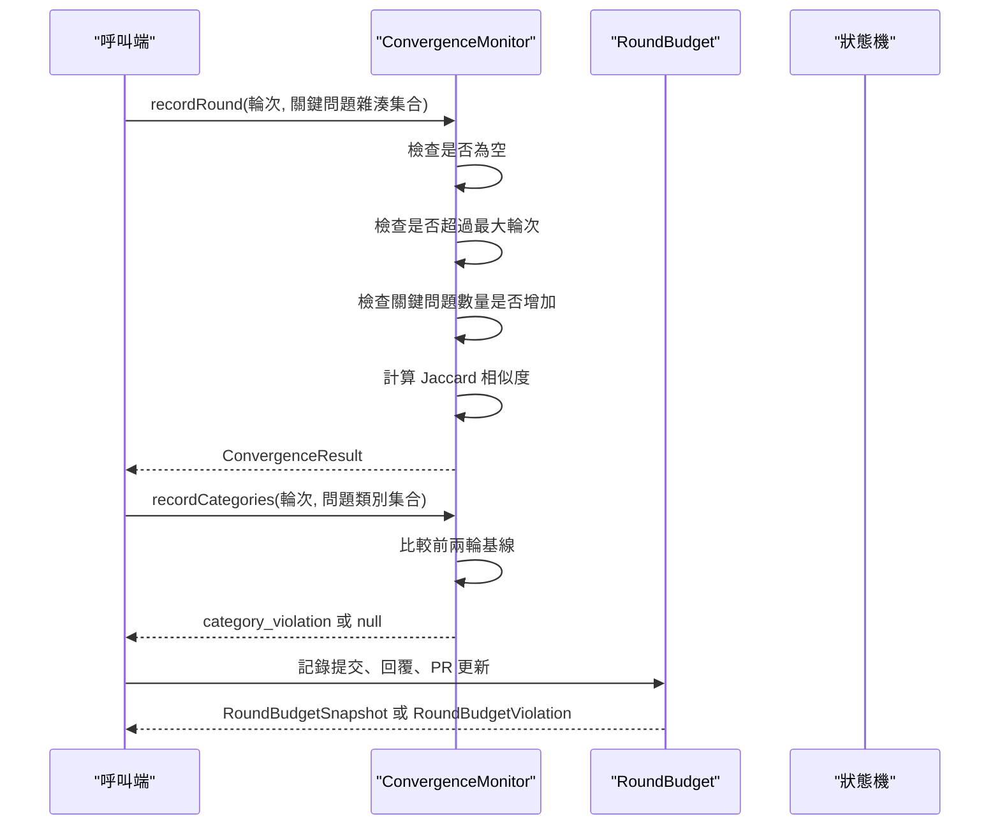
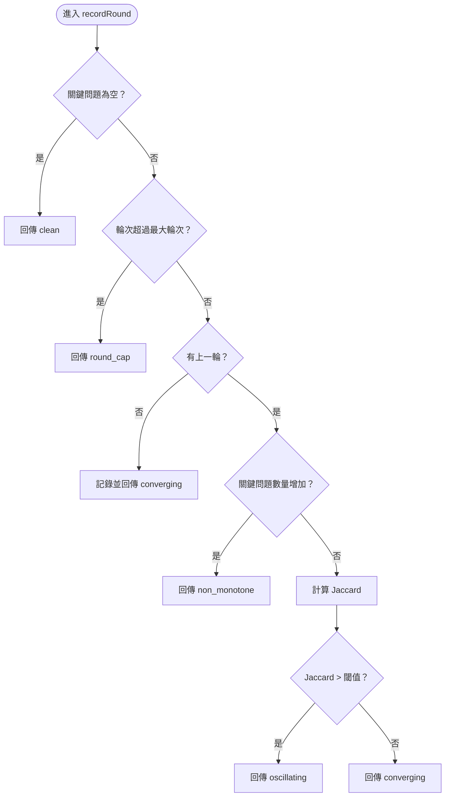

# Stop Conditions 設定

<cite>
**本文引用的檔案**   
- [src/core/convergence/ConvergenceMonitor.ts](https://github.com/mikeah2011/maestro/blob/master/src/core/convergence/ConvergenceMonitor.ts)
- [tests/core/convergence/ConvergenceMonitor.test.ts](https://github.com/mikeah2011/maestro/blob/master/tests/core/convergence/ConvergenceMonitor.test.ts)
- [src/config/schema.ts](https://github.com/mikeah2011/maestro/blob/master/src/config/schema.ts)
- [src/core/round/RoundBudget.ts](https://github.com/mikeah2011/maestro/blob/master/src/core/round/RoundBudget.ts)
- [docs/DESIGN.md](https://github.com/mikeah2011/maestro/blob/master/docs/DESIGN.md)
- [.maestro.example.yaml](https://github.com/mikeah2011/maestro/blob/master/.maestro.example.yaml)
</cite>

## 目錄
1. [簡介](#簡介)
2. [專案結構與設定位置](#專案結構與設定位置)
3. [核心收斂監控元件](#核心收斂監控元件)
4. [架構總覽](#架構總覽)
5. [詳細設定分析](#詳細設定分析)
6. [收斂決策邏輯](#收斂決策邏輯)
7. [升級策略與人工介入](#升級策略與人工介入)
8. [CI 失敗與 Bot 逾時處理](#ci-失敗與-bot-逾時處理)
9. [不同專案規模的推薦設定](#不同專案規模的推薦設定)
10. [效能調優建議](#效能調優建議)
11. [常見停滯問題診斷](#常見停滯問題診斷)
12. [結論](#結論)

## 簡介
Stop Conditions 是 Maestro 審查循環的「收斂層」。它不負責產生新的修復，而是以數學不變量與硬性上限為基礎，決定何時繼續、何時停止、何時升級給人類。其設計目標有三個：

1. **終止保證**：最多 3 輪（可透過設定表單上限至 5），避免無限迴圈。
2. **品質收斂**：關鍵問題數量不得增加；連續兩輪的關鍵問題集合不得過度重疊；第 2 輪後不得出現新問題類別。
3. **反垃圾郵件**：每輪的提交、回覆、PR 內容更新等操作有執行期斷言，違反即崩潰。

這些行為由 `ConvergenceMonitor` 計算，由 `RoundBudget` 強制執行，並由 `.maestro.yaml` 中的 `stopConditions` 暴露使用者可調整參數。

**章節來源**
- [docs/DESIGN.md:33-105](https://github.com/mikeah2011/maestro/blob/master/docs/DESIGN.md#L33-L105)
- [docs/DESIGN.md:106-160](https://github.com/mikeah2011/maestro/blob/master/docs/DESIGN.md#L106-L160)

## 專案結構與設定位置
Stop Conditions 涉及三個層次：

| 層次 | 檔案 | 責任 |
|---|---|---|
| 設定驗證 | `src/config/schema.ts` | 定義 `maxRounds`、`jaccardCeiling`、`noNewCategoryAfterRound`、`duplicateFindingPolicy`、`ciFail`、`idleTimeoutPolls`、`quietPeriodSec`、`costBudgetUSD` 等欄位與預設值。 |
| 收斂判斷 | `src/core/convergence/ConvergenceMonitor.ts` | 實作 Jaccard 相似度、單調性、新類別偵測、硬上限與穩定雜湊工具。 |
| 反垃圾預算 | `src/core/round/RoundBudget.ts` | 強制每輪操作次數上限，違反即拋出 `RoundBudgetViolation`。 |
| 範例設定 | `.maestro.example.yaml` | 提供 `stopConditions` 區塊的完整使用範例。 |
| 系統設計說明 | `docs/DESIGN.md` | 描述狀態機、收斂保證、反垃圾郵件不變量與整體流程。 |



**圖表來源**
- [.maestro.example.yaml:100-140](https://github.com/mikeah2011/maestro/blob/master/.maestro.example.yaml#L100-L140)
- [src/config/schema.ts:120-160](https://github.com/mikeah2011/maestro/blob/master/src/config/schema.ts#L120-L160)
- [src/core/convergence/ConvergenceMonitor.ts:1-80](https://github.com/mikeah2011/maestro/blob/master/src/core/convergence/ConvergenceMonitor.ts#L1-L80)
- [src/core/round/RoundBudget.ts:1-40](https://github.com/mikeah2011/maestro/blob/master/src/core/round/RoundBudget.ts#L1-L40)

**章節來源**
- [.maestro.example.yaml:100-140](https://github.com/mikeah2011/maestro/blob/master/.maestro.example.yaml#L100-L140)
- [src/config/schema.ts:120-160](https://github.com/mikeah2011/maestro/blob/master/src/config/schema.ts#L120-L160)

## 核心收斂監控元件
`ConvergenceMonitor` 維護兩個歷史序列：

- `criticalHistory`：每一輪的關鍵問題雜湊集合。
- `categoryHistory`：每一輪觀察到的問題類別集合。

它提供兩個主要方法：

| 方法 | 輸入 | 輸出 | 用途 |
|---|---|---|---|
| `recordRound` | 輪次編號、關鍵問題雜湊集合 | `ConvergenceResult` | 判斷是否 clean、converging、oscillating、non_monotone 或 round_cap。 |
| `recordCategories` | 輪次編號、問題類別集合 | `ConvergenceResult | null` | 若第 2 輪後出現新類別，回傳 `category_violation`；否則回傳 `null`。 |

`ConvergenceResult` 包含以下欄位：

| 欄位 | 類型 | 意義 |
|---|---|---|
| `status` | 字串列舉 | `clean`、`converging`、`oscillating`、`non_monotone`、`category_violation`、`round_cap`。 |
| `round` | 數字 | 當前輪次。 |
| `criticalCount` | 數字 | 本輪關鍵問題數量。 |
| `previousCriticalCount` | 可空數字 | 上一輪關鍵問題數量。 |
| `jaccard` | 可空數字 | 與上一輪的 Jaccard 相似度。 |
| `newCategories` | 可空字串陣列 | 第 2 輪後首次出現的問題類別。 |
| `message` | 字串 | 人類可讀的決策訊息。 |

**章節來源**
- [src/core/convergence/ConvergenceMonitor.ts:1-80](https://github.com/mikeah2011/maestro/blob/master/src/core/convergence/ConvergenceMonitor.ts#L1-L80)

## 架構總覽
Stop Conditions 不是獨立子程式，而是嵌入整個審查循環的狀態機中。其核心互動如下：



**圖表來源**
- [src/core/convergence/ConvergenceMonitor.ts:40-120](https://github.com/mikeah2011/maestro/blob/master/src/core/convergence/ConvergenceMonitor.ts#L40-L120)
- [src/core/round/RoundBudget.ts:40-131](https://github.com/mikeah2011/maestro/blob/master/src/core/round/RoundBudget.ts#L40-L131)

**章節來源**
- [docs/DESIGN.md:106-160](https://github.com/mikeah2011/maestro/blob/master/docs/DESIGN.md#L106-L160)

## 詳細設定分析

### 設定表單總覽
`stopConditions` 在 Zod schema 中定義，所有欄位都是可選的，但 loader 會套用預設值。

| 設定鍵 | 型別 | 預設值 | 有效範圍 | 意義 |
|---|---:|---:|---:|---|
| `maxRounds` | 整數 | 3 | 1–5 | 硬性最大輪次。即使使用者設定超過 5，也會被限制。 |
| `jaccardCeiling` | 數字 | 0.7 | 0–1 | Jaccard 相似度閾值；高於此值視為振盪。 |
| `noNewCategoryAfterRound` | 整數 | 2 | ≥1 | 從第 N+1 輪開始，不得出現之前未見的問題類別。 |
| `duplicateFindingPolicy` | 字串 | `pushback` | `pushback`、`escalate`、`accept` | 重複問題的第一次處理策略。 |
| `ciFail` | 字串 | `exit` | `exit`、`retry-with-fix` | CI 失敗時的行為。 |
| `idleTimeoutPolls` | 整數 | 20 | >0 | Bot 無回應時的輪詢次數。 |
| `quietPeriodSec` | 整數 | 90 | ≥0 | 多個 Bot 同時發布時的防抖靜默期。 |
| `costBudgetUSD` | 數字 | 5 | ≥0 | 每次循環的費用上限。 |

**章節來源**
- [src/config/schema.ts:120-160](https://github.com/mikeah2011/maestro/blob/master/src/config/schema.ts#L120-L160)
- [.maestro.example.yaml:100-140](https://github.com/mikeah2011/maestro/blob/master/.maestro.example.yaml#L100-L140)

### Jaccard 閾值
Jaccard 相似度定義為交集大小除以聯集大小。在實現上：

- 若兩集合皆空，相似度為 1。
- 否則計算共同元素數量，再除以 `size(a) + size(b) - intersection`。
- 當 `jaccard > jaccardCeiling` 時，狀態為 `oscillating`。

這意味著：

| 情境 | Jaccard | 結果 |
|---|---:|---|
| 完全相同的關鍵問題集合 | 1.0 | 振盪 |
| 大部分相同，只有少量替換 | > 0.7 | 振盪 |
| 關鍵問題明顯減少 | < 0.7 | 收斂中 |
| 完全不相交但數量減少 | 0 | 收斂中 |
| 關鍵問題數量增加 | 先觸發 `non_monotone` | 不等於 Jaccard 判斷 |

測試案例確認：

- 同一雜湊集合兩次 → Jaccard = 1.0 → `oscillating`。
- 8 個相同雜湊 + 1 個不同雜湊 → Jaccard ≈ 0.889 → `oscillating`。
- 3 個相同雜湊 / 7 個聯集 → Jaccard ≈ 0.43，但因數量增加而變成 `non_monotone`。

**章節來源**
- [src/core/convergence/ConvergenceMonitor.ts:180-206](https://github.com/mikeah2011/maestro/blob/master/src/core/convergence/ConvergenceMonitor.ts#L180-L206)
- [tests/core/convergence/ConvergenceMonitor.test.ts:120-170](https://github.com/mikeah2011/maestro/blob/master/tests/core/convergence/ConvergenceMonitor.test.ts#L120-L170)
- [tests/core/convergence/ConvergenceMonitor.test.ts:220-249](https://github.com/mikeah2011/maestro/blob/master/tests/core/convergence/ConvergenceMonitor.test.ts#L220-L249)

### Round Budget（硬性輪次上限）
雖然 `ConvergenceMonitor` 內部使用常數 `MAX_ROUNDS = 3`，但使用者層級的 `maxRounds` 來自 schema，且最大允許值為 5。實際的硬上限保護由兩個機制組成：

1. **設定層級**：`maxRounds` 的 Zod schema 限制為 1–5。
2. **實作層級**：`ConvergenceMonitor.recordRound` 在 `round > MAX_ROUNDS` 時回傳 `round_cap`。

因此，實務上的安全邊界是：

- 預設最多 3 輪。
- 使用者最多可設定到 5。
- 任何超過這個值的嘗試都會被 schema 或實作阻止。

**章節來源**
- [src/core/convergence/ConvergenceMonitor.ts:30-40](https://github.com/mikeah2011/maestro/blob/master/src/core/convergence/ConvergenceMonitor.ts#L30-L40)
- [src/config/schema.ts:125-135](https://github.com/mikeah2011/maestro/blob/master/src/config/schema.ts#L125-L135)

### Monotone Non-Increasing 保證
`ConvergenceMonitor` 要求：

```
|criticals(round n+1)| ≤ |criticals(round n)|
```

如果本輪關鍵問題數量大於上一輪，立即回傳 `non_monotone`。這是因為關鍵問題增加通常表示修復引入了迴歸，或分類器/去重機制出現問題。

測試確認：

- 從 1 個關鍵問題增加到 2 個 → `non_monotone`。
- 關鍵問題數量減少 → 進入 Jaccard 判斷。
- 關鍵問題為空 → `clean`。

**章節來源**
- [src/core/convergence/ConvergenceMonitor.ts:60-100](https://github.com/mikeah2011/maestro/blob/master/src/core/convergence/ConvergenceMonitor.ts#L60-L100)
- [tests/core/convergence/ConvergenceMonitor.test.ts:140-160](https://github.com/mikeah2011/maestro/blob/master/tests/core/convergence/ConvergenceMonitor.test.ts#L140-L160)

### 新類別偵測閾值
`recordCategories` 的行為：

1. 將當前輪次的類別加入 `categoryHistory`。
2. 若輪次 ≤ 2，直接回傳 `null`。
3. 若輪次 > 2，使用前兩輪作為基線集合。
4. 找出當前輪次中不在基線內的類別。
5. 若有新類別，回傳 `category_violation`。

測試涵蓋：

- 第 1 輪：回傳 `null`。
- 第 2 輪：回傳 `null`。
- 第 3 輪只出現已有類別：回傳 `null`。
- 第 3 輪出現新類別：回傳 `category_violation`。
- 一次出現多個新類別：全部列出。

**章節來源**
- [src/core/convergence/ConvergenceMonitor.ts:120-170](https://github.com/mikeah2011/maestro/blob/master/src/core/convergence/ConvergenceMonitor.ts#L120-L170)
- [tests/core/convergence/ConvergenceMonitor.test.ts:201-219](https://github.com/mikeah2011/maestro/blob/master/tests/core/convergence/ConvergenceMonitor.test.ts#L201-L219)

### 穩定雜湊與問題識別
為了讓 Jaccard 有意義，問題必須跨輪次穩定識別。`computeFindingHash` 組合以下元素：

| 元素 | 目的 |
|---|---|
| 檔案路徑 | 區分不同檔案中的問題。 |
| 行號桶 | 將行號以每 5 行為一桶，避免 rebase 或小修改造成行號偏移。 |
| 正規化類別 | 轉小寫並修剪空白，避免大小寫差異。 |
| 周圍程式碼雜湊 | 對發現附近的 10 行內容做 sha1，避免註解文字改寫影響識別。 |

`lineBucket` 將行號映射為桶編號：

- 行 1–5 → 桶 0
- 行 6–10 → 桶 1
- 以此類推

測試確認：

- 相同內容產生相同雜湊。
- 不同內容產生不同雜湊。
- 同一桶內行號偏移不會改變雜湊。
- 跨桶會改變雜湊。
- 類別大小寫會被正規化。
- 不同檔案會產生不同雜湊。
- 未提供行號時使用 `-1`，但仍產生合法雜湊。

**章節來源**
- [src/core/convergence/ConvergenceMonitor.ts:140-206](https://github.com/mikeah2011/maestro/blob/master/src/core/convergence/ConvergenceMonitor.ts#L140-L206)
- [tests/core/convergence/ConvergenceMonitor.test.ts:10-120](https://github.com/mikeah2011/maestro/blob/master/tests/core/convergence/ConvergenceMonitor.test.ts#L10-L120)

## 收斂決策邏輯
`recordRound` 的決策順序非常重要，因為它決定了哪一個條件優先：



**圖表來源**
- [src/core/convergence/ConvergenceMonitor.ts:40-120](https://github.com/mikeah2011/maestro/blob/master/src/core/convergence/ConvergenceMonitor.ts#L40-L120)

關鍵特性：

1. `clean` 永遠優先：只要本輪沒有關鍵問題，就認為循環完成。
2. `round_cap` 在第二個檢查點：防止長期卡住。
3. `non_monotone` 在 Jaccard 之前：數量增加比相似度高更嚴重。
4. `oscillating` 只有在數量沒增加時才觸發。
5. 最後才是 `converging`：正常繼續。

**章節來源**
- [src/core/convergence/ConvergenceMonitor.ts:40-120](https://github.com/mikeah2011/maestro/blob/master/src/core/convergence/ConvergenceMonitor.ts#L40-L120)

## 升級策略與人工介入
當收斂條件違反時，`ConvergenceMonitor` 不會自行修復，而是回傳明確的 `ConvergenceStatus`。根據設計文件，這些狀態對應的處理方式如下：

| 狀態 | 意義 | 建議處理 |
|---|---|---|
| `clean` | 沒有關鍵問題 | 結束循環。 |
| `converging` | 正常收斂中 | 繼續下一輪。 |
| `oscillating` | Jaccard > 閾值 | 升級給人類，避免消耗剩餘預算。 |
| `non_monotone` | 關鍵問題增加 | 升級給人類，可能為迴歸或分類錯誤。 |
| `category_violation` | 第 2 輪後出現新類別 | 升級給人類，可能為修復創造了新問題。 |
| `round_cap` | 達到最大輪次 | 升級給人類，需要外部干預。 |

`duplicateFindingPolicy` 控制重複問題的初始處理策略：

| 策略 | 行為 |
|---|---|
| `pushback` | 第一次遇到重複問題時退回，要求進一步釐清。 |
| `escalate` | 重複問題直接升級給人類。 |
| `accept` | 第一次重複問題接受並繼續。 |

注意：目前 `ConvergenceMonitor` 本身不直接使用 `duplicateFindingPolicy`；該欄位屬於設定層，用於較高階的編排邏輯。

**章節來源**
- [src/config/schema.ts:125-145](https://github.com/mikeah2011/maestro/blob/master/src/config/schema.ts#L125-L145)
- [docs/DESIGN.md:106-160](https://github.com/mikeah2011/maestro/blob/master/docs/DESIGN.md#L106-L160)

## CI 失敗與 Bot 逾時處理

### CI 失敗
`ciFail` 控制 CI 失敗時的行為：

| 設定值 | 行為 |
|---|---|
| `exit` | 退出並通知，不再繼續循環。 |
| `retry-with-fix` | 嘗試自動修復並重新執行 CI。 |

預設值是 `exit`，這是較保守的選擇，適合多數團隊。

**章節來源**
- [src/config/schema.ts:135-145](https://github.com/mikeah2011/maestro/blob/master/src/config/schema.ts#L135-L145)
- [.maestro.example.yaml:120-130](https://github.com/mikeah2011/maestro/blob/master/.maestro.example.yaml#L120-L130)

### Bot 逾時
Bot 逾時由兩個參數共同控制：

| 參數 | 意義 |
|---|---|
| `idleTimeoutPolls` | 輪詢次數，預設 20。 |
| `quietPeriodSec` | 多個 Bot 同時發布時的防抖靜默期，預設 90 秒。 |

設計文件中提到每個輪詢約 30 秒，因此 20 次輪詢大約對應 10 分鐘的等待時間。若超過這個時間仍無 Bot 審查，狀態機進入 `BotTimeout`，並根據配置選擇跳過 Bot 或停止循環。

**章節來源**
- [docs/DESIGN.md:106-140](https://github.com/mikeah2011/maestro/blob/master/docs/DESIGN.md#L106-L140)
- [src/config/schema.ts:135-145](https://github.com/mikeah2011/maestro/blob/master/src/config/schema.ts#L135-L145)

## 不同專案規模的推薦設定

### 小型專案
小型專案通常 PR 較短、機器人評論較少，不需要太激進的防抖或長時間等待。

| 設定 | 推薦值 | 理由 |
|---|---:|---|
| `maxRounds` | 3 | 預設值已足夠。 |
| `jaccardCeiling` | 0.7 | 標準閾值。 |
| `noNewCategoryAfterRound` | 2 | 早期引入新類別代表修復品質不佳。 |
| `idleTimeoutPolls` | 15 | 減少不必要等待。 |
| `quietPeriodSec` | 60 | 小型專案 Bot 較少，防抖可稍短。 |
| `costBudgetUSD` | 3 | 控制低風險成本。 |

### 中型專案
中型專案可能有更多 Bot、更多討論串，需要平衡效率與安全性。

| 設定 | 推薦值 | 理由 |
|---|---:|---|
| `maxRounds` | 3 | 維持收斂保證。 |
| `jaccardCeiling` | 0.6–0.7 | 若發現輕微改寫導致誤判，可略微降低。 |
| `noNewCategoryAfterRound` | 2 | 保持嚴格。 |
| `idleTimeoutPolls` | 20 | 預設值合理。 |
| `quietPeriodSec` | 90 | 預設值合理。 |
| `costBudgetUSD` | 5 | 預設值合理。 |

### 大型專案
大型專案可能有複雜的 CI、多語言、多機器人生態，容易出現延遲與噪音。

| 設定 | 推薦值 | 理由 |
|---|---:|---|
| `maxRounds` | 3–4 | 若 CI 很慢，可考慮提高上限，但不超過 5。 |
| `jaccardCeiling` | 0.6–0.7 | 視機器人穩定度調整。 |
| `noNewCategoryAfterRound` | 2 | 大型專案更容易產生衍生問題，應保持嚴格。 |
| `idleTimeoutPolls` | 25–30 | 容納慢速 CI 或延遲的 Bot。 |
| `quietPeriodSec` | 120 | 多個 Bot 同時發表評論時需要更長防抖。 |
| `costBudgetUSD` | 8–10 | 大型專案 AI 用量較大。 |
| `ciFail` | `retry-with-fix`（僅限高信賴環境） | 若團隊信任自動修復能力，可降低人工負擔。 |

### 高度自動化團隊
若團隊希望盡可能減少人工介入，可調整如下：

| 設定 | 推薦值 | 風險 |
|---|---:|---|
| `jaccardCeiling` | 0.6 | 較寬鬆，較可能誤判為收斂。 |
| `duplicateFindingPolicy` | `accept` | 可能忽略真正重複問題。 |
| `ciFail` | `retry-with-fix` | 自動修復可能不夠穩健。 |
| `maxRounds` | 4–5 | 延長探索空間，但增加成本。 |

警告：這些調整會降低收斂保證的強度。建議先在開發分支或低風險 PR 上實驗。

**章節來源**
- [.maestro.example.yaml:100-140](https://github.com/mikeah2011/maestro/blob/master/.maestro.example.yaml#L100-L140)
- [src/config/schema.ts:120-160](https://github.com/mikeah2011/maestro/blob/master/src/config/schema.ts#L120-L160)

## 效能調優建議

### 調整 Jaccard 閾值
- **提高閾值（例如 0.8）**：更難觸發振盪，適合機器人評論非常穩定的環境。
- **降低閾值（例如 0.6）**：更早偵測潛在振盪，適合機器人評論波動大的環境。
- 不要設置為 1.0，除非你明確希望允許完全相同的問題集合反覆出現。

### 調整輪次上限
- `maxRounds=3`：最安全，符合設計文件的原始承諾。
- `maxRounds=4–5`：只在 CI 極慢或修復困難時使用。
- 超過 5 會被 schema 拒絕。

### 調整 Bot 等待時間
- `idleTimeoutPolls` 越大，越可能等到 Bot 回應，但也越浪費資源。
- `quietPeriodSec` 越大，越能避開多個 Bot 同時發表造成的干擾，但也可能延遲啟動分類。

### 控制費用
`costBudgetUSD` 是硬性費用上限。若專案經常觸及預算，應優先優化：

1. 減少不必要的 AI 路由。
2. 調整各階段使用的模型等級。
3. 避免過長的 PR 或過多討論串。
4. 檢視是否因振盪導致多輪重複消耗。

### 雜湊穩定性
若發現同一問題在不同輪次被當成不同問題，請檢查：

- 是否頻繁 rebase 或合併無關變更。
- 是否機器人的註解文字大幅改寫。
- 是否問題跨越 5 行桶邊界。
- 是否類別命名不一致。

`computeFindingHash` 的設計已經考慮了這些情況，但若上游輸入品質差，穩定性仍可能下降。

**章節來源**
- [src/core/convergence/ConvergenceMonitor.ts:140-206](https://github.com/mikeah2011/maestro/blob/master/src/core/convergence/ConvergenceMonitor.ts#L140-L206)
- [src/config/schema.ts:120-160](https://github.com/mikeah2011/maestro/blob/master/src/config/schema.ts#L120-L160)

## 常見停滯問題診斷

### 症狀一：一直顯示 `oscillating`
**可能原因：**

1. `jaccardCeiling` 太低。
2. 機器人不斷重述相同問題。
3. 修復沒有消除根本問題，只是改寫註解或行號。
4. 去重機制失效，導致相同問題被多次報告。

**診斷步驟：**

1. 查看 `ConvergenceResult.jaccard` 數值。
2. 比較前一輪與本輪的關鍵問題雜湊集合。
3. 檢查是否有大量相同雜湊重複出現。
4. 暫時提高 `jaccardCeiling` 驗證是否為閾值問題。
5. 檢查去重模組是否正確運作。

### 症狀二：一直顯示 `non_monotone`
**可能原因：**

1. 修復引入了新 bug。
2. 分類器將非關鍵問題升級為關鍵問題。
3. 不同輪次使用了不同的問題收集邏輯。
4. 外部程式碼變更導致問題集合擴大。

**診斷步驟：**

1. 比較 `previousCriticalCount` 與 `criticalCount`。
2. 檢查新增的雜湊對應哪些問題。
3. 確認修復是否真的解決了原問題。
4. 若分類器不可靠，應優先修復分類邏輯而非調整收斂條件。

### 症狀三：一直顯示 `category_violation`
**可能原因：**

1. 修復創造了新問題類別。
2. 新的分析工具在第 3 輪才導入。
3. 類別命名不一致，使原本相同類別被視為新類別。
4. 機器人在後續輪次加入了新的檢查規則。

**診斷步驟：**

1. 查看 `newCategories` 清單。
2. 確認這些類別是否確實是新產生的問題。
3. 檢查類別正規化邏輯。
4. 若為預期行為，需審慎評估是否應該放寬條件。

### 症狀四：一直顯示 `round_cap`
**可能原因：**

1. 每輪都無法滿足 `clean`。
2. 持續觸發 `oscillating` 或 `non_monotone`。
3. CI 或 Bot 環境不穩定。
4. 專案過於複雜，3 輪不足以收斂。

**診斷步驟：**

1. 檢查歷史輪次的 `ConvergenceResult`。
2. 判斷是哪一個條件導致無法繼續。
3. 若確實需要更多輪次，可將 `maxRounds` 提高到 4 或 5。
4. 若環境不穩定，優先修復 CI/Bot 問題。

### 症狀五：Bot 一直超時
**可能原因：**

1. `idleTimeoutPolls` 太低。
2. Bot API 延遲或限流。
3. CI 尚未完成。
4. 平台權限不足，無法取得 Bot 評論。

**診斷步驟：**

1. 檢查 `idleTimeoutPolls × 輪詢間隔` 是否足夠。
2. 檢查平台 token 權限。
3. 檢查 CI 狀態。
4. 查看 `quietPeriodSec` 是否過長，延遲了 Bot 偵測。

**章節來源**
- [src/core/convergence/ConvergenceMonitor.ts:40-170](https://github.com/mikeah2011/maestro/blob/master/src/core/convergence/ConvergenceMonitor.ts#L40-L170)
- [tests/core/convergence/ConvergenceMonitor.test.ts:120-219](https://github.com/mikeah2011/maestro/blob/master/tests/core/convergence/ConvergenceMonitor.test.ts#L120-L219)

## 結論
Stop Conditions 是 Maestro 的核心安全網。它用三個數學不變量與一個硬性輪次上限，確保審查循環不會無限延續：

1. **關鍵問題數量不得增加。**
2. **連續兩輪的關鍵問題集合不得過度重疊。**
3. **第 2 輪後不得出現新問題類別。**
4. **最多 3 輪，使用者最多可設到 5。**

這些條件由 `ConvergenceMonitor` 實作，`RoundBudget` 提供反垃圾郵件保障，`.maestro.yaml` 的 `stopConditions` 則暴露給使用者調整。大多數團隊應從預設值開始，只在明確理解後果的情況下調整閾值或等待時間。

當系統返回 `oscillating`、`non_monotone`、`category_violation` 或 `round_cap` 時，代表需要人類介入。這不是故障，而是設計上刻意留下的安全閥。

**章節來源**
- [docs/DESIGN.md:33-160](https://github.com/mikeah2011/maestro/blob/master/docs/DESIGN.md#L33-L160)
- [src/core/convergence/ConvergenceMonitor.ts:1-206](https://github.com/mikeah2011/maestro/blob/master/src/core/convergence/ConvergenceMonitor.ts#L1-L206)
- [src/core/round/RoundBudget.ts:1-131](https://github.com/mikeah2011/maestro/blob/master/src/core/round/RoundBudget.ts#L1-L131)
- [src/config/schema.ts:120-160](https://github.com/mikeah2011/maestro/blob/master/src/config/schema.ts#L120-L160)
- [.maestro.example.yaml:100-140](https://github.com/mikeah2011/maestro/blob/master/.maestro.example.yaml#L100-L140)