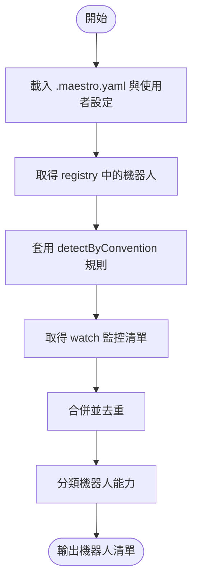
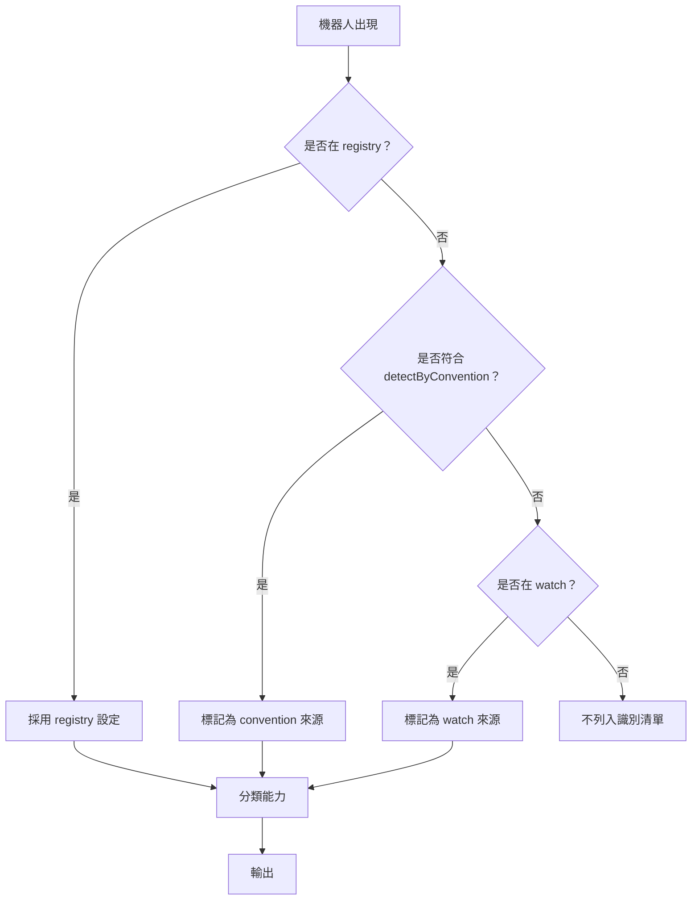
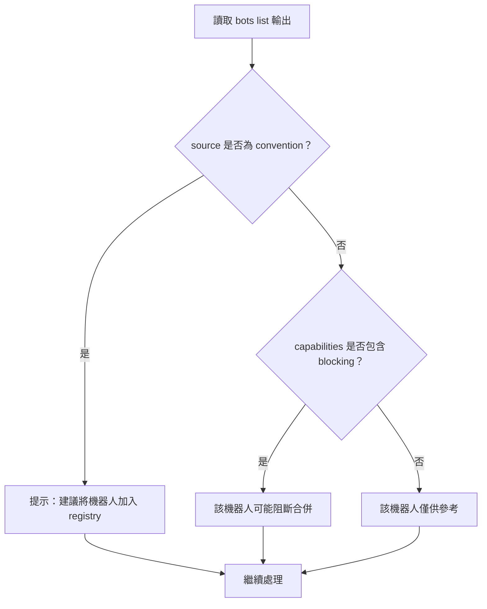

# `bots list` — 列出機器人

**本文引用的檔案**

- [src/cli/commands/bots.ts](https://github.com/mikeah2011/maestro/blob/master/src/cli/commands/bots.ts)
- [src/config/schema.ts](https://github.com/mikeah2011/maestro/blob/master/src/config/schema.ts)
- [.maestro.example.yaml](https://github.com/mikeah2011/maestro/blob/master/.maestro.example.yaml)
- [README.md](https://github.com/mikeah2011/maestro/blob/master/README.md)

## 目錄
1. [功能摘要](#功能摘要)
2. [命令語法與選項](#命令語法與選項)
3. [當前實作狀態](#當前實作狀態)
4. [預期輸出格式](#預期輸出格式)
5. [欄位說明](#欄位說明)
6. [機器人的三類來源](#機器人的三類來源)
7. [識別優先順序與衝突解決](#識別優先順序與衝突解決)
8. [設定檔結構](#設定檔結構)
9. [常見使用範例](#常見使用範例)
10. [輸出解讀指南](#輸出解讀指南)
11. [錯誤處理與除錯建議](#錯誤處理與除錯建議)
12. [結語](#結語)

## 功能摘要
`maestro bots list` 是 `maestro bots` 子命令之一，目標是列出系統目前「識別的機器人」。根據程式碼設計，這些機器人由三個層級組成：

| 來源 | 說明 | 主要用途 |
|---|---|---|
| **已註冊的自訂機器人** | 透過 `bots.registry` 明確宣告的機器人。 | 指定審查嚴謹度、嚴重程度對映等行為。 |
| **慣例型偵測規則** | 透過 `bots.detectByConvention.rules` 以字串模式匹配登入名稱、應用程式標識或評論內容。 | 自動發現未明確註冊但符合慣例的機器人。 |
| **監控清單** | 透過 `bots.watch` 指定的機器人登入名稱。 | 供自動核准工作流程選擇要監聽的機器人。 |

目前專案中的 `bots list` 尚未正式實作；執行時會回報該功能預計於 M4 版本上線。不過，配置結構與相關邏輯已經定義清楚，因此本文件可以完整說明其「預期行為」。

**章節來源**
- [src/cli/commands/bots.ts:1-25](https://github.com/mikeah2011/maestro/blob/master/src/cli/commands/bots.ts#L1-L25)
- [src/cli/commands/bots.ts:205-212](https://github.com/mikeah2011/maestro/blob/master/src/cli/commands/bots.ts#L205-L212)
- [src/config/schema.ts:107-150](https://github.com/mikeah2011/maestro/blob/master/src/config/schema.ts#L107-L150)
- [.maestro.example.yaml:57-99](https://github.com/mikeah2011/maestro/blob/master/.maestro.example.yaml#L57-L99)

## 命令語法與選項
目前 `bots list` 沒有定義任何額外選項。它的預設行為是讀取配置並輸出系統識別的機器人集合。

```bash
maestro bots list
```

若未來擴充，可預期的選項方向包括：

| 選項 | 類型 | 說明 |
|---|---|---|
| `--format` | 字串 | 控制輸出格式，例如 `table` 或 `json`。 |
| `--source` | 字串 | 篩選只顯示特定來源的機器人，例如 `registry`、`convention`、`watch`。 |
| `--login` | 字串 | 過濾單一機器人登入名稱。 |
| `--include-disabled` | 布林值 | 是否包含被停用或不符合條件的機器人。 |

以上為根據現有架構推導出的合理擴充方向，並非目前已實作的選項。

**章節來源**
- [src/cli/commands/bots.ts:205-212](https://github.com/mikeah2011/maestro/blob/master/src/cli/commands/bots.ts#L205-L212)

## 當前實作狀態
`bots list` 目前透過 `notYet('list')` 函式處理，會印出黃色警告訊息並離開程序，結束代碼為 `4`（M4 placeholder）。

這表示：

- 開發者現在無法直接執行 `maestro bots list` 取得實際輸出。
- 真正的輸出邏輯需要後續實作，但目前已有足夠的配置模型來描述預期行為。
- 其他 `bots` 子命令（例如 `register`、`inspect`、`setup`）也處於相同階段，只有 `setup` 具備較完整的流程生成能力。

**章節來源**
- [src/cli/commands/bots.ts:1-25](https://github.com/mikeah2011/maestro/blob/master/src/cli/commands/bots.ts#L1-L25)
- [src/cli/commands/bots.ts:205-212](https://github.com/mikeah2011/maestro/blob/master/src/cli/commands/bots.ts#L205-L212)

## 預期輸出格式
雖然目前沒有實作，但從 CLI 工具的一般設計以及專案中其他模組的輸出風格來看，`bots list` 應至少支援兩種輸出形式：

### 表格格式
適合人類閱讀，通常用於終端機直觀檢視。

| login | name | platform | capabilities | source | status |
|---|---|---|---|---|---|
| coderabbitai | CodeRabbit | GitHub | blocking, severity mapping | registry | active |
| ellipsis-dev[bot] | Ellipsis | GitHub | blocking | registry | active |
| copilot-pull-request-reviewer | Copilot PR Reviewer | GitHub | satisfied review pattern | registry | active |
| codex-connector | Codex | GitHub | reviewed-only | registry | active |
| gemini-code-assist[bot] | Gemini Code Assist | GitHub | advisory | registry | active |
| sourcery-ai[bot] | Sourcery | GitHub | advisory | registry | active |
| greptile-apps[bot] | Greptile | GitHub | advisory | registry | active |
| my-review-bot[bot] | My Review Bot | GitHub | convention match | convention | active |

### JSON 格式
適合自動化處理、儀表板整合與持續整合管道。

```json
{
  "bots": [
    {
      "login": "coderabbitai",
      "name": "CodeRabbit",
      "platform": "github",
      "capabilities": ["blocking", "severity-mapping"],
      "source": "registry",
      "status": "active"
    }
  ]
}
```

JSON 結構應允許未來加入更多欄位，例如嚴重程度映射、最近一次審查時間、討論串狀態等。

**章節來源**
- [src/cli/commands/bots.ts:1-25](https://github.com/mikeah2011/maestro/blob/master/src/cli/commands/bots.ts#L1-L25)
- [.maestro.example.yaml:57-99](https://github.com/mikeah2011/maestro/blob/master/.maestro.example.yaml#L57-L99)

## 欄位說明

| 欄位 | 類型 | 必填 | 說明 |
|---|---|---:|---|
| `login` | 字串 | 是 | 機器人在平台上的登入名稱。GitHub 可能包含 `[bot]` 後綴。 |
| `name` | 字串 | 否 | 人類可讀的機器人顯示名稱。若無法解析則可使用登入名稱作為替代。 |
| `platform` | 字串 | 是 | 機器人所屬的 Git 平台，例如 `github`、`gitlab`、`gitea`、`gitee`。 |
| `capabilities` | 字串陣列 | 是 | 機器人的能力標籤，例如 `blocking`、`advisory`、`severity-mapping`、`satisfied-review-pattern`、`reviewed-only`。 |
| `source` | 字串 | 是 | 機器人被識別的來源：`registry`、`convention` 或 `watch`。 |
| `status` | 字串 | 是 | 機器人當前的可用狀態，例如 `active`、`inactive`、`disabled`。 |

### `capabilities` 的可能值

| 能力標籤 | 含義 |
|---|---|
| `blocking` | 該機器人的審查結果視為阻斷性要求。 |
| `advisory` | 該機器人的審查結果僅供參考。 |
| `severity-mapping` | 該機器人支援嚴重程度到 Maestro 內部嚴重程度的對映。 |
| `satisfied-review-pattern` | 機器人以「已評論且未產生新問題」的模式被視為已滿足，類似 Copilot。 |
| `reviewed-only` | 機器人只能發表評論，不能正式批准。 |

這些能力來自機器人註冊設定與工作流分類邏輯。

**章節來源**
- [src/config/schema.ts:107-150](https://github.com/mikeah2011/maestro/blob/master/src/config/schema.ts#L107-L150)
- [src/cli/commands/bots.ts:38-75](https://github.com/mikeah2011/maestro/blob/master/src/cli/commands/bots.ts#L38-L75)
- [.maestro.example.yaml:57-99](https://github.com/mikeah2011/maestro/blob/master/.maestro.example.yaml#L57-L99)

## 機器人的三類來源

### 一、內建機器人清單
專案範本 `.maestro.example.yaml` 提供一組已註冊的機器人，代表 Maestro 已知並能理解其行為的審查工具。

| 機器人 | 註冊行為 |
|---|---|
| `coderabbitai` | blocking、支援嚴重程度映射 |
| `ellipsis-dev[bot]` | blocking |
| `copilot-pull-request-reviewer` | blocking，屬於「已滿足」審查模式 |
| `codex-connector` | blocking，屬於「僅評論」模式 |
| `gemini-code-assist[bot]` | advisory |
| `sourcery-ai[bot]` | advisory |
| `greptile-apps[bot]` | advisory |

這些條目位於 `bots.registry`，是機器人識別的第一優先來源。

**章節來源**
- [.maestro.example.yaml:57-99](https://github.com/mikeah2011/maestro/blob/master/.maestro.example.yaml#L57-L99)
- [src/config/schema.ts:107-121](https://github.com/mikeah2011/maestro/blob/master/src/config/schema.ts#L107-L121)

### 二、已註冊的自訂機器人
使用者可在自己的 `.maestro.yaml` 或 `~/.maestro/config.yaml` 中加入新的 `registry` 項目。每個項目可指定：

- `login`：機器人的登入名稱。
- `treatAs`：`blocking` 或 `advisory`。
- `severityMap`：將機器人嚴重程度對映到 Maestro 的嚴重程度。

自訂註冊不會取代內建清單；兩者會合併，並以優先順序規則決定最終行為。

**章節來源**
- [src/config/schema.ts:107-121](https://github.com/mikeah2011/maestro/blob/master/src/config/schema.ts#L107-L121)
- [README.md:129-160](https://github.com/mikeah2011/maestro/blob/master/README.md#L129-L160)

### 三、機器人識別規則
`detectByConvention` 提供慣例型偵測，讓系統能自動發現未明確註冊的機器人。

規則支援以下匹配條件：

| 條件 | 說明 |
|---|---|
| `loginContains` | 登入名稱包含指定字串。 |
| `appSlugContains` | 應用程式標識包含指定字串。 |
| `commentBodyContains` | 評論內容包含指定字串。 |

至少必須指定一個條件；否則配置驗證會失敗。

**章節來源**
- [src/config/schema.ts:123-149](https://github.com/mikeah2011/maestro/blob/master/src/config/schema.ts#L123-L149)
- [.maestro.example.yaml:85-99](https://github.com/mikeah2011/maestro/blob/master/.maestro.example.yaml#L85-L99)

## 識別優先順序與衝突解決

### 識別優先順序
系統識別機器人的邏輯大致如下：



**圖表來源**
- [src/config/schema.ts:107-150](https://github.com/mikeah2011/maestro/blob/master/src/config/schema.ts#L107-L150)
- [src/cli/commands/bots.ts:38-75](https://github.com/mikeah2011/maestro/blob/master/src/cli/commands/bots.ts#L38-L75)

### 衝突解決機制
當同一個機器人同時出現在多個來源時，應遵循以下原則：

1. **明確註冊優先於慣例匹配**  
   `registry` 比 `detectByConvention` 更精確。
2. **使用者設定優先於內建範本**  
   使用者新增的 `registry` 項目可覆蓋或補充內建行為。
3. **`treatAs` 決定審查嚴謹度**  
   若同一機器人有多個註冊條目，應保留最明確或最嚴格的設定。
4. **`watch` 是用於工作流監控，不是唯一識別來源**  
   `bots.watch` 主要用於 `maestro bots setup` 生成的自動核准工作流程，不代表它一定具備審查能力。
5. **能力分類依行為模式決定**  
   工作流分類邏輯區分三種機器人：
   - `satisfied`：例如 Copilot 模式，只要評論中表示「未產生新問題」即可視為滿足。
   - `reviewedOnly`：例如 Codex，只能評論，不能正式批准。
   - `approving`：需要達到 `APPROVED` 狀態。



**圖表來源**
- [src/config/schema.ts:107-150](https://github.com/mikeah2011/maestro/blob/master/src/config/schema.ts#L107-L150)
- [src/cli/commands/bots.ts:38-75](https://github.com/mikeah2011/maestro/blob/master/src/cli/commands/bots.ts#L38-L75)

**章節來源**
- [src/config/schema.ts:107-150](https://github.com/mikeah2011/maestro/blob/master/src/config/schema.ts#L107-L150)
- [src/cli/commands/bots.ts:38-75](https://github.com/mikeah2011/maestro/blob/master/src/cli/commands/bots.ts#L38-L75)

## 設定檔結構
以下是與 `bots list` 相關的設定區塊摘要：

| 路徑 | 類型 | 預設值 | 說明 |
|---|---|---|---|
| `bots.watch` | 字串陣列 | `[]` | 要監控的機器人登入名稱。 |
| `bots.registry` | 物件陣列 | `[]` | 明確註冊的機器人。 |
| `bots.registry[].login` | 字串 | 必填 | 機器人登入名稱。 |
| `bots.registry[].treatAs` | 字串 | `advisory` | `blocking` 或 `advisory`。 |
| `bots.registry[].severityMap` | 字串至字串映射 | 可選 | 嚴重程度映射。 |
| `bots.detectByConvention.enabled` | 布林值 | `true` | 是否啟用慣例型偵測。 |
| `bots.detectByConvention.rules` | 物件陣列 | `[]` | 慣例匹配規則。 |
| `bots.detectByConvention.rules.loginContains` | 字串陣列 | 可選 | 登入名稱包含字串。 |
| `bots.detectByConvention.rules.appSlugContains` | 字串陣列 | 可選 | 應用程式標識包含字串。 |
| `bots.detectByConvention.rules.commentBodyContains` | 字串陣列 | 可選 | 評論內容包含字串。 |

**章節來源**
- [src/config/schema.ts:107-150](https://github.com/mikeah2011/maestro/blob/master/src/config/schema.ts#L107-L150)
- [.maestro.example.yaml:57-99](https://github.com/mikeah2011/maestro/blob/master/.maestro.example.yaml#L57-L99)

## 常見使用範例

### 列出所有識別的機器人
```bash
maestro bots list
```

預期結果：
- 目前會回報該功能尚未實作。
- 未來應輸出表格或 JSON，包含所有來源的機器人。

### 只顯示已註冊的機器人
未來選項（預期）：
```bash
maestro bots list --source registry
```

### 檢查某個機器人是否被識別
未來選項（預期）：
```bash
maestro bots list --login coderabbitai
```

### 輸出 JSON 以便自動化處理
未來選項（預期）：
```bash
maestro bots list --format json
```

### 結合 CI 檢查是否有未註冊的機器人
未來可能的 CI 流程：
1. 執行 `maestro bots list --format json`。
2. 解析 JSON。
3. 檢查是否有來源為 `convention` 的機器人。
4. 若發現未註冊機器人，則發出警告或阻止合併。

**章節來源**
- [src/cli/commands/bots.ts:205-212](https://github.com/mikeah2011/maestro/blob/master/src/cli/commands/bots.ts#L205-L212)

## 輸出解讀指南

### 表格輸出解讀
| 欄位 | 如何解讀 |
|---|---|
| `login` | 這個機器人在平台上的唯一身分。 |
| `name` | 人類可讀的名稱；若無對應名稱，通常會回退到 `login`。 |
| `platform` | 機器人所屬的平台；Maestro 支援 GitHub、GitLab、Gitea、Gitee。 |
| `capabilities` | 這個機器人會影響哪些行為。`blocking` 可能會阻止合併，`advisory` 僅供參考。 |
| `source` | 機器人是如何被識別的。`registry` 是最可靠的來源。 |
| `status` | 機器人是否活躍；若被停用或不符合規則，可能顯示非活躍狀態。 |

### JSON 輸出解讀
自動化系統可根據 `capabilities` 判斷是否需要等待機器人審查完成，並根據 `source` 判斷是否需要提醒開發者將慣例匹配的機器人加入註冊清單。



**圖表來源**
- [src/config/schema.ts:107-150](https://github.com/mikeah2011/maestro/blob/master/src/config/schema.ts#L107-L150)

**章節來源**
- [.maestro.example.yaml:57-99](https://github.com/mikeah2011/maestro/blob/master/.maestro.example.yaml#L57-L99)

## 錯誤處理與除錯建議

### 目前行為
執行 `maestro bots list` 會：

1. 印出黃色的未實作警告。
2. 使用結束代碼 `4` 離開程序。
3. 不會觸發例外堆疊。

這是一種有意識的設計，表示該功能仍屬於 M4 規劃範圍。

### 常見問題與解決方式

| 問題 | 原因 | 建議 |
|---|---|---|
| 執行 `maestro bots list` 顯示 not yet implemented | 功能尚未實作 | 確認是否已升級到包含此功能的版本。 |
| 找不到 `.maestro.yaml` | 未在倉庫根目錄設定 | 使用 `maestro init` 初始化或使用範本建立設定檔。 |
| 機器人未被識別 | 未加入 `registry` 或不符合 `detectByConvention` | 檢查 `bots.registry` 與 `bots.detectByConvention.rules`。 |
| 機器人被誤判為 blocking | `treatAs` 設定為 `blocking` | 改為 `advisory`，或移除重複條目。 |
| 自動核准流程未生效 | `bots.watch` 未正確設定 | 使用 `maestro bots setup --bots <logins>` 重新生成工作流程。 |

### 除錯步驟
1. 確認 `.maestro.yaml` 存在且有效。
2. 檢查 `bots.registry` 是否包含目標機器人。
3. 檢查 `bots.detectByConvention.enabled` 是否開啟。
4. 檢查 `detectByConvention.rules` 是否包含正確的匹配字串。
5. 使用 `maestro bots setup` 檢查 `bots.watch` 是否與預期一致。
6. 若未來 `bots list` 實作後，可先用 JSON 格式輸出，再用工具檢查每個欄位。

**章節來源**
- [src/cli/commands/bots.ts:1-25](https://github.com/mikeah2011/maestro/blob/master/src/cli/commands/bots.ts#L1-L25)
- [src/cli/commands/bots.ts:205-237](https://github.com/mikeah2011/maestro/blob/master/src/cli/commands/bots.ts#L205-L237)
- [src/config/schema.ts:107-150](https://github.com/mikeah2011/maestro/blob/master/src/config/schema.ts#L107-L150)

## 結語
`maestro bots list` 目前仍是 M4 placeholder，但專案已完整定義機器人識別的資料模型與配置結構。未來的實作應重點處理：

1. 合併 `registry`、`detectByConvention`、`watch` 三個來源。
2. 明確輸出 `login`、`name`、`platform`、`capabilities`。
3. 支援表格與 JSON 兩種輸出格式。
4. 清楚標示機器人來源與衝突解決結果。
5. 提供除錯訊息，幫助開發者修正配置。

這樣能讓使用者在導入 Maestro 收斂循環之前，先確認系統正確識別了所有審查機器人，進而確保自動核准與審查流程的行為可預測且可審計。