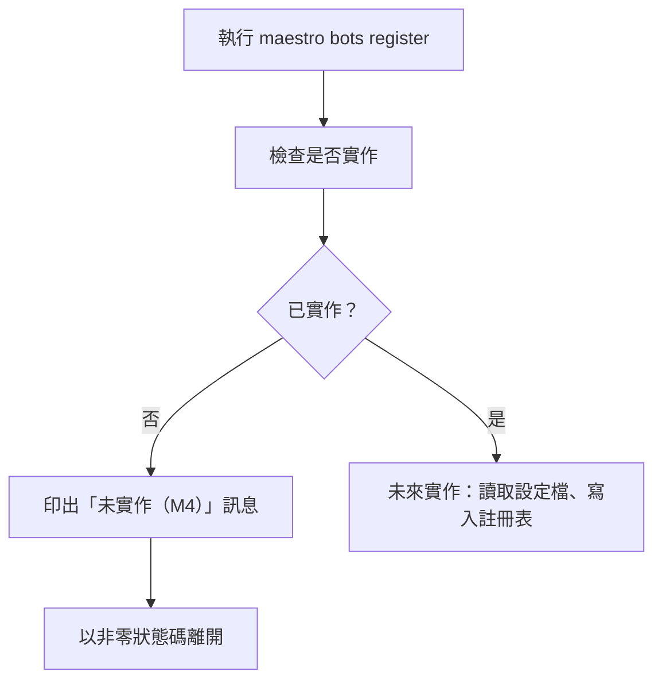
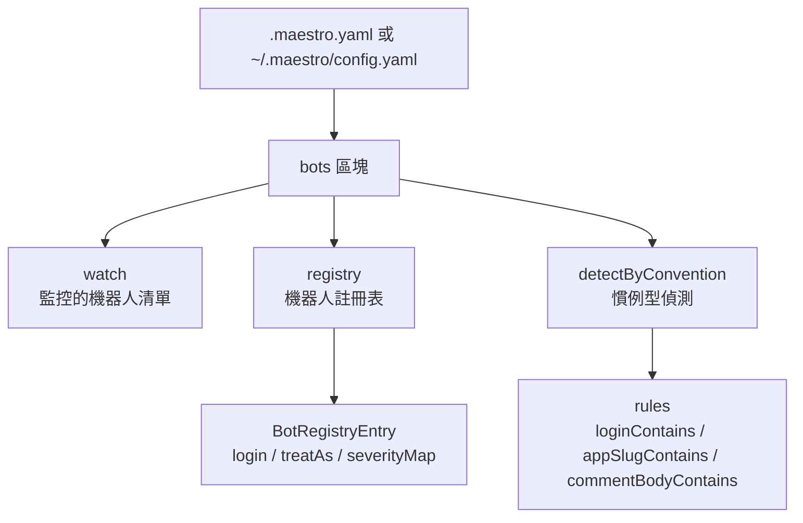
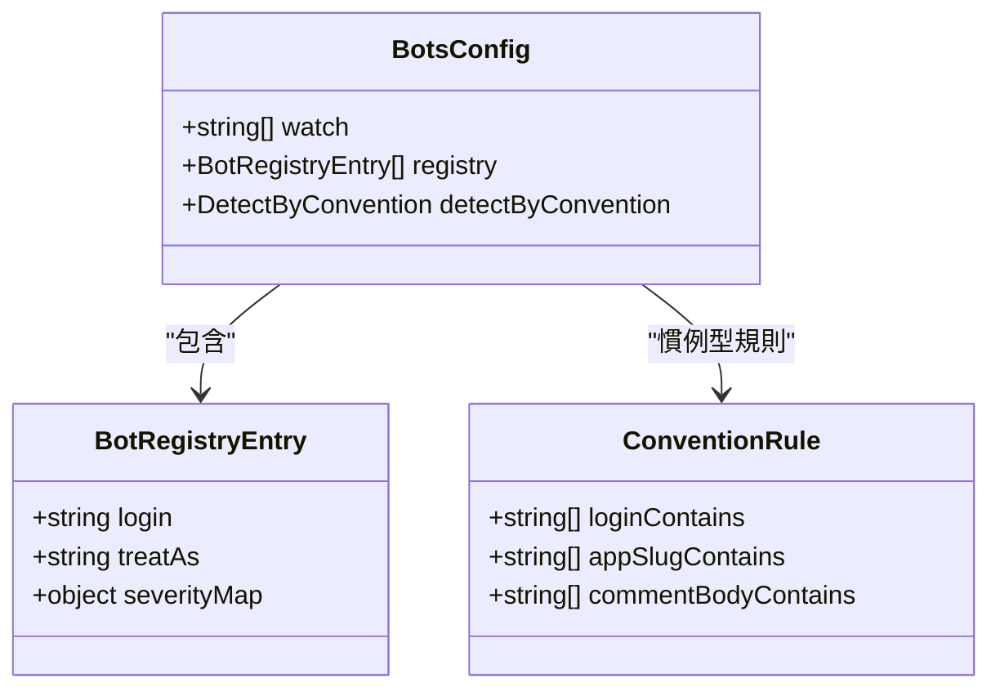
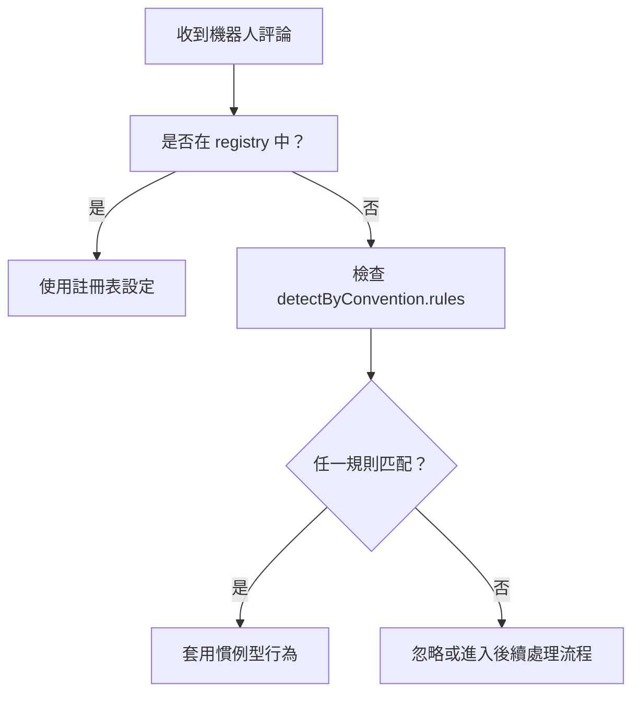
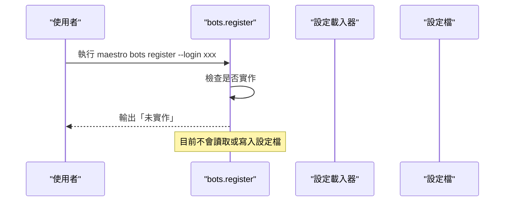

# bots register — 註冊機器人

**本文引用的檔案**

- [bots.ts](https://github.com/mikeah2011/maestro/blob/master/src/cli/commands/bots.ts)
- [schema.ts](https://github.com/mikeah2011/maestro/blob/master/src/config/schema.ts)
- [load.ts](https://github.com/mikeah2011/maestro/blob/master/src/config/load.ts)
- [.maestro.example.yaml](https://github.com/mikeah2011/maestro/blob/master/.maestro.example.yaml)
- [README.md](https://github.com/mikeah2011/maestro/blob/master/README.md)

## 目錄
1. [說明摘要](#說明摘要)
2. [指令現況](#指令現況)
3. [設定結構與註冊表位置](#設定結構與註冊表位置)
4. [login 參數與機器人名稱配置](#login-參數與機器人名稱配置)
5. [能力宣告：treatAs 與 severityMap](#能力宣告treatas-與-severitymap)
6. [識別規則定義](#識別規則定義)
7. [持久化機制與衝突處理](#持久化機制與衝突處理)
8. [自訂機器人註冊範例](#自訂機器人註冊範例)
9. [最佳實踐](#最佳實踐)
10. [常見問題與排除](#常見問題與排除)
11. [結論](#結論)

## 說明摘要

`maestro bots register` 是 `maestro bots` 子命令之一，主要用途是讓使用者將新的外部審查機器人加入 Maestro 的「機器人註冊表」，以便系統能辨識其評論、分類問題、在討論串中回覆、並依設定決定該機器人是否會阻擋合併。

目前程式碼中的 `register` 動作尚未實作；執行時會顯示「未實作（預計於 M4 上線）」並離開程式。不過，Maestro 已經完整定義了機器人註冊表的資料模型、驗證規則與設定載入流程，因此本文件以「現有設定結構與未來實作預期行為」為基礎進行說明，幫助你提前準備 `.maestro.yaml` 中的機器人註冊設定。

## 指令現況

| 項目 | 說明 |
|---|---|
| 指令名稱 | `maestro bots register` |
| 必要參數 | `--login <login>` |
| 選擇性參數 | `--treat-as <mode>` |
| 當前狀態 | 未實作；輸出訊息指出功能預計於 M4 版本上線 |
| 結束代碼 | 非零（由常數 `NOT_YET = 4` 控制） |
| 其他相關指令 | `list`、`inspect`、`setup` |



**圖表來源**
- [bots.ts:1-20](https://github.com/mikeah2011/maestro/blob/master/src/cli/commands/bots.ts#L1-L20)
- [bots.ts:201-237](https://github.com/mikeah2011/maestro/blob/master/src/cli/commands/bots.ts#L201-L237)

**章節來源**
- [bots.ts:1-30](https://github.com/mikeah2011/maestro/blob/master/src/cli/commands/bots.ts#L1-L30)
- [bots.ts:201-237](https://github.com/mikeah2011/maestro/blob/master/src/cli/commands/bots.ts#L201-L237)

## 設定結構與註冊表位置

機器人註冊資訊位於 `.maestro.yaml` 或 `~/.maestro/config.yaml` 的 `bots` 區塊中。根據 Zod Schema 與範例設定，`bots` 包含三個主要部分：

| 欄位 | 類型 | 預設值 | 用途 |
|---|---|---:|---|
| `watch` | 字串陣列 | `[]` | 指定要監控的機器人登入名稱，供 `maestro bots setup` 產生自動核准工作流程使用 |
| `registry` | 機器人條目陣列 | `[]` | 正式註冊的機器人清單，每個條目包含 `login`、`treatAs`、可選 `severityMap` |
| `detectByConvention` | 物件 | `{ enabled: true, rules: [] }` | 慣例型偵測，用於未明確註冊但符合規則的機器人 |



**圖表來源**
- [schema.ts:80-125](https://github.com/mikeah2011/maestro/blob/master/src/config/schema.ts#L80-L125)
- [.maestro.example.yaml:1-200](https://github.com/mikeah2011/maestro/blob/master/.maestro.example.yaml#L1-L200)

**章節來源**
- [schema.ts:80-125](https://github.com/mikeah2011/maestro/blob/master/src/config/schema.ts#L80-L125)
- [.maestro.example.yaml:1-200](https://github.com/mikeah2011/maestro/blob/master/.maestro.example.yaml#L1-L200)

## login 參數與機器人名稱配置

### CLI 參數

`--login` 是用來識別平台上的機器人登入名稱。它對應到註冊表條目中的 `login` 欄位。

| 參數 | 類型 | 必要 | 說明 |
|---|---|---:|---|
| `--login` | 字串 | 是 | 機器人在平台上的登入名稱，例如 `coderabbitai`、`ellipsis-dev[bot]` |
| `--treat-as` | 字串 | 否 | 機器人的能力模式，可為 `blocking` 或 `advisory`；預設為 `advisory` |

### 設定檔欄位

| 欄位 | 型別 | 必要 | 預設值 | 說明 |
|---|---|---:|---:|---|
| `login` | 字串 | 是 | 無 | 機器人的登入名稱；長度必須大於零 |
| `treatAs` | 枚舉 | 否 | `advisory` | 機器人評論對 PR 合併流程的影響等級 |
| `severityMap` | 字串鍵值映射 | 否 | 無 | 將機器人生成的嚴重級別映射到 Maestro 內部嚴重級別 |

### 名稱匹配行為

程式碼中針對 GitHub Bot 名稱有特別處理：

- `[bot]` 後綴會被移除後再比較
- 某些機器人（如 `copilot-pull-request-reviewer`、`github-advanced-security`）被視為「滿足型」機器人
- 某些機器人（如 `chatgpt-codex-connector`）被視為「僅評論型」機器人
- 其他機器人通常屬於「核准型」機器人

這表示你在設定 `login` 時，可以使用 `foo` 或 `foo[bot]`，系統在比較時會忽略 `[bot]` 後綴。

**章節來源**
- [bots.ts:1-30](https://github.com/mikeah2011/maestro/blob/master/src/cli/commands/bots.ts#L1-L30)
- [schema.ts:80-125](https://github.com/mikeah2011/maestro/blob/master/src/config/schema.ts#L80-L125)
- [bots.ts:31-100](https://github.com/mikeah2011/maestro/blob/master/src/cli/commands/bots.ts#L31-L100)

## 能力宣告：treatAs 與 severityMap

### treatAs

`treatAs` 宣告機器人評論對 PR 合併流程的影響程度：

| 值 | 意義 | 適用情境 |
|---|---|---|
| `blocking` | 阻擋型 | 機器人的高嚴重級別發現會阻止自動合併，直到問題被解決或人工介入 |
| `advisory` | 建議型 | 機器人只提供意見，不會直接阻止合併流程 |

### severityMap

`severityMap` 允許將不同機器人產生的嚴重級別名稱映射到 Maestro 內部的標準嚴重級別：

| 欄位 | 說明 |
|---|---|
| 鍵 | 機器人產出的嚴重級別名稱 |
| 值 | Maestro 內部嚴重級別，例如 `critical`、`high`、`medium`、`low` |

這個欄位在範例設定中出現於 `coderabbitai` 的註冊條目，顯示如何把紅、橘、藍、綠等顏色標籤映射到 `critical`、`high`、`medium`、`low`。



**圖表來源**
- [schema.ts:80-125](https://github.com/mikeah2011/maestro/blob/master/src/config/schema.ts#L80-L125)

**章節來源**
- [schema.ts:80-125](https://github.com/mikeah2011/maestro/blob/master/src/config/schema.ts#L80-L125)
- [.maestro.example.yaml:1-200](https://github.com/mikeah2011/maestro/blob/master/.maestro.example.yaml#L1-L200)

## 識別規則定義

除了明確註冊的機器人外，Maestro 也支援「慣例型偵測」。當機器人沒有出現在 `registry` 中，但符合 `detectByConvention.rules` 中的一個或多個規則時，仍可被系統識別。

### 慣例型偵測欄位

| 欄位 | 型別 | 預設值 | 說明 |
|---|---|---:|---|
| `enabled` | 布林值 | `true` | 是否啟用慣例型偵測 |
| `rules` | 規則陣列 | `[]` | 一組或多組識別條件 |

### 單一規則的條件

每項慣例型規則至少需要一個以下條件：

| 條件 | 型別 | 說明 |
|---|---|---|
| `loginContains` | 字串陣列 | 機器人名稱包含這些子字串 |
| `appSlugContains` | 字串陣列 | 應用程式 slug 包含這些子字串 |
| `commentBodyContains` | 字串陣列 | 評論內容包含這些子字串 |

如果一個規則的所有條件都為空，Zod 驗證會失敗，錯誤訊息指出「檢測規則必須至少指定 `loginContains`、`appSlugContains` 或 `commentBodyContains` 其中之一」。



**圖表來源**
- [schema.ts:80-125](https://github.com/mikeah2011/maestro/blob/master/src/config/schema.ts#L80-L125)

**章節來源**
- [schema.ts:80-125](https://github.com/mikeah2011/maestro/blob/master/src/config/schema.ts#L80-L125)

## 持久化機制與衝突處理

### 目前實作狀態

`maestro bots register` 目前只呼叫 `notYet('register')`，不會讀取或寫入任何設定檔。因此：

- **不會自動建立 `.maestro.yaml`**
- **不會新增 `bots.registry` 中的條目**
- **不會更新 `bots.watch`**
- **不會修改 `detectByConvention`**

未來若實作，合理的設計應是：

1. 讀取目前的 `.maestro.yaml`（或 `~/.maestro/config.yaml`）
2. 解析 YAML 並套用環境變數展開
3. 驗證設定是否符合 Zod Schema
4. 更新對應的 `bots.registry` 條目
5. 可選地更新 `bots.watch`（若使用者希望同時加入監控清單）
6. 寫回設定檔
7. 回報成功或錯誤

### 設定優先順序

Maestro 的設定載入器支援多層設定，優先順序如下：

1. CLI 旗標
2. 環境變數
3. 倉庫 `.maestro.yaml`
4. 使用者 `~/.maestro/config.yaml`
5. Git remote 自動偵測
6. Schema 預設值

這表示同一個欄位可能在不同層級重複設定，較高優先順序的層級會覆蓋較低優先順序的值。

### 衝突處理策略

目前程式碼中並未實作 `register` 的衝突邏輯，但根據既有設定載入器的行為，可推斷未來實作可能採取以下策略：

| 衝突情境 | 預期行為 |
|---|---|
| 重複的 `login` | 可能覆寫舊條目，或拒絕註冊並提示衝突 |
| 同時出現在 `registry` 與 `detectByConvention` | `registry` 應具更高優先權 |
| 多個 `loginContains` 規則匹配同一機器人 | 第一個匹配的規則可能生效，或所有規則的結果需合併 |
| 設定檔語法錯誤 | 載入器會拋出 `ConfigError` |



**圖表來源**
- [bots.ts:1-30](https://github.com/mikeah2011/maestro/blob/master/src/cli/commands/bots.ts#L1-L30)
- [load.ts:1-100](https://github.com/mikeah2011/maestro/blob/master/src/config/load.ts#L1-L100)

**章節來源**
- [bots.ts:1-30](https://github.com/mikeah2011/maestro/blob/master/src/cli/commands/bots.ts#L1-L30)
- [load.ts:1-100](https://github.com/mikeah2011/maestro/blob/master/src/config/load.ts#L1-L100)

## 自訂機器人註冊範例

以下範例說明如何在 `.maestro.yaml` 中手動設定不同的機器人類型。雖然 `register` 指令尚未實作，但這些設定仍可直接寫入設定檔。

### 範例一：阻擋型機器人

適合用於嚴格審查工具，例如 CodeRabbit、Ellipsis、Copilot Code Review。

```yaml
bots:
  registry:
    - login: coderabbitai
      treatAs: blocking
      severityMap:
        red: critical
        orange: high
        blue: medium
        green: low
```

### 範例二：建議型機器人

適合用於提供輔助意見但不應直接阻止合併的工具。

```yaml
bots:
  registry:
    - login: gemini-code-assist[bot]
      treatAs: advisory
```

### 範例三：多個自訂機器人

```yaml
bots:
  registry:
    - login: ellipsis-dev[bot]
      treatAs: blocking

    - login: copilot-pull-request-reviewer
      treatAs: blocking

    - login: codex-connector
      treatAs: blocking

    - login: sourcery-ai[bot]
      treatAs: advisory

    - login: greptile-apps[bot]
      treatAs: advisory
```

### 範例四：搭配慣例型偵測

如果你有多個測試機器人或開發工具機器人，不想一一列出，可以啟用慣例型偵測：

```yaml
bots:
  registry:
    - login: coderabbitai
      treatAs: blocking

  detectByConvention:
    enabled: true
    rules:
      - loginContains: ['bot', 'review', 'codex', 'copilot']
      - appSlugContains: ['review', 'lint']
```

### 範例五：同時設定監控清單

如果你想讓 `maestro bots setup` 也能自動產生工作流，可以把機器人加進 `watch`：

```yaml
bots:
  watch:
    - copilot-pull-request-reviewer
    - github-advanced-security
    - chatgpt-codex-connector[bot]

  registry:
    - login: copilot-pull-request-reviewer
      treatAs: blocking
```

**章節來源**
- [.maestro.example.yaml:1-200](https://github.com/mikeah2011/maestro/blob/master/.maestro.example.yaml#L1-L200)
- [schema.ts:80-125](https://github.com/mikeah2011/maestro/blob/master/src/config/schema.ts#L80-L125)

## 最佳實踐

### 1. 明確區分阻擋型與建議型機器人

- 把真正影響程式品質與安全的審查工具設為 `blocking`
- 把輔助型、格式化工具或實驗性工具設為 `advisory`
- 避免把所有機器人一律設為 `blocking`，否則會造成過度阻擋

### 2. 精確設定 `login`

- 使用機器人在平台上的真實登入名稱
- 對於 GitHub Bot，可使用 `foo` 或 `foo[bot]`，兩者都會被正確匹配
- 不要留空或輸入無意義的名稱

### 3. 善用 `severityMap`

- 若機器人使用顏色、數字或其他非標準嚴重級別，請透過 `severityMap` 映射到標準級別
- 這樣 Maestro 才能正確判斷何時該阻擋、何時只需建議

### 4. 謹慎使用慣例型偵測

- `loginContains`、`appSlugContains`、`commentBodyContains` 太寬鬆可能造成誤判
- 建議先用明確的 `registry` 條目，再考慮用 `detectByConvention` 補充
- 定期檢視 `detectByConvention` 的匹配結果，避免引入不需要的機器人

### 5. 同時維護 `registry` 與 `watch`

- `registry` 告訴 Maestro「這是誰、怎麼處理」
- `watch` 告訴 `maestro bots setup`「哪些機器人要監控」
- 兩者可以重疊，但目的不同

### 6. 使用設定檔層級管理團隊規範

- 將團隊共同使用的機器人註冊放在 `~/.maestro/config.yaml`
- 將專案專屬機器人放在 `.maestro.yaml`
- 利用設定優先順序覆蓋特定專案的行為

### 7. 在實作完成前手動編輯設定檔

由於 `register` 尚未實作，目前最可靠的方式是直接編輯 `.maestro.yaml`。未來指令實作後，應確保指令行為與手動編輯一致。

## 常見問題與排除

### Q1：為什麼執行 `maestro bots register` 沒有作用？

因為該指令目前只是佔位實作，只會輸出「未實作（M4）」並離開。請先手動編輯 `.maestro.yaml` 的 `bots.registry` 區塊。

### Q2：設定檔驗證失敗怎麼辦？

確認 `login` 不是空字串，`treatAs` 只能是 `blocking` 或 `advisory`，且慣例型規則至少有一個條件。

### Q3：機器人沒被識別？

檢查以下幾點：

- `login` 是否與平台上的實際名稱相符
- `detectByConvention.enabled` 是否為 `true`
- 慣例型規則是否真的匹配該機器人的名稱、slug 或評論內容
- 是否有更明確的 `registry` 條目與之衝突

### Q4：`maestro bots setup` 沒有監控到我加的機器人？

確認你把機器人名稱加到了 `bots.watch`，而不只是 `bots.registry`。這兩個欄位用途不同。

### Q5：如何知道哪個層級的設定生效？

Maestro 的設定載入順序是：CLI > 環境變數 > 倉庫設定 > 使用者設定 > Git remote 自動偵測 > 預設值。較高優先順序會覆蓋較低優先順序的值。

**章節來源**
- [bots.ts:1-30](https://github.com/mikeah2011/maestro/blob/master/src/cli/commands/bots.ts#L1-L30)
- [schema.ts:80-125](https://github.com/mikeah2011/maestro/blob/master/src/config/schema.ts#L80-L125)
- [load.ts:1-100](https://github.com/mikeah2011/maestro/blob/master/src/config/load.ts#L1-L100)

## 結論

`maestro bots register` 是一個規劃中的指令，未來應該會簡化機器人註冊的流程。但目前它的核心功能尚未實作，使用者仍需直接編輯 `.maestro.yaml` 的 `bots.registry` 區塊。

最重要的概念有三個：

1. **`login`** 用來唯一識別機器人
2. **`treatAs`** 宣告機器人是否阻擋合併
3. **`detectByConvention`** 提供未明確註冊機器人的備援識別機制

建議你現在就根據團隊需求整理好機器人清單，把阻擋型與建議型機器人分開，並善用 `severityMap` 統一嚴重級別。等到 M4 版本實作 `register` 指令後，就能從手動編輯過渡到指令式管理。

**章節來源**
- [bots.ts:1-30](https://github.com/mikeah2011/maestro/blob/master/src/cli/commands/bots.ts#L1-L30)
- [schema.ts:80-125](https://github.com/mikeah2011/maestro/blob/master/src/config/schema.ts#L80-L125)
- [.maestro.example.yaml:1-200](https://github.com/mikeah2011/maestro/blob/master/.maestro.example.yaml#L1-L200)
- [README.md:1-200](https://github.com/mikeah2011/maestro/blob/master/README.md#L1-L200)