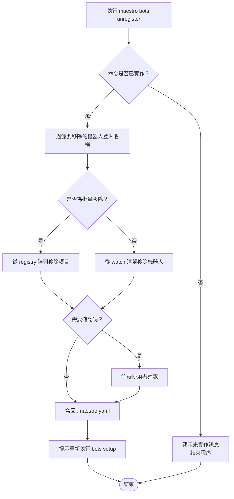
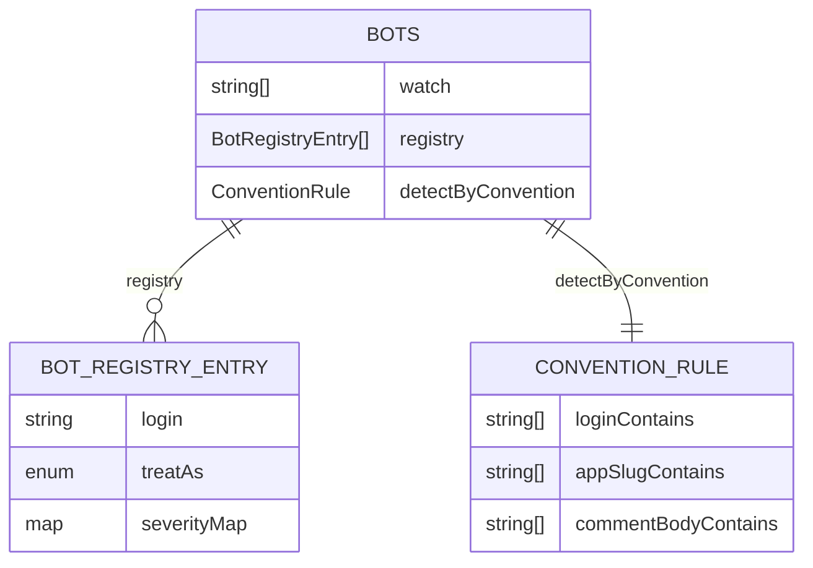
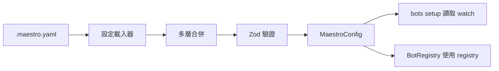
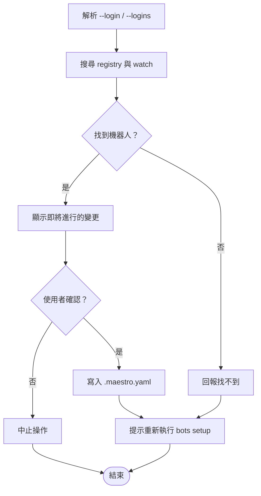
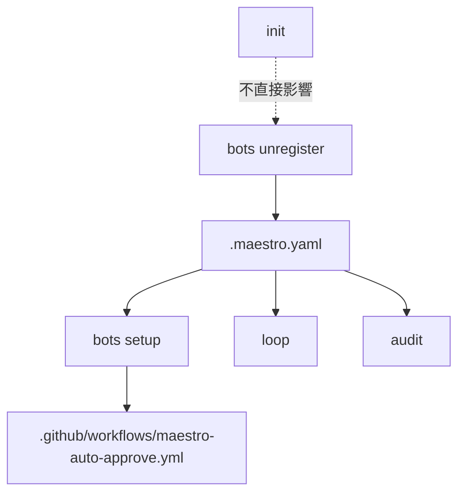
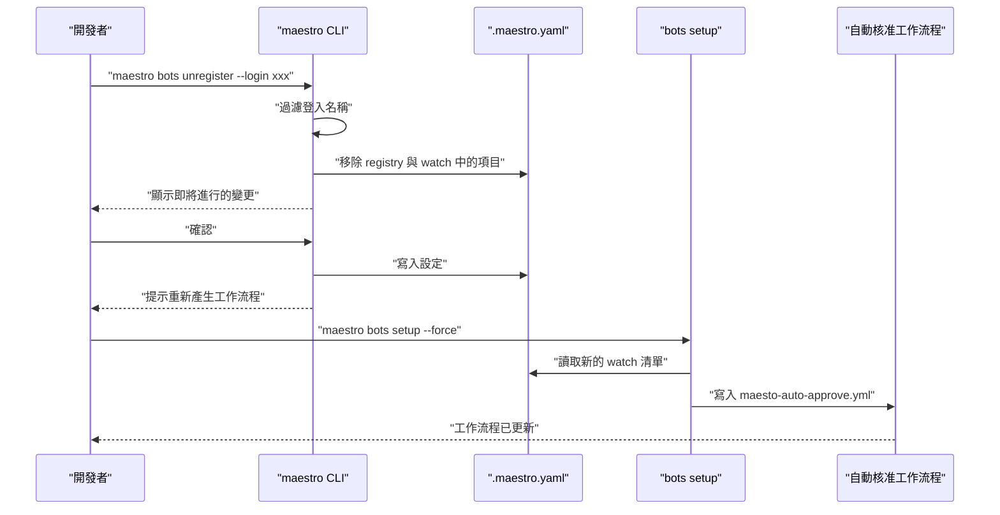

# bots unregister — 移除機器人

<cite>
**本文引用的檔案**   
- [src/cli/commands/bots.ts](https://github.com/mikeah2011/maestro/blob/master/src/cli/commands/bots.ts)
- [src/config/schema.ts](https://github.com/mikeah2011/maestro/blob/master/src/config/schema.ts)
- [src/config/load.ts](https://github.com/mikeah2011/maestro/blob/master/src/config/load.ts)
- [README.md](https://github.com/mikeah2011/maestro/blob/master/README.md)
- [docs/DESIGN.md](https://github.com/mikeah2011/maestro/blob/master/docs/DESIGN.md)
</cite>

## 目錄
1. [簡介](#簡介)
2. [命令狀態](#命令狀態)
3. [設計與資料模型](#設計與資料模型)
4. [預期行為](#預期行為)
5. [影響範圍](#影響範圍)
6. [與現有命令的兼容性](#與現有命令的兼容性)
7. [移除後重新註冊流程](#移除後重新註冊流程)
8. [常見問題排除](#常見問題排除)
9. [最佳實踐](#最佳實踐)
10. [結論](#結論)

## 簡介

`maestro bots unregister` 是一個規劃中的子命令，目標是讓使用者從機器人已註冊清單中移除某個機器人。根據目前程式碼庫的狀態，這個子命令尚未實作；它會以「M4（第四階段）功能」的形式保留，而不是直接寫入設定檔或刪除任何 GitHub Action。

本文件說明：

- 該命令在未來應該如何運作。
- 它會影響哪些設定欄位。
- 它不會自動刪除哪些檔案。
- 如何手動完成當前版本的移除。
- 移除後如何重新註冊並重建自動核准工作流程。



**圖表來源**   
- [src/cli/commands/bots.ts:18-35](https://github.com/mikeah2011/maestro/blob/master/src/cli/commands/bots.ts#L18-L35)
- [src/cli/commands/bots.ts:201-237](https://github.com/mikeah2011/maestro/blob/master/src/cli/commands/bots.ts#L201-L237)
- [src/config/schema.ts:90-96](https://github.com/mikeah2011/maestro/blob/master/src/config/schema.ts#L90-L96)

## 命令狀態

目前的 `bots` 子命令包含以下結構：

| 子命令 | 狀態 | 用途 |
|---|---|---|
| `list` | 未實作 | 列出已配置與精選的審查機器人 |
| `register` | 未實作 | 註冊自託管或客製化機器人 |
| `inspect` | 未實作 | 解析範例機器人評論 |
| `setup` | **已實作** | 產生 `.github/workflows/maestro-auto-approve.yml` |
| `unregister` | **未實作** | 計畫中的移除機器人功能 |

所有未實作的子命令都共用一個相同的處理邏輯：輸出「尚未實作（M4）」訊息，並以非零狀態碼結束程序。這表示：

- 目前沒有 `unregister` 的指令參數。
- 沒有預設旗標。
- 沒有互動式確認對話。
- 不會修改 `.maestro.yaml`。
- 不會觸發 `maestro bots setup`。

**Section sources**
- [src/cli/commands/bots.ts:18-35](https://github.com/mikeah2011/maestro/blob/master/src/cli/commands/bots.ts#L18-L35)
- [src/cli/commands/bots.ts:201-237](https://github.com/mikeah2011/maestro/blob/master/src/cli/commands/bots.ts#L201-L237)

## 設計與資料模型

機器人相關設定集中在 `BotsSchema`，主要包含三個部分：

| 欄位 | 類型 | 預設值 | 用途 |
|---|---|---|---|
| `watch` | 字串陣列 | `[]` | 供 `maestro bots setup` 使用的監控機器人清單 |
| `registry` | 機器人登錄條目陣列 | `[]` | 定義機器人的 `login`、`treatAs` 等詳細設定 |
| `detectByConvention` | 物件 | `{ enabled: true, rules: [] }` | 慣例型機器人偵測規則 |

### 單一機器人登錄條目

| 欄位 | 類型 | 預設值 | 說明 |
|---|---|---|---|
| `login` | 字串 | 必填 | 機器人在平台上的登入名稱 |
| `treatAs` | 枚舉 | `advisory` | `blocking` 或 `advisory`，決定機器人的審查結果對合併路徑的影響 |
| `severityMap` | 可選映射 | 無 | 將機器人生明嚴重度對映到內部分類 |



**圖表來源**   
- [src/config/schema.ts:90-113](https://github.com/mikeah2011/maestro/blob/master/src/config/schema.ts#L90-L113)

### 資料流



**圖表來源**   
- [src/config/load.ts:1-40](https://github.com/mikeah2011/maestro/blob/master/src/config/load.ts#L1-L40)
- [src/config/load.ts:160-216](https://github.com/mikeah2011/maestro/blob/master/src/config/load.ts#L160-L216)
- [src/config/schema.ts:90-113](https://github.com/mikeah2011/maestro/blob/master/src/config/schema.ts#L90-L113)

**Section sources**
- [src/config/schema.ts:90-113](https://github.com/mikeah2011/maestro/blob/master/src/config/schema.ts#L90-L113)
- [src/config/load.ts:1-40](https://github.com/mikeah2011/maestro/blob/master/src/config/load.ts#L1-L40)
- [src/config/load.ts:160-216](https://github.com/mikeah2011/maestro/blob/master/src/config/load.ts#L160-L216)

## 預期行為

雖然 `unregister` 尚未實作，但根據現有 `register`、`setup`、`BotsSchema` 的設計，可以合理推斷其行為應包含以下要素。

### 登入過濾

`unregister` 應接受機器人的登入名稱，例如：

- 精確匹配：`CodeRabbit[bot]`
- 支援去除 `[bot]` 後綴的比較方式
- 支援多個登入名稱的批量模式

這樣做的原因是：GitHub API 常返回帶 `[bot]` 後綴的名稱，而使用者可能輸入不含後綴的名稱。現有 `buildWorkflow` 中已展示這種後綴處理方式。

### 批量移除

建議支援兩種模式：

| 模式 | 輸入方式 | 行為 |
|---|---|---|
| 單一移除 | `--login <name>` | 只移除指定機器人 |
| 批量移除 | `--logins a,b,c` | 同時移除多個機器人 |

若指定名稱不存在於 `registry` 或 `watch`，命令應明確報告「找不到該機器人」，而不是靜默忽略。

### 確認機制

由於移除操作會改變倉庫設定，建議預設啟用確認機制：

```
確認要移除機器人「xxx[bot]」嗎？
- registry 項目會被刪除
- watch 清單可能會被更新
- 下次執行 bots setup 時會重新產生工作流程
```

只有使用者明確同意後才寫入設定檔。這是安全設計，因為：

- 錯誤移除可能導致自動核准邏輯失效。
- 某些機器人是關鍵審查者。
- 設定檔變更可能未經版本控制追蹤。



**圖表來源**   
- [src/cli/commands/bots.ts:18-35](https://github.com/mikeah2011/maestro/blob/master/src/cli/commands/bots.ts#L18-L35)
- [src/config/schema.ts:90-96](https://github.com/mikeah2011/maestro/blob/master/src/config/schema.ts#L90-L96)

## 影響範圍

### 會受影響的設定

| 設定位置 | 是否可能被修改 | 說明 |
|---|---:|---|
| `.maestro.yaml` → `bots.registry` | 是 | 移除對應的機器人登錄條目 |
| `.maestro.yaml` → `bots.watch` | 可能是 | 若機器人出現在監控清單中，應被移除 |
| `.env` | 否 | 環境變數不儲存機器人列表 |
| `~/.maestro/config.yaml` | 可能 | 若使用者層級設定包含該機器人 |
| GitHub Action | 否 | 不會自動刪除工作流程檔案 |

### 不會自動發生的事

`unregister` 不應自動執行以下動作：

1. **不會刪除 `.github/workflows/maestro-auto-approve.yml`**  
   該檔案由 `bots setup` 產生，應保留給使用者決定是否刪除或更新。

2. **不會觸發 `maestro loop`**  
   移除機器人屬於設定管理，不是循環執行期操作。

3. **不會呼叫 GitHub API**  
   此命令是本地設定管理，不模擬機器人帳號，也不修改 PR 或審查結果。

4. **不會立即重寫工作流程**  
   除非提供 `--force-regenerate` 這類明確旗標，否則應僅修改設定檔。

5. **不會清除歷史審計紀錄**  
   審計日誌是執行期產物，不應因設定變更而被刪除。

### 設定優先順序的影響

設定載入器的優先順序為：

1. CLI 旗標
2. 環境變數
3. 倉庫 `.maestro.yaml`
4. 使用者 `~/.maestro/config.yaml`
5. Git remote 自動偵測
6. 預設值

因此，若機器人名稱同時出現在多個層級，`unregister` 必須清楚說明會修改哪一層設定，或提供 `--config-layer` 選項來指定目標層級。

**Section sources**
- [src/config/load.ts:1-40](https://github.com/mikeah2011/maestro/blob/master/src/config/load.ts#L1-L40)
- [src/config/load.ts:160-216](https://github.com/mikeah2011/maestro/blob/master/src/config/load.ts#L160-L216)
- [src/config/schema.ts:90-96](https://github.com/mikeah2011/maestro/blob/master/src/config/schema.ts#L90-L96)

## 與現有命令的兼容性

### 與 `bots register`

| 面向 | 關係 |
|---|---|
| 目的 | `register` 新增機器人，`unregister` 移除機器人 |
| 資料欄位 | 兩者都操作 `bots.registry` |
| 衝突處理 | 若同一 `login` 同時存在於 `registry` 與 `watch`，應允許分別處理 |
| 狀態一致性 | 移除後若仍有重複條目，應報告不一致 |

### 與 `bots setup`

`bots setup` 會讀取 `bots.watch` 並產生自動核准工作流程。移除機器人後，建議提示使用者重新執行：

```bash
maestro bots setup --force
```

原因：

- 工作流程中的條件判斷仍可能包含舊機器人。
- 若不重新產生，自動核准邏輯可能繼續參考已被移除的機器人。
- `setup` 已有 `--force` 覆蓋現有工作流程的行為。

### 與 `loop`

`loop` 主要負責收斂循環，與機器人註冊管理是不同層次：

- `loop` 依賴 `BotRegistry` 與設定載入器。
- `unregister` 修改的是設定源頭。
- 執行中的 `loop` 不會因設定檔變動而自動重載。
- 建議在移除機器人後重新啟動循環。

### 與 `audit`

審計命令會記錄分類決策與事件。移除機器人不會自動清理審計日誌，因為：

- 歷史審計是事實紀錄。
- 歷史決策可能仍需分析。
- 若需清理，應提供獨立且明確的清理命令。

### 與 `init`

`init` 用於初始化專案設定。`unregister` 不應該觸發初始化，也不應該覆寫其他初始設定。



**圖表來源**   
- [src/cli/commands/bots.ts:201-237](https://github.com/mikeah2011/maestro/blob/master/src/cli/commands/bots.ts#L201-L237)
- [src/config/load.ts:160-216](https://github.com/mikeah2011/maestro/blob/master/src/config/load.ts#L160-L216)

**Section sources**
- [src/cli/commands/bots.ts:201-237](https://github.com/mikeah2011/maestro/blob/master/src/cli/commands/bots.ts#L201-L237)
- [src/config/load.ts:160-216](https://github.com/mikeah2011/maestro/blob/master/src/config/load.ts#L160-L216)

## 移除後重新註冊流程

### 完整流程



**圖表來源**   
- [src/cli/commands/bots.ts:201-237](https://github.com/mikeah2011/maestro/blob/master/src/cli/commands/bots.ts#L201-L237)
- [src/config/schema.ts:90-96](https://github.com/mikeah2011/maestro/blob/master/src/config/schema.ts#L90-L96)

### 步驟說明

1. **確認要移除的機器人**  
   檢查 `.maestro.yaml` 中 `bots.registry` 與 `bots.watch` 是否包含該機器人。

2. **執行移除**  
   未來實作後應類似：
   - 單一：`maestro bots unregister --login <name>`
   - 批量：`maestro bots unregister --logins <a,b,c>`

3. **查看差異**  
   在提交前檢查 `.maestro.yaml` 的 git diff。

4. **重新產生工作流程**  
   ```bash
   maestro bots setup --force
   ```

5. **驗證自動核准邏輯**  
   確認產生的工作流程不再包含已移除機器人的條件。

6. **提交變更**  
   ```bash
   git add .maestro.yaml
   git add .github/workflows/maestro-auto-approve.yml
   git commit -m "ci: remove xxx bot from maestro configuration"
   ```

### 重新註冊

若之後需要再次加入該機器人：

```bash
maestro bots register --login <name> --treat-as advisory
maestro bots setup --force
```

注意：`register` 目前也是「未實作」狀態，實際可用的是透過編輯 `.maestro.yaml` 手動加入。

**Section sources**
- [src/cli/commands/bots.ts:201-237](https://github.com/mikeah2011/maestro/blob/master/src/cli/commands/bots.ts#L201-L237)
- [src/config/schema.ts:90-96](https://github.com/mikeah2011/maestro/blob/master/src/config/schema.ts#L90-L96)

## 常見問題排除

### 問題一：執行 `maestro bots unregister` 後出現未實作訊息

**原因**  
該子命令尚未在 M4 之前實作。

**解決方案**  
目前請手動編輯 `.maestro.yaml`：

1. 從 `bots.registry` 中刪除對應的機器人條目。
2. 若機器人出現在 `bots.watch`，也將其移除。
3. 執行 `maestro bots setup --force` 重新產生工作流程。

### 問題二：移除後自動核准仍嘗試檢查已移除的機器人

**原因**  
`.github/workflows/maestro-auto-approve.yml` 尚未重新產生。

**解決方案**  
執行：

```bash
maestro bots setup --force
```

然後檢查工作流程中是否還包含該機器人名稱。

### 問題三：不知道機器人正確登入名稱為何

**原因**  
GitHub 機器人名稱可能包含 `[bot]` 後綴，也可能不包含。

**解決方案**  
- 查看 GitHub Pull Request 的審查者清單。
- 檢查現有 `.maestro.yaml` 中的 `bots.registry`。
- 觀察 CI 日誌或 GitHub Actions 輸出的機器人名稱。

### 問題四：移除後 `loop` 行為異常

**原因**  
`loop` 可能已在執行中使用舊的設定快照。

**解決方案**  
1. 停止正在執行的 `loop`。
2. 重新啟動循環。
3. 若問題持續，檢查 `BotRegistry` 是否正確載入新的設定。

### 問題五：設定在多層級中存在，只移除了一層

**原因**  
`.maestro.yaml` 與 `~/.maestro/config.yaml` 可能都包含相同機器人。

**解決方案**  
檢查兩份設定檔，並在需要的層級同時移除。若不想手動維護多層設定，建議集中放在一份設定檔中。

### 問題六：不小心移除了重要機器人

**解決方案**  
1. 從 git history 恢復 `.maestro.yaml`。
2. 重新執行 `maestro bots setup --force`。
3. 未來實作 `unregister` 時，應考慮加入：
   - `--dry-run`
   - `--undo`
   - 更嚴格的確認機制

**Section sources**
- [src/cli/commands/bots.ts:201-237](https://github.com/mikeah2011/maestro/blob/master/src/cli/commands/bots.ts#L201-L237)
- [src/config/load.ts:160-216](https://github.com/mikeah2011/maestro/blob/master/src/config/load.ts#L160-L216)
- [docs/DESIGN.md:1-40](https://github.com/mikeah2011/maestro/blob/master/docs/DESIGN.md#L1-L40)

## 最佳實踐

1. **一次只移除一個機器人**  
   減少出錯範圍，便於回溯。

2. **先執行 dry-run**  
   未來實作時，應優先支援顯示變更而不寫入檔案。

3. **提交設定前先檢視差異**  
   確保只修改了預期欄位。

4. **務必重新執行 `bots setup`**  
   避免工作流程與設定不一致。

5. **不要手動編輯工作流程來繞過設定**  
   工作流程是 `bots setup` 的產物；手動修改可能被下一次 `setup` 覆蓋。

6. **將機器人管理納入版本控制**  
   `.maestro.yaml` 與 `.github/workflows/maestro-auto-approve.yml` 都應有明確的 commit message。

7. **團隊協作時統一設定來源**  
   避免多人同時修改使用者層級與倉庫層級設定造成衝突。

8. **謹慎選擇 `treatAs`**  
   移除機器人前，確認它目前是 `blocking` 還是 `advisory`，以免誤判合併風險。

## 結論

`maestro bots unregister` 目前仍是 M4 規劃功能。現有的 `bots` 模組已具備：

- `setup` 子命令，可根據 `bots.watch` 產生自動核准工作流程。
- `BotsSchema`，定義 `registry`、`watch` 與慣例型偵測規則。
- 多層設定載入器，支援 CLI、環境變數、倉庫設定與使用者設定。

未來的 `unregister` 應作為 `register` 的反向操作，專注於：

- 精準過濾登入名稱。
- 支援單一與批量移除。
- 提供安全的確認機制。
- 明確告知影響範圍。
- 提示重新產生工作流程。
- 不自動刪除 GitHub Action 或其他執行期產物。

在功能實作前，使用者仍可透過手動編輯 `.maestro.yaml` 並執行 `maestro bots setup --force` 達到相同效果。