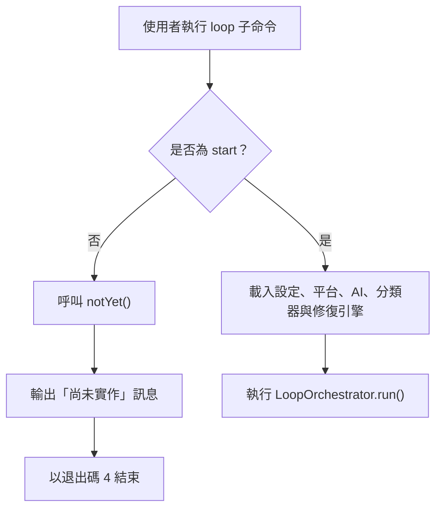
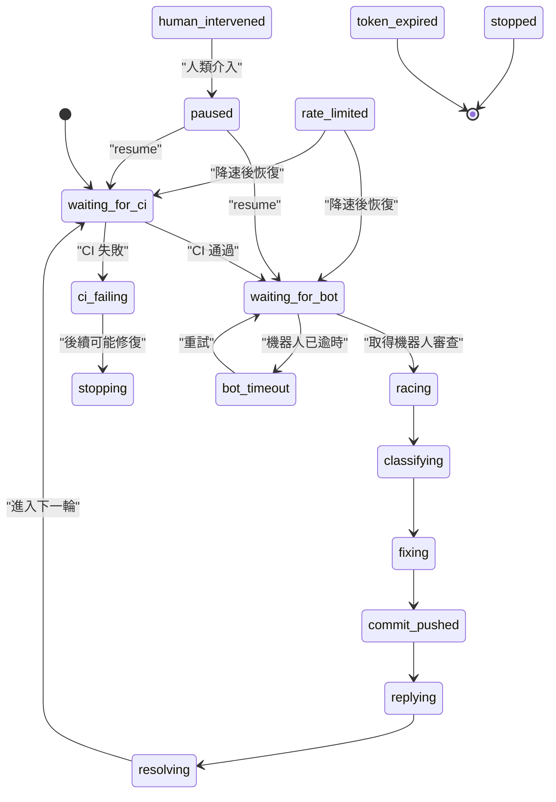
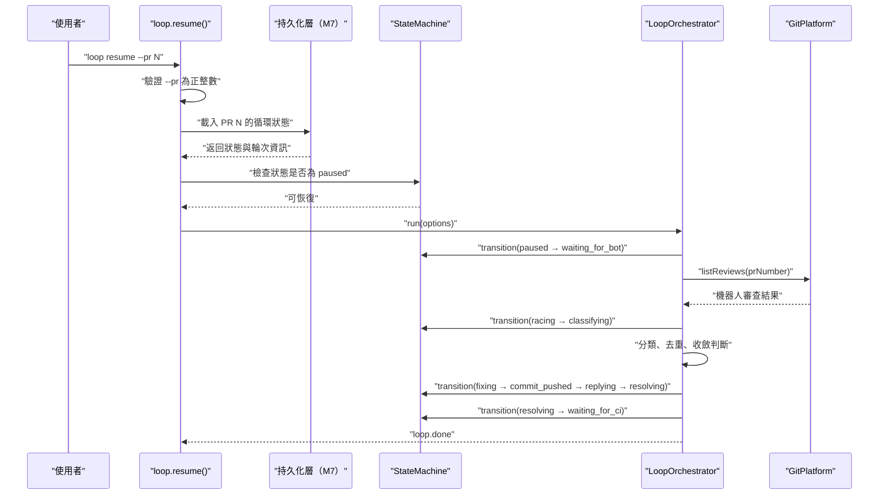
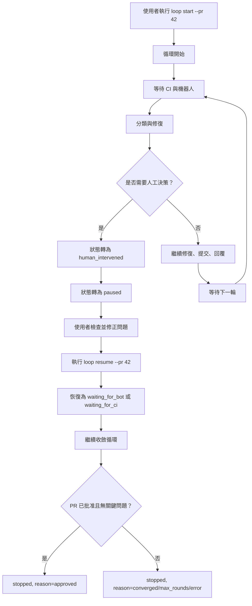
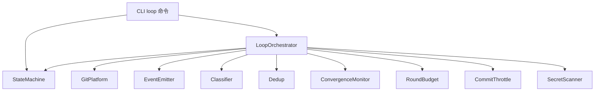
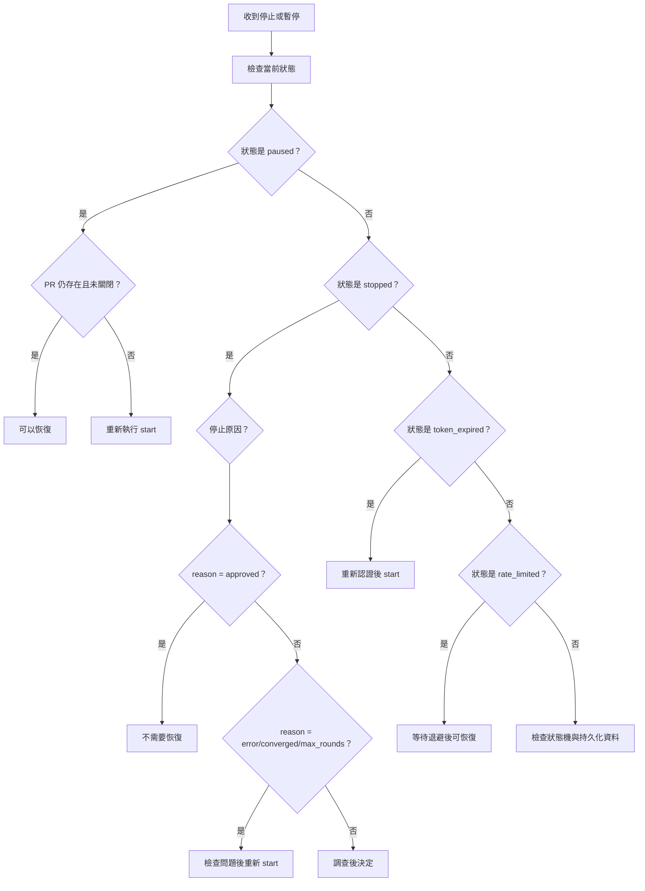

# 循環恢復 — `maestro loop resume`

**本文引用的檔案**

- [src/cli/commands/loop.ts](https://github.com/mikeah2011/maestro/blob/master/src/cli/commands/loop.ts)
- [src/core/loop/LoopOrchestrator.ts](https://github.com/mikeah2011/maestro/blob/master/src/core/loop/LoopOrchestrator.ts)
- [src/core/state/StateMachine.ts](https://github.com/mikeah2011/maestro/blob/master/src/core/state/StateMachine.ts)
- [tests/core/loop/LoopOrchestrator.test.ts](https://github.com/mikeah2011/maestro/blob/master/tests/core/loop/LoopOrchestrator.test.ts)
- [README.md](https://github.com/mikeah2011/maestro/blob/master/README.md)

## 目錄

1. [簡介](#簡介)
2. [專案結構與命令入口](#專案結構與命令入口)
3. [核心狀態機與「暫停」語義](#核心狀態機與暫停語義)
4. `maestro loop resume` 命令現況與預期行為
5. [可恢復的條件驗證](#可恢復的條件驗證)
6. [恢復後的執行流程](#恢復後的執行流程)
7. [停止與恢復的配合使用範例](#停止與恢復的配合使用範例)
8. [限制、風險與注意事項](#限制風險與注意事項)
9. [依賴關係分析](#依賴關係分析)
10. [故障診斷指南](#故障診斷指南)
11. [結論](#結論)

## 簡介

`maestro loop resume` 是 `maestro loop` 子命令之一，目標是從人類介入所導致的「暫停」狀態中恢復收斂循環。根據目前程式碼，這個子命令已註冊在 CLI 中，但尚未實作；它會呼叫一個通用「尚未實作」處理常式，印出訊息後以非零離開碼結束。

真正支援的狀態轉換邏輯集中在兩個位置：

| 層級 | 角色 | 關鍵檔案 |
|---|---|---|
| CLI 命令層 | 解析 `--pr`、顯示錯誤、未來負責讀取持久化狀態並調度恢復 | [src/cli/commands/loop.ts](https://github.com/mikeah2011/maestro/blob/master/src/cli/commands/loop.ts) |
| 核心循環層 | 驅動狀態機、分類、修復、提交、回覆、解決討論串、重新請求審查 | [src/core/loop/LoopOrchestrator.ts](https://github.com/mikeah2011/maestro/blob/master/src/core/loop/LoopOrchestrator.ts) |
| 狀態機層 | 定義所有合法狀態、前向轉換、跨切面轉換與終止狀態 | [src/core/state/StateMachine.ts](https://github.com/mikeah2011/maestro/blob/master/src/core/state/StateMachine.ts) |

從設計文件可知，`loop start` 是主要命令；`status`、`stop`、`resume` 在 M7 加入持久化層之前仍是佔位實作。因此，本文件同時說明「當前實際行為」與「基於現有狀態機設計的預期恢復行為」。

**章節來源**
- [src/cli/commands/loop.ts:1-25](https://github.com/mikeah2011/maestro/blob/master/src/cli/commands/loop.ts#L1-L25)
- [README.md:1-20](https://github.com/mikeah2011/maestro/blob/master/README.md#L1-L20)

## 專案結構與命令入口

`loop` 命令透過 Commander 註冊，包含以下子命令：

| 子命令 | 當前狀態 | 用途 |
|---|---|---|
| `start` | 已實作 | 啟動 PR 收斂循環 |
| `status` | 未實作 | 查詢進行中循環的狀態 |
| `stop` | 未實作 | 手動停止進行中的循環 |
| `resume` | 未實作 | 從人類介入導致的暫停狀態恢復 |

CLI 中有一個共用函式，用來表示這些尚未實作的子命令：

**圖表來源**
- [src/cli/commands/loop.ts:1-25](https://github.com/mikeah2011/maestro/blob/master/src/cli/commands/loop.ts#L1-L25)
- [src/cli/commands/loop.ts:480-489](https://github.com/mikeah2011/maestro/blob/master/src/cli/commands/loop.ts#L480-L489)

**章節來源**
- [src/cli/commands/loop.ts:1-25](https://github.com/mikeah2011/maestro/blob/master/src/cli/commands/loop.ts#L1-L25)
- [src/cli/commands/loop.ts:472-489](https://github.com/mikeah2011/maestro/blob/master/src/cli/commands/loop.ts#L472-L489)

## 核心狀態機與「暫停」語義

`maestro` 的收斂循環並非簡單 for 迴圈，而是由 `StateMachine` 驅動的有界狀態機。狀態分為三類：

1. **主線性狀態**：例如 `waiting_for_ci`、`waiting_for_bot`、`racing`、`classifying`、`fixing`、`commit_pushed`、`replying`、`resolving`。
2. **錯誤或跨切面狀態**：例如 `ci_failing`、`bot_timeout`、`human_intervened`、`rate_limited`、`token_expired`。
3. **終止狀態**：`stopped` 與 `token_expired`。

`paused` 是一個獨立狀態，代表「人類介入後暫停」。它的出邊允許恢復到：

| 目標狀態 | 意義 |
|---|---|
| `waiting_for_bot` | 恢復後等待機器人審查結果 |
| `waiting_for_ci` | 恢復後等待 CI 狀態 |

這表示恢復不是「直接跳回某個固定階段」，而是回到可繼續推進的主線路。

**圖表來源**
- [src/core/state/StateMachine.ts:10-45](https://github.com/mikeah2011/maestro/blob/master/src/core/state/StateMachine.ts#L10-L45)
- [src/core/state/StateMachine.ts:47-70](https://github.com/mikeah2011/maestro/blob/master/src/core/state/StateMachine.ts#L47-L70)

狀態機的轉換規則如下：

| 規則 | 行為 |
|---|---|
| 終止狀態不可再轉換 | `stopped` 與 `token_expired` 沒有出邊 |
| 跨切面狀態可從任何非終止狀態到達 | `human_intervened`、`rate_limited`、`token_expired`、`stopped` |
| 正常流程使用前向映射 | 例如 `classifying → fixing` |
| 非法轉換拋出異常 | 由 `StateTransitionError` 表達 |

**章節來源**
- [src/core/state/StateMachine.ts:10-70](https://github.com/mikeah2011/maestro/blob/master/src/core/state/StateMachine.ts#L10-L70)

## `maestro loop resume` 命令現況與預期行為

### 當前實際行為

在 `src/cli/commands/loop.ts` 中，`resume` 子命令的 `action` 直接呼叫 `notYet('resume')`。該函式會：

1. 在標準錯誤輸出黃色警告訊息。
2. 提示查看設計文件中關於系統架構的段落。
3. 呼叫 `process.exit(4)`。

也就是說，**現在執行 `maestro loop resume --pr <number>` 不會真正恢復任何東西**，而是直接報錯離開。

### 預期行為（基於現有狀態機設計）

雖然 CLI 端尚未實作，但狀態機已經預留了 `paused` 與 `human_intervened` 的語義。預期恢復流程應該符合以下原則：

| 階段 | 預期動作 |
|---|---|
| 參數驗證 | 檢查 `--pr` 是否為正整數 |
| 狀態檢索 | 從持久化儲存載入指定 PR 的循環狀態 |
| 條件驗證 | 確認狀態為 `paused` 或可恢復的相關狀態 |
| 資源初始化 | 建立 GitPlatform、EventEmitter、Classifier、ConvergenceMonitor 等 |
| 狀態轉換 | 將狀態從 `paused` 轉為 `waiting_for_bot` 或 `waiting_for_ci` |
| 繼續執行 | 從恢復點繼續完成當輪或下一輪收斂 |
| 事件輸出 | 繼續輸出 `state.transition`、`round.start`、`loop.done` 等事件 |

**章節來源**
- [src/cli/commands/loop.ts:472-489](https://github.com/mikeah2011/maestro/blob/master/src/cli/commands/loop.ts#L472-L489)
- [src/core/state/StateMachine.ts:10-45](https://github.com/mikeah2011/maestro/blob/master/src/core/state/StateMachine.ts#L10-L45)

## 可恢復的條件驗證

### 1. PR 號碼有效性

CLI 的 `start` 命令已展示參數驗證模式：若 `--pr` 不是有限數值或小於 1，會印出紅色錯誤訊息並以退出碼 2 結束。`resume` 應採用相同邏輯。

### 2. 當前狀態必須可恢復

依據狀態機，只有以下狀態適合成為「恢復起點」：

| 狀態 | 是否可恢復 | 恢復目標 |
|---|---:|---|
| `paused` | ✅ 是 | `waiting_for_bot` 或 `waiting_for_ci` |
| `human_intervened` | ⚠️ 需設計 | 通常先進入 `paused`，再由 `resume` 恢復 |
| `rate_limited` | ⚠️ 部分 | 可恢復至 `waiting_for_bot` 或 `waiting_for_ci`，但應考慮速率限制退避 |
| `stopped` | ❌ 否 | 已是終止狀態，應建議使用者重新執行 `start` |
| `token_expired` | ❌ 否 | 需重新認證或更新 token |
| `ci_failing` / `bot_timeout` | ⚠️ 視策略 | 可視為需要人工介入後再恢復，但必須明確記錄原因 |

### 3. 資源可用性

恢復時需要重新建立或恢復下列資源：

| 資源 | 用途 | 恢復要求 |
|---|---|---|
| GitHub Platform | 存取 PR、審查、討論串、CI | 需要有效 token 與網路連線 |
| EventEmitter | 輸出 JSONL 與美化事件 | 每次執行都會重建 |
| Classifier | 分類審查意見 | 可新建或重用 |
| ConvergenceMonitor | 偵測振盪與收斂 | 若需跨執行期持續追蹤，需持久化歷史輪次 |
| Dedup | 去重 | 通常按執行週期重置 |
| RoundBudget | 每輪配額 | 可按輪次繼續或重置 |
| CommitThrottle | 單輪提交節流 | 按輪次管理 |

**章節來源**
- [src/cli/commands/loop.ts:45-65](https://github.com/mikeah2011/maestro/blob/master/src/cli/commands/loop.ts#L45-L65)
- [src/core/state/StateMachine.ts:47-70](https://github.com/mikeah2011/maestro/blob/master/src/core/state/StateMachine.ts#L47-L70)
- [src/core/loop/LoopOrchestrator.ts:39-118](https://github.com/mikeah2011/maestro/blob/master/src/core/loop/LoopOrchestrator.ts#L39-L118)

## 恢復後的執行流程

### 狀態轉換序列

**圖表來源**
- [src/cli/commands/loop.ts:472-489](https://github.com/mikeah2011/maestro/blob/master/src/cli/commands/loop.ts#L472-L489)
- [src/core/state/StateMachine.ts:47-70](https://github.com/mikeah2011/maestro/blob/master/src/core/state/StateMachine.ts#L47-L70)
- [src/core/loop/LoopOrchestrator.ts:201-533](https://github.com/mikeah2011/maestro/blob/master/src/core/loop/LoopOrchestrator.ts#L201-L533)

### 恢復時的重點邏輯

#### 不重複修復

恢復時不應無條件重複上一輪的修復。正確做法是：

- 如果上一輪已完成修復、提交與回覆，則恢復後應繼續等待 CI 或機器人重新審查。
- 如果上一輪尚未完成，則需依持久化進度決定從哪個階段繼續。
- 對已提交的修復 SHA，應避免再次產生相同內容。

#### 不破壞收斂計算

`ConvergenceMonitor` 使用輪次間的關鍵問題雜湊集合來偵測振盪與非單調增長。恢復時必須確保：

- 歷史輪次的關鍵問題集合可被延續。
- 新輪次仍滿足最多一輪一次提交、每討論串每輪一次回覆等反垃圾郵件斷言。

#### 不濫用跨切面狀態

`rate_limited` 和 `token_expired` 雖然是跨切面狀態，但不等於「可以任意恢復」。特別是 `token_expired` 屬於終止狀態，不能直接恢復。

#### 人類介入的原因必須保留

`human_intervened` 到 `paused` 的轉換暗示有人工決策介入。恢復時應保留上下文，例如：

- 哪些發現被延後或拒絕。
- 使用者選擇了哪些行動。
- 是否需要重新詢問使用者。

**章節來源**
- [src/core/loop/LoopOrchestrator.ts:201-533](https://github.com/mikeah2011/maestro/blob/master/src/core/loop/LoopOrchestrator.ts#L201-L533)
- [src/core/state/StateMachine.ts:47-70](https://github.com/mikeah2011/maestro/blob/master/src/core/state/StateMachine.ts#L47-L70)

## 停止與恢復的配合使用範例

### 概念流程

### 停止的使用情境

`stop` 目前也是未實作命令。預期其用途包括：

| 情境 | 預期行為 |
|---|---|
| 使用者想中止正在執行的循環 | 將狀態轉為 `stopped` |
| 使用者想取消待執行的下一輪 | 提前結束循環 |
| 使用者誤觸發 `start` | 快速停止並返回控制項 |

### 恢復的使用情境

`resume` 預期用於：

| 情境 | 預期行為 |
|---|---|
| 人類介入後確認可繼續 | 從 `paused` 恢復 |
| 速率限制退避時間已到 | 可選擇恢復，但仍受 API 速率限制保護 |
| Token 過期後已重新認證 | 不適用；`token_expired` 是終止狀態，應建議重新執行 `start` |
| PR 已被關閉或合併 | 應拒絕恢復並回報錯誤 |

### 命令組合範例

| 步驟 | 命令 | 說明 |
|---|---|---|
| 1 | `maestro loop start --pr 42` | 啟動 PR #42 的收斂循環 |
| 2 | 觀察輸出中的狀態轉換與人類介入提示 | 判斷是否需要人工決策 |
| 3 | `maestro loop stop --pr 42` | 手動停止（目前未實作） |
| 4 | 修正問題或調整決策 | 修改 PR、分支或設定 |
| 5 | `maestro loop resume --pr 42` | 從暫停狀態恢復（目前未實作） |
| 6 | 觀察最終狀態：approved、converged、stopped 或 error | 確認循環結束原因 |

注意：上述 `stop` 與 `resume` 目前都會進入 `notYet()` 流程，實際執行會立即退出。

**圖表來源**
- [src/cli/commands/loop.ts:472-489](https://github.com/mikeah2011/maestro/blob/master/src/cli/commands/loop.ts#L472-L489)
- [src/core/state/StateMachine.ts:47-70](https://github.com/mikeah2011/maestro/blob/master/src/core/state/StateMachine.ts#L47-L70)

**章節來源**
- [src/cli/commands/loop.ts:472-489](https://github.com/mikeah2011/maestro/blob/master/src/cli/commands/loop.ts#L472-L489)
- [src/core/state/StateMachine.ts:47-70](https://github.com/mikeah2011/maestro/blob/master/src/core/state/StateMachine.ts#L47-L70)

## 限制、風險與注意事項

### 當前限制

1. **命令未實作**  
   `loop status`、`loop stop`、`loop resume` 皆為佔位實作。

2. **缺少持久化層**  
   設計文件指出這些功能將在 M7 加入持久化層。目前 `LoopOrchestrator` 的生命週期依附於單一 `run()` 呼叫。

3. **狀態機與 CLI 解耦**  
   `LoopOrchestrator` 內部會建立自己的 `StateMachine`，但 CLI 目前只傳遞選項，不暴露外部狀態查詢或恢復介面。

4. **人類介入狀態未在 orchestrator 主流程中明顯觸發**  
   狀態機允許 `human_intervened → paused`，但當前 `run()` 方法的主要可見路徑是 CI 與機器人收斂流程；人類介入通常由外部使用者輸入或外部控制邏輯觸發。

### 恢復風險

| 風險 | 說明 | 緩解方式 |
|---|---|---|
| 重複修復 | 恢復時若未追蹤已提交修復，可能產生重複 commit | 使用 CommitThrottle 與修復 SHA 追蹤 |
| 重複回覆 | 同一討論串可能被多次回覆 | RoundBudget 每輪限制一次回覆 |
| 收斂計數錯誤 | 歷史輪次遺失導致收斂偵測失效 | 持久化關鍵問題雜湊歷史 |
| 狀態不一致 | 恢復時本地狀態與遠端 PR 狀態不同步 | 恢復前先同步 platform 狀態 |
| Token 過期 | 恢復時 credential 失效 | 拒絕從 `token_expired` 恢復 |
| PR 已關閉 | 恢復到不存在或已合併的 PR | 恢復前檢查 PR 狀態 |
| 速率限制 | 恢復後立即大量呼叫 GitHub API | 沿用既有 poll interval 與 rate limit 處理 |

### 設計約束

項目 README 強調以下反垃圾郵件設計：

- 最多 3 輪。
- 關鍵問題集單調不增。
- 每輪最多一次提交。
- 每個討論串每輪最多一次回覆。
- 每輪最多一次 PR 內容更新。

恢復機制不得繞過這些約束。

**章節來源**
- [README.md:12-41](https://github.com/mikeah2011/maestro/blob/master/README.md#L12-L41)
- [src/core/loop/LoopOrchestrator.ts:201-533](https://github.com/mikeah2011/maestro/blob/master/src/core/loop/LoopOrchestrator.ts#L201-L533)

## 依賴關係分析

### 組件依賴圖

**圖表來源**
- [src/cli/commands/loop.ts:1-25](https://github.com/mikeah2011/maestro/blob/master/src/cli/commands/loop.ts#L1-L25)
- [src/core/loop/LoopOrchestrator.ts:1-118](https://github.com/mikeah2011/maestro/blob/master/src/core/loop/LoopOrchestrator.ts#L1-L118)
- [src/core/state/StateMachine.ts:1-114](https://github.com/mikeah2011/maestro/blob/master/src/core/state/StateMachine.ts#L1-L114)

### 耦合與內聚分析

| 組件 | 耦合程度 | 內聚程度 | 備註 |
|---|---:|---:|---|
| CLI `loop.ts` | 高 | 中 | 包含 AI provider 解析、pretty sink、互動提問等邏輯，負擔較重 |
| `LoopOrchestrator` | 中高 | 高 | 集中收斂循環邏輯，但依賴多個核心模組 |
| `StateMachine` | 低 | 高 | 狀態定義與轉換規則清晰，易測試 |
| `EventEmitter` | 中 | 高 | 作為跨組件事件通道 |
| `ConvergenceMonitor` | 中 | 高 | 專注於收斂偵測 |

### 測試覆蓋情況

`LoopOrchestrator.test.ts` 模擬平台行為，驗證：

- 停止條件。
- 機器人滿意狀態。
- 不再重新請求已滿意的機器人。
- 分類與討論串處理。

這表示核心循環邏輯是可測試的，而 CLI 端的 `resume` 目前沒有對應的恢復流程測試。

**章節來源**
- [tests/core/loop/LoopOrchestrator.test.ts:1-120](https://github.com/mikeah2011/maestro/blob/master/tests/core/loop/LoopOrchestrator.test.ts#L1-L120)
- [src/core/loop/LoopOrchestrator.ts:1-118](https://github.com/mikeah2011/maestro/blob/master/src/core/loop/LoopOrchestrator.ts#L1-L118)

## 故障診斷指南

### 常見錯誤與處理方式

| 現象 | 可能原因 | 建議處理 |
|---|---|---|
| 執行 `loop resume` 立刻出現「尚未實作」 | 命令尚未實作 | 等待 M7 持久化層或改用 `start` |
| 退出碼為 4 | `notYet()` 主動退出 | 這是預期的未實作行為 |
| 退出碼為 2 | `--pr` 無效 | 確認 PR 號碼為正整數 |
| 退出碼為 3 | 設定載入錯誤 | 檢查 `.maestro.yaml` 與環境變數 |
| 退出碼為 1 | 平台初始化或運行錯誤 | 檢查 GitHub Token、網路與權限 |
| 狀態為 `token_expired` | Token 已過期 | 重新認證後執行 `start`，不要嘗試 `resume` |
| 狀態為 `stopped` | 手動停止、CI 失敗、超過最大輪數、錯誤 | 檢查停止原因，必要時重新執行 |
| 恢復後仍無法繼續 | 狀態不可恢復或 PR 已關閉 | 確認 PR 存在且狀態為 `paused` |

### 如何判斷是否應該恢復

### 事件診斷技巧

在 `start` 模式中，事件會透過 stdout 與美化 sink 輸出。恢復實現後，也應輸出：

- `state.transition`：顯示狀態變化。
- `round.start`：顯示恢復後的第一輪。
- `loop.done`：顯示最終原因。

這樣使用者可以判斷恢復是否真的從預期的狀態繼續。

**章節來源**
- [src/cli/commands/loop.ts:491-512](https://github.com/mikeah2011/maestro/blob/master/src/cli/commands/loop.ts#L491-L512)
- [src/core/state/StateMachine.ts:72-114](https://github.com/mikeah2011/maestro/blob/master/src/core/state/StateMachine.ts#L72-L114)

## 結論

`maestro loop resume` 目前是一個已註冊但未實作的命令。它會立即輸出「尚未實作」訊息並退出，不會改變任何狀態或資源。

從系統設計來看，恢復的核心不在 CLI 本身，而在以下三個層次：

1. **持久化層**：保存 PR、輪次、狀態、人類決策與歷史收斂資料。
2. **狀態機層**：允許從 `paused` 恢復到 `waiting_for_bot` 或 `waiting_for_ci`。
3. **循環層**：在恢復後繼續完成分類、修復、提交、回覆、解決討論串與重新請求審查的流程。

在 M7 持久化層完成之前，使用者若要恢復收斂循環，實務上應：

- 使用 `maestro loop start --pr <number>` 重新啟動。
- 若希望保留歷史決策，需在外部紀錄 `start` 時的輸出與設定。
- 避免同時執行多個針對同一 PR 的 `loop start`，以免競爭 GitHub 狀態。

未來實現 `resume` 時，應優先保證：

- 僅允許從 `paused` 恢復。
- 不重複提交或回覆。
- 不破壞收斂監測。
- 清楚輸出狀態轉換與恢復原因。
- 對 `stopped`、`token_expired`、已關閉 PR 給出明確錯誤訊息。