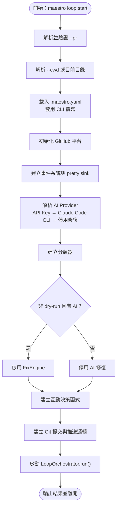
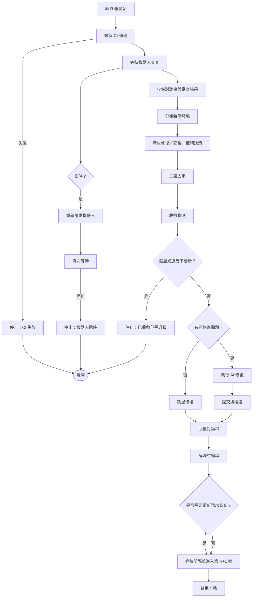
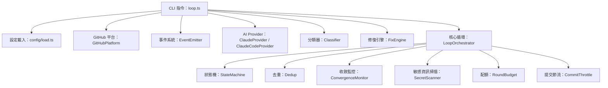
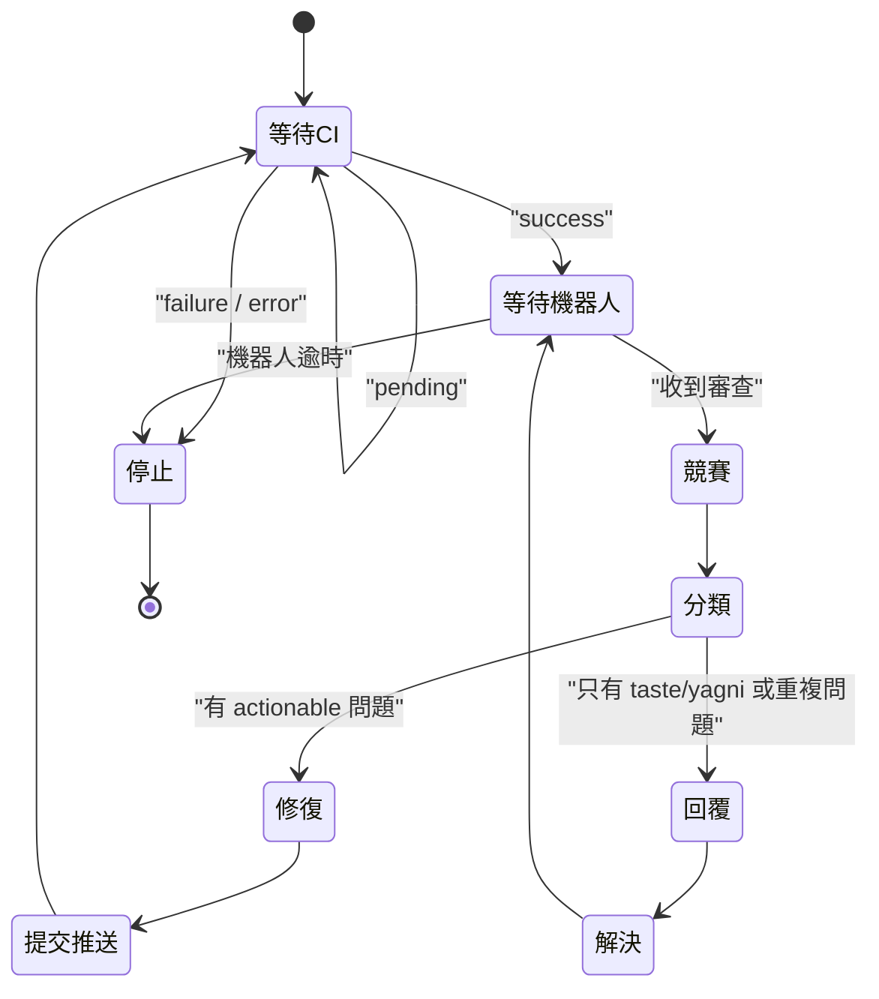

# loop start — 啟動循環

**本文引用的檔案**

- [README.md](https://github.com/mikeah2011/maestro/blob/master/README.md)
- [package.json](https://github.com/mikeah2011/maestro/blob/master/package.json)
- [.maestro.example.yaml](https://github.com/mikeah2011/maestro/blob/master/.maestro.example.yaml)
- [src/cli/commands/loop.ts](https://github.com/mikeah2011/maestro/blob/master/src/cli/commands/loop.ts)
- [src/core/loop/LoopOrchestrator.ts](https://github.com/mikeah2011/maestro/blob/master/src/core/loop/LoopOrchestrator.ts)
- [src/config/index.ts](https://github.com/mikeah2011/maestro/blob/master/src/config/index.ts)
- [src/config/load.ts](https://github.com/mikeah2011/maestro/blob/master/src/config/load.ts)
- [src/config/schema.ts](https://github.com/mikeah2011/maestro/blob/master/src/config/schema.ts)
- [docs/DESIGN.md](https://github.com/mikeah2011/maestro/blob/master/docs/DESIGN.md)

## 目錄
1. [簡介](#簡介)
2. [命令總覽與旗標選項](#命令總覽與旗標選項)
3. [啟動流程](#啟動流程)
4. [單輪收斂邏輯](#單輪收斂邏輯)
5. [dry-run 模式與正式模式的差異](#dry-run-模式與正式模式的差異)
6. [設定檔與環境變數](#設定檔與環境變數)
7. [錯誤處理與退出碼](#錯誤處理與退出碼)
8. [常見啟動參數組合範例](#常見啟動參數組合範例)
9. [依賴與架構關係](#依賴與架構關係)
10. [故障排除指南](#故障排除指南)
11. [結語](#結語)

## 簡介
`maestro loop start` 是 Maestro 的「收斂循環」啟動入口。它不是另一個審查機器人，而是把 CodeRabbit、Ellipsis、Copilot Code Review、Codex、Gemini Code Assist、Sourcery、Greptile 等審查結果集中起來，執行分類、去重、AI 修復、提交推送、討論串回覆與解決，並在有確定性停止條件時結束循環。

專案說明書指出：Maestro 的目標是讓 PR 真正合併；當 CI 通過、機器人已審查、問題已分類與處理、討論串已回覆或解決，且關鍵問題不再增加時，循環停止。若達到最大輪數、出現振盪、CI 失敗、機器人逾時，或人工介入異常，則以不同原因終止。

**章節來源**
- [README.md:1-80](https://github.com/mikeah2011/maestro/blob/master/README.md#L1-L80)
- [docs/DESIGN.md:1-60](https://github.com/mikeah2011/maestro/blob/master/docs/DESIGN.md#L1-L60)

## 命令總覽與旗標選項

### 命令結構
```text
maestro loop start --pr <編號> [其他選項]
```

| 旗標 | 是否必要 | 類型 | 預設值 | 作用 |
|---|---:|---|---|---|
| `--pr` | 是 | 正整數 | 無 | 指定要驅動收斂循環的 Pull Request 編號。小於 1 或非數字會直接報錯。 |
| `--max-rounds` | 否 | 整數 | 來自 `.maestro.yaml` 的 `stopConditions.maxRounds`，預設為 3 | 覆寫每支 PR 最多可執行的收斂輪數。 |
| `--cost-budget` | 否 | 浮點數 | 來自設定檔的 `stopConditions.costBudgetUSD` | 覆寫本次循環的成本上限（美元）。 |
| `--bots` | 否 | 逗號分隔字串 | 空字串，代表監聽所有機器人 | 只接受指定機器人帳號的審查結果。 |
| `--dry-run` | 否 | 布林旗標 | 關閉 | 模擬模式：只做分類與報告，不執行 AI 修復、不提交、不推送到遠端、不在討論串回覆。 |
| `--remote` | 否 | 字串 | `upstream` → `origin` | 用於自動偵測 owner/repo 的 Git remote 名稱。 |
| `--cwd` | 否 | 路徑字串 | 目前工作目錄 | 指定目標倉庫根目錄，所有檔案修改與 git 操作都從此目錄進行。 |

### 未實作子指令
`loop status`、`loop stop`、`loop resume` 目前仍保留為未來 M7 階段的功能。呼叫它們會顯示「尚未實作」訊息並離開程式。

**章節來源**
- [src/cli/commands/loop.ts:28-68](https://github.com/mikeah2011/maestro/blob/master/src/cli/commands/loop.ts#L28-L68)
- [src/cli/commands/loop.ts:443-466](https://github.com/mikeah2011/maestro/blob/master/src/cli/commands/loop.ts#L443-L466)

## 啟動流程

`maestro loop start` 的完整啟動流程如下：

1. **解析 PR 編號**：將 `--pr` 轉換為整數，並驗證其為正整數。
2. **解析倉庫目錄**：使用 `--cwd`，否則使用目前工作目錄。
3. **載入設定**：以目標目錄為基準讀取 `.maestro.yaml`，並套用 `--remote`、`--max-rounds`、`--cost-budget` 等覆寫。
4. **初始化 GitHub 平台**：從設定中取得 token、baseUrl、owner、repo。
5. **建立事件系統**：輸出 JSONL 事件，同時提供人類可讀的進度提示。
6. **解析 AI Provider**：優先使用 Anthropic API Key；若不可用，嘗試本機 Claude Code CLI；兩者皆不可用時停用 AI 修復引擎。
7. **建立分類器**：若有 AI Provider，則支援 LLM 分類；否則使用規則式分類。
8. **建立修復引擎**：非 dry-run 且有 AI Provider 時啟用 FixEngine。
9. **建立互動決策函式**：非 dry-run 時，在每輪分類後讓使用者確認修復、延後或拒絕。
10. **建立 Git 提交與推送邏輯**：非 dry-run 時，將修復內容加入 staging、提交、push。
11. **啟動 LoopOrchestrator**：驅動狀態機完成多輪收斂。
12. **輸出最終結果**：根據 reason 決定 exit code。



**圖表來源**
- [src/cli/commands/loop.ts:28-140](https://github.com/mikeah2011/maestro/blob/master/src/cli/commands/loop.ts#L28-L140)
- [src/cli/commands/loop.ts:233-303](https://github.com/mikeah2011/maestro/blob/master/src/cli/commands/loop.ts#L233-L303)
- [src/core/loop/LoopOrchestrator.ts:125-170](https://github.com/mikeah2011/maestro/blob/master/src/core/loop/LoopOrchestrator.ts#L125-L170)

**章節來源**
- [src/cli/commands/loop.ts:28-140](https://github.com/mikeah2011/maestro/blob/master/src/cli/commands/loop.ts#L28-L140)
- [src/cli/commands/loop.ts:233-303](https://github.com/mikeah2011/maestro/blob/master/src/cli/commands/loop.ts#L233-L303)

## 單輪收斂邏輯

每次循環包含以下階段：

1. **等待 CI**：檢查 HEAD SHA 對應的 CI 狀態。成功才繼續；失敗則終止。
2. **等待機器人審查**：輪詢 PR 評論與審查狀態。若超過逾時時間仍未收到審查，會重新請求審查者並再次等待。
3. **競賽階段 Racing**：避免多個機器人同時發表評論造成狀態震盪。
4. **收集討論串**：透過平台列出 review threads。
5. **轉換為發現項目 findings**：將討論串轉成結構化問題清單。
6. **分類 classification**：對每個 finding 判斷 bug、taste、wrong、yagni、unknown。
7. **計算決策 decisions**：預設為 bug／unknown → fix；taste／yagni → defer；wrong → reject。使用者可在非 dry-run 模式下覆寫。
8. **去重 deduplication**：三層去重，精確雜湊最優先，其次模糊匹配，最後語義 LLM 去重。
9. **收斂檢測 convergence**：針對關鍵與高嚴重度的 bug 計算 Jaccard 相似度。若超過閾值、關鍵問題數量增加，或第 2 輪後出現新類別，則停止並升級。
10. **修復 fixing**：僅對決策為 fix 的問題執行 AI 修復。
11. **提交 commit**：將本輪所有修復累積成一個提交。
12. **回覆 reply**：在每個相關討論串內回覆，並標示處理結果。
13. **解決 resolve**：在支援的平台能力下解決討論串。
14. **重新請求審查 re-request**：若已回覆且所有討論串已解決，才重新請求尚未批准的機器人。
15. **下一輪 next round**：等待一段間隔讓機器人重新審查，再回到 CI 檢查。



**圖表來源**
- [src/core/loop/LoopOrchestrator.ts:201-533](https://github.com/mikeah2011/maestro/blob/master/src/core/loop/LoopOrchestrator.ts#L201-L533)

**章節來源**
- [src/core/loop/LoopOrchestrator.ts:201-533](https://github.com/mikeah2011/maestro/blob/master/src/core/loop/LoopOrchestrator.ts#L201-L533)

## dry-run 模式與正式模式的差異

| 行為 | dry-run 模式 | 正式模式 |
|---|---|---|
| 分類 | 執行 | 執行 |
| AI 修復 | 停用，固定回傳空陣列 | 由 FixEngine 執行 |
| Git add / commit / push | 完全跳過 | 將修復內容加入 staging、提交、push |
| 互動決策 | 不顯示 | 每輪顯示建議行動，允許輸入覆寫 |
| 討論串回覆 | 不執行 | 在支援平台上回覆並標示處理結果 |
| 討論串解決 | 不執行 | 在支援平台上解決討論串 |
| PR 描述更新 | 不執行 | 若 PR approved 且描述不完整，可能生成摘要 |
| 重新請求審查 | 不執行 | 條件滿足時重新請求機器人 |
| 用途 | 安全測試、審計、觀察分類與去重結果 | 實際自動化修復與閉環 |

dry-run 的核心價值是「可觀測但不侵入」。你可以用它確認：

- PR 是否存在。
- CI 是否通過。
- 哪些機器人已發表審查。
- 分類結果是否符合預期。
- 去重是否消除重複問題。
- 收斂條件是否觸發。
- 不會修改任何程式碼或送出任何網路寫操作。

**章節來源**
- [src/cli/commands/loop.ts:45-55](https://github.com/mikeah2011/maestro/blob/master/src/cli/commands/loop.ts#L45-L55)
- [src/cli/commands/loop.ts:103-116](https://github.com/mikeah2011/maestro/blob/master/src/cli/commands/loop.ts#L103-L116)
- [src/cli/commands/loop.ts:126-140](https://github.com/mikeah2011/maestro/blob/master/src/cli/commands/loop.ts#L126-L140)
- [src/core/loop/LoopOrchestrator.ts:46-62](https://github.com/mikeah2011/maestro/blob/master/src/core/loop/LoopOrchestrator.ts#L46-L62)

## 設定檔與環境變數

### 設定優先順序
設定載入遵循明確的優先順序：

1. CLI 旗標
2. 環境變數
3. 倉庫 `.maestro.yaml`
4. 使用者 `~/.maestro/config.yaml`
5. Git remote 自動偵測
6. 預設值

### 重要設定區段

| 區段 | 欄位 | 作用 |
|---|---|---|
| `platform.type` | `github`、`gitlab`、`gitea`、`gitee` | 選擇 Git 平台 |
| `platform.auth.tokenEnv` | 例如 `GITHUB_TOKEN` | 指定 token 的環境變數名稱 |
| `platform.auth.token` | 字串 | 直接提供 token（較不安全） |
| `platform.owner` | 字串 | GitHub 組織或使用者名稱 |
| `platform.repo` | 字串 | 倉庫名稱 |
| `ai.providers` | 多個 provider 定義 | 宣告可用 AI 模型與路由 |
| `stopConditions.maxRounds` | 整數，範圍 1–5 | 最大收斂輪數，預設 3 |
| `stopConditions.quietPeriodSec` | 秒 | 機器人發文後的靜默等待期 |
| `stopConditions.costBudgetUSD` | 美元 | 成本上限 |
| `security.redactPatterns` | 正規表示式陣列 | 遮蔽敏感資訊 |

### 環境變數

| 環境變數 | 作用 |
|---|---|
| `MAESTRO_MAX_ROUNDS` | 覆寫最大輪數 |
| `MAESTRO_COST_BUDGET_USD` | 覆寫成本預算 |
| `MAESTRO_LOG_LEVEL` | 設定日誌等級 |
| `MAESTRO_AUDIT_DIR` | 設定審計目錄 |
| `ANTHROPIC_API_KEY` | Anthropic API Key；沒有時 fallback 到 Claude Code CLI |
| `GITHUB_TOKEN` | GitHub token，具備 repo 與 pull_requests 讀寫權限 |

### Git remote 自動偵測
若未手動設定 owner/repo，Maestro 會嘗試從 `git remote get-url upstream` 或 `origin` 解析平台、owner、repo，並設定適當的 token 環境變數名稱。

**章節來源**
- [src/config/load.ts:1-60](https://github.com/mikeah2011/maestro/blob/master/src/config/load.ts#L1-L60)
- [src/config/load.ts:61-120](https://github.com/mikeah2011/maestro/blob/master/src/config/load.ts#L61-L120)
- [src/config/load.ts:121-200](https://github.com/mikeah2011/maestro/blob/master/src/config/load.ts#L121-L200)
- [src/config/schema.ts:120-170](https://github.com/mikeah2011/maestro/blob/master/src/config/schema.ts#L120-L170)
- [.maestro.example.yaml:1-110](https://github.com/mikeah2011/maestro/blob/master/.maestro.example.yaml#L1-L110)

## 錯誤處理與退出碼

### CLI 層級退出碼

| 情境 | 退出碼 | 說明 |
|---|---:|---|
| `--pr` 非正整數 | 2 | PR 編號格式錯誤 |
| 設定檔載入或驗證失敗 | 3 | ConfigError |
| 平台初始化失敗 | 1 | GitHub Platform 初始化錯誤 |
| Orchestrator 回報 error | 1 | 循環執行期間發生例外 |
| 正常結束 | 0 | 無論原因是 approved、converged 還是 max_rounds |
| 呼叫未實作子指令 | 4 | status、stop、resume 尚屬 M7 |

### 循環內部錯誤處理
`LoopOrchestrator.run()` 使用 try/catch 包裹主迴圈。發生例外時：

1. 發出 `loop.error` 事件。
2. 嘗試轉換狀態到 `stopped`。
3. 回傳 reason 為 `error` 的結果物件。
4. CLI 層面印出錯誤訊息並使用 exit code 1 離開。

### CI 失敗
若 CI 狀態為 failure 或 error，循環立即停止，reason 為 stopped，並帶有 ci_failing 狀態。

### 機器人逾時
若第一次等待機器人審查失敗，會重新請求審查者；若第二次仍無審查結果，則以 bot_timeout 停止。

### Git 錯誤
提交階段若 staging 無變更，會記錄 `nothing_to_stage` 錯誤；git 操作失敗會記錄 `git` 階段錯誤，並返回空 SHA。

**章節來源**
- [src/cli/commands/loop.ts:56-73](https://github.com/mikeah2011/maestro/blob/master/src/cli/commands/loop.ts#L56-L73)
- [src/cli/commands/loop.ts:90-101](https://github.com/mikeah2011/maestro/blob/master/src/cli/commands/loop.ts#L90-L101)
- [src/cli/commands/loop.ts:201-232](https://github.com/mikeah2011/maestro/blob/master/src/cli/commands/loop.ts#L201-L232)
- [src/cli/commands/loop.ts:303-326](https://github.com/mikeah2011/maestro/blob/master/src/cli/commands/loop.ts#L303-L326)
- [src/core/loop/LoopOrchestrator.ts:480-533](https://github.com/mikeah2011/maestro/blob/master/src/core/loop/LoopOrchestrator.ts#L480-L533)

## 常見啟動參數組合範例

以下範例假設你已經安裝好依賴、設定好 GitHub Token，並位於目標倉庫目錄中。

### 基本 dry-run 測試
適合初次使用或驗證 PR 是否能被正確識別與分類。

```bash
bun run src/cli/index.ts loop start --pr 1 --dry-run
```

### 指定最大輪數
限制最多執行 2 輪收斂。

```bash
bun run src/cli/index.ts loop start --pr 1 --max-rounds 2
```

### 指定成本預算
限制本次循環最多花費 3 美元。

```bash
bun run src/cli/index.ts loop start --pr 1 --cost-budget 3
```

### 只監聽特定機器人
只處理 coderabbitai 與 ellipsis-dev[bot] 的審查結果。

```bash
bun run src/cli/index.ts loop start --pr 1 --bots "coderabbitai,ellipsis-dev[bot]"
```

### 指定 Git remote
當你的上游 remote 名稱不是 upstream 或 origin 時使用。

```bash
bun run src/cli/index.ts loop start --pr 1 --remote my-upstream
```

### 指定倉庫目錄
當你要對另一個目錄中的倉庫執行循環時使用。

```bash
bun run src/cli/index.ts loop start --pr 1 --cwd ../other-repo
```

### 結合多個旗標
測試 PR #42，最多 2 輪，只監聽 codex 機器人，並以 dry-run 驗證。

```bash
bun run src/cli/index.ts loop start \
  --pr 42 \
  --max-rounds 2 \
  --bots "chatgpt-codex-connector[bot]" \
  --dry-run
```

### 正式模式注意事項
正式模式會實際修改程式碼、提交並推送。建議先用 dry-run 確認分類與去重結果正確後，再移除 `--dry-run` 執行正式循環。

**章節來源**
- [README.md:40-80](https://github.com/mikeah2011/maestro/blob/master/README.md#L40-L80)
- [src/cli/commands/loop.ts:45-68](https://github.com/mikeah2011/maestro/blob/master/src/cli/commands/loop.ts#L45-L68)

## 依賴與架構關係

### CLI 與核心模組關係



**圖表來源**
- [src/cli/commands/loop.ts:18-27](https://github.com/mikeah2011/maestro/blob/master/src/cli/commands/loop.ts#L18-L27)
- [src/core/loop/LoopOrchestrator.ts:22-44](https://github.com/mikeah2011/maestro/blob/master/src/core/loop/LoopOrchestrator.ts#L22-L44)

### 狀態機與處理階段



**圖表來源**
- [docs/DESIGN.md:60-110](https://github.com/mikeah2011/maestro/blob/master/docs/DESIGN.md#L60-L110)
- [src/core/loop/LoopOrchestrator.ts:201-533](https://github.com/mikeah2011/maestro/blob/master/src/core/loop/LoopOrchestrator.ts#L201-L533)

### 主要資料結構

| 結構 | 位置 | 用途 |
|---|---|---|
| `LoopRunOptions` | `LoopOrchestrator.ts` | 傳遞 PR 編號、最大輪數、機器人過濾、dry-run |
| `LoopResult` | `LoopOrchestrator.ts` | 回報最終狀態、輪數、停止原因與錯誤 |
| `Finding` | `core/types/Finding.ts` | 單一審查發現，包含檔案、行號、標題、內文、嚴重度 |
| `FindingClassification` | `core/types/Finding.ts` | 分類結果：bug、taste、wrong、yagni、unknown |
| `PullRequest` | `core/types/PullRequest.ts` | PR 基本資訊與 headSha |
| `RoundCommit` | `core/round/CommitThrottle.ts` | 一輪提交的結構化訊息與修復清單 |
| `MaestroConfig` | `config/schema.ts` | 完整設定物件，經 Zod 驗證 |

**章節來源**
- [src/core/loop/LoopOrchestrator.ts:46-104](https://github.com/mikeah2011/maestro/blob/master/src/core/loop/LoopOrchestrator.ts#L46-L104)
- [src/config/schema.ts:1-120](https://github.com/mikeah2011/maestro/blob/master/src/config/schema.ts#L1-L120)

## 故障排除指南

### 問題：`--pr` 報錯
**現象**：輸出類似 `error: --pr must be a positive integer`。  
**原因**：PR 編號不是正整數，可能是 0、負數或非數字字串。  
**解法**：確認 PR 編號正確，例如 `--pr 1`。

### 問題：設定檔載入失敗
**現象**：輸出 `config error:` 並帶詳細訊息。  
**原因**：`.maestro.yaml` 語法錯誤、YAML 結構不符合 schema、或環境變數展開失敗。  
**解法**：
1. 使用 `.maestro.example.yaml` 作為基礎。
2. 檢查 `platform.owner`、`platform.repo`、`platform.auth.tokenEnv`。
3. 確保 `ANTHROPIC_API_KEY` 或其他必要環境變數存在。
4. 先執行 `doctor` 或最小化設定檔測試。

### 問題：平台初始化失敗
**現象**：輸出 `platform error:`。  
**原因**：GitHub Token 無效、權限不足、baseUrl 錯誤、或 network 問題。  
**解法**：
1. 確認 `GITHUB_TOKEN` 具有 repo 與 pull_requests 讀寫權限。
2. 若使用 Enterprise，確認 baseUrl 正確。
3. 使用 `gh auth status` 或相同 token 手動存取 GitHub API 驗證。

### 問題：沒有 AI Provider
**現象**：輸出警告，表示 fix engine disabled。  
**原因**：既沒有 Anthropic API Key，也沒有可用的 Claude Code CLI。  
**解法**：
1. 設定 `ANTHROPIC_API_KEY`。
2. 或安裝並登入 Claude Code CLI。
3. 或使用 `--dry-run` 執行純分類模式。

### 問題：dry-run 看不到修復
**現象**：沒有看到 `fix.applied` 或 `commit.pushed`。  
**原因**：dry-run 模式本來就不執行修復與提交。  
**解法**：這是預期行為。改用正式模式，或先用 dry-run 確認分類結果。

### 問題：循環停在機器人逾時
**現象**：狀態走到 `bot_timeout` 後停止。  
**原因**：指定機器人未回應，或 GitHub API rate limit、機器人自身限制。  
**解法**：
1. 檢查 `--bots` 是否包含正確的機器人 login。
2. 確認機器人在 PR 上確實有權限。
3. 調整 `quietPeriodSec` 或等待 GitHub rate limit 恢復。
4. 查看 PR 評論是否出現 usage limit 或 quota exceeded。

### 問題：CI 一直 pending
**現象**：持續輸出 `ci.polling`。  
**原因**：CI 尚未完成，或 CI 服務異常。  
**解法**：
1. 到 GitHub Actions / CI dashboard 檢查狀態。
2. 確認分支有觸發 CI 的 commit。
3. 若 CI 長期 pending，考慮手動取消或重跑。

### 問題：分類結果不理想
**現象**：大量 unknown 或不正確的 bug/taste/wrong 分類。  
**原因**：規則式分類無法判斷，LLM 分類也失敗，或審查意見過於模糊。  
**解法**：
1. 確保 AI Provider 可用。
2. 改善審查機器人的評論品質。
3. 使用 dry-run 觀察分類結果，必要時調整機器人設定。

**章節來源**
- [src/cli/commands/loop.ts:56-101](https://github.com/mikeah2011/maestro/blob/master/src/cli/commands/loop.ts#L56-L101)
- [src/cli/commands/loop.ts:142-170](https://github.com/mikeah2011/maestro/blob/master/src/cli/commands/loop.ts#L142-L170)
- [src/core/loop/LoopOrchestrator.ts:201-260](https://github.com/mikeah2011/maestro/blob/master/src/core/loop/LoopOrchestrator.ts#L201-L260)
- [docs/DESIGN.md:110-170](https://github.com/mikeah2011/maestro/blob/master/docs/DESIGN.md#L110-L170)

## 結語
`maestro loop start` 的核心價值在於「把分散的 AI 審查結果變成可收斂的流程」。它不是單純呼叫一次 AI，而是反覆拉取 PR、收集機器人評論、分類問題、去重、修復、提交、回覆討論串，並在硬性停止條件下結束。

推薦的使用方式是：

1. 先用 dry-run 驗證 PR、CI、分類與去重。
2. 確認分類結果符合團隊標準。
3. 再執行正式模式完成閉環。
4. 使用 `--bots` 控制只處理需要的機器人。
5. 使用 `--max-rounds` 控制成本與風險。
6. 遇到問題時先觀察 JSONL 事件與 pretty output，再定位是哪個階段失敗。

這個命令的設計哲學很明確：工具應該大聲失敗、禁止靜默漂移、並提供數學保證的停止條件，而不是讓開發者在疲憊時合併 PR。

**章節來源**
- [README.md:1-80](https://github.com/mikeah2011/maestro/blob/master/README.md#L1-L80)
- [docs/DESIGN.md:1-110](https://github.com/mikeah2011/maestro/blob/master/docs/DESIGN.md#L1-L110)