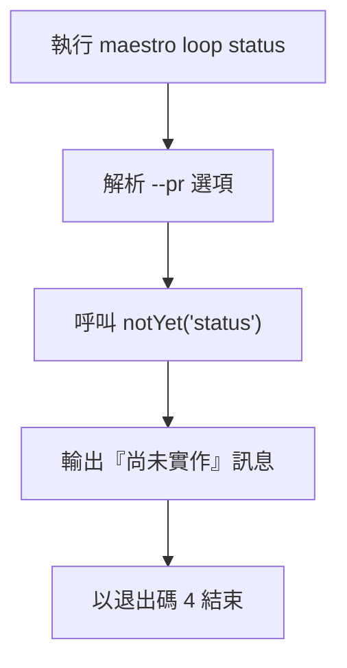
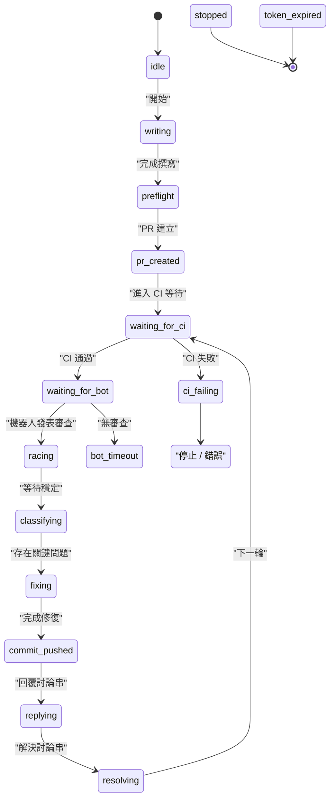
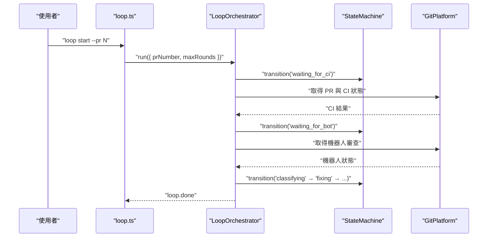
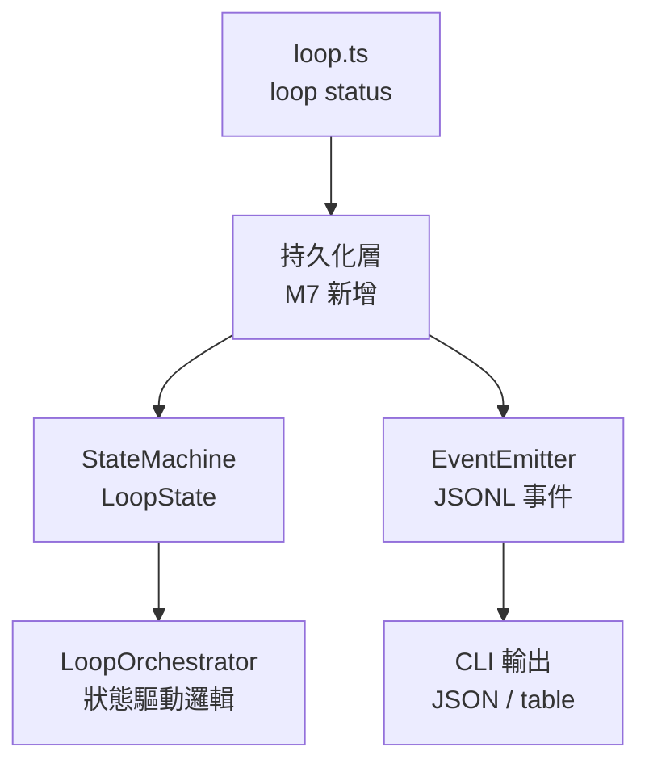

# `maestro loop status` — 查看狀態

<cite>
**本文引用的檔案**
- [src/cli/commands/loop.ts](https://github.com/mikeah2011/maestro/blob/master/src/cli/commands/loop.ts)
- [src/core/state/StateMachine.ts](https://github.com/mikeah2011/maestro/blob/master/src/core/state/StateMachine.ts)
- [src/core/loop/LoopOrchestrator.ts](https://github.com/mikeah2011/maestro/blob/master/src/core/loop/LoopOrchestrator.ts)
- [docs/DESIGN.md](https://github.com/mikeah2011/maestro/blob/master/docs/DESIGN.md)
- [README.md](https://github.com/mikeah2011/maestro/blob/master/README.md)
</cite>

## 目錄
1. [簡介](#簡介)
2. [命令現狀](#命令現狀)
3. [循環狀態總覽](#循環狀態總覽)
4. [預期輸出格式](#預期輸出格式)
5. [狀態欄位與含義](#狀態欄位與含義)
6. [歷史記錄顯示方式](#歷史記錄顯示方式)
7. [常見狀態解讀與處理建議](#常見狀態解讀與處理建議)
8. [監控循環進度的實用技巧](#監控循環進度的實用技巧)
9. [架構與實現映射](#架構與實現映射)
10. [故障排除](#故障排除)
11. [結語](#結語)

## 簡介
`maestro loop status` 是 `maestro loop` 子命令之一，目的是讓使用者在不啟動完整收斂循環的情況下，查詢某個 Pull Request 當前正在執行的循環狀態。它對應的狀態空間由系統內部的狀態機定義，涵蓋從「等待 CI」到「已停止」等所有主流程與錯誤狀態。

這個命令的主要價值在於：
- 確認 PR 是否已被 Maestro 接管。
- 判斷當前處於哪一個階段：等待 CI、等待機器人、競速中、分類中、修復中、提交已推送、回覆中、解決中。
- 識別異常狀態：CI 失敗、機器人逾時、令牌過期、人工介入、暫停等。
- 結合事件流，追蹤歷史輪次與進度。

## 命令現狀
目前 `maestro loop status` 尚未實作。執行該命令會立即輸出「尚未實作」訊息，並退出程式碼 `4`。

| 項目 | 說明 |
|---|---|
| 命令 | `maestro loop status` |
| 選項 | `--pr <number>`（預設值為當前分支的 PR） |
| 實作狀態 | 占位；待 M7 加入持久化層後實作 |
| 未實作時的行為 | 輸出黃色警告訊息，並帶出設計文件章節指引 |
| 退出碼 | `4` |

**圖表來源**
- [src/cli/commands/loop.ts:1-20](https://github.com/mikeah2011/maestro/blob/master/src/cli/commands/loop.ts#L1-L20)
- [src/cli/commands/loop.ts:473-478](https://github.com/mikeah2011/maestro/blob/master/src/cli/commands/loop.ts#L473-L478)

**段落來源**
- [src/cli/commands/loop.ts:1-20](https://github.com/mikeah2011/maestro/blob/master/src/cli/commands/loop.ts#L1-L20)
- [src/cli/commands/loop.ts:473-478](https://github.com/mikeah2011/maestro/blob/master/src/cli/commands/loop.ts#L473-L478)

## 循環狀態總覽
Maestro 的循環狀態由 `LoopState` 定義，分為以下幾類：

| 類別 | 狀態 | 簡短含義 |
|---|---|---|
| 主流程 | `idle` | 初始空閒 |
| 主流程 | `writing` | 作者撰寫或預檢準備 |
| 主流程 | `preflight` | 本機預檢 |
| 主流程 | `pr_created` | PR 已建立 |
| 主流程 | `waiting_for_ci` | 等待 CI |
| 主流程 | `waiting_for_bot` | 等待機器人審查 |
| 主流程 | `racing` | 多機器人競賽中 |
| 主流程 | `classifying` | 分類審查意見 |
| 主流程 | `fixing` | AI 或手動修復中 |
| 主流程 | `commit_pushed` | 修復已提交並推送 |
| 主流程 | `replying` | 在討論串中回覆 |
| 主流程 | `resolving` | 解決討論串 |
| 錯誤與跨狀態 | `ci_failing` | CI 失敗 |
| 錯誤與跨狀態 | `bot_timeout` | 機器人審查逾時 |
| 錯誤與跨狀態 | `human_intervened` | 外部人工干預 |
| 錯誤與跨狀態 | `rate_limited` | 觸發速率限制 |
| 錯誤與跨狀態 | `token_expired` | 平台存取令牌過期 |
| 錯誤與跨狀態 | `paused` | 暫停，等待恢復 |
| 終止 | `stopped` | 已停止 |

**圖表來源**
- [src/core/state/StateMachine.ts:15-50](https://github.com/mikeah2011/maestro/blob/master/src/core/state/StateMachine.ts#L15-L50)
- [src/core/state/StateMachine.ts:52-75](https://github.com/mikeah2011/maestro/blob/master/src/core/state/StateMachine.ts#L52-L75)
- [docs/DESIGN.md:120-160](https://github.com/mikeah2011/maestro/blob/master/docs/DESIGN.md#L120-L160)

**段落來源**
- [src/core/state/StateMachine.ts:15-75](https://github.com/mikeah2011/maestro/blob/master/src/core/state/StateMachine.ts#L15-L75)
- [docs/DESIGN.md:120-160](https://github.com/mikeah2011/maestro/blob/master/docs/DESIGN.md#L120-L160)

## 預期輸出格式
由於 `maestro loop status` 目前尚未實作，因此不存在正式的 JSON 或表格輸出合約。根據系統現有設計，未來可參考以下兩種輸出形式：

### JSON 格式（適合機器消費）
| 欄位 | 類型 | 含義 |
|---|---|---|
| `prNumber` | 數字 | 目標 PR 編號 |
| `state` | 字串 | 當前 `LoopState` |
| `round` | 數字 | 目前已完成的輪數 |
| `reason` | 字串 | 停止原因，例如 `approved`、`converged`、`max_rounds`、`stopped`、`error` |
| `finalState` | 字串 | 最終狀態 |
| `events` | 陣列 | 近期狀態轉換與重要事件 |
| `timestamp` | ISO 時間字串 | 狀態快照時間 |
| `error` | 字串或物件 | 若為錯誤狀態，包含錯誤訊息 |

### Table 格式（適合人類閱讀）
| 欄位 | 說明 |
|---|---|
| PR | PR 編號與連結 |
| 狀態 | 當前狀態 |
| 輪數 | 已完成輪數 |
| 最後更新 | 最近一次狀態變化時間 |
| 機器人 | 已審查或仍等待的機器人清單 |
| 結論 | 是否已批准、收斂或需人工處理 |
| 建議 | 下一步操作 |

未來實作時，應優先使用結構化事件作為單一真實來源，再由 CLI 根據環境決定 JSON 或表格輸出。

[此節為概念性規格說明，不直接分析特定程式碼片段]

## 狀態欄位與含義
下表按使用者的理解順序整理主要狀態及其業務意義：

| 狀態 | 使用者語言 | 何時出現 | 通常代表什麼 |
|---|---|---|---|
| `waiting_for_ci` | 等待 CI | PR 剛進入 Maestro 循環 | CI 尚未通過，無法繼續 |
| `waiting_for_bot` | 等待機器人 | CI 通過後 | 尚未收到足夠或任何機器人審查 |
| `racing` | 競速中 | 有機器人開始發表審查 | 系統仍在收集並等待多機器人結果穩定 |
| `classifying` | 分類中 | 多機器人審查已穩定 | 正在將審查意見分類為 bug、taste、wrong、yagni 等 |
| `fixing` | 修復中 | 發現關鍵問題 | 正在執行自動修復或等待決策 |
| `commit_pushed` | 提交已推送 | 修復完成 | 修復已寫入 Git 並推送到遠端 |
| `replying` | 回覆中 | 分類與修復完成 | 正在針對討論串逐項回覆 |
| `resolving` | 解決中 | 回覆完成 | 正在關閉或標記討論串為已解決 |
| `stopped` | 已停止 | 達到停止條件或手動停止 | 循環結束 |
| `ci_failing` | CI 失敗 | CI 檢查未通過 | 需要先修復 CI 或跳過 CI 策略 |
| `bot_timeout` | 機器人逾時 | 超過設定等待時間仍無審查 | 可能機器人未回應或權限不足 |
| `human_intervened` | 人工介入 | PR HEAD 被外部更改 | 需要人工確認並可能進入暫停 |
| `rate_limited` | 速率限制 | 平台 API 回傳速率限制 | 系統會退避重試 |
| `token_expired` | 令牌過期 | 平台回傳 401/403 | 需要重新取得 GitHub Token |
| `paused` | 暫停 | 人工介入後 | 等待 `resume` 或下一次互動 |

**段落來源**
- [src/core/state/StateMachine.ts:15-75](https://github.com/mikeah2011/maestro/blob/master/src/core/state/StateMachine.ts#L15-L75)
- [docs/DESIGN.md:120-160](https://github.com/mikeah2011/maestro/blob/master/docs/DESIGN.md#L120-L160)

## 歷史記錄顯示方式
Maestro 的核心事件模型以 JSONL 形式輸出事件。雖然 `loop status` 目前沒有自己的歷史記錄介面，但完整 `loop start` 會透過事件 emitter 產生大量可追蹤的事件。這些事件可以視為歷史記錄的基礎資料：

| 事件類型 | 用途 |
|---|---|
| `loop.starting` | 記錄 PR、最大輪數、機器人過濾、dry-run |
| `state.transition` | 狀態變更，包含 from、to 與附加 payload |
| `ci.polling` | CI 輪詢進度 |
| `bots.polling` | 等待機器人審查 |
| `round.start` | 新一輪開始 |
| `round.bot_status` | 各機器人審查狀態 |
| `classify.result` | 單筆審查意見的分類結果 |
| `round.classified` | 本輪分類統計 |
| `round.decisions` | 修復、延後、拒絕決策摘要 |
| `fix.applied` / `fix.skipped` | 修復結果 |
| `commit.pushed` / `commit.error` | Git 提交與推送結果 |
| `thread.replied` / `thread.resolved` | 討論串回覆與解決 |
| `reviewers.requested` / `rerequest.skipped` | 重新請求審查 |
| `loop.done` | 循環結束，包含 reason 與 rounds |

**圖表來源**
- [src/cli/commands/loop.ts:420-472](https://github.com/mikeah2011/maestro/blob/master/src/cli/commands/loop.ts#L420-L472)
- [src/core/loop/LoopOrchestrator.ts:1-40](https://github.com/mikeah2011/maestro/blob/master/src/core/loop/LoopOrchestrator.ts#L1-L40)
- [src/core/state/StateMachine.ts:77-114](https://github.com/mikeah2011/maestro/blob/master/src/core/state/StateMachine.ts#L77-L114)

**段落來源**
- [src/cli/commands/loop.ts:420-472](https://github.com/mikeah2011/maestro/blob/master/src/cli/commands/loop.ts#L420-L472)
- [src/core/loop/LoopOrchestrator.ts:1-40](https://github.com/mikeah2011/maestro/blob/master/src/core/loop/LoopOrchestrator.ts#L1-L40)

## 常見狀態解讀與處理建議

### 等待 CI
**現象：** 狀態為 `waiting_for_ci`。  
**解讀：** PR 已進入 Maestro，但 CI 尚未通過。  
**建議：**
- 檢查 CI 日誌。
- 若為舊版 CI，確認 HEAD SHA 是否正確。
- 若 CI 長期 pending，檢查 CI 服務是否正常。

### 等待機器人
**現象：** 狀態為 `waiting_for_bot`。  
**解讀：** CI 已通過，但尚未收到足夠機器人審查。  
**建議：**
- 確認機器人已授權存取倉庫。
- 檢查是否被靜默期防抖保護。
- 查看是否有機器人已在 PR 評論中表示用量上限。

### 競速中
**現象：** 狀態為 `racing`。  
**解讀：** 多個機器人正在競爭發表審查，系統等待穩定。  
**建議：**
- 一般不需干預。
- 若長時間停留，檢查平台 API 速率限制。

### 分類中
**現象：** 狀態為 `classifying`。  
**解讀：** 系統正在將審查意見分類。  
**建議：**
- 觀察 `classify.result` 與 `round.classified` 事件。
- 若分類品質不佳，檢查 LLM provider 或分類規則。

### 修復中
**現象：** 狀態為 `fixing`。  
**解讀：** 系統正在修復關鍵問題。  
**建議：**
- 若為 dry-run，不會實際修改程式碼。
- 若修復失敗，檢查 Git 工作區與 AI provider。

### 提交已推送
**現象：** 狀態為 `commit_pushed`。  
**解讀：** 修復已提交並推送。  
**建議：**
- 檢查遠端分支與 CI 是否重新觸發。
- 若不需要推送，確認是否誤用非 dry-run 模式。

### 回覆中
**現象：** 狀態為 `replying`。  
**解讀：* 系統正在針對每個討論串回覆。  
**建議：**
- 避免同時手動編輯討論串，以免觸發人工介入。

### 解決中
**現象：** 狀態為 `resolving`。  
**解讀：** 系統正在關閉或標記討論串。  
**建議：**
- 若平台不支援討論串解決功能，系統會使用降級模式。

### 已停止
**現象：** 狀態為 `stopped`。  
**解讀：** 循環已结束。  
**建議：**
- 檢查 `loop.done` 事件的 `reason`。
- 常見原因包括 `approved`、`converged`、`max_rounds`、`stopped`、`error`。

### CI 失敗
**現象：** 狀態為 `ci_failing`。  
**解讀：** CI 未通過。  
**建議：**
- 修復 CI 相關問題。
- 部分情況下系統允許跳過 CI 後繼續修復。

### 機器人逾時
**現象：** 狀態為 `bot_timeout`。  
**解讀：** 超過等待時間仍無機器人審查。  
**建議：**
- 檢查機器人權限與配置。
- 調整 `quietPeriodSec` 或相關 poll interval。

### 人工介入
**現象：** 狀態為 `human_intervened`。  
**解讀：** PR HEAD 被外部更改。  
**建議：**
- 確認是否為預期變更。
- 可能需要手動恢復或重新啟動循環。

### 速率限制
**現象：** 狀態為 `rate_limited`。  
**解讀：** 平台 API 觸發速率限制。  
**建議：**
- 等待退避重試。
- 減少並行 Maestro 實例數量。

### 令牌過期
**現象：** 狀態為 `token_expired`。  
**解讀：** GitHub Token 失效。  
**建議：**
- 重新取得並設定 `GITHUB_TOKEN`。
- 檢查 CI 環境變數是否正確。

**段落來源**
- [src/core/state/StateMachine.ts:15-75](https://github.com/mikeah2011/maestro/blob/master/src/core/state/StateMachine.ts#L15-L75)
- [docs/DESIGN.md:120-160](https://github.com/mikeah2011/maestro/blob/master/docs/DESIGN.md#L120-L160)
- [src/cli/commands/loop.ts:420-472](https://github.com/mikeah2011/maestro/blob/master/src/cli/commands/loop.ts#L420-L472)

## 監控循環進度的實用技巧

### 使用 `loop start` 的即時事件
目前最完整的監控方式是執行 `maestro loop start --pr <編號>`。該命令會輸出結構化事件與美化輸出，便於理解當前進度。

### 管道化事件進行自動化監控
可將標準錯誤事件導出到檔案或第三方工具，例如：
- 將事件寫入檔案以便後續分析。
- 使用腳本監聽 `state.transition` 事件。
- 根據 `loop.done` 事件取得最終狀態與原因。

### 觀察關鍵事件
| 事件 | 監控重點 |
|---|---|
| `state.transition` | 狀態是否卡住 |
| `ci.polling` | CI 是否持續 pending |
| `bots.polling` | 機器人是否一直未回應 |
| `round.classified` | 關鍵問題數量是否增加 |
| `commit.error` | 提交是否失敗 |
| `loop.done` | 最終 reason 是什麼 |

### 如何判斷是否需要人工處理
- 關鍵問題數量增加：可能表示修復引入迴歸。
- 重複問題比例高：可能發生振盪。
- 機器人狀態長期不變：可能權限或用量問題。
- `human_intervened`：外部變更導致循環暫停。

### 如何判斷循環是否收斂
- `reason` 為 `converged`：關鍵問題不再增加且達到收斂條件。
- `reason` 為 `approved`：PR 已獲批准。
- `reason` 為 `max_rounds`：達到最大輪數上限。

**段落來源**
- [src/cli/commands/loop.ts:479-512](https://github.com/mikeah2011/maestro/blob/master/src/cli/commands/loop.ts#L479-L512)
- [src/core/loop/LoopOrchestrator.ts:1-40](https://github.com/mikeah2011/maestro/blob/master/src/core/loop/LoopOrchestrator.ts#L1-L40)

## 架構與實現映射
`maestro loop status` 未來的實作大致會依賴以下組件：

**圖表來源**
- [src/cli/commands/loop.ts:1-20](https://github.com/mikeah2011/maestro/blob/master/src/cli/commands/loop.ts#L1-L20)
- [src/core/state/StateMachine.ts:15-114](https://github.com/mikeah2011/maestro/blob/master/src/core/state/StateMachine.ts#L15-L114)
- [src/core/loop/LoopOrchestrator.ts:1-40](https://github.com/mikeah2011/maestro/blob/master/src/core/loop/LoopOrchestrator.ts#L1-L40)

**段落來源**
- [src/cli/commands/loop.ts:1-20](https://github.com/mikeah2011/maestro/blob/master/src/cli/commands/loop.ts#L1-L20)
- [src/core/state/StateMachine.ts:15-114](https://github.com/mikeah2011/maestro/blob/master/src/core/state/StateMachine.ts#L15-L114)
- [src/core/loop/LoopOrchestrator.ts:1-40](https://github.com/mikeah2011/maestro/blob/master/src/core/loop/LoopOrchestrator.ts#L1-L40)

## 故障排除
| 問題 | 可能原因 | 處理方式 |
|---|---|---|
| 執行 `loop status` 立刻報錯 | 尚未實作 | 改用 `loop start` 或等待 M7 |
| CI 一直 pending | CI 未觸發或失敗 | 檢查 CI 日誌與環境變數 |
| 一直等待機器人 | 機器人未回應或用量限制 | 檢查機器人權限與 PR 評論 |
| 分類結果異常 | LLM provider 不可用或分類規則不足 | 檢查 AI provider 設定 |
| 提交失敗 | Git 工作區問題或權限不足 | 檢查 staged changes 與遠端權限 |
| 令牌過期 | GitHub Token 失效 | 重新設定 `GITHUB_TOKEN` |
| 速率限制 | 平台 API 限制 | 等待退避或降低並行度 |
| 人工介入 | PR HEAD 被外部更改 | 確認變更並恢復循環 |

**段落來源**
- [src/cli/commands/loop.ts:473-478](https://github.com/mikeah2011/maestro/blob/master/src/cli/commands/loop.ts#L473-L478)
- [src/core/state/StateMachine.ts:15-75](https://github.com/mikeah2011/maestro/blob/master/src/core/state/StateMachine.ts#L15-L75)

## 結語
`maestro loop status` 目前仍是占位命令，但其背後的概念已經非常明確：它以 `LoopState` 為核心，透過 `StateMachine` 管理循環生命週期，並由 `LoopOrchestrator` 驅動具體流程。未來實作後，這個命令將成為監控 PR 收斂循環的重要入口，特別是與 JSONL 事件流配合時，能同時滿足人類直觀閱讀與機器自動化監控的需求。

若你現在需要掌握某個 PR 的循環進度，建議暫時使用 `maestro loop start --pr <編號>`，並觀察事件輸出；等到持久化層上線後，再改用更輕量的 `loop status` 進行日常監控。

[此節為總結性內容，不直接分析特定程式碼片段]