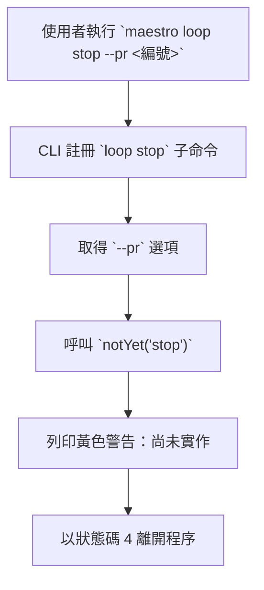
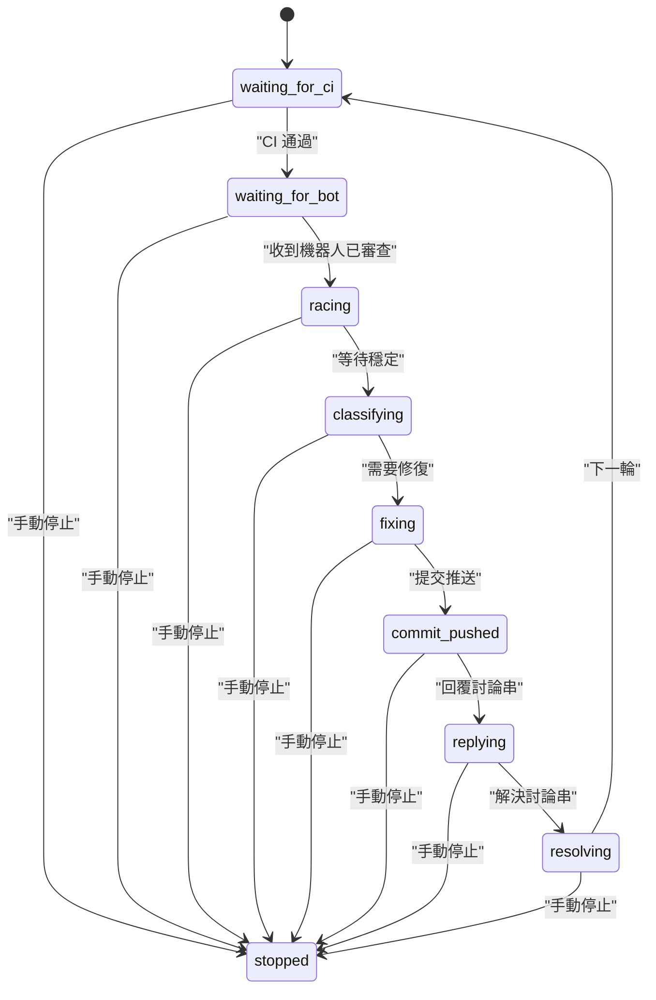
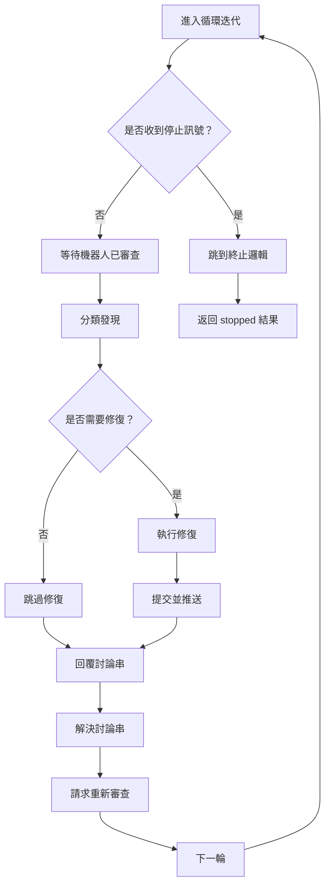
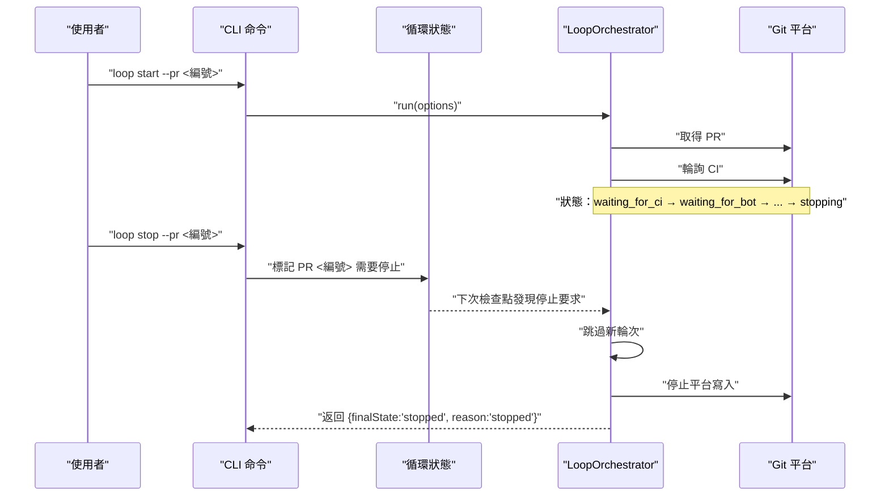
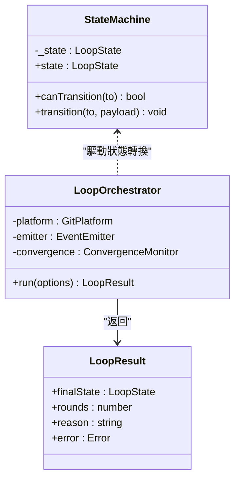
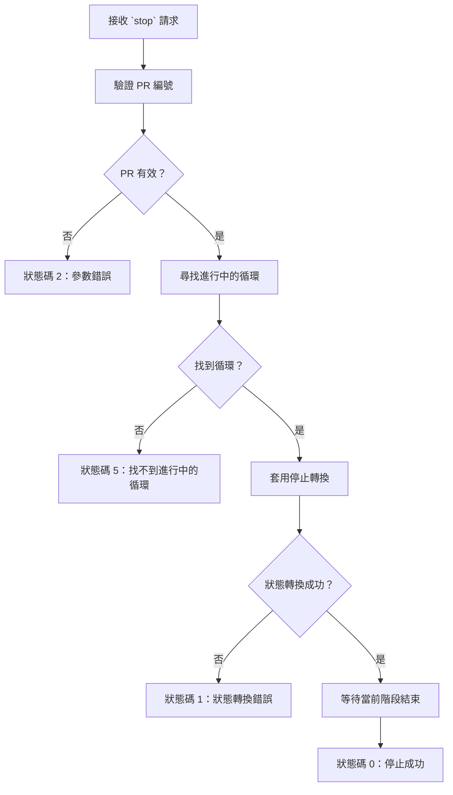
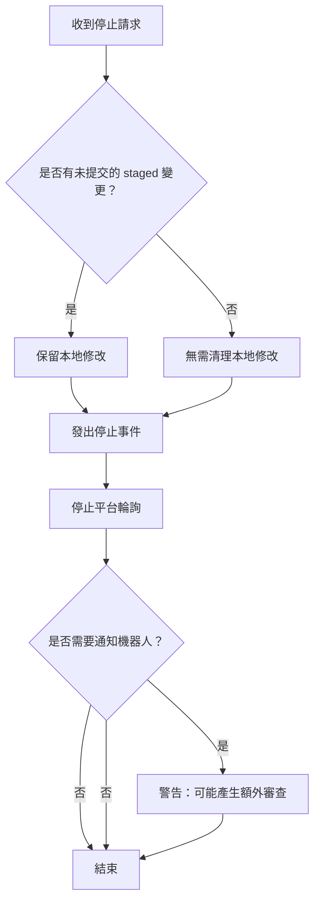
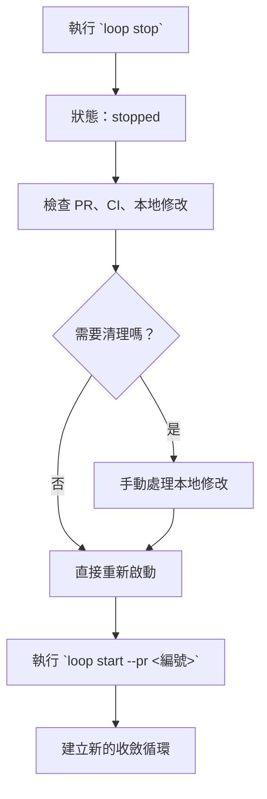

# loop stop — 停止循環

**本文引用的檔案**

- [loop.ts](https://github.com/mikeah2011/maestro/blob/master/src/cli/commands/loop.ts)
- [LoopOrchestrator.ts](https://github.com/mikeah2011/maestro/blob/master/src/core/loop/LoopOrchestrator.ts)
- [StateMachine.ts](https://github.com/mikeah2011/maestro/blob/master/src/core/state/StateMachine.ts)
- [DESIGN.md](https://github.com/mikeah2011/maestro/blob/master/docs/DESIGN.md)
- [README.md](https://github.com/mikeah2011/maestro/blob/master/README.md)
- [LoopOrchestrator.test.ts](https://github.com/mikeah2011/maestro/blob/master/tests/core/loop/LoopOrchestrator.test.ts)

## 目錄
1. [簡介](#簡介)
2. [命令位置與當前實作狀態](#命令位置與當前實作狀態)
3. [預期行為與設計目標](#預期行為與設計目標)
4. [停止類型：優雅關閉與強制停止](#停止類型優雅關閉與強制停止)
5. [執行流程](#執行流程)
6. [狀態機交互關係](#狀態機交互關係)
7. [返回狀態碼與錯誤處理](#返回狀態碼與錯誤處理)
8. [暫存資源與清理機制](#暫存資源與清理機制)
9. [停止後如何恢復或重新啟動](#停止後如何恢復或重新啟動)
10. [常見問題與故障排除](#常見問題與故障排除)
11. [最佳實踐](#最佳實踐)
12. [結論](#結論)

## 簡介
`maestro loop stop` 的設計目標是讓使用者能夠安全地終止一個正在執行的 PR 收斂循環。它不是單純殺掉程序，而是要在 `LoopOrchestrator` 的狀態機上建立明確的「手動停止」路徑，並確保：

- 不會留下未提交的半成品修復。
- 不會重複請求尚未完成審查的機器人。
- 不會中斷已開始但尚未完成的平台寫入操作。
- 能清楚告知使用者循環為何停止、在哪一輪停止、是否可繼續。

目前 `maestro loop stop` 仍處於待實作階段；CLI 會顯示「尚未實作，預計進入 M7」訊息，並以非零退出碼結束。

## 命令位置與當前實作狀態
`loop stop` 註冊於 CLI 子命令模組中，使用 Commander 定義子命令與 `--pr <number>` 選項。其動作處理器目前直接呼叫內部輔助函式，輸出「尚未實作」訊息並離開程序。

**圖表來源**
- [loop.ts:160-175](https://github.com/mikeah2011/maestro/blob/master/src/cli/commands/loop.ts#L160-L175)

**章節來源**
- [loop.ts:1-30](https://github.com/mikeah2011/maestro/blob/master/src/cli/commands/loop.ts#L1-L30)
- [loop.ts:160-175](https://github.com/mikeah2011/maestro/blob/master/src/cli/commands/loop.ts#L160-L175)

## 預期行為與設計目標
根據技術設計文件，系統有兩個重要設計點：

1. **CLI 是程序，Skill 是視窗。** 長時運行的編排邏輯位於 CLI 內；外部 UI、MCP 伺服器或其他工具是監控器，負責讀取事件並發送控制指令。因此，未來 `stop` 可以透過 MCP 暴露的 `stop_loop` 方法觸發。
2. **狀態機允許從任何非終端狀態轉換到 `stopped`。** 這是一個跨狀態轉換，代表所有橫切關注點都能把循環帶到終止狀態。

**圖表來源**
- [StateMachine.ts:11-48](https://github.com/mikeah2011/maestro/blob/master/src/core/state/StateMachine.ts#L11-L48)
- [DESIGN.md:88-118](https://github.com/mikeah2011/maestro/blob/master/docs/DESIGN.md#L88-L118)

**章節來源**
- [DESIGN.md:58-68](https://github.com/mikeah2011/maestro/blob/master/docs/DESIGN.md#L58-L68)
- [DESIGN.md:88-118](https://github.com/mikeah2011/maestro/blob/master/docs/DESIGN.md#L88-L118)
- [StateMachine.ts:11-48](https://github.com/mikeah2011/maestro/blob/master/src/core/state/StateMachine.ts#L11-L48)

## 停止類型：優雅關閉與強制停止
未來實作應區分兩種停止模式：

| 停止類型 | 觸發條件 | 行為 | 適合情境 |
|---|---|---|---|
| **優雅關閉** | 使用者主動輸入 `stop` | 停止新的輪次、等待當前輪次到達安全節點、記錄最終狀態、保留 PR 原始內容 | CI 仍在跑、機器人已回覆、不應該破壞中間狀態 |
| **強制停止** | 嚴重錯誤、環境異常、使用者明確要求立即終止 | 取消待處理的平台請求、中止等待、跳過後續步驟、回到終端狀態 | 程式卡住、平台連線失效、開發者要快速回收資源 |

### 優雅關閉的建議安全節點
`LoopOrchestrator.run` 已經是一個明確的循環結構，每個主要階段都先切換狀態，再執行平台寫入操作。優雅關閉的理想插入點包括：

- 主循環開頭：檢查是否被要求停止，若已要求則直接結束。
- `waiting_for_ci` 之後：避免繼續下一輪 CI 輪詢。
- 分類完成後：避免對大量發現進行不必要的修復。
- 提交推送前：避免產生半完成提交。
- 回覆或解決討論串後：避免只部分更新 PR 討論。
- 請求重新審查前：避免重複通知機器人。

**圖表來源**
- [LoopOrchestrator.ts:201-533](https://github.com/mikeah2011/maestro/blob/master/src/core/loop/LoopOrchestrator.ts#L201-L533)

### 強制停止的限制
由於 `LoopOrchestrator` 目前沒有暴露取消標記或取消 Promise 的能力，強制停止不能真正取消正在執行的 `platform.*` 呼叫。較安全的做法是：

- 設定內部停止旗標。
- 在每個 await 之後檢查旗標。
- 遇到無法取消的操作時，讓它繼續完成，但忽略後續狀態轉換。
- 將最終狀態設為 `stopped`，並在結果中說明是優雅關閉還是強制停止。

**章節來源**
- [LoopOrchestrator.ts:201-533](https://github.com/mikeah2011/maestro/blob/master/src/core/loop/LoopOrchestrator.ts#L201-L533)
- [StateMachine.ts:11-48](https://github.com/mikeah2011/maestro/blob/master/src/core/state/StateMachine.ts#L11-L48)

## 執行流程
以下序列圖展示未來 `loop stop` 與現有 `loop start` 之間的互動關係。CLI 本身不會直接持有 `LoopOrchestrator` 執行個體；實際執行由 `start` 子命令建立並驅動。因此，`stop` 必須依賴外部協調層（例如 MCP 伺服器、持久化狀態、或同一程序的共享狀態）。

**圖表來源**
- [loop.ts:280-340](https://github.com/mikeah2011/maestro/blob/master/src/cli/commands/loop.ts#L280-L340)
- [LoopOrchestrator.ts:201-533](https://github.com/mikeah2011/maestro/blob/master/src/core/loop/LoopOrchestrator.ts#L201-L533)

**章節來源**
- [loop.ts:280-340](https://github.com/mikeah2011/maestro/blob/master/src/cli/commands/loop.ts#L280-L340)
- [DESIGN.md:58-68](https://github.com/mikeah2011/maestro/blob/master/docs/DESIGN.md#L58-L68)

## 狀態機交互關係
`StateMachine` 是整個收斂循環的單一字真相來源。關鍵規則如下：

| 項目 | 說明 |
|---|---|
| **狀態型別** | `idle`、`writing`、`preflight`、`pr_created`、`waiting_for_ci`、`waiting_for_bot`、`racing`、`classifying`、`fixing`、`commit_pushed`、`replying`、`resolving`、`stopped`，以及多個錯誤狀態。 |
| **向前轉換** | 由線性循環逐步推進。 |
| **橫切轉換** | `human_intervened`、`rate_limited`、`token_expired`、`stopped` 可從任何非終端狀態進入。 |
| **終端狀態** | `stopped` 與 `token_expired` 沒有出邊，表示狀態機不能再繼續前進。 |
| **事件副作用** | 每次成功轉換都會重寫 EventEmitter 的上下文，使下游事件包含最新狀態。 |

`loop stop` 的核心狀態操作就是從當前狀態無條件轉換到 `stopped`，並攜帶足夠的脈絡資訊，例如：

- 當前 PR 編號。
- 當前輪數。
- 停止原因：`stopped`、`user_requested`、`force_stop`。
- 最後一次成功的狀態。

**圖表來源**
- [StateMachine.ts:11-114](https://github.com/mikeah2011/maestro/blob/master/src/core/state/StateMachine.ts#L11-L114)
- [LoopOrchestrator.ts:45-120](https://github.com/mikeah2011/maestro/blob/master/src/core/loop/LoopOrchestrator.ts#L45-L120)

**章節來源**
- [StateMachine.ts:11-114](https://github.com/mikeah2011/maestro/blob/master/src/core/state/StateMachine.ts#L11-L114)
- [LoopOrchestrator.ts:45-120](https://github.com/mikeah2011/maestro/blob/master/src/core/loop/LoopOrchestrator.ts#L45-L120)

## 返回狀態碼與錯誤處理
目前 CLI 有多種退出碼，代表不同層級的錯誤：

| 狀態碼 | 意義 | 觸發情境 |
|---|---|---|
| `0` | 成功 | `loop start` 正常結束且 `reason !== 'error'` |
| `1` | 平台錯誤或一般運行錯誤 | GitHub 平台初始化失敗、`orchestrator.run` 返回 `reason === 'error'` |
| `2` | 參數錯誤 | `--pr` 不是正整數 |
| `3` | 設定錯誤 | `.maestro.yaml` 載入或驗證失敗 |
| `4` | 尚未實作 | `status`、`stop`、`resume` 目前都是佔位符 |

`loop stop` 目前屬於第四類。未來的實作建議採用以下策略：

- 找不到進行中的循環：狀態碼 `1` 或新增獨立的狀態碼，例如 `5`，以便使用者腳本能判斷「沒有循環」與「其他錯誤」。
- 找不到指定的 PR：狀態碼 `1`，並輸出清晰的錯誤訊息。
- 狀態機轉換失敗：狀態碼 `1`，並包含狀態轉換錯誤細節。
- 優雅關閉成功：狀態碼 `0`。
- 強制停止成功：狀態碼 `0`，但在事件或標準錯誤中明確標示這是強制停止。

**圖表來源**
- [loop.ts:20-30](https://github.com/mikeah2011/maestro/blob/master/src/cli/commands/loop.ts#L20-L30)
- [loop.ts:45-65](https://github.com/mikeah2011/maestro/blob/master/src/cli/commands/loop.ts#L45-L65)
- [loop.ts:300-340](https://github.com/mikeah2011/maestro/blob/master/src/cli/commands/loop.ts#L300-L340)
- [StateMachine.ts:76-114](https://github.com/mikeah2011/maestro/blob/master/src/core/state/StateMachine.ts#L76-L114)

**章節來源**
- [loop.ts:20-30](https://github.com/mikeah2011/maestro/blob/master/src/cli/commands/loop.ts#L20-L30)
- [loop.ts:45-65](https://github.com/mikeah2011/maestro/blob/master/src/cli/commands/loop.ts#L45-L65)
- [loop.ts:300-340](https://github.com/mikeah2011/maestro/blob/master/src/cli/commands/loop.ts#L300-L340)
- [StateMachine.ts:76-114](https://github.com/mikeah2011/maestro/blob/master/src/core/state/StateMachine.ts#L76-L114)

## 暫存資源與清理機制
`loop stop` 不只是把狀態改成 `stopped`，還需要考慮以下暫存資源：

### 1. 平台 API 請求
- 正在等待 CI 狀態的輪詢不應繼續。
- 正在等待機器人審查的輪詢不應繼續。
- 正在等待使用者決策的互動不應阻塞程序。

### 2. Git 工作區
- 如果修復已經產生 staged 變更但未提交，優雅關閉應保留這些變更，並提示使用者可以手動提交。
- 如果修復尚未提交，不應自動刪除工作區修改，因為這可能遺失開發者的本地調整。
- 如果提交已成功推送，則不應回退遠端分支。

### 3. 事件與日誌
- 停止事件應包含完整脈絡：PR 編號、輪數、當前狀態、停止原因。
- 標準錯誤應向人類使用者提供可讀摘要。
- JSONL 事件流應保持結構一致，便於自動化消費者處理。

### 4. 機器人已審查狀態
- 已回覆但未解決的討論串應保留原狀。
- 已解決的討論串不應因停止而重新開啟。
- 尚未重新請求的機器人不應在停止後又被通知。

**圖表來源**
- [loop.ts:201-240](https://github.com/mikeah2011/maestro/blob/master/src/cli/commands/loop.ts#L201-L240)
- [LoopOrchestrator.ts:380-533](https://github.com/mikeah2011/maestro/blob/master/src/core/loop/LoopOrchestrator.ts#L380-L533)

**章節來源**
- [loop.ts:201-240](https://github.com/mikeah2011/maestro/blob/master/src/cli/commands/loop.ts#L201-L240)
- [LoopOrchestrator.ts:380-533](https://github.com/mikeah2011/maestro/blob/master/src/core/loop/LoopOrchestrator.ts#L380-L533)

## 停止後如何恢復或重新啟動
設計文件中提到 `human_intervened` 與 `paused` 狀態，並對應未來的 `resume` 命令。雖然 `loop stop` 與 `loop resume` 目前都是佔位符，但設計方向很明確：

| 操作 | 適用狀態 | 行為 |
|---|---|---|
| `loop status` | 任何狀態 | 顯示當前狀態、輪數、最近事件 |
| `loop stop` | `waiting_for_ci`、`waiting_for_bot`、`racing`、`classifying`、`fixing`、`commit_pushed`、`replying`、`resolving` | 轉移到 `stopped` |
| `loop resume` | `human_intervened` 或 `paused` | 允許繼續下一輪 |

對於目前可用的 `loop start`，停止後的恢復方式通常是：

1. 檢查 PR 狀態與 CI 狀態。
2. 確認是否有未提交的本地修改。
3. 若有必要，手動提交或復原修改。
4. 再次執行 `maestro loop start --pr <編號>`。

若未來引入持久化狀態，`resume` 可以直接從上次保存的狀態繼續，而不必重新掃描整個 PR。

**圖表來源**
- [DESIGN.md:88-118](https://github.com/mikeah2011/maestro/blob/master/docs/DESIGN.md#L88-L118)
- [loop.ts:160-175](https://github.com/mikeah2011/maestro/blob/master/src/cli/commands/loop.ts#L160-L175)

**章節來源**
- [DESIGN.md:88-118](https://github.com/mikeah2011/maestro/blob/master/docs/DESIGN.md#L88-L118)
- [loop.ts:160-175](https://github.com/mikeah2011/maestro/blob/master/src/cli/commands/loop.ts#L160-L175)

## 常見問題與故障排除

### 找不到進行中的循環
**原因：**
- PR 編號錯誤。
- 之前沒有執行 `loop start`。
- 之前的 `loop start` 已經結束。
- 目前缺少持久化狀態，CLI 無法跨程序追蹤進行中的循環。

**處理方式：**
- 確認 PR 是否存在且仍可存取。
- 檢查上一次 `loop start` 的最後事件。
- 若不需要恢復，直接重新執行 `loop start --pr <編號>`。

### 狀態轉換失敗
**原因：**
- 狀態機已經處於終端狀態。
- 嘗試從無效狀態轉換。
- 狀態機實現了嚴格的向前轉換與橫切轉換規則。

**處理方式：**
- 查看 `StateMachine.transition` 拋出的 `StateTransitionError`。
- 不要試圖繞過狀態機直接修改內部狀態。
- 優先使用受控的停止入口。

### 停止後 PR 狀態不一致
**原因：**
- 停止發生在中間平台寫入階段。
- 平台 API 部分成功。
- 本地 staged 變更尚未提交。

**處理方式：**
- 檢查 PR 評論與討論串。
- 檢查 Git 工作區與暫存區。
- 手動決定保留或清除修改。
- 必要時重新執行 `loop start`。

### 為什麼現在不能用 `loop stop`
**原因：**
- 目前 CLI 只有 `loop start` 是完整實作。
- `status`、`stop`、`resume` 是設計文檔中規劃的功能，目前回傳「尚未實作」。

**處理方式：**
- 暫時使用 `Ctrl+C` 終止程序。
- 注意這不會觸發優雅關閉邏輯。
- 等待 M7 加入持久化狀態與控制命令。

**章節來源**
- [loop.ts:20-30](https://github.com/mikeah2011/maestro/blob/master/src/cli/commands/loop.ts#L20-L30)
- [loop.ts:160-175](https://github.com/mikeah2011/maestro/blob/master/src/cli/commands/loop.ts#L160-L175)
- [StateMachine.ts:76-114](https://github.com/mikeah2011/maestro/blob/master/src/core/state/StateMachine.ts#L76-L114)

## 最佳實踐
1. **優先使用優雅關閉。** 除非程序完全卡住，否則不要直接殺掉程序。
2. **保留事件紀錄。** 停止後應能根據 JSONL 事件重建大致流程。
3. **避免在提交前強行停止。** 如果已經 staged 修改，先確認是否要提交。
4. **不要在仍有未解決討論串時假設循環已安全。** 停止只代表不再繼續新輪次。
5. **將 `stop` 視為狀態轉換，而非程序殺戮。** 它應該改變系統狀態，而不是只是結束 Node.js 程序。
6. **測試三種情況：**
   - 在 `waiting_for_ci` 中停止。
   - 在 `classifying` 中停止。
   - 在 `commit_pushed` 後停止。
7. **為自動化腳本提供明確狀態碼。** 不要把所有錯誤都用 `1` 表示。

## 結論
`maestro loop stop` 目前尚未實作，CLI 會以狀態碼 `4` 回報「尚未實作」。然而，核心架構已經為安全停止提供了良好基礎：

- `LoopOrchestrator` 擁有明確的循環與狀態轉換節點。
- `StateMachine` 允許從任何非終端狀態進入 `stopped`。
- 設計文件預留了 `human_intervened`、`paused`、`resume` 等機制。
- 事件系統能提供可觀測性。

未來實作重點不在於新增複雜邏輯，而在於：

1. 增加一種可查詢的「進行中循環」狀態。
2. 讓 `stop` 能定位特定 PR 的循環。
3. 在安全節點切換到 `stopped`。
4. 保留本地修改但不破壞 PR。
5. 提供清晰的可讀訊息與穩定的狀態碼。
6. 為 `resume` 保留狀態恢復能力。

這樣才能讓 `loop stop` 成為真正安全的收斂循環控制鍵，而不只是另一個會離開程序的 CLI 命令。