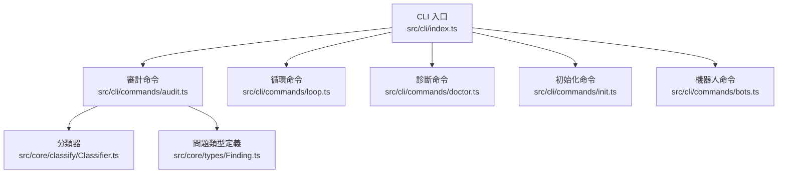
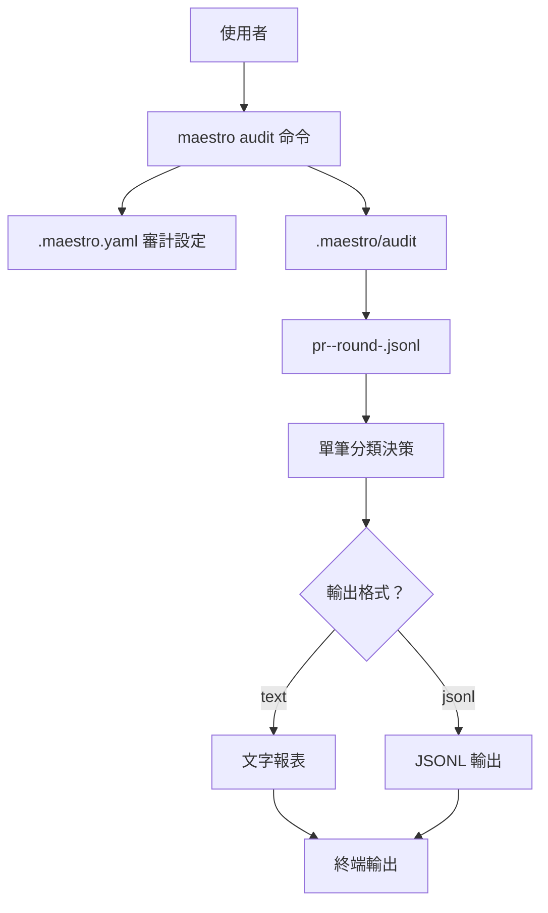
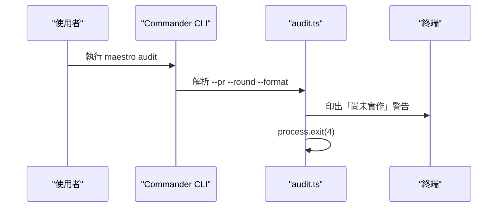
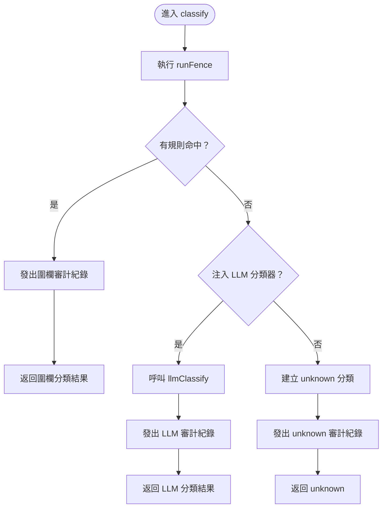
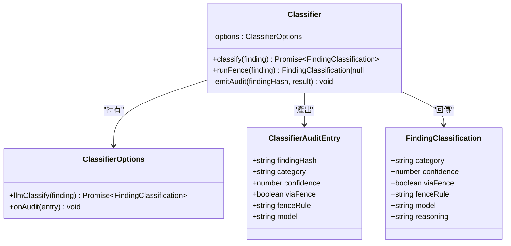
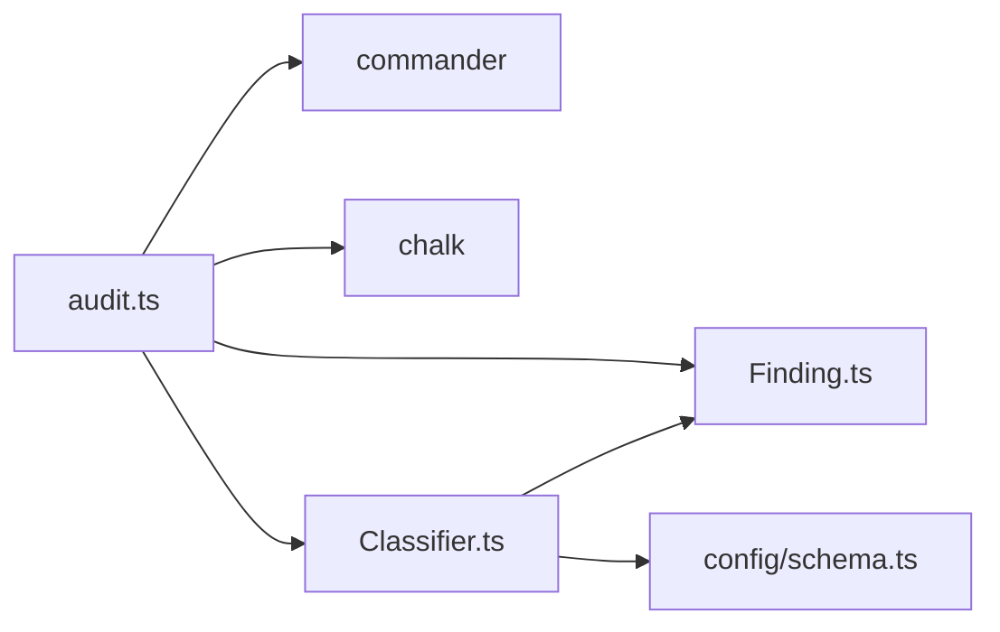

# maestro audit — 審計分類決策

**本文引用的檔案**

- [src/cli/commands/audit.ts](https://github.com/mikeah2011/maestro/blob/master/src/cli/commands/audit.ts)
- [src/core/classify/Classifier.ts](https://github.com/mikeah2011/maestro/blob/master/src/core/classify/Classifier.ts)
- [src/core/types/Finding.ts](https://github.com/mikeah2011/maestro/blob/master/src/core/types/Finding.ts)
- [src/config/schema.ts](https://github.com/mikeah2011/maestro/blob/master/src/config/schema.ts)
- [README.md](https://github.com/mikeah2011/maestro/blob/master/README.md)
- [docs/DESIGN.md](https://github.com/mikeah2011/maestro/blob/master/docs/DESIGN.md)
- [package.json](https://github.com/mikeah2011/maestro/blob/master/package.json)

## 目錄
1. [簡介](#簡介)
2. [專案結構與命令位置](#專案結構與命令位置)
3. [核心元件總覽](#核心元件總覽)
4. [架構總覽](#架構總覽)
5. [詳細元件分析](#詳細元件分析)
6. [依賴關係分析](#依賴關係分析)
7. [性能考量](#性能考量)
8. [故障排除指南](#故障排除指南)
9. [結論](#結論)
10. [附錄：旗標、規則與輸出格式對照表](#附錄旗標規則與輸出格式對照表)

## 簡介

`maestro audit` 是 Maestro CLI 中的「審計」子命令。它的主要用途是在問題分類尚未完全實作時，提供一個可重播的入口，讓開發者針對某個拉取請求（PR）檢視「原始審查發現 → 分類規則匹配結果 → LLM 分類結果 → 置信度分數 → 決策理由」的完整決策軌跡。

從當前程式碼來看，`maestro audit` 已註冊為 Commander 命令，但主體邏輯仍標記為「待實作」。它的設計目標非常明確：未來會讀取 `.maestro/audit/pr-<PR編號>-round-<輪次>.jsonl` 這類審計日誌，把每一筆分類決策重新播放出來，便於在規模化之前診斷誤分類。

本文件除了說明命令本身，也會深入解釋底層 `Classifier` 的分類圍欄（fence）、規則優先順序、自訂規則撰寫方式、審計紀錄結構，以及如何解讀未來的審計報告。

**章節來源**
- [src/cli/commands/audit.ts:1-25](https://github.com/mikeah2011/maestro/blob/master/src/cli/commands/audit.ts#L1-L25)

## 專案結構與命令位置

`maestro audit` 屬於 CLI 子命令層，位於 `src/cli/commands/audit.ts`。它不直接處理平台 API、LLM 或 PR 內容；而是由 CLI 框架（Commander）註冊命令，並預留未來串接審計日誌重播器的空間。

**圖表來源**
- [src/cli/commands/audit.ts:1-25](https://github.com/mikeah2011/maestro/blob/master/src/cli/commands/audit.ts#L1-L25)
- [src/core/classify/Classifier.ts:1-30](https://github.com/mikeah2011/maestro/blob/master/src/core/classify/Classifier.ts#L1-L30)
- [src/core/types/Finding.ts:1-20](https://github.com/mikeah2011/maestro/blob/master/src/core/types/Finding.ts#L1-L20)

**章節來源**
- [src/cli/commands/audit.ts:1-25](https://github.com/mikeah2011/maestro/blob/master/src/cli/commands/audit.ts#L1-L25)
- [README.md:1-120](https://github.com/mikeah2011/maestro/blob/master/README.md#L1-L120)

## 核心元件總覽

| 元件 | 角色 | 關鍵行為 |
|---|---|---|
| `audit.ts` | CLI 命令註冊器 | 註冊 `maestro audit`、解析旗標、目前顯示「待實作」訊息並退出。 |
| `Classifier` | 分類引擎 | 執行確定性規則圍欄；若無規則命中則呼叫 LLM；每次分類都透過 `onAudit` 產生審計紀錄。 |
| `Finding` / `FindingClassification` | 資料模型 | 描述單一審查發現、分類結果、置信度、是否由圍欄短路等欄位。 |
| `AuditSchema` | 設定驗證 | 控制審計功能是否啟用、審計目錄位置、以及是否影子記錄分類。 |

**章節來源**
- [src/cli/commands/audit.ts:1-25](https://github.com/mikeah2011/maestro/blob/master/src/cli/commands/audit.ts#L1-L25)
- [src/core/classify/Classifier.ts:1-30](https://github.com/mikeah2011/maestro/blob/master/src/core/classify/Classifier.ts#L1-L30)
- [src/core/types/Finding.ts:1-129](https://github.com/mikeah2011/maestro/blob/master/src/core/types/Finding.ts#L1-L129)
- [src/config/schema.ts:180-200](https://github.com/mikeah2011/maestro/blob/master/src/config/schema.ts#L180-L200)

## 架構總覽

`maestro audit` 的完整審計流程尚未實作，但根據現有程式碼可以清楚看出「預期架構」：

1. 使用者執行 `maestro audit --pr <編號>`。
2. CLI 讀取 `.maestro.yaml` 中的審計設定，取得審計目錄。
3. CLI 依序載入 `pr-<PR編號>-round-<輪次>.jsonl`。
4. 每筆 JSONL 對應一筆分類決策，包含：
   - 原始發現雜湊
   - 分類類別
   - 置信度分數
   - 是否由確定性圍欄短路
   - 觸發的規則名稱
   - 使用的 LLM 模型
   - 分類理由
5. 根據 `--format` 輸出文字或 JSONL。
6. 若指定 `--round`，只重播該輪次的決策。

[此圖為概念流程圖，未直接映射到具體程式碼結構，因此不提供圖表來源]

## 詳細元件分析

### `maestro audit` 命令

#### 目前狀態

命令已註冊，但主體動作只是列印黃色警告訊息，表示功能將落在 M3 版本，然後以非零狀態碼結束。這表示：

- 命令可以辨識 `--pr`、`--round`、`--format`。
- 不會真正連線 GitHub/GitLab。
- 不會真正讀取 `.maestro/audit`。
- 不會真正重播分類決策。

#### 命令定義

| 選項 | 必要 | 預設值 | 說明 |
|---|---:|---:|---|
| `--pr <number>` | 是 | 無 | 指定要審計的 PR 編號。 |
| `--round <n>` | 否 | 無 | 限制只重播特定輪次的審計紀錄。 |
| `--format <fmt>` | 否 | `text` | 輸出格式，支援 `text` 與 `jsonl`。 |

#### 錯誤處理

- 當使用者執行命令時，程式會輸出「尚未實作」訊息。
- 使用 Exit Code `4`，代表「功能尚未實作」。
- 沒有網路錯誤、檔案不存在、格式錯誤等處理路徑。

**圖表來源**
- [src/cli/commands/audit.ts:1-25](https://github.com/mikeah2011/maestro/blob/master/src/cli/commands/audit.ts#L1-L25)

**章節來源**
- [src/cli/commands/audit.ts:1-25](https://github.com/mikeah2011/maestro/blob/master/src/cli/commands/audit.ts#L1-L25)

### 分類器 `Classifier`

`Classifier` 是整個審計系統的核心。它實現了「圍欄式分類」：先檢查確定性規則，只有在沒有規則命中時才呼叫 LLM。

#### 主要方法

| 方法 | 輸入 | 輸出 | 行為 |
|---|---|---|---|
| `classify(finding)` | 單一 `Finding` | `Promise<FindingClassification>` | 依序執行圍欄、LLM、未知分類，並送出審計事件。 |
| `runFence(finding)` | 單一 `Finding` | `FindingClassification \| null` | 執行五條確定性規則，命中即返回分類結果，否則回傳 `null`。 |
| `emitAudit(...)` | 雜湊 + 分類結果 | `void` | 同步調用 `onAudit`，供外部寫入審計日誌。 |

#### 分類流程

**圖表來源**
- [src/core/classify/Classifier.ts:60-105](https://github.com/mikeah2011/maestro/blob/master/src/core/classify/Classifier.ts#L60-L105)

#### 分類類別

分類結果使用 `FindingCategory`，包括：

| 類別 | 含義 | 典型處理方式 |
|---|---|---|
| `bug` | 真實 bug，應在本輪修復 | 交由修復引擎處理。 |
| `yagni` | 有意義但超出範圍 | 延後處理。 |
| `wrong` | 機器人判斷錯誤 | 回覆推回並說明理由。 |
| `taste` | 品味偏好、風格建議 | 忽略。 |
| `duplicate` | 同輪重複問題 | 去重。 |
| `unknown` | 無法決定 | 通常會走 LLM 或人工介入。 |

#### 圍欄規則與優先順序

圍欄採用「第一條命中即停止」策略：

| 優先順序 | 規則 | 觸發條件 | 分類 | 置信度 | 規則標籤 |
|---:|---|---|---:|---:|---|
| 1 | 機器人所給嚴重程度為 critical | `rawSeverity` 為 `critical`、`blocker`、`error`、`fatal` | `bug` | `1.0` | `critical_raw_severity` |
| 2 | 正規化嚴重程度為 critical | `severity === 'critical'` | `bug` | `1.0` | `critical_severity` |
| 3 | 檔案位於敏感路徑 | 檔名包含 `/auth/`、`/payment/`、`/security/`、`/token/` 等前綴 | `bug` | `0.95` | `sensitive_path:<prefix>` |
| 4 | 標題或內文包含 Bug 關鍵字 | 包含 NPE、SQL injection、XSS、buffer overflow 等 | `bug` | `0.90` | `bug_keyword:<keyword>` |
| 5 | 標題或內文包含 Taste 關鍵字 | 包含 `nitpick:`、`cosmetic`、`style preference` 等 | `taste` | `0.85` | `taste_keyword:<keyword>` |
| 6 | 無規則命中 | — | 可能進入 LLM 或 `unknown` | — | — |

#### 敏感路徑範例

敏感路徑前綴包含認證、加密、金流、安全相關目錄，例如：

- `/auth/`
- `/authenticate/`
- `/authorization/`
- `/oauth/`
- `/crypto/`
- `/encryption/`
- `/payment/`
- `/billing/`
- `/security/`
- `/secret/`
- `/token/`
- `/credential/`
- `/password/`
- `/jwt/`
- `/session/`

#### 審計紀錄結構

每次 `classify()` 都會透過 `onAudit` 送出一筆 `ClassifierAuditEntry`：

| 欄位 | 型別 | 說明 |
|---|---|---|
| `findingHash` | `string` | 問題的穩定雜湊。 |
| `category` | `FindingCategory` | 分類結果。 |
| `confidence` | `number` | 置信度，介於 0 到 1。 |
| `viaFence` | `boolean` | 是否由確定性圍欄短路。 |
| `fenceRule` | `string?` | 觸發的圍欄規則名稱。 |
| `model` | `string?` | LLM 分類時使用的模型。 |

**圖表來源**
- [src/core/classify/Classifier.ts:18-35](https://github.com/mikeah2011/maestro/blob/master/src/core/classify/Classifier.ts#L18-L35)
- [src/core/classify/Classifier.ts:106-191](https://github.com/mikeah2011/maestro/blob/master/src/core/classify/Classifier.ts#L106-L191)
- [src/core/types/Finding.ts:84-114](https://github.com/mikeah2011/maestro/blob/master/src/core/types/Finding.ts#L84-L114)

**章節來源**
- [src/core/classify/Classifier.ts:1-191](https://github.com/mikeah2011/maestro/blob/master/src/core/classify/Classifier.ts#L1-L191)
- [src/core/types/Finding.ts:1-129](https://github.com/mikeah2011/maestro/blob/master/src/core/types/Finding.ts#L1-L129)

### 審計設定

審計功能由 `.maestro.yaml` 中的 `audit` 區塊控制：

| 設定 | 型別 | 預設值 | 說明 |
|---|---:|---:|---|
| `enabled` | `boolean` | `true` | 是否啟用審計。 |
| `dir` | `string` | `.maestro/audit` | 審計日誌目錄。 |
| `shadowLogClassifications` | `boolean` | `true` | 是否在分類時影子記錄審計紀錄。 |

這個設定會影響：

- 分類過程是否產生審計事件。
- `maestro audit` 未來要讀取的目錄位置。
- 是否干擾正常循環流程（shadow log 的設計目的是不阻塞主流程）。

**章節來源**
- [src/config/schema.ts:180-200](https://github.com/mikeah2011/maestro/blob/master/src/config/schema.ts#L180-L200)

## 依賴關係分析

`maestro audit` 目前的依賴相對簡單，但未來實作時會牽涉更多模組。

**圖表來源**
- [src/cli/commands/audit.ts:1-25](https://github.com/mikeah2011/maestro/blob/master/src/cli/commands/audit.ts#L1-L25)
- [src/core/classify/Classifier.ts:1-30](https://github.com/mikeah2011/maestro/blob/master/src/core/classify/Classifier.ts#L1-L30)
- [src/core/types/Finding.ts:1-20](https://github.com/mikeah2011/maestro/blob/master/src/core/types/Finding.ts#L1-L20)
- [src/config/schema.ts:180-200](https://github.com/mikeah2011/maestro/blob/master/src/config/schema.ts#L180-L200)

**耦合與內聚分析**

- `audit.ts` 目前僅依賴 CLI 套件與字元顏色工具，耦合度低。
- `Classifier` 高度內聚，專注於分類與審計事件產出。
- `Finding.ts` 是跨模組共享的資料契約，內聚度高且適合長期維護。
- 潛在風險：未來 `audit.ts` 若直接讀取檔案系統與平台 API，需引入更多外部依賴，應保持 CLI 薄、核心厚的架構。

**章節來源**
- [src/cli/commands/audit.ts:1-25](https://github.com/mikeah2011/maestro/blob/master/src/cli/commands/audit.ts#L1-L25)
- [src/core/classify/Classifier.ts:1-30](https://github.com/mikeah2011/maestro/blob/master/src/core/classify/Classifier.ts#L1-L30)
- [src/core/types/Finding.ts:1-129](https://github.com/mikeah2011/maestro/blob/master/src/core/types/Finding.ts#L1-L129)
- [src/config/schema.ts:180-200](https://github.com/mikeah2011/maestro/blob/master/src/config/schema.ts#L180-L200)

## 性能考量

雖然 `maestro audit` 目前尚未實作，但從 `Classifier` 的設計可以看出審計相關的效能原則：

| 面向 | 設計 | 影響 |
|---|---|---|
| 規則匹配 | 確定性規則先於 LLM | 避免不必要的 LLM 呼叫，降低延遲與成本。 |
| 審計事件 | `onAudit` 同步調用 | 不阻塞分類主流程，但需要確保外部寫入快且可靠。 |
| 關鍵字匹配 | 使用陣列遍歷與字串包含 | 對一般審查評論長度而言成本低；未來可考慮詞典或索引優化。 |
| 敏感路徑匹配 | 前綴比對 | 快速失敗，符合「最廉價優先」原則。 |
| LLM 分類 | 可注入替代實作 | 測試與審計時可用模擬 LLM，避免真實 API 成本。 |

**章節來源**
- [src/core/classify/Classifier.ts:31-105](https://github.com/mikeah2011/maestro/blob/master/src/core/classify/Classifier.ts#L31-L105)

## 故障排除指南

### 常見問題與解法

| 問題 | 可能原因 | 建議處理方式 |
|---|---|---|
| 執行 `maestro audit` 立即離開 | 功能尚未實作，目前只回傳 exit code 4 | 升級至 M3 或改用 `maestro loop start --dry-run` 觀察分類流程。 |
| 找不到審計日誌 | `audit.enabled` 關閉、目錄不同、或未執行過分類流程 | 檢查 `.maestro.yaml` 中 `audit.dir` 與 `shadowLogClassifications`。 |
| 分類結果都是 `unknown` | 未注入 `llmClassify`，或所有規則都不命中 | 確認分類器是否有 LLM 提供者，或擴充圍欄規則。 |
| 置信度總是 `1.0` | 問題被圍欄高置信度規則命中 | 這是預期行為；審計報告應重點檢查 `fenceRule`。 |
| 分類錯誤但未觸發 LLM | 圍欄規則優先於 LLM | 調整規則優先順序或新增更精確的規則。 |
| 審計報告過多噪音 | 每個分類都會產出一筆紀錄 | 使用 `--round` 過濾輪次，或以 `--format jsonl` 進一步篩選。 |

### 診斷步驟建議

1. 確認命令是否能正確解析旗標。
2. 檢查 `.maestro.yaml` 的 `audit` 區塊。
3. 確認 `.maestro/audit` 是否存在。
4. 檢查 `pr-<PR編號>-round-<輪次>.jsonl` 是否存在。
5. 若分類錯誤，優先查看 `viaFence` 與 `fenceRule`。
6. 若 LLM 分類異常，檢查 `model` 與 `reasoning`。
7. 若需要人工介入，關注 `category === 'unknown'` 且 `confidence` 很低的情況。

**章節來源**
- [src/cli/commands/audit.ts:1-25](https://github.com/mikeah2011/maestro/blob/master/src/cli/commands/audit.ts#L1-L25)
- [src/core/classify/Classifier.ts:60-191](https://github.com/mikeah2011/maestro/blob/master/src/core/classify/Classifier.ts#L60-L191)
- [src/config/schema.ts:180-200](https://github.com/mikeah2011/maestro/blob/master/src/config/schema.ts#L180-L200)

## 結論

`maestro audit` 目前是一個「骨架命令」：它已經定義了未來審計功能的介面與方向，但尚未實作日誌重播邏輯。真正具備可審計性的分類邏輯集中在 `Classifier`，它透過圍欄規則提供確定性分類，並在需要時委派給 LLM，同時產出標準化的審計事件。

對使用者而言，目前最重要的理解是：

- `--pr`、`--round`、`--format` 是未來審計報告的過濾維度。
- 分類決策的關鍵在於「圍欄規則是否命中」與「LLM 是否參與」。
- 審計報告應該用來回答：為什麼某個問題被歸類為 bug、taste、wrong、yagni 或 unknown。
- 若規則過於保守或過於寬鬆，應優先調整圍欄規則，而不是依賴 LLM 修正。

**章節來源**
- [src/cli/commands/audit.ts:1-25](https://github.com/mikeah2011/maestro/blob/master/src/cli/commands/audit.ts#L1-L25)
- [src/core/classify/Classifier.ts:1-191](https://github.com/mikeah2011/maestro/blob/master/src/core/classify/Classifier.ts#L1-L191)
- [docs/DESIGN.md:1-120](https://github.com/mikeah2011/maestro/blob/master/docs/DESIGN.md#L1-L120)

## 附錄：旗標、規則與輸出格式對照表

### 命令旗標

| 旗標 | 必要 | 預設值 | 未來用途 |
|---|---:|---:|---|
| `--pr <number>` | 是 | 無 | 過濾 PR 專屬審計日誌。 |
| `--round <n>` | 否 | 無 | 過濾特定輪次。 |
| `--format <fmt>` | 否 | `text` | `text` 用於人類閱讀，`jsonl` 用於自動化處理。 |

**章節來源**
- [src/cli/commands/audit.ts:1-25](https://github.com/mikeah2011/maestro/blob/master/src/cli/commands/audit.ts#L1-L25)

### 分類規則對照表

| 規則 | 分類 | 置信度 | 適用情境 |
|---|---:|---:|---|
| 原始嚴重程度為 critical | `bug` | `1.0` | 機器人明確指出致命問題。 |
| 正規化嚴重程度為 critical | `bug` | `1.0` | 經過 Maestro 正規化後的最高嚴重等級。 |
| 敏感路徑 | `bug` | `0.95` | 認證、金流、加密、權限相關路徑。 |
| Bug 關鍵字 | `bug` | `0.90` | 記憶體、注入、越界、死鎖等已知危險模式。 |
| Taste 關鍵字 | `taste` | `0.85` | 純風格、命名偏好、非必要建議。 |

**章節來源**
- [src/core/classify/Classifier.ts:31-105](https://github.com/mikeah2011/maestro/blob/master/src/core/classify/Classifier.ts#L31-L105)

### 審計紀錄欄位

| 欄位 | 用途 |
|---|---|
| `findingHash` | 唯一識別問題，用於追蹤同一問題跨輪變化。 |
| `category` | 最終分類結果。 |
| `confidence` | 分類信心程度，越高越不需要人工覆核。 |
| `viaFence` | 區分「確定性規則」與「LLM 判斷」。 |
| `fenceRule` | 解釋規則側決策原因。 |
| `model` | 解釋 LLM 側決策使用的是哪個模型。 |
| `reasoning` | 人類可讀的決策理由，未來審計報告的重要欄位。 |

**章節來源**
- [src/core/classify/Classifier.ts:18-35](https://github.com/mikeah2011/maestro/blob/master/src/core/classify/Classifier.ts#L18-L35)
- [src/core/types/Finding.ts:84-114](https://github.com/mikeah2011/maestro/blob/master/src/core/types/Finding.ts#L84-L114)

### 自訂規則撰寫指引

若要擴充分類能力，建議遵循以下原則：

1. **優先放入圍欄**：規則必須是確定性、可預測、可審計的。
2. **規則要有標籤**：每個規則應產生可搜尋的 `fenceRule`。
3. **置信度要合理**：高把握規則給接近 `1.0`，弱訊號規則保留空間給 LLM。
4. **避免模糊規則**：不要只靠「可能像」來分類。
5. **保留 LLM 出口**：太複雜或太新的語言模式，先走 LLM，再逐步固化為規則。
6. **審計優先**：任何新規則都要能解釋「為什麼命中」。

**章節來源**
- [src/core/classify/Classifier.ts:1-30](https://github.com/mikeah2011/maestro/blob/master/src/core/classify/Classifier.ts#L1-L30)
- [src/core/classify/Classifier.ts:106-191](https://github.com/mikeah2011/maestro/blob/master/src/core/classify/Classifier.ts#L106-L191)
- [docs/DESIGN.md:1-120](https://github.com/mikeah2011/maestro/blob/master/docs/DESIGN.md#L1-L120)