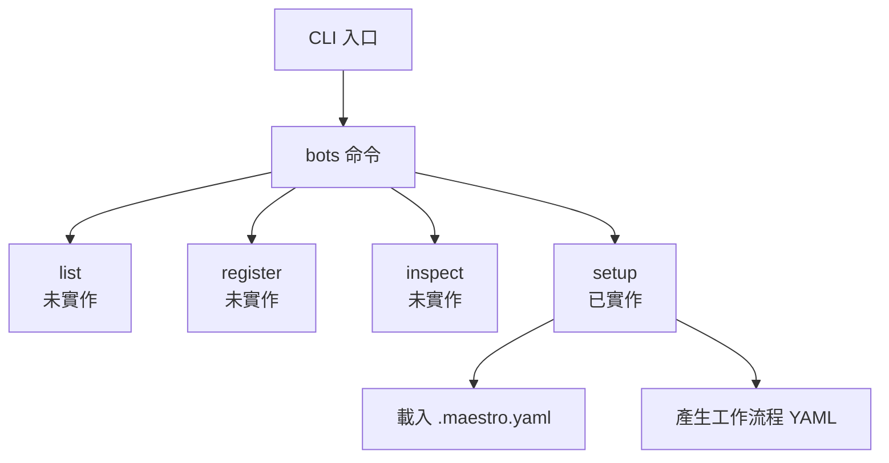
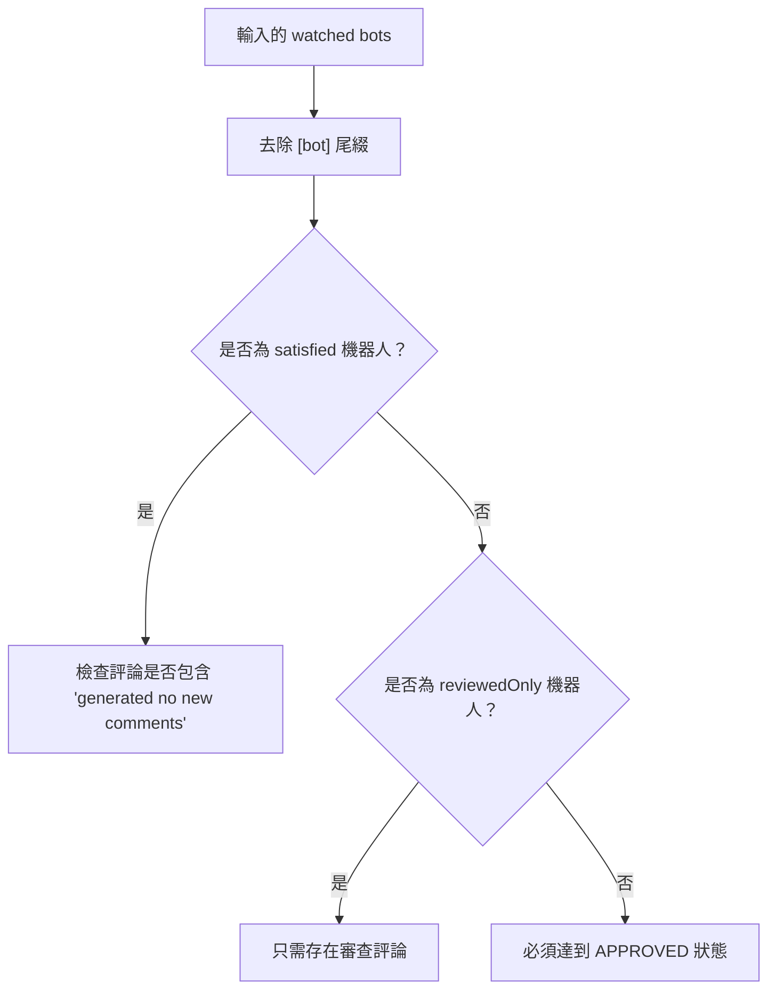
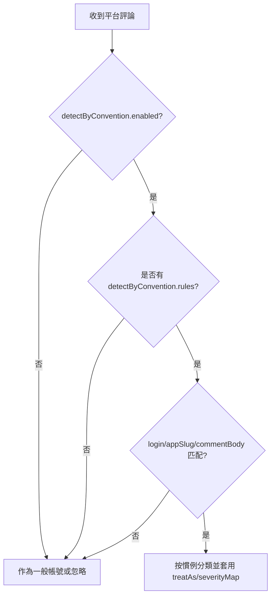
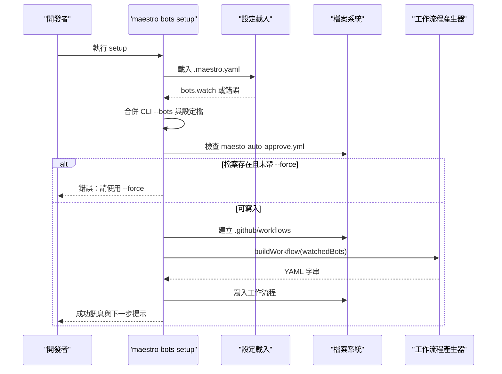
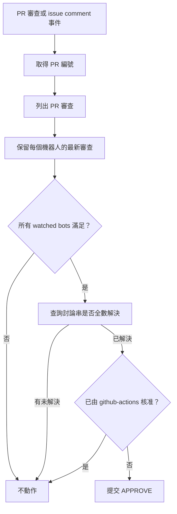
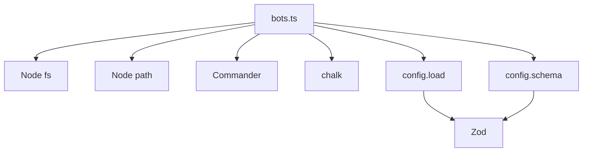

# maestro bots — 機器人管理

**本文引用的檔案**

- [bots.ts](https://github.com/mikeah2011/maestro/blob/master/src/cli/commands/bots.ts)
- [schema.ts](https://github.com/mikeah2011/maestro/blob/master/src/config/schema.ts)
- [Finding.ts](https://github.com/mikeah2011/maestro/blob/master/src/core/types/Finding.ts)
- [LoopOrchestrator.ts](https://github.com/mikeah2011/maestro/blob/master/src/core/loop/LoopOrchestrator.ts)
- [README.md](https://github.com/mikeah2011/maestro/blob/master/README.md)
- [DESIGN.md](https://github.com/mikeah2011/maestro/blob/master/docs/DESIGN.md)

## 目錄
1. [簡介](#簡介)
2. [專案結構與子命令位置](#專案結構與子命令位置)
3. [核心概念：機器人註冊表](#核心概念機器人註冊表)
4. [內建機器人分類與識別規則](#內建機器人分類與識別規則)
5. [慣例型偵測與 fallback 機制](#慣例型偵測與-fallback-機制)
6. [子命令總覽](#子命令總覽)
7. [子命令詳細說明](#子命令詳細說明)
8. [工作流程自動核准](#工作流程自動核准)
9. [常見機器人管理範例](#常見機器人管理範例)
10. [擴展自訂機器人的解析邏輯](#擴展自訂機器人的解析邏輯)
11. [依賴關係分析](#依賴關係分析)
12. [效能考量](#效能考量)
13. [疑難排解](#疑難排解)
14. [結語](#結語)

## 簡介
`maestro bots` 是 Maestro CLI 的機器人管理子命令群，負責列出、註冊、檢查與設定監控的 AI PR 審查機器人。當前程式碼中，`list`、`register`、`inspect` 三個子命令仍為佔位實作；真正可執行的功能集中在 `setup` 子命令與工作流程產生邏輯上。設計文件指出系統包含「精選登錄表」加「慣例型 fallback」，並由使用者配置覆蓋與 CLI 註冊共同組成完整的機器人註冊表。

本文件說明：
- 機器人註冊表的結構。
- 內建機器人的識別與分類。
- 慣例型 fallback 如何運作。
- 每個子命令的參數、選項與限制。
- 如何透過 `.maestro.yaml` 與 CLI 擴展自訂機器人。
- CodeRabbit、Ellipsis、Copilot、Codex 等常見機器人的管理方式。

**章節來源**
- [bots.ts:1-15](https://github.com/mikeah2011/maestro/blob/master/src/cli/commands/bots.ts#L1-L15)
- [DESIGN.md:24-42](https://github.com/mikeah2011/maestro/blob/master/docs/DESIGN.md#L24-L42)

## 專案結構與子命令位置
`maestro bots` 子命令群定義於 CLI 命令模組中，入口為 `src/cli/commands/bots.ts`。它使用 Commander 建立 `bots` 命令，並註冊四個子命令：

| 子命令 | 目前狀態 | 主要職責 |
|---|---|---|
| `list` | 未實作（M4） | 列出已設定與精選的審查機器人 |
| `register` | 未實作（M4） | 註冊自託管或自訂機器人 |
| `inspect` | 未實作（M4） | 根據樣本評論顯示 BotRegistry 解析結果 |
| `setup` | 已實作 | 產生 `.github/workflows/maestro-auto-approve.yml` |



**圖表來源**
- [bots.ts:173-237](https://github.com/mikeah2011/maestro/blob/master/src/cli/commands/bots.ts#L173-L237)

**章節來源**
- [bots.ts:173-237](https://github.com/mikeah2011/maestro/blob/master/src/cli/commands/bots.ts#L173-L237)
- [README.md:59-76](https://github.com/mikeah2011/maestro/blob/master/README.md#L59-L76)

## 核心概念：機器人註冊表
機器人註冊表不是單一清單，而是多層組合：

1. **精選登錄表**：隨附的內建機器人與其專屬解析器。
2. **慣例型 fallback**：根據 login、應用程式 slug、評論內容片段進行匹配。
3. **使用者覆寫**：`.maestro.yaml` 中的 `registry` 與 `detectByConvention`。
4. **CLI 註冊**：預留的 `maestro bots register --login` 能力（未來 M4）。

### 配置結構
`.maestro.yaml` 的 `bots` 區塊支援以下欄位：

| 欄位 | 類型 | 預設值 | 說明 |
|---|---|---:|---|
| `watch` | 字串陣列 | `[]` | `maestro bots setup` 使用的監控機器人登入名稱清單 |
| `registry` | 機器人條目陣列 | `[]` | 明確宣告的機器人，含處理模式、嚴重程度對應 |
| `detectByConvention.enabled` | 布林值 | `true` | 是否啟用慣例型偵測 |
| `detectByConvention.rules` | 慣例規則陣列 | `[]` | 慣例型匹配的條件規則 |

一個機器人條目包含：

| 欄位 | 類型 | 預設值 | 說明 |
|---|---|---:|---|
| `login` | 字串 | 必填 | 平台上的機器人登入名稱 |
| `treatAs` | `blocking` 或 `advisory` | `advisory` | 該機器人的審查是否阻斷流程 |
| `severityMap` | 字串對字串的映射 | 選填 | 將機器人的原始嚴重程度映射到 Maestro 標準等級 |

一個慣例規則至少需指定下列三類條件之一：

| 條件 | 類型 | 說明 |
|---|---|---|
| `loginContains` | 字串陣列 | login 包含這些關鍵字 |
| `appSlugContains` | 字串陣列 | GitHub App slug 包含這些關鍵字 |
| `commentBodyContains` | 字串陣列 | 評論正文包含這些關鍵字 |

**章節來源**
- [schema.ts:72-103](https://github.com/mikeah2011/maestro/blob/master/src/config/schema.ts#L72-L103)
- [DESIGN.md:24-42](https://github.com/mikeah2011/maestro/blob/master/docs/DESIGN.md#L24-L42)

## 內建機器人分類與識別規則
在 `maestro bots setup` 產生的工作流程中，機器人被分為三類互斥類別，優先順序如下：

| 類別 | 判斷邏輯 | 預期行為 |
|---|---|---|
| `satisfied` | login 包含 `copilot-pull-request-reviewer` 或 `github-advanced-security` | 只要評論包含「generated no new comments」即視為滿足 |
| `reviewedOnly` | login 等於 `chatgpt-codex-connector[bot]` 或其去尾綴形式 | 只需有審查評論，不需要 APPROVED |
| `approving` | 其餘所有 watched bots | 必須達到 APPROVED 狀態 |

工作流程會先去除 `[bot]` 尾綴再比較，因此呼叫端可以傳入 `foo` 或 `foo[bot]`，GitHub API 回傳的形式不會影響判斷。

此外，核心循環也會特別處理某些機器人的特殊回覆內容：
- 若評論包含「generated no new comments」，狀態視為 `satisfied`。
- 若評論包含 Codex 用量上限訊息，也視為 `satisfied`，避免持續重新請求。



**圖表來源**
- [bots.ts:41-75](https://github.com/mikeah2011/maestro/blob/master/src/cli/commands/bots.ts#L41-L75)
- [LoopOrchestrator.ts:177-181](https://github.com/mikeah2011/maestro/blob/master/src/core/loop/LoopOrchestrator.ts#L177-L181)

**章節來源**
- [bots.ts:41-75](https://github.com/mikeah2011/maestro/blob/master/src/cli/commands/bots.ts#L41-L75)
- [LoopOrchestrator.ts:177-181](https://github.com/mikeah2011/maestro/blob/master/src/core/loop/LoopOrchestrator.ts#L177-L181)

## 慣例型偵測與 fallback 機制
當沒有明確出現在 `registry` 或 `watch` 清單中的機器人時，系統可透過慣例型偵測來識別。這符合設計文件中所述「混合模式」：精選登錄表搭配慣例型 fallback。

慣例型偵測的運作方式：
1. 檢查 `detectByConvention.enabled` 是否開啟。
2. 依序比對 `detectByConvention.rules` 中的規則。
3. 每條規則至少需有一個有效條件：login 包含、App slug 包含、或評論內容包含。
4. 若匹配成功，即可將未知機器人歸類為已知類型，並套用其處理策略。

這種機制讓團隊不必為每一個第三方或內部機器人維護完整清單，尤其適合遵循命名或輸出格式慣例的工具。



**圖表來源**
- [schema.ts:88-103](https://github.com/mikeah2011/maestro/blob/master/src/config/schema.ts#L88-L103)
- [DESIGN.md:24-42](https://github.com/mikeah2011/maestro/blob/master/docs/DESIGN.md#L24-L42)

**章節來源**
- [schema.ts:88-103](https://github.com/mikeah2011/maestro/blob/master/src/config/schema.ts#L88-L103)
- [DESIGN.md:24-42](https://github.com/mikeah2011/maestro/blob/master/docs/DESIGN.md#L24-L42)

## 子命令總覽
以下是 `maestro bots` 全部子命令的狀態與用途：

| 子命令 | 參數與選項 | 狀態 | 說明 |
|---|---|---|---|
| `list` | 無 | 未實作 | 列出已設定與精選的審查機器人 |
| `register` | `--login <login>`、`--treat-as <mode>` | 未實作 | 註冊自託管或自訂機器人 |
| `inspect` | `--bot <login>`、`--comment <file>` | 未實作 | 顯示樣本評論的 BotRegistry 解析輸出 |
| `setup` | `--bots <logins>`、`--force` | 已實作 | 產生自動核准工作流程 |

未實作的子命令會輸出黃色警告訊息，指出功能將在 M4 版本上線，並以非零狀態碼結束程序。

**章節來源**
- [bots.ts:1-20](https://github.com/mikeah2011/maestro/blob/master/src/cli/commands/bots.ts#L1-L20)
- [bots.ts:173-200](https://github.com/mikeah2011/maestro/blob/master/src/cli/commands/bots.ts#L173-L200)

## 子命令詳細說明

### `maestro bots list`
- **目的**：列出已設定與精選的審查機器人。
- **參數**：無。
- **選項**：無。
- **目前行為**：輸出「尚未實作，預計於 M4 上線」。
- **預期行為**：未來應整合 `.maestro.yaml` 中的 `registry`、`watch` 與慣例型匹配結果，並標示 `treatAs`、嚴重程度映射與來源。

**章節來源**
- [bots.ts:173-182](https://github.com/mikeah2011/maestro/blob/master/src/cli/commands/bots.ts#L173-L182)

### `maestro bots register`
- **目的**：註冊一個自託管或自訂機器人，使其能被 Maestro 識別與處理。
- **必要參數**：
  - `--login <login>`：機器人在平台上的登入名稱。
- **選擇性選項**：
  - `--treat-as <mode>`：取值為 `blocking` 或 `advisory`，預設為 `advisory`。
- **目前行為**：輸出「尚未實作，預計於 M4 上線」。
- **預期行為**：未來應將機器人加入註冊表，並允許後續透過 `list` 檢視與透過 `setup` 納入監控。

#### `--login` 參數
- 代表平台可見的機器人登入名稱，例如 `coderabbitai`、`github-actions[bot]`、自託管工具帳號。
- 與 `.maestro.yaml` 中的 `registry[].login` 概念一致。
- 與工作流程中的 `watch` 清單不同：`register` 用於宣告機器人身份，`setup --bots` 用於決定哪些機器人需要觸發自動核准。

#### `--treat-as` 選項
- `advisory`：機器人的審查結果僅提供建議，不阻斷流程。
- `blocking`：機器人的審查結果會成為硬性要求，未完成前不得自動核准。

**章節來源**
- [bots.ts:183-191](https://github.com/mikeah2011/maestro/blob/master/src/cli/commands/bots.ts#L183-L191)
- [schema.ts:72-81](https://github.com/mikeah2011/maestro/blob/master/src/config/schema.ts#L72-L81)

### `maestro bots inspect`
- **目的**：針對一段樣本評論，顯示 BotRegistry 的解析結果。
- **必要參數**：
  - `--bot <login>`：要檢查的機器人登入名稱。
  - `--comment <file>`：包含機器人評論正文的檔案路徑。
- **目前行為**：輸出「尚未實作，預計於 M4 上線」。
- **預期用途**：開發者可用此命令驗證自訂機器人的評論格式是否被正確識別、分類與映射。

**章節來源**
- [bots.ts:192-200](https://github.com/mikeah2011/maestro/blob/master/src/cli/commands/bots.ts#L192-L200)

### `maestro bots setup`
- **目的**：產生 `.github/workflows/maestro-auto-approve.yml`，讓 GitHub Actions 在所有監控機器人滿足條件後自動提交 APPROVE。
- **選項**：
  - `--bots <logins>`：以逗號分隔的機器人登入名稱，會覆蓋設定檔中的預設清單。
  - `--force`：若工作流程檔案已存在，則強制覆寫。
- **目前行為**：完全實作。
- **執行流程**：
  1. 嘗試載入 `.maestro.yaml`。
  2. 讀取 `bots.watch` 作為預設監控清單。
  3. 若傳入 `--bots`，則改用該清單。
  4. 檢查 `.github/workflows/maestro-auto-approve.yml` 是否存在且未帶 `--force`。
  5. 建立 `.github/workflows` 目錄。
  6. 寫入工作流程 YAML。
  7. 印出下一步操作提示。



**圖表來源**
- [bots.ts:201-237](https://github.com/mikeah2011/maestro/blob/master/src/cli/commands/bots.ts#L201-L237)

**章節來源**
- [bots.ts:201-237](https://github.com/mikeah2011/maestro/blob/master/src/cli/commands/bots.ts#L201-L237)

## 工作流程自動核准
`maestro bots setup` 產生的工作流程會在以下事件觸發：
- `pull_request_review` 的 `submitted`。
- `issue_comment` 的 `created`。

工作流程會：
1. 取得 PR 的所有審查。
2. 保留每個機器人的最新審查。
3. 根據機器人分類檢查滿足條件。
4. 檢查所有討論串是否已解決。
5. 若已核准過，則冪等地跳過。
6. 否則以 `GITHUB_TOKEN` 提交 APPROVE。



**圖表來源**
- [bots.ts:41-172](https://github.com/mikeah2011/maestro/blob/master/src/cli/commands/bots.ts#L41-L172)

**章節來源**
- [bots.ts:41-172](https://github.com/mikeah2011/maestro/blob/master/src/cli/commands/bots.ts#L41-L172)

## 常見機器人管理範例
以下範例假設你已經完成基礎安裝與 `.maestro.yaml` 設定。實際程式碼中未提供 CLI 執行範例，但可依配置結構與子命令定義推導用法。

### CodeRabbit
CodeRabbit 屬於一般 `approving` 機器人，通常需要達到 APPROVED 狀態。

推薦做法：
- 在 `.maestro.yaml` 的 `bots.registry` 中加入 CodeRabbit。
- 若希望其審查阻斷流程，設定 `treatAs: blocking`。
- 在 `bots.watch` 中加入其 login。
- 執行 `maestro bots setup` 產生工作流程。

### Ellipsis
Ellipsis 同樣屬於一般 `approving` 機器人，通常也需要 APPROVED。

推薦做法：
- 將其加入 `registry` 與 `watch`。
- 可透過 `severityMap` 將 Ellipsis 的嚴重程度映射到 Maestro 標準等級。

### Copilot
程式碼中將 `copilot-pull-request-reviewer` 歸類為 `satisfied` 機器人。當其評論包含「generated no new comments」時，即視為滿足條件，不需要正式 APPROVE。

推薦做法：
- 若你的環境使用 Copilot Pull Request Reviewer，直接將其加入 `watch`。
- 工作流程會自動以滿足條件的方式處理。

### Codex
Codex 相關 login 如 `chatgpt-codex-connector[bot]` 被歸類為 `reviewedOnly`。只要存在審查評論即可，不需要 APPROVED。此外，核心循環會把 Codex 用量上限訊息視為 `satisfied`。

推薦做法：
- 將 Codex connector 加入 `watch`。
- 若遇到用量上限訊息，Maestro 會避免重複請求。

### Gemini、Sourcery、Greptile 及其他
這些工具可透過以下方式管理：
- 若有固定 login，加入 `registry` 與 `watch`。
- 若遵循某種命名或評論格式，使用 `detectByConvention.rules`。
- 若其審查應阻斷流程，設定 `treatAs: blocking`。

**章節來源**
- [bots.ts:41-75](https://github.com/mikeah2011/maestro/blob/master/src/cli/commands/bots.ts#L41-L75)
- [LoopOrchestrator.ts:177-181](https://github.com/mikeah2011/maestro/blob/master/src/core/loop/LoopOrchestrator.ts#L177-L181)
- [schema.ts:72-103](https://github.com/mikeah2011/maestro/blob/master/src/config/schema.ts#L72-L103)

## 擴展自訂機器人的解析邏輯
擴展自訂機器人有三個層次，從輕量到完整逐步增加控制力：

### 第一層：加入 `watch`
最簡單的做法是把機器人的 login 加入 `bots.watch`。這樣 `setup` 會把它納入自動核准工作流程，但其行為由內部分類決定：
- 若是 Copilot 模式，則檢查滿足條件。
- 若是 Codex 模式，則只檢查是否存在審查。
- 其他機器人都需要 APPROVED。

### 第二層：加入 `registry`
當你希望精確控制機器人的處理模式時，加入 `registry`：

```yaml
bots:
  registry:
    - login: "your-custom-bot"
      treatAs: "blocking"
      severityMap:
        "high": "critical"
        "medium": "high"
```

這適用於：
- 自託管機器人。
- 公司內部工具。
- 第三方工具的自有帳號。

### 第三層：啟用 `detectByConvention`
當機器人數量眾多、login 變化大，或來自多個組織時，使用慣例型規則：

```yaml
bots:
  detectByConvention:
    enabled: true
    rules:
      - loginContains: ["code-review", "auto-review"]
        commentBodyContains: ["Review summary"]
      - appSlugContains: ["internal-review-app"]
```

### 第四層：未來 CLI 註冊
`register` 子命令未來可能提供直接透過 CLI 更新註冊表的能力，但目前仍為 M4 占位。

### 第五層：未來 `inspect` 驗證
`inspect` 未來可用來驗證自訂機器人的評論是否能被正確解析。這對於複雜的 Markdown 結構或平台特定格式特別重要。

**章節來源**
- [schema.ts:72-103](https://github.com/mikeah2011/maestro/blob/master/src/config/schema.ts#L72-L103)
- [bots.ts:183-200](https://github.com/mikeah2011/maestro/blob/master/src/cli/commands/bots.ts#L183-L200)
- [DESIGN.md:24-42](https://github.com/mikeah2011/maestro/blob/master/docs/DESIGN.md#L24-L42)

## 依賴關係分析
`bots.ts` 的依賴關係如下：



**圖表來源**
- [bots.ts:16-22](https://github.com/mikeah2011/maestro/blob/master/src/cli/commands/bots.ts#L16-L22)
- [schema.ts:6-12](https://github.com/mikeah2011/maestro/blob/master/src/config/schema.ts#L6-L12)

### 組件耦合
- `bots.ts` 與 `config` 模組緊密耦合，因為 `setup` 需要讀取 `bots.watch`。
- `setup` 與檔案系統直接互動，產生 GitHub Actions 工作流程。
- `list`、`register`、`inspect` 目前僅依賴 Commander 與通用 CLI 錯誤處理。
- 工作流程產生邏輯本身不依賴 GitHub API，屬於純函式與字串產生。

### 潛在風險
- `buildWorkflow` 會直接把 `watchedBots` 嵌入 YAML 字串，若 bot login 包含特殊字元，未來可能需要更嚴格的逸出或驗證。
- 目前 `setup` 的容錯主要集中在 `ConfigError`，其他載入錯誤會向上拋出。

**章節來源**
- [bots.ts:16-22](https://github.com/mikeah2011/maestro/blob/master/src/cli/commands/bots.ts#L16-L22)
- [bots.ts:41-172](https://github.com/mikeah2011/maestro/blob/master/src/cli/commands/bots.ts#L41-L172)
- [schema.ts:6-12](https://github.com/mikeah2011/maestro/blob/master/src/config/schema.ts#L6-L12)

## 效能考量
目前 `bots` 子命令的效能重點不在高頻計算，而在設定載入與檔案寫入：

| 面向 | 現況 | 建議 |
|---|---|---|
| `list` | 未實作 | 未來應避免每次列出都重新掃描整個倉庫 |
| `register` | 未實作 | 應考慮增量寫入與設定驗證 |
| `inspect` | 未實作 | 樣本解析應快取已知解析器 |
| `setup` | 已實作 | 主要開銷在於 YAML 產生與檔案 I/O |
| 工作流程產生 | 純函式 | 可考慮將模板與動態條件分離以利測試 |

由於 `list`、`register`、`inspect` 尚未實作，當前可觀察到的時間成本主要集中在：
- 載入 `.maestro.yaml`。
- 分割 `--bots` 參數。
- 產生工作流程 YAML。
- 寫入 `.github/workflows/maestro-auto-approve.yml`。

**章節來源**
- [bots.ts:201-237](https://github.com/mikeah2011/maestro/blob/master/src/cli/commands/bots.ts#L201-L237)

## 疑難排解

### `list`、`register`、`inspect` 回報尚未實作
這是預期行為。當前版本中只有 `setup` 是可執行的子命令。其他功能預計在 M4 版本上線。

### `setup` 回報工作流程已存在
這是保護機制，避免意外覆寫既有工作流程。解決方案：
- 手動編輯 `.github/workflows/maestro-auto-approve.yml`。
- 或加上 `--force` 強制覆寫。

### `setup` 讀不到 `.maestro.yaml`
若設定檔不存在，程式會忽略 `ConfigError`，並改用 CLI 提供的 `--bots` 或空清單。你可以：
- 新增 `.maestro.yaml`。
- 或在命令中使用 `--bots` 明確指定機器人。

### 自動化核准沒有觸發
檢查以下項目：
- 是否執行過 `maestro bots setup`。
- 是否在 `pull_request_review` 或 `issue_comment` 事件中觸發。
- 是否所有 watched bots 都已滿足各自條件。
- 是否所有討論串都已解決。
- 是否已由 `github-actions[bot]` 提交過 APPROVE。

### 機器人未被自動核准
確認機器人分類是否符合預期：
- Copilot 模式：需要「generated no new comments」。
- Codex connector：只需要審查評論。
- 其他機器人：需要 APPROVED。

**章節來源**
- [bots.ts:16-20](https://github.com/mikeah2011/maestro/blob/master/src/cli/commands/bots.ts#L16-L20)
- [bots.ts:201-237](https://github.com/mikeah2011/maestro/blob/master/src/cli/commands/bots.ts#L201-L237)
- [bots.ts:41-172](https://github.com/mikeah2011/maestro/blob/master/src/cli/commands/bots.ts#L41-L172)

## 結語
`maestro bots` 子命令群目前以 `setup` 為主要可執行功能，其他子命令保留給 M4 版本。核心價值不在單純列出機器人，而在於：
- 透過 `.maestro.yaml` 統一管理機器人身分與行為。
- 透過精選登錄表與慣例型 fallback 減少維護成本。
- 透過工作流程自動核准完成最後一哩路。

若要長期維護多機器人 PR 收斂流程，建議優先掌握：
1. 在 `bots.registry` 中宣告關鍵機器人。
2. 在 `bots.watch` 中列出需要自動核准的機器人。
3. 使用 `detectByConvention` 處理大量或格式一致的第三方工具。
4. 使用 `maestro bots setup` 產生工作流程，並在 CI 中確保討論串最終能解決。

**章節來源**
- [README.md:1-15](https://github.com/mikeah2011/maestro/blob/master/README.md#L1-L15)
- [DESIGN.md:24-42](https://github.com/mikeah2011/maestro/blob/master/docs/DESIGN.md#L24-L42)
- [bots.ts:173-237](https://github.com/mikeah2011/maestro/blob/master/src/cli/commands/bots.ts#L173-L237)