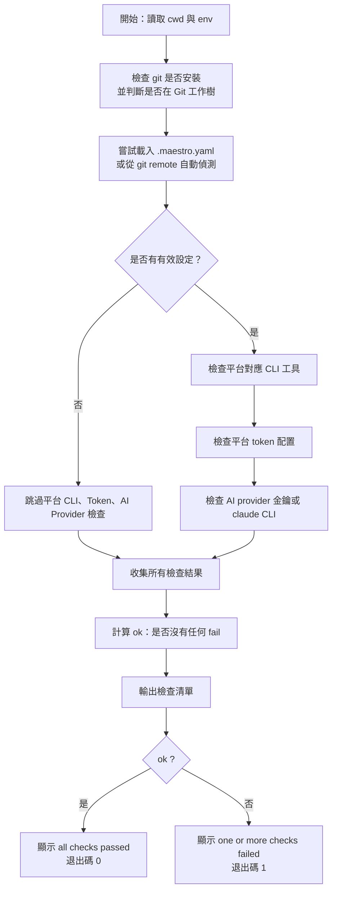
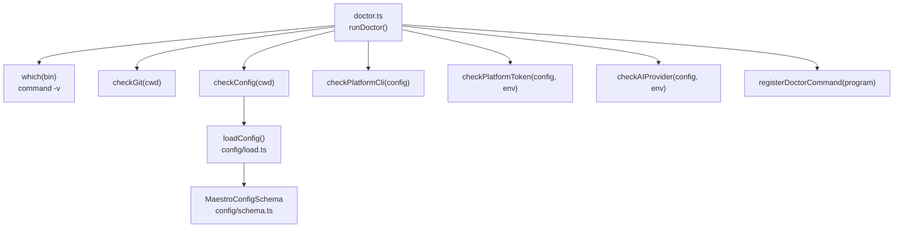

# maestro doctor — 環境診斷

**本文引用的檔案**

- [doctor.ts](https://github.com/mikeah2011/maestro/blob/master/src/cli/commands/doctor.ts)
- [load.ts](https://github.com/mikeah2011/maestro/blob/master/src/config/load.ts)
- [schema.ts](https://github.com/mikeah2011/maestro/blob/master/src/config/schema.ts)
- [doctor.test.ts](https://github.com/mikeah2011/maestro/blob/master/tests/cli/doctor.test.ts)
- [.maestro.example.yaml](https://github.com/mikeah2011/maestro/blob/master/.maestro.example.yaml)
- [package.json](https://github.com/mikeah2011/maestro/blob/master/package.json)

## 目錄
1. [簡介](#簡介)
2. [命令總覽與執行流程](#命令總覽與執行流程)
3. [健康檢查項目清單](#健康檢查項目清單)
4. [狀態、輸出格式與退出碼](#狀態輸出格式與退出碼)
5. [各環境下的預期輸出範例](#各環境下的預期輸出範例)
6. [常見問題與修復建議](#常見問題與修復建議)
7. [架構與依賴關係](#架構與依賴關係)
8. [限制與已知行為](#限制與已知行為)
9. [結論](#結論)

## 簡介

`maestro doctor` 是 Maestro CLI 的環境診斷子命令，用於在執行主流程前快速確認當前工作目錄是否具備運行條件。它的設計重點有三個：

1. **不進行網路呼叫**：不會向 GitHub、GitLab、Anthropic API 等服務發起 HTTP 請求；只驗證環境工具、設定檔與憑證是否存在。
2. **以清單形式回報**：每個檢查項目都會輸出通過、失敗、警告或跳過狀態，並附帶可操作的診斷訊息。
3. **適合自動化**：所有檢查全部通過時返回成功；任一項目失敗時會設置非零退出碼，方便 CI 中斷流程。

它主要驗證以下面向：

| 面向 | 說明 |
|---|---|
| Node.js 版本 | 由套件定義引擎要求；Doctor 本身不額外執行版本檢查。 |
| Git 環境 | 偵測 `git` 是否安裝，以及當前目錄是否為 Git 工作樹。 |
| `.maestro.yaml` 設定 | 嘗試載入、展開環境變數、合併多層設定，並以 Zod Schema 驗證。 |
| 平台 CLI 工具 | 根據 `platform.type` 檢查對應的 CLI（例如 `gh`、`glab`、`tea`、`gitee`）。 |
| 平台 Token | 檢查 `.maestro.yaml` 中的 token 或 `tokenEnv` 指定的環境變數。 |
| AI Provider 金鑰 | 檢查已宣告 provider 的 `apiKey`；若沒有則回退檢查 `claude` CLI。 |
| 網路連線測試 | **不會執行**。Doctor 明確不做網路呼叫。 |

**章節來源**
- [doctor.ts:1-20](https://github.com/mikeah2011/maestro/blob/master/src/cli/commands/doctor.ts#L1-L20)
- [package.json:42-52](https://github.com/mikeah2011/maestro/blob/master/package.json#L42-L52)

## 命令總覽與執行流程

### 命令選項

`maestro doctor` 目前支援一個選項：

| 選項 | 類型 | 預設值 | 說明 |
|---|---|---:|---|
| `--cwd <dir>` | 字串 | `process.cwd()` | 指定要檢查的工作目錄。 |

### 執行順序



**圖表來源**
- [doctor.ts:139-193](https://github.com/mikeah2011/maestro/blob/master/src/cli/commands/doctor.ts#L139-L193)
- [doctor.ts:209-237](https://github.com/mikeah2011/maestro/blob/master/src/cli/commands/doctor.ts#L209-L237)

這個流程的關鍵點是：**只有當 `.maestro.yaml` 成功載出有效設定後，才會繼續檢查平台 CLI、平台 token 與 AI provider**。如果連設定都無法載入，Doctor 仍會回報設定錯誤，但不會再假設平台為何。

**章節來源**
- [doctor.ts:139-193](https://github.com/mikeah2011/maestro/blob/master/src/cli/commands/doctor.ts#L139-L193)
- [doctor.ts:209-237](https://github.com/mikeah2011/maestro/blob/master/src/cli/commands/doctor.ts#L209-L237)

## 健康檢查項目清單

### 1. Git 是否安裝

| 欄位 | 內容 |
|---|---|
| 檢查名稱 | `git installed` |
| 觸發條件 | Doctor 一開始就會檢查。 |
| 成功條件 | 系統 PATH 中能執行 `git`。 |
| 失敗原因 | 找不到 `git` 指令。 |
| 建議修復 | 安裝 Git，參考訊息中的網址。 |

**診斷訊息格式**

- 成功：無額外 detail。
- 失敗：detail 包含安裝 Git 的指引。

**章節來源**
- [doctor.ts:38-53](https://github.com/mikeah2011/maestro/blob/master/src/cli/commands/doctor.ts#L38-L53)

### 2. 是否在 Git 工作樹內

| 欄位 | 內容 |
|---|---|
| 檢查名稱 | `inside a git repo` |
| 觸發條件 | 只要 Git 可執行，就會執行 `git rev-parse --is-inside-work-tree`。 |
| 成功條件 | 當前目錄是 Git 工作樹。 |
| 失敗原因 | 當前目錄不是 Git 工作樹。 |
| 建議修復 | 到正確的 repository 根目錄執行命令，或先執行 `git init`。 |

**診斷訊息格式**

- 成功：無額外 detail。
- 失敗：detail 會指出該目錄不是 Git repo。

**章節來源**
- [doctor.ts:45-53](https://github.com/mikeah2011/maestro/blob/master/src/cli/commands/doctor.ts#L45-L53)

### 3. `.maestro.yaml` 載入與驗證

這個檢查有兩種重要分支：

#### 情況 A：找不到 `.maestro.yaml`

| 狀態 | 意義 |
|---|---|
| `warn` | 找不到 `.maestro.yaml`，但能從 git remote 自動偵測 platform owner/repo，並使用預設值載出設定。 |
| `fail` | 找不到 `.maestro.yaml`，也無法偵測 git remote。 |

**診斷訊息格式**

- `warn`：提示未找到設定檔，顯示自動偵測到的 owner/repo，並建議執行 `maestro init`。
- `fail`：提示設定檔不存在且沒有 git remote，建議執行 `maestro init`。

#### 情況 B：找到 `.maestro.yaml`

| 狀態 | 意義 |
|---|---|
| `pass` | 設定檔存在、可解析 YAML、可展開環境變數、可被 Zod Schema 驗證。 |
| `fail` | 設定檔存在但載入或驗證失敗。 |

**診斷訊息格式**

- `pass`：無額外 detail。
- `fail`：detail 是驗證錯誤的第一行，通常來自 `ConfigError`。

設定驗證的重點包括：

- `platform.type` 必須是 `github`、`gitlab`、`gitea` 或 `gitee`。
- `platform.auth.token` 或 `platform.auth.tokenEnv` 可由使用者選擇其一。
- AI provider 結構由 schema 定義，但 Doctor 對 provider 金鑰有獨立檢查邏輯。

**章節來源**
- [doctor.ts:55-95](https://github.com/mikeah2011/maestro/blob/master/src/cli/commands/doctor.ts#L55-L95)
- [load.ts:1-20](https://github.com/mikeah2011/maestro/blob/master/src/config/load.ts#L1-L20)
- [load.ts:156-216](https://github.com/mikeah2011/maestro/blob/master/src/config/load.ts#L156-L216)
- [schema.ts:200-226](https://github.com/mikeah2011/maestro/blob/master/src/config/schema.ts#L200-L226)

### 4. 平台 CLI 工具檢查

Doctor 會根據 `config.platform.type` 查表決定要檢查哪個 CLI：

| 平台 | 需要安裝的 CLI | 安裝說明 |
|---|---|---|
| `github` | `gh` | https://cli.github.com/ |
| `gitlab` | `glab` | https://gitlab.com/gitlab-org/cli |
| `gitea` | `tea` | https://gitea.com/gitea/tea |
| `gitee` | `gitee` | https://gitee.com/oschina/git-osc |

| 狀態 | 意義 |
|---|---|
| `pass` | 對應 CLI 已在 PATH 中找到。 |
| `fail` | 找不到對應 CLI。 |
| `skip` | `platform.type` 不在已知映射表中。 |

**診斷訊息格式**

- `pass`：detail 會顯示找到的 CLI 路徑。
- `fail`：detail 會建議安裝對應 CLI。
- `skip`：detail 顯示 unknown platform。

**章節來源**
- [doctor.ts:22-36](https://github.com/mikeah2011/maestro/blob/master/src/cli/commands/doctor.ts#L22-L36)
- [doctor.ts:97-117](https://github.com/mikeah2011/maestro/blob/master/src/cli/commands/doctor.ts#L97-L117)

### 5. 平台 Token 檢查

Doctor 檢查的是「憑證是否存在」，而不是「憑證是否具有特定 GitHub 權限」。

| 優先順序 | 條件 | 狀態 |
|---|---|---|
| 第一 | `.maestro.yaml` 中 `platform.auth.token` 存在且非空 | `pass`，detail 為 inline token |
| 第二 | `platform.auth.tokenEnv` 指向的環境變數存在 | `pass`，detail 為 env var set |
| 第三 | 兩者都沒有 | `fail` |

**診斷訊息格式**

- `pass`：inline token 或 env var set。
- `fail`：
  - 若有 `tokenEnv`：顯示該環境變數未設定。
  - 若沒有 `tokenEnv`：顯示未在設定檔中設定 token 或 tokenEnv。

**重要澄清**：此檢查不會實際連線到 GitHub 驗證 token 權限。GitHub 權限不足通常會在後續執行 `maestro loop`、PR 操作或平台 API 呼叫時才暴露。

**章節來源**
- [doctor.ts:119-137](https://github.com/mikeah2011/maestro/blob/master/src/cli/commands/doctor.ts#L119-L137)

### 6. AI Provider 金鑰檢查

Doctor 會遍歷 `config.ai.providers` 中的所有 provider：

| Provider 類型 | 行為 |
|---|---|
| `local` | 視為通過，並列入成功列表。 |
| 其他類型 | 需要有非空的 `apiKey` 才算通過。 |

如果所有 provider 都已通過，就顯示哪些 provider 已配置。

如果沒有任何 provider 通過，Doctor 會嘗試回退檢查：

1. 執行 `which claude`。
2. 如果找到 `claude` CLI，則表示 ClaudeCodeProvider 可運作，不需要 API key。
3. 如果也找不到 `claude` CLI，則回傳 `warn`，列出缺少 API key 的 provider。

| 狀態 | 意義 |
|---|---|
| `pass` | 至少有一個 provider 有 API key，或是找到 `claude` CLI。 |
| `warn` | 沒有 API key 也沒有 `claude` CLI；fix engine 可能無法使用。 |
| `fail` | Doctor 本身不對 AI provider 產生 fail；失敗主要由其他項目造成。 |

**診斷訊息格式**

- `pass`：列出成功的 provider，或在 fallback 情況下顯示 `claude` CLI 路徑。
- `warn`：列出缺少 API key 的 provider 名稱。

**章節來源**
- [doctor.ts:139-186](https://github.com/mikeah2011/maestro/blob/master/src/cli/commands/doctor.ts#L139-L186)
- [.maestro.example.yaml:6-33](https://github.com/mikeah2011/maestro/blob/master/.maestro.example.yaml#L6-L33)

### 7. Node.js 版本驗證

Doctor 本身**沒有** Node.js 版本檢查函式。Node.js 版本是由套件工程規格約束：

| 項目 | 值 |
|---|---|
| 引擎要求 | Node.js `>=20` |
| 替代執行器 | Bun `>=1.1` |

因此，如果 Node.js 版本不符合 `package.json` 的 engines 規範，通常會在安裝或執行階段由包管理器處理，而不是由 `maestro doctor` 回報。

**章節來源**
- [package.json:42-52](https://github.com/mikeah2011/maestro/blob/master/package.json#L42-L52)

### 8. 平台連線測試

Doctor **不會**執行任何網路連線測試，也不會驗證：

- GitHub / GitLab / Gitea / Gitee API 是否可達。
- token 是否有效。
- token 是否擁有寫入 PR、建立 check run、回覆評論等權限。
- Anthropic API 是否可連線。

這些屬於執行階段行為，而非環境診斷階段行為。

**章節來源**
- [doctor.ts:1-20](https://github.com/mikeah2011/maestro/blob/master/src/cli/commands/doctor.ts#L1-L20)

## 狀態、輸出格式與退出碼

### 四種狀態

| 狀態 | 符號 | 顏色 | 含義 |
|---|---:|---|---|
| `pass` | ✓ | 綠色 | 該項目正常。 |
| `fail` | ✗ | 紅色 | 該項目失敗，Doctor 整體視為失敗。 |
| `warn` | ! | 黃色 | 環境不完整但仍可繼續；例如缺少 `.maestro.yaml` 但有 git remote。 |
| `skip` | - | 灰色 | 該項目不適用；例如未知平台。 |

### 單行輸出格式

每筆檢查會輸出一行：

```text
  <symbol>  <name>
  <symbol>  <name> — <detail>
```

其中：

- `<symbol>` 是狀態符號。
- `<name>` 是檢查名稱。
- `<detail>` 是可選診斷訊息，使用較淡的顏色呈現。

### 結尾訊息

- 全部通過：`all checks passed.`
- 任一項目為 `fail`：`one or more checks failed; fix above before running the loop.`

### 退出碼

| 條件 | 退出碼 |
|---|---:|
| 所有項目都不是 `fail` | `0` |
| 有任何項目為 `fail` | `1` |

注意：`warn` 不會讓 Doctor 失敗。

**章節來源**
- [doctor.ts:201-237](https://github.com/mikeah2011/maestro/blob/master/src/cli/commands/doctor.ts#L201-L237)

## 各環境下的預期輸出範例

下列範例僅模擬 Doctor 的文字輸出；實際顏色與符號會依終端機支援程度而異。

### 本地開發環境（完整）

假設：

- Git 已安裝且在 repo 內。
- `.maestro.yaml` 存在且有效。
- `gh` 已安裝。
- `GITHUB_TOKEN` 已設定。
- AI provider 已設定 API key，或已安裝 `claude` CLI。

```text
maestro doctor:

  ✓  git installed
  ✓  inside a git repo
  ✓  .maestro.yaml loads + validates
  ✓  gh installed (github)
  ✓  platform token configured — env var set
  ✓  AI provider keys — ok: claude (claude), openai (openai)

all checks passed.
```

**預期退出碼**：`0`

### 本地開發環境（缺少 `.maestro.yaml`，但有 git remote）

假設：

- Git 在 repo 內。
- 沒有 `.maestro.yaml`。
- git remote 可自動偵測 owner/repo。
- `gh` 與 `GITHUB_TOKEN` 可用。
- AI provider 已配置。

```text
maestro doctor:

  ✓  git installed
  ✓  inside a git repo
  !  .maestro.yaml — not found — using git remote auto-detect (owner/repo); run `maestro init` to persist settings
  ✓  gh installed (github)
  ✓  platform token configured — env var set
  ✓  AI provider keys — ok: claude (claude)

all checks passed.
```

**預期退出碼**：`0`  
說明：`.maestro.yaml` 缺失只會是 `warn`，不會讓 Doctor 失敗。

### 本地開發環境（設定檔驗證失敗）

假設：

- Git 在 repo 內。
- `.maestro.yaml` 存在但 schema 驗證失敗。
- 其他項目正確。

```text
maestro doctor:

  ✓  git installed
  ✓  inside a git repo
  ✗  .maestro.yaml loads + validates — invalid maestro config: ...
  -  platform CLI for github — skip
  -  platform token configured — skip
  -  AI provider keys — skip

one or more checks failed; fix above before running the loop.
```

**預期退出碼**：`1`

### CI 環境（缺少平台 CLI）

假設：

- Git 在 repo 內。
- `.maestro.yaml` 存在且有效。
- `GITHUB_TOKEN` 已設定。
- 沒有安裝 `gh`。
- AI provider 已配置。

```text
maestro doctor:

  ✓  git installed
  ✓  inside a git repo
  ✓  .maestro.yaml loads + validates
  ✗  gh installed (github) — install gh from https://cli.github.com/
  ✓  platform token configured — env var set
  ✓  AI provider keys — ok: claude (claude)

one or more checks failed; fix above before running the loop.
```

**預期退出碼**：`1`

CI 修復建議：

1. 在 CI job 中加入安裝 `gh` 的步驟。
2. 確保 `GITHUB_TOKEN` 由 CI secret 提供。
3. 若只需要 Doctor 檢查而不需要平台 CLI，可在 CI 中避免使用需要 `gh` 的命令。

### Container 環境（只有基礎映像）

假設：

- container 內沒有 `git`。
- 沒有 `.maestro.yaml`。
- 沒有 `gh`。
- 沒有 `GITHUB_TOKEN`。
- 沒有 AI provider。

```text
maestro doctor:

  ✗  git installed — install git from https://git-scm.com/
  ✗  inside a git repo — /app is not a git repo
  ✗  .maestro.yaml — not found at /.maestro.yaml and no git remote detected; run `maestro init`
  -  platform CLI for github — skip
  -  platform token configured — skip
  -  AI provider keys — skip

one or more checks failed; fix above before running the loop.
```

**預期退出碼**：`1`

Container 修復建議：

1. 基礎映像安裝 `git`。
2. 將 `.maestro.yaml` 複製進 container。
3. 透過 mount 或 secret 提供 `GITHUB_TOKEN`。
4. 若需要平台 CLI，安裝 `gh`。
5. 若需要 AI provider，設定 `ANTHROPIC_API_KEY` 或其他 provider 金鑰。

### CI 與 container 混合情境（token 未設定）

假設：

- Git 在 repo 內。
- `.maestro.yaml` 使用 `tokenEnv: GITHUB_TOKEN`。
- CI job 忘記注入 `GITHUB_TOKEN`。

```text
maestro doctor:

  ✓  git installed
  ✓  inside a git repo
  ✓  .maestro.yaml loads + validates
  ✓  gh installed (github)
  ✗  platform token configured — GITHUB_TOKEN env var is unset
  ✓  AI provider keys — ok: claude (claude)

one or more checks failed; fix above before running the loop.
```

**預期退出碼**：`1`

**章節來源**
- [doctor.test.ts:1-101](https://github.com/mikeah2011/maestro/blob/master/tests/cli/doctor.test.ts#L1-L101)
- [doctor.ts:55-186](https://github.com/mikeah2011/maestro/blob/master/src/cli/commands/doctor.ts#L55-L186)

## 常見問題與修復建議

### 問題一：報告 missing `.maestro.yaml`

**可能原因**

1. 在 repo 根目錄外執行命令。
2. 確實沒有 `.maestro.yaml`。
3. `.maestro.yaml` 位於子目錄，但 command 是在父目錄執行。

**修復方式**

- 到 repository 根目錄執行。
- 複製 `.maestro.example.yaml` 至 `.maestro.yaml`。
- 若希望持久化設定，執行 `maestro init`。

**相關檢查**

- `.maestro.yaml loads + validates`
- `.maestro.yaml`

**章節來源**
- [doctor.ts:55-95](https://github.com/mikeah2011/maestro/blob/master/src/cli/commands/doctor.ts#L55-L95)

### 問題二：設定檔驗證失敗

**可能原因**

- `platform.type` 拼錯。
- `platform.auth` 結構不符合 schema。
- AI provider 結構不符合 schema。
- YAML 語法錯誤。
- 環境變數展開後仍無法滿足 schema。

**修復方式**

1. 查看 Doctor 報出的 `invalid maestro config:` 錯誤行。
2. 對照 `.maestro.example.yaml` 的結構。
3. 先移除複雜的 routing 或 provider，逐步恢復。
4. 使用 `node -e "console.log(JSON.stringify(require('js-yaml').loadAll(fs.readFileSync('.maestro.yaml','utf8'))[0]))"` 類似的思路先確認 YAML 可解析。

**相關檢查**

- `.maestro.yaml loads + validates`

**章節來源**
- [load.ts:196-216](https://github.com/mikeah2011/maestro/blob/master/src/config/load.ts#L196-L216)
- [schema.ts:200-226](https://github.com/mikeah2011/maestro/blob/master/src/config/schema.ts#L200-L226)

### 問題三：platform token configured 失敗

**可能原因**

- `.maestro.yaml` 中沒有 `auth.token`。
- `auth.tokenEnv` 指定的環境變數未設定。
- CI 或 container 沒有注入該環境變數。

**修復方式**

- 若使用環境變數，設定 `tokenEnv` 並注入對應變數，例如 `GITHUB_TOKEN`。
- 若使用 inline token，請謹慎評估安全性；通常建議使用環境變數。
- 在 CI 中使用 secret 管理機制注入 token。

**相關檢查**

- `platform token configured`
- `platform token (<env>)`

**章節來源**
- [doctor.ts:119-137](https://github.com/mikeah2011/maestro/blob/master/src/cli/commands/doctor.ts#L119-L137)

### 問題四：AI provider keys warn

**可能原因**

1. 所有非 `local` provider 都沒有 `apiKey`。
2. 系統中也沒有 `claude` CLI。
3. `claude` CLI 不在 PATH 中。

**修復方式**

- 為需要的 provider 設定 `apiKey`。
- 如果使用 ClaudeCodeProvider，安裝並讓 `claude` CLI 可在 PATH 中找到。
- 如果完全不需要 AI provider，考慮使用 `local` provider 或調整 provider 配置。

**相關檢查**

- `AI provider keys`

**章節來源**
- [doctor.ts:139-186](https://github.com/mikeah2011/maestro/blob/master/src/cli/commands/doctor.ts#L139-L186)

### 問題五：找不到平台 CLI

**可能原因**

- 沒有安裝對應平台的 CLI。
- CLI 安裝成功但不在 PATH 中。
- 使用的平台型別不在已知映射中。

**修復方式**

- 安裝對應 CLI：
  - GitHub：`gh`
  - GitLab：`glab`
  - Gitea：`tea`
  - Gitee：`gitee`
- 確認 CLI 可於 shell 直接執行。
- 若使用自訂平台型別，Doctor 會標記為 `skip`。

**相關檢查**

- `gh installed (github)`
- `glab installed (gitlab)`
- `tea installed (gitea)`
- `gitee installed (gitee)`
- `platform CLI for <type>`

**章節來源**
- [doctor.ts:22-36](https://github.com/mikeah2011/maestro/blob/master/src/cli/commands/doctor.ts#L22-L36)
- [doctor.ts:97-117](https://github.com/mikeah2011/maestro/blob/master/src/cli/commands/doctor.ts#L97-L117)

### 問題六：認為 GitHub token 權限不足

Doctor **不會**檢查 token 的 GitHub 權限。如果 token 存在但權限不足，錯誤通常出現在後續實際呼叫平台 API 的時候。

**修復方式**

1. 先用 `gh auth status` 或平台 CLI 自行驗證 token。
2. 確認 token 具有寫入 PR、comment、check run 等所需權限。
3. 若是企業版 GitHub，確認 `baseUrl` 設定正確。
4. 把權限問題歸類為執行階段問題，而非 Doctor 檢查範圍。

**章節來源**
- [doctor.ts:1-20](https://github.com/mikeah2011/maestro/blob/master/src/cli/commands/doctor.ts#L1-L20)

### 問題七：Node.js 版本問題

Doctor 不會檢查 Node.js 版本。如果執行時出現版本不相容錯誤，請檢查：

- Node.js 是否 `>=20`。
- 是否使用符合要求的 Bun。
- 專案安裝過程是否使用了相容的 Node 版本。

**章節來源**
- [package.json:42-52](https://github.com/mikeah2011/maestro/blob/master/package.json#L42-L52)

## 架構與依賴關係

### Doctor 模組內部關係



**圖表來源**
- [doctor.ts:22-193](https://github.com/mikeah2011/maestro/blob/master/src/cli/commands/doctor.ts#L22-L193)
- [doctor.ts:209-237](https://github.com/mikeah2011/maestro/blob/master/src/cli/commands/doctor.ts#L209-L237)
- [load.ts:156-216](https://github.com/mikeah2011/maestro/blob/master/src/config/load.ts#L156-L216)
- [schema.ts:200-226](https://github.com/mikeah2011/maestro/blob/master/src/config/schema.ts#L200-L226)

### Doctor 與其他模組的耦合

| 模組 | 耦合方式 | 說明 |
|---|---|---|
| `config/load.ts` | 匯入 `loadConfig`、`ConfigError` | 用來載入與驗證 `.maestro.yaml`。 |
| `config/schema.ts` | 透過 `loadConfig` 間接使用 Zod schema | Doctor 本身不直接使用 zod，但依賴 schema 驗證結果。 |
| `platforms/github/GitHubPlatform.ts` | 無直接匯入 | Doctor 不會建立或初始化 GitHubPlatform，也不發送網路請求。 |
| `cli/index.ts` | 透過 `registerDoctorCommand` 註冊子命令 | Doctor 作為 commander 子命令進入。 |

**圖表來源**
- [doctor.ts:12-20](https://github.com/mikeah2011/maestro/blob/master/src/cli/commands/doctor.ts#L12-L20)
- [doctor.ts:209-237](https://github.com/mikeah2011/maestro/blob/master/src/cli/commands/doctor.ts#L209-L237)

## 限制與已知行為

1. **不檢查網路連線**：Doctor 不會連線 GitHub、GitLab、Anthropic 或其他外部服務。
2. **不檢查 GitHub token 權限**：只檢查 token 是否配置，不檢查權限。
3. **不檢查 Node.js 版本**：Node.js 版本由 `package.json` engines 控制。
4. **不檢查平台 API 可用性**：即使 `gh` 存在且 token 存在，Doctor 仍可能 pass，但實際平台操作仍可能失敗。
5. **AI provider 允許 local**：`local` provider 會被視為通過，因為它不一定需要外部 API key。
6. **未知平台會跳過**：如果 `platform.type` 不在已知映射中，平台 CLI 檢查會標記為 `skip`。
7. **warn 不算失敗**：缺少 `.maestro.yaml` 但可自動偵測時，Doctor 仍會返回成功。
8. **細節訊息可能被截斷**：設定驗證錯誤會取出 `ConfigError` 訊息的第一行，因此長錯誤訊息可能不夠完整。

**章節來源**
- [doctor.ts:1-20](https://github.com/mikeah2011/maestro/blob/master/src/cli/commands/doctor.ts#L1-L20)
- [doctor.ts:55-95](https://github.com/mikeah2011/maestro/blob/master/src/cli/commands/doctor.ts#L55-L95)
- [doctor.ts:97-117](https://github.com/mikeah2011/maestro/blob/master/src/cli/commands/doctor.ts#L97-L117)
- [doctor.ts:139-186](https://github.com/mikeah2011/maestro/blob/master/src/cli/commands/doctor.ts#L139-L186)
- [load.ts:196-216](https://github.com/mikeah2011/maestro/blob/master/src/config/load.ts#L196-L216)

## 結論

`maestro doctor` 是一個輕量、安全且適合自動化的環境診斷工具。它的核心價值在於：

- 在執行主流程前快速發現常見的環境問題。
- 用一致的四態模型回報：pass、fail、warn、skip。
- 不執行網路請求，降低診斷過程中的副作用與誤判。
- 適合在本地開發、CI、container 等多種環境中使用。

但它不是完整的環境認證工具。若你需要驗證：

- GitHub token 是否有效。
- GitHub token 是否具備所需權限。
- Anthropic API 是否可連線。
- 平台 API 是否正常回應。

應在 Doctor 之後，使用平台 CLI、API 測試或實際執行 Maestro loop 來驗證這些執行階段條件。

**章節來源**
- [doctor.ts:1-20](https://github.com/mikeah2011/maestro/blob/master/src/cli/commands/doctor.ts#L1-L20)
- [doctor.ts:209-237](https://github.com/mikeah2011/maestro/blob/master/src/cli/commands/doctor.ts#L209-L237)
- [package.json:42-52](https://github.com/mikeah2011/maestro/blob/master/package.json#L42-L52)