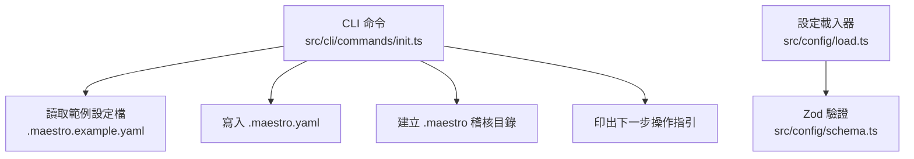
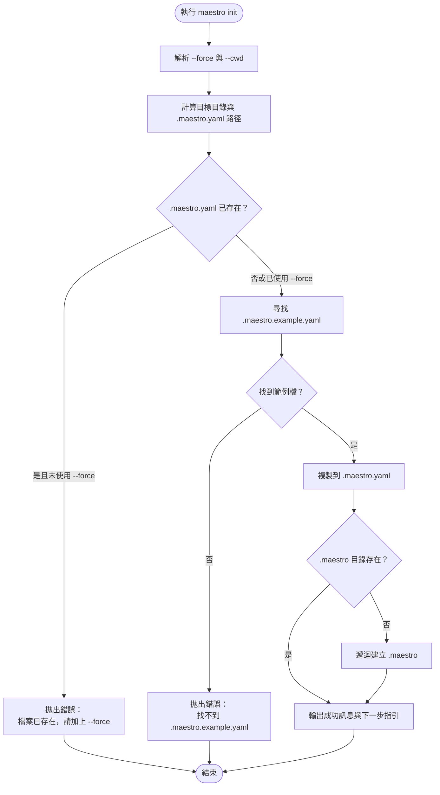
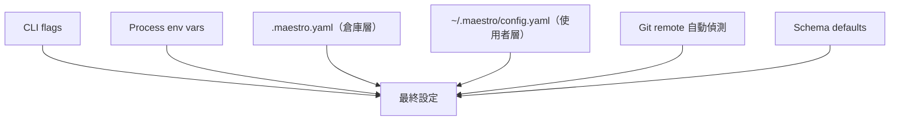
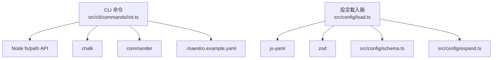

# maestro init — 初始化設定

<cite>
**本文引用的檔案**   
- [init.ts](https://github.com/mikeah2011/maestro/blob/master/src/cli/commands/init.ts)
- [.maestro.example.yaml](https://github.com/mikeah2011/maestro/blob/master/.maestro.example.yaml)
- [init.test.ts](https://github.com/mikeah2011/maestro/blob/master/tests/cli/init.test.ts)
- [schema.ts](https://github.com/mikeah2011/maestro/blob/master/src/config/schema.ts)
- [load.ts](https://github.com/mikeah2011/maestro/blob/master/src/config/load.ts)
- [package.json](https://github.com/mikeah2011/maestro/blob/master/package.json)
</cite>

## 目錄
1. [簡介](#簡介)
2. [命令總覽](#命令總覽)
3. [專案結構與角色分工](#專案結構與角色分工)
4. [互動流程與執行行為](#互動流程與執行行為)
5. [.maestro.yaml 設定檔結構](#masertryaml-設定檔結構)
6. [選項、預設值與驗證規則](#選項預設值與驗證規則)
7. [常見初始設定場景](#常見初始設定場景)
8. [錯誤處理與除錯建議](#錯誤處理與除錯建議)
9. [依賴關係分析](#依賴關係分析)
10. [後續編輯建議](#後續編輯建議)
11. [結論](#結論)

## 簡介
`maestro init` 是 Maestro 的初始化入口。它的核心任務很明確：在當前 Git 倉庫中建立 `.maestro.yaml`，並準備 `.maestro` 稽核目錄。它不是「全自動設定助手」；它會從安裝包複製範例設定檔，然後引導使用者手動填入 API Key、平台權杖與 Bots 等資訊。

這個設計讓設定內容可以進入版本控制，同時保留環境變數與使用者層級設定的覆蓋空間。

**Section sources**
- [init.ts:1-87](https://github.com/mikeah2011/maestro/blob/master/src/cli/commands/init.ts#L1-L87)
- [.maestro.example.yaml:1-239](https://github.com/mikeah2011/maestro/blob/master/.maestro.example.yaml#L1-L239)

## 命令總覽
`maestro init` 使用 Commander 註冊子命令，支援以下參數：

| 選項 | 長選項 | 說明 | 是否必要 |
|---|---|---|---|
| `-f` | `--force` | 若已存在 `.maestro.yaml`，允許覆寫 | 否 |
| 無 | `--cwd <dir>` | 指定要產生設定檔的目標目錄；省略時使用目前工作目錄 | 否 |

CLI 的程式碼路徑為 `src/cli/commands/init.ts`，而套件二進位名稱由 `package.json` 定義。

**Section sources**
- [init.ts:69-87](https://github.com/mikeah2011/maestro/blob/master/src/cli/commands/init.ts#L69-L87)
- [package.json:10-23](https://github.com/mikeah2011/maestro/blob/master/package.json#L10-L23)

## 專案結構與角色分工

**圖表來源**
- [init.ts:20-68](https://github.com/mikeah2011/maestro/blob/master/src/cli/commands/init.ts#L20-L68)
- [.maestro.example.yaml:1-239](https://github.com/mikeah2011/maestro/blob/master/.maestro.example.yaml#L1-L239)
- [load.ts:180-216](https://github.com/mikeah2011/maestro/blob/master/src/config/load.ts#L180-L216)
- [schema.ts:200-226](https://github.com/mikeah2011/maestro/blob/master/src/config/schema.ts#L200-L226)

### 主要責任
- **init.ts**：負責 CLI 選項解析、目標路徑解析、範例檔複製、目錄建立與使用者提示。
- **.maestro.example.yaml**：提供完整設定骨架，包含 AI provider、Git platform、bots registry、stop conditions、security、language plugins、PR body template 等。
- **load.ts**：負責多層設定合併、環境變數展開、Git remote 自動偵測與最終驗證。
- **schema.ts**：以 Zod 定義所有欄位的型別、預設值與驗證約束。
- **init.test.ts**：驗證基本行為，例如是否產生檔案、是否建立目錄、是否拒絕覆寫、是否接受 `--force`。

**Section sources**
- [init.ts:1-87](https://github.com/mikeah2011/maestro/blob/master/src/cli/commands/init.ts#L1-L87)
- [init.test.ts:1-65](https://github.com/mikeah2011/maestro/blob/master/tests/cli/init.test.ts#L1-L65)
- [load.ts:1-216](https://github.com/mikeah2011/maestro/blob/master/src/config/load.ts#L1-L216)
- [schema.ts:1-226](https://github.com/mikeah2011/maestro/blob/master/src/config/schema.ts#L1-L226)

## 互動流程與執行行為

`maestro init` 的實際執行流程如下：

**圖表來源**
- [init.ts:20-68](https://github.com/mikeah2011/maestro/blob/master/src/cli/commands/init.ts#L20-L68)

### 步驟說明

1. **解析目標目錄**  
   使用 `--cwd`；若省略則使用 `process.cwd()`。
2. **檢查 `.maestro.yaml`**  
   如果檔案已存在且沒有傳入 `--force`，直接拋出錯誤。
3. **尋找範例設定檔**  
   依序嘗試以下位置：
   - 編譯後檔案相對路徑的上層目錄
   - 專案根目錄
   - 目前工作目錄
4. **複製設定檔**  
   將 `.maestro.example.yaml` 複製為 `.maestro.yaml`。
5. **建立稽核目錄**  
   若 `.maestro` 不存在，則建立該目錄；若已存在，不會報錯。
6. **輸出下一步指引**  
   提醒使用者編輯設定、執行 `maestro doctor`，以及在 PR 上啟動 review loop。

**Section sources**
- [init.ts:20-68](https://github.com/mikeah2011/maestro/blob/master/src/cli/commands/init.ts#L20-L68)
- [init.test.ts:20-65](https://github.com/mikeah2011/maestro/blob/master/tests/cli/init.test.ts#L20-L65)

## .maestro.yaml 設定檔結構

`.maestro.yaml` 是整個 Maestro 的核心設定檔。它支援多層設定，並且每個欄位都有預設值與驗證規則。

### 設定優先順序

**圖表來源**
- [load.ts:1-20](https://github.com/mikeah2011/maestro/blob/master/src/config/load.ts#L1-L20)
- [load.ts:180-216](https://github.com/mikeah2011/maestro/blob/master/src/config/load.ts#L180-L216)

### 根層級欄位摘要

| 欄位 | 用途 | 重要子欄位 | 預設值或限制 |
|---|---|---|---|
| `ai` | 宣告 AI provider 與階段路由 | `providers`、`routing` | 空物件 |
| `platform` | Git platform 連線 | `type`、`auth`、`baseUrl`、`owner`、`repo` | 必填 `type` |
| `bots` | 管理 AI bot 評論 | `registry`、`detectByConvention`、`watch` | 預設啟用 convention 偵測 |
| `stopConditions` | 收斂與成本控制 | `maxRounds`、`jaccardCeiling`、`costBudgetUSD` 等 | 多數有安全預設值 |
| `preflight` | 本地 pre-push 檢查 | `steps`、`blockOnSeverity` | 預設啟用四階段檢查 |
| `plugins.languages` | 語言工具鏈 | `lint`、`typecheck`、`test`、`format` | 空物件 |
| `prBody` | PR Body 更新區段 | `marker.start/end`、`template` | 預設 HTML comment marker |
| `security` | 敏感資料防護 | `scanOutgoing`、`redactPatterns` | 預設開啟掃描 |
| `audit` | 稽核日誌 | `enabled`、`dir`、`shadowLogClassifications` | 預設啟用 |
| `logging` | 日誌等級與格式 | `level`、`format`、`eventStream` | 預設 JSONL |
| `advanced` | 快取、重試、速率限制 | `cacheProviders`、`retryStrategy`、`rateLimit` | 預設啟用快取 |

**Section sources**
- [.maestro.example.yaml:1-239](https://github.com/mikeah2011/maestro/blob/master/.maestro.example.yaml#L1-L239)
- [schema.ts:1-226](https://github.com/mikeah2011/maestro/blob/master/src/config/schema.ts#L1-L226)

## 選項、預設值與驗證規則

### AI Providers 與 Routing

AI 設定分為兩部分：

- **`ai.providers`**：定義可用的 provider，例如 `claude`、`openai`、`google`、`local`、`custom`。
- **`ai.routing`**：針對不同階段選擇 provider 與 model tier。

| 欄位 | 型別 | 預設值 | 驗證規則 |
|---|---|---|---|
| `type` | string enum | 必填 | 僅限 `claude`、`openai`、`google`、`local`、`custom` |
| `apiKey` | string | 可選 | 字串 |
| `baseUrl` | string URL | 可選 | 必須是合法 URL |
| `models` | record | 可選 | key 為 `cheap`、`strong`、`flagship` |
| `defaultTier` | enum | 可選 | 僅限三級 tier |
| `timeout` | number | 可選 | 正整數 |
| `retries` | number | 可選 | 非負整數 |
| routing target `provider` | string | 必填 | 至少一個字元 |
| routing target `tier` | enum | `cheap` | 僅限三級 tier |

Routing 階段包括：

| 階段 | 用途 |
|---|---|
| `commitMessage` | 每輪產生 commit message |
| `prBodyDraft` | 每個 PR 產生一次 PR body 草稿 |
| `classifyUnknown` | fenced classifier fallback |
| `semanticDedup` | 第三層語義去重 |
| `tasteDetection` | 判斷 review 是否陷入 bikeshedding |
| `finalSummary` | 回合結束時的 PR body 總結 |
| `fallback` | 其他階段失敗時的 fallback |

**Section sources**
- [schema.ts:11-67](https://github.com/mikeah2011/maestro/blob/master/src/config/schema.ts#L11-L67)
- [.maestro.example.yaml:5-63](https://github.com/mikeah2011/maestro/blob/master/.maestro.example.yaml#L5-L63)

### Git Platform

| 欄位 | 型別 | 預設值 | 說明 |
|---|---|---|---|
| `type` | enum | 必填 | `github`、`gitlab`、`gitea`、`gitee` |
| `auth.tokenEnv` | string | 可選 | 環境變數名稱 |
| `auth.token` | string | 可選 | 直接設定 token（不建議） |
| `baseUrl` | URL | 可選 | GitHub Enterprise 或 self-hosted |
| `owner` | string | 可選 | 可由 git remote 自動偵測 |
| `repo` | string | 可選 | 可由 git remote 自動偵測 |

系統會嘗試從 git remote 自動偵測 platform、owner、repo，並設定對應的 `tokenEnv`。

**Section sources**
- [schema.ts:72-93](https://github.com/mikeah2011/maestro/blob/master/src/config/schema.ts#L72-L93)
- [load.ts:118-179](https://github.com/mikeah2011/maestro/blob/master/src/config/load.ts#L118-L179)
- [.maestro.example.yaml:66-97](https://github.com/mikeah2011/maestro/blob/master/.maestro.example.yaml#L66-L97)

### Bots Registry

Bots 設定用於讓 Maestro 訂閱 AI review bot 的評論，並根據分類回覆或標記 thread。

| 欄位 | 型別 | 預設值 | 說明 |
|---|---|---|---|
| `registry[].login` | string | 必填 | Bot login 名稱 |
| `registry[].treatAs` | enum | `advisory` | `blocking` 或 `advisory` |
| `registry[].severityMap` | record | 可選 | 自訂嚴重性對照 |
| `detectByConvention.enabled` | boolean | `true` | 啟用 convention-based 偵測 |
| `detectByConvention.rules[]` | rule object | 空陣列 | 至少需指定一個匹配條件 |

Convention rule 至少需要以下其中一個：

| 條件 | 說明 |
|---|---|
| `loginContains` | 匹配 bot login |
| `appSlugContains` | 匹配 app slug |
| `commentBodyContains` | 匹配评论内容 |

**Section sources**
- [schema.ts:96-118](https://github.com/mikeah2011/maestro/blob/master/src/config/schema.ts#L96-L118)
- [.maestro.example.yaml:100-134](https://github.com/mikeah2011/maestro/blob/master/.maestro.example.yaml#L100-L134)

### Stop Conditions

Stop conditions 是 Maestro 的「收斂保證」。它們決定當 review loop 出現重複、成本過高、長時間停滯或 CI 失敗時該如何處理。

| 欄位 | 型別 | 預設值 | 限制 |
|---|---|---:|---|
| `maxRounds` | int | 3 | 最小 1，最大 5 |
| `jaccardCeiling` | number | 0.7 | 介於 0 到 1 |
| `noNewCategoryAfterRound` | int | 2 | 最小 1 |
| `duplicateFindingPolicy` | enum | `pushback` | `pushback`、`escalate`、`accept` |
| `ciFail` | enum | `exit` | `exit`、`retry-with-fix` |
| `idleTimeoutPolls` | int | 20 | 正整數 |
| `quietPeriodSec` | int | 90 | 非負整數 |
| `costBudgetUSD` | number | 5 | 非負數 |

測試也確認 `maxRounds` 上限為 5，即使使用者輸入更大值也會被截斷。

**Section sources**
- [schema.ts:121-142](https://github.com/mikeah2011/maestro/blob/master/src/config/schema.ts#L121-L142)
- [.maestro.example.yaml:137-152](https://github.com/mikeah2011/maestro/blob/master/.maestro.example.yaml#L137-L152)

### Preflight

Local preflight 在 push 前執行檢查，避免把明顯問題推到遠端。

| 欄位 | 型別 | 預設值 | 說明 |
|---|---|---|---|
| `enabled` | boolean | `true` | 是否啟用 |
| `steps` | array | `selfReview`、`lint`、`typecheck`、`test` | 執行步驟 |
| `blockOnSeverity` | enum | `critical` | `critical`、`high`、`medium` |

**Section sources**
- [schema.ts:145-155](https://github.com/mikeah2011/maestro/blob/master/src/config/schema.ts#L145-L155)
- [.maestro.example.yaml:155-165](https://github.com/mikeah2011/maestro/blob/master/.maestro.example.yaml#L155-L165)

### Language Plugins

Language plugins 讓 Maestro 知道如何執行 lint、typecheck、test、format。

| 欄位 | 型別 | 預設值 | 說明 |
|---|---|---|---|
| `languages` | record | 空物件 | 以語言名稱為 key |
| `lint` | string | 可選 | Lint 指令 |
| `typecheck` | string | 可選 | Type check 指令 |
| `test` | string | 可選 | Test 指令 |
| `format` | string | 可選 | Format 指令 |

範例包含 typescript、python、go、rust。

**Section sources**
- [schema.ts:158-170](https://github.com/mikeah2011/maestro/blob/master/src/config/schema.ts#L158-L170)
- [.maestro.example.yaml:168-194](https://github.com/mikeah2011/maestro/blob/master/.maestro.example.yaml#L168-L194)

### PR Body Template

Maestro 會更新 PR body 中兩個 marker 之間的區塊，而不是重複追加。

| 欄位 | 型別 | 預設值 | 說明 |
|---|---|---|---|
| `marker.start` | string | `<!-- maestro:start -->` | 起始 marker |
| `marker.end` | string | `<!-- maestro:end -->` | 結尾 marker |
| `template` | string | 可選 | Handlebars 模板 |

**Section sources**
- [schema.ts:173-187](https://github.com/mikeah2011/maestro/blob/master/src/config/schema.ts#L173-L187)
- [.maestro.example.yaml:197-222](https://github.com/mikeah2011/maestro/blob/master/.maestro.example.yaml#L197-L222)

### Security

Security 設定保護 outgoing message 與 PR body 更新。

| 欄位 | 型別 | 預設值 | 說明 |
|---|---|---|---|
| `scanOutgoing` | boolean | `true` | 每次回覆或更新 PR body 前掃描 |
| `redactPatterns` | string array | 預設多個 pattern | 包含 api key、secret、password、token 及常見 token prefix |

**Section sources**
- [schema.ts:190-201](https://github.com/mikeah2011/maestro/blob/master/src/config/schema.ts#L190-L201)
- [.maestro.example.yaml:225-239](https://github.com/mikeah2011/maestro/blob/master/.maestro.example.yaml#L225-L239)

### Audit、Logging、Advanced

| 區段 | 重要欄位 | 預設值 |
|---|---|---|
| `audit` | `enabled`、`dir`、`shadowLogClassifications` | 啟用，目錄 `.maestro/audit` |
| `logging` | `level`、`format`、`eventStream` | `info`、`jsonl` |
| `advanced.cacheProviders` | boolean | `true` |
| `advanced.retryStrategy.maxRetries` | int | 3 |
| `advanced.retryStrategy.backoffMultiplier` | number | 2 |
| `advanced.rateLimit.honorRemainingHeader` | boolean | `true` |
| `advanced.rateLimit.minInterRequestMs` | int | 100 |

**Section sources**
- [schema.ts:204-226](https://github.com/mikeah2011/maestro/blob/master/src/config/schema.ts#L204-L226)

## 常見初始設定場景

### 單人開發者

適合個人專案或小型 side project。重點是：

- 只設定需要的 AI provider。
- 使用預設 stop conditions。
- 保留預設 bots registry，或關閉 convention detection。
- 使用 local 或便宜的 model tier。

建議調整：

- 移除不需要的高階 provider。
- 降低 `costBudgetUSD`。
- 保留 `maxRounds` 為 3。
- 使用 `detectByConvention.enabled: false` 以避免意外訂閱 bot。

**Section sources**
- [.maestro.example.yaml:5-239](https://github.com/mikeah2011/maestro/blob/master/.maestro.example.yaml#L5-L239)
- [schema.ts:11-201](https://github.com/mikeah2011/maestro/blob/master/src/config/schema.ts#L11-L201)

### 團隊協作

團隊情境通常需要：

- 固定 Git platform。
- 透過 CI 注入 `GITHUB_TOKEN` 等權杖。
- 明確 bots registry。
- 更嚴格的 stop conditions。
- 開啟 audit 與 logging。

建議調整：

- 鎖定 `platform.type`。
- 設定 `security.scanOutgoing: true`。
- 將 `duplicateFindingPolicy` 改為 `escalate`。
- 將 `ciFail` 改為 `exit`。
- 將 `audit.enabled` 設為 `true`。
- 將 `logging.level` 調整為 `info` 或 `debug`。

**Section sources**
- [.maestro.example.yaml:66-239](https://github.com/mikeah2011/maestro/blob/master/.maestro.example.yaml#L66-L239)
- [schema.ts:72-201](https://github.com/mikeah2011/maestro/blob/master/src/config/schema.ts#L72-L201)

### CI 環境

CI 環境通常不適合 interactive setup，因此最佳實踐是：

- 使用 CI 腳本執行 `maestro init`。
- 透過環境變數注入 API Key 與 platform token。
- 使用較低的 `maxRounds`。
- 使用較低的 `costBudgetUSD`。
- 使用 `ciFail: exit`。
- 使用 JSONL logging。

相關環境變數包括：

| 環境變數 | 作用 |
|---|---|
| `MAESTRO_MAX_ROUNDS` | 覆蓋 `stopConditions.maxRounds` |
| `MAESTRO_COST_BUDGET_USD` | 覆蓋 `stopConditions.costBudgetUSD` |
| `MAESTRO_LOG_LEVEL` | 覆蓋 `logging.level` |
| `MAESTRO_AUDIT_DIR` | 覆蓋 `audit.dir` |

**Section sources**
- [load.ts:66-94](https://github.com/mikeah2011/maestro/blob/master/src/config/load.ts#L66-L94)
- [.maestro.example.yaml:137-239](https://github.com/mikeah2011/maestro/blob/master/.maestro.example.yaml#L137-L239)

### 使用 Claude Code 作為主要 Provider

Claude 相關的設定重點：

- `ai.providers.claude.type: claude`
- `apiKey` 使用 `${ANTHROPIC_API_KEY}`
- `models` 設定 `cheap`、`strong`、`flagship`
- `routing` 將不同階段分配到不同 tier

Claude Code 提供者實作位於 `src/ai/providers/ClaudeCodeProvider.ts`，但 `init` 本身不會自動建立該 provider；使用者需在 `.maestro.yaml` 中宣告 provider，並在環境中提供對應金鑰。

**Section sources**
- [.maestro.example.yaml:5-63](https://github.com/mikeah2011/maestro/blob/master/.maestro.example.yaml#L5-L63)
- [schema.ts:11-67](https://github.com/mikeah2011/maestro/blob/master/src/config/schema.ts#L11-L67)

## 錯誤處理與除錯建議

### `maestro init` 的錯誤

| 情境 | 錯誤訊息特徵 | 解決方式 |
|---|---|---|
| `.maestro.yaml` 已存在且未加 `--force` | 訊息包含 `already exists` | 加上 `--force`，或先備份現有設定 |
| 找不到 `.maestro.example.yaml` | 訊息列出檢查路徑，並提示重新安裝 | 重新安裝套件或確保範例檔存在 |

測試涵蓋：

- 正常產生 `.maestro.yaml`
- 產生 `.maestro` 目錄
- 拒絕覆寫已有檔案
- 接受 `--force` 覆寫
- 目錄已存在時不會報錯

**Section sources**
- [init.ts:24-41](https://github.com/mikeah2011/maestro/blob/master/src/cli/commands/init.ts#L24-L41)
- [init.ts:70-87](https://github.com/mikeah2011/maestro/blob/master/src/cli/commands/init.ts#L70-L87)
- [init.test.ts:20-65](https://github.com/mikeah2011/maestro/blob/master/tests/cli/init.test.ts#L20-L65)

### 設定檔載入錯誤

當 `.maestro.yaml` 或使用者設定無法通過 Zod 驗證時，載入器會拋出 `ConfigError`，並格式化錯誤訊息。

典型錯誤包含：

- YAML 頂層不是 mapping
- 欄位型別不符
- 數值超出範圍
- enum 值不在允許清單內
- convention rule 缺少至少一個匹配條件

**Section sources**
- [load.ts:96-116](https://github.com/mikeah2011/maestro/blob/master/src/config/load.ts#L96-L116)
- [load.ts:180-216](https://github.com/mikeah2011/maestro/blob/master/src/config/load.ts#L180-L216)
- [schema.ts:96-118](https://github.com/mikeah2011/maestro/blob/master/src/config/schema.ts#L96-L118)

## 依賴關係分析

**圖表來源**
- [init.ts:15-19](https://github.com/mikeah2011/maestro/blob/master/src/cli/commands/init.ts#L15-L19)
- [load.ts:1-20](https://github.com/mikeah2011/maestro/blob/master/src/config/load.ts#L1-L20)
- [schema.ts:1-10](https://github.com/mikeah2011/maestro/blob/master/src/config/schema.ts#L1-L10)
- [package.json:57-89](https://github.com/mikeah2011/maestro/blob/master/package.json#L57-L89)

### 耦合與整合點

- `init.ts` 與 `.maestro.example.yaml` 緊密耦合：init 的行為完全依賴範例檔的存在與結構。
- `load.ts` 與 `schema.ts` 緊密耦合：載入後一定經過 Zod 驗證。
- `load.ts` 與 Git remote 解耦：只在載入階段才呼叫 git command，init 不依賴 git。
- `init.ts` 不依賴設定載入邏輯，兩者分工明確：init 產生設定，load 讀取設定。

**Section sources**
- [init.ts:15-87](https://github.com/mikeah2011/maestro/blob/master/src/cli/commands/init.ts#L15-L87)
- [load.ts:1-216](https://github.com/mikeah2011/maestro/blob/master/src/config/load.ts#L1-L216)
- [schema.ts:1-226](https://github.com/mikeah2011/maestro/blob/master/src/config/schema.ts#L1-L226)

## 後續編輯建議

### 編輯順序建議

1. **先設定 platform**  
   確認 Git platform、tokenEnv 或 baseUrl。
2. **再設定 AI providers**  
   至少加入一個 provider 與對應 API Key。
3. **調整 routing**  
   根據預算與品質需求分配 cheap、strong、flagship。
4. **設定 bots registry**  
   加入團隊使用的 AI review bot。
5. **調整 stop conditions**  
   根據團隊節奏與成本限制調整。
6. **設定 language plugins**  
   加入專案實際使用的語言工具鏈。
7. **確認 security 與 audit**  
   特別是在團隊與 CI 環境。

### 環境變數優先

API Key、token 與環境特定設定應放在環境變數中，而不是硬編碼在 `.maestro.yaml`。系統支援 `${ENV_VAR}` 展開，並提供 `MAESTRO_*` 環境變數覆蓋。

### 版本控制建議

- 將 `.maestro.yaml` 納入版本控制。
- 不要提交 API Key。
- 使用環境變數或使用者層級設定存放敏感資訊。
- 在 team guide 中說明 stop conditions 與 bots 的意義。

**Section sources**
- [.maestro.example.yaml:1-10](https://github.com/mikeah2011/maestro/blob/master/.maestro.example.yaml#L1-L10)
- [load.ts:1-20](https://github.com/mikeah2011/maestro/blob/master/src/config/load.ts#L1-L20)
- [load.ts:66-94](https://github.com/mikeah2011/maestro/blob/master/src/config/load.ts#L66-L94)

## 結論

`maestro init` 是一個簡單但有意義的入門命令：

- 它不會要求使用者回答互動式問題。
- 它會複製完整的範例設定檔。
- 它會建立 `.maestro` 稽核目錄。
- 它會引導使用者手動編輯設定。

這種設計適合：

- 熟悉 YAML 的使用者
- 希望設定可版本化的團隊
- 需要環境變數與多層設定覆蓋的 CI 環境

使用者應該把 `maestro init` 視為「設定骨架生成器」，而不是「一鍵完成設定」的工具。真正的設定價值來自後續對 AI provider、platform、bots、stop conditions、security 與 language plugins 的理解與調整。