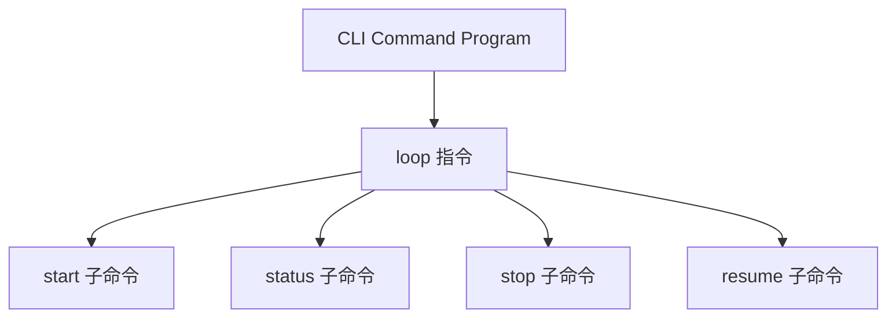
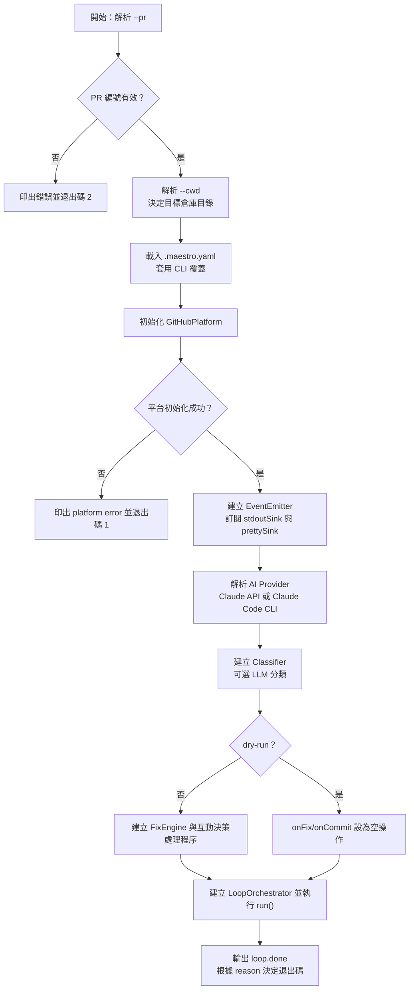
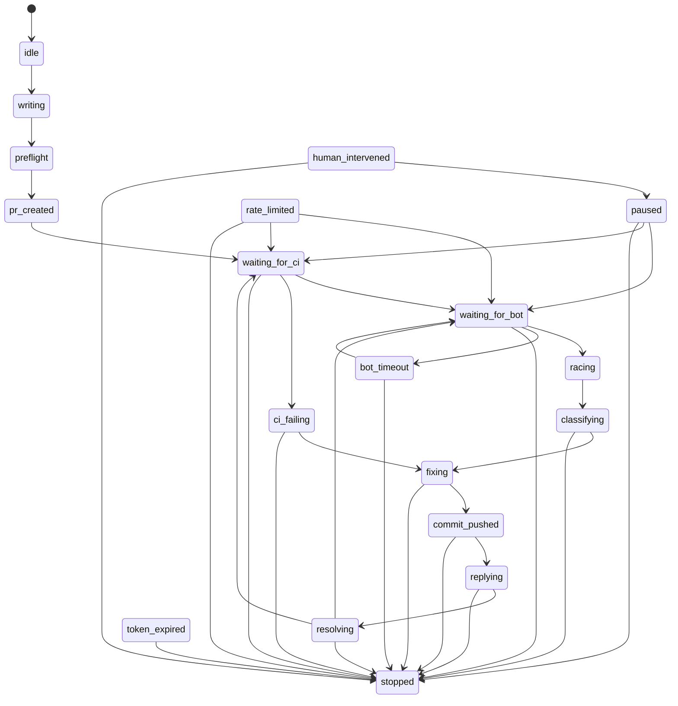
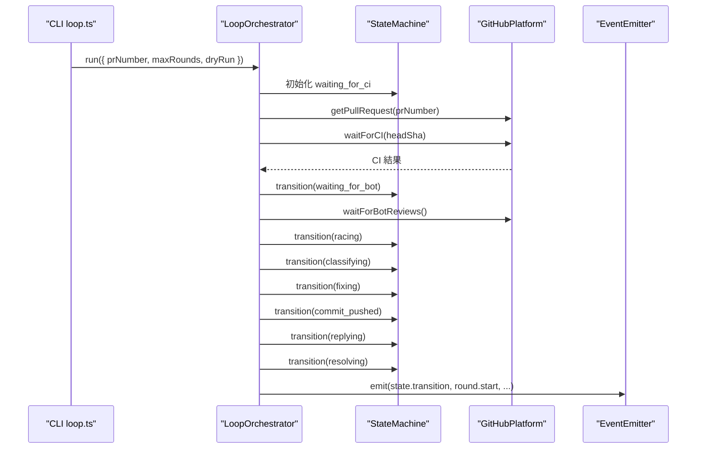

# maestro loop — 循環控制

<cite>
**本文引用的檔案**   
- [loop.ts](https://github.com/mikeah2011/maestro/blob/master/src/cli/commands/loop.ts)
- [LoopOrchestrator.ts](https://github.com/mikeah2011/maestro/blob/master/src/core/loop/LoopOrchestrator.ts)
- [StateMachine.ts](https://github.com/mikeah2011/maestro/blob/master/src/core/state/StateMachine.ts)
- [EventEmitter.ts](https://github.com/mikeah2011/maestro/blob/master/src/core/events/EventEmitter.ts)
- [README.md](https://github.com/mikeah2011/maestro/blob/master/README.md)
- [DESIGN.md](https://github.com/mikeah2011/maestro/blob/master/docs/DESIGN.md)
</cite>

## 目錄

1. [簡介](#簡介)
2. [專案結構與命令載入點](#專案結構與命令載入點)
3. `maestro loop` 子命令總覽
4. `start`：啟動收斂循環
5. `status`：查看當前狀態
6. `stop`：停止運行
7. `resume`：恢復暫停的循環
8. 循環狀態機與狀態轉換
9. JSONL 事件輸出格式與用途
10. 常見使用場景與範例
11. 依賴關係分析
12. 效能與成本特性
13. 故障排除
14. 結論

## 簡介

`maestro loop` 是 Maestro CLI 中用於驅動「多 AI 審查機器人 PR 收斂循環」的命令群。它的主要目標不是取代 CodeRabbit、Ellipsis、Copilot Code Review、Codex、Gemini Code Assist 或 Sourcery，而是作為這些機器人之上的收斂層：分類問題、去重、修復 bug、在討論串內回覆、解決討論串、重新請求審查，並在硬性上限（預設最多 3 輪）或收斂條件達成時停止。

四個子命令如下：

| 子命令 | 目前狀態 | 主要目的 |
|---|---|---|
| `maestro loop start` | 已實作 | 啟動指定 PR 的收斂循環，並輸出 JSONL 事件流。 |
| `maestro loop status` | 尚未實作 | 未來用於查看進行中循環的狀態。 |
| `maestro loop stop` | 尚未實作 | 未來用於停止進行中的循環。 |
| `maestro loop resume` | 尚未實作 | 未來用於恢復進入人工介入暫停狀態的循環。 |

其中只有 `start` 具備完整實現；`status`、`stop`、`resume` 目前會輸出「尚未實作（預計於 M7）」訊息並退出程式碼 4。

**章節來源**
- [README.md:1-100](https://github.com/mikeah2011/maestro/blob/master/README.md#L1-L100)
- [loop.ts:1-30](https://github.com/mikeah2011/maestro/blob/master/src/cli/commands/loop.ts#L1-L30)

## 專案結構與命令載入點

`maestro loop` 的入口是 Commander 註冊函式 `registerLoopCommand`，位於 CLI 命令模組中。它建立 `loop` 指令，並註冊 `start`、`status`、`stop`、`resume` 四個子命令。



**圖表來源**
- [loop.ts:32-45](https://github.com/mikeah2011/maestro/blob/master/src/cli/commands/loop.ts#L32-L45)
- [loop.ts:432-493](https://github.com/mikeah2011/maestro/blob/master/src/cli/commands/loop.ts#L432-L493)

**章節來源**
- [loop.ts:32-45](https://github.com/mikeah2011/maestro/blob/master/src/cli/commands/loop.ts#L32-L45)
- [loop.ts:432-493](https://github.com/mikeah2011/maestro/blob/master/src/cli/commands/loop.ts#L432-L493)

## `maestro loop` 子命令總覽

### 共用行為

所有 `loop` 子命令都屬於同一個 Commander 指令。但只有 `start` 擁有完整的 action handler；其他三個子命令目前共用一個 `notYet` 輔助函式：

- 印出黃色警告：`maestro loop <action>: not yet implemented (lands in M7)`
- 印出灰色提示：參見設計文件系統架構段落
- 以退出碼 `4` 結束程式

### 子命令對照表

| 子命令 | 必要選項 | 選填選項 | 目前行為 |
|---|---|---|---|
| `start` | `--pr <number>` | `--max-rounds`、`--cost-budget`、`--bots`、`--dry-run`、`--remote`、`--cwd` | 完整實作 |
| `status` | 無 | `--pr <number>` | 尚未實作 |
| `stop` | `--pr <number>` | 無 | 尚未實作 |
| `resume` | `--pr <number>` | 無 | 尚未實作 |

**章節來源**
- [loop.ts:23-31](https://github.com/mikeah2011/maestro/blob/master/src/cli/commands/loop.ts#L23-L31)
- [loop.ts:432-493](https://github.com/mikeah2011/maestro/blob/master/src/cli/commands/loop.ts#L432-L493)

## `start`：啟動收斂循環

### 命令語法

```bash
maestro loop start --pr <PR編號> [選項]
```

### 選項說明

| 選項 | 類型 | 是否必要 | 預設值 | 行為說明 |
|---|---|---|---|---|
| `--pr <number>` | 正整數 | 是 | 無 | 要驅動的 Pull Request 編號。驗證失敗或非正整數會以紅色錯誤訊息退出，退出碼為 2。 |
| `--max-rounds <n>` | 整數 | 否 | 來自 `.maestro.yaml` 的 `stopConditions.maxRounds` | 覆寫單次循環最大輪數。若未設定，回落到配置值。 |
| `--cost-budget <usd>` | 浮點數 | 否 | 來自 `.maestro.yaml` 的 `stopConditions.costBudgetUSD` | 定義在本次循環中可使用的最高費用（美元）。注意：此 CLI 選項會被讀取並加入覆蓋區，但核心 `LoopOrchestrator.run` 的型別定義中並未直接讀取該欄位；費用限制更多由設計文件中描述的預算機制與事件報告機制支援。 |
| `--bots <logins>` | 逗號分隔字串 | 否 | 空陣列，表示接受所有機器人 | 僅接受指定登入名稱的機器人評論。例如 `--bots coderabbit,codex`。 |
| `--dry-run` | 布林旗標 | 否 | `false` | 分類與回報發現問題，但跳過修復、提交、回覆、解決討論串與重新請求審查。 |
| `--remote <name>` | 字串 | 否 | 優先使用 `upstream`，找不到時回退到 `origin` | 用於自動偵測 owner/repo 的 Git remote。 |
| `--cwd <path>` | 路徑字串 | 否 | 目前工作目錄 `process.cwd()` | 指定目標倉庫目錄，所有檔案 I/O 與 git 操作都在此目錄執行。 |

### 執行流程



**圖表來源**
- [loop.ts:47-170](https://github.com/mikeah2011/maestro/blob/master/src/cli/commands/loop.ts#L47-L170)
- [loop.ts:244-311](https://github.com/mikeah2011/maestro/blob/master/src/cli/commands/loop.ts#L244-L311)
- [LoopOrchestrator.ts:113-145](https://github.com/mikeah2011/maestro/blob/master/src/core/loop/LoopOrchestrator.ts#L113-L145)

### 重要行為細節

1. **PR 編號驗證**：必須是有限數值且大於 0。
2. **工作目錄解析**：`--cwd` 若存在則轉為絕對路徑；否則使用 `process.cwd()`。
3. **配置載入**：`loadConfig` 使用目標 repo 目錄作為 `cwd`，因此 `.maestro.yaml` 從該目錄讀取，`--remote` 也會基於該 repo 的 git remotes 自動偵測 owner/repo。
4. **AI Provider 選擇順序**：
   - 若 `ANTHROPIC_API_KEY` 或 config 中的 `apiKey` 存在，先嘗試 `ClaudeProvider`。
   - 失敗時回退至 `ClaudeCodeProvider`（需要本機安裝 `claude` CLI）。
   - 兩者皆不可用時，修復引擎停用，但仍可執行分類與報告。
5. **Dry-run 差異**：
   - 不呼叫 `FixEngine.fix`。
   - `onCommit` 回傳空字串。
   - 不觸發互動決策、不回覆討論串、不解決討論串、不重新請求審查。
   - `onPRApproved` 也停用。
6. **CI 等待**：初始 CI 等待逾時為 30 分鐘；CI 失敗會終止循環。
7. **退出碼**：
   - `0`：成功或正常停止（approved、converged、max_rounds）。
   - `1`：發生錯誤（reason 為 `error`）。
   - `2`：`--pr` 無效。
   - `3`：`.maestro.yaml` 載入錯誤。
   - `4`：`status`、`stop`、`resume` 尚未實作。

**章節來源**
- [loop.ts:47-170](https://github.com/mikeah2011/maestro/blob/master/src/cli/commands/loop.ts#L47-L170)
- [loop.ts:244-311](https://github.com/mikeah2011/maestro/blob/master/src/cli/commands/loop.ts#L244-L311)
- [loop.ts:495-512](https://github.com/mikeah2011/maestro/blob/master/src/cli/commands/loop.ts#L495-L512)

## `status`：查看當前狀態

### 命令語法

```bash
maestro loop status [--pr <number>]
```

### 選項

| 選項 | 類型 | 是否必要 | 預設值 | 行為 |
|---|---|---|---|---|
| `--pr <number>` | 整數 | 否 | 未定義 | 未來可能用來指定要查詢的 PR；目前不會被使用。 |

### 目前行為

`status` 是一個 placeholder：

1. 不檢查 `--pr` 是否存在。
2. 直接呼叫 `notYet('status')`。
3. 印出：
   ```
   maestro loop status: not yet implemented (lands in M7)
   詳見 docs/DESIGN.md §3（系統架構）。
   ```
4. 以退出碼 `4` 結束。

### 未來設計預期

根據設計文件的 MCP 伺服器規劃，未來應提供類似 `get_status` 的能力，讓外部工具可以查詢進行中循環的狀態。這需要新增持久化層（M7），例如儲存每輪狀態、事件、預算與人類介入紀錄。

**章節來源**
- [loop.ts:432-439](https://github.com/mikeah2011/maestro/blob/master/src/cli/commands/loop.ts#L432-L439)
- [DESIGN.md:155-180](https://github.com/mikeah2011/maestro/blob/master/docs/DESIGN.md#L155-L180)

## `stop`：停止運行

### 命令語法

```bash
maestro loop stop --pr <number>
```

### 選項

| 選項 | 類型 | 是否必要 | 預設值 | 行為 |
|---|---|---|---|---|
| `--pr <number>` | 整數 | 是 | 無 | 指定要停止的 PR。 |

### 目前行為

與 `status` 相同：

- 立即呼叫 `notYet('stop')`
- 輸出 M7 延遲訊息
- 退出碼 `4`

### 未來設計預期

`stop` 對應狀態機中的 `stopped` 終止狀態。未來實作可能需要：

1. 載入 PR 相關循環狀態（需持久化）。
2. 將狀態轉換為 `stopped`。
3. 發出 `state.transition` 事件。
4. 清理暫存資源。
5. 回傳明確結果給呼叫者。

**章節來源**
- [loop.ts:441-447](https://github.com/mikeah2011/maestro/blob/master/src/cli/commands/loop.ts#L441-L447)
- [StateMachine.ts:15-40](https://github.com/mikeah2011/maestro/blob/master/src/core/state/StateMachine.ts#L15-L40)

## `resume`：恢復暫停的循環

### 命令語法

```bash
maestro loop resume --pr <number>
```

### 選項

| 選項 | 類型 | 是否必要 | 預設值 | 行為 |
|---|---|---|---|---|
| `--pr <number>` | 整數 | 是 | 無 | 指定要恢復的 PR。 |

### 目前行為

同樣是 placeholder：

- 呼叫 `notYet('resume')`
- 輸出 M7 延遲訊息
- 退出碼 `4`

### 未來設計預期

`resume` 對應狀態機中的 `human_intervened` → `paused` → `waiting_for_bot` / `waiting_for_ci` 轉換。未來實作可能包含：

1. 讀取上次 `human_intervened` 的持久化狀態。
2. 允許使用者輸入新的決策或確認。
3. 將狀態從 `paused` 轉換為 `waiting_for_bot` 或 `waiting_for_ci`。
4. 繼續循環。

**章節來源**
- [loop.ts:449-455](https://github.com/mikeah2011/maestro/blob/master/src/cli/commands/loop.ts#L449-L455)
- [StateMachine.ts:24-40](https://github.com/mikeah2011/maestro/blob/master/src/core/state/StateMachine.ts#L24-L40)

## 循環狀態機與狀態轉換

### 基本概念

Maestro 的核心收斂循環由 `LoopOrchestrator` 驅動，而 `LoopOrchestrator` 使用 `StateMachine` 管理循環狀態。每次狀態轉換都會透過 `EventEmitter` 發出事件，讓 UI、日誌與監控系統取得單一真實來源。

狀態機分為三類：

| 類別 | 狀態 | 意義 |
|---|---|---|
| 主線狀態 | `idle`、`writing`、`preflight`、`pr_created`、`waiting_for_ci`、`waiting_for_bot`、`racing`、`classifying`、`fixing`、`commit_pushed`、`replying`、`resolving` | 正常循環流程中的階段。 |
| 錯誤與跨狀態狀態 | `ci_failing`、`bot_timeout`、`human_intervened`、`rate_limited`、`token_expired`、`paused` | 異常、外部干擾或人類介入狀態。 |
| 終止狀態 | `stopped`、`token_expired` | 沒有 outgoing transition，循環在此結束。 |

### 主線狀態轉換



**圖表來源**
- [StateMachine.ts:15-40](https://github.com/mikeah2011/maestro/blob/master/src/core/state/StateMachine.ts#L15-L40)

### 關鍵轉換規則

1. **終止狀態不可離開**：`stopped` 與 `token_expired` 沒有任何 outgoing transition。
2. **跨狀態轉換**：`human_intervened`、`rate_limited`、`token_expired`、`stopped` 可從任何非終止狀態進入。
3. **CI 失敗**：`waiting_for_ci` → `ci_failing` → `fixing` 或 `stopped`。
4. **機器人逾時**：`waiting_for_bot` → `bot_timeout` → `waiting_for_bot`（可重試）或 `stopped`。
5. **人類介入**：`human_intervened` → `paused`；恢復後可回到 `waiting_for_bot` 或 `waiting_for_ci`。
6. **速率限制**：`rate_limited` 可回到 `waiting_for_bot` 或 `waiting_for_ci`，代表指數退避後繼續。

### `LoopOrchestrator.run` 中的狀態使用



**圖表來源**
- [LoopOrchestrator.ts:113-145](https://github.com/mikeah2011/maestro/blob/master/src/core/loop/LoopOrchestrator.ts#L113-L145)
- [LoopOrchestrator.ts:200-532](https://github.com/mikeah2011/maestro/blob/master/src/core/loop/LoopOrchestrator.ts#L200-L532)

**章節來源**
- [StateMachine.ts:15-114](https://github.com/mikeah2011/maestro/blob/master/src/core/state/StateMachine.ts#L15-L114)
- [LoopOrchestrator.ts:113-145](https://github.com/mikeah2011/maestro/blob/master/src/core/loop/LoopOrchestrator.ts#L113-L145)
- [LoopOrchestrator.ts:200-532](https://github.com/mikeah2011/maestro/blob/master/src/core/loop/LoopOrchestrator.ts#L200-L532)

## JSONL 事件輸出格式與用途

### 事件模型

所有領域事件都透過 `EventEmitter` 產生，型別為 `MaestroEvent`：

| 欄位 | 類型 | 說明 |
|---|---|---|
| `ts` | ISO-8601 時間字串 | 事件產生時的時間戳記。 |
| `type` | 字串 | 事件類型，使用點分命名空間，例如 `state.transition`、`round.start`。 |
| `round` | 數字 | 當前輪數（若有上下文）。 |
| `state` | 字串 | 當前狀態（若有上下文）。 |
| `payload` | 物件 | 事件專屬內容。 |

### 序列化格式

每個事件會被序列化為一行 JSON，結尾帶換行字元：

```json
{"ts":"...","type":"state.transition","round":1,"state":"waiting_for_bot","payload":{"from":"waiting_for_ci","to":"waiting_for_bot"}}
```

### 事件接收器

`EventEmitter` 支援兩種方式接收事件：

1. **sink**：低層級寫入器，例如寫入 `process.stdout`。
2. **handler**：高層級訂閱者，可用於 Claude Code skill、MCP 伺服器或其他內部組件。

CLI 預設訂閱兩個 sink：

| Sink | 用途 |
|---|---|
| `stdoutSink` | 將事件以 JSONL 寫入標準輸出，方便管道、檔案或外部監控工具讀取。 |
| `prettySink` | 將事件格式化為人類可讀的訊息，寫入標準錯誤。 |

### 重要事件類型

| 事件類型 | 時機 | 主要用途 |
|---|---|---|
| `loop.starting` | 啟動循環前 | 記錄 PR、最大輪數、機器人過濾、dry-run。 |
| `state.transition` | 狀態改變 | 追蹤循環進度與狀態機轉換。 |
| `ci.polling` | 等待 CI | 顯示 pending/failing 數量。 |
| `round.start` | 每輪開始 | 標記第 N 輪。 |
| `round.bot_status` | 取得機器人審查後 | 列出各機器人狀態與是否已滿足。 |
| `bot.satisfied` | 機器人已 satisfied/approved | 不再重新請求該機器人。 |
| `classify.result` | 單一問題分類完成 | 顯示分類、嚴重程度、信心、檔案位置。 |
| `round.classified` | 一輪分類完成 | 統計 total、unique、criticals、duplicates、convergence。 |
| `round.decisions` | 決策完成 | 顯示 fix/defer/reject 數量。 |
| `fix.applied` | 修復套用 | 顯示描述與影響檔案。 |
| `fix.skipped` | 跳過修復 | 顯示原因與分類分布。 |
| `commit.pushed` | Git 提交推送 | 顯示 SHA、輪數、修復數量。 |
| `commit.error` | Git 操作錯誤 | 顯示階段與錯誤訊息。 |
| `thread.replied` | 回覆討論串 | 顯示 threadId 與分類。 |
| `thread.resolved` | 解決討論串 | 顯示 threadId。 |
| `reviewers.requested` | 重新請求審查 | 列出機器人帳號。 |
| `rerequest.skipped` | 跳過重新請求 | 顯示原因。 |
| `round.waiting` | 輪間休息 | 顯示等待秒數。 |
| `pr.body_updated` | 更新 PR 描述 | 顯示新描述長度。 |
| `loop.error` | 發生錯誤 | 記錄錯誤訊息與輪數。 |
| `loop.done` | 循環結束 | 記錄最終 reason、rounds。 |

### 用途與生態

設計文件指出，JSONL 事件是「UI 唯一真實來源」。其用途包括：

- CLI 即時進度顯示。
- Claude Code skill 整合。
- MCP 伺服器事件分發。
- 純 `tail -f` 監控。
- 未來的 GitHub Action UI。
- 外部自動化管道與日誌系統。

**章節來源**
- [EventEmitter.ts:1-108](https://github.com/mikeah2011/maestro/blob/master/src/core/events/EventEmitter.ts#L1-L108)
- [loop.ts:457-493](https://github.com/mikeah2011/maestro/blob/master/src/cli/commands/loop.ts#L457-L493)
- [DESIGN.md:39-90](https://github.com/mikeah2011/maestro/blob/master/docs/DESIGN.md#L39-L90)

## 常見使用場景與範例

以下範例假設你已在目標倉庫目錄下執行命令，並已設定 `.maestro.yaml` 與 GitHub Token。

### 情境一：Dry-run 測試

適合首次使用或驗證 PR 是否能被正確分類，但不希望實際修改程式碼。

```bash
cd your-repo
maestro loop start --pr 42 --dry-run
```

**行為**：

- 載入 `.maestro.yaml`。
- 初始化 GitHub 平台。
- 等待 CI。
- 取得機器人審查。
- 分類問題。
- 計算收斂。
- **跳過**修復、提交、回覆、解決討論串與重新請求審查。
- 仍會輸出 JSONL 事件與人類可讀進度。

### 情境二：正式執行

```bash
maestro loop start --pr 42
```

**行為**：

- 若環境有 `ANTHROPIC_API_KEY` 或 config 中的 apiKey，使用 Claude API。
- 否則若本機有 `claude` CLI，使用 Claude Code CLI。
- 若兩者皆不可用，仍可分類，但修復引擎停用。
- 依序執行：CI → 機器人審查 → 分類 → 修復 → 提交 → 回覆 → 解決 → 重新請求 → 下一輪。

### 情境三：限制最大輪數

```bash
maestro loop start --pr 42 --max-rounds 2
```

當達到最大輪數時，狀態機會轉換為 `stopped`，reason 為 `max_rounds`。

### 情境四：只監控特定機器人

```bash
maestro loop start --pr 42 --bots coderabbit,codex
```

只會接受這些機器人產生的問題；其他機器人的評論不會進入分類流程。

### 情境五：指定不同遠端與工作目錄

```bash
maestro loop start \
  --pr 42 \
  --remote origin \
  --cwd ../my-other-repo
```

適用於 PR 不在目前工作目錄，或需要使用不同 git remote 來偵測 owner/repo。

### 情境六：監聽 JSONL 事件

```bash
maestro loop start --pr 42 --dry-run > events.jsonl
```

或結合 `jq`：

```bash
maestro loop start --pr 42 --dry-run | jq '.type'
```

### 情境七：狀態查詢（未來）

```bash
maestro loop status --pr 42
```

目前會輸出 M7 延遲訊息。

### 情境八：停止循環（未來）

```bash
maestro loop stop --pr 42
```

目前會輸出 M7 延遲訊息。

### 情境九：恢復暫停循環（未來）

```bash
maestro loop resume --pr 42
```

目前會輸出 M7 延遲訊息。

**章節來源**
- [README.md:41-90](https://github.com/mikeah2011/maestro/blob/master/README.md#L41-L90)
- [loop.ts:47-170](https://github.com/mikeah2011/maestro/blob/master/src/cli/commands/loop.ts#L47-L170)
- [loop.ts:432-493](https://github.com/mikeah2011/maestro/blob/master/src/cli/commands/loop.ts#L432-L493)

## 依賴關係分析

### CLI 到核心組件的依賴

```mermaid
graph TB
    CLI["cli/commands/loop.ts"]
    Config["config/load.ts + schema.ts"]
    Platform["platforms/github/GitHubPlatform.ts"]
    Events["core/events/EventEmitter.ts"]
    AI["ai/providers/ClaudeProvider.ts<br/>ClaudeCodeProvider.ts"]
    Classifier["core/classify/Classifier.ts"]
    FixEngine["core/fix/FixEngine.ts"]
    Orchestrator["core/loop/LoopOrchestrator.ts"]
    StateMachine["core/state/StateMachine.ts"]
    RoundBudget["core/round/RoundBudget.ts"]
    CommitThrottle["core/round/CommitThrottle.ts"]
    Convergence["core/convergence/ConvergenceMonitor.ts"]
    Dedup["core/dedup/Dedup.ts"]
    SecretScanner["core/security/SecretScanner.ts"]

    CLI --> Config
    CLI --> Platform
    CLI --> Events
    CLI --> AI
    CLI --> Classifier
    CLI --> FixEngine
    CLI --> Orchestrator

    Orchestrator --> StateMachine
    Orchestrator --> RoundBudget
    Orchestrator --> CommitThrottle
    Orchestrator --> Convergence
    Orchestrator --> Dedup
    Orchestrator --> SecretScanner
    Orchestrator --> Platform
```



**圖表來源**
- [loop.ts:17-28](https://github.com/mikeah2011/maestro/blob/master/src/cli/commands/loop.ts#L17-L28)
- [LoopOrchestrator.ts:1-45](https://github.com/mikeah2011/maestro/blob/master/src/core/loop/LoopOrchestrator.ts#L1-L45)

### 耦合度分析

- **CLI 層耦合較高**：`loop.ts` 負責建立幾乎所有組件實例，並把它們注入 `LoopOrchestrator`。
- **Orchestrator 解耦良好**：`LoopOrchestrator` 透過介面與 injectable hook（`onFix`、`onCommit`、`onDecide`、`onPRApproved`）降低與平台與 AI 的耦合。
- **StateMachine 獨立**：狀態機邏輯完全集中在 `StateMachine.ts`，只依賴 `EventEmitter`。
- **EventEmitter 低耦合**：只負責事件序列化與分發，不關心業務邏輯。

### 潛在風險

1. `loop.ts` 同時承擔 CLI 引數解析、組件建構與流程編排，未來可考慮拆成更小的 use-case module。
2. `status`、`stop`、`resume` 目前只是 placeholder，未來需要持久化層才能真正運作。
3. `--cost-budget` CLI 選項會進入 config overrides，但 `LoopOrchestrator.run` 的 options 型別中未直接暴露該欄位，實際費用控制需進一步檢視 config 層與 `CostTracker`。

**章節來源**
- [loop.ts:17-28](https://github.com/mikeah2011/maestro/blob/master/src/cli/commands/loop.ts#L17-L28)
- [LoopOrchestrator.ts:45-113](https://github.com/mikeah2011/maestro/blob/master/src/core/loop/LoopOrchestrator.ts#L45-L113)
- [StateMachine.ts:83-114](https://github.com/mikeah2011/maestro/blob/master/src/core/state/StateMachine.ts#L83-L114)
- [EventEmitter.ts:39-108](https://github.com/mikeah2011/maestro/blob/master/src/core/events/EventEmitter.ts#L39-L108)

## 效能與成本特性

### 輪間等待

`LoopOrchestrator` 預設在兩輪之間等待 300,000 毫秒（5 分鐘），讓機器人有時間重新審查。這個值可由 `roundIntervalMs` 調整，CLI 目前固定使用預設值。

### CI 輪詢間隔

預設 10,000 毫秒（10 秒）輪詢一次 CI 狀態。

### 機器人審查輪詢間隔

預設 30,000 毫秒（30 秒）輪詢一次機器人審查。

### 機器人審查逾時

預設 300,000 毫秒（5 分鐘）。CLI 中使用 `config.stopConditions.quietPeriodSec * 1000` 計算，因此 `.maestro.yaml` 的 `quietPeriodSec` 會影響此值。

### 成本預算

設計文件提到 `CostTracker` 與 `--cost-budget`，CLI 也支援 `--cost-budget` 覆寫。不過就目前的 `LoopOrchestrator.run` 簽章而言，費用控制並非直接由 orchestrator 的 options 驅動；實際行為應配合 config 層與事件報告機制理解。

### Dry-run 的成本優勢

`--dry-run` 能避免：

- AI 修復呼叫
- Git 提交與 push
- 平台回覆與解決討論串
- 重新請求審查

因此適合先用少量 PR 驗證分類與狀態機行為，再進行正式執行。

**章節來源**
- [LoopOrchestrator.ts:147-161](https://github.com/mikeah2011/maestro/blob/master/src/core/loop/LoopOrchestrator.ts#L147-L161)
- [LoopOrchestrator.ts:270-320](https://github.com/mikeah2011/maestro/blob/master/src/core/loop/LoopOrchestrator.ts#L270-L320)
- [LoopOrchestrator.ts:533-565](https://github.com/mikeah2011/maestro/blob/master/src/core/loop/LoopOrchestrator.ts#L533-L565)
- [loop.ts:260-311](https://github.com/mikeah2011/maestro/blob/master/src/cli/commands/loop.ts#L260-L311)
- [DESIGN.md:39-90](https://github.com/mikeah2011/maestro/blob/master/docs/DESIGN.md#L39-L90)

## 故障排除

### 常見錯誤與處理

| 現象 | 可能原因 | 建議處理 |
|---|---|---|
| `error: --pr must be a positive integer` | `--pr` 不是正整數 | 檢查引數是否為數字，例如 `--pr 42`。 |
| `config error: ...` | `.maestro.yaml` 無效或無法載入 | 檢查 owner/repo、tokenEnv、AI provider 設定；使用 `maestro doctor` 驗證環境。 |
| `platform error: ...` | GitHub Token 無權限或連線失敗 | 檢查 `GITHUB_TOKEN` 是否包含 repo 與 pull_requests 讀寫權限。 |
| `loop ended with error` | 循環中發生例外 | 查看 JSONL 事件中的 `loop.error`，確認是哪一輪出錯。 |
| `maestro loop status/stop/resume: not yet implemented` | 功能尚未進入 M7 | 目前只能使用 `start`；其他子命令需等待持久化層上線。 |
| 沒有 AI 修復能力 | 沒有 Anthropic API Key 且沒有 `claude` CLI | 安裝 Claude CLI 或設定 `ANTHROPIC_API_KEY`。 |
| CI 一直 pending | CI 尚未完成或逾時 | 檢查 CI 狀態；預設 CI 逾時為 30 分鐘。 |
| 機器人一直沒有回應 | 機器人未收到審查請求或達到用量上限 | 檢查 PR 審查者、機器人帳號與用量限制。 |

### 診斷建議

1. 先用 `--dry-run` 確認分類與狀態機是否正常。
2. 將 JSONL 輸出導到檔案，便於事後分析。
3. 使用 `maestro doctor` 檢查環境變數與工具可用性。
4. 檢查 `.maestro.yaml` 中 `stopConditions.maxRounds`、`quietPeriodSec`、`costBudgetUSD`。
5. 若遇到 `status`/`stop`/`resume` 相關需求，請留意設計文件中 M7 持久化層的規劃。

**章節來源**
- [loop.ts:47-66](https://github.com/mikeah2011/maestro/blob/master/src/cli/commands/loop.ts#L47-L66)
- [loop.ts:244-311](https://github.com/mikeah2011/maestro/blob/master/src/cli/commands/loop.ts#L244-L311)
- [loop.ts:432-455](https://github.com/mikeah2011/maestro/blob/master/src/cli/commands/loop.ts#L432-L455)

## 結論

`maestro loop` 目前以 `start` 為核心實作，提供完整的 PR 收斂循環：CI 檢查、機器人審查收集、問題分類、去重、修復、提交、回覆、解決討論串與重新請求審查。`status`、`stop`、`resume` 仍是 placeholder，預計在 M7 加入持久化層後才具實用性。

對於使用者而言，最重要的掌握點有三：

1. **`start --pr` 是唯一可用的子命令**，其餘三個目前會返回 M7 延遲錯誤。
2. **`--dry-run` 是安全測試模式**，適合驗證分類、狀態機與事件輸出而不修改程式碼。
3. **JSONL 事件是系統的唯一真實來源**，可被 CLI、外部工具、Claude Code skill 或未來 MCP 伺服器消費。

若你的團隊正在協調多個 AI 審查機器人，建議先以 dry-run 觀察分類與收斂行為，再逐步調整 `.maestro.yaml` 中的 `maxRounds`、`quietPeriodSec`、`costBudgetUSD` 等參數，最後在正式 PR 上執行完整循環。

[No sources needed since this section summarizes without analyzing specific files]