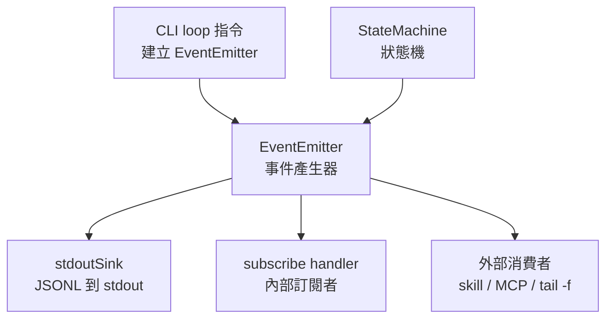
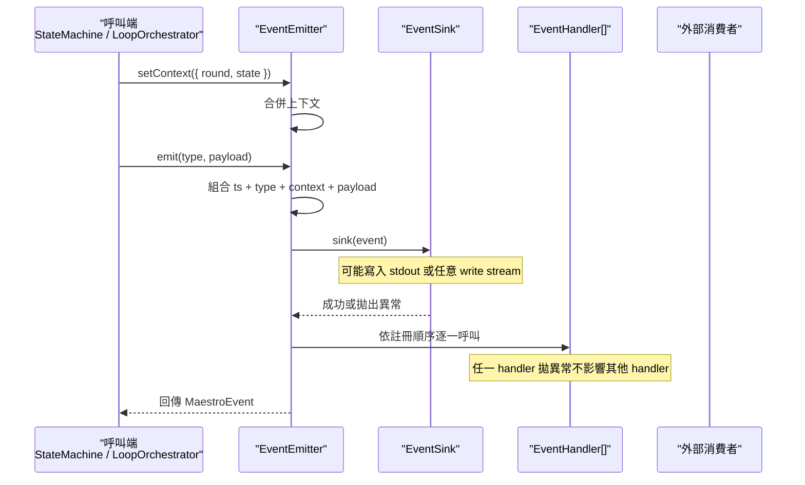
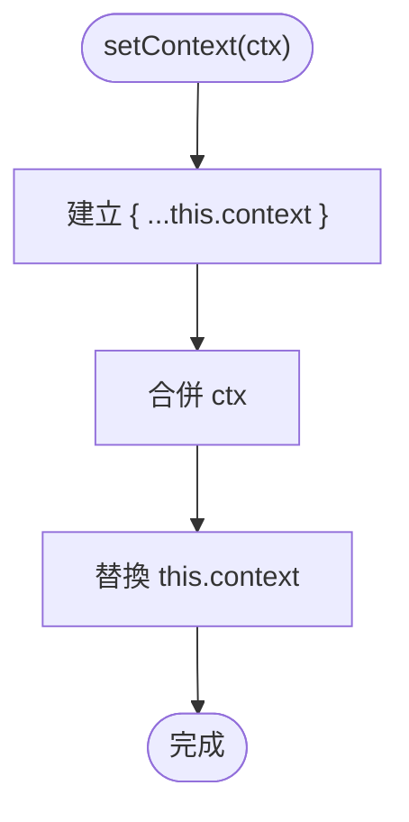
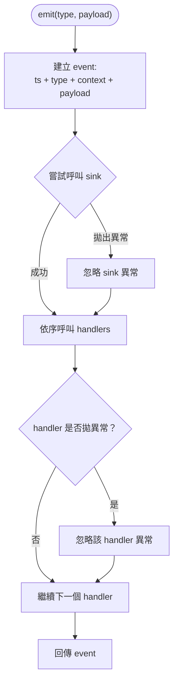
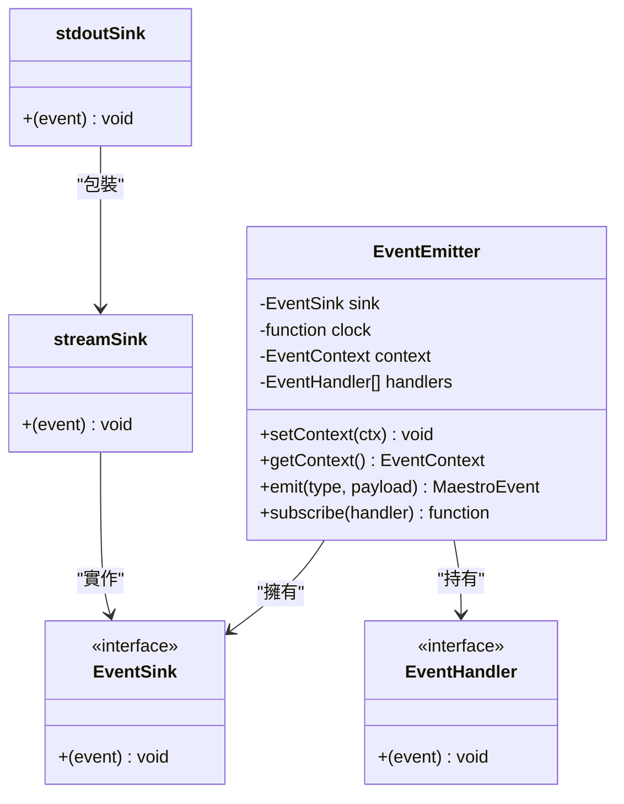
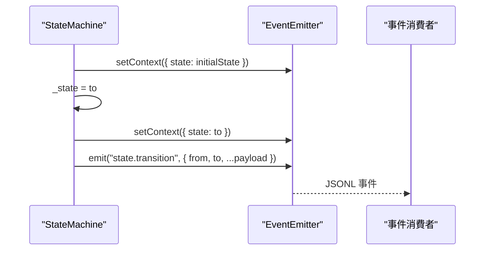
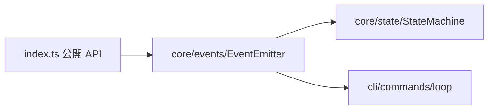
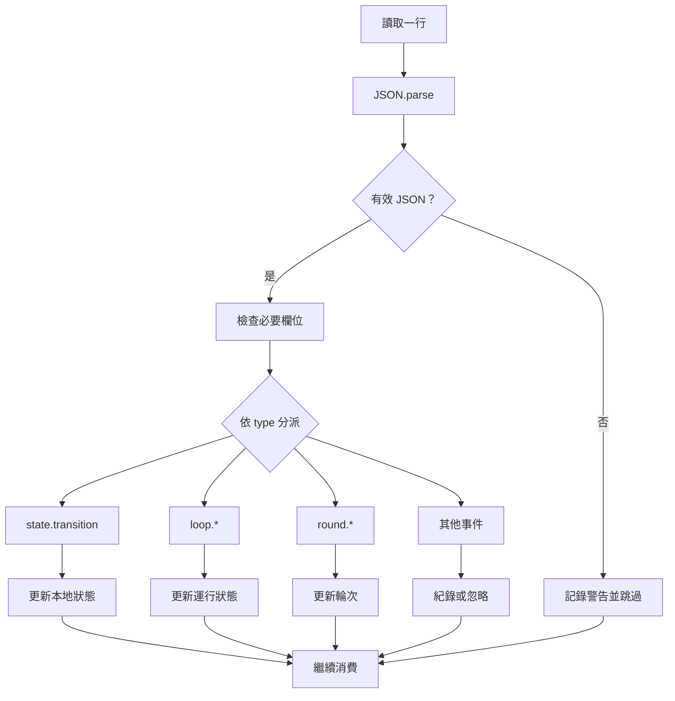

# 事件系統（EventEmitter）

**本文引用的檔案**

- [EventEmitter.ts](https://github.com/mikeah2011/maestro/blob/master/src/core/events/EventEmitter.ts)
- [EventEmitter.test.ts](https://github.com/mikeah2011/maestro/blob/master/tests/core/events/EventEmitter.test.ts)
- [StateMachine.ts](https://github.com/mikeah2011/maestro/blob/master/src/core/state/StateMachine.ts)
- [loop.ts](https://github.com/mikeah2011/maestro/blob/master/src/cli/commands/loop.ts)
- [index.ts](https://github.com/mikeah2011/maestro/blob/master/src/index.ts)
- [DESIGN.md](https://github.com/mikeah2011/maestro/blob/master/docs/DESIGN.md)

## 目錄

1. [簡介](#簡介)
2. [專案結構與角色定位](#專案結構與角色定位)
3. [核心資料模型](#核心資料模型)
4. [架構總覽](#架構總覽)
5. [詳細元件分析](#詳細元件分析)
6. [依賴與整合關係](#依賴與整合關係)
7. [事件流消費者整合指南](#事件流消費者整合指南)
8. [效能與錯誤隔離特性](#效能與錯誤隔離特性)
9. [事件序列範例](#事件序列範例)
10. [除錯技巧](#除錯技巧)
11. [結論](#結論)

## 簡介

`EventEmitter` 是 Maestro 所有領域事件的單一真實來源。它負責把狀態轉移、API 寫入、分類決策等動作，轉成結構化 JSONL 事件，並輸出到 stdout 或程式內部的訂閱者。

設計上的關鍵約束有三個：

1. **事件是 UI 的唯一真實來源**：CLI、Claude Code skill、MCP Server、`tail -f` 都應該從同一份事件流重建狀態，而不是各自解析 `console.log`。
2. **sink 失敗必須被隔離**：下游消費者崩潰不該拖垮主循環。
3. **上下文是可疊加的**：透過 `setContext` / `getContext` 攜帶當前 `round` 與 `state`，讓每個事件都能自我說明所屬的輪次與狀態。

這使得事件系統不只是「日誌」，而是可重播、可稽核、可串接外部工具的可序列化事件通道。

**章節來源**
- [EventEmitter.ts:1-22](https://github.com/mikeah2011/maestro/blob/master/src/core/events/EventEmitter.ts#L1-L22)
- [DESIGN.md:27-60](https://github.com/mikeah2011/maestro/blob/master/docs/DESIGN.md#L27-L60)

## 專案結構與角色定位

事件系統位於 `src/core/events`，屬於核心層，不依賴平台或 AI provider；其他模組只消費它的公開 API。



**圖表來源**
- [loop.ts:95-115](https://github.com/mikeah2011/maestro/blob/master/src/cli/commands/loop.ts#L95-L115)
- [EventEmitter.ts:40-108](https://github.com/mikeah2011/maestro/blob/master/src/core/events/EventEmitter.ts#L40-L108)
- [StateMachine.ts:78-114](https://github.com/mikeah2011/maestro/blob/master/src/core/state/StateMachine.ts#L78-L114)

### 主要角色

| 角色 | 責任 | 是否對外公開 |
|---|---|---|
| `MaestroEvent` | 單一事件的不可變結構，包含時間戳、類型、輪次、狀態與 payload | 是 |
| `EventSink` | 定義事件輸出的函式介面 | 是 |
| `EventHandler` | 定義內部訂閱者的函式介面 | 是 |
| `EventEmitter` | 建立事件、維護上下文、廣播給 sink 與 handlers | 是 |
| `streamSink` | 將事件序列化為 JSONL 行字串後寫入可寫 stream | 是 |
| `stdoutSink` | 包裝 `process.stdout` 的標準輸出 sink | 是 |
| `toLine` | 純函式，用於測試與外部序列化 | 是 |

**章節來源**
- [EventEmitter.ts:12-108](https://github.com/mikeah2011/maestro/blob/master/src/core/events/EventEmitter.ts#L12-L108)
- [index.ts:38-50](https://github.com/mikeah2011/maestro/blob/master/src/index.ts#L38-L50)

## 核心資料模型

### `MaestroEvent`

| 欄位 | 型別 | 必要 | 說明 |
|---|---|---:|---|
| `ts` | `string` | 是 | 由 emitter 的 clock 產生的 ISO-8601 時間戳 |
| `type` | `string` | 是 | 點分命名的事件類型，例如 `state.transition`、`round.start` |
| `round` | `number?` | 否 | 若已設定上下文，則為目前輪次 |
| `state` | `string?` | 否 | 若已設定上下文，則為目前狀態 |
| `payload` | `Record<string, unknown>` | 是 | 事件專屬資料；未提供時預設為空物件 |

這個結構的設計重點是：**所有非 context 欄位都是必填**，而 `round` 與 `state` 保留可選，因為並非所有事件都有完整上下文。不過在實際使用中，只要呼叫過 `setContext`，事件就會自動附加這些欄位。

### `EventSink` 與 `EventHandler`

兩者都是接收一個 `MaestroEvent` 的無回傳值函式，但用途不同：

| 類型 | 用途 | 典型實作 |
|---|---|---|
| `EventSink` | 決定事件的最終落點 | `stdoutSink`、`streamSink`、未來可加 file sink、network sink |
| `EventHandler` | 程序內即時處理事件 | pretty printer、metric collector、test assertion、internal bus |

這是雙通道設計：`sink` 是持久化通道，`handlers` 是即時通道。兩者互不影響，且都受到錯誤隔離保護。

**章節來源**
- [EventEmitter.ts:12-47](https://github.com/mikeah2011/maestro/blob/master/src/core/events/EventEmitter.ts#L12-L47)

## 架構總覽



**圖表來源**
- [EventEmitter.ts:48-96](https://github.com/mikeah2011/maestro/blob/master/src/core/events/EventEmitter.ts#L48-L96)
- [StateMachine.ts:100-114](https://github.com/mikeah2011/maestro/blob/master/src/core/state/StateMachine.ts#L100-L114)

## 詳細元件分析

### EventEmitter：事件工廠與廣播中心

`EventEmitter` 持有四項私有狀態：

1. `sink`：事件持久化目的地，預設為 no-op。
2. `clock`：可注入的時間來源，方便測試。
3. `context`：當前 `round` 與 `state`。
4. `handlers`：程序內訂閱者陣列。

#### 建構式行為

- 若未提供 `options.sink`，使用 `noopSink`，表示事件仍會產生但不寫入任何地方。
- `clock` 預設為 `() => new Date()`，測試中可用固定時間取代。

#### 上下文管理

`setContext` 使用淺複製合併新上下文，因此多次呼叫會累積：



**圖表來源**
- [EventEmitter.ts:52-54](https://github.com/mikeah2011/maestro/blob/master/src/core/events/EventEmitter.ts#L52-L54)

`getContext` 回傳一份新的副本，避免外部直接修改 emitter 的內部狀態。

#### emit 流程



**圖表來源**
- [EventEmitter.ts:60-92](https://github.com/mikeah2011/maestro/blob/master/src/core/events/EventEmitter.ts#L60-L92)

這裡的關鍵設計是：

- `emit` 的回傳值是 `MaestroEvent`，支援流式鏈式呼叫。
- payload 省略時預設為 `{}`。
- sink 與 handler 的異常都被 `try/catch` 包起來，確保主循環不會因為 stdout 關閉或某個訂閱者崩潰而中斷。

#### subscribe 模式

`subscribe` 會把 handler 加入陣列，並回傳一個取消函式。取消函式會過濾掉該 handler，使訂閱具備生命週期管理能力。

測試驗證了以下行為：

- 訂閱者依註冊順序執行。
- 取消訂閱後不再收到事件。
- 返回的事件結構正確。

**章節來源**
- [EventEmitter.ts:40-96](https://github.com/mikeah2011/maestro/blob/master/src/core/events/EventEmitter.ts#L40-L96)
- [EventEmitter.test.ts:1-107](https://github.com/mikeah2011/maestro/blob/master/tests/core/events/EventEmitter.test.ts#L1-L107)

### toLine、streamSink 與 stdoutSink

#### `toLine`

這是一個純函式，將 `MaestroEvent` 序列化為一列 JSONL 字串，結尾帶 `\n`。它不依賴 emitter 狀態，因此適合在測試、log 重播或其他序列化場景中使用。

#### `streamSink`

接受一個具有 `write(chunk: string)` 介面的目標，將每筆事件轉換為 JSONL 行後寫入。它抽象了「任何可寫串流」，不只是 Node.js `WriteStream`。

#### `stdoutSink`

直接包裝 `process.stdout`，是 CLI 預設的 JSONL 輸出方式。



**圖表來源**
- [EventEmitter.ts:40-108](https://github.com/mikeah2011/maestro/blob/master/src/core/events/EventEmitter.ts#L40-L108)

**章節來源**
- [EventEmitter.ts:98-108](https://github.com/mikeah2011/maestro/blob/master/src/core/events/EventEmitter.ts#L98-L108)

### StateMachine 如何攜帶 state 上下文

`StateMachine` 在構造時會先設定初始狀態，之後每次 `transition` 都會：

1. 更新內部 `_state`。
2. 呼叫 `emitter.setContext({ state: to })`。
3. 發出 `state.transition` 事件，並帶上 `from`、`to` 與額外的 payload。

這代表後續所有事件都會自動帶有最新狀態，而不需要每個模組自己追蹤狀態。



**圖表來源**
- [StateMachine.ts:78-114](https://github.com/mikeah2011/maestro/blob/master/src/core/state/StateMachine.ts#L78-L114)

**章節來源**
- [StateMachine.ts:1-114](https://github.com/mikeah2011/maestro/blob/master/src/core/state/StateMachine.ts#L1-L114)

### CLI 如何建立與連接事件流

`loop start` 指令是事件流的啟動點：

1. 建立 `EventEmitter`。
2. 設定初始 `round: 0`。
3. 訂閱 `stdoutSink`，讓 JSONL 輸出到主控台。
4. 訂閱 `prettySink`，提供人類可讀的提示訊息。
5. 發出 `loop.starting` 事件，包含 PR 編號、最大輪數、機器人過濾條件與 dry-run 標誌。

這顯示 CLI 不是唯一消費者；它只是把事件同時交給 stdout 與其他視覺化邏輯。

**章節來源**
- [loop.ts:95-115](https://github.com/mikeah2011/maestro/blob/master/src/cli/commands/loop.ts#L95-L115)

## 依賴與整合關係

### 內部依賴



**圖表來源**
- [index.ts:38-50](https://github.com/mikeah2011/maestro/blob/master/src/index.ts#L38-L50)
- [EventEmitter.ts:1-108](https://github.com/mikeah2011/maestro/blob/master/src/core/events/EventEmitter.ts#L1-L108)
- [StateMachine.ts:1-20](https://github.com/mikeah2011/maestro/blob/master/src/core/state/StateMachine.ts#L1-L20)
- [loop.ts:24-30](https://github.com/mikeah2011/maestro/blob/master/src/cli/commands/loop.ts#L24-L30)

### 外部消費者

根據設計文件，事件系統的預期消費者包括：

| 消費者 | 整合方式 | 輸入格式 |
|---|---|---|
| Claude Code skill | 呼叫 CLI 並將 JSONL 事件流管道到 TodoWrite 或類似 UI 機制 | JSONL |
| MCP Server | 暴露 `start_loop` / `get_status` / `stop_loop` / `get_round_summary` | JSONL 事件流 |
| `tail -f` | 直接觀察 stdout 事件檔或 pipe | JSONL |
| CI / 自動化腳本 | 解析 JSONL 以取得進度、成本與診斷資訊 | JSONL |

設計文件明確指出：

> 「UI 唯一真實來源：結構化 JSONL 事件，由 Claude Code skill、MCP 伺服器、純 `tail -f`、未來的 GitHub Action UI 讀取。」

**章節來源**
- [DESIGN.md:45-60](https://github.com/mikeah2011/maestro/blob/master/docs/DESIGN.md#L45-L60)

## 事件流消費者整合指南

### 基本整合步驟

任何消費者要消費事件，應遵循以下原則：

1. **不要解析 `console.log`**：只解析 JSONL 事件。
2. **逐行解碼**：每行都是一個獨立的 JSON 物件。
3. **容錯處理**：跳過無法解析的行，不要把整條流視為失敗。
4. **獨立於控制流程**：消費者崩潰不應導致 Maestro 主循環停止。
5. **保留原始事件**：如需重播或稽核，應保留未修改的 JSONL 行。

### 三種典型整合方式

#### 1. Claude Code skill

Claude Code skill 是一個 shell 包裝層，負責：

- 啟動 `maestro` CLI。
- 讀取 stdout 的 JSONL。
- 將事件轉換為 skill UI 可顯示的形式。
- 可能將控制指令回傳給 CLI。

#### 2. MCP Server

MCP Server 提供 RPC 方法：

| 方法 | 目的 | 事件關聯 |
|---|---|---|
| `start_loop` | 啟動循環 | 對應 `loop.starting` |
| `get_status` | 查詢目前狀態 | 對應 `state.transition` |
| `stop_loop` | 停止循環 | 對應最終停止事件 |
| `get_round_summary` | 取得輪次摘要 | 對應分類與修復結果事件 |

#### 3. `tail -f`

最簡單的整合方式是直接觀察 JSONL 輸出：

```bash
maestro loop start --pr <PR編號> 2>&1 | jq .
```

或寫入檔案後用 `tail -f` 監控：

```bash
maestro loop start --pr <PR編號> > events.jsonl 2>&1 &
tail -f events.jsonl
```

### 事件流處理建議流程



[此流程為概念性流程圖，不對應特定來源檔案]

## 效能與錯誤隔離特性

### 錯誤隔離策略

`EventEmitter.emit` 對 sink 與 handler 分別進行 `try/catch`。這意味著：

| 情境 | 行為 |
|---|---|
| stdout 被封鎖或關閉 | sink 拋出異常，被忽略，事件仍繼續產生 |
| 某個 handler 拋出異常 | 該 handler 被跳過，其餘 handler 仍會執行 |
| payload 含有非序列化內容 | 序列化失敗應由 payload 提供者負責，但 emitter 本身不主動驗證 payload |
| clock 回傳無效時間 | 測試環境可注入穩定 clock，生產環境使用 `new Date()` |

這種設計符合「UI 觀察器崩潰不該影響業務循環」的原則。

### 時間戳與可重播性

- `ts` 由 emitter 的 clock 產生，預設使用系統時間。
- `toLine` 使用 `JSON.stringify`，因此事件可重序列化。
- 測試使用固定日期驗證 JSONL 的確定性。

### 訂閱者數量與順序

- 訂閱者按註冊順序執行。
- 沒有背壓機制；如果 handler 很慢，會延遲 emit 的回傳。
- 沒有去重機制；重複 `emit` 會重複觸發所有訂閱者。

### 空間複雜度

- `handlers` 陣列隨訂閱者線性成長。
- `context` 每次 `setContext` 建立新物件，避免外部污染，但也增加少量分配。
- 事件本身不緩衝；除非外部 consumer 自行 buffering，否則 emitter 不持有歷史事件。

**章節來源**
- [EventEmitter.ts:48-96](https://github.com/mikeah2011/maestro/blob/master/src/core/events/EventEmitter.ts#L48-L96)
- [EventEmitter.test.ts:53-107](https://github.com/mikeah2011/maestro/blob/master/tests/core/events/EventEmitter.test.ts#L53-L107)

## 事件序列範例

以下是一個典型的 PR 審查循環事件序列。請注意，這是以事件結構為基礎的描述，而非直接貼出程式碼內容。

| 順序 | 事件類型 | round | state | payload 重點 |
|---:|---|---:|---|---|
| 1 | `loop.starting` | 0 | — | `prNumber`、`maxRounds`、`botFilter`、`dryRun` |
| 2 | `state.transition` | — | `writing` → `preflight` | `from`、`to` |
| 3 | `state.transition` | — | `preflight` → `pr_created` | `from`、`to` |
| 4 | `state.transition` | — | `pr_created` → `waiting_for_ci` | `from`、`to` |
| 5 | `state.transition` | — | `waiting_for_ci` → `waiting_for_bot` | `from`、`to` |
| 6 | `state.transition` | — | `waiting_for_bot` → `racing` | `from`、`to` |
| 7 | `state.transition` | — | `racing` → `classifying` | `from`、`to` |
| 8 | 分類事件 | — | `classifying` | finding hash、category、confidence |
| 9 | `state.transition` | — | `classifying` → `fixing` | `from`、`to` |
| 10 | 修復事件 | — | `fixing` | findings、AI suggestion |
| 11 | `state.transition` | — | `fixing` → `commit_pushed` | `from`、`to` |
| 12 | `state.transition` | 1 | `commit_pushed` → `waiting_for_ci` | `from`、`to` |
| 13 | 最終事件 | N | `stopped` | 收斂結果、升級原因或人工介入 |

### 單行 JSONL 範例結構

第一筆事件可能長這樣（僅描述結構）：

- `ts`：ISO-8601 時間戳
- `type`：`loop.starting`
- `payload`：包含 PR 編號、最大輪數、機器人過濾條件與 dry-run 旗標

狀態轉移事件則包含：

- `type`：`state.transition`
- `payload.from`：舊狀態
- `payload.to`：新狀態
- 若有上下文，也會包含 `round` 與 `state`

這類事件可直接用 `jq`、Python `jsonlines`、Node.js readline 或任何 JSONL 工具處理。

**章節來源**
- [loop.ts:100-115](https://github.com/mikeah2011/maestro/blob/master/src/cli/commands/loop.ts#L100-L115)
- [StateMachine.ts:88-114](https://github.com/mikeah2011/maestro/blob/master/src/core/state/StateMachine.ts#L88-L114)
- [EventEmitter.test.ts:82-107](https://github.com/mikeah2011/maestro/blob/master/tests/core/events/EventEmitter.test.ts#L82-L107)

## 除錯技巧

### 1. 直接觀察 stdout

當事件透過 `stdoutSink` 輸出時，可在開發階段用 JSON 格式化器查看：

```bash
bun run src/cli/index.ts loop start --pr 1 --dry-run 2>&1 | jq .
```

### 2. 分離事件與錯誤訊息

CLI 可能會把人類可讀訊息寫入 stderr，而 JSONL 事件寫入 stdout。除錯時建議分開重導：

```bash
bun run src/cli/index.ts loop start --pr 1 > events.jsonl 2> errors.log
```

### 3. 使用自訂 sink 收集事件

在測試或除錯模式中，可以用自訂 `EventSink` 收集事件，然後檢查事件順序、payload 與上下文：

- 確認 `round` 是否在適當時機遞增。
- 確認 `state` 是否符合狀態機允許的轉移。
- 確認 payload 是否包含足夠的診斷資訊。

### 4. 驗證 JSONL 完整性

可使用 `toLine` 或相同序列化邏輯反序列化每一行，驗證：

- 每行結尾有 `\n`。
- 每行可單獨 `JSON.parse`。
- 必要欄位存在。
- `ts` 是合法 ISO-8601 字串。

### 5. 檢查上下文疊加問題

若事件中的 `round` 或 `state` 不符合預期，優先檢查：

- 是否在正確的時機呼叫 `setContext`。
- 是否有子範圍覆寫上下文卻忘記還原。
- `getContext` 是否被意外修改。

### 6. 模擬時間戳

由於 `EventEmitter` 建構式支援注入 `clock`，除錯可重用固定時間，避免時間戳波動干擾比較。

**章節來源**
- [EventEmitter.test.ts:1-20](https://github.com/mikeah2011/maestro/blob/master/tests/core/events/EventEmitter.test.ts#L1-L20)
- [EventEmitter.test.ts:82-107](https://github.com/mikeah2011/maestro/blob/master/tests/core/events/EventEmitter.test.ts#L82-L107)
- [loop.ts:95-115](https://github.com/mikeah2011/maestro/blob/master/src/cli/commands/loop.ts#L95-L115)

## 結論

`EventEmitter` 是 Maestro 可觀測性的核心。它把原本分散的狀態變化、API 操作與分類決策，統一為可序列化、可重播、可跨工具共享的 JSONL 事件。

其最重要的三個設計選擇是：

1. **單一事件來源**：所有重要動作都經過 `emit`，便於稽核與重播。
2. **錯誤隔離**：sink 與 handler 的異常不會摧毀主循環。
3. **上下文攜帶**：`setContext` / `getContext` 讓 `round` 與 `state` 成為事件的內在屬性，而非外部追蹤狀態。

對於外部整合者來說，最安全的做法是把事件視為**不可變的 JSONL 事實流**：逐行解析、獨立容錯、保留原始行，並根據 `type` 分派處理邏輯。這樣既能支援 Claude Code skill、MCP Server，也能支援 `tail -f`、CI 儀表板與未來新增的 UI 產品。