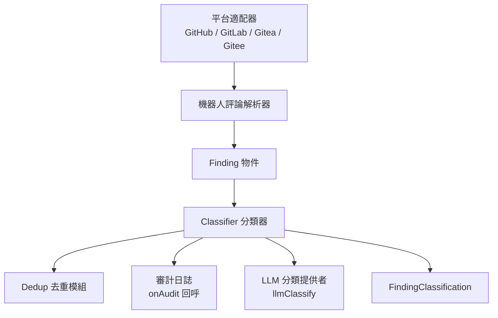
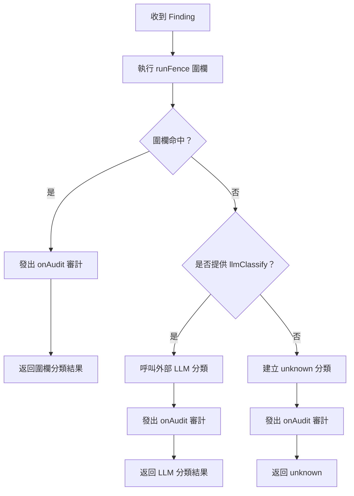
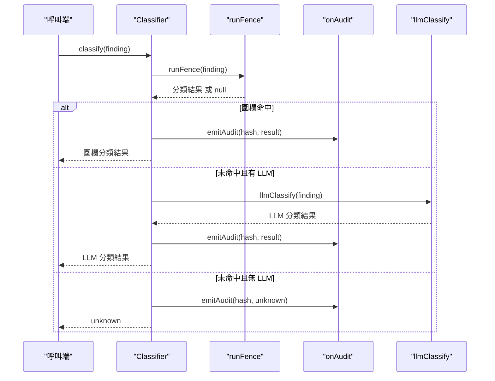
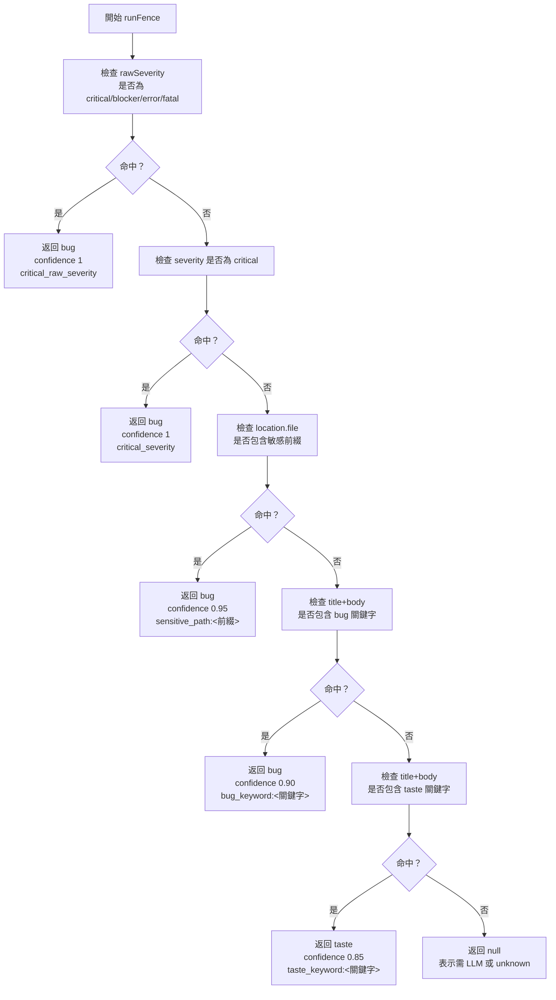
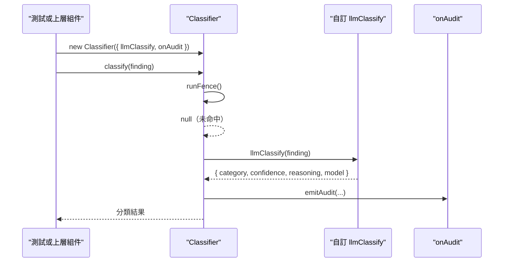

# Classifier 分類器

**本文引用的檔案**

- [Classifier.ts](https://github.com/mikeah2011/maestro/blob/master/src/core/classify/Classifier.ts)
- [Finding.ts](https://github.com/mikeah2011/maestro/blob/master/src/core/types/Finding.ts)
- [Classifier.test.ts](https://github.com/mikeah2011/maestro/blob/master/tests/core/classify/Classifier.test.ts)
- [DESIGN.md](https://github.com/mikeah2011/maestro/blob/master/docs/DESIGN.md)
- [Dedup.ts](https://github.com/mikeah2011/maestro/blob/master/src/core/dedup/Dedup.ts)
- [SecretScanner.ts](https://github.com/mikeah2011/maestro/blob/master/src/core/security/SecretScanner.ts)

## 目錄

1. [簡介](#簡介)
2. [專案結構與定位](#專案結構與定位)
3. [核心資料模型](#核心資料模型)
4. [圍欄式設計模式總覽](#圍欄式設計模式總覽)
5. [分類階層與置信度閾值](#分類階層與置信度閾值)
6. [詳細組件分析](#詳細組件分析)
7. [與其他組件的整合](#與其他組件的整合)
8. [規則配置與擴展指南](#規則配置與擴展指南)
9. [效能特性與優化建議](#效能特性與優化建議)
10. [常見問題診斷](#常見問題診斷)
11. [結論](#結論)

## 簡介

Classifier 是 Maestro 中負責將審查機器人產出的原始發現轉化為可操作分類的核心組件。它採用「圍欄式」設計：在呼叫任何大型語言模型之前，先用一連串確定性規則進行短路判斷；只有當所有規則都未命中時，才退回到 LLM 模糊分類或 `unknown`。

這樣的設計有三個直接好處：

- **成本可控**：常見、明確的 bug、品味偏好與敏感路徑問題不需要走 LLM。
- **行為可審計**：每次分類都會透過 `onAudit` 輸出決策軌跡，包含是否由圍欄命中、命中的規則名稱、分類結果與置信度。
- **優先級明確**：嚴重程度、敏感路徑、關鍵字等規則依固定順序短路，避免 LLM 的隨機性或上下文差異影響高風險判定。

**章節來源**
- [Classifier.ts:1-191](https://github.com/mikeah2011/maestro/blob/master/src/core/classify/Classifier.ts#L1-L191)
- [DESIGN.md:1-200](https://github.com/mikeah2011/maestro/blob/master/docs/DESIGN.md#L1-L200)

## 專案結構與定位

Classifier 位於 `src/core/classify/Classifier.ts`，屬於系統核心層的領域邏輯模組。它的輸入是經過平台適配器與機器人解析器處理後的 `Finding`，輸出是帶有分類結果的 `FindingClassification`。

**圖表來源**
- [Classifier.ts:1-191](https://github.com/mikeah2011/maestro/blob/master/src/core/classify/Classifier.ts#L1-L191)
- [Finding.ts:1-129](https://github.com/mikeah2011/maestro/blob/master/src/core/types/Finding.ts#L1-L129)
- [DESIGN.md:1-200](https://github.com/mikeah2011/maestro/blob/master/docs/DESIGN.md#L1-L200)

Classifier 本身不直接讀取 `.maestro.yaml` 中的 rules 或 keywords；目前程式碼內建了三套規則集合：

| 規則類型 | 位置 | 用途 |
|---|---|---|
| 關鍵嚴重程度 | `CRITICAL_RAW_SEVERITIES` | 快速識別 bot 標記為 critical / blocker / error / fatal 的問題 |
| Bug 關鍵字 | `BUG_KEYWORDS` | 偵測記憶體損壞、注入、溢位、死結等安全與穩定性問題 |
| Taste 關鍵字 | `TASTE_KEYWORDS` | 偵測純風格、命名偏好、非必要性建議 |
| 敏感路徑前綴 | `SENSITIVE_PATH_PREFIXES` | 將 `/auth/`、`/crypto/`、`/payment/` 等路徑內的發現預設視為 bug |

**章節來源**
- [Classifier.ts:38-90](https://github.com/mikeah2011/maestro/blob/master/src/core/classify/Classifier.ts#L38-L90)

## 核心資料模型

### Finding 物件

`Finding` 代表一次單一機器人審查中的一項發現。Classifier 主要使用以下欄位：

| 欄位 | 型別 | 說明 |
|---|---|---|
| `hash` | `string` | 穩定雜湊，用於去重與審計關聯 |
| `bot` | `BotIdentity` | 指出是哪個機器人提出該發現 |
| `location.file` | `string` | 程式碼檔案路徑，用於敏感路徑匹配 |
| `severity` | `Severity` | 正規化後的嚴重程度 |
| `rawSeverity` | `string \| undefined` | 機器人原始嚴重程度字串 |
| `title` | `string` | 簡短標題，用於關鍵字匹配 |
| `body` | `string` | 完整正文，用於關鍵字匹配 |
| `classification` | `FindingClassification \| undefined` | 分類結果（可選） |

**章節來源**
- [Finding.ts:34-95](https://github.com/mikeah2011/maestro/blob/master/src/core/types/Finding.ts#L34-L95)

### FindingClassification 模型

`FindingClassification` 是 Classifier 的正式輸出結構，也是整個系統共享的分類結果格式：

| 欄位 | 型別 | 必填 | 說明 |
|---|---|---:|---|
| `category` | `FindingCategory` | 是 | 分類類別 |
| `confidence` | `number` | 是 | 0 到 1 的置信度數值 |
| `viaFence` | `boolean` | 是 | 是否由確定性圍欄短路返回 |
| `fenceRule` | `string \| undefined` | 否 | 若 viaFence 為 true，標示命中的規則名稱 |
| `model` | `string \| undefined` | 否 | 若來自 LLM，標示使用的模型 |
| `reasoning` | `string \| undefined` | 否 | 供審計記錄使用的推理文字 |

#### FindingCategory 定義

分類類別共有六種：

| 分類 | 意義 | 典型處理方式 |
|---|---|---|
| `bug` | 真實錯誤，需要在本輪修復 | 進入 FixEngine 或人工修復流程 |
| `yagni` | 有意義但超出當前範圍 | 延後處理 |
| `wrong` | 機器人判斷錯誤 | 推回並附上推理 |
| `taste` | 品味偏好或風格偏好 | 通常忽略 |
| `duplicate` | 本輪已重複 | 由 Dedup 合併 |
| `unknown` | 分類器無法決定 | 可作為後續策略的訊號 |

**章節來源**
- [Finding.ts:18-33](https://github.com/mikeah2011/maestro/blob/master/src/core/types/Finding.ts#L18-L33)
- [Finding.ts:97-114](https://github.com/mikeah2011/maestro/blob/master/src/core/types/Finding.ts#L97-L114)

## 圍欄式設計模式總覽

Classifier 的核心方法 `classify` 控制整體流程：

**圖表來源**
- [Classifier.ts:92-133](https://github.com/mikeah2011/maestro/blob/master/src/core/classify/Classifier.ts#L92-L133)

### 短路優先級

圍欄規則的優先級是「第一個命中即返回」：

1. **原始嚴重程度為關鍵值**：`critical`、`blocker`、`error`、`fatal`（大小寫不敏感）。
2. **正規化嚴重程度為 `critical`**。
3. **檔案路徑落在敏感路徑前綴**。
4. **標題或正文包含 bug 關鍵字**。
5. **標題或正文包含 taste 關鍵字**。
6. **全部未命中**：嘗試 LLM；若無 LLM，則回傳 `unknown`。

這種順序非常重要：即使一個問題同時符合 bug 關鍵字和 taste 關鍵字，只要它先被更嚴格的規則命中，就不會落到後面較弱的規則。

### 圍欄規則清單

| 優先序 | 規則 | 分類 | 置信度 | fenceRule 格式 |
|---:|---|---|---:|---|
| 1 | 原始嚴重程度為關鍵值 | `bug` | `1` | `critical_raw_severity` |
| 2 | 正規化嚴重程度為 `critical` | `bug` | `1` | `critical_severity` |
| 3 | 檔案路徑包含敏感前綴 | `bug` | `0.95` | `sensitive_path:<前綴>` |
| 4 | 標題或正文包含 bug 關鍵字 | `bug` | `0.90` | `bug_keyword:<關鍵字>` |
| 5 | 標題或正文包含 taste 關鍵字 | `taste` | `0.85` | `taste_keyword:<關鍵字>` |
| 6 | 無圍欄命中且無 LLM | `unknown` | `0` | 無 |

**章節來源**
- [Classifier.ts:92-175](https://github.com/mikeah2011/maestro/blob/master/src/core/classify/Classifier.ts#L92-L175)

## 分類階層與置信度閾值

Classifier 並未實現完整的狀態機或動態閾值切換；它使用的是「硬編碼優先級 + 固定置信度」的策略。這讓分類行為容易測試、容易審計，但也意味著擴充新規則時必須自行評估對既有優先級的衝擊。

| 分類 | 置信度 | 解讀 |
|---|---:|---|
| `bug`（原始關鍵嚴重程度） | `1` | 機器人已明確標記為致命或阻塞等級 |
| `bug`（正規化關鍵嚴重程度） | `1` | 系統正規化後仍為最高風險 |
| `bug`（敏感路徑） | `0.95` | 程式碼位於認證、加密、付款等敏感區域 |
| `bug`（關鍵字） | `0.90` | 內容包含已知漏洞或錯誤關鍵字 |
| `taste` | `0.85` | 偏向風格或次要建議 |
| `unknown` | `0` | 沒有足夠資訊做確定性分類 |

### 置信度的實際作用

目前 Classifier 內部不會根據 `confidence` 觸發分支邏輯；它只是把這個數值寫進 `FindingClassification` 並透過 `onAudit` 暴露出去。因此：

- 下游消費者可以根據置信度過濾低信心分類。
- 審計系統可以用置信度衡量分類器的確定性強度。
- 未來可擴展為「低於某個閾值才強制走 LLM」的機制，但目前尚未實作。

**章節來源**
- [Classifier.ts:92-175](https://github.com/mikeah2011/maestro/blob/master/src/core/classify/Classifier.ts#L92-L175)
- [Finding.ts:97-114](https://github.com/mikeah2011/maestro/blob/master/src/core/types/Finding.ts#L97-L114)

## 詳細組件分析

### classify 方法

`classify` 是外部調用的主入口。它的責任是協調圍欄、LLM 與審計。

**圖表來源**
- [Classifier.ts:92-133](https://github.com/mikeah2011/maestro/blob/master/src/core/classify/Classifier.ts#L92-L133)

重點行為：

- 如果圍欄命中，直接返回，不會呼叫 LLM。
- 如果圍欄未命中且提供了 `llmClassify`，則等待其 Promise 完成。
- 如果兩者都沒有，返回 `category: 'unknown'`、`confidence: 0`、`viaFence: false`。
- 所有分支都會呼叫 `emitAudit`，確保審計完整性。

### runFence 方法

`runFence` 是圍欄的核心演算法，按固定順序檢查五類規則。

**圖表來源**
- [Classifier.ts:135-175](https://github.com/mikeah2011/maestro/blob/master/src/core/classify/Classifier.ts#L135-L175)

#### 規則細節

| 規則 | 匹配方式 | 時間複雜度 | 備註 |
|---|---|---:|---|
| 原始嚴重程度 | 查 `ReadonlySet` | O(1) | 先轉小寫再比對 |
| 正規化嚴重程度 | 字串相等 | O(1) | 僅匹配 `critical` |
| 敏感路徑 | 遍歷前綴陣列並呼叫 `includes` | O(P × N) | P 為前綴數量，N 為路徑長度 |
| Bug 關鍵字 | 遍歷關鍵字陣列並呼叫 `includes` | O(K × M) | K 為關鍵字數量，M 為搜尋字串長度 |
| Taste 關鍵字 | 遍歷關鍵字陣列並呼叫 `includes` | O(T × M) | T 為 taste 關鍵字數量 |

#### 路徑匹配行為

敏感路徑匹配是「子字串包含」而非「嚴格路徑前綴」。例如：

- `src/auth/login.ts` 會被 `/auth/` 命中。
- `lib/crypto/aes.ts` 會被 `/crypto/` 命中。
- `services/payment/stripe.ts` 會被 `/payment/` 命中。
- 一般工具函式如 `src/utils/format.ts` 不會命中。

這意味著新增敏感前綴時要謹慎，避免過於寬鬆導致誤判。

#### 關鍵字匹配行為

Bug 關鍵字與 taste 關鍵字都是大小寫不敏感的子字串匹配。現有規則涵蓋：

- 記憶體與程式錯誤：空指標、使用後釋放、緩衝區溢位、堆疊溢位、記憶體洩漏、離界存取等。
- 安全漏洞：SQL 注入、XSS、CSRF、反序列化、權限提升、路徑遍歷等。
- 穩定性問題：race condition、deadlock、infinite loop、除零等。
- 品味偏好：nit、cosmetic、style preference、just a suggestion、optionally 等。

**章節來源**
- [Classifier.ts:92-175](https://github.com/mikeah2011/maestro/blob/master/src/core/classify/Classifier.ts#L92-L175)

### emitAudit 方法

`emitAudit` 是一個同步回呼封裝，把所有分類結果轉換成 `ClassifierAuditEntry`：

| 欄位 | 說明 |
|---|---|
| `findingHash` | 關聯原始發現的雜湊 |
| `category` | 最終分類 |
| `confidence` | 置信度 |
| `viaFence` | 是否由圍欄短路 |
| `fenceRule` | 圍欄命中的規則名稱 |
| `model` | 若來自 LLM，標示模型名稱 |

這個設計讓審計資料與分類邏輯解耦：Classifier 不需要知道審計如何儲存，只需調用可注入的回呼。

**章節來源**
- [Classifier.ts:177-191](https://github.com/mikeah2011/maestro/blob/master/src/core/classify/Classifier.ts#L177-L191)

### LLM 回退機制

Classifier 本身不產生 prompt，也不直接呼叫 Anthropic 或 Claude Code。它只要求外部提供一個 `llmClassify` 函式，接收 `Finding` 並回傳 `FindingClassification`。

這帶來幾個重要特性：

1. **Provider 獨立**：Classifier 不知道底層是 Claude、OpenAI、Gemini 還是自訂 HTTP 服務。
2. **可測試**：單元測試可直接 mock `llmClassify`，不需要網路連線。
3. **可替換**：不同環境可使用不同模型；高頻低風險分類可用便宜模型。
4. **Prompt 生成不在 Classifier 中**：prompt 工程應放在呼叫方或 AI Provider 層。

**圖表來源**
- [Classifier.ts:92-133](https://github.com/mikeah2011/maestro/blob/master/src/core/classify/Classifier.ts#L92-L133)
- [Classifier.test.ts:150-190](https://github.com/mikeah2011/maestro/blob/master/tests/core/classify/Classifier.test.ts#L150-L190)

**章節來源**
- [Classifier.ts:23-37](https://github.com/mikeah2011/maestro/blob/master/src/core/classify/Classifier.ts#L23-L37)
- [Classifier.ts:92-133](https://github.com/mikeah2011/maestro/blob/master/src/core/classify/Classifier.ts#L92-L133)
- [Classifier.test.ts:150-190](https://github.com/mikeah2011/maestro/blob/master/tests/core/classify/Classifier.test.ts#L150-L190)

## 與其他組件的整合

### 與 Dedup 的關係

Dedup 負責「同一輪中重複問題的合併」，Classifier 負責「單個問題的可操作性分類」。兩者的關注點不同：

| 組件 | 主要問題 | 輸入 | 輸出 |
|---|---|---|---|
| Classifier | 這是什麼類型的問題？ | 單一 `Finding` | `FindingClassification` |
| Dedup | 這個問題是否已存在？ | 多個 `Finding` | `unique` 與 `duplicates` |

Dedup 的三層架構如下：

1. 精確雜湊匹配：消除約 60% 重複。
2. Levenshtein 標題相似度：消除約 25% 重複。
3. 語義 LLM 去重：處理剩餘部分，每輪上限 10 次呼叫。

雖然目前 Classifier 與 Dedup 沒有直接的程式碼耦合，但它們共用相同的 `Finding` 與 `FindingClassification` 型別，因此實務上常組成「先去重、再分類」或「邊收集邊分類」的管道。

**章節來源**
- [Dedup.ts:1-153](https://github.com/mikeah2011/maestro/blob/master/src/core/dedup/Dedup.ts#L1-L153)
- [Finding.ts:1-129](https://github.com/mikeah2011/maestro/blob/master/src/core/types/Finding.ts#L1-L129)

### 與 SecretScanner 的關係

SecretScanner 不是分類器的一部分，而是外發內容的安全防護層。它掃描回覆文字與 PR 更新內容，找出可能洩露的密鑰、JWT、AWS key、Stripe key 等，並產出遮蔽版本。

Classifier 與 SecretScanner 的共同點是：

- 兩者都依賴「模式匹配」而非 LLM。
- 兩者都可透過注入或擴展增強。
- 兩者都應該在寫入平台前執行。

差異在於：

| 面向 | Classifier | SecretScanner |
|---|---|---|
| 目標 | 分類問題性質 | 防止敏感資訊外洩 |
| 輸入 | `Finding` | 字串 |
| 輸出 | `FindingClassification` | 遮蔽後字串與 findings |
| 風險 | 分類錯誤可能延遲修復 | 洩漏密鑰可能造成資安事件 |

**章節來源**
- [SecretScanner.ts:1-136](https://github.com/mikeah2011/maestro/blob/master/src/core/security/SecretScanner.ts#L1-L136)

### 與系統設計的對應關係

設計文件明確將 Classifier 描述為「圍欄式設計：確定性規則優先，在任何 LLM 呼叫之前短路」。這與程式碼中的 `runFence`、`classify`、`onAudit` 三者完全一致。

**章節來源**
- [DESIGN.md:1-200](https://github.com/mikeah2011/maestro/blob/master/docs/DESIGN.md#L1-L200)

## 規則配置與擴展指南

### 現有的內建規則

Classifier 目前沒有從設定檔讀取 rules、keywords、path patterns 的邏輯；這些規則直接寫在程式碼中。若要理解如何配置，必須先了解它們在程式碼中的角色：

| 項目 | 變數或位置 | 可調整範圍 |
|---|---|---|
| 關鍵原始嚴重程度 | `CRITICAL_RAW_SEVERITIES` | 新增或移除嚴重程度字串 |
| Bug 關鍵字 | `BUG_KEYWORDS` | 新增漏洞、錯誤、穩定性相關關鍵字 |
| Taste 關鍵字 | `TASTE_KEYWORDS` | 新增風格、命名、樣式偏好關鍵字 |
| 敏感路徑前綴 | `SENSITIVE_PATH_PREFIXES` | 新增認證、金流、安全相關路徑 |
| 分類優先級 | `runFence` 方法 | 改變規則檢查順序會影響短路行為 |
| 分類置信度 | 各規則 return 區塊 | 調整置信度但不改變分類邏輯 |

### 如何配置 rules、keywords、path patterns

由於目前沒有 YAML schema 支援，「配置」在程式碼層面等同於「修改內建常數陣列」。以下說明各種擴展情境。

#### 新增自訂 bug 關鍵字

適合情境：

- 團隊有特定框架的錯誤模式，例如特定異常名稱、框架專屬漏洞。
- 靜態分析工具產出之關鍵字需要被 Classifier 識別。

步驟：

1. 找到 `BUG_KEYWORDS` 陣列。
2. 新增小寫形式關鍵字，避免大小寫不一致導致漏判。
3. 保持關鍵字具備足夠辨識度，避免太短造成誤判。
4. 透過單元測試驗證新關鍵字能命中。

#### 新增自訂 taste 關鍵字

適合情境：

- 團隊有固定的審查慣用語，例如特定 nit prefix、review comment 模板。
- 想減少對純風格問題的干擾。

步驟：

1. 找到 `TASTE_KEYWORDS` 陣列。
2. 加入團隊常用語句或標籤。
3. 注意 taste 會將問題分類為 `taste`，置信度為 `0.85`，通常較低風險。

#### 新增敏感路徑

適合情境：

- 專案使用特定目錄結構，例如 `/internal/auth/`、`/api/v2/payments/`。
- 想將新增的認證、金流、密碼管理模組自動升級為 bug 分類。

步驟：

1. 找到 `SENSITIVE_PATH_PREFIXES` 陣列。
2. 新增路徑前綴。
3. 確認路徑是「包含匹配」，避免意外命中其他目錄。
4. 使用測試驗證路徑命中與未命中情況。

#### 新增自訂分類規則

如果需要更複雜的規則，例如：

- 依據 bot 身份調整優先級。
- 依據 PR 階段或 branch 調整分類。
- 結合多個欄位做條件判斷。

建議做法：

1. 在 `runFence` 中加入新的規則檢查。
2. 為新規則設定合理的 `fenceRule` 名稱，便於審計追蹤。
3. 設定合理的 `confidence`。
4. 為每個新規則撰寫測試用例。
5. 考慮是否應該放在圍欄中，還是交給 LLM 處理。

### 如何擴展 LLM 分類

Classifier 已經開放 `llmClassify` 注入點。擴展 LLM 分類時，建議遵循以下原則：

1. **不要複製 Classifier 的規則到 LLM prompt**：避免重複工作與行為不一致。
2. **只在圍欄未命中時使用 LLM**：保留圍欄的成本優勢。
3. **prompt 中納入 finding 的關鍵欄位**：`title`、`body`、`location.file`、`severity`、`rawSeverity`。
4. **要求 LLM 回傳標準結構**：`category`、`confidence`、`reasoning`、`model`。
5. **限制 LLM 呼叫次數**：在循環層級或批次層級加上預算限制。
6. **審計 LLM 結果**：透過 `onAudit` 記錄 model 與 reasoning，方便事後稽核。

**章節來源**
- [Classifier.ts:38-175](https://github.com/mikeah2011/maestro/blob/master/src/core/classify/Classifier.ts#L38-L175)
- [Classifier.test.ts:1-L258](https://github.com/mikeah2011/maestro/blob/master/tests/core/classify/Classifier.test.ts#L1-L258)

## 效能特性與優化建議

### 時間複雜度分析

假設：

- P = 敏感路徑前綴數量
- B = bug 關鍵字數量
- T = taste 關鍵字數量
- N = 檔案路徑長度
- M = 標題與正文總長度

則 `runFence` 的最壞情況時間複雜度為：

O(P × N + B × M + T × M)

其中：

- 嚴重程度檢查是 O(1)。
- 路徑匹配是線性於前綴數量與路徑長度。
- 關鍵字匹配是線性於關鍵字數量與搜尋字串長度。

對於一般 PR 審查規模，P、B、T 都是常數級別的陣列，因此 Classifier 的運作非常輕量。

### 空間複雜度

- 內建規則集合是模組層级的 `ReadonlySet` 與 `ReadonlyArray`，全域共享。
- 每次 `classify` 不會分配大量臨時物件。
- `emitAudit` 只構造一個小型審計物件。

整體空間複雜度接近 O(1) 額外空間。

### 優化建議

| 情境 | 建議 |
|---|---|
| 關鍵字非常多 | 考慮使用 Trie 或正規表達式預編譯，降低重複 `includes` 開銷 |
| 路徑前綴很多 | 可改用前綴樹或排序後二分查找 |
| 需要動態規則 | 將 rules、keywords、path patterns 抽離為可載入設定，並加入 schema 驗證 |
| 需要更高靈活性 | 為 rule 增加 weight、scope、enabled flag 等元資料 |
| 需要性能監控 | 在 `onAudit` 中加入執行時間與規則命中統計 |
| 需要防呆 | 為新增規則加入單元測試，特別是邊界與衝突案例 |

### 與 Dedup 的效能協同

Dedup 能在 Classifier 之前減少問題數量，間接降低 Classifier 的總工作量。最佳實踐通常是：

1. 先收集多機器人輸出。
2. 使用 Dedup 合併重複問題。
3. 對 unique findings 逐一呼叫 Classifier。
4. 將分類結果與審計資料匯出。

這樣可以避免對同一問題重複跑圍欄與 LLM。

**章節來源**
- [Classifier.ts:135-175](https://github.com/mikeah2011/maestro/blob/master/src/core/classify/Classifier.ts#L135-L175)
- [Dedup.ts:1-153](https://github.com/mikeah2011/maestro/blob/master/src/core/dedup/Dedup.ts#L1-L153)

## 常見問題診斷

### 問題：為什麼我的 sensitive path 沒有命中？

可能原因：

- 路徑不包含所設定前綴。
- 前綴過長或方向錯誤。
- 路徑匹配是子字串包含，不是嚴格前綴。
- 檔案路徑格式與預期不符。

診斷方式：

1. 檢查 `finding.location.file` 的實際值。
2. 確認敏感前綴以 `/` 開頭並包含尾斜線。
3. 使用測試模擬相同路徑驗證匹配行為。

**章節來源**
- [Classifier.ts:152-163](https://github.com/mikeah2011/maestro/blob/master/src/core/classify/Classifier.ts#L152-L163)
- [Classifier.test.ts:70-100](https://github.com/mikeah2011/maestro/blob/master/tests/core/classify/Classifier.test.ts#L70-L100)

### 問題：為什麼 bug 關鍵字沒有命中？

可能原因：

- 關鍵字大小寫不一致。
- 關鍵字太短，與正常詞彙重疊。
- 關鍵字不在 `BUG_KEYWORDS` 中。
- 標題或正文未包含預期文字。

診斷方式：

1. 檢查 `title` 與 `body` 是否確實包含該關鍵字。
2. 確認關鍵字是小寫形式。
3. 新增測試覆蓋該關鍵字。

**章節來源**
- [Classifier.ts:165-174](https://github.com/mikeah2011/maestro/blob/master/src/core/classify/Classifier.ts#L165-L174)
- [Classifier.test.ts:102-148](https://github.com/mikeah2011/maestro/blob/master/tests/core/classify/Classifier.test.ts#L102-L148)

### 問題：為什麼 taste 關鍵字沒有命中？

可能原因：

- taste 關鍵字與 bug 關鍵字衝突，而 bug 規則優先級更高。
- 關鍵字不在 `TASTE_KEYWORDS` 中。
- 文字出現在非預期位置。

診斷方式：

1. 確認該問題沒有先被 bug 規則命中。
2. 檢查 taste 關鍵字是否存在。
3. 查看 `fenceRule` 是否顯示其他規則已先行短路。

**章節來源**
- [Classifier.ts:165-174](https://github.com/mikeah2011/maestro/blob/master/src/core/classify/Classifier.ts#L165-L174)
- [Classifier.test.ts:150-190](https://github.com/mikeah2011/maestro/blob/master/tests/core/classify/Classifier.test.ts#L150-L190)

### 問題：為什麼 LLM 沒有被呼叫？

可能原因：

- 圍欄已命中，所以直接短路。
- 沒有提供 `llmClassify` 選項。
- 測試中使用 mock 但未正確注入。

診斷方式：

1. 檢查圍欄規則是否命中。
2. 確認建構子傳入了 `llmClassify`。
3. 檢查 `onAudit` 中 viaFence 與 fenceRule。

**章節來源**
- [Classifier.ts:92-133](https://github.com/mikeah2011/maestro/blob/master/src/core/classify/Classifier.ts#L92-L133)
- [Classifier.test.ts:150-190](https://github.com/mikeah2011/maestro/blob/master/tests/core/classify/Classifier.test.ts#L150-L190)

### 問題：為什麼分類結果是 unknown？

可能原因：

- 圍欄未命中。
- 沒有提供 LLM。
- 這是一個既不明顯是 bug、也不是 taste 的中間問題。

診斷方式：

1. 檢查圍欄規則是否全部未命中。
2. 確認是否提供 `llmClassify`。
3. 觀察 `onAudit` 輸出，確認分類流程。
4. 考慮是否需要新增規則或改善 LLM prompt。

**章節來源**
- [Classifier.ts:113-133](https://github.com/mikeah2011/maestro/blob/master/src/core/classify/Classifier.ts#L113-L133)
- [Classifier.test.ts:150-190](https://github.com/mikeah2011/maestro/blob/master/tests/core/classify/Classifier.test.ts#L150-L190)

### 問題：審計日誌缺少某些欄位？

可能原因：

- 圍欄命中時沒有 `model`。
- LLM 命中時可能有 `model` 與 `reasoning`。
- `fenceRule` 僅在 viaFence 為 true 時有意義。

診斷方式：

1. 檢查 viaFence。
2. 檢查 fenceRule。
3. 檢查 model 與 reasoning 是否由 LLM 提供。

**章節來源**
- [Classifier.ts:177-191](https://github.com/mikeah2011/maestro/blob/master/src/core/classify/Classifier.ts#L177-L191)

## 結論

Classifier 的設計重點是「確定性優先、LLM 輔助」。它透過圍欄式規則短路掉高風險、高頻率、易判斷的分類，讓 LLM 專注處理真正模糊的問題。這個設計在成本、速度、可審計性之間取得平衡。

對使用者而言，最實用的三個能力是：

1. **理解分類優先級**：嚴重程度 > 敏感路徑 > bug 關鍵字 > taste 關鍵字 > LLM > unknown。
2. **擴展內建規則**：透過新增關鍵字、敏感路徑或自訂規則，讓分類更符合團隊需求。
3. **注入 LLM 分類**：在不改動 Classifier 的情況下，替換底層模型與 prompt 策略。

未來若需要更靈活的規則引擎，可考慮將 rules、keywords、path patterns 抽離為設定檔，並引入規則評分、權重、啟用旗標與 schema 驗證。但在目前規模下，內建規則與圍欄短路已經是清晰、穩定且易維護的解決方案。